# 텐배거 리포트 2026-11-07 — Cerebras — 2028년 배수는 동종 수준까지 내려왔고, 남은 질문은 5일 뒤 실적이다

> 2026-11-07 · Cerebras Systems(CBRS) · 기업: 웨이퍼 한 장 크기 AI 칩(WSE) 기반 추론 시스템 판매와 추론 클라우드 운영

## Chiip View

8/11 종가 \$234.76에서 11/6 \$89.68까지 −62%다. 같은 기간 FY27 EPS 컨센서스는 \$0.96에서 \$1.235로 +29% 올랐고, Fwd 1Y P/E가 244배에서 73배로 −70% 줄었다(같은 시작·끝일). 숫자가 아니라 '가장 빠른 추론은 Cerebras뿐'이라는 이야기가 깨진 결과다.

지난 리포트(10/30 종가) 이후 −18%는 대부분 업종 몫이다. 같은 기간 동종 4곳·CoreWeave 중앙값은 −11%였고 11/5 하루 AMD −17%, MRVL −16%였다. 회사는 11/5 블로그에서 CS-3(Cerebras 3세대 시스템) 웨이퍼 퇴역이 0.5% 미만이라며 공개 숏의 1.5~2.5년 수명 주장을 반박했다. 다만 회사 자체 수치이고 배치 대수·보증 교체 수가 없다.

**Chiip View: 2028년 EPS \$6.15에 Fwd 2Y 14.6배면 동종 중앙값 약 14배와 같다. 시장은 컨센서스를 믿되 프리미엄은 주지 않는다.** 남은 쟁점은 2028년 EPS가 \$6.15인가 컨센서스 \$3.5인가다. 최대 고객 최고속 등급의 NVIDIA(미국 AI 반도체 회사) 이전 보도에는 여전히 회사 답변이 없다.

엔진은 21.4배를 골라 목표주가 \$73, 업사이드 −19%, 손익비 1.3을 냈다. 규칙 등급은 Sell이고 토론이 한 단계 올려 Neutral로 정했다. 시나리오 확률 가중값은 \$89(−0.4%)로 지금 가격과 같고, 목표주가와의 차이는 DCF 몫이다. 완전 희석 시가총액은 \$27.3B, 표지 주식 기준은 \$21.3B다.

중간선거 영향 −0.4/10 — CHIPS(미국 반도체지원법) 보조금 채널(보조금 수령 공시 없음, 노출 낮음) · 업종 반응 SMH(미국 반도체 업종 ETF) 누적 초과수익 −2.7%(t −0.84). 정책 0단계(선거 결과) 가설이다.

## 대시보드
| 항목 | 값 | 설명 |
|---|---|---|
| 주가 | \$89.68 | 고점 대비 -71% · 상장 첫날 종가 대비 -71% |
| 시가총액 | \$27.28B | 완전 희석 기준 · EV \$20.85B |
| 업사이드 | -19% | 목표주가 \$73 · 다운사이드 -73% · 손익비(강세÷약세) 1.3 |
| 구매등급 | Neutral | 애널리스트 11명: Strong Buy 9 · Buy 1 · Neutral 1 · Sell 0 · Strong Sell 0 |
| 멀티플 | Fwd 1Y P/E 72.6배 | 동종 중앙값 21.2배 |
| 가이던스 3Q26 | \$215M | 컨센서스 \$216M |
| 알파 | 5.5/10 | 텐배거 가능성 점수 |
| 이벤트 | 3Q26 실적(장 마감 후). 그 전 11/9~10 전후 락업 종료 | 2026-11-12 |

## 한 장 요약
- **기업가치를 결정하는 내러티브** Cerebras는 웨이퍼 한 장을 통째로 칩으로 만들어 추론을 가장 빠르게 한다는 이야기로 상장했다. 공모가 \$185, 첫날 종가 \$311, 11/6 \$89.68이다. 8/11 이후 주가는 −62%인데 FY27 EPS 추정은 +29%다. 숫자가 아니라 이야기가 깨졌다.
- **밸류에이션 모델로 본 주가 상방은 어디까지인가?** **목표주가 \$73(-19%), 약세와 기본 사이(약세 쪽 21%)다.** 강세 \$174(+94%)는 Fwd 1Y P/E 26.8배를 강세 EPS에 적용한 값이다. 기본 \$86, 약세 \$24. 손익비 1.3, DCF 기준 업사이드 -55%.
- **수주는 어디까지 왔나?** OpenAI 약정 750MW 포함 RPO(잔여 이행의무, 확정 주문 잔액) 0%, 100% 매출 \$25.40B · OpenAI 옵션 1.25GW 미확인, 100% 매출 미확인 · AWS(아마존 클라우드) Bedrock(Trainium(AWS 자체 AI 칩) 결합) 미확인, 100% 매출 미확인. 확정은 RPO \$25.4B이고 대부분 OpenAI다. AWS·AMD·Oracle은 금액이 없고 RPO에 들어 있지 않다.
- **누가 사 주나?** 최대 고객 MBZUAI(추정)(Customer A) 34%, 상위 3곳 76%. 공시·회사 발표로 확인한 몫은 42%다.
- **마진과 공급망은 어디가 약한가?** GPM 14.2%, OPM -265.0%. OPM을 가장 흔드는 BOM(제품 원가를 이루는 부품·재료 명세) 항목은 CS(Cerebras 시스템 제품군) 시스템 감가상각(자체 보유 웨이퍼 시스템)이고 가격 +10%에 -1.43%p다. 공급망 신뢰성은 3.0/10(병목 심각)이고 가장 약한 고리는 WSE(Cerebras 웨이퍼 한 장 크기 칩) 웨이퍼(TSMC(대만 파운드리) 5nm)다.
- **생산능력은 얼마나 늘어나나?** 현재 명목 캐파 미확인, 착공 이상 증설 0 MW(데이터센터 전산 부하 용량). TTM 2Q26 CAPEX는 매출의 109.7%다.
- **지금 가격은 무엇을 가정하나?** P/E로는 2027년 EPS \$1.235에 72.6배, 2028년 EPS \$6.15에 14.6배다. 동종 Fwd 2Y 중앙값 약 14배와 같다. 즉 시장은 2028년 컨센서스를 믿되 성장 프리미엄을 주지 않거나, EPS를 낮게 보고 프리미엄을 주고 있다. 2028년 EPS 컨센서스는 \$5.68~\$6.62(2명, 8월)이고 컨센서스은 \$3.5(11/5, 신뢰 낮음)다.

현금흐름으로 풀면 요구 5년 매출 CAGR은 142%이고 기본 시나리오는 85%다. 완전 희석 3.04억 주 기준 시가총액은 \$27.3B, EV는 약 \$20.9B다. 표지 주식 기준 시가총액은 \$21.3B로, 2026년 초 비공개 평가 \$23.1B(보도)보다 낮다.
- **왜 움직였나?** 10/30 \$109.18 → 11/6 \$89.68, −17.9%다. EPS 컨센서스는 그대로라 전부 배수 몫이다. 같은 기간 NVDA −8.8%, AMD −11.0%, AVGO −9.9%, MRVL −28.1%, CoreWeave −15.4%였다(중앙값 −11.0%). 회사 고유 몫은 약 7%p다.

날짜별로 보면 11/2 UBS(유니온 뱅크 오브 스위츠랜드) 목표가 \$330→\$250(Buy 유지) 날 −11.7%, 11/5 AI 반도체 동반 급락 날 −11.0%(세부 원인 미확인 — 같은 날 AMD CEO가 AI 지출 우려를 '근시안적'이라고 반박했다), 11/6 업종 반등과 함께 +9.8%다. 11/5 회사의 웨이퍼 수명 반박 블로그는 업종 급락과 같은 날이라 효과를 떼어 잴 수 없다.
- **지난 콜 이후 무엇이 바뀌었나?** 3Q 콜은 11/12다. 그 전까지 새 1차 자료는 둘이다. 10/30 Zone Frontier(미국 데이터센터 개발사)가 미네소타 40MW 캠퍼스의 1Q27 매출 개시·2Q27 전량 일정을 유지한다고 밝혔다. 11/5 회사가 CS-3 웨이퍼 퇴역 0.5% 미만, TSMC 105°C 10년 인증, 현장 접합 온도 65°C 미만을 공개했다.

'우리가 다르게 보는 곳'인 최고속 등급의 NVIDIA 이전 보도에는 회사 답변이 없다. 2Q 콜(8/12)은 그 보도 전이라 다루지 않았다. 컨센서스는 1Q27 매출만 \$402.7M → \$383.5M으로 내렸고 연간은 그대로다.
- **무엇이 바뀌면 판단이 달라지나?** 위로는 RPO 증가, OpenAI 옵션 행사나 최신 모델 최고속 등급 복귀 확인, 4Q 코어 총마진 반등, 분리형 첫 매출이다. 강세 \$174(+94%)가 열린다.

아래로는 RPO 감소나 납기 지연, 손상·내용연수 단축, 코어 총마진 반등 실패다. 약세 \$24(−73%)다. 락업 종료(약 11/10)가 실적(11/12)보다 먼저 온다.

## 한눈에 보기

**일봉**

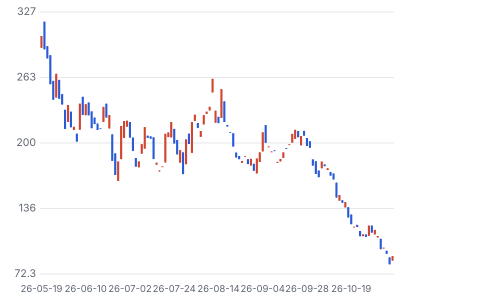

**주봉**

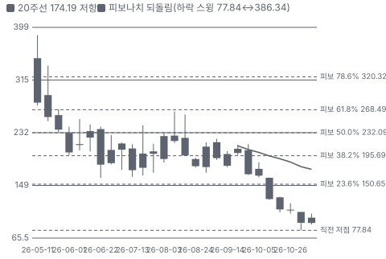

**월봉**

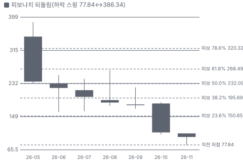

**분기 매출·EPS 실적과 컨센서스**

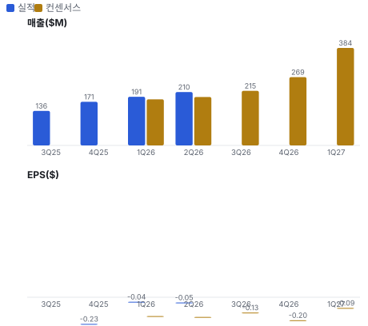

**EPS 리비전**

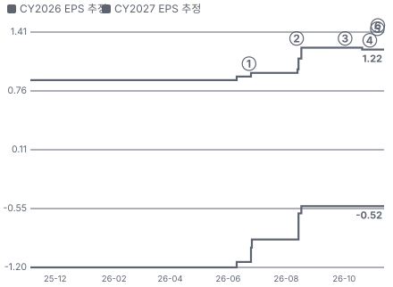

① 26-06-23 1Q26 첫 실적 · EPS 리비전 +5%
② 26-08-12 2Q26 실적, FY26 상향 · EPS 리비전 +29%
③ 26-10-02 최고속 등급 NVIDIA 이전 보도 · EPS 리비전 +0%
④ 26-10-28 Culper 숏 공개 · EPS 리비전 +0%
⑤ 26-11-05 회사, 웨이퍼 수명 숏 반박 · EPS 리비전 +0%

**밸류에이션 주가 시나리오**

**주가별 업사이드**

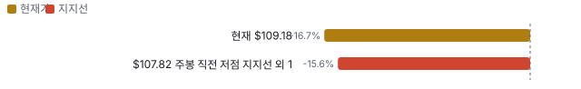

**제품·서비스 포트폴리오**

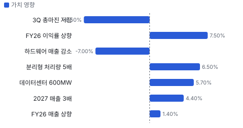

**고객 믹스(2Q26, 매출 대비)**

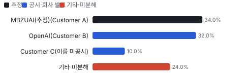

**공급 병목(10점, 낮을수록 병목)**

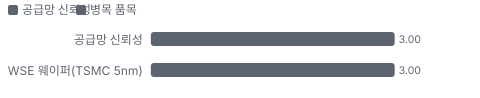

**CAPEX의 매출 대비 비중**

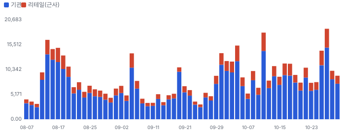

**어닝콜 변화별 주주가치 영향**

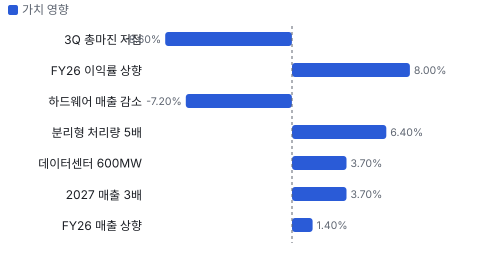

**멀티플 프리미엄(현재값 — 최근 4개 분기 추이 재료 없음)**

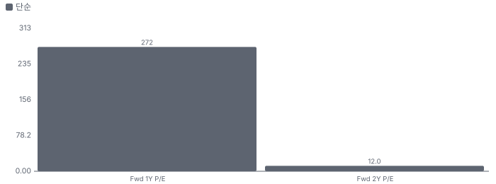

**합리적 멀티플**

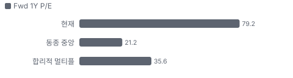

**일별 거래량 분해**

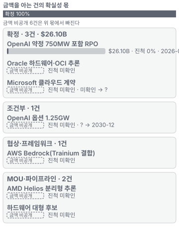

**기관 자금 흐름**

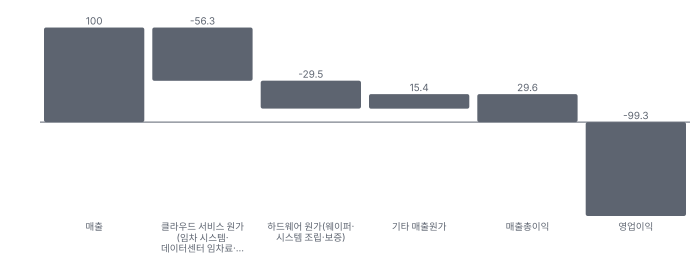

**몬테카를로**

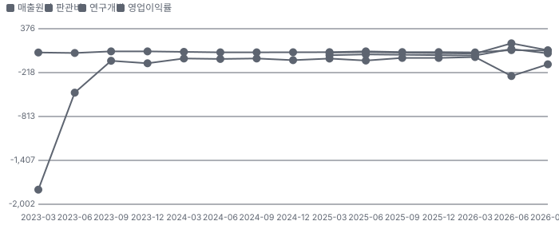

해석: 3,000번 중 467번(16%)에서 가치가 지금 주가 이상이었다. 가정을 흔들어도 지금 주가를 뒷받침하지 못하는 경우가 더 많다. 가운데 값은 0.48배이고, 열 번 중 여덟 번은 0.19~1.17배 사이에 든다.

**규모·마진·진척도**

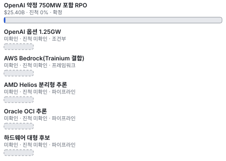

**매출 → 매출총이익 → 영업이익(매출 = 100, 최근 4분기)**

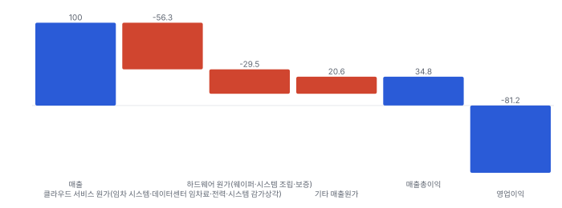

**1년 전 대비 마진 기여(비용 비중 변화의 반대)**

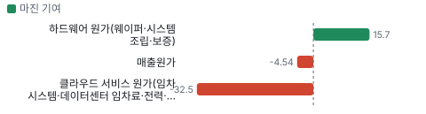

**분기 비용 비중 추이(매출 대비, 공시)**

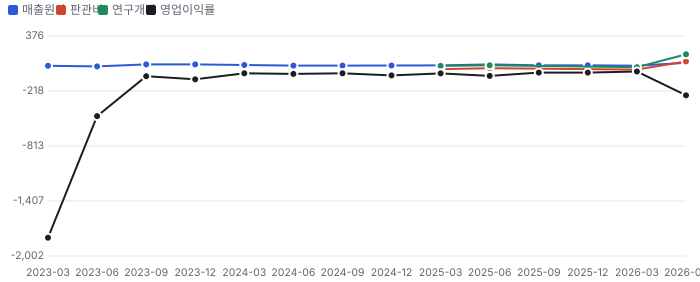

**매출 100의 쓰임(최근 4개 분기)**

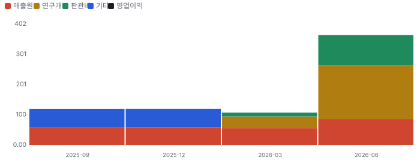

**비용 요인별 매출 대비 비중과 1년 변화**

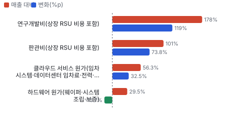

**BOM 항목 가격 +10% 시 OPM 변화**

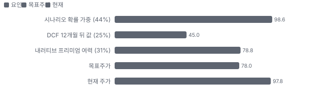

**추론 클라우드 BOM 원가 몫과 가격 +10% 시 OPM**

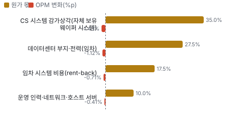

**CS-3·CS-4 시스템 BOM 원가 몫과 가격 +10% 시 OPM**

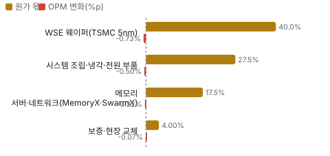

**매출 증가율의 가격·물량 분해와 AR(2) 투영(전년 대비)**

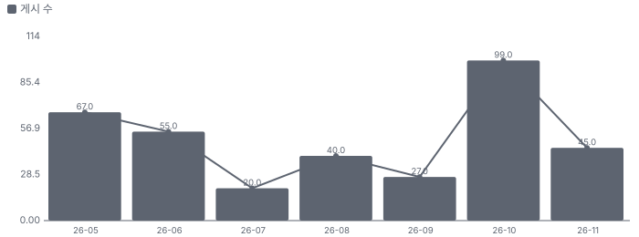

**분기별 매출 증가율 분해**

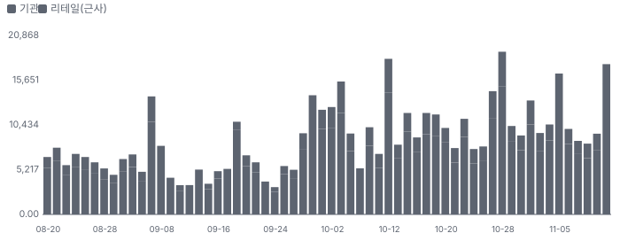

**목표주가 산정 — 약세와 기본 사이(약세 쪽 21%), 도달 확률 약 55%**

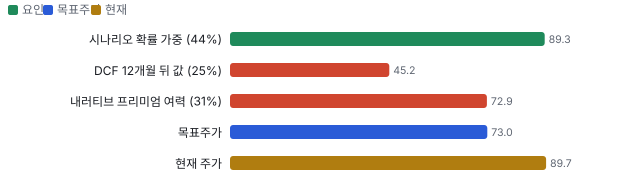

**커뮤니티 언급 수(최근 30일, 채널별)**

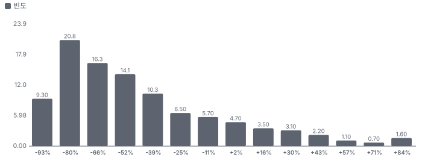

**커뮤니티 게시 수(월, 최근 7개월)**

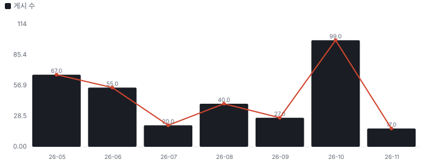

## 내러티브

> **기업가치를 결정하는 이야기:** 주가는 2028년 EPS × 멀티플이다. EPS는 RPO \$25.4B가 일정대로 데이터센터에 깔리는지, 임차 시스템이 빠지며 총마진이 60%로 가는지가 정한다. 멀티플은 '대체 불가능한 속도'인지 '또 하나의 가속기 임대업'인지가 정한다.

> **멀티플·EPS 프리미엄**
> **멀티플:** Fwd 1Y(2027년) P/E 72.6배는 동종 중앙값 21.2배의 3배가 넘는다. Fwd 2Y(2028년)는 14.6배로 동종 Fwd 2Y 중앙값 약 14배와 같다(11/6 주가 기준). 시장은 2028년 숫자에 프리미엄을 주지 않는다.
> **EPS:** 2026년 1·2Q 모두 매출·EPS가 컨센서스를 넘었다. FY27 EPS는 8/11 \$0.96에서 \$1.235로 올랐다. 다만 추정 대부분이 8월에 고정돼 있고 애널리스트가 2~4명이다.

### 투자자들은 왜 열광했나

OpenAI \$20B 이상 계약, 상장 첫날 +68%, GPU(그래픽 처리 장치, AI 연산 주력 칩) 대비 15배라는 숫자가 겹쳤다. 희소한 비 NVIDIA 추론 종목이었다. 식은 이유는 세 가지다. 실적마다 마진 가이던스가 실망을 줬고(첫 실적 다음 날 −19.6%, 둘째 −11.8%), 8/19부터 2주마다 락업 물량이 풀렸고, 9/30~10/2 OpenAI의 최고속 등급이 NVIDIA로 갔다는 보도가 결정타였다.

### 무엇이 기업가치를 바꾸나

> **구조적 체질 변화**
> **변화:** 하드웨어 판매에서 클라우드로 옮겼다. 코어 클라우드 비중은 2Q 61%다. 대신 자본 집약적이 됐다
> **증거:** 1H 설비투자 \$549M > GAAP 매출 \$374M
> **반증:** 설비투자 ÷ 매출이 2027년에도 1배를 넘는다

> **고부가 믹스 확장**
> **변화:** 빠른 토큰에 프리미엄이 붙는다는 주장이다. 코어 총마진 목표 60% 이상. 지금은 임차 시스템으로 2Q 40.6%, 3Q 38~40%다
> **증거:** 2Q 콜
> **반증:** 4Q 코어 총마진이 반등하지 않는다

> **기술 혁신**
> **변화:** CS-4(Cerebras 4세대 시스템, 웨이퍼 3장)는 같은 WSE-3(Cerebras 3세대 웨이퍼 칩) 실리콘을 클럭을 올려 3장 묶었다. 새 공정이 아니다. CS-5(Cerebras 차기 시스템)는 2027 하반기 목표다
> **증거:** 회사 보도자료, 2Q 콜
> **반증:** CS-5 지연 또는 NVIDIA SRAM(칩 안의 고속 메모리) 계열 추론 칩의 독립 측정 우위

> **실행 속도**
> **변화:** 회사가 공개한 납품 지표는 OpenAI 계약에서 첫 생산 투입까지 35일이다. 시범 규모이지 전체 납기가 아니다. 750MW 납기는 공개되지 않았고 동종 비교는 불가능하다 **납품 리드타임 35일.** 피어 비교 미확인. 이전 대비 미확인.
> **증거:** 1Q 콜
> **반증:** 미네소타 40MW가 2027년 2분기를 넘긴다

> **M&A**
> **변화:** 해당 없음(큰 인수가 없다. 자금은 데이터센터와 시스템에 쓴다)
> **증거:** 10-Q
> **반증:** 대형 인수 발표

> **정책·입법 연관성**
> **재정정책:** OBBBA(2025년 7월 제정 재정조정법) 설비 즉시 상각은 자체 보유 설비가 많은 이 회사에 현금세 이연 효과가 있다. 지금은 적자라 당장 효과는 작다 2025년 7월 제정 법률 반증: 법 개정 의회 동의 10/10 — 하원 5/5(OBBBA 본회의 통과) · 상원 5/5(OBBBA 본회의 통과).
> **행정명령:** 수출 통제가 UAE(아랍에미리트) 고객 매출을 좌우한다. 10-Q는 수출 허가를 보장하지 못한다고 적었다. 2026-01-14 Section 232(미국 무역확장법 안보 관세 조항) 포고문은 미국 내 100MW 초과 데이터센터 용도를 면제한다. 재검토 결과는 미확인이다 10-Q 위험 요인, 포고문 해설 반증: UAE 허가 지연이나 면제 축소 의회 동의 2/10 — 하원 1/5(이 조치를 입법한 법안 확인 안 됨) · 상원 1/5(이 조치를 입법한 법안 확인 안 됨).
> **연관입법:** 해당 없음(회사 매출에 직접 닿는 입법을 확인하지 못했다. GAIN AI Act(미국 AI 칩 수출 제한 법안)·Chip Security Act(미국 칩 위치 확인 법안) 진행은 미확인)

> **CAPEX 낙수효과**
> **변화:** AI 데이터센터 투자의 수혜지만 공급사보다 임대 사업자 위치에 가깝다. 고객 투자 → 이 회사 매출은 RPO 안의 OpenAI만 확인된다
> **증거:** 10-Q Note 3
> **반증:** AWS 물량이 RPO에 잡히지 않는다

### 내러티브 근거

> '가장 빠른 추론은 Cerebras뿐' 이야기가 상장 프리미엄을 만들었고, 10월에 최대 고객의 선택과 공개 숏이 그 이야기를 흔들었다. EPS 추정은 그대로인데 주가는 8/11 이후 −62%다. 11/5 회사가 웨이퍼 수명 숏을 자체 수치로 반박했다. 동종 대비 멀티플 차이 +242% 중 회사 고유 몫은 +115%다. 단계는 소멸, 쏠림은 낮음이다.

> **가장 빠른 추론(웨이퍼 스케일)** · 약화
> **논리:** 웨이퍼 한 장 칩의 메모리 대역폭으로 추론 토큰 속도에서 GPU보다 빠르다는 이야기
> **숫자:** Fwd 1Y P/E 72.6배, 2Y 14.6배(11/6)
> **반증:** OpenAI 최신 모델 최고속 등급이 Cerebras로 돌아온다는 확인이면 이 약화가 풀린다

> **OpenAI 대형 계약** · 유지
> **논리:** 750MW 약정·최대 2GW 옵션으로 매출이 관계사(G42(UAE AI 지주회사)) 의존에서 벗어난다
> **숫자:** RPO \$25.4B, 완전 희석 EV 약 \$20.9B의 약 1.2배
> **반증:** RPO 감소 또는 납기 지연 공시

> **웨이퍼 수명·교체 CAPEX(약세)** · 유지
> **논리:** 상시 고온 운용으로 수명이 짧아 계약 손익분기를 못 넘는다
> **숫자:** 손익분기 수명 2.1~4.2년(공개 숏 입력 기준) vs 회사 공개 CS-3 퇴역 0.5% 미만
> **반증:** 10-Q 내용연수 유지·손상 없음(11/12)

> **Oracle OCI(Oracle 클라우드 인프라) 제휴(고객 다변화)** · 태동
> **논리:** Oracle 클라우드에서 Cerebras 추론을 제공 — 관계사·OpenAI 의존에서 벗어나는 첫 대형 채널
> **숫자:** 계약 규모 미공개(미확인)
> **반증:** OCI 매출 기여가 4Q26·1Q27 공시에 안 보임

> **OpenAI 최고속 등급 이전(약세)** · 강화
> **논리:** 가장 빠른 등급이 NVIDIA로 갔다면 속도 독점 이야기가 깨진다
> **숫자:** 9/25~10/2 −19.5%, 8/11 이후 주가 −62%, FY27 EPS 추정 +29%
> **반증:** OpenAI가 Cerebras 물량 확대를 공시하거나 RPO가 늘어난다

## 포트폴리오

| 제품·서비스 | 구분 | 무엇 | 쓰는 곳 | 돈 버는 방식 | Mix | Mix 변화(전년 대비) |
|---|---|---|---|---|---|---|
| 추론 클라우드 | 서비스 | 자체 시스템을 임차 데이터센터에 깔아 토큰을 판다 | OpenAI, 코딩·에이전트 스타트업, 기업 | 2Q 코어 \$127.7M, +287%. 코어 마진 41.8% | 70% | +38.0%p |
| CS-3·CS-4 시스템 | 제품 | 웨이퍼 칩 기반 랙 시스템을 고객 시설에 판매 | G42·MBZUAI, 연구소, 정부 | 2Q 코어 \$82.1M, +17%. 코어 마진 38.8% | 30% | -38.0%p |
| WSE 웨이퍼 스케일 엔진 | 기술 | 웨이퍼 전체를 한 칩으로 쓰고 SRAM을 칩 안에 둔다. TSMC 5nm | 디코드(토큰 생성) 구간 | 시스템 원가 미공개 | 미확인 | 미확인 |
| 분리형 추론 | 기술 | 프리필은 GPU·Trainium, 디코드는 WSE가 맡는 구성 | AWS, AMD Helios(AMD 랙 단위 AI 플랫폼) | 매출 미확인, 회사는 토큰 5배 주장 | 미확인 | 미확인 |

**Mix 변화가 가장 큰 쪽은 CS-3·CS-4 시스템(-38.0%p, 전년 대비).** 계절성 판정: 분기 매출 계절 지수 기준 있음 → 전년 같은 분기와 비교.

## 고객

> **2Q26 최대 고객 MBZUAI(추정)(Customer A) 34%, 상위 3곳 76%, 집중도 보통.** 공시·회사 발표로 확인한 몫은 매출의 42%이고, 나머지 고객 몫은 추정이거나 미분해다. 2Q 매출의 76%가 세 고객이다. OpenAI가 32%로 1Q 11%에서 올라왔고 Customer A는 34%(1Q 63%, 1년 전 70%)로 내려왔다. 10-Q는 2025년 매출 대다수가 UAE 본사 고객이라고 적었다

**고객별 매출 몫(2Q26)**
| 고객 | 몫 | 변화 | 근거 |
|---|---|---|---|
| MBZUAI(추정)(Customer A) | 34% | -36%p | 추정 |
| OpenAI(Customer B) | 32% | 미확인 | 공시 |
| Customer C(이름 미공시) | 10% | 미확인 | 공시 |
| G42(추정)(Customer D) | 미확인 | 미확인 | 추정 |
| 기타·미분해 | 24% | - | - |

> **MBZUAI(추정)(Customer A)** · 추정
> **사는 것:** CS 시스템·클라우드(UAE 연구·정부)
> **추정 근거:** 공시 표기는 Customer A다. UAE 본사 고객이라는 10-Q 서술과 이전 회차 대조로 MBZUAI로 본 가설

> **OpenAI(Customer B)** · 공시
> **사는 것:** 추론 클라우드 용량(750MW 약정)
> **추정 근거:** 2Q25에는 10% 미만이라 공시되지 않았다

> **Customer C(이름 미공시)** · 공시
> **사는 것:** 미확인
> **추정 근거:** 이름 미공시

> **G42(추정)(Customer D)** · 추정
> **사는 것:** CS 시스템
> **추정 근거:** 공시 표기는 Customer D. 2Q26 단일 분기 몫은 10% 미만이라 미공시

## 수주·파이프라인

> **2026-06-30 기준 6건.** 확정 \$25.40B. 공시 잔여 이행의무(RPO) \$25.40B. 서로 겹치는 항목은 합계에서 뺐다.

**실행 속도와 방해 요인**
| 항목 | 상태 | 실행 속도 | 방해 요인 |
|---|---|---|---|
| OpenAI 약정 750MW 포함 RPO | 확정 | RPO의 22%가 2028년 6월까지, 43%가 그다음 24개월, 나머지는 그 뒤 | 데이터센터 준공 · 웨이퍼 수명 · OpenAI 작업 배정 |
| OpenAI 옵션 1.25GW | 조건부 | 2030년 말까지 분할 행사, 합계 최대 2.0GW | OpenAI 행사 결정 · 모델별 칩 선택 |
| AWS Bedrock(Trainium 결합) | 프레임워크 | 2027년 1분기 제공 목표. RPO에 없고 워런트 270만 주는 지급액 조건 | AWS 데이터센터 배치 · 수요 불확실 |
| AMD Helios 분리형 추론 | 파이프라인 | 4Q 배치 목표, 회사는 구매자가 있다고 말했다 | Helios 일정 · 실제 처리량 5배 입증 |
| Oracle OCI 추론 | 파이프라인 | 2027년 제공 계획, 금액 미공개 | 배치 방식 미공개 |
| 하드웨어 대형 후보 | 파이프라인 | 회사는 후기 단계 수억 달러 규모라고 말했다 | 고객 데이터센터 일정 |

## 마진 구조

> **GPM 14.2%, OPM -265.0%.** 2Q25 대비 GPM -16.9%p, OPM -209.6%p. 2Q26 GAAP 매출원가는 매출의 85.8%로 1년 전 68.9%보다 16.9%p 올랐다. 클라우드 원가(임차 시스템·데이터센터·감가상각)가 23.8%에서 56.3%로 커진 몫이 크다. 연구개발비·판관비는 상장 때 RSU 비용 약 \$377M이 잡혀 매출의 2.8배다 — 일회성 몫이 커서 영업이익률 −265%는 정상 수준이 아니다

> **매출 100 중 매출원가 65.2, 매출총이익 34.8(최근 4분기, 공시).** 매출원가 요인 중 클라우드 서비스 원가(임차 시스템·데이터센터 임차료·전력·시스템 감가상각)이 매출의 56.3%로 가장 무겁고, 단가가 +10% 오르면 GPM이 -5.63%p 움직인다. 분기 회귀로 매출 1이 늘 때 매출원가는 0.66 늘고, 매출원가의 고정비 몫은 -5%다.

**비용 요인 강도 — 비중·추세·충격(+10%)·탄력**
| 비용 | 구분 | 매출 대비 | 1년 변화 | 마진 기여 | 충격 시 마진 | 매출 탄력 | 고정비 몫 |
|---|---|---|---|---|---|---|---|
| 클라우드 서비스 원가(임차 시스템·데이터센터 임차료·전력·시스템 감가상각) | 매출원가 요인 | 56.3% | +32.5%p | -32.5%p | -5.63%p | 미확인 | 미확인 |
| 하드웨어 원가(웨이퍼·시스템 조립·보증) | 매출원가 요인 | 29.5% | -15.7%p | +15.7%p | -2.95%p | 미확인 | 미확인 |
| 매출원가 | 공시 항목 | 65.2% | +4.5%p | -4.5%p | -6.52%p | 0.66 | -5% |

매출 탄력 = 분기 비용을 매출에 회귀한 기울기(매출 1당 변동비), 고정비 몫 = 절편 ÷ 평균 비용. 표본이 8분기 미만이면 미확인. 매출원가 요인 비중은 margin 재료의 추정이 섞여 있고, 공시 매출원가와의 차이는 '기타 매출원가'로 둔다.

**GPM에서 OPM까지(GAAP)**
| 기간 | GPM | 연구개발 | 판관비 | 기타 | OPM |
|---|---|---|---|---|---|
| 2Q25 | 31.1% | 58.9% | 27.6% | 0.0% | -55.4% |
| 2Q26 | 14.2% | 177.8% | 101.4% | 0.0% | -265.0% |

**GPM·OPM 최근 4개 분기**
| 분기 | GPM | OPM |
|---|---|---|
| 2025-09 | 40.6% | -19.5% |
| 2025-12 | 41.0% | -19.7% |
| 2026-03 | 44.6% | -7.8% |
| 2026-06 | 14.2% | -265.0% |

**마진을 결정하는 비용 요인 — 비용 +10% 시 OPM**
| 비용 | 매출 대비 | 변화 | 고정비 | OPM |
|---|---|---|---|---|
| 연구개발비(상장 RSU 비용 포함) | 177.8% | +118.9%p | 85% | -17.78%p |
| 판관비(상장 RSU 비용 포함) | 101.4% | +73.8%p | 80% | -10.14%p |
| 클라우드 서비스 원가(임차 시스템·데이터센터 임차료·전력·시스템 감가상각) | 56.3% | +32.5%p | 미확인 | -5.63%p |
| 하드웨어 원가(웨이퍼·시스템 조립·보증) | 29.5% | -15.7%p | 미확인 | -2.95%p |

**비용을 움직이는 요인**
| 비용 | 요인 |
|---|---|
| 연구개발비(상장 RSU 비용 포함)(연구개발) | CS-4·CS-5 개발 인력, 2Q 상장 시점 RSU 일괄 인식 · 근거 공시 |
| 판관비(상장 RSU 비용 포함)(판관비) | 상장 회사 비용·영업 인력, 2Q RSU 일괄 인식 · 근거 공시 |
| 클라우드 서비스 원가(임차 시스템·데이터센터 임차료·전력·시스템 감가상각)(매출원가) | 클라우드 비중 확대, 임차 시스템(rent-back) 부담 약 5%p(2Q 콜), 데이터센터 리스 개시 · 근거 공시 |
| 하드웨어 원가(웨이퍼·시스템 조립·보증)(매출원가) | 하드웨어 매출 감소, 고객 워런트 상각이 GAAP 하드웨어 매출을 깎는다 · 근거 공시 |

**추론 클라우드 BOM — 매출의 70%, GPM 42%(코어 클라우드 총마진 41.8%(2Q 콜, 회사 조정 기준). GAAP은 19.5%(\$24.6M/\$126.0M) — SBC·워런트 상각 차이. rev_share는 GAAP 2Q 클라우드 ÷ 총매출(코어 기준 61%)), 항목 가격 +10% 시**
| 항목 | 원가 몫 | 전가 | 제품 GPM | OPM |
|---|---|---|---|---|
| CS 시스템 감가상각(자체 보유 웨이퍼 시스템) | 25~45% | 미확인 | -2.0%p | -1.43%p |
| 데이터센터 부지·전력(임차) | 20~35% | 미확인 | -1.6%p | -1.12%p |
| 임차 시스템 비용(rent-back) | 10~25% | 미확인 | -1.0%p | -0.71%p |
| 운영 인력·네트워크·호스트 서버 | 5~15% | 미확인 | -0.6%p | -0.41%p |
| 미분해 | 10% | - | - | - |

**CS-3·CS-4 시스템 BOM — 매출의 30%, GPM 39%(코어 하드웨어 총마진 38.8%(2Q 콜). GAAP은 1.8%(\$1.0M/\$54.1M) — 워런트 상각·SBC 차이), 항목 가격 +10% 시**
| 항목 | 원가 몫 | 전가 | 제품 GPM | OPM |
|---|---|---|---|---|
| WSE 웨이퍼(TSMC 5nm) | 30~50% | 미확인 | -2.4%p | -0.73%p |
| 시스템 조립·냉각·전원 부품 | 20~35% | 미확인 | -1.7%p | -0.50%p |
| 메모리 서버·네트워크(MemoryX·SwarmX) | 10~25% | 미확인 | -1.1%p | -0.32%p |
| 보증·현장 교체 | 2~6% | 미확인 | -0.2%p | -0.07%p |
| 미분해 | 11% | - | - | - |

판매가 전가를 모르는 항목은 전가 0%로 계산했다.

**BOM 항목 가격을 움직이는 것**
| 항목 | 요인 |
|---|---|
| CS 시스템 감가상각(자체 보유 웨이퍼 시스템) | 내용연수 3~5년 가정이 몫을 정한다. 공개 숏의 수명 논쟁이 바로 이 항목이다 · 근거 추정 |
| 데이터센터 부지·전력(임차) | MW당 임차료와 전력 단가, 가동률 · 근거 추정 |
| 임차 시스템 비용(rent-back) | 자체 데이터센터가 서기 전까지 남의 시설·시스템을 빌려 쓴다 · 근거 추정 |
| 운영 인력·네트워크·호스트 서버 | 클러스터 운영과 프리필용 서버 · 근거 추정 |
| WSE 웨이퍼(TSMC 5nm) | TSMC 5nm 웨이퍼 가격과 웨이퍼 단위 수율 보정(여분 코어) 비용 · 근거 추정 |
| 시스템 조립·냉각·전원 부품 | 웨이퍼 한 장에 kW급 전력을 넣고 빼는 맞춤 부품 · 근거 추정 |
| 메모리 서버·네트워크(MemoryX·SwarmX) | 외부 가중치 저장용 서버의 DRAM(D램 메모리)·플래시 가격 · 근거 추정 |
| 보증·현장 교체 | 웨이퍼 교체가 잦으면 커진다(공개 숏 논점) · 근거 추정 |

**BOM 투입 물가 — PPI 전년비, 2026-11-07 수집**
| 항목 | 미국 | 일본 | 한국 | 대만 |
|---|---|---|---|---|
| 운영 인력·네트워크·호스트 서버 | +3.0% | 미확인 | 미확인 | +57.2%* |
| WSE 웨이퍼(TSMC 5nm) | -2.2% | +3.9% | -24.2%* | +22.9%* |
| 메모리 서버·네트워크(MemoryX·SwarmX) | -2.2%* | +3.9%* | -24.2% | +22.9%* |

별표는 품목보다 넓은 업종 지수다. 지난 1년 투입 물가를 판매가 전가 뒤 원가에 그대로 넣으면 OPM은 +0.59%p 움직인다(매출원가의 17% 기준).

## 공급망 병목

> **공급망 신뢰성 3.0/10, 병목 심각.** 가장 약한 고리는 WSE 웨이퍼(TSMC 5nm) 3.0점이고, 품목 평균은 3.0점이다. 근거가 부족한 3건(시스템 조립·냉각·전원 부품 · 데이터센터 부지·전력(임차) · 메모리 서버·네트워크(MemoryX·SwarmX))은 점수에서 뺐다. 병목은 웨이퍼가 아니라 데이터센터 공간이다. CEO가 2Q 콜에서 업계 전체의 병목이라고 말했다. 웨이퍼는 TSMC 단일 공급이지만 5nm는 3nm·CoWoS(TSMC 첨단 패키징)·HBM(GPU 옆에 쌓는 고대역폭 메모리) 병목 밖이다. 10-Q는 부품·제조 대부분을 생산 능력 보장 없는 발주로 산다고 적었다 — 물량을 묶어 두지 않았다

**병목과 마진 — 품목 가격 +10% 시 OPM**
| 품목 | 점수 | 판정 | 구분 | OPM |
|---|---|---|---|---|
| WSE 웨이퍼(TSMC 5nm)(필수) | 3.0 | 병목 심각 | 핵심 통제 품목 | -0.73%p |

> **WSE 웨이퍼(TSMC 5nm)** · 3.0/10
> **왜:** 웨이퍼 한 장이 칩이라 다른 파운드리로 옮기려면 설계부터 다시 해야 한다(재인증 24개월은 추정). 1년 초과 구매 약정은 \$10.3M뿐이다
> **병목 요인:** 인증 공급사 1곳 · 캐파 균형 · 리드타임 미확인 · 재인증 24개월 · 1위 점유율 90% · 대만 집중 100% · 물량 확보 현물
> **풀리는 조건:** 미확인 — 2026년 말 10배는 회사 발언이고 장비·물량 배정 확인 전이다

**공급사**
| 품목 | 공급사 | 몫 | 근거 |
|---|---|---|---|
| WSE 웨이퍼(TSMC 5nm) | TSMC(WSE-3 웨이퍼 제조(5nm)) | 미확인 | 공시 |
| 시스템 조립·냉각·전원 부품 | 위탁 조립사(이름 원문 미대조)(시스템 조립) | 미확인 | 추정 |
| 데이터센터 부지·전력(임차) | Zone Frontier(미네소타 40MW 캠퍼스(1Q27 매출 개시, 2Q27 전량)) | 미확인 | 회사 발표 |
| 데이터센터 부지·전력(임차) | 그 밖의 임대 사업자(미공시)(코로케이션·임차 시스템) | 미확인 | 공시 |
| 메모리 서버·네트워크(MemoryX·SwarmX) | 외부 서버·메모리 공급사(미공시)(가중치 저장 서버) | 미확인 | 추정 |

**무역 통계로 본 공급 지역**
| 품목 | EU 수입처 | 일본 수입처 | EU 1위 전년비 |
|---|---|---|---|
| WSE 웨이퍼(TSMC 5nm) | TW(대만) 32% · MY(말레이시아) 19% · CN(중국) 15% | 台湾 60% · 中華人民共和国 8% | +136.5% |
| 메모리 서버·네트워크(MemoryX·SwarmX) | TW 45% · KR(한국) 21% · CN 16% | 台湾 52% · 大韓民国 28% | +365.5% |

## 생산능력

> **현재 명목 캐파 미확인, 가동률 미확인.** 착공 이상 증설은 0 MW(데이터센터 전산 부하 용량), 발표까지 합치면 640 MW(데이터센터 전산 부하 용량)이다. TTM 2Q26 CAPEX는 \$0.75B로 매출의 109.7%다. 회사는 지금 가동 중인 MW를 밝히지 않는다. 2027년 말까지 쓸 600MW 이상을 확보했다고 했고(2Q 콜), OpenAI 약정은 750MW다. CAPEX는 FY2024 매출의 8%에서 FY2025 75%, TTM 2Q26 110%로 매출보다 커졌다

**생산능력 확충 계획**
| 계획 | 단계 | 증설 | 가동 시점 | CAPEX |
|---|---|---|---|---|
| 확보 데이터센터(2027년 말까지 600MW+) | 발표 | 600 MW(데이터센터 전산 부하 용량) | 2027-12 | 미확인 |
| 미네소타 Zone Frontier 캠퍼스 | 발표 | 40 MW(데이터센터 전산 부하 용량) | 2027-03 | 미확인 |

남은 계획의 CAPEX 합계는 \$0.00B(금액 미확인 2건 제외)다. 합계는 TTM 2Q26 매출의 0%다.

**증설 방해 요인**
| 계획 | 방해 요인 |
|---|---|
| 확보 데이터센터(2027년 말까지 600MW+) | 부지 준공·전력 연결·시스템 생산 |
| 미네소타 Zone Frontier 캠퍼스 | 준공·전력 |

**CAPEX와 매출 대비**
| 기간 | CAPEX | 매출 | 매출 대비 | 구분 |
|---|---|---|---|---|
| FY2023 | \$0.01B | \$0.08B | 8.4% | 실적 |
| FY2024 | \$0.02B | \$0.29B | 8.1% | 실적 |
| FY2025 | \$0.38B | \$0.51B | 75.0% | 실적 |
| TTM 2Q26 | \$0.75B | \$0.68B | 109.7% | 실적 |

## 해자

> 해자는 칩 자체보다 '속도 + 공급망 우회 + 계약'의 묶음이다. 속도 해자가 가장 중요한데 최대 고객의 선택이 그것을 시험하고 있다.

> **웨이퍼 스케일 SRAM 구조의 디코드 속도** · 보통
> **해자:** 칩 안의 SRAM이 메모리 대역폭 병목을 없애 토큰 생성이 GPU보다 빠르다. 회사는 GPU 대비 15배, GPT-5.6 Sol(OpenAI 대형 모델) 10배를 주장한다.
> **근거:** OpenAI가 8월 GPT-5.6 Sol Ultrafast(OpenAI 모델의 최고속 서비스 등급)를 Cerebras로 서빙했다는 보도가 있다. 그러나 10월 GPT-6.1 Sol(OpenAI 최신 대형 모델) Ultrafast는 NVIDIA GPU로 간다는 보도가 나왔다. OpenAI·회사의 확인이나 부인은 찾지 못했다.
> **숫자:** CS-4 메모리 대역폭 129.6PB/s, CS-3의 6배(회사 수치)
> **깨지는 조건:** NVIDIA가 같은 모델을 같은 속도로 낸다는 독립 측정 또는 OpenAI의 물량 축소

> **HBM·CoWoS·3nm를 쓰지 않는 공급망** · 보통
> **해자:** 업계 공통 병목을 비켜 가 5nm 웨이퍼만 확보하면 늘릴 수 있다.
> **근거:** 2Q 콜에서 2026년 말 제조 능력 10배 초과, 2027년 추가 3~4배 계약을 말했다. 그러나 10-Q는 부품·제조 대부분이 생산 능력 보장 없는 발주 방식이고 단일 공급원이 있다고 적었다.
> **숫자:** 1년 초과 구매 약정 \$10.3M뿐
> **깨지는 조건:** TSMC 5nm 배정 축소나 Flex(미국 전자제품 위탁 생산사)·Sanmina(미국 전자제품 위탁 생산사) 조립 지연

> **OpenAI 계약과 지분 결속** · 보통
> **해자:** 750MW 약정, \$1.0B 운전자금 대출, 3,345만 주 워런트가 양쪽을 묶는다.
> **근거:** RPO \$25.4B. 다만 10-Q상 기간은 3~4년, 최대 5년이고 대부분이 한 고객이다. 약정은 용량 구매이지 특정 모델 전담이 아니다.
> **숫자:** 워런트 중 1,003만 주를 7월 행사
> **깨지는 조건:** 납기 지연으로 계약 해지 조항 발동이나 잔고 감소

> **프런티어 모델 서빙 소프트웨어** · 약함
> **해자:** 비공개 대형 모델을 서빙하며 쌓은 운영 역량이다. 회사는 계약 뒤 35일 만에 생산 투입했다고 말한다.
> **근거:** 회사 주장 중심이다. GPU의 소프트웨어 생태계와 비교한 독립 자료는 확인하지 못했다.
> **숫자:** 미확인
> **깨지는 조건:** 새 모델 서빙이 GPU보다 몇 달씩 늦는다

> **데이터센터 확보 속도** · 약함
> **해자:** 추론은 GW(기가와트)급 단일 부지가 필요 없어 작은 부지를 빨리 모을 수 있다.
> **근거:** 모두 임차다. 고정 리스 \$690M에 미개시 \$1.5B, 3Q 추가 \$753M. 경쟁사도 같은 시장에서 부지를 찾는다.
> **숫자:** 확보 600MW+ vs 약정 750MW·옵션 합계 2.0GW
> **깨지는 조건:** 미네소타 40MW 등 개별 부지가 2027년 일정을 놓친다

## 경영진·네트워크

> 창업자 경영 회사다. Feldman이 회장·CEO이고 공동 창업자 Lie가 CTO다. 벤처 이사들이 초기부터 이사회에 있다. 연결이 매출을 만들었다는 증거는 없다.

> **Andrew D. Feldman** · 공동 창업자·회장·CEO · 2016-04
> **프로필:** 56세. Stanford MBA(경영학 석사)·BA(학사). SeaMicro(AMD가 인수한 서버 회사) CEO(2007~12), AMD 인수 뒤 AMD 부사장. Riverstone Networks(미국 네트워크 장비 회사) 재직 건으로 2007년 12월 회계 통제 회피 1건 유죄 인정, 2008년 SEC(미국 증권거래위원회)와 합의. 투자설명서에 공시된 사실이다
> **비즈니스:** SeaMicro·AMD 인맥이 초기 팀의 뿌리다. AMD는 지금 Helios 결합 파트너다
> **정계:** 미확인
> **동문:** Stanford
> **사모임:** 미확인

> **Sean Lie** · 공동 창업자·CTO · 2016(CTO 2022-04)
> **프로필:** AMD 데이터센터 서버 수석 아키텍트, SeaMicro IO(입출력) 패브릭 리드. 10/27 60,000주 약 \$6.9M 장내 매도
> **비즈니스:** AMD·SeaMicro 경력
> **정계:** 미확인
> **동문:** 미확인
> **사모임:** 미확인

> **Eric Vishria** · 선임 사외이사, Benchmark 파트너 · 2016-05
> **프로필:** 초기 투자자 측 이사. 감사위원
> **비즈니스:** Benchmark(미국 벤처캐피털) 포트폴리오
> **정계:** 미확인
> **동문:** 미확인
> **사모임:** 미확인

**네트워크 정량화**
| 연결 | 강도 | 닿는 매출 | 가중 노출 | 매출 대비 | 근거 |
|---|---|---|---|---|---|
| 비즈니스: AMD 경력 인맥과 AMD Helios 결합. 금액 미공개이고 인맥이 제휴를 만들었다는 증거는 없다 | 2/5 | 미확인 | 미확인 | 미확인 | 금액 미공개 424B4, 2Q 콜 |
| 비즈니스: OpenAI 지분 결속. 워런트 3,345만 주와 대출 \$1.0B는 문서로 확인되는 계약 연결이다 | 5/5 | \$0.23B | \$0.23B | 33% | OpenAI 2Q 매출 \$56.8M 연환산 10-Q Note 3·12 |
| 정계: UAE 고객(G42·MBZUAI)의 미국 수출 허가 의존. 경영진의 정치적 연결은 공개 기록으로 확인하지 못했다 | 1/5 | \$0.18B | \$0.04B | 5% | MBZUAI 1H 비중 49% × 1H GAAP 매출 \$0.37B 10-Q 위험 요인 |

가중 노출은 연결이 닿는 매출의 크기다. 연결이 그 매출을 만들었다는 뜻이 아니며, 인과는 공개 자료로 입증하지 못한다.

## 약세 논리 및 셀온 조건

| 논리 | 근거 | 반박 | 가를 자료 |
|---|---|---|---|
| (약세) 최대 고객이 속도 해자를 부정했다 | GPT-6.1 Sol 최고속 등급의 NVIDIA 서빙 보도. 8월 GPT-5.6 Sol에서는 Cerebras였다는 보도가 있다 | 원 보도를 직접 확인하지 못했고 회사·OpenAI의 확인도 없다. 첫 배치만 그럴 수 있고 RPO 변화 공시는 없다 | 3Q 콜 답변, RPO |
| (약세) 웨이퍼 수명이 계약 손익분기보다 짧다 | 공개 숏은 1.5~2.5년을 주장한다. 손익분기는 그들 입력으로 2.1~4.2년이다. 내용연수가 1.5~3년에서 3~5년으로 바뀐 것은 서류 사실이다 | 회사는 11/5 CS-3 웨이퍼 퇴역 0.5% 미만, TSMC 105°C 10년 인증을 공개했다. 1H 보증 충당 증가도 작다. 다만 회사 자체 수치이고 배치 대수·자체 클라우드 교체 수가 없다 | 3Q 10-Q 유형자산 처분·손상, 교체 설비투자 — 11/12 전후 |
| (약세) 코어 매출이 경제성을 부풀린다 | 코어는 고객 워런트 상각을 더해 잰다. 1H 상각 \$46.3M, 남은 자산 \$1.13B가 2031년까지 매출을 깎는다. 2Q GAAP 매출은 코어보다 \$29.8M 낮다 | 비현금이고 회사가 조정표를 공개한다 | GAAP과 코어 격차 추이 |
| (약세) 고객 집중과 UAE 의존 | 2Q MBZUAI 34%, OpenAI 32%. 10-Q는 2025년 매출 대다수가 UAE 본사 고객이라고 적었다. 재무 보고 내부 통제의 중대한 약점도 남아 있다 | OpenAI 비중이 오르며 MBZUAI는 70%에서 내려왔다. 2Q에 \$30M 초과 계약 6건 | 10% 초과 고객, 약점 해소 |
| (약세) 경쟁사 증설과 추론 전용 칩 | 높은 수익은 공급을 부른다. NVIDIA가 최고속 등급을 가져갔다면 경쟁 대응이 이미 나온 것이다. AMD는 추론 칩 회사를 인수했고 비상장 경쟁사도 있다 | AMD는 Helios 결합 파트너이기도 하다. 회사는 3nm·HBM 병목을 피한다 | NVIDIA 추론 제품 공개 측정, AMD 로드맵 |
| (약세) 하락은 업종 디레이팅이고 아직 끝나지 않았다 | 10/30 이후 동종 중앙값 −11%, 11/5 AMD −17%·MRVL −16%. 클라우드 설비투자 컨센서스 증가율이 2028년 +9%로 꺾인다(IB 업종 자료) | 회사 고유 몫은 약 7%p뿐이다. 업종이 반등하면 같은 방향일 수 있다 | 4Q 하이퍼스케일러 설비투자 가이던스 — 2027-01~02 |
| (약세) 기저율과 수급 | 상장주 절반 이상의 생애 수익률이 단기 국채에 못 미친다. 8/19~10/28 단계 해제가 최대 1.71억 주였고 잔여 전부가 11/9~10 전후 풀린다. 잔여분을 숏 측은 약 22%로 본다. 회사 수치로 재확인하지 못했다 | 주가가 이미 공모가 \$185 아래이고 숏 비중 17.7%는 반대 수급이 될 수 있다 | Form 4, 9월 말 13F |
| (강세, 이 판단이 틀릴 경우) 이미 과도하게 내렸다 | 2028년 Fwd 2Y 14.6배는 동종과 같고 EPS 추정은 올랐다. 애널리스트 평균 목표가는 \$260(11/4)이다. 표지 시가총액 \$21.3B는 비공개 마지막 평가보다 낮다 | 목표가와 2028 EPS는 8월 이후 거의 갱신되지 않았다. 시장 기대의 증거이지 결론이 아니다 | 11/12 뒤 추정 변경 — 11월 셋째 주 |

> **셀온 조건**
> **조건 1:** 9/30 기준 RPO가 \$25.4B보다 줄거나 OpenAI 납기 지연이 공시된다(11/12)
> **조건 2:** 회사가 3Q 콜에서 최고속 등급 질문에 답하지 않거나 OpenAI 물량 재배분을 인정한다
> **조건 3:** 유형자산 손상이나 내용연수 단축이 나온다
> **조건 4:** 4Q 코어 총마진 가이던스가 3Q 저점 38~40%보다 오르지 않는다
> **조건 5:** 미네소타 40MW 등 개별 데이터센터가 2027년 2분기를 넘긴다
> **조건 6:** 경쟁사가 같은 모델을 같은 속도로 낸다는 독립 측정이 나온다

## 어닝콜 변화

**직전 콜 대비 새로 나오거나 바뀐 내용 → 가치 영향**
| 항목 | 내용 | 직전 콜 | 최신 콜 | 모델 동인 이동 | 확신도 | 가치 영향 |
|---|---|---|---|---|---|---|
| 업데이트 | FY26 코어 매출 가이던스 중간값 상향 | \$860M | \$885M | 기준연도 매출 +\$0.03B | 0.8 | +1.4% |
| 업데이트 | FY26 코어 영업이익률 가이던스 상향 | −30% | −18% | 출발 이익률 +12.0% | 0.8 | +8.0% |
| 신규 | 2027 코어 매출 3배 초과를 처음 언급. 컨센서스는 이미 3.3배다 | 언급 없음 | 3배 초과 | 1년차 성장률 +10.0% | 0.8 | +3.7% |
| 신규 | 2027년 말까지 쓸 600MW 이상 확보, 파이프라인은 GW 단위 | 수치 없음 | 600MW+ | 성장 지속(감속 계수) +2.0% | 0.8 | +3.7% |
| 신규 | AMD Helios 결합으로 시스템당 토큰 5배 주장, 4Q 배치 | AWS만 | AWS·AMD | 목표 이익률 +2.0% | 0.5 | +6.4% |
| 부정 | 임차 시스템 비용으로 코어 총마진 46.5% → 40.6%, 3Q 38~40% | 46.5% | 38~40% | 장기 이익률 -1.0% | 0.8 | -8.6% |
| 부정 | 코어 하드웨어 \$111.6M → \$82.1M, 고객 데이터센터 지연이 겹쳤다 | \$111.6M | \$82.1M | 매출÷투하자본 -5.0% | 0.8 | -7.2% |
| **합계** | 단독 합 |  |  | 동시 적용 +5.8% |  | **+7.3%** |

**사건별 EPS 리비전**
| # | 날짜 | 구분 | 사건 | CY2026 EPS 전→후 | CY2027 EPS 전→후 | 리비전 | 주가 반응 |
|---|---|---|---|---|---|---|---|
| ① | 26-06-23 | 실적 | 1Q26 첫 실적 | \$-1.14 → \$-0.89 | \$0.92 → \$0.96 | +4.9% | -19.6% |
| ② | 26-08-12 | 실적 | 2Q26 실적, FY26 상향 | \$-0.89 → \$-0.52 | \$0.96 → \$1.24 | +28.6% | -11.8% |
| ③ | 26-10-02 | 내러티브 | 최고속 등급 NVIDIA 이전 보도 | \$-0.52 → \$-0.52 | \$1.24 → \$1.24 | +0.0% | -1.8% |
| ④ | 26-10-28 | 내러티브 | Culper 숏 공개 | \$-0.52 → \$-0.52 | \$1.22 → \$1.22 | +0.0% | -5.7% |
| ⑤ | 26-11-05 | 내러티브 | 회사, 웨이퍼 수명 숏 반박 | \$-0.52 → \$-0.52 | \$1.22 → \$1.22 | +0.0% | -11.0% |

## P·Q 사이클

> **Q 사이클 — 최근 4분기 평균 가격 기여 -1.7%, 물량 기여 +66.5%(전년 대비 로그 증가율).** P 강도 5.7/10, Q 강도 4.1/10, 최근 8분기 중 100%가 같은 요인 우세(구조적). AR(2) 투영으로는 8분기 안에 전환 신호가 없다.

**P·Q 사이클 정량**
| 항목 | 가격(P) | 물량(Q) |
|---|---|---|
| 최근 4분기 평균 기여 | -1.7% | +66.5% |
| 강도(0~10, 자기 이력 z) | 5.7 | 4.1 |
| AR(2) 고유 주기 | 6.1분기 | 미확인 |
| 다음 4분기 투영 평균 | -2.8% | +60.1% |

가격 근거: 미국 PPI(생산자물가지수) 반도체·관련 소자 대용 — 회사 판매가가 아니라 업종 가격. PPI를 쓰면 회사 판매가가 아니라 업종 가격 대용이다. 로그 증가율이라 가격·물량 기여의 합이 매출 증가율이다. 투영은 통계 외삽이며 가이던스·컨센서스가 아니다. 회사 판매가로 잴 수 없는 이유: 토큰 단가·시스템 출하 대수·가동 MW를 공시하지 않아 가격과 물량을 나눌 수 없다. 매출은 소수 계약의 인식 일정을 따른다

10년 위치·프리미엄: TTM 표본 11개로 20개에 못 미친다 — quarters.js로 분기 44개를 다시 받으면 나온다.

## 밸류에이션

> **목표주가 \$73, 업사이드 -19%.** 자리는 약세와 기본 사이(약세 쪽 21%)이고 도달 확률은 약 55%다. 기본 \$86, 강세 \$174(+94%), 약세 \$24(-73%). DCF 기준 업사이드는 기본 -55%, 강세 +3%, 약세 -76%다(WACC 11.7%).

2027년 말 시점에 2028년 EPS를 적용했다. 주식 수는 약 3.2억 주, 이자수익은 약 \$200M으로 가정했다. 2028년 EPS 표본은 2명이고 8월 값이다. EPS 가정은 11/2 판과 같다 — 그 뒤 새 분기 실적이 없었다.

멀티플은 동종 배수가 내려 27.6배에서 21.4배로 낮아졌다. 그래서 같은 EPS에서 기본은 \$110에서 \$86으로 내렸다. 시나리오 확률 가중값은 \$89로 지금 가격과 같다.

시나리오와 DCF가 다른 이유: 시나리오는 시장 멀티플로 2028년만 본다. DCF는 2029년 이후 재투자까지 잰다. 매출÷투하자본을 1.0으로 둔 DCF 기본은 지금보다 55% 낮다. 2027~28년 설비투자 추정 합 약 \$10B(신뢰 낮음)를 그대로 넣으면 0.42~0.59이고, 0.7만 돼도 기본 EV가 0 이하로 떨어진다. DCF는 자본 집약도 한 변수에 걸린 값이다. 목표주가 \$73이 시나리오 가중값 \$89보다 낮은 것도 DCF 요인이 가중에 들어가서다.

몬테카를로의 5년 2배·3배·10배 확률은 DCF 가치 분포 기준이고 주가 분포가 아니다. 완전 희석 시가총액 약 \$27B에서 10배는 \$270B이고 어떤 시나리오도 닿지 않는다.

> **약세 \$24 (-73%)** · 확률 30%
> **가정:** 16.1배 × EPS \$1.50
> **근거:** 2028년 매출 \$3.5B, 조정 영업이익률 8%. 데이터센터가 늦고 OpenAI가 작업을 다른 칩으로 나누며 임차·교체 비용이 남는다

> **기본 \$86 (-4%)** · 확률 45%
> **가정:** 21.4배 × EPS \$4.00
> **근거:** 2028년 매출 \$5.5B, 조정 영업이익률 20%. RPO는 일정대로 가지만 옵션 행사가 늦고 총마진은 60%에 못 미친다. 컨센서스 \$6.15보다 낮고 GAAP 추정 \$3.91 근처다

> **강세 \$174 (+94%)** · 확률 25%
> **가정:** 26.8배 × EPS \$6.50
> **근거:** 2028년 매출 \$6.8B, 조정 영업이익률 27%. 분리형이 처리량을 올리고 AWS·Oracle 물량이 RPO에 잡힌다. 컨센서스 상단 \$6.62 근처다

**멀티플 선정 — Fwd 1Y P/E**
| 단계 | 조정 | 근거 |
|---|---|---|
| 동종 중앙값 | 21.2배 | 범위 15.0~42.2배, 4곳 |
| 펀더멘털 | +20% | 성장·이익률·ROIC로 본 합리적 멀티플 33.8배와의 차이의 일부만 인정 |
| 해자 | +2% | 웨이퍼 스케일 SRAM 구조의 디코드 속도 보통 · HBM·CoWoS·3nm를 쓰지 않는 공급망 보통 · OpenAI 계약과 지분 결속 보통 · 프런티어 모델 서빙 소프트웨어 약함 · 데이터센터 확보 속도 약함 |
| 반복 매출 | +12% | 반복 매출 61%(동종 20%) · 추론 클라우드 사용량·용량 계약 · 이미 반복 단계 · 기반 미확인(가동 MW·시스템 대수 미공시) |
| 수주 전환·가시성 | -13% | RPO·ACV(연간 계약 가치) 성장 − 매출 성장 0.00 → 가시성 0.00 · 전환 42개월(동종 12) |
| 내러티브 | -10% | 단계 소멸 |
| 사이클·실행 판단 | -10% | 최대 고객이 가장 빠른 등급을 다른 칩에 맡겼다는 보도가 부정되지 않았고 고객 두 곳이 2Q 매출의 66%다. 클라우드 설비투자가 매출보다 커서 이익의 질도 동종보다 낮다 |
| **선정** | **21.4배** | 지금 72.6배 |

**동종 레인지**
| 회사 | Fwd 1Y P/E | Fwd 2Y P/E | 성장 | 영업이익률 | ROIC |
|---|---|---|---|---|---|
| NVDA | 15.0 | 9.4 | 89% | 64% | 91% |
| AMD | 42.2 | 23.4 | 59% | 31% | 17% |
| AVGO | 16.9 | 10.6 | 77% | 66% | 34% |
| MRVL | 25.6 | 17.7 | 63% | 39% | 15% |
| **Cerebras Systems** | 72.6 | 14.6 |  |  |  |

지금 주가가 요구하는 5년 매출 CAGR 142%, 기본 시나리오 85%. 몬테카를로 중앙값 업사이드 -52%.

> 의사결정 보조(투자자문 아님): ① 매수 매력: 연 기대수익 -0.4% (자기자본비용 11.7% 대비 -12.1%p) · 자본비용 초과 확률 15% · 안전마진 0.19 → 정량 신호 약함 / ② 위험 예산 지표(이론): 0% — 기대수익이 자기자본비용에 못 미침(무위험 대비 켈리 0%는 참고) · 5년 하위10% -71% · 30%+ 손실 확률 43% / ③ 상방(5년): 기대 0.98배 · 2배 10% · 3배 1% · 10배 0% · 상위10% 1.98배

투입 물가 점검: 지난 1년 PPI를 BOM에 넣으면 OPM +0.59%p다(매출원가의 17% 기준).

## 애널리스트 토론

> **토론 결론 Neutral(규칙 등급 Sell).** Buy 쪽의 'DCF 한 가정 민감도'와 Neutral 쪽의 '시나리오 가중값 = 지금 가격' 반박이 살아남았다. 목표주가가 지금보다 낮은 차이는 리포트 스스로 신뢰를 낮춘 DCF 몫이고, 10/30 이후 하락 중 회사 고유 몫은 동종 중앙값 대비 약 7%p다. 판단을 바꿀 1차 자료가 11/12에 나오므로 규칙 등급 Sell에서 한 단계 올린 Neutral로 조율한다

**패널(가상 애널리스트)**
| 자리 | 애널리스트 | 핵심 논리 | 틀리는 조건 | 최종 투표 |
|---|---|---|---|---|
| Strong Buy | 한도윤(가상 리서치 하우스 Meridian) | 2028년 EPS 컨센서스 \$6.15에 Fwd 2Y 14.6배면 동종 중앙값 약 14배와 같다 — 성장률이 두 배인 회사에 프리미엄이 0이다 | 3Q RPO 감소 또는 2028 EPS 하향 | Buy |
| Buy | 서민재(가상 리서치 하우스 Halden) | DCF가 목표주가를 끌어내리지만 그 DCF는 매출÷투하자본 1.0 한 가정에 걸려 있다. 시나리오 확률 가중값은 지금 주가와 같다 | 4Q 코어 총마진이 3Q 저점에서 오르지 않는다 | Neutral |
| Neutral | 윤가람(가상 리서치 하우스 Corvane) | 주가가 기본 시나리오 \$86 근처까지 와서 하방의 상당 몫은 반영됐다. 그러나 5일 뒤 실적과 락업 종료가 겹쳐 방향을 정할 자료가 아직 없다 | 3Q에서 RPO 증가와 최고속 등급 답변이 함께 나온다 | Neutral |
| Sell | 정하린(가상 리서치 하우스 Ostrava) | 목표주가 \$73은 지금보다 19% 낮다. 손익비 1.3은 약세 −73%를 보상하지 못하고, 락업 잔여 물량이 실적 전에 풀린다 | 락업 종료 뒤 거래량 급증 없이 주가가 버틴다 | Sell |
| Strong Sell | 권태오(가상 리서치 하우스 Bramwell) | 설비투자가 매출보다 크고(TTM 110%) GAAP 영업손실이 이어진다. 고객 세 곳이 매출의 76%라 한 고객의 선택이 곧 이익이다 | OpenAI 옵션 행사 또는 AWS·Oracle 물량의 RPO 편입 | Sell |

**투표**
| Strong Buy | Buy | Neutral | Sell | Strong Sell |
|---|---|---|---|---|
| 0 | 1 | 2 | 2 | 0 |

> **개회 · Strong Buy**
> **발언:** 8/11 이후 −62% 중 EPS는 +29% 올랐고 배수가 −70% 줄었다. 숫자가 아니라 이야기가 깨졌는데, 2028년 배수는 이미 동종 수준이다.

> **개회 · Buy**
> **발언:** 엔진 목표주가가 낮은 건 DCF 몫 때문이다. 시나리오만 보면 확률 가중 \$89로 지금 가격이다. 하방이 줄었다.

> **개회 · Neutral**
> **발언:** 싸진 건 맞지만, 판단을 바꿀 자료(3Q RPO·총마진·최고속 등급 답변)가 5일 뒤에 온다. 지금은 기다릴 근거가 더 많다.

> **개회 · Sell**
> **발언:** 규칙은 Sell이다. 목표주가 −19%, 손익비 1.3이다. 락업 종료가 실적보다 이틀 먼저 온다.

> **개회 · Strong Sell**
> **발언:** 이 회사는 칩 회사에서 자본 집약적 클라우드 회사가 됐다. 동종 P/E를 그대로 쓰면 이익의 질을 과대평가한다.

> **반박1 · Sell → Strong Buy**
> **발언:** 2028년 EPS 표본은 2명이고 8월 값이다. 컨센서스은 \$3.5다. 14.6배는 \$6.15를 믿을 때의 숫자다.

> **반박1 · Strong Buy → Strong Sell**
> **발언:** CAPEX가 매출보다 큰 건 램프 초기다. OpenAI가 운전자금 \$1.0B를 빌려 줬고 순현금이 \$6.4B다. 자금 위험은 2027년까지 없다.

> **반박1 · Neutral → Buy**
> **발언:** 시나리오 가중값이 지금 가격이라는 건 업사이드가 0이라는 뜻이기도 하다. Buy 근거가 아니라 Neutral 근거다.

> **반박1 · Strong Sell → Buy**
> **발언:** 회사 웨이퍼 퇴역 0.5%는 배치 대수도 보증 교체 수도 없다. 자체 수치로 감가상각 논쟁이 닫히지 않는다.

> **반박2 · Buy → Sell**
> **발언:** 목표주가 \$73의 차이는 DCF 20% 가중이 만든다. 리포트 스스로 s2c 0.7이면 기본 EV가 0이 된다고 적었다 — 한 가정에 그만큼 민감한 값으로 Sell을 고르면 안 된다.

> **반박2 · Sell → Neutral**
> **발언:** 기다린다는 말은 Neutral이 아니라 지금 위험을 안지 않는다는 뜻이다. 약세 −73%가 강세 +94%와 비슷한 확률대다.

> **반박2 · Neutral → Sell**
> **발언:** 락업 종료는 날짜가 공개된 물량이라 이미 가격에 들어갔을 몫이 크다. 공매도 17.7%는 반대 수급이 될 수 있다. 수급만으로 한 단계를 더 내릴 근거는 약하다.

> **반박2 · Strong Buy → Neutral**
> **발언:** 동종도 11/5 하루 AMD −17%, MRVL −16%였다. 10/30 이후 CBRS −18%는 동종 중앙값 −11%와 7%p 차이뿐이다.

> **최종 · Strong Buy** · Buy
> **발언:** 2028년 배수 프리미엄 0은 기회지만, 2028 EPS 표본 2명 반박은 받아들인다. Buy로 내린다.

> **최종 · Buy** · Neutral
> **발언:** 업사이드 0이라는 반박은 맞다. 실적 전에는 Neutral이다.

> **최종 · Neutral**
> **발언:** Neutral 유지. 판단을 가를 자료는 11/12 RPO와 4Q 코어 총마진 가이던스다.

> **최종 · Sell**
> **발언:** DCF 가정 민감도 반박은 일부 인정하지만 손익비가 낮다. Sell 유지.

> **최종 · Strong Sell** · Sell
> **발언:** 동종과의 7%p 차이 반박은 받아들인다. 하방은 회사 고유보다 업종 몫이 컸다. Sell로 올린다.

남은 반대 의견: Sell 두 자리 — 손익비 1.3과 실적 이틀 전 락업 종료 물량은 그대로다

패널은 가상 인물이고 실존 IB의 의견이 아니다.

## 커뮤니티 내러티브

> **커뮤니티는 기대를 '상장 물량을 받아 준 개인이 물렸다'는 수급 이야기로 소화하고 있다. 웨이퍼 수명 논쟁은 11/5 회사 반박 뒤 한쪽으로 기울지 않았고 11/12 실적에 판정을 미뤘다** 관심 급증 3.7/10(결합 Z +1.1), 최근 7일 신뢰 가중 감성 -0.25(관측 전체 -0.18).

**채널별 내러티브와 기대 소화**
| 채널 | 주된 이야기 | 기대 | 1차 자료 대조 | 비중 |
|---|---|---|---|---|
| 레딧 | 상장은 내부자의 출구였고 개인이 물렸다 — 락업이 끝나면 더 판다 | 하향 | 부분 확인 — 8/19~10/28 단계 해제 최대 1.71억 주와 임원 매도는 사실(424B4·Form 4). 다만 커뮤니티가 말하는 11/16 종료일은 투자설명서 기준(3Q 뒤 둘째 거래일과 180일째 중 이른 날, 약 11/10)과 다르다 | 60% |
| 레딧 | 공개 숏의 웨이퍼 수명 1.5~2.5년은 엉터리 모델이다 | 상향 | 미확인 — 회사가 11/5 블로그에서 CS-3 웨이퍼 퇴역 0.5% 미만을 밝혔지만 회사 자체 수치이고 배치 대수·보증 교체 수는 없다 | 20% |
| X | 웨이퍼 수명·감가상각이 이 회사 경제성의 전부다 — 3Q 실적이 판정한다 | 혼재 | 확인 — 내용연수 1.5~3년 → 3~5년 변경은 서류 사실이고 1H 보증 충당 증가는 작다(10-Q). 자체 클라우드 교체는 보증에 잡히지 않는다 | 40% |
| X | 최대 고객의 최고속 등급이 NVIDIA로 갔다 — 속도 해자가 시험대 | 하향 | 미확인 — 2차 보도뿐이고 회사·OpenAI 확인 없음 | 20% |
| X | 이미 비공개 마지막 평가(약 \$23B) 근처까지 내렸다 — 바닥 찾기 | 혼재 | 확인 — 11/6 시가총액 약 \$21.3B(표지 주식), 2026년 초 비공개 평가 \$23.1B(보도) | 40% |

**채널별 급증 측정(음이항 Z·CUSUM, 사건형은 포아송 꼬리확률)**
| 채널 | 최근 | 평소 | 급증 | 지속 |
|---|---|---|---|---|
| X | 3일 3건 | 하루 1.9건 | Z -0.5 | - |
| 레딧 | 3일 3건 | 하루 0.2건 | Z +2.8 | - |

**기대가 바뀐 시점:** 8월 2Q 실적·AMD 결합으로 기대가 정점(월간 점수 80) → 9월 말 최고속 등급 NVIDIA 이전 보도로 꺾임(37) → 10월 공개 숏으로 가장 부정적(27, 글 99건) → 11월 UBS 목표가 하향과 신저가 뒤 수급 비관이 주류, 11/5 회사 반박 뒤 일부 약세론자가 돌아섰다

원천: Quantral(X·레딧·유튜브·서브스택 언급 집계, 작성자 적중률로 신뢰 가중). 커뮤니티 의견은 시장 기대의 증거이지 사실이 아니며, 관심 급증은 주가·펀더멘털 변화가 아니다.

## 시장 평가

> **셀사이드(IB 애널리스트)**
> **한 줄:** 목표가와 주가의 차이가 세 배에 가깝다. 11/12 실적 뒤 하향이 몰릴 수 있다. EPS 추정이 8월에 멈춰 있어 강세 합의는 10월 사건을 아직 담지 않았다
> **애널리스트 의견:** 11명 — 강력 매수 9·매수 1·보유 1·매도 0 — 상장 주관사 중심 강세 합의, 의견 기준일 10/2
> **목표가 평균·범위:** \$260(중앙 \$280, \$149~\$325, 11/4) — 11/6 종가 대비 평균 +190%. 주가를 따라가지 못한 값이다
> **최근 목표가 조정:** TD Cowen(미국 투자은행) 10/19 하향, UBS 11/2 \$330→\$250(Buy 유지) — TD Cowen 하향 폭은 확인하지 못했다
> **2Q 콜 질문 증권사:** UBS, TD Cowen, Barclays, Needham, Morgan Stanley, Mizuho — 고객 집중·분리형 경제성·AWS·램프

> **바이사이드(기관 투자자)**
> **한 줄:** 8/19~10/28 단계 해제 뒤 남은 물량이 약 11/10(투자설명서 기준)에 풀린다. 9월 말 13F는 11/16 전후 공개된다. 벤처·성장 펀드가 언제 파느냐가 수급을 정한다
> **13F 기관 보유(2Q26):** 395곳 · 8,680만 주 — Eclipse(미국 벤처캐피털) 5.0%·Fidelity 3.7%·Altimeter(미국 성장주 펀드) 3.2%·Coatue(미국 기술주 헤지펀드) 3.1%
> **펀드 레터:** 3Q 신규 편입 5건, 약세 언급 1건 — Liontrust(영국 자산운용사) 계열이 상장 뒤 조정에서 신규 편입했다고 적었다
> **내부자 장내 거래:** 매도 26건 · 매수 0건 — CFO 9/29 \$6.6M, CTO 10/27 \$6.9M
> **공매도 비중(유통 주식):** 17.7% — 기준일 미확인

> **언론·업계**
> **한 줄:** 언론 관심이 성장에서 '최대 고객이 떠나나'와 수명으로 옮겨 갔다
> **최대 고객 이슈:** 9/30~10/2 — GPT-6.1 Sol Ultrafast의 NVIDIA 서빙 보도
> **숏 리포트:** Culper 2026-10-28 — 웨이퍼 수명 공격
> **공학 쪽 독립 글:** Irrational Analysis 10/28 — 일부 맞고 일부 틀리다는 제목
> **회사 반박:** 2026-11-05 — CS-3 웨이퍼 퇴역 0.5% 미만(회사 자체 수치)

## 체크리스트

| 시점 | 무엇 | 의미 |
|---|---|---|
| 2026-11-10 전후 | 락업 종료(3Q 실적 뒤 둘째 거래일과 180일째 중 이른 날 — 투자설명서 기준) | 벤처·임원 잔여 물량. 커뮤니티가 말하는 11/16은 투자설명서와 다르다 |
| 2026-11-12 | 3Q 실적·콜(장 마감 후) | RPO, 코어 총마진 38~40% 저점 통과, 4Q 가이던스, 최고속 등급 질문에 대한 답 |
| 2026-11-12 전후 | 10-Q 제출 | 유형자산 처분·손상, 리스, 구매 약정, 내부 통제 중대한 약점 |
| 2026-11-16 전후 | 9월 말 13F 마감 | 벤처·성장 펀드 이탈 여부 |
| 2026년 4Q | 분리형 추론 첫 배치 | 처리량 5배 주장의 검증 |
| 2027년 1Q | AWS Bedrock 제공, 미네소타 40MW 매출 개시 | RPO 밖 매출, 납기 |
| 2027-02 예상 | 4Q 실적·2027 가이던스 | 3배 초과의 숫자화 |

## 재발행 기록 — 양식 3 전환

| 항목 | 전(2026-11-02 판) | 후(2026-11-07 판) |
|---|---|---|
| 주가 | \$109.18(10/30 종가) | \$89.68(11/6 종가) |
| 목표주가·등급 | \$91, 업사이드 −17%, Sell | \$73, 업사이드 −19%, 규칙 Sell → 토론 Neutral |
| 선정 멀티플 | 27.6배 | 21.4배 — 동종 배수 하락(동종 시총·배수를 11/6 주가로 갱신) |
| 시나리오 | 약세 \$31·기본 \$110·강세 \$224 | 약세 \$24·기본 \$86·강세 \$174(EPS 가정 그대로) |
| Fwd 1Y·2Y P/E | 88.4배·17.8배 | 72.6배·14.6배 |
| 컨센서스 | 목표가 평균 \$267, 1Q27 매출 \$402.7M | 목표가 평균 \$260(UBS \$330→\$250), 1Q27 매출 \$383.5M |
| 새 절 | — | 마진 구조·공급망 병목·생산능력·고객·애널리스트 토론·커뮤니티 내러티브·분기 손익 14개·세그먼트 분기 매출 |
| 새 사실 | — | 11/5 회사 웨이퍼 수명 반박(자체 수치), 10/30 미네소타 40MW 일정 유지, 11/5 AI 반도체 동반 급락 |
| 용어 | — | PPI·AR(자기회귀 모형)·CUSUM(누적합 변화 감지 통계)·ACV·국가 약자 풀이를 공통 용어표에 추가 |

## 출처
- Cerebras 2Q26 10-Q https://www.sec.gov/Archives/edgar/data/2021728/000162828026056357/cbrs-20260630.htm
- Cerebras 투자설명서 424B4 https://www.sec.gov/Archives/edgar/data/0002021728/000162828026035214/cerebras-424b4.htm
- Cerebras 이사회 https://cerebras.gcs-web.com/corporate-governance/board-of-directors
- Oracle 제휴 보도자료 https://www.oracle.com/news/announcement/ai-world-cerebras-and-oracle-team-up-to-bring-cerebras-ai-inference-to-oracle-cloud-infrastructure-2026-10-27/
- CS-4 보도자료 https://www.cerebras.ai/press-release/cerebras-unveils-cs-4-up-to-30-times-faster-than-gpu-based-solutions-3347356
- 3Q 실적 일정 https://www.globenewswire.com/news-release/2026/10/20/3384934/0/en/cerebras-systems-announces-date-of-third-quarter-2026-financial-results.html
- Zone Frontier 주주 공지 https://www.globenewswire.com/news-release/2026/10/30/3392215/0/en/zone-frontier-inc-provides-shareholder-update-on-minnesota-execution-and-debt-financing-progress-completed-strategic-transformation-insider-share-purchases-and-texas-project.html
- OpenAI 최고속 등급 2차 보도 https://www.trefis.com/articles/617536/does-the-fall-in-cerebras-stock-change-anything/2026-10-05 · https://www.kucoin.com/blog/jp-cerebras-cbrs-stock-drop-openai-nvidia · https://cryptobriefing.com/altman-reaffirms-openai-cerebras-partnership/ — CNBC·SemiAnalysis 원문은 직접 확인하지 못했다
- Culper Research 리포트 https://www.culperresearch.com — 자기 말 요약
- Section 232 해설 https://www.whitecase.com/insight-alert/president-trump-orders-narrowly-targeted-25-section-232-tariff-certain-advanced
- Cerebras 블로그 2026-11-05 https://www.cerebras.ai/blog/what-it-took-to-build-wafer-scale-and-why-it-lasts
- UBS 목표가 변경 보도 2026-11-02 https://www.marketscreener.com/news/ubs-cuts-price-target-on-cerebras-systems-to-250-from-330-keeps-buy-rating-ce785fd9d98ff224
- AMD 3Q26 실적 2026-11-03 https://www.globenewswire.com/news-release/2026/11/03/3394824/0/en/amd-reports-third-quarter-2026-financial-results.html
- SEC 10-Q 2026-06-30 https://www.sec.gov/Archives/edgar/data/2021728/000162828026056357/cbrs-20260630.htm
- IB 업종 자료 요지(마스터 노션, 라이선스 자료 요지 포함 — 외부 공유 금지)
- 마스터 노션 자료: MS MS_-_Following_AIs_1.6_trillion_Money_Trail_-_Mapping_the_Revenue_Generated_by_the_Capex_Boom(1).pdf (요지만, 외부 공유 금지)
- 마스터 노션 자료: 미확인 JP Morgan SemiconductorsSemi Cap Equipment 3Q26 Sector Preview.pdf (요지만, 외부 공유 금지)
- 10-Q 1H26 10%, 2Q25 18%
- 10-Q 2Q26 10%
- 10-Q 고객 집중 공시(2Q26 34%, 1H 49%), 1년 전 2Q25 70%
- 10-Q 관계 거래: 2Q 매출 \$56.8M ÷ GAAP \$180.1M = 31.5%, 1H 20%
- 10-Q Note 3
- 2026-10-27 회사 보도자료
- 2Q 콜
- 2Q 콜 CFO
- 2Q 콜, 10-Q Note 12
- 10-Q 리스 주석(고정 리스 \$690M, 미개시 \$1.5B) — 원가 몫 미공시
- 10-Q 보증 충당 1H 추가 \$8.4M, 사용 \$5.8M, 잔액 \$12.0M
- 2Q 콜 — 임차 시스템이 코어 총마진을 약 5%p 깎는다
- 2Q26 감가상각 \$24.4M(현금흐름표)과 1H 설비투자 \$549M — 서비스 원가 내 몫은 회사 미공시
- 업계 일반 — 회사 미공시
- 회사 미공시 — 수냉·전원 공급 모듈·섀시
- 회사 미공시 — 웨이퍼 1장이 칩 1개라 웨이퍼 원가 비중이 크다(구조상 추정)
- 회사 제품 자료 — 원가 몫 미공시
- 10-Q 공급 위험 서술 — 일부 부품 단일 공급원
- 10-Q 리스 주석
- 10-Q 리스 주석, 2Q 콜
- 10-Q 위험 요인
- 424B4 위험 요인(단일 파운드리)
- 424B4·10-Q 위험 요인, 2Q 콜
- Zone Frontier 주주 공지 2026-10-30
- 업계 일반
- 2Q 콜·10-Q
- 2Q26 어닝콜(2026-08-12)
- Zone Frontier 주주 공지 2026-10-30(1Q27 매출 개시, 2Q27 40MW 전량)

_구매 등급·목표주가 모두 규칙이 계산한 모델 값으로, 개인의 보유 종목·자금 사정을 반영하지 않는다 · 공개 자료 기반 분석이며 투자 권유가 아님 · 1차 판정, 미검증 · Chiip ten-bagger_