# 텐배거 리포트 2026-10-30 — Cerebras(CBRS) — 웨이퍼 한 장짜리 AI 칩, 10배인가 0.3배인가

> 2026-10-30 · Cerebras Systems(CBRS) · 기업: 웨이퍼 한 장 크기 AI 칩(WSE) 기반 추론 시스템 판매와 추론 클라우드 운영

## Chiip View
**컨빅션 중 · 알파 8/10 · 업사이드 +29%**

밸류는 '이익률'과 '자본 집약도(웨이퍼 수명)' 두 숫자에 걸려 있다. Fiscal.ai 원자료로 다시 맞춘 현금흐름 DCF(WACC 11.48%, 회사 가이던스·Zacks 컨센서스 동인, SBC 비용 반영, 완전 희석 3.04억 주 = 시총 \$34.2B)는 기본 0.29배·강세 0.60배·약세 0.22배, 확률 가중 약 0.37배. 기본 시나리오로 지금 가격을 정당화하려면 장기 영업이익률이 15%가 아니라 **약 49%**여야 한다. 멀티플로 보면 EV/매출 39.8배(완전 희석)는 동종 중앙(18.9배) 대비 +110%인데, 펀더멘털로 정당한 몫은 +12%뿐이고 나머지 +87%가 Cerebras에만 얹힌 기대다 — 합리적 멀티플 21.2배(범위 6.0~36.4배) ≈ 0.63배. 수급은 기관 분산(CMF −0.36)·리테일 순매도 정황이고 13F 첫 공시 기준 394개 기관이 표지 주식의 약 37%를 들고 있어 락업 해제(11/10 전후)가 가격을 정한다. 11/12 3Q 10-Q의 설비투자·교체 주기가 이 기대가 맞는지 가른다.

업사이드 기준: 판단 시나리오 확률 가중 · 2028년 말 주주가치 ÷ 현재 시가총액 (배, 할인 전, 멀티플 기반 자체추론) — 가격 목표가 아니라 시나리오 확률 가중 지표

## 한 장 요약
- **① 10배가 되려면?** 시가총액 약 \$267B(표지 주식 기준) = 매출 약 \$26B × EV/매출 10배 수준. OpenAI 최대 2GW 옵션 전부 행사 + 고객 다변화(Oracle OCI 등)가 필요하다. v2: 5년 10배 필요 매출 CAGR 275% → 기저율 상위 0%, 몬테카를로 5년 뒤 2배 확률 0%. **기저율상 매우 드문 경로**(Bessembinder 2018).
- **② 지금 가격은 무엇을 가정하나?** EV \$19.6B(표지 주식 시총 \$26.7B − 현금 \$7.9B + 차입 \$0.75B) = 2027 매출 컨센서스(\$2.76B, Zacks)의 7.1배, 수주잔고(\$25.4B)의 **0.77배**. 역DCF 내포 5년 매출 CAGR **163%**(Chiip 기본 65%) — 잔고가 손실 계약이 아니고 이익률이 동종 최상위로 간다는 가정이 들어 있다.
- **③ 숏 리포트의 급소는?** 수명 2년대면 OpenAI 계약 손익분기(**할인 없이 2.1~4.2년**, 10% 할인 2.5~5.7년)에 못 미친다. 다만 수명 주장(아레니우스 3~3.5배)은 숏 측 가정이며, 회사가 냉각수를 18~21°C로 더 차갑게 쓰는 효과를 빼먹었다. 11/12 10-Q의 유형자산 내용연수·손상이 첫 증거다.

## 핵심 숫자
| 항목 | 값 | 설명 |
|---|---|---|
| 주가 (10/28) | \$112.56 | 고점 \$386 대비 −71% · 지지 \$108(−4%)·저항 \$200 |
| 시가총액 / EV | \$26.7B / \$19.6B | 현금 \$7.9B·차입 \$751M(Fiscal.ai 6/30) · 완전 희석 시총 \$34.2B |
| 수주잔고(RPO) | \$25.4B | 2026-06-30, 대부분 OpenAI · EV의 1.3배 |
| 수급 (CMF 20일) | −0.36 | 기관 분산 쪽 · 공매도 비중 17.7%(유통 주식) |

읽는 법 — '배' = 현금흐름으로 계산한 주주가치 ÷ 지금 시가총액(1.0배 = 지금 주가가 현금흐름으로 설명됨, 0.5배 = 절반만 설명됨). DCF 내재가치 = 회사 가이던스·컨센서스로 만든 미래 현금흐름을 자본비용으로 할인한 값. 몬테카를로 = 가정을 무작위로 3,000번 바꿔 본 분포.

## ① 주가 — 상장 이후

**그림 1 · CBRS 주간 종가 (달러)**

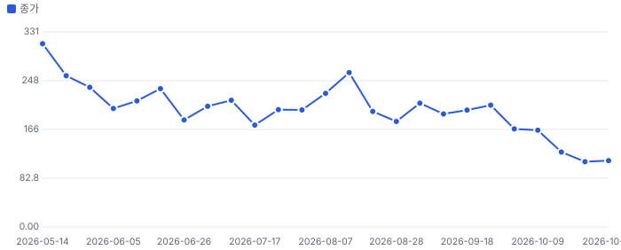
_5/14 상장 첫날 고가 \$386 → 9/30 'OpenAI UltraFast는 엔비디아' 보도 → 10/12 락업 1차 → 10/28 Culper 숏 리포트._

## ② 매출 — 실적과 컨센서스

**그림 2 · 분기 매출 (\$M)**

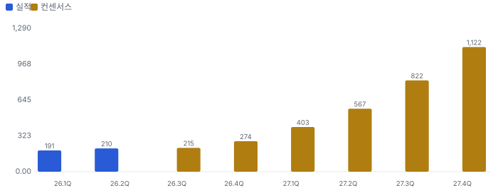
_2027년 매출 컨센서스 합 약 \$2.9B — OpenAI 트랜치 인도가 2027년에 몰린다는 가정._

- OpenAI 계약: 750MW 약정, 최대 2.0GW 옵션(2030년까지), 매출 인식 22%가 2028-06까지(10-Q)
- 고객 집중: 2025년 매출의 86%가 G42·MBZUAI(관계사) — 2026년부터 OpenAI로 이동

## ③ 밸류의 핵심 변수 — 웨이퍼 수명

**그림 3 · OpenAI 계약 손익분기 수명 (년) vs 주장**

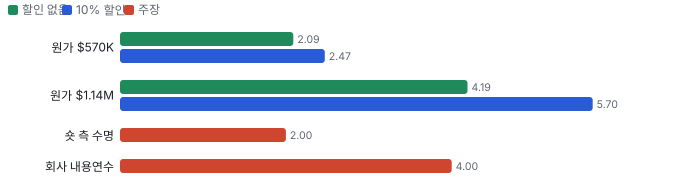
_입력: OpenAI 웨이퍼당 연 \$273K·시스템 원가(Culper 추정). 전력은 고객 전가(10-Q). 수명이 손익분기 막대보다 짧으면 손실 계약._

**숏 주장별 검증**
| 주장 | 근거 | Chiip 판정 |
|---|---|---|
| 커넥터는 Paricon 제품 | 공급사 공개 자료 | 일부 확인 |
| 더미 연산으로 늘 뜨겁게 | 회사 발언·코드 필드 | 존재 확인, '상시'는 추론 |
| 대기 전력 70~80% | 제3자 논문 2편 | 확정 |
| 수명 1.4~2.3년 | 숏 측 모델·익명 6명 | 검증 불가 |
| 내용연수 1.5~3→3~5년 | DRS·S-1 | 확정(영향 −5.9%p) |

> **엔지니어 관점:** 온도 변화 반복(열 사이클 피로)은 일정 온도 유지가 오히려 줄인다. 반면 고온 체류형 열화(전자이동·절연막 파괴)는 늘어난다. 방향은 '수명 단축 가능', 크기(3배)는 미확인.

## 어닝콜 변화·컨센서스 — 상장 후 첫 콜(2Q26, 8/12) 전후

**기준:** 상장(5/14) 후 콜이 한 번뿐이라 '직전 콜 대비' 비교 대신 **상장 서류(S-1·424B4) → 2Q 콜**의 변화를 본다. 회사는 FY2026 코어 매출 가이던스를 \$0.88~0.89B로 올리고 코어 영업이익률 −19~−17%, 3Q 코어 매출 \$214~216M을 제시했다(Fiscal.ai ir_events q2-2026). 다음 확인은 11/12 3Q 실적.

**실적 vs 컨센서스 (발표 직전 Zacks 평균)**
| 분기 | 지표 | 실적 | 컨센서스 | 서프라이즈 |
|---|---|---|---|---|
| 2026Q2 | 매출 | \$209.9M | \$194.2M (2명, 06-26) | +8.1% |

**컨센서스 리비전 — 상장 직후(2026-06-26) → 지금, Zacks 평균**
| 기간 | 지표 | 직전 | 지금(기준일) | 리비전 |
|---|---|---|---|---|
| FY2026 | 매출(\$M) | 861 | 885 (08-17, 3명) | +2.8% |
| FY2027 | 매출(\$M) | 2,774 | 2,926 (10-21, 4명) | +5.5% |
| FY2026 | EPS | −0.89 | −0.52 (08-17, 4명) | 손실 −41% |
| FY2027 | EPS | 0.96 | 1.24 (08-17, 4명) | +28.6% |
| 2026Q3 | EPS | −0.32 | −0.13 (08-17, 3명) | 손실 −58% |

**그림 4 · 2Q 콜 직전(8/11) → 10/28 주가 변화 분해 = 매출 추정 리비전 × 배수 변화 (%)**

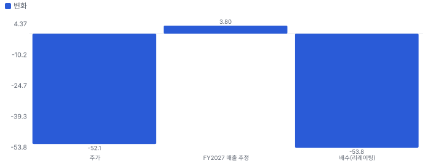
_(1 + 주가 변화) = (1 + 리비전) × (1 + 배수 변화). 주가 \$234.76 → \$112.56(Fiscal.ai), FY2027 매출 추정 \$2,820M(07-29) → \$2,926M(10-21, Zacks). 이익 추정이 아직 적자·소폭 흑자라 EPS 대신 매출 기준_

**해석:** 콜 이후 추정은 매출·이익 모두 올랐는데 주가는 절반이 됐다 — 하락 전부가 배수 축소다. 상장 직후 쏠림(배수 89배 중앙)이 식는 과정에 10/28 숏 리포트(수명)가 겹쳤다. Zacks 분기 EPS 추정은 8월 중순 이후 대부분 미갱신이라 리비전은 방향 참고용이다(제출 2~4명).

## 내러티브 — 멀티플 프리미엄과 리비전을 끌어올리는 이야기

> **한 줄:** '웨이퍼 한 장 AI 칩 = 가장 빠른 추론' 이야기가 상장 프리미엄을 만들었고, 숏 리포트(수명)가 그 프리미엄의 지속성을 공격하는 중 · 동종 대비 멀티플 차이 +110% 중 회사 고유 몫 +87%(멀티플 엔진) — 내러티브가 설명해야 하는 크기 · 단계 확산, 쏠림 중간

**내러티브 요인 — 누가 믿고, 멀티플·리비전 중 어디로 작동하나**
| 요인 | 셀사이드 | 바이사이드 | 리테일 | 작동 경로 | 숫자로 바꾸면 | 상태 | 반증 조건 |
|---|---|---|---|---|---|---|---|
| 가장 빠른 추론(웨이퍼 스케일) | 강 | 중 | 중 | 멀티플 | EV/매출 39.8배(완전 희석) 중 기업 고유 몫 +87%(멀티플 엔진) | 유지 | 고객이 GPU·다른 ASIC으로 추론을 옮기는 계약 공시 |
| OpenAI 대형 계약 | 강 | 중 | 약 | 리비전 | 수주잔고 \$25.4B = EV의 1.3배(EV는 잔고의 0.77배) | 유지 | OpenAI 약정 이행 지연·축소 |
| 웨이퍼 수명·교체 CAPEX(약세) | 약 | 중 | 강 | 멀티플 | 수명 2.1~4.2년(할인 없음)이 OpenAI 계약 손익분기 | 강화 | 10-Q 내용연수 유지·손상 없음(11/12) |
| Oracle OCI 제휴(고객 다변화) | 중 | 중 | 중 | 리비전 | 계약 규모 미공개(미확인) | 태동 | OCI 매출 기여가 4Q26·1Q27 공시에 안 보임 |

- **가장 빠른 추론(웨이퍼 스케일)** — 웨이퍼 한 장 칩의 메모리 대역폭으로 추론 토큰 속도에서 GPU보다 빠르다는 이야기 (바뀌는 입력: 성장(추론 수요)·가격 결정력) [리포트 멀티플 절]
- **OpenAI 대형 계약** — 750MW 약정·최대 2GW 옵션으로 매출이 관계사(G42) 의존에서 벗어난다 (바뀌는 입력: 성장·고객 위험) [10-Q(리포트 ② 절)]
- **웨이퍼 수명·교체 CAPEX(약세)** — 상시 고온 운용으로 수명이 짧아 계약 손익분기를 못 넘는다 (바뀌는 입력: 재투자·이익률) [Culper 요약·리포트 ③ 절]
- **Oracle OCI 제휴(고객 다변화)** — Oracle 클라우드에서 Cerebras 추론을 제공 — 관계사·OpenAI 의존에서 벗어나는 첫 대형 채널 (바뀌는 입력: 성장·고객 위험) [Fiscal.ai company_news 2026-10-27(중요도 3)]

**셀사이드(IB 애널리스트)**
| 지표 | 값 | 추세·해석 | 출처 |
|---|---|---|---|
| 애널리스트 의견(Zacks) | 11명 — 강력 매수 9·매수 1·보유 1·매도 0 | 상장 주관사 중심의 강세 합의 | Fiscal.ai analyst_ratings — Data provided by Zacks Investment Research, Inc., www.zacksdata.com |
| 목표가 평균·범위(Zacks) | \$267 (중앙 \$290, \$149~\$330, 11명) | 10/28 종가 \$112.56 대비 평균 +137% — IB 기대의 증거(Chiip 목표가 아님) | 같은 곳 |
| 2Q 콜 질문 증권사 | UBS, TD Cowen, Barclays, Needham, Morgan Stanley, Mizuho | 질문 초점 = OpenAI 램프·코어 마진·CAPEX | Fiscal.ai ir_events_transcript(q2-2026) 화자 목록 |

**셀사이드(IB 애널리스트) 해석:** 상장 주관·커버리지 증권사가 대부분 — 추론 속도·OpenAI 계약을 성장 근거로 본다

**바이사이드(기관 투자자)**
| 지표 | 값 | 추세·해석 | 출처 |
|---|---|---|---|
| 13F 기관 보유(2Q26, 첫 공시) | 394개 기관 · 8,680만 주(표지 주식의 약 37%) | 상위: Eclipse 5.0%·Fidelity 3.7%·Altimeter 3.2%·Coatue 3.1%·Capital World 1.7% — 벤처·성장주 펀드 중심 | Fiscal.ai institutional_holders 2026Q2 |
| 펀드 레터 언급 | 0건 | 헤지펀드 레터 논지 아직 없음 | Fiscal.ai company_fund_letters |
| 공매도 비중(유통 주식) | 17.7% | 약세 베팅의 크기 | 같은 곳 |

**바이사이드(기관 투자자) 해석:** 락업 해제(11/10 전후 약 22%) 전후로 기관 손바뀜이 가격을 정한다

**리테일(레딧·텔레그램·X)**
| 지표 | 값 | 추세·해석 | 출처 |
|---|---|---|---|
| 레딧 언급 순위(ApeWisdom) | 37위 · 24시간 언급 12건(하루 전 3건, 101위) | 숏 리포트 뒤 리테일 관심 급증 | apewisdom.io 2026-10-29 23:52 |
| 텔레그램 공개 채널 언급 | 미집계(관심도 후보 밖) | - | radar/attention.py |
| X 언급 수 | 미수집(X 키 입력 전) | - | - |

**리테일(레딧·텔레그램·X) 해석:** 리테일 관심은 숏 리포트 사건에 반응한 단기 급증 — 지속 여부는 미확인

**언론·업계**
| 지표 | 값 | 추세·해석 | 출처 |
|---|---|---|---|
| 숏 리포트 | Culper Research 2026-10-28 | 웨이퍼 수명·교체 CAPEX 공격 | 리포트 요약(원문 재배포 금지) |

**언론·업계 해석:** 언론 관심의 중심이 성장에서 '수명·현금 소진'으로 이동

**읽는 법:** '멀티플' 요인은 같은 이익에 더 높은 배수를 주게 하는 이야기(지속성·위험 감소·희소성), '리비전' 요인은 추정 이익 자체를 올리는 이야기(수주·가격·이익률). 회사 고유 프리미엄이 큰데 리비전 근거가 약하면 이야기가 숫자보다 앞서 있다(과밀 위험). 커뮤니티·IB 의견은 사실이 아니라 시장 기대의 증거다. 틀: Damodaran(2017) Narrative and Numbers, Shiller(2019) Narrative Economics.

## 밸류에이션 — 맥킨지·IB 방식(현금흐름 할인(DCF) 엔진)

**방법:** 맥킨지식 재무 재구성(NOPAT·투하자본·ROIC) → 바텀업 WACC → FCFF DCF + 가치 동인 계속가치(ROIC·성장) → 경제적 이익 항등 검증 → 시나리오·몬테카를로 → 가격 내포 기대(역DCF)와 매출 성장 기저율. 단위 \$B, 모든 가치는 **현재 시가총액 대비 배수**로 표기(목표주가 아님).

**할인율(WACC) 구성**
| 항목 | 값 |
|---|---|
| 무위험(미 10년) | 4.99% |
| 주식 위험 프리미엄 | 4.20% |
| 레버드 베타(바텀업) | 1.49 (무레버 1.49) |
| 국가위험 | 0.23% |
| 자기자본비용 | 11.48% |
| 부채비중 | 0% |
| WACC | **11.48%** |
| 영구성장 | 3.5% |

**시나리오별 DCF 주주가치 ÷ 현재 시가총액(\$34.2B)**
| 시나리오 | 확률 | 주주가치(\$B) | 지금 | 5년 뒤(할인 전) | 5년 매출 CAGR | 5년차 영업이익률 |
|---|---|---|---|---|---|---|
| 기본 | 50% | 10.0 | **0.29배** | 0.46배 | 65.0% | 20% |
| 강세 | 30% | 20.4 | **0.60배** | 1.00배 | 88.3% | 26% |
| 약세 | 20% | 7.6 | **0.22배** | 0.29배 | 24.9% | 15% |

**읽는 법:** '배'는 PER·EV/매출 같은 멀티플이 아니라 **DCF로 계산한 주주가치 ÷ 지금 시가총액**이다. 1.0배 = 그 시나리오 가정이 지금 주가와 같은 가치, 0.3배 = 가정대로면 주가의 30%만 현금흐름으로 설명된다. '5년 뒤'는 5년 뒤 시점의 주주가치(그때 돈, 할인 전)를 지금 시가총액으로 나눈 값 — 지금 사서 5년 들고 있을 때 그 시점 내재가치가 지금 가격의 몇 배인가. 매년 약 WACC만큼 커진다(배당 없음, 적자 현금흐름은 차입으로 메운다고 가정).

기본 시나리오 분해: 기업가치 2.9 = 1~10년 현금흐름 현재가치 -2.6 + 11년차 이후(계속가치) \$5.4B(초기 재투자가 커서 1~10년 합이 음수면 계속가치가 기업가치의 100%를 넘는다) · 순현금 7.2 · ROIC 1년차 -4% → 5년차 16% · 경제적 이익 항등 오차 6.2e-16(DCF와 EP 가치가 같아야 정상) · 할인율 +50bp → 가치 -4.9%

**그림 5 · 몬테카를로 3,000회 — 지금 가치/시가총액 분포 (%)**

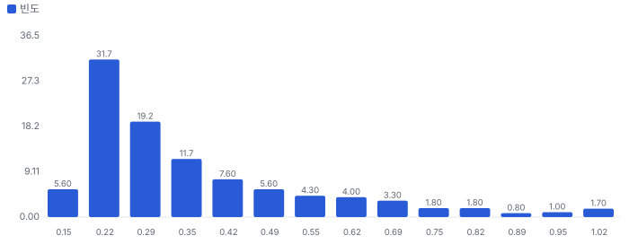
_P10 0.21 · P50 0.30 · P90 0.66 · 기대 0.37배 · 30% 이상 고평가 확률 92% · 5년 뒤 ≥1.5배 3% · ≥2배 0% · ≥3배 0% · ≥10배 0%_

**그림 6 · 가격 내포 기대 vs 필요 성장 (5년 매출 CAGR %)**

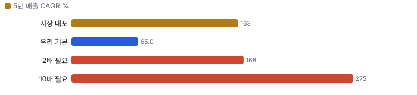
_시장 내포 기저율 상위 0%(n=367, 전체) · 기본 기저율 상위 2%(n=367, 전체) · 2배 필요 성장 기저율 상위 0% · 10배 필요 성장 기저율 상위 0% — 기저율: 같은 매출 규모 미국 상장사가 실제로 달성한 5년 CAGR 분포(SEC 재무)_

**민감도 — 기본 시나리오 가치/시총(매출 경로 고정, 장기 이익률 × 매출÷투하자본)**
|  | 매출÷투하자본 0.75 | 매출÷투하자본 1 | 매출÷투하자본 1.5 | 매출÷투하자본 2.5 |
|---|---|---|---|---|
| 장기 이익률 15% | 0.16 | 0.25 | 0.34 | 0.41 |
| 장기 이익률 22% | 0.31 | 0.40 | 0.49 | 0.56 |
| 장기 이익률 30% | 0.48 | 0.57 | 0.66 | 0.73 |
| 장기 이익률 40% | 0.69 | 0.78 | 0.87 | 0.94 |

매출÷투하자본 = 매출 1달러를 늘리는 데 드는 설비·운전자본(높을수록 가볍다). 장기 이익률은 4년차 목표와 이후 수렴값을 같이 바꾼 것. 계속가치는 RONIC = WACC(11년차 이후 성장은 가치를 만들지 않는다는 맥킨지 보수 가정) · 다른 축: WACC −1%p 0.33배 · WACC +1%p 0.27배 · RONIC 20%(11년차 이후 성장이 가치 창출) 0.32배

**동종 레인지와 펀더멘털 내재 멀티플 (EV/매출, 최근 12개월)**
| 회사 | EV/매출 | 성장 | 영업이익률 | ROIC 영업권 포함/제외 | 매출÷투하자본(영업권 제외) | 펀더멘털 내재 | 시장÷내재 |
|---|---|---|---|---|---|---|---|
| NVDA | 16.8 | 83% | 65% | 93% / 108% | 2.11 | 15.5 | 1.09 |
| AMD | 22.4 | 40% | 16% | 9% / 31% | 2.52 | 2.6 | 8.58 |
| AVGO | 18.9 | 49% | 48% | 25% / 308% | 8.11 | 12.3 | 1.54 |
| MRVL | 21.4 | 31% | 17% | 6% / 37% | 2.83 | 2.4 | 8.94 |
| CRWV | 10.7 | 115% | -3% | -0% / -0% | 0.18 | - | - |
| **동종 중앙** | 18.9 |  |  |  |  |  | 5.06 |
| **Cerebras Systems** | 39.8 |  |  |  |  | 4.2 | 9.49 |

**그림 7 · EV/매출 — 과거·동종·펀더멘털·합리적 멀티플 (배)**

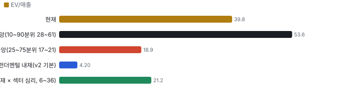
_펀더멘털 내재 = 같은 WACC·계속가치 규칙으로 각 회사의 성장·이익률·자본 회전율을 자본화한 EV ÷ 매출. 섹터 심리 = 동종의 시장 ÷ 내재 배율_

**할인·프리미엄 분해:** Cerebras Systems의 EV/매출은 동종 중앙 대비 **+110%** = 동종과 같은 섹터 심리를 받는다면 펀더멘털(성장·이익률·ROIC)로 정당한 몫 +12% × Cerebras Systems에만 얹힌 기업 고유 몫 **+87%**(두 몫을 곱하면 전체). 심리를 빼고 펀더멘털만 비교하면 동종 중앙 내재 대비 -44%. 기업 고유 몫이 양(+)이면 시장이 동종보다 더 큰 기대를 얹은 것(할인이 덜 됐다), 음(−)이면 더 할인한 것이다 — Rhodes-Kropf·Robinson·Viswanathan(2005)의 '기업 고유 오차 vs 섹터 오차' 분해 방식.

**합리적 멀티플:** 21.2배(섹터 심리 25~75분위 6.0~36.4배) → 주주가치 ÷ 시가총액 **0.63배**(0.33~0.93배). 현재 39.8배와의 차이가 시장이 동종보다 더 얹은 기대다.

한계: 동종 영업이익률은 GAAP(인수 무형자산 상각 포함)이라 인수가 큰 AMD, AVGO, MRVL는 내재 멀티플이 낮게·심리 배율이 높게 나온다 → 합리적 멀티플이 위로 치우칠 수 있다(상각 전 이익 EBITA로 바꾸면 낮아질 가능성). 동종 성장은 최근 분기 전년 대비, 표본 5곳 — 방향 판단용.

**ROIC에 비례하는 정상 상태 멀티플 (맥킨지 가치 동인: EV/NOPAT = (1 − g/ROIC) ÷ (WACC − g))**
| ROIC | EV/NOPAT | EV/매출 @영업이익률 15% | EV/매출 @영업이익률 22% | EV/매출 @영업이익률 30% | EV/매출 @영업이익률 40% |
|---|---|---|---|---|---|
| 10% | 8.1 | 1.0 | 1.4 | 1.9 | 2.6 |
| 15% | 9.6 | 1.1 | 1.7 | 2.3 | 3.0 |
| 20% | 10.3 | 1.2 | 1.8 | 2.5 | 3.3 |
| 30% | 11.1 | 1.3 | 1.9 | 2.6 | 3.5 |
| 50% | 11.7 | 1.4 | 2.0 | 2.8 | 3.7 |

정상 상태 교차 확인: DCF 기본 시나리오의 5년차 ROIC 14%·영업이익률 20%이면 정상 상태 EV/NOPAT 9.4배(5년차 EV/매출 1.4배). 이를 지금으로 할인하면 주주가치 ÷ 시가총액 0.34배 — 고성장 기업은 현재 멀티플이 아니라 정상 상태 멀티플을 할인해 비교한다(맥킨지 『Valuation』 멀티플 장).

**데이터 검증 — 원자료(Fiscal.ai·SEC) ↔ 밸류에이션 입력 대조 10.0/10**
| 검사 | 결과 | 내용 |
|---|---|---|
| 원자료 스냅숏 | 통과 | 조회 시각 2026-10-30T01:00:00+09:00 |
| 시가총액 대조 | 통과 | 가격 112.56 × 표지 주식 0.237564 = 26.74 vs 원자료 개요 26.7402 |
| 가격 일치 | 통과 | 112.56 vs 112.56 |
| 현금·차입 대조 | 통과 | 현금 7.9215 vs 7.9215 · 차입(리스 포함) 0.751 vs 0.751 |
| TTM 매출 = 4분기 합 | 통과 | 0.6807 vs 0.6807(4분기) |
| TTM 영업이익 = 4분기 합 | 통과 | -0.5524 vs -0.5525 |
| 투하자본 = 재무상태표 | 통과 | 1.984 vs 자기자본+차입+리스−현금 1.984 |
| 연간 컨센서스 = 분기 합 | 통과 | FY2026 0.8857 vs 0.8857 · FY2027 2.755 vs 2.7550 |
| 회사 가이던스 반영 | 통과 | 회사 2Q26 실적 보도자료·콜(2026-08-12, Fiscal.ai ir_events q2-2026) — FY2026 코어 매출 0.88~0 |
| 희석 주식(출처·같은 날짜) | 통과 | 잠재 주식 0.076011 vs SEC 0.076011 · 기본 주식 날짜 2026-06-30 / 희석 날짜 2026-06-30 |
| 어닝콜 톤 = 실적 레이더 | 통과 | 사용 up · 레이더 기준 up(톤 변화 1.1, 가이던스 raise) |
| 동종사 4곳 이상·기준 표기 | 통과 | 5곳 · 기준 ttm |
| 매출·이익률 기준 명시(SBC 처리) | 통과 | 매출 core · 이익률 non_gaap · 비GAAP → SBC 6% 차감 |

**동인 출처 — 어느 자료가 어느 변수가 됐나**
| 동인 | 출처·값 |
|---|---|
| rev0 | 회사 가이던스 중간값 [0.88, 0.89] (회사 2Q26 실적 보도자료·콜(2026-08-12, Fiscal.ai ir_events q2-2026) — FY2026 코어 매출 \$0.88~0.89B(상향), 코어 영업이익률 −19~−17%, 3Q 코어 매출 \$0.214~0.216B) |
| growth | 컨센서스 1년차 211.3% |
| margin | 1년차 컨센서스 -3.5% 고정 → 목표 22%(4년차, 덮어쓰기) → 장기 수렴 15% |
| s2c | TTM 매출 ÷ 투하자본(평균 근사) 0.5 → 덮어쓰기 1.0 |
| range | 고·저 추정 없음 — 초고성장 규칙(약세 ×0.4·강세 ×1.25) |
| probs | 어닝콜 톤 'up' 규칙 {'bear': 0.2, 'base': 0.5, 'bull': 0.3} |
| overrides | 목표 영업이익률 22%(GAAP, SBC 포함): AI 가속기 동종 AMD 17%·MRVL 17%와 회사 장기 코어 총마진 60%+ 목표 사이 — 클라우드 감가상각 부담 반영 / 매출÷투하자본 1.0: 자체 클라우드 장비 보유형(1H26 설비투자 \$549M > 매출 \$374M, 최대 고객이 데이터센터 투자 일부 보전) — 램프 초기 TTM 값은 대표성 없음 / SBC 6%: 비GAAP 이익률(가이던스·EPS 컨센서스)을 GAAP으로 맞추는 차감 — 상장 전 1Q26 5.0%, 상장 후 RSU 정상 수준 미확인 |
| shares | 완전 희석 = 기본 0.228204(2026-06-30) + 옵션·RSU·워런트·전환 0.0760 — SEC XBRL AntidilutiveSecuritiesExcludedFromComputationOfEarn |

> 의사결정 보조(투자자문 아님): ① 매수 매력: 연 기대수익 -10.2% (자기자본비용 11.5% 대비 -21.6%p) · 자본비용 초과 확률 1% · 안전마진 0.21 → 정량 신호 약함 / ② 위험 예산 지표(이론): 0% — 기대수익이 자기자본비용에 못 미침(무위험 대비 켈리 0%는 참고) · 5년 하위10% -72% · 30%+ 손실 확률 73% / ③ 상방(5년): 기대 0.59배 · 2배 0% · 3배 0% · 10배 0% · 상위10% 1.09배

## 수급 — 누가 왜 샀나(Chiip Flow)

> **한 줄:** 최근 20거래일 거래의 리테일 몫은 20.2%(직전 60일 19.4%) — 거래는 주로 기관이 만든다. 기관 자금 흐름(CMF 20일) -0.36로 기관 분산 쪽, 리테일 매수 압력 z -1.23로 리테일 순매도 정황. 이상 거래일에 늘어난 거래량의 82%가 기관 몫.

**그림 8 · 일별 거래량 분해 — 리테일 근사(도매 체결사) vs 기관(거래소·다크풀) (천 주)**

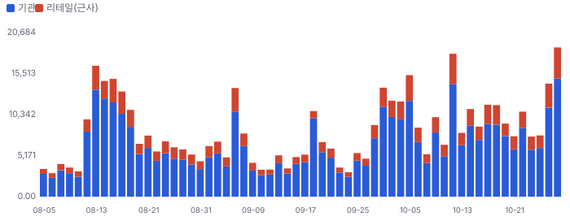
_리테일 = 장외(TRF) 거래량 × 그 주 FINRA 비ATS 리테일 도매 체결사 비중(최근 2주는 직전 4주 평균 — 추정). 기관 = 전체 − 리테일._

**그림 9 · 기관 자금 흐름(CMF 20일)과 리테일 매수 압력(z ÷ 4로 같은 눈금)**

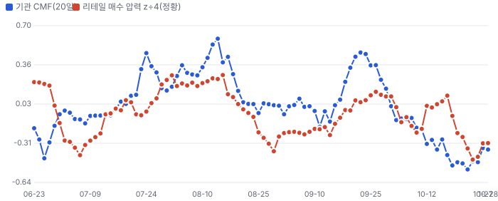
_CMF > 0: 기관 거래가 몰린 날 종가가 고가 쪽(매집). 리테일 압력: 장외 공매도 비율의 60일 z — 마켓메이커가 리테일 매수에 공매도로 물량을 대는 구조라 높을수록 리테일 순매수 쪽(정황)._

**이상 거래일 — 왜 늘었나, 누가 늘렸나(최근 120거래일, RVOL ≥ 1.8 또는 z ≥ 2)**
| 날짜 | RVOL | 주가 | 종가 위치 | 늘어난 거래량 | 증가분 분해 | 원인 태그 |
|---|---|---|---|---|---|---|
| 2026-08-13 | 3.3배 | -11.8% | +1.00 | 11.46M | 기관 83% · 리테일 17% | 실적 발표 다음 날 |
| 2026-10-12 | 3.0배 | -10.7% | -1.00 | 12.01M | 기관 78% · 리테일 22% | 원인 미확인(공개 사건 없음) |
| 2026-08-17 | 2.9배 | +15.1% | +1.00 | 9.75M | 기관 80% · 리테일 20% | 원인 미확인(공개 사건 없음) |
| 2026-08-14 | 2.9배 | -5.2% | -1.00 | 9.54M | 기관 88% · 리테일 12% | 원인 미확인(공개 사건 없음) |
| 2026-10-05 | 2.6배 | +9.1% | +1.00 | 9.50M | 기관 78% · 리테일 22% | 원인 미확인(공개 사건 없음) |
| 2026-10-28 | 2.6배 | -5.7% | -1.00 | 11.54M | 기관 79% · 리테일 21% | 원인 미확인(공개 사건 없음) |
| 2026-08-18 | 2.6배 | -12.7% | -1.00 | 8.07M | 기관 78% · 리테일 22% | 원인 미확인(공개 사건 없음) |
| 2026-09-30 | 2.4배 | -8.9% | -1.00 | 7.92M | 기관 84% · 리테일 16% | 월말 |

**주간 체결 장소별 비중 — FINRA 확정치(최신 주 2026-09-21, 약 2주 지연)**
| 주 시작 | 전체(주) | 거래소 | ATS(다크풀) | 리테일 도매 | 기타 장외 |
|---|---|---|---|---|---|
| 2026-08-17 | 53.37M | 52.8% | 21.5% | 21.5% | 4.2% |
| 2026-08-24 | 30.12M | 47.8% | 23.1% | 24.4% | 4.7% |
| 2026-08-31 | 36.39M | 48.5% | 25.1% | 23.1% | 3.3% |
| 2026-09-07 | 19.02M | 51.8% | 23.7% | 21.8% | 2.7% |
| 2026-09-14 | 29.83M | 55.9% | 21.5% | 16.8% | 5.8% |
| 2026-09-21 | 25.13M | 54.2% | 21.9% | 19.6% | 4.3% |

**읽는 법:** 리테일 몫이 늘면서 주가가 오르면 리테일 주도 랠리(되돌림 위험 큼), 기관 CMF가 +로 돌며 거래량이 늘면 기관 매집 쪽이다. 근거: 리테일 식별은 Boehmer·Jones·Zhang·Zhang(2021, JF)의 장외 도매 체결 방식, 자금 흐름은 Chaikin Money Flow. 한계: 도매 체결사 물량에 일부 기관 주문이 섞이고, 리테일 지정가 주문 일부는 거래소로 간다 — 근사치다. 지표일 뿐 매매 권유가 아니다.

## 가격 구간 — 월·주·일 피보나치와 겹침 구간

> **한 줄:** 현재가 \$112.56 — 바로 위 저항 \$200~201(+78.0%, 강도 2.0), 바로 아래 지지 \$108(-3.7%, 강도 2.0). 가격 구간 지표일 뿐 매수·매도 권유가 아니다.

**지지·저항 겹침 구간(서로 다른 기준선이 ±1.2% 안에 모인 곳, 강도 = 겹친 기준선 수)**
| 구간 | 가격 | 현재가 대비 | 강도 | 겹친 기준선 |
|---|---|---|---|---|
| 저항 1 | \$200~201 | +78.0% | 2.0 | 일봉 피보 38.2% · 주봉 피보 38.2% |
| 지지 1 | \$108 | -3.7% | 2.0 | 50일 최저(거래 범위) · 주봉 스윙 저점 |

**시간 단위별 피보나치 되돌림(\$)**
| 단위 | 지배 스윙 | 다리 | 23.6% | 38.2% | 50% | 61.8% | 78.6% |
|---|---|---|---|---|---|---|---|
| 월봉 | \$108.37(2026-10-26) → \$350.00(2026-05-14) | 하락 | 165.4 | 200.7 | 229.2 | 257.7 | 298.3 |
| 주봉 | \$108.37(2026-10-26) → \$350.00(2026-05-14) | 하락 | 165.4 | 200.7 | 229.2 | 257.7 | 298.3 |
| 일봉 | \$180.22(2026-09-14) → \$212.41(2026-09-22) | 상승 | 204.8 | 200.1 | 196.3 | 192.5 | 187.1 |

**그림 10 · 월봉 — 장기 스윙 되돌림**

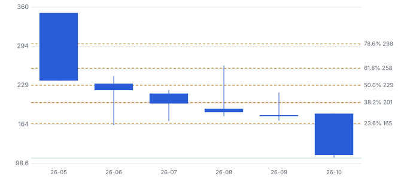
_지배 스윙: 확보 구간 최저↔최고 — 저점 \$108.37(2026-10-26) · 고점 \$350.00(2026-05-14), 하락 다리. 점선 = 피보나치 되돌림, 띠 = 겹침 구간(초록 지지·빨강 저항). 캔들: 빨강 상승·파랑 하락._

**그림 11 · 주봉 — 52주 스윙 되돌림**

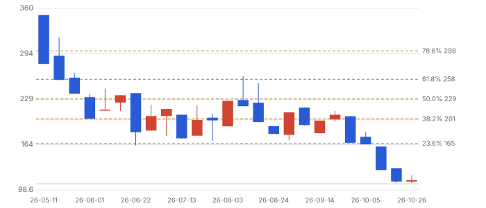
_지배 스윙: 최근 52주 최저↔최고 — 저점 \$108.37(2026-10-26) · 고점 \$350.00(2026-05-14), 하락 다리. 점선 = 피보나치 되돌림, 띠 = 겹침 구간(초록 지지·빨강 저항). 캔들: 빨강 상승·파랑 하락._

**그림 12 · 일봉 — 마지막 완료 스윙 되돌림(최근 90거래일)**

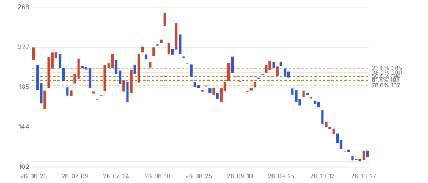
_지배 스윙: ATR 지그재그 16.2% 마지막 완료 다리 — 저점 \$180.22(2026-09-14) · 고점 \$212.41(2026-09-22), 상승 다리. 점선 = 피보나치 되돌림, 띠 = 겹침 구간(초록 지지·빨강 저항). 캔들: 빨강 상승·파랑 하락._

**기법과 근거:** 스윙은 ATR 지그재그(임계 = max(월 20%·주 10%·일 5%, 2.5×ATR14)), 되돌림 23.6~78.6%·확장 127.2·161.8%. 함께 본 기준선: 50·200일 이동평균과 50·150·200일 거래 범위 고저(Brock·Lakonishok·LeBaron 1992, JF), 라운드 넘버(\$50 단위, Osler 2003 JF·Osler 2000 FRBNY EPR). 피보나치 비율 자체의 학술 근거는 약하다 — 다수가 같은 선에 주문을 두는 데서 오는 효과로 보고, 여러 기준선이 겹친 구간만 강하게 본다. 상장 후 116거래일뿐이라 월·주봉 스윙은 상장 이후 전체 구간이다(장기 지지·저항으로 읽지 말 것).

## ④ 시나리오 — 확률 가중

**그림 13 · 2028년 말 주주가치 ÷ 현재 시가총액 (배, 할인 전, 멀티플 기반 자체추론)**

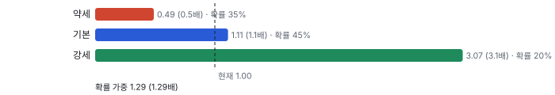
_P(10배) 2% 미만 판단. 가정은 숫자로 공개 — 반증되면 즉시 갱신. 배수 = 시나리오 주주가치 ÷ 10/28 시가총액(목표주가 아님)._

> **판단 시나리오 확률 가중 1.28배(2028년 말, 할인 전):** WACC 11.48%로 2.2년 할인하면 지금 가치 약 **1.01배**. 같은 리포트의 DCF 확률 가중 0.37배·합리적 멀티플 0.63배보다 높다 — 차이는 이 시나리오가 2028년 출구 EV/매출 6~8배를 유지한다고 가정하는 데서 나온다(DCF는 장기 이익률 15~22%·매출÷투하자본 1.0으로 재투자 부담을 현금흐름에 그대로 반영). 세 방법이 갈리는 지점 = 출구 배수의 지속성.

> **두 방법의 차이(중요):** 위 시나리오는 배수(EV/매출) 기반 판단이고, 앞 '밸류에이션 — 맥킨지·IB 방식'은 현금흐름 DCF다. DCF가 낮은 이유는 자체 클라우드 장비를 보유하는 사업이라 성장에 큰 재투자가 들기 때문(1H26 설비투자 \$549M > 매출 \$374M, 매출÷투하자본 1.0 가정). 민감도: 장기 이익률 15→40%, 매출÷투하자본 축에서 가치/시총 0.16~0.94배. 동종 멀티플로도 합리적 21.2배 vs 현재 39.8배(완전 희석). **배수 논리는 자본 효율이 높은 팹리스형을 가정하는 셈** — 웨이퍼 수명이 짧으면 DCF 쪽이 맞다.

## 반대 검증 — 가장 강한 약세 논리

| 약세 논리 | 근거(리포트 안) | 가를 자료·시점 | 현재 판정 |
|---|---|---|---|
| 웨이퍼 수명이 짧아 교체 CAPEX가 계약 이익을 먹는다 | Culper 숏 리포트(수명 1.4~2.3년 주장), 대기 전력 70~80%(제3자 논문) | 11/12 10-Q 유형자산 내용연수·손상·CAPEX/매출 | 크기 미확인 — 방향(고온 체류형 열화)은 가능 |
| 매출이 관계사·한 고객에 몰려 있다 | 2025년 매출 86%가 G42·MBZUAI, 2026년부터 OpenAI로 이동(10-Q) | 3Q 고객별 매출 비중·신규 고객 공시 | 확정(집중), 다변화는 미확인 |
| 자체 클라우드 장비 보유로 성장할수록 현금이 탄다 | 1H26 설비투자 \$549M > 매출 \$374M | 3Q 설비투자·영업현금흐름·자금 조달(증자·차입) | 확정(현재), 지속 여부 미확인 |
| 멀티플이 아직 동종보다 덜 할인됐다 | EV/매출 39.8배(완전 희석) vs 동종 중앙 18.9배, 기업 고유 몫 +87% | 락업 해제(11/10 전후) 뒤 수급·멀티플 | 확정(현재 수준) |

가장 강한 논리는 첫째(수명)다 — 맞으면 OpenAI 계약 손익분기(할인 없이 2.1~4.2년)와 직접 부딪히고, 셋째(현금 소진)를 키운다. 세 논리가 모두 11/12 10-Q 한 문서로 상당 부분 가려진다.

## 킬 조건 — 이 판단을 철회할 사건(자체추론)

| 킬 조건(측정 가능) | 시점 | 철회되는 가정 |
|---|---|---|
| 10-Q에 웨이퍼·시스템 내용연수 단축 또는 손상차손 인식 | 11/12 3Q 10-Q | 수명 3~4년(기본 시나리오) → 약세 확률 상향 |
| FY2026 코어 매출 가이던스 하향(\$880~890M 아래) 또는 코어 영업이익률 −19% 밑 | 11/12 3Q 실적 | 기본 시나리오 성장·이익률 경로 |
| OpenAI 750MW 약정 이행 지연·축소(8-K·10-Q) | 수시 · 분기 보고 | 수주잔고 0.77배 가격 가정 |
| 설비투자가 매출을 2분기 더 넘고 외부 자금 조달(증자) 발표 | 4Q26 실적(2027-02 예상, 날짜 미확인) | 희석 없는 강세 경로 |

## ⑤ 체크리스트

| 시점 | 무엇 | 의미 |
|---|---|---|
| 11/10 전후 | 락업 마지막 해제(약 22%) | 수급 압력 |
| 11/12 | 3분기 실적·10-Q | 유형자산 처분·손상·CAPEX/매출·보증충당금 = 수명의 증거 |
| 수시 | 회사 반박·고장률 공개 | 숏 논지 약화 조건 |
| 2027 | OpenAI 추가 용량 행사 여부 | 강세 시나리오 조건 |

## 출처
- Fiscal.ai(MCP): company_profile·stock_prices(10/28 종가)·표준화 재무(2026-06-30)·daily_ratios, 조회 2026-10-30
- Fiscal.ai ir_events: 2Q26 press_release·transcript(q2-2026, 화자·Q&A) · institutional_holders 2Q26(13F)
- Zacks 컨센서스·의견·목표가: Data provided by Zacks Investment Research, Inc., www.zacksdata.com (https://www.zacksdata.com)
- SEC 10-Q 2026-08-12(RPO·고객) · 424B4 2026-05-14(락업) · DRS 2025-12-22·S-1 2026-04-17(내용연수)
- 동종: Fiscal.ai NVDA·AMD·AVGO·MRVL·CRWV(최근 12개월)
- 수급: FINRA 공개 자료(Reg SHO·ATS) — Chiip Flow
- Culper Research 2026-10-28(재배포 금지 — 요약만)
- Bessembinder (2018) JFE · Rhodes-Kropf·Robinson·Viswanathan (2005) JFE
- 앞선 판: outputs/tenbagger/reports/20261029_CBRS.json(구 원천 easyconomics) — 이번 판은 Fiscal.ai로 다시 계산

_연구 후보이지 매수 권유가 아닙니다 · 공개 자료 기반 분석이며 투자 권유가 아님 · 1차 판정, 미검증 · Chiip ten-bagger_