# 텐배거 리포트 2026-11-02 — INNIO — 수요는 숫자로 나왔다, 값을 누르는 건 11/30 물량과 고객 집중이다

> 2026-11-02 · INNIO N.V.(INIO) · 기업: Jenbacher·Waukesha 가스 엔진 발전 설비 제조와 엔진 애프터서비스 — 데이터센터 자가발전 수요 포함

## Chiip View

수요는 의심할 곳이 적다. 3Q 매출 +57%, 조정 EBITDA +70%, 12개월 장비 수주 \$6.8B, 잔고 \$8.0B다. 값을 누르는 것은 세 가지다. **11/30 보호예수가 풀리면 유통주식의 6.2배인 6.47억 주가 매도 가능해진다.** 상위 5개 고객이 9개월 매출의 54%다. 9개월 영업현금 \$741.5M은 계약부채 증가 \$797.0M이 만들었다. 목표주가는 \$15.4로 업사이드 −6%, 약세 다운사이드 −28%, 손익비 2.4이고 등급은 Neutral이다. 기본 시나리오 \$19(+15%)보다 목표가 낮은 것은 DCF가 끌어내려서다. DCF 기본값은 5년 매출 CAGR 13%를 쓰고 지금 가격은 22%를 요구한다. 2029년 뒤 주문을 믿느냐가 이 차이다. Fwd 1Y EV/EBITDA는 12.5배로 동종 중앙값 16.5배보다 24% 낮다. 다음 확인은 11월 중순 13F, 11/30 해제, 2027년 2월경 4Q 수주다.

## 대시보드
| 항목 | 값 | 설명 |
|---|---|---|
| 주가 | \$16.30 | 고점 대비 -60% · 1년 -52% |
| 시가총액 | \$12.25B | EV \$13.87B |
| 업사이드 | -6% | 목표주가 \$15 · 다운사이드 -28% · 손익비 2.4 |
| 구매등급 | Neutral | 애널리스트 11명: Strong Buy 6 · Buy 2 · Neutral 3 · Sell 0 · Strong Sell 0 |
| 멀티플 | Fwd 1Y EV/EBITDA 12.5배 | 동종 중앙값 16.5배 |
| 가이던스 4Q26 | \$1,176M | 컨센서스 \$1,223M |
| 알파 | 7.2/10 | 텐배거 가능성 점수 |
| 이벤트 | IPO 보호예수 만료, 6.47억 주 매도 가능 | 2026-11-30 |

## 한 장 요약
- **기업가치를 결정하는 내러티브** **시장이 산 이야기는 '전력망을 못 기다리는 데이터센터가 가스엔진을 깐다'는 것이다.** 수요는 숫자로 나왔다. 12개월 장비 수주 \$6.8B, 잔고 \$8.0B, 잔고+슬롯 약 19GW다. 그런데 주가는 종가 고점 \$41.13에서 \$16.30으로 −60%, IPO(기업공개)가 \$27 아래다. 쟁점이 수요에서 ①지속 기간 ②고객 집중 ③11/30 보호예수 해제로 옮겨 갔다.
- **밸류에이션 모델로 본 주가 상방은 어디까지인가?** **목표주가 \$15(-6%), 약세와 기본 사이(약세 쪽 48%)다.** 강세 \$27(+68%)는 Fwd 1Y EV/EBITDA 17.8배를 강세 EBITDA에 적용한 값이다. 기본 \$19, 약세 \$12. 손익비 2.4, DCF 기준 업사이드 -33%.
- **수주는 어디까지 왔나?** 장비 수주잔고 전체 미확인, 100% 매출 \$8.00B · RPO(계약했지만 아직 매출로 잡지 않은 금액) 중 장비 잔고 밖 금액 미확인, 100% 매출 \$2.90B · VoltaGrid(가스엔진으로 현장 전력을 파는 미국 회사) 2.3GW 미확인, 100% 매출 미확인. 확정 장비 잔고 \$8.0B, RPO \$10.9B다. 슬롯은 약 19GW의 일부이고 금액 미공개라 확정 합계에 넣지 않았다.
- **지금 가격은 무엇을 가정하나?** 현금흐름으로 풀면 5년 매출 CAGR **22%**다. 기본 시나리오 13%보다 높고, 컨센서스 FY2027 +32%·FY2028 +15% 뒤에도 고성장이 이어져야 한다. 22%면 2031년 매출 약 \$10.7B다(FY26 가이던스 중간값 기준, 추정). 회사 계획으로 그린 2030년은 10GW × \$650/kW + 서비스 약 \$2.5B = 약 \$9B다(추정). 배수로 보면 그림이 다르다. Fwd 1Y EV/EBITDA 12.5배는 동종 중앙값 16.5배보다 낮다. 시장은 이익을 깎는 게 아니라 이익의 지속 기간을 깎는다.
- **왜 움직였나?** 종가 고점 6/22 \$41.13에서 −60%다. 7/29 −17.0%는 2Q 장비 마진 14%였다. 10/22 −10.4%는 620MW 수주 소식에도 GE(미국 General Electric) Vernova 급락일과 겹쳤다. 10/23 \$15.21에서 3Q 전후 사흘 +20.6%였지만 10/29~30에 −11.2%를 돌려줬다. 같은 이틀 Caterpillar −12.7%, Bloom Energy −10.9%로 회사 사건보다 업종 매도로 본다. JPM(J.P. Morgan) 목표가 \$33 → \$31도 10/30에 나왔다. 2Q 실적 전날부터 보면 주가 −39.5%, FY2027 EPS 추정 +10%라 하락은 전부 멀티플이다.
- **3Q 콜에서 무엇이 바뀌었나?** 좋아진 것은 FY26 매출 \$3.8~3.9B → \$3.9~4.0B, 조정 EBITDA \$720~740M → \$780~800M, 장비 마진 2Q 14% → 3Q 17.1%, 잔고+슬롯 15GW → 약 19GW다. 새로 나온 것은 신규 설치분 서비스 강도 MW(메가와트)당 연 \$50k 이상, 주문 대부분 take-or-pay(안 받아도 대금을 내는 계약), 네오클라우드 무배정이다. 아쉬운 것은 수주다. 3Q \$2.2B로 2Q \$2.3B보다 줄었고 전력 \$546M → \$265M, 압축 \$281M → \$116M이다. 4Q 매출 가이던스 환산은 \$1,126~1,226M이고 컨센서스 \$1,223M은 상단이다.
- **무엇이 바뀌면 판단이 달라지나?** 위쪽은 세 가지다. 주요 주주 첫 매각이 작은 할인으로 소화되고, 4Q 12개월 수주/매출이 2.0 이상이고, 2029~31 슬롯의 주문 전환이 공시되면 기본 \$19~강세 \$27 쪽이다. 아래쪽은 매각 할인이 크거나, 경쟁 증설로 kW(킬로와트)당 가격이 \$600 아래로 가거나, VoltaGrid 자금에 문제가 생기는 경우다. 그때는 약세 \$12 쪽이다.

## 한눈에 보기

**일봉**

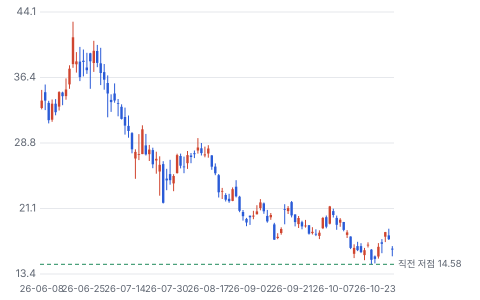

**주봉**

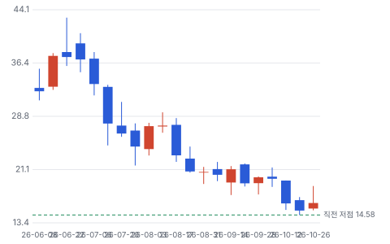

**월봉**

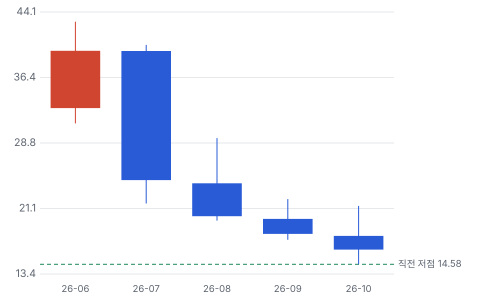

**분기 매출·EPS 실적과 컨센서스**

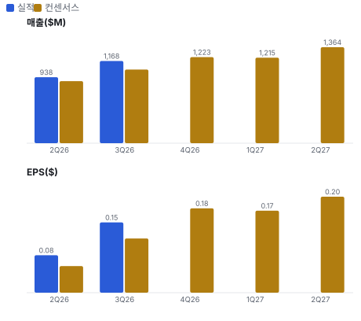

**EPS 리비전**

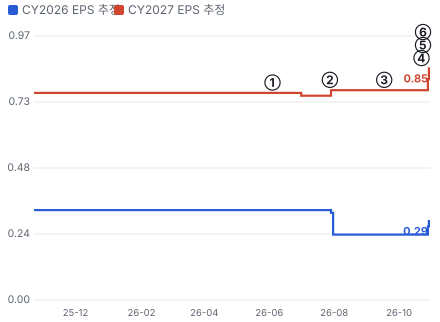

① 26-06-04 IPO \$27 · EPS 리비전 +0%
② 26-07-28 2Q26 실적, 장비 마진 14% · EPS 리비전 +2%
③ 26-09-17 Liberty 450MW 수주 · EPS 리비전 +0%
④ 26-10-22 620MW 수주, GE Vernova 급락 · EPS 리비전 +0%
⑤ 26-10-27 3Q26 실적, 가이던스 상향 · EPS 리비전 +10%
⑥ 26-10-29 Caterpillar 실적 뒤 전력주 매도 · 실적 창과 겹침

**밸류에이션 주가 시나리오**

**주가별 업사이드**

**어닝콜 변화별 주주가치 영향**

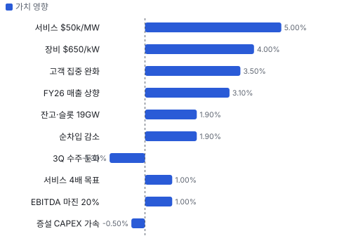

**최근 4개 분기 주가 변화 분석**

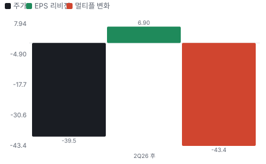

**멀티플 프리미엄**

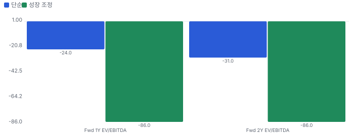

**합리적 멀티플**

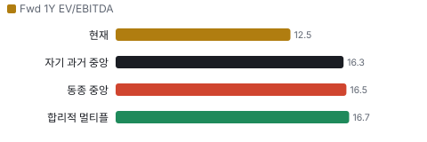

**일별 거래량 분해**

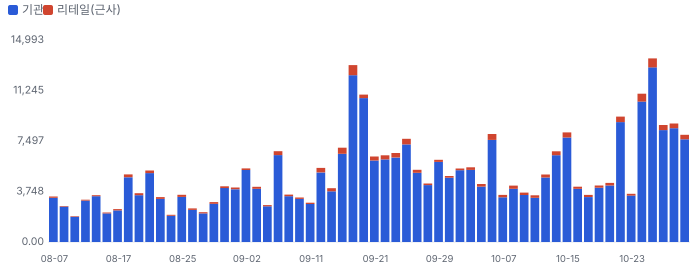

**기관 자금 흐름**

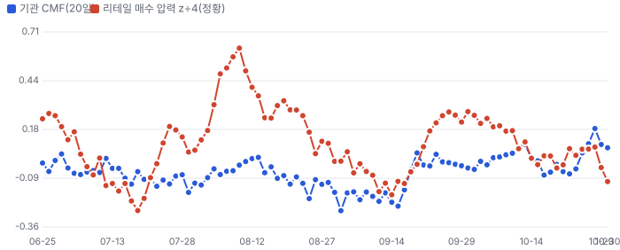

**몬테카를로**

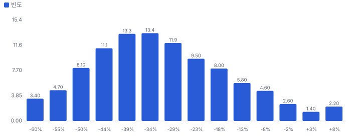

해석: 3,000번 중 112번(4%)에서 가치가 지금 주가 이상이었다. 가정을 흔들어도 지금 주가를 뒷받침하지 못하는 경우가 더 많다. 가운데 값은 0.67배이고, 열 번 중 여덟 번은 0.49~0.90배 사이에 든다.

## 내러티브

> **기업가치를 결정하는 이야기:** 값은 두 줄이다. 장비는 GW(기가와트) × kW당 가격이고 3Q는 1.2GW × 약 \$650이다. 서비스는 설치 기반 × MW당 연 매출이고 44GW × \$30k에서 새 물량은 \$50k 이상으로 간다. 2028년까지 장비 이익은 잔고가 거의 정했다. 값을 가르는 것은 2029년 뒤 주문과 서비스 전환이다.

> **멀티플·EPS 프리미엄**
> **멀티플:** Fwd 1Y EV/EBITDA 12.46배로 동종 중앙값 16.5배보다 24% 낮고 상장 뒤 7월 말 21배에서 내려왔다. 프리미엄이 할인으로 뒤집혔다.
> **EPS:** FY2027 EPS 컨센서스는 \$0.77에서 \$0.85로 +10%, FY2028은 \$0.99에서 \$1.10으로 +11%다. 제출이 2~3명뿐이라 표본이 얇다.

### 투자자들은 왜 열광했나

6월 IPO 때 \$27에 나와 3주 만에 \$42.95를 찍었다. VoltaGrid 2.3GW 수주, 전력망 접속 대기 6년 이상 숫자, 연 3.5GW → 10GW 초과 증설이 겹쳤다. 식은 순서는 이렇다. 7/28 2Q 장비 마진 14%, 9월 공매도 급증, 10/22 GE Vernova 급락, 10/29 Caterpillar 실적 뒤 동반 매도다.

### 무엇이 기업가치를 바꾸나

> **구조적 체질 변화**
> **변화:** CHP(열병합 발전)·유럽 회사에서 미국 데이터센터 장비 회사로 바뀌었다
> **증거:** 데이터센터가 12개월 장비 수주의 67%. 북미 매출 비중 확대, TTM 장비 비중 58%로 +6%p
> **반증:** 데이터센터 수주가 2분기 연속 전년 대비 감소

> **고부가 믹스 확장**
> **변화:** kW당 가격과 서비스 강도가 함께 오른다. 다만 컨테이너 범위는 마진을 깎는다
> **증거:** \$/kW 3Q 약 \$650, 앞으로 \$600 이상. 장비 마진 2Q 14% → 3Q 17.1%. 서비스 강도 \$30k → \$50k 초과
> **반증:** 장비 마진 2분기 연속 15% 미만

> **기술 혁신**
> **변화:** 새 기술보다 부하 추종과 물 사용이 판매 논리다
> **증거:** Type 6(Jenbacher 6세대 엔진 계열) 물 0.1L/MWh 미만(회사 자료, 터빈 최대 200L). 회사 주장이고 독립 시험은 확인 못 했다
> **반증:** 연료전지·소형 터빈이 같은 현장에서 수주를 뺏는다

> **실행 속도**
> **변화:** 납품은 늘고 납기는 고객 대기 상태다. 3Q 1.2GW, 4Q 약 1.5GW **납품 리드타임 16~27개월.** 피어 비교 미확인. 이전 대비 미확인.
> **증거:** Liberty 450MW 2026-09 수주 → 2028 납품, VoltaGrid 1.5GW 2026-02 수주 → 2028까지. 공장 납기 월수는 회사가 공개하지 않아 수주 공시로 환산했다
> **반증:** 2027 인도 가이던스가 6GW 아래

> **M&A**
> **변화:** 규모보다 서비스 거점 인수다
> **증거:** Enerflex(캐나다 가스 설비 회사) 아시아태평양 애프터마켓 \$61.6M, 9/30 종결. M&A 때 레버리지 2.5배 허용
> **반증:** 레버리지를 넘는 대형 인수

> **정책·입법 연관성**
> **재정정책:** 해당 없음(보조금·세액공제에 기대는 사업이 아니다. 10-Q 보조금 금액 공시 없음)
> **행정명령:** 미국 관세가 오스트리아산 엔진 원가를 건드린다. 회사는 Waukesha(INNIO의 미국 가스엔진 브랜드이자 위스콘신 공장 지역) 조립으로 현지화 중이다 10-Q 위험요인, 첫 Jenbacher(INNIO의 가스엔진 브랜드) 발전기 Waukesha 조립. 비교: Caterpillar 2026 관세 약 \$2.2B 반증: 관세 인상분을 가격에 못 넘겨 장비 마진이 내려간다 의회 동의 2/10 — 하원 1/5(행정부 조치로 관련 표결을 찾지 못했다) · 상원 1/5(같음).
> **연관입법:** 주 단위 데이터센터 규칙이 변수다. 고객 프로젝트 대부분이 텍사스다 3Q 콜 Baird 질문. 프로젝트 1건 1주 지연 뒤 해소 반증: 텍사스 인허가로 주문 지연·취소 공시

> **CAPEX 낙수효과**
> **변화:** 하이퍼스케일러 투자가 VoltaGrid·Liberty·Aggreko(영국 임대 발전 회사) 같은 중간 공급자를 거쳐 온다
> **증거:** 3Q 620MW 후속, Liberty 450MW, Aggreko 2031 연장. 회사는 네오클라우드 무배정이라 밝혔다. 최종 고객명은 비공개
> **반증:** 중간 공급자의 자금 조달 실패, 하이퍼스케일러 CAPEX 가이던스 하향

### 내러티브 근거

> '데이터센터 현장 가스엔진'이 상장 프리미엄을 만들었지만 2Q 뒤 FY2027 EPS 추정 +10%에도 주가는 −39.5%다. 지금은 AI 전력주 전체의 수요 지속 의심과 11/30 보호예수 해제가 값을 누른다. 동종 대비 멀티플 차이 -24% 중 회사 고유 몫은 -25%다. 단계는 소멸, 쏠림은 낮음이다.

> **데이터센터 현장 발전(전력망 접속 대기)** · 유지
> **논리:** 전력망 접속을 기다리는 데이터센터가 현장 가스엔진으로 전력을 직접 확보한다
> **숫자:** 장비 잔고 \$8.0B, 잔고+슬롯 약 19GW, RPO \$10.9B
> **반증:** 4Q 수주 12개월 B/B 2.0 미만(2027-02)

> **2028년 이후 주문 절벽(약세)** · 강화
> **논리:** 현장 발전은 전력망이 따라잡기 전까지의 다리일 뿐이라 주문이 꺾인다
> **숫자:** 2Q 뒤 FY2027 EPS 추정 +10%, 주가 −39.5%
> **반증:** 2029~31 슬롯의 주문 전환 공시

> **설치 기반 서비스** · 유지
> **논리:** 신규 설치분이 MW당 연 \$50K 이상의 서비스 매출을 만든다
> **숫자:** 서비스 강도 MW당 연 \$50K 이상(경영진 발언, 확신도 0.5)
> **반증:** 서비스 마진 하락, 고객 자체 정비 확대

> **보호예수 해제와 지배주주 매각(약세)** · 강화
> **논리:** 11/30 뒤 Advent(미국 사모펀드 Advent International)·ADIA(아부다비 투자청) 물량이 시장에 나온다
> **숫자:** 매도 가능 6.47억 주 = 유통주식 1.04억 주의 6.2배, 시가 \$10.5B
> **반증:** 블록 매각이 할인 5% 안에서 소화되거나 주주가 추가 보호예수를 약속

## 포트폴리오

| 제품·서비스 | 구분 | 무엇 | 쓰는 곳 | 돈 버는 방식 |
|---|---|---|---|---|
| Jenbacher 가스엔진 | 제품 | J620(Jenbacher 20기통 가스엔진)·J624(Jenbacher 24기통 가스엔진) 등 왕복동 가스엔진과 컨테이너 패키지 | 데이터센터 현장 주전원, 열병합 발전 | 장비 3Q 매출 약 \$778M, 세그먼트 EBITDA 마진 17.1% |
| Waukesha 엔진 | 제품 | 가스 압축·발전용 엔진 | 가스 압축, 유전 | 압축 3Q 수주 \$116M |
| 엔진 애프터서비스 | 서비스 | 장기 서비스 계약, 부품, 오버홀, 재제조 | 설치 기반 약 44GW | 3Q \$390M, TTM \$1.5B, 마진 약 32% |
| myPlant(INNIO의 엔진 군 원격 관리 플랫폼) | 기술 | AI 기반 엔진 군 관리 | 원격 감시, 정비 시점 예측 | 매출 별도 공시 없음 |

## 수주·파이프라인

> **2026-09-30 기준 8건.** 확정 \$10.90B. 공시 장비 수주잔고 \$8.00B. 서로 겹치는 항목은 합계에서 뺐다.

**실행 속도와 방해 요인**
| 항목 | 상태 | 실행 속도 | 방해 요인 |
|---|---|---|---|
| 장비 수주잔고 전체 | 확정 | 3Q 1.2GW, 4Q 약 1.5GW 전망 | Jenbach 라인 증설 · 숙련 인력 · 부품 공급 |
| RPO 중 장비 잔고 밖 금액 | 확정 | RPO \$10.9B 중 71%가 24개월 안 인식, 구성은 차이로 추정 | 서비스 계약 착수 시점 |
| VoltaGrid 2.3GW | 확정 | 2025-10 수주, 잔고에 포함 | VoltaGrid 자금 조달 · 현장 인허가 |
| VoltaGrid 1.5GW | 확정 | 2026-02 수주, 2028까지 납품 | 엔진 300대 생산 슬롯 |
| Liberty Energy(미국 유전 서비스·전력 회사) 450MW | 확정 | 2028 납품 | Liberty의 고객 계약 |
| 데이터센터 후속 620MW | 확정 | 3Q 전후 수주, 서비스 계약 500MW 동반 | 개발사 일정 |
| Aggreko 2031 연장 | 프레임워크 | 2027년 말까지 최소 450MW 주문·납품 | 개별 발주 |
| 슬롯 예약 | 파이프라인 | 회사 설명: 6~18개월 뒤 주문 전환, 2029~31 슬롯 서명 | 고객 프로젝트 일정 · 회사 슬롯 금액 미공개 |

## 해자

> 해자는 설치 기반 서비스다. 슬롯은 공급 부족이 끝나면 시험받고, 기술 우위는 경쟁이 있다.

> **설치 기반 서비스** · 강함
> **해자:** 엔진을 판 뒤 수명 내내 부품과 오버홀을 맡는다
> **근거:** 3Q 콜: 설치 기반 약 44GW, TTM 서비스 \$1.5B, 엔진 1대 수명 서비스 EBITDA는 장비 EBITDA의 약 2.5배. 고객 계약 10~15년
> **숫자:** 서비스 EBITDA 마진 약 32%, 장비 17.1%
> **깨지는 조건:** 고객이 인건 범위 외 부품까지 자체 조달, 서비스 마진 하락

> **슬롯과 take-or-pay 계약** · 보통
> **해자:** 취소 불가 슬롯과 선금으로 2029~31 수요를 묶는다
> **근거:** 3Q 콜: 잔고+슬롯 약 19GW, 슬롯 취소·양도 불가, 주문 대부분 take-or-pay. 10-Q RPO \$10.9B, 71%가 24개월 안
> **숫자:** 19GW ÷ 2030 연 캐파 10GW = 약 1.9년 치, 지금 캐파 기준 약 5.4년 치
> **깨지는 조건:** 슬롯이 6~18개월 안에 주문으로 안 바뀌거나 위약금 소송이 난다

> **왕복동 가스엔진 기술** · 보통
> **해자:** 부분부하 효율, 빠른 부하 추종, 모듈 증설로 터빈·연료전지 틈을 잡는다
> **근거:** 회사 자료 기준이고 비교 시험은 미확인. 왕복동 경쟁자는 Caterpillar, Wärtsilä, Rolls-Royce(영국 엔진 회사), Cummins
> **숫자:** Caterpillar 3Q Power Generation 매출 +30%
> **깨지는 조건:** Caterpillar·Wärtsilä 증설 뒤 kW당 가격이 \$600 아래로

> **고객 선수금 자금 구조** · 약함
> **해자:** 증설 자금을 고객이 댄다. 수주가 꺾이면 반대로 작동한다
> **근거:** 10-Q 9개월 영업현금 \$741.5M 중 계약부채 증가가 \$797.0M
> **숫자:** 계약부채 증가를 빼면 영업현금 −\$55.5M
> **깨지는 조건:** 수주 둔화로 계약부채가 감소

## 경영진·네트워크

> 창업자 없는 사모펀드 분사 회사다. Advent가 사실상 지배하고, 의장은 전 Cummins CEO, 이사에 전 Vantage(미국 데이터센터 회사 Vantage Data Centers) COO가 있다. 공개 자료로 확인한 정치 연결은 없다.

> **Olaf Berlien** · CEO·사장 · 2021-10
> **프로필:** Osram(독일 조명 회사) CEO(2015~2021), Exyte(독일 공장 설계·시공 회사) CEO, ThyssenKrupp(독일 철강·산업재 회사) 임원(2002~2013) 출신. 독일 대형 산업재 경력
> **비즈니스:** 독일 산업재 경영진 네트워크
> **정계:** 미확인
> **동문:** 베를린공대 경영·경제 박사
> **사모임:** 미확인

> **Dennis Schulze** · CFO·M&A 총괄 · 2019-04
> **프로필:** H.C. Starck(독일 소재 회사) 그룹 CFO 출신. 사모펀드 소유 회사 재무 경력
> **비즈니스:** 사모펀드 포트폴리오 재무
> **정계:** 미확인
> **동문:** 미확인
> **사모임:** 미확인

> **Tom Linebarger** · 이사회 의장 · 2026(상장)
> **프로필:** Cummins CEO(2012~2022), 회장(~2023). Republic Services(미국 폐기물 회사) 이사. IPO에서 \$2.5M 장내 매수
> **비즈니스:** 왕복동 엔진 업계 최고경영자 경력
> **정계:** 미확인
> **동문:** 미확인
> **사모임:** 미확인

**네트워크 정량화**
| 연결 | 강도 | 닿는 매출 | 가중 노출 | 매출 대비 | 근거 |
|---|---|---|---|---|---|
| 비즈니스: Advent — 지분 지배, 이사 3석(Sen·Chauhan·Thuerbach) | 5/5 | \$3.52B | \$3.51B | 100% | 회사 전체 TTM 매출 투자설명서: Advent가 AI Alpine(Advent·ADIA 공동 지주회사) Parent 지분 53.8%, 주요 주주 지분 86.2% |
| 비즈니스: 이사 Chris Yetman(전 Vantage COO) — 데이터센터 고객층 | 2/5 | 미확인 | 미확인 | 미확인 | Vantage 관련 INNIO(이 회사) 매출 공시 없음 투자설명서. Vantage는 VoltaGrid 고객이라는 보도가 있다 |
| 정계: 정부·의회 직책 연결 | 0/5 | 미확인 | 미확인 | 미확인 | 투자설명서에서 찾지 못했다. 로비 공시는 이번 회차에 확인하지 못했다 2026-06 투자설명서 |

가중 노출은 연결이 닿는 매출의 크기다. 연결이 그 매출을 만들었다는 뜻이 아니며, 인과는 공개 자료로 입증하지 못한다.

## 약세 논리 및 셀온 조건

| 약세 논리 | 근거 | 반박 | 가를 자료 |
|---|---|---|---|
| 지배주주 물량이 값을 누른다 | 10-Q: 주요 주주 6.465억 주, 유통 약 1.035억 주의 6.2배. 시가 \$10.5B, 최근 일평균 거래량 약 100일 치 | 해제와 매각은 다르다. 공모가 \$27 아래에서 파는지는 미확인이다. 공매도 약 2,050만 주(9/30)가 물량을 받을 수 있다 | 블록 매각 공시, 추가 보호예수 |
| 2028년 이후 주문 절벽 | 3Q 수주 \$2.2B로 감소. GE Vernova 3Q 신규 계약 11GW로 2Q의 절반. 전력망 접속이 풀리면 현장 발전 수요가 준다 | CEO는 2029~31 대화 중이라 했다. 슬롯은 취소 불가다. 서비스는 전력망 연결 뒤에도 이어진다고 회사가 주장한다 | 4Q 수주, 슬롯의 주문 전환 |
| 고객과 자금이 몇 곳에 몰렸다 | 9개월 상위 5개 고객 매출 54%(2025 34%). VoltaGrid가 2025 장비 수주의 41% | 회사는 단기 최대 고객 비중을 약 21%로 전망하고 네오클라우드 배정이 없다고 했다 | 상위 고객 비중, VoltaGrid 자금 조달 |
| 현금이 선수금이다 | 9개월 영업현금 \$741.5M, 계약부채 증가 \$797.0M. 빼면 −\$55.5M | 납품이 늘면 잔액은 매출로 바뀐다. 순레버리지 3.6배 → 2.1배로 내렸다 | 4Q 계약부채 증감 |
| 경쟁 증설 | Caterpillar 3Q Power Generation 매출 +30%, 수주잔고 \$72B. Wärtsilä도 데이터센터 엔진을 판다. 높은 수익은 증설을 부른다 | 회사 슬롯은 2029~31까지 서명됐다. kW당 \$650은 아직 유지된다 | 동종 증설 발표, kW당 가격 |
| 통제·법률 위험 | 10-Q: 내부통제 중대한 취약점 미해소, 공시 통제 비효과적. 로펌 조사 공고 다수. 텀론 전액 2028-11 만기 | 10-Q는 중대한 소송이 없다고 적었고 제소는 확인하지 못했다. 신용등급은 9월에 올랐다 | 연차 내부통제 보고, 소장 접수, 재융자 |

> **셀온 조건**
> **조건 1:** 4Q 12개월 수주/매출이 2.0 미만이고 잔고가 줄어든다
> **조건 2:** 장비 마진이 2분기 연속 15% 미만이다
> **조건 3:** kW당 가격이 \$600 아래로 내려가거나 Caterpillar·Wärtsilä의 큰 증설이 나온다
> **조건 4:** 슬롯 취소·연기나 고객 분쟁이 공시된다
> **조건 5:** 주요 주주가 큰 할인으로 매각한다

## 어닝콜 변화

**직전 콜 대비 새로 나오거나 바뀐 내용 → 가치 영향**
| 항목 | 내용 | 직전 콜 | 최신 콜 | 모델 동인 이동 | 확신도 | 가치 영향 |
|---|---|---|---|---|---|---|
| 업데이트 | FY26 매출 가이던스 상향 | \$3.8~3.9B | \$3.9~4.0B | 기준연도 매출 +\$0.10B | 0.8 | +3.1% |
| 업데이트 | 그룹 조정 EBITDA 마진 가이던스 | 약 19% | 약 20%(장비 3Q 17.1% 조기 도달) | 출발 이익률 +1.0% | 0.8 | +1.0% |
| 신규 | 장비 \$/kW 공개·1H27 매출 추정 상향 | 수치 없음 | 3Q 약 \$650/kW, 앞으로 600 이상 | 1년차 성장률 +3.0% | 0.7 | +4.0% |
| 업데이트 | 수주잔고·슬롯 | \$6.6B·15GW+·2030까지 | \$8.0B·약 19GW·2031까지 | 성장 지속(감속 계수) +3.0% | 0.6 | +1.9% |
| 신규 | 신규 설치분 서비스 강도 | 상당히 높다(수치 없음) | >\$50k/MW/년(기존 약 \$30k) | 장기 이익률 +1.0% | 0.5 | +5.0% |
| 신규 | 서비스 EBITDA 장기 목표 | 2.5배 유지 또는 개선 | 2030년대 중반 4배 | 목표 이익률 +0.50% | 0.4 | +1.0% |
| 신규 | 최대 고객 수주 비중 공개 | 과다 아님(수치 없음) | 수주 비중 2024 20%·2025 41% → 단기 전망 약 21%, 네오클라우드 무배정 | 할인율(WACC) -0.25% | 0.4 | +3.5% |
| 업데이트 | 순차입 감소 | \$1.69B(2Q, 리스 포함) | \$1.54B(3Q, 리스 포함) | 순차입 -\$0.15B | 1.0 | +1.9% |
| 신규 | 증설 CAPEX 가속 | 상반기 \$94M | 3Q \$93M(9개월 187) | 매출÷투하자본 -10.0% | 0.8 | -0.5% |
| 부정 | 3Q 수주 둔화 | 2Q \$2.3B, B/B 4.4 | 3Q \$2.2B(전력 546→265·압축 281→\$116M), B/B 3.3 | 성장 지속(감속 계수) -2.0% | 0.3 | -1.3% |
| 반복 | 취소·지연 없음, 서비스 고한자릿수 성장 | 같음 | 같음 | — — | 1.0 | +0.0% |
| **합계** | 단독 합 |  |  | 동시 적용 +22.0% |  | **+19.6%** |

**사건별 EPS 리비전**
| # | 날짜 | 구분 | 사건 | CY2026 EPS 전→후 | CY2027 EPS 전→후 | 리비전 | 주가 반응 |
|---|---|---|---|---|---|---|---|
| ① | 26-06-04 | 내러티브 | IPO \$27 | \$0.33 → \$0.33 | \$0.76 → \$0.76 | +0.0% | - |
| ② | 26-07-28 | 실적 | 2Q26 실적, 장비 마진 14% | \$0.33 → \$0.24 | \$0.75 → \$0.77 | +2.2% | -2.6% |
| ③ | 26-09-17 | 내러티브 | Liberty 450MW 수주 | \$0.24 → \$0.24 | \$0.77 → \$0.77 | +0.0% | +12.0% |
| ④ | 26-10-22 | 내러티브 | 620MW 수주, GE Vernova 급락 | \$0.24 → \$0.24 | \$0.77 → \$0.77 | +0.0% | -10.4% |
| ⑤ | 26-10-27 | 실적 | 3Q26 실적, 가이던스 상향 | \$0.24 → \$0.29 | \$0.77 → \$0.85 | +10.0% | +2.1% |
| ⑥ | 26-10-29 | 내러티브 | Caterpillar 실적 뒤 전력주 매도 | \$0.27 → \$0.29 | \$0.81 → \$0.85 | 실적 창과 겹침 | -4.5% |

**해석:** 1개 구간 누적 주가 -39% = EPS 리비전 +7% × 멀티플 -43%. 더 크게 움직인 쪽은 **멀티플**이다.

## 밸류에이션

> **목표주가 \$15, 업사이드 -6%.** 자리는 약세와 기본 사이(약세 쪽 48%)이고 도달 확률은 약 66%다. 기본 \$19, 강세 \$27(+68%), 약세 \$12(-28%). DCF 기준 업사이드는 기본 -33%, 강세 -19%, 약세 -44%다(WACC 9.8%).

기준 멀티플이 Fwd 1Y라 EBITDA도 같은 기간을 쓴다. 조정 EBITDA 기준이다. 12개월 뒤 시장이 다음 해 이익을 본다면 4Q27~3Q28 매출 추정 \$5.93B에 FY2027 마진 22.5%를 곱한 약 \$1.33B × 14.2배로 주당 약 \$23이다.

시나리오와 DCF가 갈리는 이유는 기간이다. 시나리오는 지금의 동종 멀티플을 쓰고, DCF는 FY2028 뒤 성장을 빠르게 낮춘다. 3,000번 돌린 DCF 가치 분포에서 5년 2배 확률은 0%이고 이 값은 주가 분포가 아니다. 판단을 Neutral로 두는 것은 이 두 값이 위아래로 벌어져서다.

> **약세 \$12 (-28%)** · 확률 30%
> **가정:** 10.7배 × EBITDA \$0.98B
> **근거:** 수주가 꺾이고 추정이 내려간다. 다음 4개 분기 EBITDA 컨센서스 \$1.11B보다 약 12% 낮다

> **기본 \$19 (+15%)** · 확률 45%
> **가정:** 14.2배 × EBITDA \$1.11B
> **근거:** 다음 4개 분기 EBITDA 컨센서스 \$1.11B대로 간다. 애널리스트 2명 값이다

> **강세 \$27 (+68%)** · 확률 25%
> **가정:** 17.8배 × EBITDA \$1.25B
> **근거:** 3Q처럼 추정을 넘고 장비 마진 18%대, 슬롯이 주문으로 바뀐다

**멀티플 선정 — Fwd 1Y EV/EBITDA**
| 단계 | 조정 | 근거 |
|---|---|---|
| 동종 중앙값 | 16.5배 | 범위 10.5~46.4배, 5곳 |
| 펀더멘털 | +1% | 성장·이익률·ROIC로 본 합리적 멀티플 16.7배와의 차이의 일부만 인정 |
| 해자 | +6% | 설치 기반 서비스 강함 · 슬롯과 take-or-pay 계약 보통 · 왕복동 가스엔진 기술 보통 · 고객 선수금 자금 구조 약함 |
| 내러티브 | -10% | 단계 소멸 |
| 사이클·실행 판단 | -10% | 상위 5개 고객이 9개월 매출의 54%이고 중간 공급자 비중이 높으며, 재무보고 내부통제의 중대한 취약점이 남아 동종 수준 배수를 다 주지 않는다 |
| **선정** | **14.2배** | 지금 12.5배 |

**동종 레인지**
| 회사 | Fwd 1Y EV/EBITDA | Fwd 2Y EV/EBITDA | 성장 | 영업이익률 | ROIC |
|---|---|---|---|---|---|
| CAT(미국 Caterpillar) | 16.5 | 15.1 | 9% | 20% | 23% |
| CMI(미국 엔진 회사 Cummins) | 12.4 | 11.2 | 11% | 12% | 18% |
| GEV(미국 GE Vernova) | 27.2 | 22.3 | 19% | 12% | - |
| BE(미국 연료전지 회사 Bloom Energy) | 46.4 | 34.0 | 59% | 24% | 31% |
| WRT1V(핀란드 Wärtsilä) | 10.5 | 9.1 | 1% | 14% | 105% |
| **INNIO** | 12.5 | 10.3 |  |  |  |

지금 주가가 요구하는 5년 매출 CAGR 22%, 기본 시나리오 13%. 몬테카를로 중앙값 업사이드 -33%.

> 의사결정 보조(투자자문 아님): ① 매수 매력: 연 기대수익 +1.5% (자기자본비용 10.4% 대비 -9.0%p) · 자본비용 초과 확률 2% · 안전마진 0.49 → 정량 신호 약함 / ② 위험 예산 지표(이론): 0% — 기대수익이 자기자본비용에 못 미침(무위험 대비 켈리 0%는 참고) · 5년 하위10% -22% · 30%+ 손실 확률 5% / ③ 상방(5년): 기대 1.07배 · 2배 0% · 3배 0% · 10배 0% · 상위10% 1.41배

## 시장 평가

> **셀사이드(IB 애널리스트)**
> **한 줄:** 실적 추정은 오르는데 목표가는 내린다. 배수를 낮춰 잡는다는 뜻이다
> **애널리스트 의견:** 11명 — 강력 매수 6·매수 2·보유 3·매도 0 — 10월에만 Morgan Stanley(미국 투자은행)·Citi(미국 Citigroup)·RBC(캐나다 Royal Bank)·JPM이 목표가 조정
> **목표가 평균·범위:** \$31.4~\$34.6 (\$21~\$42, 10명) — 현재가 대비 평균 +93~+112%, 기대의 증거일 뿐 Chiip 목표가 아니다
> **3Q 뒤 목표가 변경:** Morgan Stanley \$40 → \$42, JPM \$33 → \$31 — 방향이 갈렸다
> **3Q 콜 질문 증권사:** Morgan Stanley, Goldman Sachs, RBC, Bank of America, Baird, Citigroup 등 8곳 — 초점: 수주 지속, \$/kW, 서비스 마진, 슬롯 신용, 주 규제

> **바이사이드(기관 투자자)**
> **한 줄:** 공매도가 쌓여 있고 롱 논지는 아직 한 운용사에 몰렸다
> **13F 기관 보유:** 미공개 — 3Q 13F 공시는 11월 중순이 첫 대규모 자료
> **펀드 레터:** Baron(미국 운용사 Baron Capital) 계열 4개 펀드 5건, 2Q 신규 편입 — 논지: 현장 전력 + 면도기·면도날 서비스, 아직 단일 운용사
> **공매도 잔고:** 9/30 20.5M주, 유통주식 대비 약 20% — 상장 직후 대비 약 5배
> **이사 장내 매수:** IPO 때 \$27에 Linebarger \$2.5M 등 — 이후 장내 매매 없음

> **언론·업계**
> **한 줄:** 언론은 데이터센터 전력 병목의 수혜주로 다룬다
> **글로벌 언론 언급(7일):** 40건 — 실적·데이터센터 전력 맥락

## 체크리스트

| 시점 | 무엇 | 의미 |
|---|---|---|
| 2026년 11월 중순 | 3Q 13F 첫 대규모 공시 | 상장 뒤 누가 샀고 Baron 외 롱이 있는가 |
| 2026년 11월 중순 | FINRA(미국 금융산업규제국) 10/31 공매도 잔고 | 약 2,050만 주에서 늘었나, 숏커버가 있었나 |
| 2026-11-30 | 보호예수 만료 | 6.47억 주 매도 가능, 첫 블록 시점 |
| 2026년 12월 | Advent·ADIA 매각 공시 | 할인폭이 수요를 말해 준다 |
| 2027년 2월경(예상) | 4Q 실적과 FY27 가이던스 | 수주, 인도 GW, 장비 마진, 잔고+슬롯 |
| 2027년 상반기 | 슬롯의 주문 전환 | 회사 설명의 6~18개월이 맞는지 |
| 2027~2028 | 텀론 재융자 | 2028-11 만기 전 금리와 조건 |

## 재발행 기록 — 양식 3 전환

| 항목 | 전(2026-10-30) | 후(2026-11-02) |
|---|---|---|
| 기준가 | \$18.35(10/28) | \$16.30(10/30) |
| 기준 멀티플 | EV/매출 4.4배 | Fwd 1Y EV/EBITDA 12.5배 |
| 결론 | DCF 기본 업사이드 −22%, 합리적 멀티플로는 저평가 | 목표주가 \$15.4, Neutral |
| 새로 확인 | 최대 고객 41%(콜) | VoltaGrid 수주 41%, 상위 5개 매출 54%, 계약부채 \$797.0M, 내부통제 취약점, 보호예수 11/30 |
| 컨센서스 | FY2027 매출 \$5.16B, 원천 하나 | FY2027 매출 \$5.29B, 원천 대조. 4Q 분기 추정은 가이던스 상단을 넘는 값을 빼고 썼다 |
| 가격 자료 | 시가·종가 근사 | 실제 고가·저가, 상장 첫 주 제외 6/8부터 |

## 출처
- INNIO 3Q26 10-Q https://www.sec.gov/Archives/edgar/data/2109150/000162828026067448/inio-20260930.htm
- INNIO 3Q26 8-K https://www.sec.gov/Archives/edgar/data/2109150/000162828026067394/inio-20261027.htm
- INNIO 투자설명서 424B4 https://www.sec.gov/Archives/edgar/data/2109150/000119312526256992/liberty_-_424b4.htm
- INNIO 3Q26 보도자료 https://www.globenewswire.com/news-release/2026/10/27/3388791/0/en/innio-reports-record-third-quarter-2026-financial-results-with-revenue-up-57-net-income-up-176-and-adjusted-ebitda-up-70-raises-2026-full-year-guidance.html
- VoltaGrid 1.5GW 보도자료 https://www.innio.com/en/news-media/press-releases/innio-secures-additional-major-order-from-voltagrid-1-5-gw-for-behind-the-meter-power-generation/
- 24/7 Wall St. Caterpillar 실적 보도 https://247wallst.com/investing/2026/10/29/caterpillar-beat-earnings-and-still-dropped-9-the-ai-power-trade-just-hit-the-same-wall-as-software/
- Kessler Topaz 조사 공고(제소 아님) https://www.ktmc.com/inio-innio-nv-investigation/
- 마스터 노션 Stocks 이니오 INIO(공장 지도·공매도 잔고)
- 라이선스 자료 요지 포함 — 외부 공유 금지
- 마스터 노션 자료: JPM 2026-10-29 JPM_GE_Vernova_Power_SRA_2026-10-29_5510883.pdf (요지만, 외부 공유 금지)
- 2025-10 보도자료
- 2026-02 보도자료
- 2026-09-17 보도, 3Q 콜
- 2026-10-08 보도, 3Q 콜
- 2026-10-22 보도, 3Q 콜
- 3Q 10-Q 주석
- 3Q 콜

_구매 등급·목표주가 모두 규칙이 계산한 모델 값으로, 개인의 보유 종목·자금 사정을 반영하지 않는다 · 공개 자료 기반 분석이며 투자 권유가 아님 · 1차 판정, 미검증 · Chiip ten-bagger_