# 텐배거 리포트 2026-10-30 — INNIO(INIO) — 이익은 올랐는데 배수가 무너졌다: 데이터센터 가스엔진의 진짜 질문

> 2026-10-30 · INNIO N.V.(INIO) · 기업: Jenbacher·Waukesha 가스 엔진 발전 설비 제조와 엔진 애프터서비스 — 데이터센터 자가발전 수요 포함

## Chiip View
**컨빅션 중 · 알파 7/10 · 업사이드 +26%**

숫자는 그대로, 배수는 무너졌다. 2Q 콜 이후 같은 분기 EPS 추정은 +1.7%(Zacks, 제출 2~3명 — 매출 추정은 8월 초 이후 미갱신)인데 주가는 −31.8%, 하락 거의 전부가 멀티플 축소(−32.9%)다. 3Q 콜이 새로 준 정보의 가치는 확신도 가중 +16.0%. Fiscal.ai 원자료로 다시 맞춘 현금흐름 DCF(WACC 9.79%)는 기본 0.78배·강세 1.37배·약세 0.48배(확률 가중 0.90배, 몬테카를로 중앙 0.80배) — 지금 가격은 '공정 근처에서 약간 비싼 쪽'이고 시장은 5년 매출 CAGR 24%를 이미 넣었다. 동종 멀티플로 보면 그림이 다르다: EV/매출 4.4배는 동종 중앙과 같지만 성장·이익률·ROIC로 정당한 몫은 +65%이고 INNIO에만 −39% 할인이 얹혀 있어 합리적 멀티플 7.2배 ≈ 1.72배. 두 방법이 갈리는 지점이 '2028년 이후 주문 절벽'이며, 4Q 수주(2027-02)와 2029~31 슬롯의 주문 전환이 가른다. 10배는 회사 2030 캐파 계획의 약 3배가 필요해 기저율상 사실상 없다.

업사이드 기준: 판단 시나리오 확률 가중 · 2028년 말 주주가치 ÷ 현재 시가총액 (배, 할인 전) — 가격 목표가 아니라 시나리오 확률 가중 지표

## 한 장 요약
- **① 10배가 되려면?** 시가총액 약 \$138B = EV/매출 4.9배(캐터필러 수준) 기준 매출 약 \$28B. 회사 계획(2030년 캐파 10GW 초과 × 약 \$650/kW = 장비 약 \$6.5B + 서비스 약 \$2.5B, 추정)으로는 약 \$9B — **계획 캐파의 약 3배가 더 필요**하다. v2: 5년 안 10배에 필요한 매출 CAGR 74% → 같은 규모 미국 상장사 기저율 상위 0%. 5년 뒤 2배 확률 21%, 3배 6%(몬테카를로 3,000회). **텐배거가 아니라 '2~3배 후보'로 분류**한다(Bessembinder 2018 — 10배는 희귀 사건).
- **② 지금 가격은 무엇을 가정하나?** 시장 내포 5년 매출 CAGR **24.0%**(기저율 상위 18%) vs Chiip 기본 18.4%. 기본 시나리오(0.78배)로 지금 가격을 정당화하려면 셋 중 하나가 필요하다: 장기 이익률 17%→**21.0%**, 또는 고성장 지속(감속 계수 0.70→**0.80** — 2029~31 슬롯이 실제 주문이 됨), 또는 할인율 9.8%→**8.2%**(고객 신용 우려 해소). 동종 멀티플 기준(합리적 7.2배)으로는 이미 싸다 — 차이는 시장이 INNIO에만 얹은 −39% 할인이다.
- **③ 이번 콜이 바꾼 것은?** 가이던스(매출 \$3.9~4.0B·조정 EBITDA 마진 20%)·잔고 \$8.0B·슬롯 약 19GW·신규 설치분 서비스 강도 MW당 연 \$50k 이상이 숫자로 나왔다 → 기업가치 **+16.0%**(확신도 가중, 단독 합 +23.8%). 다만 가치의 약 40%가 경영진 발언(확신도 0.5 이하)이고, 3Q 수주는 2Q보다 줄었다(전력 솔루션 \$546M→\$265M). 3Q는 Zacks 추정 대비 매출 +14%·EPS +36% 서프라이즈.

## 핵심 숫자
| 항목 | 값 | 설명 |
|---|---|---|
| 주가 (10/28) | \$18.35 | 고점 \$42.95(6/22) 대비 −57% · 3Q 실적 후 2일 +10.3% |
| 시가총액 / EV | \$13.8B / \$15.4B | 현금 \$1.20B·차입 \$2.82B(리스 포함, Fiscal.ai 9/30) |
| 장비 수주잔고 | \$8.0B | 12개월 B/B 3.3 · 잔고+슬롯 약 19GW |
| 수급 (CMF 20일) | +0.35 | 기관 매집 쪽 · 리테일 몫 4.5% · 바로 아래 지지 \$15(−18%) |

읽는 법 — '배' = 현금흐름으로 계산한 주주가치 ÷ 지금 시가총액(1.0배 = 지금 주가가 현금흐름으로 설명됨, 0.5배 = 절반만 설명됨). DCF 내재가치 = 회사 가이던스·컨센서스로 만든 미래 현금흐름을 자본비용으로 할인한 값. 몬테카를로 = 가정을 무작위로 3,000번 바꿔 본 분포.

## ① 주가 — 상장 이후

**그림 1 · INIO 종가 (달러)**

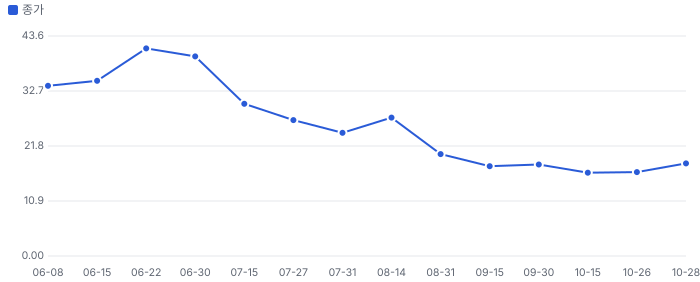
_출처 Fiscal.ai company_stock_prices. 2Q 콜(7/28)은 가이던스 첫 제시·수주 316% 증가에도 다음 날 −17% — 장비 마진 하락(19→14%)이 이유로 거론됐다(실적 정리 기준). 3Q 콜은 그 마진 우려를 17.1%로 해소._

공매도: 유동주식의 21.2%(Fiscal.ai). 대주주 AI Alpine(Luxembourg)의 자회사 구조 — 상장 보호예수(락업) 해제 일정은 424B4로 확인 필요(**미확인**).

## ② 실적 — 분기 매출과 컨센서스

**그림 2 · 분기 매출 (\$M)**

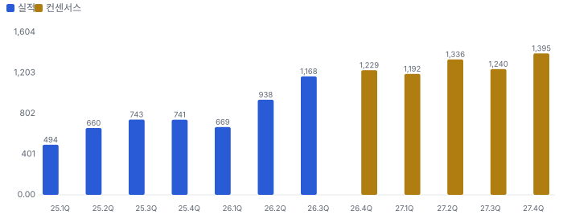
_실적 = SEC 10-Q·Fiscal.ai 분기 손익(일치 확인), 컨센서스 = Zacks 분기 평균(Fiscal.ai, 2026-10-29 갱신분 — 매출 추정은 2026-07-31~08-05 이후 미갱신, 제출 2명). FY2026 = \$4.0B(실적 3개 분기 + 4Q 추정, 가이던스 \$3.9~4.0B), FY2027 컨센서스 \$5.16B(+29%). Data provided by Zacks Investment Research, Inc., www.zacksdata.com_

**그림 3 · 부문별 분기 매출 — 장비 vs 서비스 (\$M)**

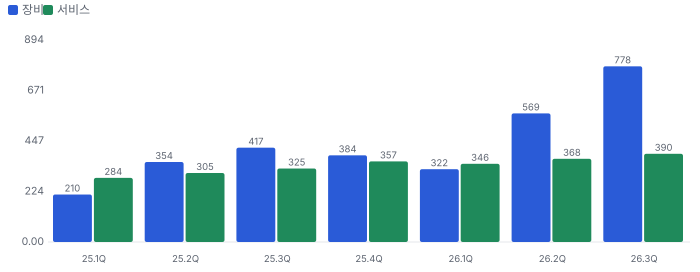
_장비 3Q +86% YoY(데이터센터 납품이 장비 매출의 60%), 서비스 +20%. 서비스는 아직 데이터센터 설치분이 아니라 기존 44GW 설치 기반의 부품 수요가 끈다 — 데이터센터 서비스는 3만 시간 오버홀(약 2030년)부터._

- 장비 조정 EBITDA 마진 1Q 7.1% → 2Q 14% → 3Q **17.1%**(2Q 콜의 '4Q 출구 10%대 후반'을 한 분기 앞당김), 판관비율 19→16→11%
- 서비스 조정 EBITDA 마진 3Q 32%(전년 28%)
- 고객 선수금(계약부채) 2025년 말 \$820M → 9월 말 **\$1.6B**(10-Q) — 고객 돈으로 증설을 대는 구조, 동시에 고객 신용이 회사 운전자본에 들어와 있다는 뜻
- 3Q GAAP 영업이익 \$194M(이익률 16.6%) — 상반기 IPO 관련 비용이 빠지며 GAAP과 조정치 차이가 좁아졌다

## ③ 병목 → 해결 기술 → INNIO의 자리 (엔지니어 관점)

**병목:** AI 데이터센터는 전력망 접속을 기다릴 수 없다. 회사 발표 기준 미국 전력망 연결 대기는 2000년대 2년 미만에서 현재 6년 초과(회사 인용치, 미검증). 그래서 '계통 밖(behind-the-meter)' 현장 발전이 브리지·주전원으로 쓰인다 — INNIO 잔고·슬롯의 데이터센터분 94%가 비상용이 아니라 **주전원(prime power)**(2Q 콜).

**현장 발전 기술 비교 — 데이터센터 주전원 관점 (회사 주장은 표시)**
| 기술 | 대표 기업 | 강점 | 약점·확인할 것 |
|---|---|---|---|
| 왕복동 가스엔진 | INNIO(Jenbacher)·캐터필러·바르질라·커민스 | 모듈(수 MW 단위) N+1 구성, 빠른 기동·부하 추종, 물 사용 거의 없음(Type 6 0.1L/MWh 미만 — 회사 주장) | 대수가 많아 정비 인력·부품 수요 큼(= INNIO 서비스 매출의 원천), NOx 배출 인허가 |
| 항공 전용(aeroderivative)·산업용 가스터빈 | GE 베르노바·지멘스 에너지 | 단위 출력 크고 부지 효율 | 급격한 부하 변동 추종·부분 부하 효율, 냉각수(터빈 최대 약 200L/MWh — INNIO 비교치), 납기 장기화 |
| 고체산화물 연료전지 | 블룸 에너지 | 연소 없음·배출 낮음, 모듈 | kW당 비용·스택 수명(교체 주기) |
| 계통 + 배터리 | 유틸리티·ESS | 연료 리스크 없음 | 접속 대기 6년 초과가 병목 그 자체 |

**엔지니어 해석(가설):** AI 학습 부하는 수천 개 GPU가 동기화 단계마다 함께 오르내려 수 초 단위로 MW급 변동을 만든다. 회전 관성이 있는 다수의 왕복동 엔진은 이 변동을 나눠 받기 쉽고, 한 대가 서도 전체 출력의 일부만 빠진다(N+1). 대신 엔진 대수가 많을수록 오버홀 사건도 많아진다 — **장비 판매가 곧 미래 서비스 매출의 설치 기반**이 되는 구조가 INNIO 밸류의 핵심 고리다(신규 설치분 MW당 연 \$50K 이상, 기존 약 \$30K — 3Q 콜, 경영진 추정·현재가).

> **금지표 점검:** '명목 캐파(2030년 10GW 초과) → 판매 가능 생산량'은 가동률·수율·램프 일정으로 따로 본다. 슬롯 예약은 환불 불가 선급금이 있지만 회사가 잔고/슬롯 GW 분할을 공개하지 않는다('앞으로도 안 함', 2Q 콜) — '협력·예약 → 매출 확보'로 바로 잇지 않는다.

## ④ 밸류의 핵심 변수 — 지금 가격을 정당화하는 손익분기

**그림 4 · 기본 시나리오 가치 = 시가총액(1.0배)이 되는 동인 값 — 현재 가정 vs 필요값**

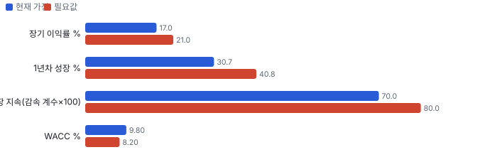
_DCF 기본 시나리오(가치/시총 0.78배, Fiscal.ai 원자료)에서 동인 하나만 움직여 1.0배가 되는 값(Chiip 계산, 이분법). 감속 계수 0.80 = 2027년 이후 성장이 기본보다 약 2년 더 오래 간다는 뜻._

**핵심 변수 1~2개 — 무엇이 가르나**
| 변수 | 지금 가정 | 가르는 자료 | 시점 |
|---|---|---|---|
| 성장 지속(주문 절벽 여부) | 2027년 +31% 뒤 감속(0.70) | 4Q 장비 수주·12개월 B/B, 2029~31 슬롯의 주문 전환(회사: 6~18개월) | 2027-02 4Q 실적 |
| 장기 이익률 | 조정 EBITA 19%(4년차) → 17% | 장비 마진 17% 유지 + 서비스 비중, 경쟁 증설에 따른 \$/kW | 매 분기 |

## 어닝콜 변화·컨센서스·멀티플 프리미엄·EPS 리비전

**방법:** 직전 콜(2026-07-28) → 최신 콜(2026-10-27)에서 새로 나오거나 바뀐 항목을 DCF 기본 시나리오의 동인 이동으로 옮기고, 그 변화가 없었을 때(동인을 되돌린 DCF) 대비 주주가치 변화를 잰다. 확신도: 확정 1.0 · 회사 가이던스 0.8 · 경영진 목표·장기 발언 0.5 · 정황 0.3. '반복'은 직전 콜과 같은 말이라 가치 영향 0.

**직전 콜 대비 새로 나오거나 바뀐 내용 → 가치 영향 (DCF 기본 시나리오 주주가치 기준)**
| 항목 | 내용 | 직전 콜 | 최신 콜 | 모델 동인 이동 | 확신도 | 단독 Δ가치 | 확신도 가중 |
|---|---|---|---|---|---|---|---|
| F1 업데이트 | FY26 매출 가이던스 상향 | \$3.8~3.9B | \$3.9~4B | 기준연도 매출 +\$0.10B | 0.8 | +3.0% | +2.4% |
| F2 업데이트 | 그룹 조정 EBITDA 마진 가이던스 | 약 19% | 약 20%(장비 3Q 17.1% 조기 도달) | 출발 이익률 +1.0% | 0.8 | +0.7% | +0.6% |
| F3 신규 | 장비 \$/kW 공개·1H27 매출 추정 상향 | 수치 없음 | 3Q 약 \$650/kW, 앞으로 600 이상 | 1년차 성장률 +3.0% | 0.7 | +7.8% | +5.5% |
| F4 업데이트 | 수주잔고·슬롯 | \$6.6B·15GW+·2030까지 | \$8.0B·약 19GW·2031까지 | 성장 지속(감속 계수) +3.0% | 0.6 | +5.3% | +3.2% |
| F5 신규 | 신규 설치분 서비스 강도 | 상당히 높다(수치 없음) | >\$50k/MW/년(기존 약 \$30k) | 장기 이익률 +1.0% | 0.5 | +5.4% | +2.7% |
| F6 신규 | 서비스 EBITDA 장기 목표 | 2.5배 유지 또는 개선 | 2030년대 중반 4배 | 목표 이익률 +0.50% | 0.4 | +0.9% | +0.4% |
| F7 신규 | 고객 집중·신용 공개 | 과다 아님(수치 없음) | 2025 최대 고객 41%→향후 약 21%, 네오클라우드 무배정 | 할인율(WACC) -0.25% | 0.4 | +3.7% | +1.5% |
| F8 업데이트 | 순차입 감소 | \$1.69B(2Q, 리스 포함) | \$1.54B(3Q, 리스 포함) | 순차입 -\$0.15B | 1.0 | +1.4% | +1.4% |
| F9 신규 | 증설 CAPEX 가속 | 상반기 \$94M | 3Q \$93M(9개월 187) | 매출÷투하자본 -10.0% | 0.8 | -0.6% | -0.5% |
| F10 부정 | 3Q 수주 둔화 | 2Q \$2.3B, B/B 4.4 | 3Q \$2.2B(전력 546→265·압축 281→\$116M), B/B 3.3 | 성장 지속(감속 계수) -2.0% | 0.3 | -3.8% | -1.1% |
| F11 반복 | 취소·지연 없음, 서비스 고한자릿수 성장 | 같음 | 같음 | — — | 1.0 | +0.0% | +0.0% |
| **합계** | 단독 합 / 확신도 가중 합 |  |  | 동시 적용 +27.0% |  | **+23.8%** | **+16.0%** |

**그림 5 · 콜 변화 항목별 주주가치 영향 (%)**

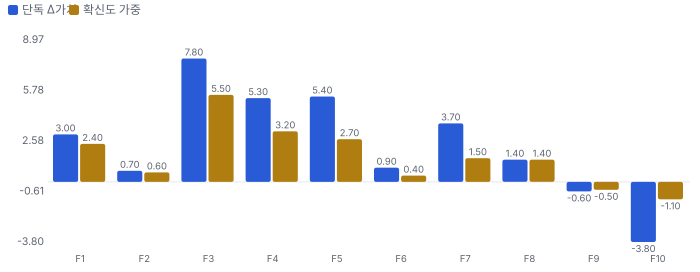
_직전 콜 정보만으로 본 가치 8.51 → 최신 \$10.80B(시가총액 13.79의 0.62배 → 0.78배)_

**읽는 법:** 확신도 가중 합 +16.0%이 '이번 콜로 기업가치가 얼마나 바뀌었나'에 대한 Chiip 기준값이다. 단독 합(+23.8%)과 동시 적용(+27.0%)의 차이는 동인끼리 곱해지는 상호작용(예: 성장 × 이익률). 경영진 발언(확신도 0.5 이하) 비중이 크면 다음 분기 숫자로 확인될 때까지 가치로 다 넣지 않는다.

**실적 vs 컨센서스 (발표 직전 Zacks 평균)**
| 분기 | 지표 | 실적 | 컨센서스 | 서프라이즈 |
|---|---|---|---|---|
| 2026Q2 | 매출 | \$937.7M | \$890.2M (2명) | +5.3% |
| 2026Q2 | EPS(조정) | \$0.08 | \$0.05 (3명) | +60% |
| 2026Q3 | 매출 | \$1,168M | \$1,024M (2명) | +14.0% |
| 2026Q3 | EPS(조정) | \$0.15 | \$0.11 (3명) | +36% |

**그림 6 · 분기별 서프라이즈 (%)**

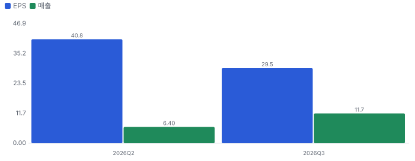

**컨센서스 리비전 — 2Q 콜 직전 Zacks 평균(2026-07-01·07-06) → 지금(2026-10-28), 같은 분기끼리**
| 분기 | 지표 | 직전 | 지금 | 리비전 |
|---|---|---|---|---|
| 2026Q4 | EPS | 0.170 | 0.173 (3명) | +2.0% |
| 2027Q1 | EPS | 0.160 | 0.160 (2명) | 0.0% |
| 2027Q2 | EPS | 0.175 | 0.180 (2명) | +2.9% |
| 2026Q4 | 매출(\$M) | 1,220 | 1,229 (07-31) | +0.8% |
| 2027Q1 | 매출(\$M) | 1,201 | 1,192 (07-31) | -0.7% |
| 2027Q2 | 매출(\$M) | 1,312 | 1,336 (08-05) | +1.8% |
| **합계 3분기** | EPS | 0.505 | 0.513 | **+1.7%** |
| **합계 3분기** | 매출(\$M) | 3,734 | 3,757 | **+0.6%** |

**그림 7 · 같은 기간 주가 변화 분해 = EPS 리비전 × 멀티플 변화 (%)**

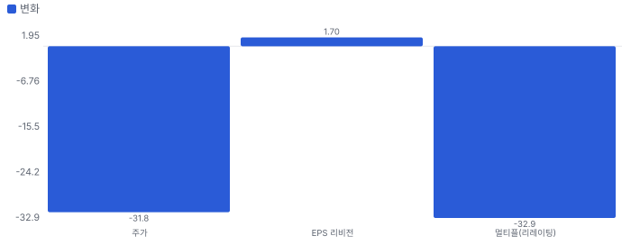
_(1 + 주가 변화) = (1 + EPS 리비전) × (1 + 멀티플 변화). 주가 = 7/27 종가 \$26.92 → 10/28 \$18.35, EPS 리비전 = 위 표 Zacks 같은 분기 합_

**해석:** 이 기간 주가 −31.8% 중 EPS 추정 변화가 +1.7%, 멀티플 변화가 −32.9% — 주가를 움직인 것은 **멀티플(시장이 붙이는 배수) 변화**다. 이익 추정은 그대로이거나 조금 올랐는데 주가가 내렸다면 시장은 숫자가 아니라 지속성·위험(할인율)을 다시 매긴 것이다. 단, 3Q 콜(10/27) 이후 Zacks 매출 추정은 아직 갱신되지 않았다(마지막 07-31~08-05) — 3Q 서프라이즈(+14%)가 반영되면 리비전 몫이 커질 수 있다.

리비전 출처: Fiscal.ai company_analyst_estimates(Zacks, history) — 직전 = 2Q 콜(7/28) 직전 마지막 평균, 지금 = 2026-10-28. **한계:** 분기 추정 제출이 2~3명뿐이고 매출 추정은 8월 초 이후 미갱신이라 리비전은 신뢰성 있게 측정되지 않는다 — 방향 참고용. 10/29 리포트(구 원천 easyconomics, 반올림 단위)는 +4.3%로 계산했다. Zacks 연간 FY2026 매출 \$3.86B는 분기 합(\$4.00B)과 맞지 않아 분기 합을 쓴다. Data provided by Zacks Investment Research, Inc., www.zacksdata.com

**멀티플 프리미엄 — 동종 중앙값 대비 (성장 조정 = 배수 ÷ 최근 분기 전년 대비 매출 성장%, 한 분기 성장이라 변동이 크다)**
| 지표 | 대상 | 동종 중앙값(범위) | 프리미엄 | 성장 조정 프리미엄 |
|---|---|---|---|---|
| EV/EBITDA | 28.4배 | 20.4배 (12.4~108.5, 5사) | **+39%** | -73% |
| EV/매출 | 4.4배 | 4.4배 (2.1~17.6, 5사) | **+0%** | -75% |

**그림 8 · 멀티플 프리미엄 (%) — 0 = 동종 중앙값**

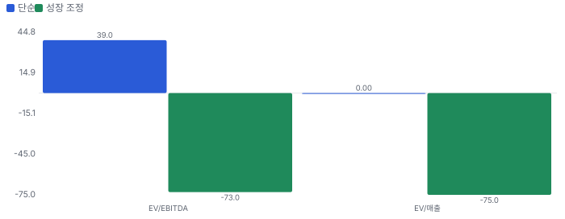

## 내러티브 — 멀티플 프리미엄과 리비전을 끌어올리는 이야기

> **한 줄:** '데이터센터 현장 가스엔진 발전'이 상장 프리미엄을 만들었지만, 2Q 콜 이후 EPS 추정이 +1.7%(Zacks, 제출 2~3명)로 거의 그대로인 사이 배수가 −32.9% 무너져 '2028년 이후 주문 절벽' 이야기가 지배 · 동종 대비 멀티플 차이 +0% 중 회사 고유 몫 −39%(멀티플 엔진) — 내러티브가 설명해야 하는 크기 · 리비전 경로로 숫자가 된 몫은 아직 작다(3Q 콜 후 매출 추정 미갱신) · 단계 컨센서스, 쏠림 낮음

**내러티브 요인 — 누가 믿고, 멀티플·리비전 중 어디로 작동하나**
| 요인 | 셀사이드 | 바이사이드 | 리테일 | 작동 경로 | 숫자로 바꾸면 | 상태 | 반증 조건 |
|---|---|---|---|---|---|---|---|
| 데이터센터 현장 발전(전력망 접속 대기) | 강 | 중 | 약 | 멀티플+리비전 | 잔고 \$8B·슬롯 19GW(3Q 콜) | 유지 | 4Q 수주 12개월 B/B 2.0 미만(2027-02) |
| 2028년 이후 주문 절벽(약세) | 중 | 강 | - | 멀티플 | EPS 추정 +1.7%인데 주가 −31.8% = 배수 −32.9% | 강화 | 2029~31 슬롯의 주문 전환 공시 |
| 설치 기반 서비스 | 중 | 중 | - | 리비전 | 서비스 강도 MW당 연 \$50K 이상(경영진 발언, 확신도 0.5) | 유지 | 서비스 마진 하락·고객 자체 정비 확대 |

- **데이터센터 현장 발전(전력망 접속 대기)** — 전력망 접속을 기다리는 데이터센터가 현장 가스엔진으로 전력을 직접 확보한다 (바뀌는 입력: 성장(수주)·가격(\$/kW)) [리포트 어닝콜 절]
- **2028년 이후 주문 절벽(약세)** — 현장 발전은 전력망이 따라잡기 전까지의 다리일 뿐이라 주문이 꺾인다 (바뀌는 입력: 성장 감속·이익률) [리포트 판단 문장]
- **설치 기반 서비스** — 신규 설치분이 MW당 연 \$50K 이상의 서비스 매출을 만든다 (바뀌는 입력: 이익률·지속성) [3Q 콜(리포트)]

**셀사이드(IB 애널리스트)**
| 지표 | 값 | 추세·해석 | 출처 |
|---|---|---|---|
| 애널리스트 의견(Zacks) | 11명 — 강력 매수 6·매수 2·보유 3·매도 0 | 커버리지는 넓지만 매출 추정 제출은 2명뿐 | Fiscal.ai analyst_ratings·estimates — Data provided by Zacks Investment Research, Inc., www.zacksdata.com |
| 목표가 평균·범위(Zacks) | \$35.6 (\$22~\$41, 10명) | 10/28 종가 \$18.35 대비 평균 +94% — IB 기대의 증거(Chiip 목표가 아님) | 같은 곳 |
| 3Q 콜 질문 증권사 | Morgan Stanley, Goldman Sachs, RBC, JP Morgan, Bank of America, Baird, Citigroup, BNP Paribas | 질문 초점 = 수주 지속·슬롯·백로그 신용·서비스 마진 | Fiscal.ai ir_events_transcript(q3-2026) 화자 목록 |

**셀사이드(IB 애널리스트) 해석:** 질문 초점이 수주 지속·슬롯 시점·백로그 신용 질에 몰렸다 = 사이클 정점 걱정

**바이사이드(기관 투자자)**
| 지표 | 값 | 추세·해석 | 출처 |
|---|---|---|---|
| 13F 기관 보유 | 미공개(상장 2026-06 — Fiscal.ai '아직 없음') | 첫 13F(3Q) 공시는 11월 중순 | Fiscal.ai institutional_holders |
| 펀드 레터 언급 | 0건 | 헤지펀드 레터에 아직 등장하지 않음 — 바이사이드 논지 미형성 | Fiscal.ai company_fund_letters |
| 공매도 비중(유통 주식) | 21.2% | 약세 베팅의 크기 | 같은 곳 |

**바이사이드(기관 투자자) 해석:** 공매도 비중이 높다(약세 베팅이 큼) — 배수 축소의 한 축

**리테일(레딧·텔레그램·X)**
| 지표 | 값 | 추세·해석 | 출처 |
|---|---|---|---|
| 레딧 언급(ApeWisdom) | 상위 목록 밖(언급 적음) | 리테일 관심 낮음 | apewisdom.io 2026-10-29 23:52 |
| 텔레그램 공개 채널 언급(7일) | 0건 | 국내 투자 채널 관심 없음 | knowledge/models/discovery/attention.csv 2026-10-29 |
| Seeking Alpha 색인 제목(7일) | 8건 | 미국 개인 투자자 글은 있음 | 같은 곳 |

**리테일(레딧·텔레그램·X) 해석:** 리테일 관심이 낮다 — 가격은 기관이 정한다

**언론·업계**
| 지표 | 값 | 추세·해석 | 출처 |
|---|---|---|---|
| 글로벌 언론 언급(7일) | 40건 | 실적·데이터센터 전력 맥락 | attention.csv |

**언론·업계 해석:** 언론은 데이터센터 전력 병목의 수혜주로 다룬다

**읽는 법:** '멀티플' 요인은 같은 이익에 더 높은 배수를 주게 하는 이야기(지속성·위험 감소·희소성), '리비전' 요인은 추정 이익 자체를 올리는 이야기(수주·가격·이익률). 회사 고유 프리미엄이 큰데 리비전 근거가 약하면 이야기가 숫자보다 앞서 있다(과밀 위험). 커뮤니티·IB 의견은 사실이 아니라 시장 기대의 증거다. 틀: Damodaran(2017) Narrative and Numbers, Shiller(2019) Narrative Economics.

## 밸류에이션 — 맥킨지·IB 방식(현금흐름 할인(DCF) 엔진)

**방법:** 맥킨지식 재무 재구성(NOPAT·투하자본·ROIC) → 바텀업 WACC → FCFF DCF + 가치 동인 계속가치(ROIC·성장) → 경제적 이익 항등 검증 → 시나리오·몬테카를로 → 가격 내포 기대(역DCF)와 매출 성장 기저율. 단위 \$B, 모든 가치는 **현재 시가총액 대비 배수**로 표기(목표주가 아님).

**할인율(WACC) 구성**
| 항목 | 값 |
|---|---|
| 무위험(미 10년) | 4.99% |
| 주식 위험 프리미엄 | 4.20% |
| 레버드 베타(바텀업) | 1.25 (무레버 1.15) |
| 국가위험 | 0.14% |
| 자기자본비용 | 10.37% |
| 부채비중 | 11% |
| WACC | **9.79%** |
| 영구성장 | 3.5% |

**시나리오별 DCF 주주가치 ÷ 현재 시가총액(\$13.8B)**
| 시나리오 | 확률 | 주주가치(\$B) | 지금 | 5년 뒤(할인 전) | 5년 매출 CAGR | 5년차 영업이익률 |
|---|---|---|---|---|---|---|
| 기본 | 50% | 10.8 | **0.78배** | 1.24배 | 18.4% | 18% |
| 강세 | 30% | 18.9 | **1.37배** | 2.17배 | 27.5% | 20% |
| 약세 | 20% | 6.6 | **0.48배** | 0.75배 | 10.0% | 17% |

**읽는 법:** '배'는 PER·EV/매출 같은 멀티플이 아니라 **DCF로 계산한 주주가치 ÷ 지금 시가총액**이다. 1.0배 = 그 시나리오 가정이 지금 주가와 같은 가치, 0.3배 = 가정대로면 주가의 30%만 현금흐름으로 설명된다. '5년 뒤'는 5년 뒤 시점의 주주가치(그때 돈, 할인 전)를 지금 시가총액으로 나눈 값 — 지금 사서 5년 들고 있을 때 그 시점 내재가치가 지금 가격의 몇 배인가. 매년 약 WACC만큼 커진다(배당 없음, 적자 현금흐름은 차입으로 메운다고 가정).

기본 시나리오 분해: 기업가치 12.4 = 1~10년 현금흐름 현재가치 5.5 + 11년차 이후(계속가치) \$6.9B(초기 재투자가 커서 1~10년 합이 음수면 계속가치가 기업가치의 100%를 넘는다) · 순현금 -1.6 · ROIC 1년차 34% → 5년차 37% · 경제적 이익 항등 오차 2.9e-16(DCF와 EP 가치가 같아야 정상) · 할인율 +50bp → 가치 -6.9%

**그림 9 · 몬테카를로 3,000회 — 지금 가치/시가총액 분포 (%)**

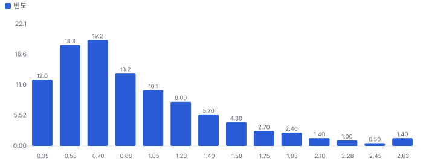
_P10 0.42 · P50 0.80 · P90 1.64 · 기대 0.94배 · 30% 이상 고평가 확률 40% · 5년 뒤 ≥1.5배 39% · ≥2배 21% · ≥3배 6% · ≥10배 0%_

**그림 10 · 가격 내포 기대 vs 필요 성장 (5년 매출 CAGR %)**

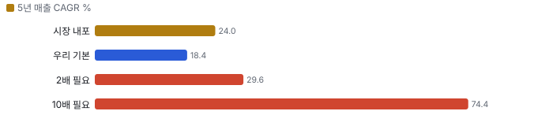
_시장 내포 기저율 상위 18%(n=163, \$1~10B) · 기본 기저율 상위 33%(n=163, \$1~10B) · 2배 필요 성장 기저율 상위 12% · 10배 필요 성장 기저율 상위 0% — 기저율: 같은 매출 규모 미국 상장사가 실제로 달성한 5년 CAGR 분포(SEC 재무)_

**민감도 — 기본 시나리오 가치/시총(매출 경로 고정, 장기 이익률 × 매출÷투하자본)**
|  | 매출÷투하자본 0.75 | 매출÷투하자본 1.5 | 매출÷투하자본 2.5 | 매출÷투하자본 3 |
|---|---|---|---|---|
| 장기 이익률 15% | 0.22 | 0.51 | 0.62 | 0.65 |
| 장기 이익률 19% | 0.44 | 0.72 | 0.83 | 0.86 |
| 장기 이익률 30% | 1.03 | 1.31 | 1.43 | 1.45 |
| 장기 이익률 40% | 1.57 | 1.85 | 1.96 | 1.99 |

매출÷투하자본 = 매출 1달러를 늘리는 데 드는 설비·운전자본(높을수록 가볍다). 장기 이익률은 4년차 목표와 이후 수렴값을 같이 바꾼 것. 계속가치는 RONIC = WACC(11년차 이후 성장은 가치를 만들지 않는다는 맥킨지 보수 가정) · 다른 축: WACC −1%p 0.91배 · WACC +1%p 0.68배 · RONIC 20%(11년차 이후 성장이 가치 창출) 0.93배

**동종 레인지와 펀더멘털 내재 멀티플 (EV/매출, 최근 12개월)**
| 회사 | EV/매출 | 성장 | 영업이익률 | ROIC 영업권 포함/제외 | 매출÷투하자본(영업권 제외) | 펀더멘털 내재 | 시장÷내재 |
|---|---|---|---|---|---|---|---|
| CAT | 4.4 | 20% | 18% | 21% / 24% | 1.76 | 2.3 | 1.89 |
| CMI | 2.2 | 3% | 11% | 17% / 22% | 2.64 | 1.0 | 2.20 |
| GEV | 5.2 | 17% | 6% | - / - | - | - | - |
| BE | 17.6 | 111% | 15% | 19% / 19% | 1.70 | 3.6 | 4.86 |
| WRT1V | 2.1 | 7% | 13% | 99% / - | 9.95 | 1.4 | 1.49 |
| **동종 중앙** | 4.4 |  |  |  |  |  | 2.05 |
| **INNIO** | 4.4 |  |  |  |  | 3.5 | 1.24 |

**그림 11 · EV/매출 — 과거·동종·펀더멘털·합리적 멀티플 (배)**

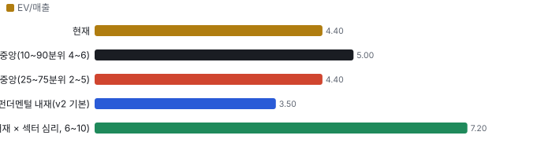
_펀더멘털 내재 = 같은 WACC·계속가치 규칙으로 각 회사의 성장·이익률·자본 회전율을 자본화한 EV ÷ 매출. 섹터 심리 = 동종의 시장 ÷ 내재 배율_

**할인·프리미엄 분해:** INNIO의 EV/매출은 동종 중앙 대비 **+0%** = 동종과 같은 섹터 심리를 받는다면 펀더멘털(성장·이익률·ROIC)로 정당한 몫 +65% × INNIO에만 얹힌 기업 고유 몫 **-39%**(두 몫을 곱하면 전체). 심리를 빼고 펀더멘털만 비교하면 동종 중앙 내재 대비 +91%. 기업 고유 몫이 양(+)이면 시장이 동종보다 더 큰 기대를 얹은 것(할인이 덜 됐다), 음(−)이면 더 할인한 것이다 — Rhodes-Kropf·Robinson·Viswanathan(2005)의 '기업 고유 오차 vs 섹터 오차' 분해 방식.

**합리적 멀티플:** 7.2배(섹터 심리 25~75분위 6.3~10.1배) → 주주가치 ÷ 시가총액 **1.72배**(1.50~2.46배). 현재 4.4배와의 차이가 시장이 동종보다 더 얹은 기대다.

한계: 동종 영업이익률은 GAAP(인수 무형자산 상각 포함)이라 인수가 큰 CMI, GEV, WRT1V는 내재 멀티플이 낮게·심리 배율이 높게 나온다 → 합리적 멀티플이 위로 치우칠 수 있다(상각 전 이익 EBITA로 바꾸면 낮아질 가능성). 동종 성장은 최근 분기 전년 대비, 표본 5곳 — 방향 판단용.

동종 4사 회귀(시장 EV/매출 = -5.9 + 5.98 × 펀더멘털 내재, R² 0.88) — Bhojraj·Lee(2002)의 '펀더멘털로 정당화되는 멀티플'. INNIO에 대입하면 15.3배. 표본이 작아 참고용.

**ROIC에 비례하는 정상 상태 멀티플 (맥킨지 가치 동인: EV/NOPAT = (1 − g/ROIC) ÷ (WACC − g))**
| ROIC | EV/NOPAT | EV/매출 @영업이익률 15% | EV/매출 @영업이익률 22% | EV/매출 @영업이익률 30% | EV/매출 @영업이익률 40% |
|---|---|---|---|---|---|
| 10% | 10.3 | 1.2 | 1.7 | 2.3 | 3.1 |
| 15% | 12.2 | 1.4 | 2.0 | 2.7 | 3.7 |
| 20% | 13.1 | 1.5 | 2.2 | 3.0 | 3.9 |
| 30% | 14.0 | 1.6 | 2.3 | 3.2 | 4.2 |
| 50% | 14.8 | 1.7 | 2.4 | 3.3 | 4.4 |

정상 상태 교차 확인: DCF 기본 시나리오의 5년차 ROIC 36%·영업이익률 18%이면 정상 상태 EV/NOPAT 14.3배(5년차 EV/매출 2.1배). 이를 지금으로 할인하면 주주가치 ÷ 시가총액 0.92배 — 고성장 기업은 현재 멀티플이 아니라 정상 상태 멀티플을 할인해 비교한다(맥킨지 『Valuation』 멀티플 장).

**데이터 검증 — 원자료(Fiscal.ai·SEC) ↔ 밸류에이션 입력 대조 10.0/10**
| 검사 | 결과 | 내용 |
|---|---|---|
| 원자료 스냅숏 | 통과 | 조회 시각 2026-10-30T01:00:00+09:00 |
| 시가총액 대조 | 통과 | 가격 18.35 × 표지 주식 0.75 = 13.76 vs 원자료 개요 13.7625 |
| 가격 일치 | 통과 | 18.35 vs 18.35 |
| 현금·차입 대조 | 통과 | 현금 1.1958 vs 1.1958 · 차입(리스 포함) 2.8174 vs 2.8174 |
| TTM 매출 = 4분기 합 | 통과 | 3.5148 vs 3.5148(4분기) |
| TTM 영업이익 = 4분기 합 | 통과 | 0.3797 vs 0.3797 |
| 투하자본 = 재무상태표 | 통과 | 1.9678 vs 자기자본+차입+리스−현금 1.968 |
| 연간 컨센서스 = 분기 합 | 통과 | FY2026 4.0033 vs 4.0033 · FY2027 5.1635 vs 5.1635 |
| 회사 가이던스 반영 | 통과 | 회사 3Q 실적 보도자료·콜(2026-10-27, Fiscal.ai ir_events: press_release·transcript q3-202 |
| 희석 주식(출처·같은 날짜) | 통과 | 잠재 주식 0.0017 vs SEC 0.0017 · 기본 주식 날짜 2026-09-30 / 희석 날짜 2026-09-30 |
| 어닝콜 톤 = 실적 레이더 | 통과 | 사용 up · 레이더 기준 up(톤 변화 0.2, 가이던스 raise) |
| 동종사 4곳 이상·기준 표기 | 통과 | 5곳 · 기준 ttm |
| 매출·이익률 기준 명시(SBC 처리) | 통과 | 매출 gaap · 이익률 gaap |

**동인 출처 — 어느 자료가 어느 변수가 됐나**
| 동인 | 출처·값 |
|---|---|
| rev0 | 회사 가이던스 중간값 [3.9, 4.0] (회사 3Q 실적 보도자료·콜(2026-10-27, Fiscal.ai ir_events: press_release·transcript q3-2026) — FY2026 매출 \$3.9~4.0B 상향) |
| growth | 컨센서스 1년차 30.7% |
| margin | 1년차 컨센서스 17.3% 고정 → 목표 19%(4년차, 덮어쓰기) → 장기 수렴 17% |
| s2c | TTM 매출 ÷ 투하자본(평균 근사) 1.786 → 덮어쓰기 3.0 |
| range | 고·저 추정 없음 — 1년차 성장 ±40% |
| probs | 어닝콜 톤 'up' 규칙 {'bear': 0.2, 'base': 0.5, 'bull': 0.3} |
| overrides | 목표 조정 EBITA 이익률 19%(4년차): 장비 마진 3Q 17.1% 도달 + 서비스(마진 32%) 비중이 2030년대 확대 — 동종 CAT 22%·Wärtsilä 14%·CMI 12% 사이, 장기 17%로 수렴 / 매출÷투하자본 3.0: TTM 1.9는 인수 영업권 \$1.67B가 섞인 값 — 증분 기준으로는 고객 선수금(9개월 +\$782M)이 운전자본을 대고 CAPEX는 매출 증가분의 약 20%(TTM \$291M ÷ 매출 증가 \$1.28B) → 증분 3~5, 보수적으로 3 / SBC 0.2%: 3Q SBC \$2.7M ÷ 매출 1,168 |
| shares | 완전 희석 = 기본 0.75(2026-09-30) + 옵션·RSU·워런트·전환 0.0017 — SEC XBRL AntidilutiveSecuritiesExcludedFromComputationOfEarn |

> 의사결정 보조(투자자문 아님): ① 매수 매력: 연 기대수익 +8.2% (자기자본비용 10.4% 대비 -2.2%p) · 자본비용 초과 확률 33% · 안전마진 0.42 → 정량 신호 약함 / ② 위험 예산 지표(이론): 0% — 기대수익이 자기자본비용에 못 미침(무위험 대비 켈리 54%는 참고) · 5년 하위10% -34% · 30%+ 손실 확률 12% / ③ 상방(5년): 기대 1.48배 · 2배 21% · 3배 6% · 10배 0% · 상위10% 2.57배

## 수급 — 누가 왜 샀나(Chiip Flow)

> **한 줄:** 최근 20거래일 거래의 리테일 몫은 4.5%(직전 60일 3.8%) — 거래는 주로 기관이 만든다. 기관 자금 흐름(CMF 20일) +0.35로 기관 매집 쪽, 리테일 매수 압력 z +0.31로 리테일 방향 뚜렷하지 않음. 이상 거래일에 늘어난 거래량의 94%가 기관 몫.

**그림 12 · 일별 거래량 분해 — 리테일 근사(도매 체결사) vs 기관(거래소·다크풀) (천 주)**

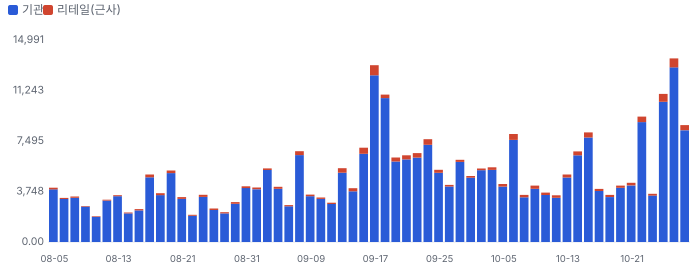
_리테일 = 장외(TRF) 거래량 × 그 주 FINRA 비ATS 리테일 도매 체결사 비중(최근 2주는 직전 4주 평균 — 추정). 기관 = 전체 − 리테일._

**그림 13 · 기관 자금 흐름(CMF 20일)과 리테일 매수 압력(z ÷ 4로 같은 눈금)**

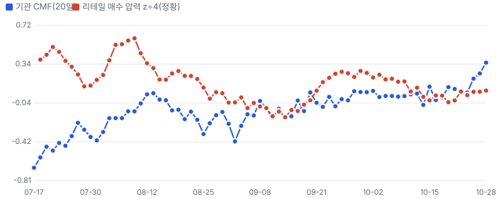
_CMF > 0: 기관 거래가 몰린 날 종가가 고가 쪽(매집). 리테일 압력: 장외 공매도 비율의 60일 z — 마켓메이커가 리테일 매수에 공매도로 물량을 대는 구조라 높을수록 리테일 순매수 쪽(정황)._

**이상 거래일 — 왜 늘었나, 누가 늘렸나(최근 120거래일, RVOL ≥ 1.8 또는 z ≥ 2)**
| 날짜 | RVOL | 주가 | 종가 위치 | 늘어난 거래량 | 증가분 분해 | 원인 태그 |
|---|---|---|---|---|---|---|
| 2026-09-17 | 3.6배 | +12.0% | -1.00 | 9.48M | 기관 93% · 리테일 7% | 원인 미확인(공개 사건 없음) |
| 2026-10-27 | 3.2배 | +2.1% | +1.00 | 9.36M | 기관 95% · 리테일 5% | 실적 발표 |
| 2026-09-18 | 3.0배 | +0.9% | +1.00 | 7.29M | 기관 98% · 리테일 2% | 분기 만기·지수 정기 변경 |
| 2026-10-26 | 2.6배 | +9.3% | +1.00 | 6.78M | 기관 94% · 리테일 6% | 원인 미확인(공개 사건 없음) |
| 2026-10-22 | 2.2배 | -10.4% | -1.00 | 5.11M | 기관 95% · 리테일 5% | 원인 미확인(공개 사건 없음) |
| 2026-10-15 | 2.0배 | +0.0% | +1.00 | 4.07M | 기관 94% · 리테일 6% | 원인 미확인(공개 사건 없음) |
| 2026-10-28 | 2.0배 | +8.1% | +1.00 | 4.33M | 기관 95% · 리테일 5% | 실적 발표 다음 날 · 레이더 기사 2건 |
| 2026-09-16 | 1.9배 | +5.2% | +1.00 | 3.35M | 기관 90% · 리테일 10% | 원인 미확인(공개 사건 없음) |

**주간 체결 장소별 비중 — FINRA 확정치(최신 주 2026-10-05, 약 2주 지연)**
| 주 시작 | 전체(주) | 거래소 | ATS(다크풀) | 리테일 도매 | 기타 장외 |
|---|---|---|---|---|---|
| 2026-08-31 | 20.47M | 48.8% | 39.8% | 3.3% | 8.2% |
| 2026-09-07 | 16.48M | 48.4% | 34.8% | 3.8% | 13.0% |
| 2026-09-14 | 40.52M | 52.4% | 33.0% | 5.5% | 9.1% |
| 2026-09-21 | 32.29M | 51.5% | 32.2% | 5.3% | 11.0% |
| 2026-09-28 | 26.23M | 59.7% | 24.9% | 3.3% | 12.1% |
| 2026-10-05 | 23.66M | 52.3% | 31.0% | 5.3% | 11.5% |

**읽는 법:** 리테일 몫이 늘면서 주가가 오르면 리테일 주도 랠리(되돌림 위험 큼), 기관 CMF가 +로 돌며 거래량이 늘면 기관 매집 쪽이다. 근거: 리테일 식별은 Boehmer·Jones·Zhang·Zhang(2021, JF)의 장외 도매 체결 방식, 자금 흐름은 Chaikin Money Flow. 한계: 도매 체결사 물량에 일부 기관 주문이 섞이고, 리테일 지정가 주문 일부는 거래소로 간다 — 근사치다. 지표일 뿐 매매 권유가 아니다.

## 가격 구간 — 월·주·일 피보나치와 겹침 구간

> **한 줄:** 현재가 \$18.35 — 바로 아래 지지 \$15(-17.8%, 강도 3.5). 가격 구간 지표일 뿐 매수·매도 권유가 아니다.

**지지·저항 겹침 구간(서로 다른 기준선이 ±1.2% 안에 모인 곳, 강도 = 겹친 기준선 수)**
| 구간 | 가격 | 현재가 대비 | 강도 | 겹친 기준선 |
|---|---|---|---|---|
| 지지 1 | \$15 | -17.8% | 3.5 | 50일 최저(거래 범위) · 라운드 \$15 · 일봉 스윙 저점 · 주봉 스윙 저점 |

**시간 단위별 피보나치 되돌림(\$)**
| 단위 | 지배 스윙 | 다리 | 23.6% | 38.2% | 50% | 61.8% | 78.6% |
|---|---|---|---|---|---|---|---|
| 월봉 | \$15.11(2026-10-22) → \$37.04(2026-07-06) | 하락 | 20.3 | 23.5 | 26.1 | 28.7 | 32.3 |
| 주봉 | \$15.11(2026-10-22) → \$37.04(2026-07-06) | 하락 | 20.3 | 23.5 | 26.1 | 28.7 | 32.3 |
| 일봉 | \$15.11(2026-10-22) → \$21.35(2026-10-06) | 하락 | 16.6 | 17.5 | 18.2 | 19.0 | 20.0 |

**그림 14 · 월봉 — 장기 스윙 되돌림**

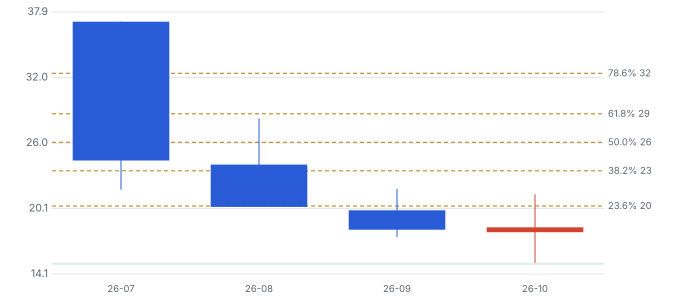
_지배 스윙: 확보 구간 최저↔최고 — 저점 \$15.11(2026-10-22) · 고점 \$37.04(2026-07-06), 하락 다리. 점선 = 피보나치 되돌림, 띠 = 겹침 구간(초록 지지·빨강 저항). 캔들: 빨강 상승·파랑 하락._

**그림 15 · 주봉 — 52주 스윙 되돌림**

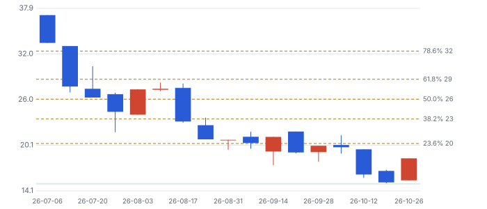
_지배 스윙: 최근 52주 최저↔최고 — 저점 \$15.11(2026-10-22) · 고점 \$37.04(2026-07-06), 하락 다리. 점선 = 피보나치 되돌림, 띠 = 겹침 구간(초록 지지·빨강 저항). 캔들: 빨강 상승·파랑 하락._

**그림 16 · 일봉 — 마지막 완료 스윙 되돌림(최근 90거래일)**

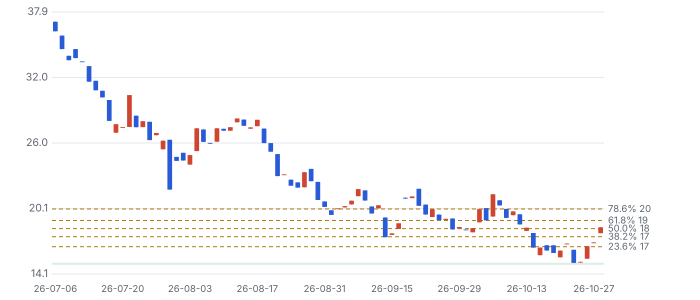
_지배 스윙: ATR 지그재그 12.0% 마지막 완료 다리 — 저점 \$15.11(2026-10-22) · 고점 \$21.35(2026-10-06), 하락 다리. 점선 = 피보나치 되돌림, 띠 = 겹침 구간(초록 지지·빨강 저항). 캔들: 빨강 상승·파랑 하락._

**기법과 근거:** 스윙은 ATR 지그재그(임계 = max(월 20%·주 10%·일 5%, 2.5×ATR14)), 되돌림 23.6~78.6%·확장 127.2·161.8%. 함께 본 기준선: 50·200일 이동평균과 50·150·200일 거래 범위 고저(Brock·Lakonishok·LeBaron 1992, JF), 라운드 넘버(\$50 단위, Osler 2003 JF·Osler 2000 FRBNY EPR). 피보나치 비율 자체의 학술 근거는 약하다 — 다수가 같은 선에 주문을 두는 데서 오는 효과로 보고, 여러 기준선이 겹친 구간만 강하게 본다. 상장 후 82거래일뿐이라 월·주봉 스윙은 상장 이후 전체 구간이다(장기 지지·저항으로 읽지 말 것).

## ⑤ 시나리오 — 2028년 말 시가총액 배수 (멀티플 기반, 자체추론)

**그림 17 · 2028년 말 주주가치 ÷ 현재 시가총액 (배, 할인 전)**

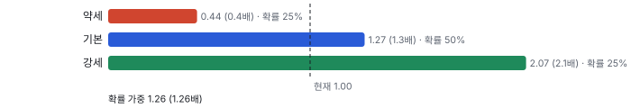
_확률 가중 1.26배(2028년 말, 할인 전) ≈ 지금 가치 약 1.03배(자기자본비용 10.4%로 2년 할인). P(10배) 1% 미만 판단._

> **두 방법의 차이(중요):** 위 시나리오(확률 가중 현재가치 약 1.03배)는 배수 기반이고, 바로 앞 '밸류에이션 — 맥킨지·IB 방식'의 현금흐름 DCF 기본은 0.78배(몬테카를로 기대 0.94배, Fiscal.ai 원자료)다. 차이의 원인은 ① DCF는 장기 이익률을 17%로 페이드(경쟁 증설 가정)하고 ② 증설 재투자(매출÷투하자본 3.0)를 비용으로 차감하며 ③ 2028년 이후 성장 감속을 명시하지만, 배수 시나리오는 2028년 EV/EBITDA 13배가 유지된다고 가정한다. **배수 13배가 유지되려면 시장이 2029~31년 주문 지속을 믿어야 한다** — 지금 멀티플이 2Q 이후 33% 빠진 것이 바로 그 믿음의 후퇴다.

## ⑥ 반대 검증 — 가장 강한 약세 논리

| 약세 논리 | 근거 | 가를 자료 |
|---|---|---|
| 주문 절벽(2028 이후) | 3Q 수주 \$2.2B < 2Q \$2.3B, 전력 솔루션 \$546M→\$265M·압축 \$281M→\$116M. 2027년 매진이라 지금 주문은 2029~31년분 — 멀수록 취소·연기 위험 | 4Q 수주·B/B, 10-K 잔고 해지 조항 |
| 경쟁 증설(가격 결정력 정점) | 높은 수익은 공급 증설을 부르고 투자자는 경쟁사 증설을 과소평가한다 — Greenwood & Hanson (2015), QJE 130(1). SemiAnalysis 공개 글(2026-10-19 'Datacenters 2027: +50GW … The Shortage Could Move to Chips')은 전력 부족이 칩으로 이동할 수 있다고 봤다(크라우딩 근거) | 캐터필러·바르질라·커민스·롤스로이스 mtu 가스 발전기 증설 발표, INNIO \$/kW 600 미만 |
| 고객 신용·집중 | 2025년 최대 고객 비중 41%(3Q 콜에서 처음 공개, 향후 약 21%는 예비 전망). 고객 선수금 \$1.6B가 운전자본을 대므로 고객 자금난은 곧 회사 현금흐름 문제. 공매도 유동주식 21% | 10-K 고객 집중 공시, 하이퍼스케일러 백투백 계약 비중 |
| 대주주 물량(오버행) | AI Alpine(사모펀드 계열) 자회사 — 락업 해제 시 매도 가능 | 424B4 락업 기간(미확인) |
| 레버리지·M&A | 순레버리지 2.1배, 인수 시 2.5배까지 허용(3Q 콜) — 배당 없음 | 4Q 순차입, M&A 공시 |

**다른 해석 1개:** 2Q 이후 멀티플 축소는 INNIO 고유 문제가 아니라 10월 '네오클라우드·데이터센터 개발사 신용' 재평가가 AI 전력 체인 전체 배수를 끌어내린 것일 수 있다. 가를 자료 = 같은 기간 블룸 에너지·GE 베르노바·베르티브의 멀티플 변화(동종 대비 INNIO만 더 빠졌는지) — 이번 리포트에서는 **미확인**.

## ⑦ 킬 조건과 체크리스트

**킬 조건 — 하나라도 충족되면 판단 철회**
| 조건 | 의미 |
|---|---|
| 4Q 장비 수주 12개월 B/B 2.0 미만 + 잔고 전분기 대비 감소 | 주문 절벽 시작 — 성장 지속 가정 철회 |
| 장비 조정 EBITDA 마진 2분기 연속 15% 미만 | 마진 회복이 일시적 — 이익률 가정 철회 |
| 경쟁 4사 중 2곳 이상 가스 발전기 대규모 증설 + INNIO \$/kW 600 미만 | 가격 결정력 정점(Greenwood & Hanson 경쟁 무시) |
| 잔고 취소·연기 공시 또는 최대 고객 비중 30% 이상 유지(10-K) | 신용·집중 위험 현실화 |

**체크리스트**
| 시점 | 무엇 | 의미 |
|---|---|---|
| 2026-12 전후(미확인) | 상장 락업 해제(424B4로 날짜 확인) | 수급 — 대주주 매도 가능성 |
| 2027-02 하순(날짜 미확인) | 4Q 실적: 인도 약 1.5GW, FY 조정 EBITDA \$780M 이상, 잔고 \$8.5B 이상, 수주·B/B | 성장 지속·마진 가정의 첫 검증 |
| 2027-03 | 10-K: 최대 고객 비중·잔고 해지 조항·슬롯 조건 | 신용·집중 위험 |
| 수시 | 텍사스 등 주 인허가, 경쟁사 증설, \$/kW | 킬 조건 감시 |

## 출처
- Fiscal.ai(MCP): company_profile·stock_prices(10/28 종가)·표준화 재무(손익·재무상태표 2026-09-30)·daily_ratios·segments, 조회 2026-10-30
- Fiscal.ai ir_events: 3Q26 press_release·transcript(q3-2026, 화자·Q&A), 2Q26 transcript(q2-2026)
- Zacks 컨센서스·의견·목표가: Data provided by Zacks Investment Research, Inc., www.zacksdata.com (https://www.zacksdata.com) — 분기 추정 제출 2~3명, 매출 추정 2026-07-31~08-05 이후 미갱신
- SEC XBRL companyfacts CIK 2109150 — 10-Q 2026-09-30(계약부채·희석 증권·CAPEX)
- 동종: Fiscal.ai CAT·CMI·GEV·BE·WRT1V(최근 12개월)
- 수급: FINRA 공개 자료(Reg SHO·ATS) — Chiip Flow
- 어닝콜 트랜스크립트는 라이선스 자료 — 요지만 자기 말로
- Bessembinder (2018) JFE 129(3) · Greenwood & Hanson (2015) QJE 130(1) · Rhodes-Kropf·Robinson·Viswanathan (2005) JFE
- SemiAnalysis 공개 글 제목(2026-10-19, 유료 본문 미사용) — knowledge/narratives/lens_semianalysis.md
- 앞선 판: outputs/tenbagger/reports/20261029_INIO.json(구 원천 easyconomics) — 이번 판은 Fiscal.ai로 다시 계산(4Q25 영업이익 \$78M로 정정, 리비전 Zacks 기준)
- 알파 7.2는 10/28 산정(구 모델) — 재산정 대상

_연구 후보이지 매수 권유가 아닙니다 · 공개 자료 기반 분석이며 투자 권유가 아님 · 1차 판정, 미검증 · Chiip ten-bagger_