# 텐배거 리포트 2026-11-02 — TTM Technologies — EPS는 42% 올랐고 주가는 39% 빠졌다, 쟁점은 N+M 일정과 순차입 \$2B다

> 2026-11-02 · TTM Technologies, Inc.(TTMI) · 기업: AI 데이터센터·네트워킹용 고다층(N+M) PCB와 국방 레이더·RF 부품·서브시스템을 만드는 미국 대형 PCB 제조사

## Chiip View

숫자는 좋고 값은 싸졌는데 재무상태표가 달라졌다. 3Q 매출 +60%, 조정 EBITDA 20.1%, 2027 EPS 가이던스 \$8.10~8.90이다. 8/6 뒤 FY2027 EPS 추정은 +42%, 주가는 −39%다. **10-Q로 다시 보니 순차입은 \$0.87B가 아니라 약 \$2.07B(추정)다.** 9/30 Epiq(소프트웨어 무선 장비 회사) \$1.1B와 10월 자사주 \$0.1B가 9/28 재무상태표 뒤에 있었고 지난 리포트가 이를 놓쳤다. TTM 조정 EBITDA의 3.1배이고 Ophir(MKS의 적외선·레이저 광학 사업) \$0.65B가 더해진다. N+M(서로 다른 층수를 맞붙인 비대칭 고다층 PCB) 지연이 일정인지 수요인지는 아직 못 가른다. 회사는 고객 일정이라 했지만 CEO는 복수 공급사도 언급했다. 목표주가는 \$109로 업사이드 +31%, 약세 다운사이드 −18%, 손익비 6.6이고 등급은 Buy다. 기본 시나리오 \$123(+49%)보다 낮은 것은 DCF 기본 업사이드가 0%라서다. Fwd 1Y P/E는 10.4배로 동종 중앙값 15.5배보다 33% 낮다. 시장 내포 5년 매출 CAGR은 15%로 기본 시나리오와 같다. 다음 확인은 12/1~2 콘퍼런스, 2027-01-01 PCB(인쇄회로기판) 조달 금지 시행, 2027년 2월 4Q 실적이다.

## 대시보드
| 항목 | 값 | 설명 |
|---|---|---|
| 주가 | \$82.94 | 고점 대비 -63% · 1년 +34% |
| 시가총액 | \$8.83B | EV \$10.90B |
| 업사이드 | +31% | 목표주가 \$109 · 다운사이드 -18% · 손익비 6.6 |
| 구매등급 | Buy | 애널리스트 6명: Strong Buy 4 · Buy 1 · Neutral 1 · Sell 0 · Strong Sell 0 |
| 멀티플 | Fwd 1Y P/E 10.4배 | 동종 중앙값 15.5배 |
| 가이던스 4Q26 | \$1,430M · \$1.80 | 컨센서스 \$1,435M · \$1.78 |
| 알파 | 7.1/10 | 텐배거 가능성 점수 |
| 이벤트 | 4Q26 실적(예상, 전년 2/4 기준. 날짜 미공지) | 2027-02-03 |

## 한 장 요약
- **기업가치를 결정하는 내러티브** TTMI의 값은 **N+M 보드의 램프 × 국방 잔고 − 부채 이자** 세 가지로 정해진다. 3Q 매출 \$1.20B(+60%), 조정 EBITDA 20.1%, 2027 EPS 가이던스 \$8.10~8.90까지 숫자는 올랐다. 주가는 고점 대비 −63%, Fwd 1Y P/E 10.4배로 동종 중앙값 15.5배보다 33% 낮다. 멀티플을 깎은 이유는 **일정과 부채**다. N+M 프로그램 3개 중 1개가 밀렸고, Epiq 인수 뒤 순차입은 약 \$2.07B(추정)로 2Q의 3.6배다.
- **밸류에이션 모델로 본 주가 상방은 어디까지인가?** **목표주가 \$109(+31%), 약세와 기본 사이(약세 쪽 26%)다.** 강세 \$181(+118%)는 Fwd 1Y P/E 15.7배를 강세 EPS에 적용한 값이다. 기본 \$123, 약세 \$68. 손익비 6.6, DCF 기준 업사이드 0%.
- **수주는 어디까지 왔나?** A&D(항공우주·방위) 프로그램 잔고(SPY-6(미 해군 함정 레이더)·APS-143(해상 감시 레이더)·Golden Dome(미국 본토 미사일 방어 구상)·제한 프로그램) 미확인, 100% 매출 \$2.00B · 90일 수주잔고 미확인, 100% 매출 \$1.30B · 장기 계약 잔여 이행의무 미확인, 100% 매출 \$0.46B. 확정으로 셀 수 있는 것은 A&D 잔고 \$2.0B다. 프로그램별 금액은 공개되지 않아 진척도는 미확인이고, N+M은 수주가 아니라 프로그램 램프로 읽어야 한다.
- **지금 가격은 무엇을 가정하나?** Fwd 1Y P/E 10.4배는 AI 랠리 전인 2023~25년 초 범위(8.7~13.1배) 안이다. 시장은 AI 보드 프리미엄을 거의 다 지웠다. 동종 중앙값 15.5배를 대면 \$82.94는 EPS 약 \$5.35를 뜻하고, 이는 FY2027 가이던스 하단 \$8.10보다 34% 낮다. 이익을 그만큼 깎는다기보다 이익이 몇 년 가느냐를 의심한다는 뜻이다. 현금흐름으로 풀면 5년 매출 CAGR 15%로 기본 시나리오와 같다. 그래서 DCF로는 싸지 않다.
- **왜 움직였나?** 고점 6/22 \$221.47에서 −63%다. 세 구간이다. 7월은 \$187에서 \$115로 빠졌고 업종 약세와 겹쳤으며 회사 고유 원인은 확인하지 못했다. 8/17 Epiq \$1.1B 차입 인수 8-K 뒤 이틀에 −17%였다. 10/22 3Q 실적날 −27.7%는 N+M 지연 탓이다. 10/26~27 회사가 약 120만 주를 샀고 CEO·이사도 10/28 매수했는데, 10/30 다시 −5.4%였고 원인은 확인하지 못했다. 8/6 뒤 FY2027 EPS 추정 +42%, 주가 −39%로 P/E가 −57%다.
- **3Q 콜에서 무엇이 바뀌었나?** 좋아진 것은 FY2026 매출 약 \$4.4B → \$4.47~4.49B, 2027 첫 가이던스, 조정 EBITDA 16.6% → 20.1%, A&D 잔고 \$2.0B다. 나빠진 것은 N+M이다. 2Q 콜의 하반기 약 \$600M이 약 \$364~378M으로 내려왔다. 이 값은 실제 3Q 데이터센터 매출 \$498.0M과 CEO가 말한 비중으로 계산했다. CEO가 말한 '\$400M의 31%'와 '200 약간 위'는 서로 맞지 않는다. 다음 콜에서 달러 금액을 다시 물어야 할 부분이다.
- **무엇이 바뀌면 판단이 달라지나?** 위쪽은 세 가지다. 4Q 데이터센터 매출 약 \$700M 달성, 지연 프로그램의 1Q27 양산, 1Q27 EBITDA 이익률 20% 이상이다. 아래쪽은 데이터센터 가이던스 2분기 연속 미달, 2027 가이던스 하향, 추가 대형 인수다.

## 한눈에 보기

**일봉**

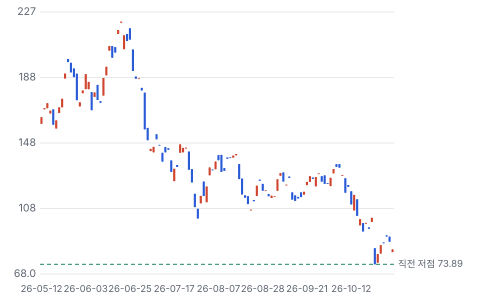

**주봉**

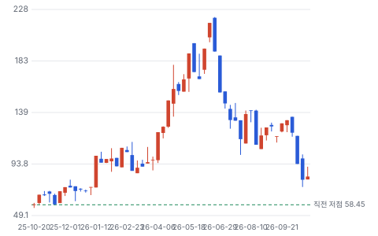

**월봉**

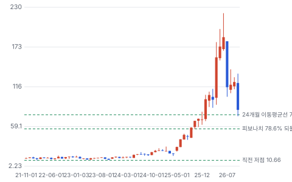

**분기 매출·EPS 실적과 컨센서스**

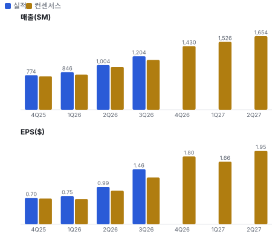

**EPS 리비전**

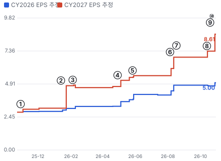

① 25-10-29 3Q25 실적 · EPS 리비전 +8%
② 26-01-13 1/13 +19.7% 급등, 원인 미확인 · EPS 리비전 +54%
③ 26-02-04 4Q25 실적 · EPS 리비전 -3%
④ 26-04-29 1Q26 실적 후 +15% · EPS 리비전 +10%
⑤ 26-05-27 Investor Day, 이익률 목표 상향 · EPS 리비전 +3%
⑥ 26-08-05 2Q26 실적, N+M 하반기 약 \$600M 시사 · EPS 리비전 +25%
⑦ 26-08-17 Epiq \$1.1B 차입 인수 발표 · 실적 창과 겹침
⑧ 26-10-13 N+M 캐파 \$400M 추가 8-K · EPS 리비전 +7%
⑨ 26-10-19 Ophir \$650M 인수 발표 · EPS 리비전 +0%
⑩ 26-10-22 3Q26 실적, N+M 지연으로 −27.7% · EPS 리비전 +17%

**밸류에이션 주가 시나리오**

**주가별 업사이드**

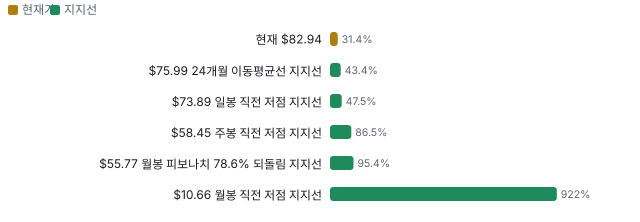

**어닝콜 변화별 주주가치 영향**

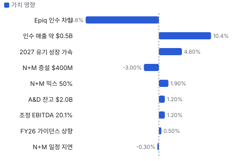

**최근 4개 분기 주가 변화 분석**

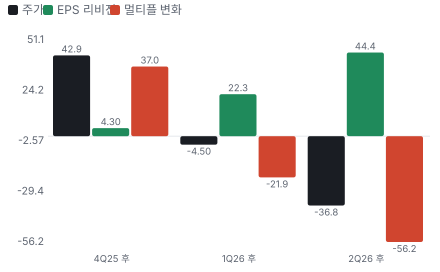

**멀티플 프리미엄**

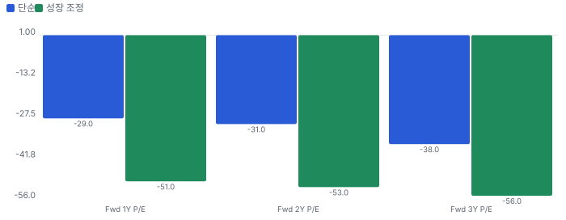

**합리적 멀티플**

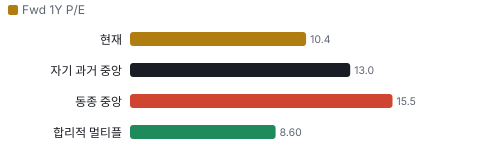

**일별 거래량 분해**

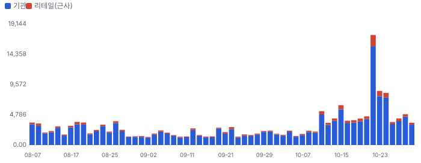

**기관 자금 흐름**

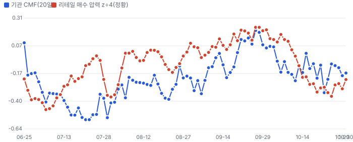

**몬테카를로**

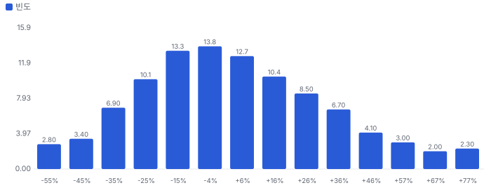

해석: 3,000번 중 1,517번(51%)에서 가치가 지금 주가 이상이었다. 지금 주가를 뒷받침하는 경우와 그렇지 않은 경우가 반반에 가깝다. 가운데 값은 1.00배이고, 열 번 중 여덟 번은 0.66~1.44배 사이에 든다.

## 내러티브

> **기업가치를 결정하는 이야기:** 매출의 성장축은 데이터센터·네트워킹(3Q \$498M, +115%)이고, 그중 N+M이 약 30%에서 2027년 50%로 간다. N+M 총이익률은 전사 평균보다 크게 높아 믹스가 곧 이익률이다. 바닥은 A&D다(3Q \$404.5M, 잔고 \$2.0B). 멀티플은 이 성장이 몇 년 가느냐와 차입 인수가 ROIC를 깎느냐로 정해진다. EPS는 EBITDA에서 분기 이자 약 \$34M을 뺀 값이라 부채가 곧바로 닿는다.

> **멀티플·EPS 프리미엄**
> **멀티플:** 지금은 프리미엄이 아니라 할인이다. Fwd 1Y P/E 10.4배는 6/30 37.4배에서 −72%이고 동종 중앙값 15.5배보다 33% 낮다. 6월의 프리미엄은 'AI 보드 희소성 + 국방'이 만들었고, 8/17 Epiq 차입 인수와 10/22 N+M 지연이 지웠다.
> **EPS:** EPS 추정은 강하다. FY2027 추정이 8/7 \$6.06에서 10/28 \$8.61로 +42%다. 같은 기간 주가는 −39%라 P/E가 22.5배에서 9.6배로 −57%다. 다만 이 추정은 Ophir를 빼고 있고 표본은 2~3명이다.

### 투자자들은 왜 열광했나

열광의 정점은 6월이었다. 첫째, 콘텐츠다. N+M은 기존 구조보다 보드 가치를 약 4배 올린다고 회사는 말한다. 둘째, 희소성이다. AI 서버·스위치 고다층 보드와 국방 인증을 함께 가진 미국 상장사가 드물다. 셋째, 이익률이다. 5월 Investor Day에서 EBITDA 목표가 16~18%로 올랐는데 3Q에 20.1%가 나왔다. 식은 이유도 같은 곳에 있다. 7월 하락은 AI 하드웨어 업종 약세와 겹쳤고 회사 고유 원인은 확인하지 못했다. 이어 8/17 Epiq 발표 뒤 이틀에 −17%, 10/22 N+M 지연으로 하루 −27.7%였다.

### 무엇이 기업가치를 바꾸나

> **구조적 체질 변화**
> **변화:** 보드 제조사에서 방산 전자 플랫폼으로 옮기는 중이다. CEO가 2025년 9월 Teledyne(미국 계측·방산 전자 회사)에서 왔고 13개월 동안 STG(스위스 PCB 회사 Swiss Technology Group), Epiq, Ophir 등 약 \$2.1B를 썼다. 재무 구조도 바뀌었다. 순차입이 1개 분기 만에 약 3.6배가 됐다.
> **증거:** 10-Q Note 13. 2026 상반기 STG \$369.1M, 9/30 Epiq \$1.1B, 10/19 Ophir \$650M 계약.
> **반증:** 인수 자산의 이익률이 전사를 못 넘거나 2027 ROIC가 낮아지면 체질 변화가 아니라 차입 확대다.

> **고부가 믹스 확장**
> **변화:** N+M이 데이터센터의 약 30%에서 2027년 50%로 간다. CFO는 N+M 총이익률이 전사 평균보다 크게 높고 2027 EBITDA 이익률이 200bp 이상 오른다고 말했다.
> **증거:** 3Q 조정 EBITDA 20.1%(2Q 16.6%). CEO는 일부 물량이 3Q로 당겨졌다고 했다.
> **반증:** 1Q27 조정 EBITDA 이익률 18% 미만

> **기술 혁신**
> **변화:** AI 서버의 전력·신호 병목을 보드에서 푸는 제품이 N+M이다. 다음은 Eau Claire(위스콘신주 도시) 혁신센터의 MSAP(세미 애디티브 미세 회로 공정)·SAP(세미 애디티브 회로 공정), 내장 수동소자, 광학 내장이다.
> **증거:** CEO 설명과 3Q 콜. 연구개발비는 3Q \$9.5M으로 매출의 1% 미만이다.
> **반증:** 차세대 플랫폼에서 보드 층수·면적이 줄거나 다른 인터커넥트가 대체한다.

> **실행 속도**
> **변화:** 해당 없음(회사가 주문에서 납품까지의 기간을 공시하지 않아 동종과 비교할 수 없다). 콜에서 확인되는 값은 CCL(동박적층판, PCB 원판)·T-glass(저열팽창 유리섬유) 소재 리드타임 12~24주 이상이고 납품 기간이 아니다. 증설은 기존 부지 방식이라 \$400M이 약 15개월에 끝난다.
> **증거:** 3Q 콜 B. Riley(미국 증권사) 질문. 동종의 같은 기준 값은 찾지 못했다.
> **반증:** 소재 부족이 매출 지연 사유로 공시된다.

> **M&A**
> **변화:** 시장이 가장 싫어하는 지점이다. Epiq는 시너지 반영 2027 EBITDA의 17.4배로 비쌌고 2027 EPS를 희석한다. Ophir는 약 10배로 낫다. CFO는 큰 인수는 당분간 끝이라고 말했다.
> **증거:** 8-K와 보도, 3Q 콜. 영업권·무형자산 \$1.11B(9/28)는 Epiq 전 값이다.
> **반증:** CFO 발언 뒤 추가 대형 인수가 나오면 멀티플 할인이 굳는다.

> **정책·입법 연관성**
> **재정정책:** FY2027 Golden Dome 요청 약 \$17.5B 중 98%가 재정조정 법안에 달렸다. 군수품 재고 복구 약 \$90B도 요청돼 있다. 회사는 3Q에 Golden Dome 수주를 언급했으나 금액은 없다. 예산 요청, 하원 군사위 NDAA(미국 국방수권법) 수정안 보도. 본회의 통과는 찾지 못했다. 반증: 재정조정 법안이 무산되거나 임시예산이 새 사업을 막는다. 의회 동의 5/10 — 하원 4/5(하원 군사위 NDAA 수정안 확인, 본회의는 미확인) · 상원 1/5(상원 단계는 확인하지 못했다, 미확인).
> **행정명령:** 2025년 1월 행정명령이 Golden Dome을 시작했고 2025년 재정조정법이 약 \$25B를 줬다. 2025 재정조정법 세출 반영. 반증: 사업 축소나 자금 재배정. 의회 동의 10/10 — 하원 5/5(2025 재정조정법 세출 반영) · 상원 5/5(2025 재정조정법 세출 반영).
> **연관입법:** 10 U.S.C. § 4873이 2027-01-01부터 중국·러시아·이란·북한산 대상 PCB의 국방 조달을 막는다. 2026-07-02 사전 공고만 나왔고 최종 규칙은 찾지 못했다. 면제 조항이 있다. FY2021 NDAA 841조, FY2022 851조. 공고는 모든 하청 단계 전달을 예상한다. 반증: 규칙이 늦어지거나 면제가 넓어진다. TTMI 중국 공장이 국방 물량을 만들지 못하는 점은 원래 전제다.

> **CAPEX 낙수효과**
> **변화:** 돈은 하이퍼스케일러 → AI 칩·네트워크 회사 → EMS(전자제품 위탁 생산) → TTMI로 내려온다. 3Q 한 고객이 매출의 약 20%를 차지할 만큼 몰렸다. 고객 이름은 공시하지 않아 경로는 미확인이다.
> **증거:** 10-Q 고객 집중 주석. 전체 BtB(수주 ÷ 매출) 2.1, 상업 2.5, 90일 잔고 \$1.3B.
> **반증:** 하이퍼스케일러 CAPEX 가이던스 하향, 90일 잔고 감소.

### 내러티브 근거

> 'AI 고다층 PCB + 국방 잔고'는 숫자로 올라왔다(FY27 EPS 추정 +42%). 주가는 8/6 뒤 −39%다. 시장은 N+M 일정과 \$1.75B 차입 인수를 먼저 가격에 넣었다. 동종 대비 멀티플 차이 -33% 중 회사 고유 몫은 +22%다. 단계는 컨센서스, 쏠림은 중간이다.

> **AI 데이터센터 N+M 고다층 PCB 콘텐츠** · 지연
> **논리:** 비대칭 N+M 보드가 데이터센터·네트워킹 매출의 30% → 50%로, ASP가 원가보다 빨리 오른다
> **숫자:** 3Q 데이터센터·네트워킹 +115% YoY, 4Q 비중 약 49%, N+M 4Q 약 \$210M
> **반증:** 4Q 실적(2027-02)에서 데이터센터·네트워킹 매출이 4Q 가이던스(약 \$700M)를 10% 이상 밑돎

> **국방 수주잔고(A&D \$2.0B)** · 강화
> **논리:** Golden Dome·SPY-6 등 다년 프로그램이 경기와 무관한 바닥을 준다
> **숫자:** A&D 매출 34%, 잔고 \$2.0B(전년 \$1.5B), 2027 A&D 매출 약 65% 가시성
> **반증:** A&D BtB 1.0 미만 2분기 연속

> **이익률 레버리지** · 강화
> **논리:** 믹스(N+M·A&D)와 가격 조정으로 조정 EBITDA 20%대가 유지된다
> **숫자:** 조정 EBITDA 2Q 16.6% → 3Q 20.1%, FY27 조정 EBIT 이익률 추정 19.5%
> **반증:** 2027 1Q 조정 EBITDA 이익률 18% 미만

> **N+M 일정 지연·고객 집중(약세)** · 확산
> **논리:** 소수 대형 고객 프로그램이 밀리면 데이터센터 매출이 분기마다 흔들린다 — '일정'이 '수요'일 수 있다
> **숫자:** N+M 하반기 약 \$364~378M vs 2Q 콜 시사 약 \$600M(−37~−39%), 3Q 데이터센터 가이던스 약 −10%
> **반증:** 4Q에 N+M 비중이 데이터센터의 30%를 넘고 2027 1Q 가이던스가 컨센서스(\$1.51B) 이상

> **부채 기반 연쇄 인수(약세)** · 확산
> **논리:** PCB 회사가 차입으로 광학·처리 사업을 사서 이익의 질과 ROIC를 희석한다
> **숫자:** 순차입 \$0.57B → 약 \$2.07B(1개 분기, 추정), Ophir \$0.65B 추가 예정, 4Q 이자 \$33.9M(3Q \$12.1M)
> **반증:** Ophir 종결 시 순차입 ÷ LTM 조정 EBITDA 2배 미만 달성, 2027 FCF가 \$330M 이상

> **AI 하드웨어 배수 압축(약세)** · 확산
> **논리:** AI 투자 지속성 의심이 보드·부품 업종 배수를 누른다
> **숫자:** Fwd 1Y P/E 6/30 37.4배 → 10/30 10.4배, 같은 기간 FY27 EPS 추정 +56%
> **반증:** Fwd 1Y P/E가 동종 중앙값 15배대 회복

## 포트폴리오

| 제품·서비스 | 구분 | 무엇 | 쓰는 곳 | 돈 버는 방식 |
|---|---|---|---|---|
| 데이터센터·네트워킹 PCB(N+M 포함) | 제품 | AI 가속기 서버와 스위치에 들어가는 저손실 고다층 보드다. N+M은 층수가 다른 두 판을 맞붙여 신호와 전력 경로를 나눈다 | AI 칩 회사·대형 클라우드·네트워크 장비사 | 3Q \$498.0M, +115%. 프로그램 단위로 팔고 소재 인상분을 전가한다 |
| A&D PCB·RF(무선 주파수) 부품·모듈 | 제품 | 국방용 보드, 고주파 부품, 빔포밍 네트워크, 다중 칩 모듈이다 | 레이더, 미사일, 위성, 전자전 | A&D 매출의 약 절반. 3Q A&D 합계 \$404.5M, 장기 프로그램 |
| 임무 시스템 | 제품 | 해상 감시 레이더 APS-143·APS-153(다중 모드 해상 감시 레이더), IFF(피아식별 장치), MOSAIC(TTM 소형 레이더 브랜드) 소형 레이더, 항공기 통신 체계다 | 미군과 동맹국 | 설계부터 맡는 장기 계약. 잔여 이행의무 \$463.5M |
| Epiq 소프트웨어 무선 | 제품 | 신호 정보·전자전용 소프트웨어 정의 무선과 내방사선 우주 컴퓨팅이다 | 신호 정보, 전자전, 우주 | 9/30 인수. 2027 시너지 반영 EBITDA의 17.4배에 샀고 매출은 미공시다 |
| 일반 PCB | 제품 | 의료·산업·계측·자동차용 보드다 | AI 칩 테스트 장비, 의료기기, 자동차 | 3Q 의료·산업·계측 \$213.3M(+97%), 자동차 \$88.0M(+11%) |
| Ophir 적외선·레이저 광학(인수 예정) | 기술 | 열화상 렌즈와 레이저 광학 부품이다 | 무인기·대무인기 탐지, 산업용 레이저 | \$650M, 2027 EBITDA 약 10배. 2027년 2분기 종결 예정 |

## 수주·파이프라인

> **2026-09-28 기준 5건.** 확정 \$2.00B. 공시 A&D 수주잔고 \$2.00B. 서로 겹치는 항목은 합계에서 뺐다.

**실행 속도와 방해 요인**
| 항목 | 상태 | 실행 속도 | 방해 요인 |
|---|---|---|---|
| A&D 프로그램 잔고(SPY-6·APS-143·Golden Dome·제한 프로그램) | 확정 | 3Q BtB 1.6, 2027 A&D 매출의 약 65% 가시성 | 미국 예산 지연 · 소재 리드타임 |
| 90일 수주잔고 | 조건부 | 전년 \$610M 대비 +111%. 회사는 취소될 수 있다고 적었다 | 고객 취소·일정 변경 |
| 장기 계약 잔여 이행의무 | 확정 | 55%를 12개월 안에 인식. 2025년 말 \$415.1M에서 증가. A&D 잔고와 겹친다 | 개발 계약 일정 |
| N+M 프로그램 3개 | 파이프라인 | 3Q 약 \$154M, 4Q 약 \$210~224M, 2027 데이터센터의 약 50%. 지연된 1개는 4Q 하반기 램프, 1Q27 양산 | 고객 프로그램 일정 · 복수 공급사 · CCL·T-glass 수급 |
| Ophir Optics(MKS의 적외선·레이저 광학 사업) 인수 뒤 2027 물량 | 조건부 | CEO: 2027 수주 85% 이상 확보. 2027년 2분기 종결 예정 | 규제 승인 · 분할 인수 통합 |

## 해자

> 가장 단단한 곳은 국방 쪽 자격이고, 데이터센터 N+M은 공정 노하우라 특허로 막히지 않는다. 시장이 값을 매기는 해자는 N+M인데 더 강한 해자는 A&D다.

> **미국 국방 보안 자격** · 강함
> **해자:** 기밀·제한 프로그램을 하려면 보안 체계와 수출 통제 준수가 먼저다. 회사는 제한 프로그램이 경쟁사가 밀어내기 매우 어렵다고 말한다.
> **근거:** 이사회에 정부 보안위원회를 두고 국방방첩보안국(DCSA(미국 국방방첩보안국))과 맺은 SBR(외국 지분 관리 이사회 결의)을 정관으로 유지한다. CMMC(미 국방 공급망 사이버 보안 인증) 레벨 2 인증을 받았다(2026 위임장). 잔고 \$2.0B는 전년 약 \$1.5B에서 늘었다.
> **숫자:** 3Q A&D 매출 \$404.5M(+21%), BtB 1.6
> **깨지는 조건:** A&D BtB 1.0 미만이 2분기 이어지거나, 미국 군수품 목록 완화로 해외 생산 제한이 풀린다

> **N+M 고다층 공정 노하우** · 보통
> **해자:** AI 서버·스위치의 비대칭 고다층 보드를 수율 있게 만드는 능력이다. CEO는 기존 구조 대비 가치가 약 4배라고 말했다.
> **근거:** 3개 주요 프로그램 중 2개가 순항이고 5~10개로 늘린다고 했다. 그러나 10-K는 제조 공정 기술이 대체로 지식재산 보호를 받지 못한다고 적었고, CEO도 고객이 항상 복수 공급사를 쓴다고 말했다.
> **숫자:** 3Q N+M 약 \$154M, 데이터센터의 약 31%
> **깨지는 조건:** 대만·중국 PCB사가 같은 프로그램 인증을 받아 N+M 비중이 2027년 50%에 못 미친다

> **기존 부지 증설 속도** · 보통
> **해자:** 기존 공장 옆 건물에 장비를 넣는 방식이라 수요를 따라가는 시간이 짧고 위험이 작다.
> **근거:** \$400M 증설이 4Q26에 시작해 2028년 초에 끝난다. 2026 CAPEX \$410~430M. 다만 고객 약정이 있느냐는 질문에 금액 답변은 없었다.
> **숫자:** 2025~29 증설 합계 약 \$1.6B
> **깨지는 조건:** 증설 뒤 가동률 하락이나 고객 약정 부재가 드러난다

> **미국 내 Ultra-HDI(초고밀도 배선 기판) 공장** · 보통
> **해자:** 미국 안의 초고밀도 PCB 양산 능력은 국방 공급망 국산화 수요와 맞닿아 있다.
> **근거:** Syracuse(뉴욕주 도시) 공장은 건물 완공, 장비 설치 중으로 2026년 하반기 양산 예정이었다(10-K). 2025년 DIBC(미 국방 산업기반 컨소시엄) 지원금 현금 \$20.4M을 받았다. 2027-01-01부터 중국산 등 PCB의 국방 조달 금지가 시행된다.
> **숫자:** 미확인
> **깨지는 조건:** 최종 규칙에서 면제가 넓어지거나 양산이 2027년으로 밀린다

> **보드에서 시스템으로의 상향** · 약함
> **해자:** RF 모듈, 레이더, Epiq 무선, Ophir 광학을 묶어 탐지 시스템을 파는 전략이다.
> **근거:** A&D의 약 절반이 이미 상위 제품이다. 그러나 Epiq·Ophir 결합 제품은 아직 매출로 확인되지 않았고 시너지 숫자도 회사 추정이다.
> **숫자:** 두 인수 합계 \$1.75B
> **깨지는 조건:** 2027년까지 결합 제품 수주가 공시되지 않는다

## 경영진·네트워크

> 창업자 경영 회사가 아니다. 회장과 CEO가 모두 Teledyne 출신이고 전략도 Teledyne식 방산 전자 인수에 가깝다. 연결이 매출을 만들었다는 증거는 없다.

> **Edwin Roks** · 사장·CEO·이사 · 2025-09
> **프로필:** Teledyne CEO(2024-01~2025-04), 그 전 Teledyne 디지털 이미징 부문 대표. 네덜란드 Twente 대학 전자·반도체 물리 박사. 취임 뒤 Epiq·Ophir 등 인수 \$1.75B를 주도했고 8/25 1만 주, 10/28 5천 주를 장내 매수했다
> **비즈니스:** Teledyne에서 이미징·방산 전자 사업을 이끌었다
> **정계:** 미확인
> **동문:** Twente 대학, Eindhoven 공대
> **사모임:** 미확인

> **Rex D. Geveden** · 이사회 의장(사외) · 2018-05(의장 2021)
> **프로필:** BWX Technologies(미국 원자력·해군 추진 회사) 사장·CEO. 그 전 Teledyne 부사장, NASA(미국 항공우주국) 고위 행정직(Associate Administrator)으로 17년 근무. 8/24 5천 주 장내 매수
> **비즈니스:** BWXT(원자력·해군 추진)와 Teledyne 경력
> **정계:** NASA 고위직 공직 이력. 선거자금·로비 기록은 확인하지 않았다(미확인)
> **동문:** Murray State 대학
> **사모임:** 미확인

> **Wajid Ali** · 사외이사 · 2024-05
> **프로필:** Lumentum(미국 광부품 회사) CFO. 그 전 Synaptics(미국 반도체 회사) CFO, Teledyne 재무. 10/28 1만 주 장내 매수
> **비즈니스:** Lumentum 광부품 사업과 AI 광통신 공급망
> **정계:** 미확인
> **동문:** 미확인
> **사모임:** 미확인

**네트워크 정량화**
| 연결 | 강도 | 닿는 매출 | 가중 노출 | 매출 대비 | 근거 |
|---|---|---|---|---|---|
| 정계: DCSA와 맺은 SBR과 이사회 정부 보안위원회. 정치 인맥이 아니라 문서로 확인되는 제도 연결이다 | 5/5 | \$1.62B | \$1.62B | 42% | 3Q A&D 매출 \$404.5M 연환산 2026 위임장 |
| 비즈니스: 회장·CEO·이사 3명의 Teledyne 경력. 거래 금액은 공시에서 확인하지 못했다 | 3/5 | 미확인 | 미확인 | 미확인 | 특수관계 거래 금액 미확인 2026 위임장 |
| 비즈니스: 이사 Ali의 Lumentum 재직. TTM의 Lumentum 거래는 확인하지 못했다 | 2/5 | 미확인 | 미확인 | 미확인 | 거래 미공시 2026 위임장 |

가중 노출은 연결이 닿는 매출의 크기다. 연결이 그 매출을 만들었다는 뜻이 아니며, 인과는 공개 자료로 입증하지 못한다.

## 약세 논리 및 셀온 조건

| 약세 논리 | 근거 | 반박 | 가를 자료 |
|---|---|---|---|
| '일정'은 '수요'의 다른 말이다 | CEO가 고객은 항상 복수 공급사를 쓰고 같은 기술 창에 들어야 한다고 말했다. 그 말은 물량이 다른 공급사로 갈 수 있다는 뜻이다. 3Q 데이터센터는 가이던스보다 약 10% 낮았다 | 4Q 약 \$700M이면 3Q 대비 +41%이고 90일 잔고가 \$1.3B다. 상업 BtB가 2.5다 | 4Q 데이터센터 매출, N+M 비중, 1Q27 가이던스 |
| 부채가 이익보다 빨리 늘었다 | 순차입 2Q \$0.57B → 약 \$2.07B(추정). TTM 조정 EBITDA \$668M의 3.1배다. 4Q 이자 가이던스 \$33.9M은 3Q \$12.1M의 2.8배다. 회사의 Ophir 종결 시 2배 미만은, 2Q27 LTM EBITDA 약 \$1.24B(추정)로 계산하면 약 2.2배라 Ophir EBITDA 합산이나 FCF가 더 필요하다 | CFO는 큰 인수는 끝이라고 했고 FY2027 FCF 추정은 약 \$330M이다. RCF(회전한도 대출) 여력 \$733.9M(9/28)이 있다 | Ophir 종결 시 레버리지, 2027 FCF |
| Epiq를 비싸게 샀다 | 시너지 반영 2027 EBITDA의 17.4배, 곧 약 \$63M(추정)에 \$1.1B를 냈다. 회사도 2027 EPS 희석을 인정했다. 자기 주식은 Fwd 1Y P/E 10배대인데 부채로 더 비싼 자산을 샀다 | 신호 정보·전자전은 긴 주기 사업이다. Ophir는 약 10배로 더 낫다 | Epiq 구매가격 배분, 2028 EPS 기여 |
| 조정 이익과 실제 이익의 거리 | 3Q GAAP EPS \$0.79, 조정 EPS \$1.46으로 1.8배다. 9개월 영업현금 \$272.9M, CAPEX \$251.6M이라 FCF가 얇다 | 차이의 상당 부분은 인수 비용과 SBC이고 4Q부터 큰 인수가 없다면 줄어든다 | 4Q GAAP EPS, 현금전환 |
| 경쟁 증설 | 10-K는 PCB 경쟁사가 주로 중국·대만이고 공정 기술이 대체로 지식재산 보호를 받지 못한다고 적었다. 높은 이익률은 증설을 부른다. 경쟁사 AI 보드 증설 규모는 이번에 확인하지 못했다 | 2027-01-01 조달 금지와 국방 인증은 A&D 쪽을 지킨다. 데이터센터는 보호막이 없다 | 대만·중국 PCB사 증설, 고객 인증 |

> **셀온 조건**
> **조건 1:** 4Q 데이터센터·네트워킹 매출이 약 \$700M을 10% 이상 밑돈다
> **조건 2:** 2027 가이던스 \$6.5~6.75B나 EPS \$8.10~8.90이 내려간다
> **조건 3:** 1Q27 조정 EBITDA 이익률이 18% 미만이다
> **조건 4:** CFO 발언과 달리 추가 대형 인수나 증자가 나온다
> **조건 5:** A&D BtB가 2분기 연속 1.0 미만이다

## 어닝콜 변화

**직전 콜 대비 새로 나오거나 바뀐 내용 → 가치 영향**
| 항목 | 내용 | 직전 콜 | 최신 콜 | 모델 동인 이동 | 확신도 | 가치 영향 |
|---|---|---|---|---|---|---|
| 업데이트 | FY2026 매출 가이던스 | 약 \$4.4B(2Q 콜) | \$4.47~4.49B, 4Q \$1.42~1.44B | 기준연도 매출 +\$0.02B | 0.8 | +0.5% |
| 업데이트 | 2027 유기 성장 | 2027·28 유기 15~20% | 2027 매출 \$6.5~6.75B, 유기 '20% 이상' | 1년차 성장률 +5.0% | 0.8 | +4.6% |
| 신규 | 완료 인수 매출 편입 | 인수 기여 5% 미만 언급 | 2027 가이던스에 약 \$0.5B 포함 | 1년차 성장률 +11.0% | 1.0 | +10.4% |
| 부정 | 인수 차입 | 순차입 \$0.57B(6/29) | 약 \$2.07B(Epiq \$1.1B·자사주 \$0.1B 뒤, 추정), 이자 분기 +\$20M | 순차입 +\$1.50B | 1.0 | -14.6% |
| 부정 | N+M 램프 지연 | 하반기 N+M 약 \$600M | 3Q 약 \$154M·4Q 약 \$210~224M, 3Q 데이터센터 가이던스 약 −10% | 기준연도 매출 -\$0.01B | 1.0 | -0.3% |
| 업데이트 | 이익률 | 2Q 조정 EBITDA 16.6% | 3Q 조정 EBITDA 20.1%, 2027 +200bp 이상 시사 | 출발 이익률 +2.0% | 1.0 | +1.2% |
| 신규 | 수주잔고 | A&D 잔고 \$1.7B·BtB 1.3, 90일 \$0.90B | A&D \$2.0B·BtB 1.6, 전체 BtB 2.1, 90일 \$1.3B | 성장 지속(감속 계수) +2.0% | 0.5 | +1.2% |
| 신규 | N+M 증설 | 2025~29 증설 약 \$1.2B | \$400M 추가(N+M 전용, 2028 매출 대상), 고객 약정 답변 없음 | 매출÷투하자본 -10.0% | 0.8 | -3.0% |
| 반복 | N+M 믹스·마진 | N+M 마진이 평균 이상 | 데이터센터의 30% → 내년 50%, 총이익률 평균보다 크게 높음 | 목표 이익률 +1.0% | 0.5 | +1.9% |
| **합계** | 단독 합 |  |  | 동시 적용 -2.2% |  | **+1.8%** |

**사건별 EPS 리비전**
| # | 날짜 | 구분 | 사건 | CY2026 EPS 전→후 | CY2027 EPS 전→후 | 리비전 | 주가 반응 |
|---|---|---|---|---|---|---|---|
| ① | 25-10-29 | 실적 | 3Q25 실적 | - → \$2.86 | \$2.81 → \$3.03 | +7.8% | -2.4% |
| ② | 26-01-13 | 내러티브 | 1/13 +19.7% 급등, 원인 미확인 | \$2.87 → \$3.09 | \$3.11 → \$4.78 | +53.7% | +19.7% |
| ③ | 26-02-04 | 실적 | 4Q25 실적 | \$3.09 → \$3.24 | \$4.78 → \$4.64 | -3.0% | -3.8% |
| ④ | 26-04-29 | 실적 | 1Q26 실적 후 +15% | \$3.25 → \$3.60 | \$4.72 → \$5.18 | +9.7% | +15.1% |
| ⑤ | 26-05-27 | 내러티브 | Investor Day, 이익률 목표 상향 | \$3.74 → \$4.13 | \$5.40 → \$5.53 | +2.5% | -3.2% |
| ⑥ | 26-08-05 | 실적 | 2Q26 실적, N+M 하반기 약 \$600M 시사 | \$4.09 → \$4.82 | \$5.53 → \$6.90 | +24.7% | +3.9% |
| ⑦ | 26-08-17 | 내러티브 | Epiq \$1.1B 차입 인수 발표 | \$4.82 → \$4.82 | \$6.90 → \$6.90 | 실적 창과 겹침 | -10.8% |
| ⑧ | 26-10-13 | 내러티브 | N+M 캐파 \$400M 추가 8-K | \$4.82 → \$4.77 | \$6.90 → \$7.35 | +6.6% | +5.2% |
| ⑨ | 26-10-19 | 내러티브 | Ophir \$650M 인수 발표 | \$4.77 → \$4.77 | \$7.35 → \$7.35 | +0.0% | +5.6% |
| ⑩ | 26-10-22 | 실적 | 3Q26 실적, N+M 지연으로 −27.7% | \$4.77 → \$5.00 | \$7.35 → \$8.61 | +17.0% | -27.7% |

**해석:** 3개 구간 누적 주가 -14% = EPS 리비전 +84% × 멀티플 -53%. 더 크게 움직인 쪽은 **EPS 리비전**이다.

## 밸류에이션

> **목표주가 \$109, 업사이드 +31%.** 자리는 약세와 기본 사이(약세 쪽 26%)이고 도달 확률은 약 55%다. 기본 \$123, 강세 \$181(+118%), 약세 \$68(-18%). DCF 기준 업사이드는 기본 0%, 강세 +25%, 약세 -17%다(WACC 8.8%).

EPS는 조정 기준이고 Ophir 인수 이자·이익은 기본에 넣지 않았다.

시나리오 기본 \$123과 DCF 기본이 갈린다. 시나리오는 멀티플이 12.6배로 돌아온다고 보고 DCF는 FY2027 뒤 성장이 빠르게 줄고 장기 이익률이 15%로 수렴한다고 본다. 목표주가 \$109는 그 사이다. 확률 가중값은 \$118이다.

3,000번 돌린 DCF 가치 분포에서 5년 2배 확률은 17%, 3배와 10배는 0%다. 이 값은 주가 분포가 아니다. 그래서 텐배거가 아니라 2배 안쪽의 재평가 후보로 본다.

> **약세 \$68 (-18%)** · 확률 30%
> **가정:** 9.4배 × EPS \$7.20
> **근거:** N+M 지연이 이어지고 데이터센터 매출이 가이던스를 또 밑돈다. 4Q27~3Q28 EPS 컨센서스 하단 \$9.8보다 27% 낮다

> **기본 \$123 (+49%)** · 확률 50%
> **가정:** 12.6배 × EPS \$9.80
> **근거:** 가이던스대로 가고 4Q27~3Q28 EPS는 컨센서스 범위 \$9.8~\$10.3의 하단이다. 표본이 2~3명이라 하단을 쓴다

> **강세 \$181 (+118%)** · 확률 20%
> **가정:** 15.7배 × EPS \$11.50
> **근거:** N+M이 데이터센터의 50%를 넘고 Ophir가 더해지며 이익률이 22%대로 간다. 컨센서스 상단보다 12% 높다

**멀티플 선정 — Fwd 1Y P/E**
| 단계 | 조정 | 근거 |
|---|---|---|
| 동종 중앙값 | 15.5배 | 범위 12.6~22.4배, 5곳 |
| 펀더멘털 | -20% | 성장·이익률·ROIC로 본 합리적 멀티플 8.6배와의 차이의 일부만 인정 |
| 해자 | +7% | 미국 국방 보안 자격 강함 · N+M 고다층 공정 노하우 보통 · 기존 부지 증설 속도 보통 · 미국 내 Ultra-HDI 공장 보통 · 보드에서 시스템으로의 상향 약함 |
| 내러티브 | +0% | 단계 컨센서스 |
| 사이클·실행 판단 | -15% | Epiq 뒤 순차입이 TTM 조정 EBITDA의 약 3.1배이고 Ophir가 더해진다. 3Q 한 고객이 매출의 약 20%이며 핵심 N+M 프로그램 하나가 밀렸다. 동종 EMS는 순차입이 작아 같은 배수를 주기 어렵다 |
| **선정** | **12.6배** | 지금 10.4배 |

**동종 레인지**
| 회사 | Fwd 1Y P/E | Fwd 2Y P/E | Fwd 3Y P/E | 성장 | 영업이익률 | ROIC |
|---|---|---|---|---|---|---|
| SANM | 12.6 | 11.2 | 10.1 | 21% | 7% | 24% |
| PLXS | 19.2 | 16.4 | 14.8 | 16% | 6% | 15% |
| JBL | 15.5 | 12.1 | 10.3 | 24% | 6% | 44% |
| FLEX | 13.7 | 10.2 | 8.1 | 30% | 8% | 23% |
| APH | 22.4 | 19.5 | 16.9 | 35% | 30% | 26% |
| **TTM Technologies** | 10.4 | 8.1 | 6.3 |  |  |  |

지금 주가가 요구하는 5년 매출 CAGR 15%, 기본 시나리오 15%. 몬테카를로 중앙값 업사이드 +0%.

> 의사결정 보조(투자자문 아님): ① 매수 매력: 연 기대수익 +9.3% (자기자본비용 9.7% 대비 -0.3%p) · 자본비용 초과 확률 45% · 안전마진 0.66 → 정량 신호 약함 / ② 위험 예산 지표(이론): 0% — 기대수익이 자기자본비용에 못 미침(무위험 대비 켈리 100%는 참고) · 5년 하위10% +1% · 30%+ 손실 확률 2% / ③ 상방(5년): 기대 1.56배 · 2배 17% · 3배 0% · 10배 0% · 상위10% 2.17배

## 시장 평가

> **셀사이드(IB 애널리스트)**
> **한 줄:** 셀사이드는 이익 추정을 크게 올렸지만 목표가는 내렸다 — 'N+M 일정'이 확인될 때까지 배수를 주지 않는다
> **애널리스트 의견:** 6명 — Strong Buy 4·Buy 1·Neutral 1 — 다른 채널은 Buy 6명, 표본이 적다. 실적 후 등급 하향 0건
> **목표가 평균·범위:** \$179.8 (\$136~\$250, 6명) — 10/30 종가 \$82.94 대비 평균 +117%, 최저 목표가도 +64% — 시장 기대의 증거이지 Chiip 목표주가가 아니다
> **실적 후 목표가 조정:** Truist(미국 은행) \$231→\$170 · Needham(미국 투자은행) \$175→\$150 · Stifel(미국 투자은행) 하향(10/23) — 추정은 올리고 목표가는 내림 = 배수 압축
> **3Q 콜 질문 증권사:** Fox Advisors(미국 리서치사)·Truist·B. Riley·Stifel·Needham — 질문 초점 = N+M 일정·4분기 회복의 성격·인수 차입·소재 수급

> **바이사이드(기관 투자자)**
> **한 줄:** 약세 펀드의 논리는 '가격'이었다. Fwd 1Y P/E가 6월 37배에서 10배로 내려와 그 논리는 약해졌고, 이제 쟁점은 부채다
> **13F 기관(2Q26):** 598곳 · 순 −4.77M주 · 증가 203·감소 188 — 고점 분기에 기관 순매도, 3Q 13F는 11월 중순 공개
> **펀드 레터(3Q25~2Q26):** 6개 펀드 — 강세 5(Voya(미국 자산운용사)·Invesco(미국 자산운용사) Discovery·Technology Innovators 신규·Nomura(일본 금융그룹) 비중 축소), 약세 2(Longleaf(미국 가치주 운용사)·Fidelity(미국 자산운용사) Small Cap Value — 리서치만, 미보유) — 강세 쪽은 AI+국방 교차, 약세 쪽은 '내재가치 초과·품질 대비 비쌈'(2분기 고점 기준)
> **내부자 장내 거래:** 매수 6·매도 78(누적) — 10/28 CEO 5천 주·이사 1만 주, 8/24~25 CEO 1만 주·의장 5천 주 — 6~8월 임원 장내 매도 뒤 8·10월 경영진 매수

> **언론·업계**
> **한 줄:** 업종 서사는 살아 있고, TTMI 개별 서사만 '일정·부채'로 꺾였다
> **업종 기사:** Celestica(캐나다 전자제품 위탁 생산사) 강세 장문·'AI 인프라 수혜 5종목'(10/23~28) — AI 보드·스위치 수요는 강세 서사 유지

## 체크리스트

| 시점 | 무엇 | 의미 |
|---|---|---|
| 2026년 11월 중순 | 3Q 13F | 6월 고점 뒤 누가 샀고 팔았나 |
| 2026-12-01~02 | BofA(뱅크 오브 아메리카) 레버리지 금융, UBS(유니온 뱅크 오브 스위츠랜드) TMT(기술·미디어·통신) 콘퍼런스 | 레버리지 목표와 N+M 일정 발언 |
| 2026년 4분기 | ILFA(독일 PCB 회사)·Merlin(영국 PCB 지주회사) 종결, Epiq 구매가격 배분 | 영업권 규모와 2027 희석 |
| 2027-01-01 | PCB 국방 조달 금지 시행, 최종 규칙 여부 | A&D 국내 수요와 면제 범위 |
| 2027년 2월(예상) | 4Q 실적, FY2027 시장별 가이던스 | N+M 달러 금액, 데이터센터 \$700M 달성 |
| 2027년 2분기 | Ophir 종결 | 순차입 ÷ LTM EBITDA 2배 미만 여부 |

## 재발행 기록 — 양식 3 전환

| 항목 | 전(2026-10-30) | 후(2026-11-02) |
|---|---|---|
| 기준가 | \$87.63(10/29) | \$82.94(10/30) |
| 순차입 | \$0.87B(9/28) | 약 \$2.07B. 9/30 Epiq \$1.1B와 10월 자사주 \$0.1B가 빠져 있었다 |
| 주식 수 | 105.4M(10/23) | 104.2M, 10/26~27 자사주 반영 |
| 기준 멀티플 | EV/매출 2.64배, 가정 P/E 13배 | Fwd 1Y P/E 10.4배, 동종 5곳 |
| FY2026 가이던스 | \$4.47B → \$4.49B | 약 \$4.4B → \$4.47~4.49B. CEO 발언은 범위였고 CFO 발언으로 고쳤다 |
| N+M 하반기 | 약 \$334M | 약 \$364~378M. 3Q 데이터센터 실제 \$498.0M으로 다시 계산 |
| 고객 집중 | 미확인 | 3Q 한 고객 약 20%, 9개월 두 고객 27%, 2025 상위 5개 44% |
| 새로 넣은 것 | 없음 | 해자, 경영진, 수주, 정책(2027-01-01 PCB 조달 금지), 목표주가·구매 등급 |

## 출처
- TTM 3Q26 10-Q https://www.sec.gov/Archives/edgar/data/1116942/000119312526435875/ttmi-20260928.htm
- TTM 2025 10-K https://www.sec.gov/Archives/edgar/data/1116942/000119312526051976/ttmi-20251229.htm
- TTM 2026 위임장 https://www.sec.gov/Archives/edgar/data/1116942/000119312526115993/ttmi-20260319.htm
- 3Q 실적 8-K https://www.sec.gov/Archives/edgar/data/1116942/000119312526428263/
- Ophir 인수 8-K https://www.sec.gov/Archives/edgar/data/1116942/000119312526424707/d187690d8k.htm
- N+M 캐파 8-K https://www.sec.gov/Archives/edgar/data/1116942/000119312526419614/d38382d8k.htm
- Epiq 인수 8-K https://www.sec.gov/Archives/edgar/data/1116942/000119312526353148/d375900d8k.htm
- Epiq 조건 보도 https://www.govconwire.com/articles/ttm-technologies-epiq-design-solutions
- PCB 조달 금지 해설 https://www.crowell.com/en/insights/client-alerts/at-long-last-dow-signals-rule-implementing-pcb-prohibition-and-commercial-exemptions
- 10 U.S.C. § 4873 https://www.law.cornell.edu/uscode/text/10/4873
- Golden Dome 예산 요청 https://federalnewsnetwork.com/budget/2026/04/white-house-seeks-17-5-billion-for-golden-dome-but-most-funding-hinges-on-reconciliation
- NDAA 군수품 재고 https://shephardmedia.com/news/defence-notes/us-lawmakers-prepare-a-historic-investment-in-stockpile-replenishment-in-fy2027/
- 10-Q 매출 주석
- 3Q 콜
- 3Q 콜, 10-Q
- 3Q 콜, 10-Q Note 13

_구매 등급·목표주가 모두 규칙이 계산한 모델 값으로, 개인의 보유 종목·자금 사정을 반영하지 않는다 · 공개 자료 기반 분석이며 투자 권유가 아님 · 1차 판정, 미검증 · Chiip ten-bagger_