# 텐배거 리포트 2026-10-30 — Ultra Clean(UCTT) — 실적은 사이클 상승을 확인했는데, 주가는 하강을 넣었다: 증설의 대가를 얼마나 깎아야 하나

> 2026-10-30 · Ultra Clean Holdings, Inc.(UCTT) · 기업: 반도체 장비사(AMAT·LRCX 등)에 가스·화학 공급 모듈·프레임 등 서브시스템을 위탁 설계·생산하고, 팹 부품 초정밀 세정 서비스를 제공

## Chiip View
**컨빅션 중 · 알파 7.0/10 · 업사이드 +27%**

사이클 상승은 숫자로 확인됐다(3Q 매출 +48.8%, 4Q 가이던스 중간값 +9.4% QoQ, 2027 WFE '\$200B 이상'으로 표현 확정). 그런데 주가는 고점 대비 −62%, 같은 기간 선행 매출 추정은 올랐으니 하락 거의 전부가 배수 축소다. 시장이 깎은 이유는 세 가지 — 장비 업종 디레이팅, 고객 약정 없는 선행 증설(재고 \$723M·영업현금 3분기 연속 마이너스), 그 돈을 메운 ATM 증자(약 \$203M, 주식 +5.6%). 지금 가격 \$54.70은 선행 P/E 13배를 가정하면 FY2027 조정 EPS 약 \$4.2, 즉 Fiscal 추정(\$5.85)보다 약 28% 낮은 이익 — 4Q 런레이트(\$3.3B)가 다시 줄어드는 그림을 넣었다. Chiip은 증설 할인의 상당 부분은 정당하다고 보지만(동종 ICHR과 같은 EV/매출 — 이익률이 MKSI·AEIS의 3분의 1), '사이클 하강'까지 넣은 것은 과하다고 본다. 가를 사건은 2027년 2월의 두 숫자: 대형 장비사 2027 WFE 코멘트와 UCTT 4Q 영업현금흐름 플러스 전환. 10배는 산술적으로 거의 닫혀 있다(매출 약 \$25B 필요 = WFE 점유율 6배) — '2배 알파 후보'로 분류.

업사이드 기준: 판단 시나리오 확률 가중 \$69.4 ÷ 현재가 \$54.70 − 1, 12~18개월·할인 안 함·선행 P/E 배수 기준(DCF 아님) — 가격 목표가 아니라 시나리오 확률 가중 지표

## 한 장 요약
- **① 10배가 되려면?** 시가총액 약 \$26B. 반도체 서브시스템 중상단 배수(선행 P/E 15배)·조정 순이익률 7%면 **매출 약 \$25B** — 회사 캐파 계획(\$5B 이상 단계적)의 5배, 2027 WFE \$200B 기준 점유율 약 1.4% → 약 12%로 커져야 한다. 10년 매출 CAGR 약 24.5%. DCF 몬테카를로: 5년 뒤 10배 확률 12%(사이클 하강을 넣지 않은 분포라 상한으로 읽는다). **텐배거가 아니라 '2배 알파 후보'**(Bessembinder 2018 — 10배는 희귀 사건).
- **② 지금 가격은 무엇을 가정하나?** 선행 P/E 13배(서브시스템 사이클 중간 배수, 추정)를 쓰면 \$54.70 = FY2027 조정 EPS **약 \$4.2** — Fiscal 자체 추정 \$5.85보다 28% 낮다. 이익률이 그대로면 FY2027 매출 약 \$2.8B, 즉 4Q 가이던스 런레이트(약 \$3.3B)보다 **줄어드는 해**를 가정한다. DCF 기준 시장 내포 5년 매출 CAGR **−14.8%**(n=163 기저율 상위 100%)도 같은 말이다.
- **③ 3Q 콜에서 무엇이 바뀌었나?** 좋아진 것: 3Q 매출이 가이던스 상단(\$750M)을 넘었고 4Q 가이던스를 다시 올렸다(\$800~860M), 총이익률 17.3%(+60bp), NPI 8건, 2027 WFE '\$200B 이상'. 나빠진 것: 재고 +\$93M, 영업현금 −\$42M(3분기 연속), **ATM 증자 공개**(10월 첫 주 220만 주). 질문은 UBS의 '증설의 대가(장기 약정)'와 Needham의 'MFC 부족'에 몰렸다 — 셀사이드는 실적이 아니라 자본 효율을 묻는다.
- **④ 왜 고점 대비 −62%인가?** 6/30 \$142.59 → 10/29 \$54.70. 같은 기간 EV/매출 3.21배 → 1.33배(−59%), 선행 매출 추정은 상향 — **배수 축소**다. 7월 초 이틀 −25%는 원인 미확인, 10월은 장비 업종 약세(Lam 전망 실망 10/21)와 ATM 매도 구간(10월 첫 주 평균 \$78.45)이 겹쳤다. 바이사이드는 고점 분기(2Q 13F 순 −3.2백만 주)에 이미 줄였다.
- **⑤ 무엇을 보면 판단이 바뀌나?** 강세 쪽: 4Q(2027-02) 영업현금 플러스·재고 정체, 총이익률 17.5% 이상, 대형 장비사의 2027 WFE 상향. 약세 쪽: 2027 WFE 감소 시사, 추가 ATM, 매출 \$850M 분기에도 총이익률 17% 미만(가격 압박), 경쟁 서브시스템 업체·고객 내재화 증설(Greenwood & Hanson 2015 — 경쟁 증설 과소평가).

## 핵심 숫자
| 항목 | 값 | 설명 |
|---|---|---|
| 주가 (10/29) | \$54.70 | 6/30 고점 \$142.59 대비 −62% · 3Q 실적 후 2일 +6% |
| 시가총액 / EV | \$2.62B / \$3.0B | 현금 \$0.44B(ATM 반영)·차입·리스 \$0.81B |
| 3Q 매출 / 4Q 가이던스 | \$759M / \$800~860M | +48.8% YoY · 메모리 34%·파운드리·로직 52% |
| 재고 / 영업현금(3Q) | \$723M / −\$42M | 재고 +\$93M QoQ · 영업현금 3분기 연속 음수 |
| EV/매출 (TTM) | 1.33배 | 6/30 3.21배 · 동종 ICHR 1.47배·MKSI 4.18배 |

읽는 법 — '배' = 현금흐름으로 계산한 주주가치 ÷ 지금 시가총액(1.0배 = 지금 주가가 현금흐름으로 설명됨, 0.5배 = 절반만 설명됨). DCF 내재가치 = 회사 가이던스·컨센서스로 만든 미래 현금흐름을 자본비용으로 할인한 값. 몬테카를로 = 가정을 무작위로 3,000번 바꿔 본 분포.

## ① 주가와 배수 — 고점 대비 −62%, 하락은 배수에서 나왔다

**그림 1 · UCTT 월말 종가 (달러, 2024-10~2026-10-29)**

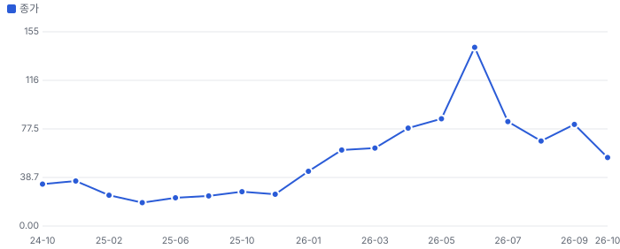

**그림 2 · UCTT EV/매출 (TTM, 배, 월말)**

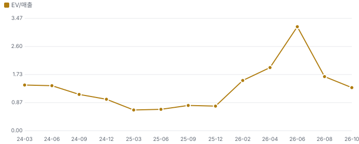

Fiscal.ai 일별 배수 기준 EV/매출은 2024년 1.0~1.4배, 2025년 저점 0.6배, 2026년 6월 3.2배였다. **지금 1.33배는 2024년 평균대로 돌아온 값**이다 — 시장은 2026년 상반기의 '사이클 프리미엄'을 거의 다 뺐다. 반면 선행 매출 추정은 6월(Zacks FY2027 \$3.17B) → 지금(Fiscal 자체 \$3.75B)으로 올랐다(출처가 달라 엄밀한 리비전 비교는 아님 — 같은 출처 리비전은 자동 삽입 절 참조).

> **읽는 법**: 이익 추정은 오르는데 배수가 빠졌다 = 시장은 '이번 상승이 언제 꺾이나'를 가격에 넣는 중. 장비주 사이클의 전형적인 중반 디레이팅인지, 정점 신호인지가 핵심 질문이다.

## ② 실적 — 3Q 서프라이즈와 4Q 가이던스

**그림 3 · 분기 매출 (\$M) — 실적 vs Fiscal.ai 자체 추정**

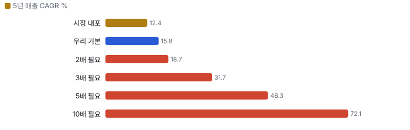

**그림 4 · 분기 GAAP 영업이익 (\$M)**

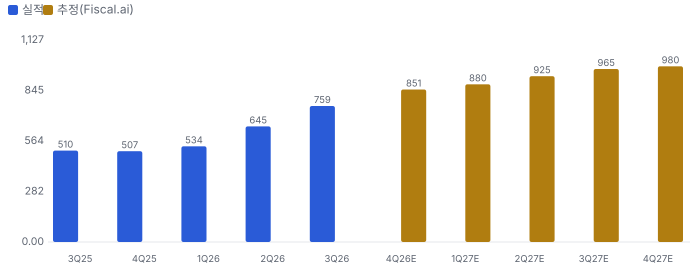

| 항목 | 3Q26 실적 | 발표 전 추정 | 판단 |
|---|---|---|---|
| 매출 | \$759.0M | \$730.8M(Fiscal) · 회사 가이던스 \$700~750M | 가이던스 상단 +1.2% |
| 조정 EPS | \$1.15 | \$0.96(Fiscal) · 가이던스 \$0.83~1.03 | 상단 +11.7% |
| 총이익률(비GAAP) | 17.3% | 2Q 16.7% | +60bp |
| 영업이익률(비GAAP / GAAP) | 9.0% / 7.1% | 2Q 7.0% / 4.6% | 레버리지 확인 |
| 영업현금흐름 | −\$42.3M | 2Q −\$41.1M | 재고 선매입으로 3분기 연속 음수 |
| 4Q 가이던스 | 매출 \$800~860M · EPS \$1.11~1.35 | Zacks 4Q 매출 \$809.6M(8/6, 2명) | 중간값 +2.5% |

제품 매출 \$681.9M(+19.1% QoQ)은 GAA(게이트올어라운드) 식각·증착과 HBM이 끌었고, 서비스 \$77.1M(+6.7%)은 웨이퍼 투입량을 따라 늦게 오른다(미국 신규 팹 가동 2027~28). **상위 2고객 61%** — 고객 장비 출하와 거의 같이 움직인다.

## ③ 사업과 병목 — 엔지니어 관점

UCTT가 만드는 것은 장비의 '혈관'이다: 가스 공급 모듈(가스 스틱 — 밸브·레귤레이터·MFC를 초고순도 용접 배관으로 잇는 블록), 화학 공급 모듈, 프레임·용접(weldment) 조립. 장비사는 상승기에 최종 조립·시험 캐파를 지키고 서브시스템을 외주로 넘긴다(2Q 콜에서 경영진 설명) — 그래서 UCTT 제품 매출은 상승기에 고객 장비 매출보다 빨리 오르고, 하강기엔 더 빨리 빠진다.

- **병목**: 클린룸 조립 캐파와 핵심 부품(MFC·밸브). 3Q 콜에서 Needham이 MFC 부족을 물었고 경영진은 '1~2분기 지속 가능'이라 답했다 — UCTT는 MFC를 만들지 않는다(구매자). 재고 선매입(\$723M)은 이 병목에 대한 보험이다.
- **해결 기술 → 위치**: 고객 사양대로 만드는 위탁(build-to-print)에서 설계 참여(build-to-spec·NPI)로 옮기면 공구당 콘텐츠·이익률이 오른다. NPI 8건(식각·ALD·PVD·리소)은 2~3년 뒤 다음 노드 양산에서 매출이 된다(경영진) — **샘플·수주 → 양산 매출은 금지표 연결**이라 아직 이익률 동인에 넣지 않았다(확신도 0.3).
- **캐파**: 말레이시아 클린룸 2.6만 ft² 조기 가동, 세부 용접 2배·싱가포르·체코 클린룸 추가, 2027년 말레이시아·태국 수직계열화 2배. \$4B 런레이트(1H27) → \$5B 이상 단계적. **명목 캐파 → 매출 금지표**: \$5B 캐파는 WFE 약 \$250B를 전제로 한다(경영진 환산).
- **엔지니어 관점 해석(자체추론)**: 포토·식각 장비의 가스 계통은 공정 레시피마다 라인 수가 늘어(GAA·HBM TSV 식각) 장비당 가스 스틱 콘텐츠가 커진다. 다만 이 콘텐츠 증가는 경쟁사 ICHR에도 똑같이 온다 — UCTT 고유 우위는 '용접·클린룸 캐파를 먼저 깔아둔 것'이고, 이것은 사이클이 꺾이면 고정비가 된다.

## ④ 10배 경로 — 숫자로

| 항목 | 값 | 근거 |
|---|---|---|
| 10배 시가총액 | 약 \$26.2B | 현재 \$2.62B × 10 |
| 필요 조정 순이익(선행 P/E 15배) | 약 \$1.75B | 서브시스템 상단 배수 가정(추정) |
| 필요 매출(조정 순이익률 7%) | 약 \$25B | 회사 목표 비GAAP 영업이익률 약 10% − 세금·이자(추정) |
| 회사 캐파 계획 대비 | 약 5배 | \$5B 이상 단계적(3Q 콜) |
| WFE 점유율 | 약 1.4% → 약 12%(WFE \$200B 기준) | FY26 매출 \$2.79B ÷ 2027 WFE \$200B |
| 10년 매출 CAGR | 약 24.5% | \$2.79B → \$25B |
| v2: 5년 10배 필요 매출 CAGR | 29.6% → 기저율 상위 12%(n=163, 시총 \$1~10B 미국 상장사) | scripts/valuation/DCF 기저율 |

> **결론**: 10배는 WFE 점유율을 8배 넘게 키우거나 다른 사업(서비스·첨단 패키징)을 크게 붙여야 닫힌다 — 지금 자료로는 경로가 없다. 질문을 '사이클 중반 디레이팅을 되돌리는 2배 알파'로 바꾼다. 기저율: 미국 상장주 절반 이상의 생애 수익률이 1개월 국채에 못 미친다(Bessembinder 2018).

## ⑤ 핵심 변수와 손익분기 — FY2027 이익

**그림 5 · 현재가 \$54.70을 정당화하는 FY2027 조정 EPS (달러, 선행 P/E별) vs 추정**

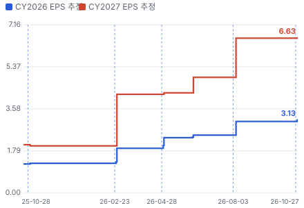

- **핵심 변수 1 — FY2027 매출**: 손익분기 약 \$2.8B(P/E 13배·이익률 유지, Chiip 계산) vs Fiscal 추정 \$3.75B·4Q 런레이트 \$3.3B. 매출이 \$2.8B 아래로 가는 해(2023년형 하강: 2022 \$2.37B → 2023 \$1.73B, −27%)면 지금 가격도 비싸다.
- **핵심 변수 2 — 현금 전환**: 영업현금이 플러스로 돌아야 추가 ATM이 멈춘다. \$100M 증자마다 주식 약 3.7% 희석(현재가 기준). ATM 증자 발표의 기저율은 산업 기업 약 −3%(Asquith & Mullins 1986).
- **민감도(Chiip 계산)**: 연 영업이익 \$40M 변화 ≈ 시가총액 15.7%(세율 21%·13배) — 총이익률 1%p ≈ FY2027 매출 \$3.75B에서 영업이익 약 \$37M.

## 어닝콜 변화·컨센서스·멀티플 프리미엄·EPS 리비전

**방법:** 직전 콜(2026-08-03) → 최신 콜(2026-10-27)에서 새로 나오거나 바뀐 항목을 DCF 기본 시나리오의 동인 이동으로 옮기고, 그 변화가 없었을 때(동인을 되돌린 DCF) 대비 주주가치 변화를 잰다. 확신도: 확정 1.0 · 회사 가이던스 0.8 · 경영진 목표·장기 발언 0.5 · 정황 0.3. '반복'은 직전 콜과 같은 말이라 가치 영향 0.

**직전 콜 대비 새로 나오거나 바뀐 내용 → 가치 영향 (DCF 기본 시나리오 주주가치 기준)**
| 항목 | 내용 | 직전 콜 | 최신 콜 | 모델 동인 이동 | 확신도 | 단독 Δ가치 | 확신도 가중 |
|---|---|---|---|---|---|---|---|
| F1 업데이트 | 4Q 매출 가이던스 | 3Q 가이던스 \$700~750M | 3Q 실적 \$759M, 4Q \$800~860M | 기준연도 매출 +\$0.04B | 0.8 | +1.5% | +1.2% |
| F2 업데이트 | 2027 WFE 전망 | mid-2027 \$200B 런레이트 | 2027년 \$200B 이상(고객 가시성 기반) | 1년차 성장률 +3.0% | 0.5 | +4.6% | +2.3% |
| F3 업데이트 | 캐파 로드맵 | \$4B(1H27)·\$5B 계획 중 | \$5B 이상 단계적, 세부·말레이시아·태국 2배 | 성장 지속(감속 계수) +2.0% | 0.5 | +2.0% | +1.0% |
| F4 업데이트 | 총이익률 | 2Q 16.7% | 3Q 17.3%(비GAAP 영업이익률 9.0%) | 출발 이익률 +0.60% | 1.0 | +0.3% | +0.3% |
| F5 반복 | 장기 이익률 목표 | \$4B에서 총이익률 20% | \$4B에서 총이익률 20%(유지) | 목표 이익률 — | 0.5 | +0.0% | +0.0% |
| F6 신규 | NPI 프로그램 수주 | 수치 없음 | 8건(식각·ALD·PVD·리소), 비슷한 수가 인증 중 | 장기 이익률 +0.50% | 0.3 | +1.7% | +0.5% |
| F7 부정 | 운전자본 투입 | 재고 \$630M·영업현금 −\$41M | 재고 \$723M·영업현금 −\$42M | 매출÷투하자본 -20.0% | 1.0 | -1.2% | -1.2% |
| F8 신규 | ATM 증자 | 없음 | 약 \$203M 순조달(주식 약 +5.6%) | 순차입 -\$0.20B | 1.0 | +2.2% | +2.2% |
| F9 부정 | MFC 공급 부족 | 질문 없음 | 1~2분기 지속 가능(경영진) | 1년차 성장률 -1.0% | 0.3 | -1.5% | -0.4% |
| **합계** | 단독 합 / 확신도 가중 합 |  |  | 동시 적용 +10.0% |  | **+9.6%** | **+5.9%** |

**그림 6 · 콜 변화 항목별 주주가치 영향 (%)**

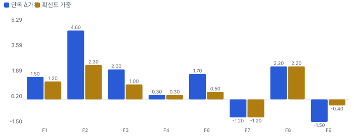
_직전 콜 정보만으로 본 가치 8.56 → 최신 \$9.42B(시가총액 2.67의 3.20배 → 3.52배)_

**읽는 법:** 확신도 가중 합 +5.9%이 '이번 콜로 기업가치가 얼마나 바뀌었나'에 대한 Chiip 기준값이다. 단독 합(+9.6%)과 동시 적용(+10.0%)의 차이는 동인끼리 곱해지는 상호작용(예: 성장 × 이익률). 경영진 발언(확신도 0.5 이하) 비중이 크면 다음 분기 숫자로 확인될 때까지 가치로 다 넣지 않는다.

**실적 vs 컨센서스 (발표 직전 추정)**
| 분기 | 지표 | 실적 | 컨센서스 | 서프라이즈 |
|---|---|---|---|---|
| 2026Q3 | 매출 | \$759M | \$730.8M | +3.9% |
| 2026Q3 | EPS | 1.15 \$ | 0.96 \$ | +19.8% |

**그림 7 · 분기별 서프라이즈 (%)**

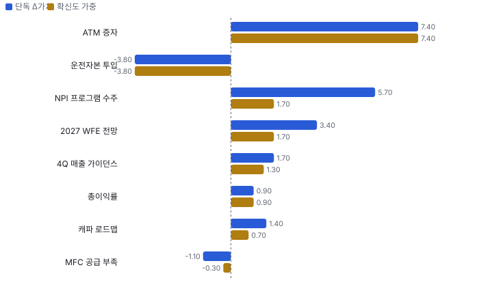

**컨센서스 리비전 — 2Q 실적 전(6/10) Zacks(2026-06-10) → 지금(2026-08-07), 같은 분기끼리**
| 분기 | 지표 | 직전 | 지금 | 리비전 |
|---|---|---|---|---|
| 2026Q4 | EPS | 0.91 | 1.12 | +23.1% |
| 2027Q1 | EPS | 0.9 | 1.21 | +34.4% |
| 2027Q2 | EPS | 1.03 | 1.47 | +42.7% |
| 2026Q4 | 매출(백만\$) | 724.1 | 809.6 | +11.8% |
| 2027Q1 | 매출(백만\$) | 707.6 | 856 | +21.0% |
| 2027Q2 | 매출(백만\$) | 756.2 | 915.2 | +21.0% |
| **합계 3분기** | EPS | 2.84 | 3.8 | **+33.8%** |
| **합계 3분기** | 매출(백만\$) | 2,188 | 2,581 | **+18.0%** |

**그림 8 · 같은 기간 주가 변화 분해 = EPS 리비전 × 멀티플 변화 (%)**

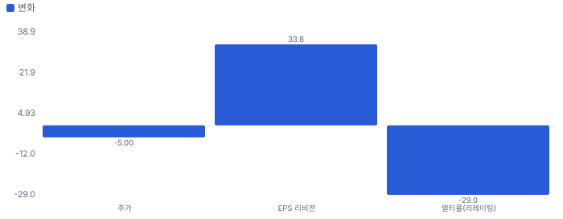
_(1 + 주가 변화) = (1 + EPS 리비전) × (1 + 멀티플 변화). EPS 리비전은 위 표의 같은 분기 합 기준_

**해석:** 이 기간 주가 -5.0% 중 EPS 추정 변화가 +33.8%, 멀티플 변화가 -29.0% — 주가를 움직인 것은 **이익 추정 하향**이다. 이익 추정은 오르는데 주가가 내렸다면 시장은 숫자가 아니라 지속성·위험(할인율)을 다시 매긴 것이다.

리비전 출처: Fiscal.ai analyst_estimates history(Zacks) — 같은 분기끼리. Zacks 분기 추정은 8/7 이후 갱신 없음(3Q 콜 후 리비전은 Fiscal 자체 추정 4Q26 \$850.6M·EPS 1.30으로만 관찰). Data provided by Zacks Investment Research, Inc., www.zacksdata.com

**멀티플 프리미엄 — 동종 중앙값 대비 (성장 조정 = 배수 ÷ 최근 분기 전년 대비 매출 성장%, 한 분기 성장이라 변동이 크다)**
| 지표 | 대상 | 동종 중앙값(범위) | 프리미엄 | 성장 조정 프리미엄 |
|---|---|---|---|---|
| EV/EBITDA | 17.8배 | 27.9배 (17.8~178.6, 5사) | **-36%** | -4% |
| EV/매출 | 1.3배 | 4.2배 (1.5~7.8, 5사) | **-68%** | -56% |

**그림 9 · 멀티플 프리미엄 (%) — 0 = 동종 중앙값**

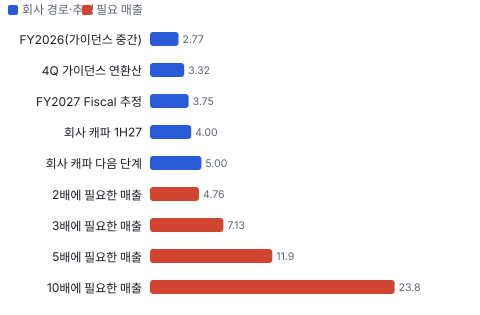

## 내러티브 — 멀티플 프리미엄과 리비전을 끌어올리는 이야기

> **한 줄:** '2027~28 WFE 증설 사이클의 서브시스템 아웃소싱 수혜'는 실적으로 확인되는데(3Q 매출 +49%), 주가는 6/30 고점 대비 −62% — 시장은 증설 대가(재고·증자)와 장비주 디레이팅을 먼저 가격에 넣었다 · 동종 대비 멀티플 차이 -70% 중 회사 고유 몫 -92%(멀티플 엔진) — 내러티브가 설명해야 하는 크기 · 직전 콜 이후 EPS 추정 +33.8%(2026Q4, 2027Q1, 2027Q2) — 리비전 경로로 이미 숫자가 된 몫 · 단계 태동, 쏠림 낮음

**내러티브 요인 — 누가 믿고, 멀티플·리비전 중 어디로 작동하나**
| 요인 | 셀사이드 | 바이사이드 | 리테일 | 작동 경로 | 숫자로 바꾸면 | 상태 | 반증 조건 |
|---|---|---|---|---|---|---|---|
| WFE 2027~28 다년 증설(AI 메모리·GAA·HBM) | 강 | 중 | 약 | 멀티플+리비전 | 3Q 매출 +48.8% YoY·4Q 가이던스 중간값 +9.4% QoQ, 메모리 비중 34% | 강화 | 대형 장비사(AMAT·LRCX) 2027 WFE 전망 하향(2027-01~02 실적) |
| 이익률 레버리지(가동률·고부가 NPI) | 중 | 중 | - | 리비전 | 총이익률 2Q 16.7% → 3Q 17.3%, NPI 8건 | 유지 | 매출 \$850M 이상 분기에 총이익률 17% 미만 |
| 증설의 대가 — 재고·증자(약세) | 강 | 강 | - | 멀티플 | 재고 \$723M(+\$93M), 영업현금 3분기 연속 음수, ATM 약 \$203M(주식 +5.6%) | 강화 | 4Q 영업현금흐름 플러스 전환·재고 회전 개선(2027-02 4Q 실적) |
| 장비주 디레이팅(AI 심리 냉각, 약세) | 중 | 강 | 약 | 멀티플 | EV/매출 6/30 3.21배 → 10/29 1.33배(−59%), 같은 기간 선행 매출 추정은 상향 | 확산 | 장비 업종 배수 회복과 함께 UCTT EV/매출 2배 회복 |
| 고객 집중(상위 2사 61%) | 중 | 중 | - | 멀티플 | 상위 2고객 61%(3Q) | 유지 | 상위 2고객 비중 55% 미만으로 분산(10-K) |

- **WFE 2027~28 다년 증설(AI 메모리·GAA·HBM)** — 2027 WFE \$200B 이상, 고객이 서브시스템을 외부로 넘겨 UCTT가 업종보다 빨리 큰다 (바뀌는 입력: 성장 지속기간) [3Q 콜·co-ultraclean.md]
- **이익률 레버리지(가동률·고부가 NPI)** — \$4B에서 총이익률 20% — 가동률과 build-to-spec 제품 믹스로 마진이 오른다 (바뀌는 입력: 이익률) [3Q 콜 CFO]
- **증설의 대가 — 재고·증자(약세)** — 고객 약정 없이 캐파·재고를 먼저 사고, 그 돈을 증자로 메운다 — 사이클이 꺾이면 ROIC가 무너진다 (바뀌는 입력: 재투자 효율·희석) [10-Q·3Q 콜]
- **장비주 디레이팅(AI 심리 냉각, 약세)** — AI 투자 지속성 의심이 장비 업종 배수를 누른다 (바뀌는 입력: 위험·배수) [Fiscal.ai daily ratios·co-ultraclean.md]
- **고객 집중(상위 2사 61%)** — AMAT·LRCX 내부 생산 전환 또는 이원화 시 물량이 빠진다 (바뀌는 입력: 위험) [3Q 콜 CFO]

**셀사이드(IB 애널리스트)**
| 지표 | 값 | 추세·해석 | 출처 |
|---|---|---|---|
| 애널리스트 의견(Zacks) | 7명 — 강력 매수 5·매수 1·보유 1·매도 0 | 의견은 강세 일색이나 매출 추정 제출은 2명(8/6 이후 미갱신) | Fiscal.ai analyst_ratings — Data provided by Zacks Investment Research, Inc., www.zacksdata.com |
| 목표가 평균·범위(Zacks) | \$113.1 (\$80~\$150, 7명) | 10/29 종가 \$54.70 대비 평균 +107% — IB 기대의 증거(Chiip 목표가 아님), 범위가 약 2배로 분산 큼 | 같은 곳 |
| 3Q 콜 질문 증권사 | UBS·Needham·TD Cowen·Oppenheimer·Craig-Hallum | 질문 초점 = 증설의 대가(장기 약정)·MFC 부족·공급망 차질 | Fiscal.ai ir_events_transcript(q3-2026) |
| 실적 후 목표가 조정 | Needham \$80로 하향(10/28, 밸류에이션 사유 — 제목 기준) | 이익이 아니라 배수 문제로 낮춤 | Fiscal.ai company_news(moomoo 색인) |

**셀사이드(IB 애널리스트) 해석:** 셀사이드는 실적은 인정하지만 '증설 대가'와 사이클 지속성에 질문이 몰린다 — 배수 확장을 막는 쪽

**바이사이드(기관 투자자)**
| 지표 | 값 | 추세·해석 | 출처 |
|---|---|---|---|
| 13F 기관(2026Q2) | 409곳 · 순 −3.23백만 주 · 증가 87·감소 151 | 고점 직전 분기에 이미 기관 순매도(차익 실현) | Fiscal.ai institutional_holders 2026Q2(45일 지연) |
| 펀드 레터(2026Q2~Q3) | RAM Smid 비중 축소(강세 유지)·Next Century 전량 매도(약세)·Nomura Small Cap 보유(고확신)·Liontrust 청산(목표 도달) | 바이사이드는 '사이클 초기'에 동의하면서도 3분기에 차익·장비주 이탈 | Fiscal.ai company_fund_letters |
| 내부자 장내 거래(누적) | 매수 4·매도 33 | 6~7월 전임 CFO·CAO 장내 매도, 8월 이후는 세금 원천징수만 | Fiscal.ai insider_transactions |

**바이사이드(기관 투자자) 해석:** 바이사이드는 고점에서 줄였다 — 지금은 다시 살 근거(현금 전환)를 기다리는 단계

**리테일(레딧·텔레그램·X)**
| 지표 | 값 | 추세·해석 | 출처 |
|---|---|---|---|
| 레딧(ApeWisdom) | 미수집 | 이번 회차 조회하지 않음 | — |
| 커뮤니티 기사 제목(45일) | 1건 | Substack 0·HN 0 — 리테일 무관심 | knowledge/narratives/companies/co-ultraclean.md(10/28) |

**리테일(레딧·텔레그램·X) 해석:** 리테일 관심이 거의 없다 — 가격은 기관·셀사이드가 정한다

**언론·업계**
| 지표 | 값 | 추세·해석 | 출처 |
|---|---|---|---|
| 업종 기사 | SA·IBD·Barron's 장비주 기사 다수(10/21~26) | 'AI 심리 냉각 → 장비주 디레이팅' vs 'WFE 2028까지 성장' | co-ultraclean.md 섹터 표 |

**언론·업계 해석:** 언론은 UCTT를 개별로 다루지 않고 장비 업종 흐름으로 묶는다

**읽는 법:** '멀티플' 요인은 같은 이익에 더 높은 배수를 주게 하는 이야기(지속성·위험 감소·희소성), '리비전' 요인은 추정 이익 자체를 올리는 이야기(수주·가격·이익률). 회사 고유 프리미엄이 큰데 리비전 근거가 약하면 이야기가 숫자보다 앞서 있다(과밀 위험). 커뮤니티·IB 의견은 사실이 아니라 시장 기대의 증거다. 틀: Damodaran(2017) Narrative and Numbers, Shiller(2019) Narrative Economics.

## 밸류에이션 — 맥킨지·IB 방식(현금흐름 할인(DCF) 엔진)

**방법:** 맥킨지식 재무 재구성(NOPAT·투하자본·ROIC) → 바텀업 WACC → FCFF DCF + 가치 동인 계속가치(ROIC·성장) → 경제적 이익 항등 검증 → 시나리오·몬테카를로 → 가격 내포 기대(역DCF)와 매출 성장 기저율. 단위 \$B, 모든 가치는 **현재 시가총액 대비 배수**로 표기(목표주가 아님).

**할인율(WACC) 구성**
| 항목 | 값 |
|---|---|
| 무위험(미 10년) | 4.99% |
| 주식 위험 프리미엄 | 4.20% |
| 레버드 베타(바텀업) | 1.50 (무레버 1.35) |
| 국가위험 | 0.23% |
| 자기자본비용 | 11.50% |
| 부채비중 | 12% |
| WACC | **10.73%** |
| 영구성장 | 3.5% |

**시나리오별 DCF 주주가치 ÷ 현재 시가총액(\$2.7B)**
| 시나리오 | 확률 | 주주가치(\$B) | 지금 | 5년 뒤(할인 전) | 5년 매출 CAGR | 5년차 영업이익률 |
|---|---|---|---|---|---|---|
| 기본 | 50% | 9.4 | **3.52배** | 5.83배 | 15.8% | 22% |
| 강세 | 30% | 12.9 | **4.83배** | 8.01배 | 23.8% | 20% |
| 약세 | 20% | 6.7 | **2.51배** | 4.13배 | 7.2% | 24% |

**읽는 법:** '배'는 PER·EV/매출 같은 멀티플이 아니라 **DCF로 계산한 주주가치 ÷ 지금 시가총액**이다. 1.0배 = 그 시나리오 가정이 지금 주가와 같은 가치, 0.3배 = 가정대로면 주가의 30%만 현금흐름으로 설명된다. '5년 뒤'는 5년 뒤 시점의 주주가치(그때 돈, 할인 전)를 지금 시가총액으로 나눈 값 — 지금 사서 5년 들고 있을 때 그 시점 내재가치가 지금 가격의 몇 배인가. 매년 약 WACC만큼 커진다(배당 없음, 적자 현금흐름은 차입으로 메운다고 가정).

기본 시나리오 분해: 기업가치 9.8 = 1~10년 현금흐름 현재가치 3.9 + 11년차 이후(계속가치) \$5.9B(초기 재투자가 커서 1~10년 합이 음수면 계속가치가 기업가치의 100%를 넘는다) · 순현금 -0.4 · ROIC 1년차 23% → 5년차 38% · 경제적 이익 항등 오차 0.0e+00(DCF와 EP 가치가 같아야 정상) · 할인율 +50bp → 가치 -6.5%

**그림 10 · 몬테카를로 3,000회 — 지금 가치/시가총액 분포 (%)**

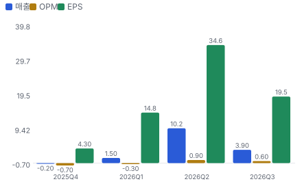
_P10 2.04 · P50 3.42 · P90 6.27 · 기대 3.88배 · 30% 이상 고평가 확률 0% · 5년 뒤 ≥1.5배 100% · ≥2배 100% · ≥3배 94% · ≥10배 11%_

**그림 11 · 가격 내포 기대 vs 필요 성장 (5년 매출 CAGR %)**

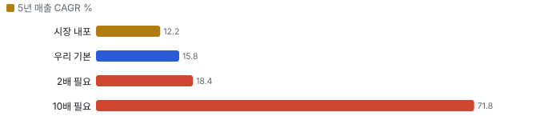
_시장 내포 기저율 상위 100%(n=163, \$1~10B) · 기본 기저율 상위 44%(n=163, \$1~10B) · 2배 필요 성장 기저율 상위 99% · 10배 필요 성장 기저율 상위 12% — 기저율: 같은 매출 규모 미국 상장사가 실제로 달성한 5년 CAGR 분포(SEC 재무)_

**민감도 — 기본 시나리오 가치/시총(매출 경로 고정, 장기 이익률 × 매출÷투하자본)**
|  | 매출÷투하자본 0.75 | 매출÷투하자본 1.5 | 매출÷투하자본 2.2 | 매출÷투하자본 2.5 |
|---|---|---|---|---|
| 장기 이익률 10% | 0.11 | 0.87 | 1.11 | 1.18 |
| 장기 이익률 15% | 0.91 | 1.67 | 1.91 | 1.97 |
| 장기 이익률 30% | 3.30 | 4.07 | 4.31 | 4.37 |
| 장기 이익률 40% | 4.90 | 5.66 | 5.91 | 5.97 |

매출÷투하자본 = 매출 1달러를 늘리는 데 드는 설비·운전자본(높을수록 가볍다). 장기 이익률은 4년차 목표와 이후 수렴값을 같이 바꾼 것. 계속가치는 RONIC = WACC(11년차 이후 성장은 가치를 만들지 않는다는 맥킨지 보수 가정) · 다른 축: WACC −1%p 4.06배 · WACC +1%p 3.08배 · RONIC 20%(11년차 이후 성장이 가치 창출) 4.01배

**동종 레인지와 펀더멘털 내재 멀티플 (EV/매출, 최근 12개월)**
| 회사 | EV/매출 | 성장 | 영업이익률 | ROIC 영업권 포함/제외 | 매출÷투하자본(영업권 제외) | 펀더멘털 내재 | 시장÷내재 |
|---|---|---|---|---|---|---|---|
| ICHR | 1.5 | 9% | -2% | -2% / -2% | 1.33 | - | - |
| MKSI | 4.2 | 16% | 16% | 8% / 8% | 0.66 | 1.0 | 4.08 |
| AEIS | 4.7 | 25% | 13% | 15% / 15% | 1.40 | 1.4 | 3.40 |
| ENTG | 7.8 | 9% | 18% | 7% / 7% | 0.48 | 1.1 | 7.00 |
| KLIC | 3.9 | 44% | 13% | 23% / 23% | 2.19 | 2.4 | 1.62 |
| **동종 중앙** | 4.2 |  |  |  |  |  | 3.74 |
| **Ultra Clean Holdings** | 1.2 |  |  |  |  | 4.0 | 0.31 |

**그림 12 · EV/매출 — 과거·동종·펀더멘털·합리적 멀티플 (배)**

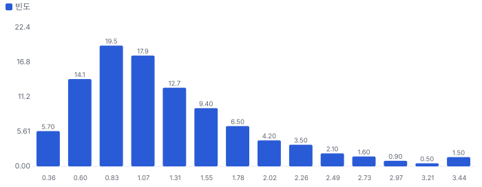
_펀더멘털 내재 = 같은 WACC·계속가치 규칙으로 각 회사의 성장·이익률·자본 회전율을 자본화한 EV ÷ 매출. 섹터 심리 = 동종의 시장 ÷ 내재 배율_

**할인·프리미엄 분해:** Ultra Clean Holdings의 EV/매출은 동종 중앙 대비 **-70%** = 동종과 같은 섹터 심리를 받는다면 펀더멘털(성장·이익률·ROIC)로 정당한 몫 +258% × Ultra Clean Holdings에만 얹힌 기업 고유 몫 **-92%**(두 몫을 곱하면 전체). 심리를 빼고 펀더멘털만 비교하면 동종 중앙 내재 대비 +220%. 기업 고유 몫이 양(+)이면 시장이 동종보다 더 큰 기대를 얹은 것(할인이 덜 됐다), 음(−)이면 더 할인한 것이다 — Rhodes-Kropf·Robinson·Viswanathan(2005)의 '기업 고유 오차 vs 섹터 오차' 분해 방식.

**합리적 멀티플:** 15.0배(섹터 심리 25~75분위 11.8~19.3배) → 주주가치 ÷ 시가총액 **13.54배**(10.67~17.46배). 현재 1.2배와의 차이가 시장이 동종보다 더 얹은 기대다.

**ROIC에 비례하는 정상 상태 멀티플 (맥킨지 가치 동인: EV/NOPAT = (1 − g/ROIC) ÷ (WACC − g))**
| ROIC | EV/NOPAT | EV/매출 @영업이익률 15% | EV/매출 @영업이익률 22% | EV/매출 @영업이익률 30% | EV/매출 @영업이익률 40% |
|---|---|---|---|---|---|
| 10% | 9.0 | 1.1 | 1.6 | 2.1 | 2.8 |
| 15% | 10.6 | 1.3 | 1.8 | 2.5 | 3.4 |
| 20% | 11.4 | 1.4 | 2.0 | 2.7 | 3.6 |
| 30% | 12.2 | 1.4 | 2.1 | 2.9 | 3.9 |
| 50% | 12.9 | 1.5 | 2.2 | 3.1 | 4.1 |

정상 상태 교차 확인: DCF 기본 시나리오의 5년차 ROIC 43%·영업이익률 22%이면 정상 상태 EV/NOPAT 12.7배(5년차 EV/매출 2.6배). 이를 지금으로 할인하면 주주가치 ÷ 시가총액 3.52배 — 고성장 기업은 현재 멀티플이 아니라 정상 상태 멀티플을 할인해 비교한다(맥킨지 『Valuation』 멀티플 장).

**데이터 검증 — 원자료(Fiscal.ai·SEC) ↔ 밸류에이션 입력 대조 10.0/10**
| 검사 | 결과 | 내용 |
|---|---|---|
| 원자료 스냅숏 | 통과 | 조회 시각 2026-10-30T07:20:00+09:00 |
| 시가총액 대조 | 통과 | 가격 54.7 × 표지 주식 0.04796 = 2.62 vs 원자료 개요 2.6234 |
| 가격 일치 | 통과 | 54.7 vs 54.7 |
| 현금·차입 대조 | 통과 | 현금 0.44 vs 재무상태표(2026_10_21) 0.4400 · 차입 0.8101 vs 0.8101 — 개요(2026-09-25)보다 최신 1차 자료 |
| TTM 매출 = 4분기 합 | 통과 | 2.4443 vs 2.4443(4분기) |
| TTM 영업이익 = 4분기 합 | 통과 | 0.1055 vs 0.1055 |
| 투하자본 = 재무상태표 | 통과 | 1.3525 vs 자기자본+차입+리스−현금 1.353 |
| 연간 컨센서스 = 분기 합 | 통과 | FY2026 2.78816 vs 2.7882 · FY2027 3.75 vs 3.7500 · FY2028 4.5 vs 4.5000 |
| 회사 가이던스 반영 | 통과 | 회사 3Q 실적 보도자료·콜(2026-10-27, Fiscal.ai ir_events q3-2026): 4Q 매출 \$800~860M·EPS \$1 |
| 희석 주식(출처·같은 날짜) | 통과 | 잠재 주식 0.00094 vs SEC None · 기본 주식 날짜 2026-10-21 / 희석 날짜 2026-10-21 |
| 어닝콜 톤 = 실적 레이더 | 통과 | 사용 up · 레이더 기준 up(톤 변화 0.5, 가이던스 raise) |
| 동종사 4곳 이상·기준 표기 | 통과 | 5곳 · 기준 ttm |
| 매출·이익률 기준 명시(SBC 처리) | 통과 | 매출 gaap · 이익률 non_gaap · 비GAAP → SBC 1% 차감 |

**동인 출처 — 어느 자료가 어느 변수가 됐나**
| 동인 | 출처·값 |
|---|---|
| rev0 | 회사 가이던스 중간값 [2.7376, 2.7976] (회사 3Q 실적 보도자료·콜(2026-10-27, Fiscal.ai ir_events q3-2026): 4Q 매출 \$800~860M·EPS \$1.11~1.35 → FY2026 = 1~3Q 실적 1,937.6 + 4Q 가이던스) |
| growth | 컨센서스 1년차 35.5%, 2년차 20.0% |
| margin | 1년차 컨센서스 10.7% 고정 → 목표 10%(3년차, 덮어쓰기) → 장기 수렴 30% |
| s2c | 재무 재구성 증분 매출/투하자본 1.8 → 덮어쓰기 2.2 |
| range | 컨센서스 최저·최고 추정 → 1년차 성장 15.6%~51.8% |
| probs | 어닝콜 톤 'up' 규칙 {'bear': 0.2, 'base': 0.5, 'bull': 0.3} |
| overrides | 목표 영업이익률 10%(SBC 차감 후, 3년차): 회사 목표 '매출 \$4B에서 총이익률 20%·비GAAP 영업이익률 약 10%' + \$5B 단계의 추가 가동률 효과를 SBC 0.9%와 상쇄로 봄(Zacks FY27 11.6% − SBC = 10.7%보다 낮게) — 동종 MKSI 16%·AEIS 13%보다 낮은 위탁 생산형 구조라 그 이상은 가정하지 않는다 / 매출÷투하자본 2.2: TTM 1.8은 재고 선매입(\$723M)이 부풀린 값, 증분 기준 CAPEX는 매출 증가분의 약 5%이나 재고·매출채권이 증분 매출의 약 40%를 묶는다 → 2.2(보수) |
| shares | 완전 희석 = 기본 0.04796(2026-10-21) + 옵션·RSU·워런트·전환 0.0009 — 4Q 가이던스 희석 주식 약 48.9백만 주(3Q 콜 CFO) − 표지 기본 주식 47.96백만 = 약 0. |

> 의사결정 보조(투자자문 아님): ① 매수 매력: 연 기대수익 +45.0% (자기자본비용 11.5% 대비 +33.5%p) · 자본비용 초과 확률 100% · 안전마진 2.04 → 정량 신호 강함 / ② 위험 예산 지표(이론): 1/4 켈리 10.0% (상한 10%) · 5년 하위10% +238% · 30%+ 손실 확률 0% / ③ 상방(5년): 기대 6.41배 · 2배 100% · 3배 94% · 10배 11% · 상위10% 10.41배

## 수급 — 누가 왜 샀나(Chiip Flow)

> **한 줄:** 최근 20거래일 거래의 리테일 몫은 5.0%(직전 60일 6.4%) — 거래는 주로 기관이 만든다. 기관 자금 흐름(CMF 20일) -0.11로 기관 분산 쪽, 리테일 매수 압력 z +0.37로 리테일 방향 뚜렷하지 않음. 이상 거래일에 늘어난 거래량의 94%가 기관 몫.

**그림 13 · 일별 거래량 분해 — 리테일 근사(도매 체결사) vs 기관(거래소·다크풀) (천 주)**

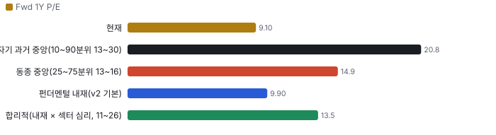
_리테일 = 장외(TRF) 거래량 × 그 주 FINRA 비ATS 리테일 도매 체결사 비중(최근 2주는 직전 4주 평균 — 추정). 기관 = 전체 − 리테일._

**그림 14 · 기관 자금 흐름(CMF 20일)과 리테일 매수 압력(z ÷ 4로 같은 눈금)**

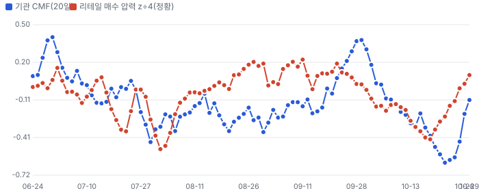
_CMF > 0: 기관 거래가 몰린 날 종가가 고가 쪽(매집). 리테일 압력: 장외 공매도 비율의 60일 z — 마켓메이커가 리테일 매수에 공매도로 물량을 대는 구조라 높을수록 리테일 순매수 쪽(정황)._

**이상 거래일 — 왜 늘었나, 누가 늘렸나(최근 120거래일, RVOL ≥ 1.8 또는 z ≥ 2)**
| 날짜 | RVOL | 주가 | 종가 위치 | 늘어난 거래량 | 증가분 분해 | 원인 태그 |
|---|---|---|---|---|---|---|
| 2026-10-28 | 4.3배 | +8.5% | +1.00 | 3.10M | 기관 94% · 리테일 6% | 실적 발표 다음 날 · 3Q 실적 다음 날(10/27 장후 발표) · Needham 목표가 \$80 하향 · 레이더 기사 1건 |
| 2026-06-26 | 2.9배 | -1.5% | +1.00 | 2.01M | 기관 99% · 리테일 1% | 원인 미확인(공개 사건 없음) |
| 2026-10-13 | 2.8배 | -3.9% | -1.00 | 1.64M | 기관 95% · 리테일 5% | 원인 미확인(공개 사건 없음) |
| 2026-06-02 | 2.4배 | +6.5% | +1.00 | 1.31M | 기관 101% · 리테일 -1% | 원인 미확인(공개 사건 없음) |
| 2026-05-29 | 2.4배 | -2.0% | -1.00 | 1.29M | 기관 99% · 리테일 1% | 월말 |
| 2026-08-04 | 2.2배 | -5.2% | -1.00 | 1.74M | 기관 92% · 리테일 8% | 실적 발표 다음 날 · 2Q 실적 다음 날(8/3 발표) |
| 2026-10-29 | 2.2배 | -2.1% | +1.00 | 1.12M | 기관 95% · 리테일 5% | 3Q 실적 다음 날(10/27 장후 발표) · Needham 목표가 \$80 하향 다음 날 · 레이더 기사 4건 |
| 2026-10-22 | 2.1배 | -14.9% | -1.00 | 1.06M | 기관 96% · 리테일 4% | Lam Research 실적 전망 실망(IBD 10/21)·최대 고객 공급 제약 언급 |

**주간 체결 장소별 비중 — FINRA 확정치(최신 주 2026-09-21, 약 2주 지연)**
| 주 시작 | 전체(주) | 거래소 | ATS(다크풀) | 리테일 도매 | 기타 장외 |
|---|---|---|---|---|---|
| 2026-08-17 | 5.57M | 55.8% | 30.0% | 4.2% | 10.0% |
| 2026-08-24 | 3.18M | 53.5% | 30.3% | 5.4% | 10.9% |
| 2026-08-31 | 4.65M | 47.1% | 27.7% | 5.3% | 19.9% |
| 2026-09-07 | 3.35M | 51.4% | 31.2% | 3.6% | 13.8% |
| 2026-09-14 | 3.84M | 61.1% | 19.3% | 4.8% | 14.8% |
| 2026-09-21 | 3.72M | 56.2% | 25.8% | 8.8% | 9.2% |

**읽는 법:** 리테일 몫이 늘면서 주가가 오르면 리테일 주도 랠리(되돌림 위험 큼), 기관 CMF가 +로 돌며 거래량이 늘면 기관 매집 쪽이다. 근거: 리테일 식별은 Boehmer·Jones·Zhang·Zhang(2021, JF)의 장외 도매 체결 방식, 자금 흐름은 Chaikin Money Flow. 한계: 도매 체결사 물량에 일부 기관 주문이 섞이고, 리테일 지정가 주문 일부는 거래소로 간다 — 근사치다. 지표일 뿐 매매 권유가 아니다.

## 가격 구간 — 월·주·일 피보나치와 겹침 구간

> **한 줄:** 현재가 \$54.70 — 바로 위 저항 \$67~68(+23.2%, 강도 3.0), 바로 아래 지지 \$44(-19.2%, 강도 4.0). 가격 구간 지표일 뿐 매수·매도 권유가 아니다.

**지지·저항 겹침 구간(서로 다른 기준선이 ±1.2% 안에 모인 곳, 강도 = 겹친 기준선 수)**
| 구간 | 가격 | 현재가 대비 | 강도 | 겹친 기준선 |
|---|---|---|---|---|
| 저항 3 | \$113~114 | +107.6% | 2.0 | 월봉 피보 23.6% · 주봉 피보 23.6% |
| 저항 2 | \$82 | +49.6% | 2.0 | 일봉 스윙 고점 · 주봉 피보 50.0% |
| 저항 1 | \$67~68 | +23.2% | 3.0 | 50일 이동평균 · 일봉 피보 61.8% · 주봉 피보 61.8% |
| 지지 1 | \$44 | -19.2% | 4.0 | 150일 최저(거래 범위) · 50일 최저(거래 범위) · 월봉 피보 78.6% · 일봉 스윙 저점 |

**시간 단위별 피보나치 되돌림(\$)**
| 단위 | 지배 스윙 | 다리 | 23.6% | 38.2% | 50% | 61.8% | 78.6% |
|---|---|---|---|---|---|---|---|
| 월봉 | \$17.46(2025-04-01) → \$142.59(2026-06-30) | 상승 | 113.1 | 94.8 | 80.0 | 65.3 | 44.2 |
| 주봉 | \$21.56(2025-11-21) → \$142.59(2026-06-30) | 상승 | 114.0 | 96.4 | 82.1 | 67.8 | 47.5 |
| 일봉 | \$44.15(2026-10-23) → \$81.63(2026-10-01) | 하락 | 53.0 | 58.5 | 62.9 | 67.3 | 73.6 |

**그림 15 · 월봉 — 장기 스윙 되돌림**

_지배 스윙: 최근 60개월 최저↔최고 — 저점 \$17.46(2025-04-01) · 고점 \$142.59(2026-06-30), 상승 다리. 점선 = 피보나치 되돌림, 띠 = 겹침 구간(초록 지지·빨강 저항). 캔들: 빨강 상승·파랑 하락._

**그림 16 · 주봉 — 52주 스윙 되돌림**

_지배 스윙: 최근 52주 최저↔최고 — 저점 \$21.56(2025-11-21) · 고점 \$142.59(2026-06-30), 상승 다리. 점선 = 피보나치 되돌림, 띠 = 겹침 구간(초록 지지·빨강 저항). 캔들: 빨강 상승·파랑 하락._

**그림 17 · 일봉 — 마지막 완료 스윙 되돌림(최근 90거래일)**

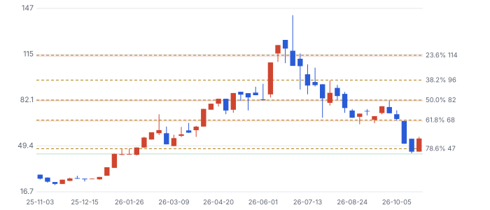
_지배 스윙: ATR 지그재그 15.3% 마지막 완료 다리 — 저점 \$44.15(2026-10-23) · 고점 \$81.63(2026-10-01), 하락 다리. 점선 = 피보나치 되돌림, 띠 = 겹침 구간(초록 지지·빨강 저항). 캔들: 빨강 상승·파랑 하락._

**기법과 근거:** 스윙은 ATR 지그재그(임계 = max(월 20%·주 10%·일 5%, 2.5×ATR14)), 되돌림 23.6~78.6%·확장 127.2·161.8%. 함께 본 기준선: 50·200일 이동평균과 50·150·200일 거래 범위 고저(Brock·Lakonishok·LeBaron 1992, JF), 라운드 넘버(\$50 단위, Osler 2003 JF·Osler 2000 FRBNY EPR). 피보나치 비율 자체의 학술 근거는 약하다 — 다수가 같은 선에 주문을 두는 데서 오는 효과로 보고, 여러 기준선이 겹친 구간만 강하게 본다. 월봉은 최근 60개월(Fiscal.ai 장기 월봉) · 고가·저가는 Fiscal.ai 일봉에 없어 시가·종가로 근사(스윙 고저가 실제보다 좁게 잡힐 수 있다).

## ⑥ 판단 시나리오 — 배수 기준(12~18개월)

**그림 18 · 판단 시나리오 주가 (달러, 12~18개월, 선행 P/E 배수 기준)**

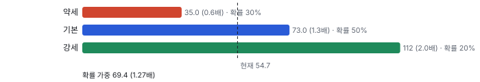

확률 가중 **\$69.4(+27%)**. 확률은 어닝콜 톤 '상향' 규칙(약세 20·기본 50·강세 30)에서 **약세를 30%로 올렸다** — 고객 약정 없는 증설·ATM·상위 2고객 61%가 하방 꼬리를 키운다(자체추론).

> **DCF와 왜 다른가**: 현금흐름 DCF(WACC 10.73%)는 기본 3.52배·몬테카를로 중앙 3.46배를 낸다. 동인이 '컨센서스 성장 35%→20% 뒤 영구 3.5%로 부드럽게 감속, 이익률 10% 유지'라 **장비 사이클의 하강(3~4년마다 매출 −25~40%)을 한 번도 넣지 않았기 때문**이다. 시장 내포 5년 CAGR −14.8%는 그 반대 극단(하강이 곧 온다)을 넣었다. 판단 시나리오는 둘 사이 — 사이클 중간 배수로 12~18개월 이익을 평가한다. DCF 3.5배는 '사이클이 오지 않는다면'의 상한으로만 읽는다.

## ⑦ 반대 검증 — 가장 강한 약세 논리

| 약세 논리 | 강도 | 가를 자료(시점) |
|---|---|---|
| ① 정점 신호: 고객사(최대 고객)가 공급 제약을 말하고 서브시스템 업체가 재고를 쌓는 건 2018·2022년 정점의 패턴 | 강 | AMAT·LRCX 2027 WFE 코멘트(2027-01 말~02 중), UCTT 4Q 재고 회전 |
| ② 증설의 대가: 고객 장기 약정 없이 캐파를 먼저 짓고 그 돈을 증자로 메운다 — 사이클이 꺾이면 ROIC 붕괴 | 강 | 4Q 영업현금흐름·추가 ATM 여부(2027-02), 장기 약정 공개 |
| ③ 경쟁 증설: ICHR·고객 내재화가 같은 상승기에 캐파를 늘려 가격 압박(Greenwood & Hanson 2015) | 중 | ICHR 3Q·4Q 캐파 코멘트, UCTT 총이익률이 매출 \$850M 분기에 17% 아래인지 |
| ④ 고객 집중: 상위 2고객 61% — 한 곳의 이원화·내재화가 매출의 수십 %를 흔든다 | 중 | 10-K 고객 비중(2027-02~03) |
| ⑤ 이미 싸다는 반론의 반론: EV/매출 1.33배는 ICHR(1.47배)과 같다 — 이익률(TTM GAAP 4.3%)이 MKSI(15.7%)·AEIS(13.2%)의 3분의 1이라 할인은 정당 | 중 | 총이익률 20% 경로(회사 목표 \$4B) |

**그림 19 · 동종 EV/매출 (TTM, 배) — Fiscal.ai 2026-10-29**

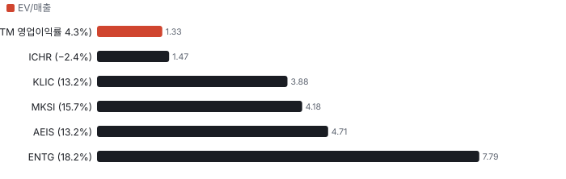

Chiip 변이 관점의 약점: 'Chiip은 사이클 중반, 시장은 정점'이라는 차이는 **시점 판단**이라 틀리면 약세 시나리오(\$35)가 곧 기본이 된다. 강세 논리의 유일한 독립 근거는 2027 WFE에 대한 고객 가시성(경영진 발언)뿐이다 — 경영진 발언은 가이던스급 확신도(0.5)로만 썼다.

## ⑧ 킬 조건과 체크리스트

- **킬 1**: 대형 장비사(AMAT·LRCX) 1~2월 실적에서 2027 WFE가 2026 대비 감소 시사
- **킬 2**: 4Q(2027-02) 영업현금흐름 다시 마이너스 + ATM 추가 매도
- **킬 3**: 매출 \$850M 이상 분기에도 총이익률 17% 미만 — 경쟁 증설(ICHR·고객 내재화)에 따른 가격 압박
- **킬 4**: 상위 2고객 중 한 곳의 이원화·내재화 발표

| 시점 | 무엇 | 의미 |
|---|---|---|
| 2026-11 중순 | 3Q 13F(기관 보유 변화) | 고점 이후 기관 매도가 이어졌는지 — 2Q는 순 −3.2백만 주 |
| 2027-01 말 | LRCX 실적·2027 WFE 코멘트 | 킬 1 — 최대 고객의 시스템 매출 방향 |
| 2027-02 중순 | AMAT 실적 | 킬 1 — 2027 WFE·공급 제약 해소 여부 |
| 2027-02 초~중 | UCTT 4Q 실적·1Q 가이던스 | 매출 \$800~860M 범위, 총이익률 17.5%+, 영업현금 플러스, ATM 잔량 |
| 2027-02~03 | UCTT 10-K | 상위 고객 비중·재고 구성·장기 약정 여부 |
| 2027 상반기 | \$4B 캐파 완료·\$5B 단계 착수 | 고객 약정과 함께 착수하는지(증설의 대가) |

## 출처
- Fiscal.ai(MCP) 2026-10-30 07시 조회: company_profile·stock_prices(10/29 종가, 일봉·월봉)·daily_ratios(시총·EV/매출·EV/EBITDA)·shares_outstanding(10-Q 표지 2026-10-21)·financials_standardized(손익·재무상태·현금흐름 2026-09-25, 원문 https://www.sec.gov/Archives/edgar/data/1275014/000162828026067880/uctt-20260925.htm)
- Fiscal.ai company_estimates(Fiscal 자체 추정 — Zacks 아님)·ir_events(3Q26 보도자료·슬라이드·트랜스크립트 q3-2026, 2Q26 트랜스크립트 q2-2026)·institutional_holders(2026Q2)·insider_transactions·fund_letters(RAM·Next Century·Nomura·Liontrust)·company_news·company_peers
- Zacks 컨센서스·의견·목표가(7명, 목표가 평균 \$113.1·범위 \$80~150 — IB 기대의 증거): Data provided by Zacks Investment Research, Inc., www.zacksdata.com (https://www.zacksdata.com) — 매출 추정 2명·8/6 이후 미갱신
- 3Q 실적 보도자료: https://www.prnewswire.com/news-releases/ultra-clean-reports-third-quarter-2026-financial-results-302921159.html · Needham 목표가 하향(10/28) 색인: https://www.moomoo.com/news/post/1002637745/ultra-clean-price-target-cut-to-80-00-share-from
- 동종: Fiscal.ai ICHR·MKSI·AEIS·ENTG·KLIC(최근 4분기 실적 합·daily ratios 2026-10-29)
- 내러티브 헤드라인: knowledge/narratives/companies/co-ultraclean.md(2026-10-28 수집)
- 기저율: Bessembinder (2018) JFE 129(3) · Greenwood & Hanson (2015) QJE 130(1) · Asquith & Mullins (1986) JFE 15(1-2)
- 트랜스크립트는 라이선스 자료 — 요지만 자기 말로. 노션 Stocks: 이번 회차 ±7일 어닝콜·컨센서스 입력 종목 없음(CACI·DELL·COHR·ORCL 페이지 확인)
- 보강 적용: D-20261029-01(기저율·경쟁 무시) · D-20261029-03(크라우딩 출처) · D-20261029-06(경계값 n개 표기) · 원칙 P-20261029-01(기업 1줄) · X-20261029-08(번호 접두)

_연구 후보이지 매수 권유가 아닙니다 · 공개 자료 기반 분석이며 투자 권유가 아님 · 1차 판정, 미검증 · Chiip ten-bagger_