# 텐배거 리포트 2026-11-02 — 이익 추정은 올랐는데 주가는 고점의 3분의 1, 재고 약정 \$1.1B가 값을 가른다

> 2026-11-02 · Ultra Clean(UCTT) · 기업: 반도체 장비사(Lam·AMAT 등)에 가스·화학 공급 모듈과 서브시스템을 위탁 설계·생산하고, 팹 부품 초정밀 세정 서비스를 제공하는 회사

## Chiip View

3Q 매출 +48.8%와 4Q 가이던스 상향은 깨지지 않았는데 Fwd 1Y P/E는 8.9배로 동종 중앙값 14.7배보다 40% 낮다. **싸진 이유는 이익이 아니라 이익의 근거다.** 재고 구매 약정 \$1,111M은 3분기 영업현금 −\$42.3M과 함께 구속력 없는 고객 예측 위에 놓여 있고, EPS 추정 표본은 1명이다. 10/30 −9.1%는 회사 소식이 아니라 장비주 동반 하락이었다. **2027년 상반기 고객 CAPEX 발언과 4Q 영업현금 전환이 값을 가른다.**

## 대시보드
| 항목 | 값 | 설명 |
|---|---|---|
| 주가 | \$49.71 | 고점 대비 -65% · 1년 +85% |
| 시가총액 | \$2.43B | EV \$2.80B |
| 업사이드 | +31% | 목표주가 \$65 · 다운사이드 -34% · 손익비 3.5 |
| 구매등급 | Buy | 애널리스트 7명: Strong Buy 5 · Buy 1 · Neutral 1 · Sell 0 · Strong Sell 0 |
| 멀티플 | Fwd 1Y P/E 8.9배 | 동종 중앙값 14.7배 |
| 가이던스 4Q26 | \$830M · \$1.23 | 컨센서스 \$851M · \$1.30 |
| 알파 | 7.3/10 | 텐배거 가능성 점수 |
| 이벤트 | 4Q26 실적(예상일, 전년 발표는 2/23) | 2027-03-01 |

## 한 장 요약
- **기업가치를 결정하는 내러티브** UCTT의 기업가치는 **WFE(반도체 장비 투자) × 점유 약 2% × 이익률** 세 숫자로 정해진다. 주가는 1/2 \$27.32에서 6/30 \$142.59로 5.2배 올랐다. AI 투자가 WFE를 2026년 약 \$155B에서 2027년 \$200B 초과로 끌어올리고, 상승기에 장비사가 넘기는 외주와 총이익률 20% 목표가 겹치면 이익이 매출보다 빨리 는다는 이야기였다. 지금은 **멀티플 프리미엄이 사라졌다.** EPS 추정은 계속 올랐는데(CY2027 \$2.05 → \$6.63, 표본 1명) 주가는 고점 대비 −65%다. 시장의 질문이 '얼마나 오르나'에서 '이 사이클이 얼마나 오래가고, 증설 비용을 누가 대나'로 바뀌었다.
- **밸류에이션 모델로 본 주가 상방은 어디까지인가?** **목표주가 \$65(+31%), 약세와 기본 사이(약세 쪽 12%)다.** 강세 \$109(+120%)는 Fwd 1Y P/E 15.6배를 강세 EPS에 적용한 값이다. 기본 \$70, 약세 \$33. 손익비 3.5, DCF 기준 업사이드 +23%.
- **수주는 어디까지 왔나?** 연 \$4B 캐파 76%, 100% 매출 \$4.00B · 신규 프로그램 8건 미확인, 100% 매출 미확인. 회사는 의미 있는 수주잔고가 없다고 공시한다. 건별 확정 수주가 없어 캐파와 신규 프로그램으로 잰다.
- **지금 가격은 무엇을 가정하나?** Fwd 1Y P/E 8.9배다. 동종 중앙값 14.7배보다 40% 낮고 Fwd 2Y는 7.2배다. 선행 EPS \$5.59를 믿으면 싸다. 시장은 그 EPS를 믿지 않는다. FY27 EPS 컨센서스는 \$5.85~\$6.63이고 표본이 얇다.
- **왜 움직였나?** 6/30 \$142.59에서 10/30 \$49.71로 −65%다. 8/3 이후 −44%는 EPS가 아니라 멀티플이 만들었다. 10/30 −9.1%는 회사 공시가 없는 날로, ICHR(아이커 시스템즈) −8.3%·AMAT(어플라이드 머티어리얼즈) −7.5%·마이크론 −5.3%가 함께 빠졌다. 업종 하락의 원인은 확인하지 못했다.
- **무엇이 바뀌었나?** 3Q 콜에서 4Q 가이던스를 \$800~860M으로 올렸고 비GAAP 총이익률은 17.3%가 됐다. 반대로 재고는 \$723.3M으로 늘고 영업현금은 −\$42.3M이었다. 10월 첫 주 ATM(시장가 분할 증자)으로 220만 주를 평균 \$78.45에 팔았다. 지난 리포트 이후 새 회사 공시는 없고 달라진 건 주가 −9.1%다.
- **무엇이 바뀌면 판단이 바뀌나?** 강세로는 4Q 영업현금 플러스, 재고 정체, 총이익률 17.5% 이상, Lam(램리서치)·AMAT의 2027 WFE 상향이다. 약세로는 2027 WFE 감소 시사, 영업현금 음수에 ATM 추가 매도, 상위 고객의 이원화다.

## 한눈에 보기

**일봉**

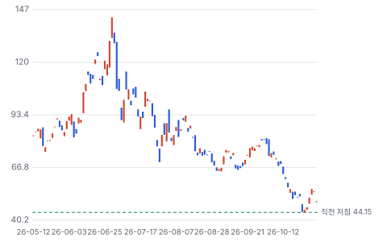

**주봉**

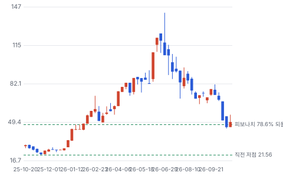

**월봉**

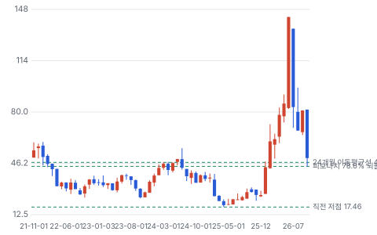

**분기 매출·EPS 실적과 컨센서스**

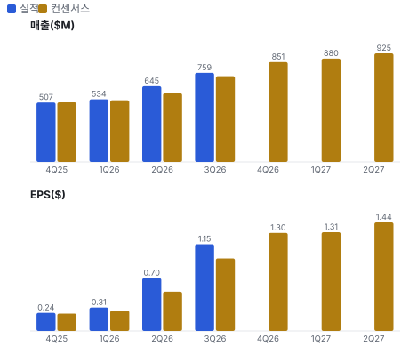

**EPS 리비전**

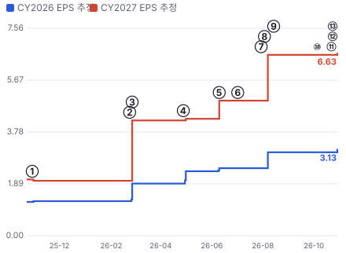

① 25-10-28 3Q25 실적 · EPS 리비전 -2%
② 26-02-23 4Q25 실적·상승 사이클 확인 · EPS 리비전 +110%
③ 26-02-26 0% 전환사채 가격 결정(옵션 포함 \$600M) · 실적 창과 겹침
④ 26-04-28 1Q26 실적·AI 다년 사이클 초기 언급 · EPS 리비전 +1%
⑤ 26-06-10 EPS 추정 상향 후 6/11 증권사 WFE 전망 상향·장비주 급등 · EPS 리비전 +15%
⑥ 26-07-02 메모리 우려로 장비주 동반 급락 · EPS 리비전 +0%
⑦ 26-07-30 Lam 6월 분기 실적·9월 분기 가이던스 강세 · EPS 리비전 +0%
⑧ 26-08-03 2Q26 실적·WFE \$200B 언급 · EPS 리비전 +34%
⑨ 26-08-14 ATM \$400M 등록(AMAT 실적 약세와 같은 날) · 실적 창과 겹침
⑩ 26-10-05 UBS 증설 사유 목표가 하향 · EPS 리비전 +0%
⑪ 26-10-22 Lam 전망 실망(CY27 WFE \$200B 초과 제시에도) · EPS 리비전 +0%
⑫ 26-10-27 3Q26 실적·ATM 220만 주 공개 · EPS 리비전 +1%
⑬ 26-10-30 장비주 동반 −6~−8%(회사 공시 없음) · 실적 창과 겹침

**밸류에이션 주가 시나리오**

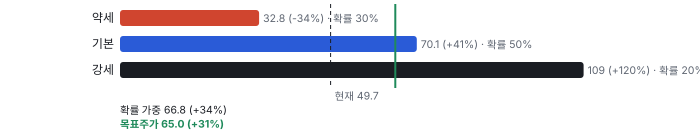

**주가별 업사이드**

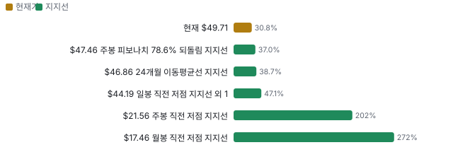

**어닝콜 변화별 주주가치 영향**

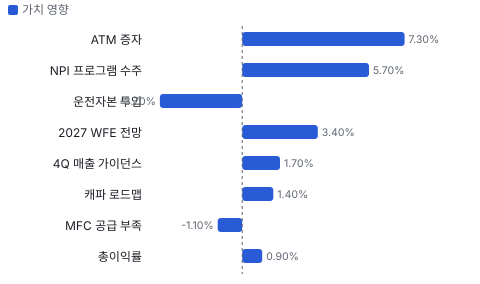

**최근 4개 분기 주가 변화 분석**

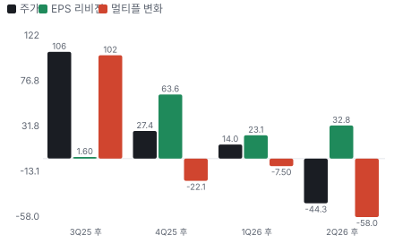

**멀티플 프리미엄**

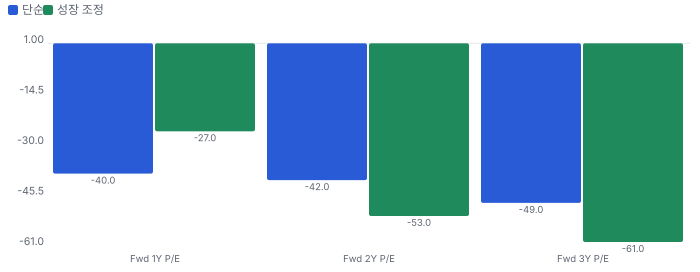

**합리적 멀티플**

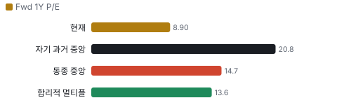

**일별 거래량 분해**

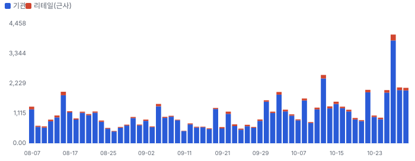

**기관 자금 흐름**

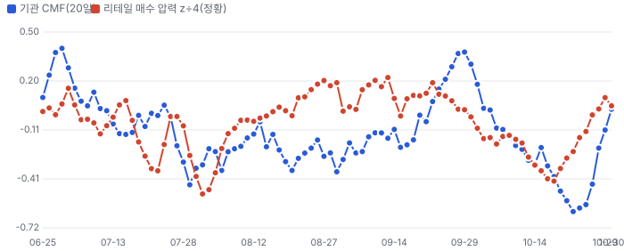

**몬테카를로**

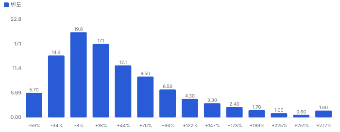

해석: 3,000번 중 1,934번(64%)에서 가치가 지금 주가 이상이었다. 가정을 흔들어도 지금 주가를 뒷받침하는 경우가 더 많다. 가운데 값은 1.20배이고, 열 번 중 여덟 번은 0.63~2.40배 사이에 든다.

## 내러티브

> **기업가치를 결정하는 이야기:** 매출 = WFE × 점유 약 2%(회사 환산 \$5B ÷ \$250B). 이익 = 매출 × 이익률이고, 총이익률은 3Q 17.3%에서 매출 \$4B 시 20%가 목표다. 멀티플은 사이클이 몇 년 가느냐에 대한 시장의 판단이다. UCTT는 고객 설계대로 만드는 비중이 커서 기술 희소성 프리미엄이 작다. 그래서 배수는 업종 사이클과 함께 움직이고, EPS는 가동률과 함께 움직인다.

> **멀티플·EPS 프리미엄**
> **멀티플:** 지금은 프리미엄이 아니라 할인이다. Fwd 1Y P/E 8.9배는 동종 중앙값 14.7배보다 40% 낮고, 2/23의 44.8배에서 내려왔다. 고점의 프리미엄은 'WFE 다년 사이클 + 외주 확대'가 만들었고, 7월 이후 장비 업종 디레이팅과 증설 자금 조달이 지웠다.
> **EPS:** EPS에는 기대가 남아 있다. CY2027 EPS 컨센서스 \$6.63은 1년 전 \$2.05의 3.2배이고, 추정 범위 하단 \$5.85와는 13% 벌어져 있다. 일부는 사업이 아니라 재무 구조에서 왔다. 분기 이자비용이 \$9.9M에서 \$1.5M로 줄어 연 약 \$34M, 세후 주당 약 \$0.55가 더해졌다(Chiip 계산).

### 투자자들은 왜 열광했나

열광의 정점은 6월이었다. 첫째, 규모가 커졌다. 회사가 인용한 고객의 2026년 WFE 전망은 4월 \$140~145B였고, 10월 Lam은 2026년 약 \$155B, 2027년 \$200B 초과를 제시했다. 둘째, 레버리지다. 회사는 매출 \$4B에서 총이익률 20%를 목표로 말했고, 상승기에 고객이 서브시스템(장비 안에 들어가는 모듈 조립품)을 외주로 넘긴다고 설명했다. 셋째, 가시성이다. 2Q 콜에서 경영진은 고객이 예측 기간을 늘려 주고 있다고 말했다. 넷째, 리비전이다. CY2027 EPS 추정이 2월에 2배가 됐고 8월에 다시 34% 올랐다. 식은 이유도 같은 곳에 있다. 7월에 장비 업종이 AI 트레이드 재평가로 급락했고, 8/14 ATM 등록, 10/5 UBS(유니온 뱅크 오브 스위츠랜드)의 증설 사유 목표가 하향, 10/21 Lam 전망 실망이 이어졌다.

### 무엇이 기업가치를 바꾸나

> **구조적 체질 변화**
> **변화:** 부채 구조와 운영 체계가 바뀌었다. 2026년 3월 0% 전환사채 \$600M으로 term loan \$481M을 전액 갚아 분기 이자비용이 \$9.9M에서 \$1.5M로 줄었다. 경영진의 'UCT 3.0(램프 준비·NPX·디지털 전환을 묶은 경영진의 사업 계획)'은 램프 준비·NPX(차세대 공정 부품을 고객과 함께 개발·시험하는 UCT 센터 프로그램)·디지털 전환 세 축이고, CFO도 8월에 바뀌었다.
> **증거:** 10-Q 2026-09-25 부채 주석, 전환가 \$84.75·capped call 상한 \$104.07·만기 2031년 3월.
> **반증:** 이자 절감을 증자 희석이 상쇄하거나, 사이클 하강기에 늘어난 캐파가 고정비로 드러나면 체질 변화가 아니라 재무 설계에 그친다.

> **고부가 믹스 확장**
> **변화:** 가스 패널 같은 모듈 조립에서 설계 단계 참여(build-to-spec(고객 사양을 받아 설계부터 맡는 방식))와 부품 내재화로 옮기는 중이다. 회사 설명으로 제품별 총이익률은 10%에서 50~60%까지 벌어져 있어 믹스가 곧 이익률이다. 서비스는 매출의 10%지만 3Q 총이익률 28.8%로 제품 15.6%의 약 2배다.
> **증거:** 3Q 제품 매출 \$681.9M·원가 \$575.7M, 서비스 매출 \$77.1M·원가 \$54.9M(10-Q). 비GAAP 총이익률 2Q 16.7% → 3Q 17.3%.
> **반증:** 매출 \$850M 분기에도 총이익률 17.5% 미만이면 믹스 이야기가 숫자로 바뀌지 않은 것이다.

> **기술 혁신**
> **변화:** UCTT의 기술은 소재 발명이 아니라 초고순도 유체 제어와 오염 관리다. GAA(게이트 올 어라운드 트랜지스터)·HBM(고대역폭 메모리)으로 식각·증착 집약도가 오르면 장비당 가스 계통과 세정 난도가 함께 오른다. 2Q에 힐스보로 NPX 센터를 열었고, 3Q에 식각·ALD(원자층 증착)·PVD(물리 기상 증착)·리소그래피에서 8건을 수주했다. 회사는 이 제품들이 2~3년 뒤 다음 노드에서 상용화된다고 설명했다.
> **증거:** 연구개발비 3Q \$8.8M(매출의 1.2%), 특허 100건 이상, 고객을 위해 개발한 IP는 대체로 고객 소유(10-K).
> **반증:** 2028년까지 NPX 프로그램의 양산 매출이 확인되지 않으면 기술 프리미엄의 근거가 없다.

> **실행 속도**
> **변화:** 해당 없음(주문→인도 기간을 회사도 피어도 공개하지 않는다). 10-K는 주문 대부분을 같은 분기 안에 받아 처리하고 의미 있는 수주잔고가 없다고 적었다. 대신 물량 속도를 본다. 분기 매출은 2Q \$644.9M → 3Q \$759.0M → 4Q 가이던스 \$800~860M이다.
> **증거:** 병목은 UCTT 조립이 아니라 부품이다. 경영진은 MFC(질량유량제어기, 공정 가스 유량을 재는 핵심 부품) 부족이 1~2분기 더 간다고 말했고, 10-K는 공급사 납기가 고객 납기보다 길 수 있다고 적었다.
> **반증:** MFC 부족이 풀린 뒤에도 4Q 매출이 \$800M에 못 미친다

> **M&A**
> **변화:** M&A는 지금 성장 동력이 아니다. 2018년 Quantum Global(세정 서비스), 2020년 말 합의한 Ham-Let(밸브·피팅), 2023년 HIS(서브팹 회사) 이노베이션스(서브팹(장비 아래층의 배기·가스 설비))로 사업을 넓혔지만, 2025년 2분기에 Fluid Solutions(UCT 유체 부품 사업부) \$77.6M·Services \$73.5M, 합계 \$151.1M의 영업권을 상각했다. 3Q 콜까지 새 인수 계획은 나오지 않았다.
> **증거:** 10-K 2025 영업권 주석. 남은 영업권 \$114.2M. 2025년 순손실의 주된 원인이 이 상각이다.
> **반증:** 자체 IP가 있는 부품·계측 회사를 합리적 가격에 사면 긍정으로 바뀐다. 증자 자금으로 하는 대형 인수는 반대 방향이다.

> **정책·입법 연관성**
> **재정정책:** 해당 없음(UCTT에 직접 닿는 재정 지출이 없다). CHIPS(미국 반도체 지원법) 보조금은 고객 팹에 가고, 회사가 공시한 정부 보조금은 2025년 \$2.2M뿐이다. 10-Q·10-K에 전략 계약이나 CHIPS 지원 공시가 없다. 반증: 미국 팹 보조금 지급이 끊겨 착공이 밀린다
> **행정명령:** 2026년 1월 232조 조치는 좁은 범위의 첨단 로직 칩이 대상이었고 장비에는 즉시 관세를 매기지 않았다. 그 뒤 변화는 확인하지 못했다. 법무법인 해설 기준이다. UCTT 2025년 해외 매출은 75.9%다. 반증: 광범위 관세가 장비·부품까지 넓어진다 의회 동의 2/10 — 하원 1/5(대통령 조치라 표결 없음) · 상원 1/5(대통령 조치라 표결 없음).
> **연관입법:** 48D 세액공제는 2025년 법으로 35%가 됐지만 2026년 12월 31일 뒤 착공분은 받지 못한다. 연장안 BASIC Act(H.R. 3204)와 상원 SEMI Investment Act(반도체 장비·소재 공급망까지 세액공제를 넓히는 상원 법안)가 있고, 통과는 확인되지 않았다. SEMI(국제반도체장비재료협회)는 8월에도 연장을 요청 중이었다. Crapo·Wyden 상원의원이 연장 지지를 밝혔다. 간접 효과라 고객 착공 일정으로만 닿는다. 반증: 연장 없이 일몰되고 2027년 미국 착공 계획이 줄어든다

> **CAPEX 낙수효과**
> **변화:** 돈은 하이퍼스케일러 → 메모리·파운드리 → 장비사 → UCTT로 내려온다. TSMC(타이완 세미컨덕터 매뉴팩처링)는 2026년 CAPEX를 \$52~56B에서 7월 \$60~64B로 올렸고, Lam은 WFE를 2026년 약 \$155B, 2027년 \$200B 초과로 제시했다. UCTT는 3Q 매출의 61.1%가 Lam(38.8%)과 AMAT(22.3%)에서 나와 이 경로의 마지막 고리에 있다.
> **증거:** 3Q 매출 +48.8% YoY, 4Q 가이던스 \$800~860M, 재고 구매 약정 \$1,111M. Lam 수치는 예비 전망이다.
> **반증:** Lam·AMAT가 2027 WFE를 낮추거나 하이퍼스케일러 CAPEX 둔화가 확인되면 경로 전체가 꺾인다.

### 내러티브 근거

> '2027~28 WFE 증설 사이클의 서브시스템 아웃소싱 수혜'는 실적으로 확인되는데(3Q 매출 +49%), 주가는 6/30 고점 대비 −65% — 시장은 증설 대가(재고·증자)와 장비주 디레이팅을 먼저 가격에 넣었다. 동종 대비 멀티플 차이 -40% 중 회사 고유 몫은 -35%다. 단계는 소멸, 쏠림은 낮음이다.

> **WFE 2027~28 다년 증설(AI 메모리·GAA·HBM)** · 강화
> **논리:** 2027 WFE \$200B 이상, 고객이 서브시스템을 외부로 넘겨 UCTT가 업종보다 빨리 큰다
> **숫자:** 3Q 매출 +48.8% YoY·4Q 가이던스 중간값 +9.4% QoQ, 메모리 비중 34%
> **반증:** 대형 장비사(AMAT·LRCX(램리서치)) 2027 WFE 전망 하향(2027-01~02 실적)

> **이익률 레버리지(가동률·고부가 NPI(신제품 도입))** · 유지
> **논리:** \$4B에서 총이익률 20% — 가동률과 build-to-spec 제품 믹스로 마진이 오른다
> **숫자:** 총이익률 2Q 16.7% → 3Q 17.3%, NPI 8건
> **반증:** 매출 \$850M 이상 분기에 총이익률 17% 미만

> **증설의 대가 — 재고·증자(약세)** · 강화
> **논리:** 고객 약정 없이 캐파·재고를 먼저 사고, 그 돈을 증자로 메운다 — 사이클이 꺾이면 ROIC가 무너진다
> **숫자:** 재고 \$723M(+\$93M), 영업현금 3분기 연속 음수, ATM 약 \$203M(주식 +5.6%)
> **반증:** 4Q 영업현금흐름 플러스 전환·재고 회전 개선(2027-02 4Q 실적)

> **장비주 디레이팅(AI 심리 냉각, 약세)** · 확산
> **논리:** AI 투자 지속성 의심이 장비 업종 배수를 누른다
> **숫자:** Fwd 1Y P/E 2/23 44.8배 → 10/30 8.9배, 같은 기간 선행 EPS 추정은 상향
> **반증:** 장비 업종 배수 회복과 함께 UCTT Fwd 1Y P/E 12배 회복

> **고객 집중(상위 2사 61%)** · 유지
> **논리:** AMAT·LRCX 내부 생산 전환 또는 이원화 시 물량이 빠진다
> **숫자:** 상위 2고객 61%(3Q)
> **반증:** 상위 2고객 비중 55% 미만으로 분산(10-K)

## 포트폴리오

| 제품·서비스 | 구분 | 무엇 | 쓰는 곳 | 돈 버는 방식 |
|---|---|---|---|---|
| 가스·유체 공급 시스템 | 제품 | 장비 안에서 공정 가스와 화학액을 정밀하게 보내는 모듈이다. 밸브·레귤레이터·유량 제어기를 초고순도 용접 배관으로 잇는다. | 식각·증착 장비 | 장비사 주문을 받아 조달·조립·시험까지 맡는다 |
| 프레임·용접·공정 모듈·로보틱스 | 제품 | 장비의 뼈대, 고순도 용접물, 웨이퍼 이송 장치와 메카트로닉스 조립품이다. | 장비사가 외주로 넘기는 상위 조립 | 용접·프레임 수직계열화로 원가를 낮춘다. 세부(필리핀) 용접 캐파를 두 배로 늘리는 중이다 |
| 부품(Fluid Solutions) | 제품 | 초청정 밸브·커넥터·피팅·히터 같은 가스 라인 부품이다. | 반도체와 석유화학·전력 | 모듈보다 이익률이 높은 부품을 안에서 만든다 |
| 세정·코팅·오염 분석 | 서비스 | 쓰고 난 장비 챔버 부품을 초고순도로 세정·재코팅하고 미세 오염을 분석한다. | 소자사 팹과 장비사 | 웨이퍼 투입량에 연동된다. 3Q 매출 \$77.1M, 총이익률 28.8% |
| NPX·build-to-spec | 기술 | 고객 설계대로 만드는 단계에서 설계 단계로 들어가는 전환이다. NPX는 신제품 개발·도입·이관을 합친 조직이다. | 식각·ALD·PVD·리소그래피·계측 | 첫 공급사 자격을 얻으면 양산 때 점유와 이익률이 오른다. 아직 매출로 확인되지 않았다 |

## 수주·파이프라인

> **2026-10-27 기준 2건.** 건별 확정 금액은 공개되지 않았다. 서로 겹치는 항목은 합계에서 뺐다.

**실행 속도와 방해 요인**
| 항목 | 상태 | 실행 속도 | 방해 요인 |
|---|---|---|---|
| 연 \$4B 캐파 | 파이프라인 | 1H27 목표, 이후 \$5B 이상 단계적 | 고객 장기 약정 없음 · 재고 구매 약정 \$1,111M · ATM 희석 |
| 신규 프로그램 8건 | 파이프라인 | 회사 설명으로 2~3년 뒤 다음 노드에서 상용화 | 고객 노드 일정 · 고객 소유 IP |

## 해자

> 고객 승인과 규모가 신규 진입은 막지만, 총이익률 17%가 말하듯 가격 결정력으로 이어지지 않는다

> **장비사 승인 라인** · 보통
> **해자:** Lam·AMAT 장비에 들어가는 가스 계통은 고객 승인을 받은 설계·공정으로 만들어 쉽게 바꾸지 못한다.
> **근거:** 3Q 매출의 61.1%가 두 고객이다. 다만 10-K는 고객 내재화와 Ichor·Fujikin·Foxsemicon·VDL ETG(네덜란드 장비 위탁 생산사)·Jabil·Celestica를 경쟁으로 적었고, 고객을 위해 개발한 IP는 대체로 고객 소유다.
> **숫자:** 3Q 제품 총이익률 15.6%
> **깨지는 조건:** 상위 고객이 물량을 이원화하거나 내재화해 어느 한쪽 비중이 5%p 이상 준다

> **세정·분석 서비스 현장망** · 보통
> **해자:** 팹 가까이에 인증된 세정·코팅·오염 분석 설비를 두어야 해서 지역 밀착이 진입 장벽이다.
> **근거:** 서비스는 3Q 매출 \$77.1M으로 10%지만 총이익률이 제품의 약 2배다. 미국 신규 팹 가동이 2027~28년 수요로 이어진다는 건 회사 설명이고 계약은 공시되지 않았다.
> **숫자:** 3Q 서비스 총이익률 28.8%
> **깨지는 조건:** 서비스 총이익률이 25% 아래로 내려가거나 미국 신규 팹 인증이 경쟁사로 간다

> **규모와 상승기 캐파** · 약함
> **해자:** 상승기에 물량을 받아낼 캐파가 곧 점유율이다. 다만 고객 약정 없이 지은 캐파라 사이클이 꺾이면 해자가 아니라 고정비다.
> **근거:** 회사는 2027년 상반기 연 \$4B 캐파를 제시했다. 동종 Ichor TTM 매출은 \$1.0B다. 재고 구매 약정 \$1,111M은 구속력 없는 고객 예측을 근거로 잡혀 있다.
> **숫자:** TTM 매출 \$2.44B vs Ichor \$1.01B
> **깨지는 조건:** 경쟁사 증설이 겹쳐 매출 \$850M 분기에도 총이익률이 17%를 밑돈다

## 경영진·네트워크

> CEO는 2대 고객 AMAT 출신이고 의장도 AMAT 임원을 지냈다. 두 사람 모두 AMAT이 2006년 사들인 Applied Films(AMAT이 2006년 인수한 코팅 장비 회사) 출신이다. 연결이 수주를 만들었다는 증거는 없다.

> **James Xiao** · CEO · 2025-09
> **프로필:** 55세. AMAT에서 19년 일했고 마지막은 ALD 제품군 총괄 부사장이었다. 2006년 Applied Films 인수로 합류했고 그 전에는 중국 법인 대표였다.
> **비즈니스:** AMAT ALD 제품군을 맡았던 경력이 2대 고객과 직접 닿는다. 위임장은 고객·업계·정부 네트워크를 선임 사유로 적었다. 다른 상장사 이사직은 확인하지 못했다.
> **정계:** 공개 기록상 공직·정치 활동 미확인
> **동문:** 대련이공대 응용물리, 인디애나대 켈리 MBA(경영학 석사)
> **사모임:** 미확인

> **Thomas T. Edman** · 독립 의장 · 2026-05(이사 2015)
> **프로필:** 63세. TTM Technologies CEO(2014~2025년 9월)를 지냈다. 그 전 AMAT에서 AKT(AMAT의 디스플레이 장비 사업) 디스플레이 사업 총괄과 사업개발 부사장을 맡았고, Applied Films CEO였다.
> **비즈니스:** Jabil·Materion 이사(2026년 1월부터), TTM 이사(2004년부터), 전자 제조 협회(Global Electronics Association) 명예 의장. Jabil은 10-K가 적은 서브시스템 경쟁사다.
> **정계:** 공개 기록상 공직·정치 활동 미확인
> **동문:** 예일대 동아시아학, 와튼 MBA
> **사모임:** 미확인

> **Clarence L. Granger** · 이사(전 CEO·전 의장) · 2002
> **프로필:** 77세. 12년간 CEO를 지냈고 2025년 3~9월 임시 CEO로 돌아왔다. 2026년 5월 의장에서 물러났다. 창업자가 아니고, 창업자는 공개 자료에서 현 경영진에 없다.
> **비즈니스:** Seagate·HMT(하드디스크 부품 회사) 테크놀로지 경영진 출신
> **정계:** 미확인
> **동문:** UC(캘리포니아대) 버클리·스탠퍼드 산업공학
> **사모임:** 미확인

**네트워크 정량화**
| 연결 | 강도 | 닿는 매출 | 가중 노출 | 매출 대비 | 근거 |
|---|---|---|---|---|---|
| 비즈니스: Xiao — AMAT ALD 제품군 총괄 출신, AMAT은 2대 고객 | 4/5 | \$0.55B | \$0.44B | 18% | TTM 매출 \$2.44B × 3Q AMAT 비중 22.3% 2026 위임장, 10-Q |
| 비즈니스: Edman — AMAT 부사장·Applied Films CEO 출신, Xiao와 같은 회사 경력 | 3/5 | \$0.55B | \$0.33B | 13% | TTM 매출 \$2.44B × 3Q AMAT 비중 22.3%. 위와 같은 매출이라 합산하지 않는다 2026 위임장 |
| 비즈니스: Edman — Jabil 이사 겸임. Jabil은 경쟁사 명단에 있어 판로보다 이해상충 점검 대상 | 3/5 | \$0.00B | \$0.00B | 0% | 연결이 닿는 UCTT 매출 없음 2026 위임장, 10-K 경쟁 절 |
| 정계: 로비·공직 연결 미확인 | 0/5 | \$0.00B | \$0.00B | 0% | 공개 기록에서 찾지 못함 2026 위임장 |

가중 노출은 연결이 닿는 매출의 크기다. 연결이 그 매출을 만들었다는 뜻이 아니며, 인과는 공개 자료로 입증하지 못한다.

## 약세 논리 및 셀온 조건

| 약세 논리 | 근거 | 가를 자료 |
|---|---|---|
| 약정이 예측 위에 있다 | 재고 구매 약정 \$1,111M은 12월 말 \$443.6M(유형자산 포함, 범위가 다르다)의 2.5배다. 10-K는 고객 예측이 구속력이 없고 취소될 수 있다고 적었다 | 4Q 재고·영업현금, 10-K 약정 |
| 정점 패턴 | 최대 고객이 공급 제약을 말하고 서브시스템 회사가 재고를 쌓는 모습은 과거 정점과 닮았다(추정) | Lam·AMAT 2027 WFE 발언 |
| 증설의 대가 | 전환사채 \$600M에 ATM \$400M 프로그램을 더했다. 10월 첫 주 220만 주를 포함해 누적 약 \$203M을 조달했고(주식 약 +5.6%) 잔량은 \$193.2M이다 | ATM 추가 매도 여부 |
| 경쟁 증설 | Ichor와 고객 내재화가 같은 상승기에 캐파를 늘리면 가격이 눌린다. 공급 증설을 투자자가 늘 과소평가한다 | ICHR 캐파 발언, 총이익률 |
| 고객 집중 | Lam 38.8%·AMAT 22.3%로 두 곳이 61.1%다 | 10-K 고객 비중 |
| 리비전 표본이 얇다 | 연간 EPS 추정은 1명뿐이고 컨센서스 범위는 \$5.85~\$6.63이다. 리비전은 한 사람의 모델 변화일 수 있다 | 표본 증가 여부 |
| 확인 못 한 자료 | 제한 현금은 10-Q·10-K 본문에 언급이 없다. 전략 계약·정부 지원 공시는 없다. 업종 하락 원인과 232조 2026년 2월 이후 변화도 미확인이다 | 4Q 10-K |

> **셀온 조건**
> **조건 1:** Lam·AMAT가 2027 WFE를 2026년보다 낮게 시사한다.
> **조건 2:** 4Q 영업현금이 다시 음수이고 ATM 추가 매도가 나온다.
> **조건 3:** 매출 \$850M 이상 분기에도 총이익률이 17%를 밑돈다.
> **조건 4:** 상위 2고객 중 한 곳이 이원화나 내재화를 밝힌다.

## 어닝콜 변화

**직전 콜 대비 새로 나오거나 바뀐 내용 → 가치 영향**
| 항목 | 내용 | 직전 콜 | 최신 콜 | 모델 동인 이동 | 확신도 | 가치 영향 |
|---|---|---|---|---|---|---|
| 업데이트 | 4Q 매출 가이던스 | 3Q 가이던스 \$700~750M | 3Q 실적 \$759M, 4Q \$800~860M | 기준연도 매출 +\$0.04B | 0.8 | +1.7% |
| 업데이트 | 2027 WFE 전망 | mid-2027 \$200B 런레이트 | 2027년 \$200B 이상(고객 가시성 기반) | 1년차 성장률 +3.0% | 0.5 | +3.4% |
| 업데이트 | 캐파 로드맵 | \$4B(1H27)·\$5B 계획 중 | \$5B 이상 단계적, 세부·말레이시아·태국 2배 | 성장 지속(감속 계수) +2.0% | 0.5 | +1.4% |
| 업데이트 | 총이익률 | 2Q 16.7% | 3Q 17.3%(비GAAP 영업이익률 9.0%) | 출발 이익률 +0.60% | 1.0 | +0.9% |
| 반복 | 장기 이익률 목표 | \$4B에서 총이익률 20% | \$4B에서 총이익률 20%(유지) | 목표 이익률 — | 0.5 | +0.0% |
| 신규 | NPI 프로그램 수주 | 수치 없음 | 8건(식각·ALD·PVD·리소), 비슷한 수가 인증 중 | 장기 이익률 +0.50% | 0.3 | +5.7% |
| 부정 | 운전자본 투입 | 재고 \$630M·영업현금 −\$41M | 재고 \$723M·영업현금 −\$42M | 매출÷투하자본 -20.0% | 1.0 | -3.7% |
| 신규 | ATM 증자 | 없음 | 약 \$203M 순조달(주식 약 +5.6%) | 순차입 -\$0.20B | 1.0 | +7.3% |
| 부정 | MFC 공급 부족 | 질문 없음 | 1~2분기 지속 가능(경영진) | 1년차 성장률 -1.0% | 0.3 | -1.1% |
| **합계** | 단독 합 |  |  | 동시 적용 +16.6% |  | **+15.5%** |

**사건별 EPS 리비전**
| # | 날짜 | 구분 | 사건 | CY2026 EPS 전→후 | CY2027 EPS 전→후 | 리비전 | 주가 반응 |
|---|---|---|---|---|---|---|---|
| ① | 25-10-28 | 실적 | 3Q25 실적 | \$1.23 → \$1.26 | \$2.05 → \$2.00 | -2.4% | -4.2% |
| ② | 26-02-23 | 실적 | 4Q25 실적·상승 사이클 확인 | \$1.26 → \$1.90 | \$2.00 → \$4.20 | +110.0% | +17.2% |
| ③ | 26-02-26 | 내러티브 | 0% 전환사채 가격 결정(옵션 포함 \$600M) | \$1.32 → \$1.90 | \$2.00 → \$4.20 | 실적 창과 겹침 | -11.7% |
| ④ | 26-04-28 | 실적 | 1Q26 실적·AI 다년 사이클 초기 언급 | \$1.90 → \$2.35 | \$4.20 → \$4.26 | +1.4% | -8.0% |
| ⑤ | 26-06-10 | 내러티브 | EPS 추정 상향 후 6/11 증권사 WFE 전망 상향·장비주 급등 | \$2.38 → \$2.46 | \$4.26 → \$4.92 | +15.5% | +15.3% |
| ⑥ | 26-07-02 | 내러티브 | 메모리 우려로 장비주 동반 급락 | \$2.46 → \$2.46 | \$4.92 → \$4.92 | +0.0% | -17.8% |
| ⑦ | 26-07-30 | 내러티브 | Lam 6월 분기 실적·9월 분기 가이던스 강세 | \$2.46 → \$2.46 | \$4.92 → \$4.92 | +0.0% | +19.6% |
| ⑧ | 26-08-03 | 실적 | 2Q26 실적·WFE \$200B 언급 | \$2.46 → \$3.04 | \$4.92 → \$6.59 | +33.9% | -5.2% |
| ⑨ | 26-08-14 | 내러티브 | ATM \$400M 등록(AMAT 실적 약세와 같은 날) | \$3.04 → \$3.04 | \$6.59 → \$6.59 | 실적 창과 겹침 | -8.6% |
| ⑩ | 26-10-05 | 내러티브 | UBS 증설 사유 목표가 하향 | \$3.04 → \$3.04 | \$6.59 → \$6.59 | +0.0% | +1.8% |
| ⑪ | 26-10-22 | 내러티브 | Lam 전망 실망(CY27 WFE \$200B 초과 제시에도) | \$3.04 → \$3.04 | \$6.59 → \$6.59 | +0.0% | -14.9% |
| ⑫ | 26-10-27 | 실적 | 3Q26 실적·ATM 220만 주 공개 | \$3.04 → \$3.13 | \$6.59 → \$6.63 | +0.6% | +8.5% |
| ⑬ | 26-10-30 | 내러티브 | 장비주 동반 −6~−8%(회사 공시 없음) | \$3.13 → \$3.13 | \$6.63 → \$6.63 | 실적 창과 겹침 | -9.1% |

**해석:** 4개 구간 누적 주가 +67% = EPS 리비전 +172% × 멀티플 -39%. 더 크게 움직인 쪽은 **EPS 리비전**이다.

## 밸류에이션

> **목표주가 \$65, 업사이드 +31%.** 자리는 약세와 기본 사이(약세 쪽 12%)이고 도달 확률은 약 50%다. 기본 \$70, 강세 \$109(+120%), 약세 \$33(-34%). DCF 기준 업사이드는 기본 +23%, 강세 +89%, 약세 -14%다(WACC 10.7%).

약세 확률을 어닝콜 톤 규칙의 20%에서 30%로 올렸다. 고객 약정 없는 증설, ATM, 상위 2고객 61%가 하방 꼬리를 키운다(자체추론).

EPS는 FY27 기준 Chiip 추정이고 멀티플은 엔진이 고른다. DCF는 사이클 하강을 명시하지 않고 성장을 부드럽게 줄이므로 약세 꼬리는 시나리오 쪽이 더 크게 본다.

> **약세 \$33 (-34%)** · 확률 30%
> **가정:** 9.4배 × EPS \$3.50
> **근거:** 2027 WFE 정체·고객 재고 조정으로 FY27 매출 약 \$3.0B

> **기본 \$70 (+41%)** · 확률 50%
> **가정:** 12.5배 × EPS \$5.60
> **근거:** FY27 매출 \$3.6~3.8B·총이익률 18%

> **강세 \$109 (+120%)** · 확률 20%
> **가정:** 15.6배 × EPS \$7.00
> **근거:** WFE가 2028년까지 오르고 \$4B 도달·총이익률 20%

**멀티플 선정 — Fwd 1Y P/E**
| 단계 | 조정 | 근거 |
|---|---|---|
| 동종 중앙값 | 14.7배 | 범위 12.5~28.1배, 5곳 |
| 펀더멘털 | -4% | 성장·이익률·ROIC로 본 합리적 멀티플 13.6배와의 차이의 일부만 인정 |
| 해자 | +2% | 장비사 승인 라인 보통 · 세정·분석 서비스 현장망 보통 · 규모와 상승기 캐파 약함 |
| 내러티브 | -10% | 단계 소멸 |
| 사이클·실행 판단 | -20% | 영업이익률이 동종의 3분의 1 수준이고 영업현금이 3분기 연속 음수이며 EPS 표본이 얇아 동종 중앙값에서 할인을 유지한다 |
| **선정** | **12.5배** | 지금 8.9배 |

**동종 레인지**
| 회사 | Fwd 1Y P/E | Fwd 2Y P/E | Fwd 3Y P/E | 성장 | 영업이익률 | ROIC |
|---|---|---|---|---|---|---|
| ICHR | 14.7 | 11.6 | 11.0 | 46% | 9% | 9% |
| MKSI(MKS 인스트루먼트) | 12.5 | 10.9 | 9.9 | 35% | 27% | 14% |
| AEIS(어드밴스드 에너지 인더스트리스) | 15.5 | 13.4 | 10.8 | 40% | 24% | 27% |
| ENTG(엔테그리스) | 28.1 | 24.7 | 21.0 | 18% | 28% | 11% |
| KLIC(쿨리케 앤 소파) | 13.0 | - | - | 59% | 23% | 40% |
| **Ultra Clean Holdings** | 8.9 | 7.2 | 5.6 |  |  |  |

지금 주가가 요구하는 5년 매출 CAGR 9%, 기본 시나리오 16%. 몬테카를로 중앙값 업사이드 +20%.

> 의사결정 보조(투자자문 아님): ① 매수 매력: 연 기대수익 +17.9% (자기자본비용 11.6% 대비 +6.3%p) · 자본비용 초과 확률 60% · 안전마진 0.63 → 정량 신호 중립 / ② 위험 예산 지표(이론): 1/4 켈리 10.0% (상한 10%) · 5년 하위10% +4% · 30%+ 손실 확률 3% / ③ 상방(5년): 기대 2.27배 · 2배 49% · 3배 22% · 10배 0% · 상위10% 3.92배

## 시장 평가

> **셀사이드(IB 애널리스트)**
> **한 줄:** 셀사이드는 실적은 인정하지만 '증설 대가'와 사이클 지속성에 질문이 몰린다 — 배수 확장을 막는 쪽
> **애널리스트 의견:** 7명 — 강력 매수 5·매수 1·보유 1·매도 0 — 의견은 강세 일색이나 매출 추정 제출은 2명(8/6 이후 미갱신)
> **목표가 평균·범위:** \$110.3 (\$80~\$150, 7명) — 10/30 종가 \$49.71 대비 평균 +122% — IB 기대의 증거(Chiip 목표가 아님), 범위가 약 2배로 분산 큼
> **3Q 콜 질문 증권사:** UBS·Needham·TD(캐나다계 증권사)코웬·Oppenheimer·Craig-Hallum — 질문 초점 = 증설의 대가(장기 약정)·MFC 부족·공급망 차질
> **실적 후 목표가 조정:** Needham \$80로 하향(10/28, 밸류에이션 사유 — 제목 기준) — 이익이 아니라 배수 문제로 낮춤

> **바이사이드(기관 투자자)**
> **한 줄:** 바이사이드는 고점에서 줄였다 — 지금은 다시 살 근거(현금 전환)를 기다리는 단계
> **13F 기관(2Q26):** 409곳 · 순 −3.23백만 주 · 증가 87·감소 151 — 고점 직전 분기에 이미 기관 순매도(차익 실현)
> **펀드 레터(2Q26~Q3):** RAM(미국 자산운용사) 스미드 펀드 비중 축소(강세 유지)·Next Century 전량 매도(약세)·Nomura Small Cap 보유(고확신)·Liontrust 청산(목표 도달) — 바이사이드는 '사이클 초기'에 동의하면서도 3분기에 차익·장비주 이탈
> **내부자 장내 거래(누적):** 매수 4·매도 33 — 6~7월 전임 CFO·CAO(최고회계책임자) 장내 매도, 8월 이후는 세금 원천징수만
> **13F 3Q26 공개 진행:** 83곳만 공개(11/14 마감) — 아직 판단 불가

> **언론·업계**
> **한 줄:** 언론은 UCTT를 개별로 다루지 않고 장비 업종 흐름으로 묶는다
> **업종 기사:** SA(시킹 알파)·IBD(인베스터스 비즈니스 데일리)·Barron's 장비주 기사 다수(10/21~26) — 'AI 심리 냉각 → 장비주 디레이팅' vs 'WFE 2028까지 성장'

## 체크리스트

| 시점 | 무엇 | 의미 |
|---|---|---|
| 2026-11-14 | 3Q 13F 마감 | 고점 뒤 기관 매도가 이어졌나, 지금 83곳만 공개 |
| 2026-12-31 | 48D 착공 시한·연장 입법 | 미국 팹 착공과 서비스 매출 가정 |
| 2027-01 말 | Lam 실적 | 최대 고객의 2027 WFE 발언 |
| 2027-02 중순 | AMAT 실적 | 2027 WFE, 공급 제약 해소 |
| 2027-03-01(예상) | UCTT 4Q 실적 | 매출 범위, 총이익률 17.5%, 영업현금, ATM 잔량 |
| 2027 상반기 | \$4B 캐파 완료 | 고객 약정과 함께 다음 단계에 들어가는지 |

## 재발행 기록 — 양식 3 전환

- 기준 주가: \$54.70(10/29) → \$49.71(10/30). Fwd 1Y P/E 9.0배 → 8.9배.
- 새 재료: 해자, 경영진·네트워크, 수주·파이프라인, 정책·입법 연관성, 구매 등급·목표주가.
- 10-Q·10-K 네 곳을 다시 봤다. 10-K의 '수주잔고 없음'과 '고객 예측은 구속력 없음'을 재고 약정 논리에 새로 넣었다.
- 내러티브 단계: 태동 → 소멸. 프리미엄이 사라졌고 시장의 질문이 사이클 지속성으로 옮겨 갔다는 판단이다.

## 출처
- 10-Q 2026-09-25: https://www.sec.gov/Archives/edgar/data/1275014/000162828026067880/uctt-20260925.htm
- 10-K 2025: https://www.sec.gov/Archives/edgar/data/1275014/000162828026010744/uctt-20251226.htm
- 2026 위임장: https://www.sec.gov/Archives/edgar/data/0001275014/000114036126016813/ny20064711x1_def14a.htm
- 이사 선임 8-K 2026-09-30: https://www.sec.gov/Archives/edgar/data/1275014/000162828026063977/uctt-20260928.htm · CFO 8-K 2026-07-08: https://www.sec.gov/Archives/edgar/data/1275014/000162828026047655/uctt-20260702.htm
- 전환사채 8-K: https://www.sec.gov/Archives/edgar/data/1275014/000095010326003139/dp242585_8k.htm · ATM 8-K: https://www.sec.gov/Archives/edgar/data/1275014/000095010326012379/dp251729_8k.htm
- 3Q 실적 보도자료: https://www.prnewswire.com/news-releases/ultra-clean-reports-third-quarter-2026-financial-results-302921159.html
- Lam WFE 전망(2차 요약, 예비 전망): https://www.tikr.com/blog/applied-materials-sinks-7-on-lams-outlook-a-bit-higher-wasnt-enough
- TSMC CAPEX(2차 요약): https://www.moomoo.com/community/feed/tsmc-beats-guidance-68-margin-64b-capex-demand-through-2030-116929615757318
- 사건 원인(2차 자료): 7/2 https://www.tikr.com/blog/lam-research-stock-fell-10-in-a-day-heres-where-the-stock-could-go-in-2026 · 6/11 https://invezz.com/news/2026/06/11/applied-materials-kla-stocks-gain-as-ai-boom-lifts-chip-equipment-outlook/
- 48D 연장: https://www.govinfo.gov/content/pkg/BILLS-119hr3204ih/html/BILLS-119hr3204ih.htm · https://www.semi.org/en/semi-press-release/semi-brings-semiconductor-industry-tax-leaders-to-capitol-hill-to-urge-congress-to-extend-section-48d-semiconductor-investment-tax-credit · 232조: https://www.whitecase.com/insight-alert/president-trump-orders-narrowly-targeted-25-section-232-tariff-certain-advanced
- Needham 10/28: https://www.moomoo.com/news/post/1002637745/ultra-clean-price-target-cut-to-80-00-share-from
- 3Q 콜
- 3Q 콜·10-Q

_구매 등급·목표주가 모두 규칙이 계산한 모델 값으로, 개인의 보유 종목·자금 사정을 반영하지 않는다 · 공개 자료 기반 분석이며 투자 권유가 아님 · 1차 판정, 미검증 · Chiip ten-bagger_