# 텐배거 리포트 2026-11-02 — Vicor — 특허 전선이 20개 법인으로 넓어졌다, 프리미엄 45%는 아직 판정 전의 약속이다

> 2026-11-02 · Vicor Corporation(VICR) · 기업: AI 가속기에 전기를 수직으로 넣는 고밀도 전력 모듈(VPD)을 자체 팹에서 만들고 관련 특허 로열티를 받는 미국 회사

## Chiip View

이야기는 숫자가 됐지만 가격은 아직 판정 전의 약속을 산다. 로열티는 TTM \$126.6M이고 회사가 처음 준 기준선은 분기 \$43M이다. 수주잔고는 \$406M이다. **목표주가는 \$199로 업사이드 +4%, 약세 다운사이드 −43%, 손익비 2.1이고 등급은 Neutral이다.** 확률 가중값 \$219(+14%)보다 낮은 것은 DCF 12개월 뒤 값이 \$123이고 차트 여력이 \$196이라서다. 고점 대비 −50%는 거의 배수에서 나왔다. 그래도 Fwd 1Y P/E 36.5배는 동종 중앙값 25.2배보다 45% 높고, 시장 내포 5년 매출 CAGR은 44%로 기본 시나리오 28%를 크게 넘는다. **이번에 고친 가장 큰 사실은 ITC(미국 국제무역위원회)다.** 1526은 폭스콘만이 아니라 MPS(미국 전력 반도체 회사)·Infineon(독일 전력 반도체 회사)·델타일렉트로닉스·콴타 등 20개 법인을 겨눈다. 이기면 로열티 기반이 넓어지지만, 지면 프리미엄의 근거가 흔들린다. 시장은 IP 회사로 값을 매기고, 우리는 2027-05-20 1484 판단 전까지 그 값이 확인되지 않았다고 본다. 다음 확인은 1526 목표일, 12/31 48D(미국 반도체 투자 세액공제) 착공 시한, 2027년 2월 4Q 로열티다.

## 대시보드
| 항목 | 값 | 설명 |
|---|---|---|
| 주가 | \$191.09 | 고점 대비 -50% · 1년 +109% |
| 시가총액 | \$9.10B | EV \$8.60B |
| 업사이드 | +4% | 목표주가 \$199 · 다운사이드 -43% · 손익비 2.1 |
| 구매등급 | Neutral | 애널리스트 5명: Strong Buy 4 · Buy 1 · Neutral 0 · Sell 0 · Strong Sell 0 |
| 멀티플 | Fwd 1Y P/E 36.5배 | 동종 중앙값 25.2배 |
| 가이던스 4Q26 | \$186M | 컨센서스 \$195M |
| 알파 | 6.4/10 | 텐배거 가능성 점수 |
| 이벤트 | 4Q26 실적(예상, 회사 미공지) | 2027-02-18 |

## 한 장 요약
- **기업가치를 결정하는 내러티브** VICR의 값은 **로열티 × 제품 캐파 × AI 전력 배수** 세 가지로 정해진다. 3Q 매출 \$197.1M(+79%), 로열티 기준선 분기 \$43M, 수주잔고 \$406M까지 숫자는 올랐다. 주가는 고점 \$379.78에서 −50%이고 Fwd 1Y P/E는 36.5배다. 그래도 동종 중앙값 25.2배보다 45% 높다.
- **밸류에이션 모델로 본 주가 상방은 어디까지인가?** **목표주가 \$199(+4%), 약세와 기본 사이(약세 쪽 14%)다.** 강세 \$361(+89%)는 Fwd 1Y P/E 38.0배를 강세 EPS에 적용한 값이다. 기본 \$213, 약세 \$109. 손익비 2.1, DCF 기준 업사이드 -42%.
- **수주는 어디까지 왔나?** 제품 수주잔고(12개월 내 출하) 미확인, 100% 매출 \$0.41B · 4Q 첫 2주 수주 미확인, 100% 매출 \$0.10B · 로열티 기준선 연환산 미확인, 100% 매출 \$0.17B. 확정으로 셀 수 있는 것은 12개월 수주잔고 \$406M이다. 로열티 기준선과 ITC는 수주가 아니라 조건부 수입이다.
- **지금 가격은 무엇을 가정하나?** 현금흐름으로 풀면 5년 매출 CAGR 44%다. 2031년 매출 약 \$4.0B(추정)로 회사 목표 \$2.5B의 1.6배다.

사업별로 나누면 로열티 기준선을 순이익 30배로 쳐도 약 \$3.3B(추정)다. 나머지 약 \$5.0B가 제품 몫이라 FY2027 제품 매출 \$729M(추정)의 약 6.9배다. 제품에 5배만 주면 분기 로열티는 \$61M이 필요하다. 기준선보다 43% 높지만 3Q 실적 \$66.6M보다는 낮다.
- **왜 움직였나?** 6/30 고점 \$379.78에서 −50%다. 7/20 뒤로 보면 주가 −17%, FY2027 EPS 추정 +3%라 배수가 내렸다.

10/22 −15.7%와 10/30 −7.5%는 회사 공시가 없었다. 10/22에는 MPS −9.0%, AEIS(미국 전력 장비 회사) −12.5%였고 10/30에는 AEIS −7.4%, VRT(미국 데이터센터 전력·냉각 회사) −5.5%, NVDA −4.2%였다. 업종 동반 하락으로 보이지만 그 원인은 확인하지 못했다. 10/30 MPS는 +1.1%로 달랐다.
- **3Q 콜에서 무엇이 바뀌었나?** 좋아진 것은 로열티 기준선 \$43M, 첫 순수 VPD(칩 바로 아래에서 전력을 넣는 수직 전력 공급) 라이선스, 제품 총이익률 약 46.7% → 52.2%(추정), 4Q 첫 2주 수주 \$100M이다.

나빠진 것은 법률비 \$16.1M(로열티의 약 20%), 소급분 크기 답변 회피, 2세대 VPD 선도 고객 밖 채택 '아직 초기', 수주잔고 증가율 +26% → +7%다. 3Q 매출은 \$197.1M으로 컨센서스 \$187M을 넘었고, EPS \$1.33은 컨센서스 \$1.32~\$1.51 안쪽이다.
- **무엇이 바뀌면 판단이 달라지나?** 위쪽은 4Q 로열티 \$55M 이상, 하이퍼스케일러 첫 VPD 라이선스, 2세대 선도 고객 밖 설계 수주, 1484 승소다.

아래쪽은 로열티 \$43M 미달, 초기 계약 갱신 지연, ITC 비침해·무효 판단, 대형 고객의 IVR(칩 안에 넣는 전압 조정기) 단독 양산 채택이다.

## 한눈에 보기

**일봉**

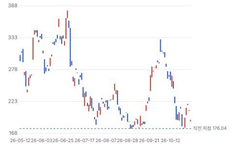

**주봉**

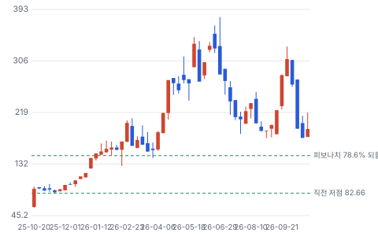

**월봉**

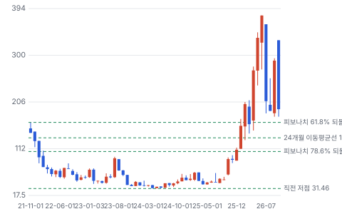

**분기 매출·EPS 실적과 컨센서스**

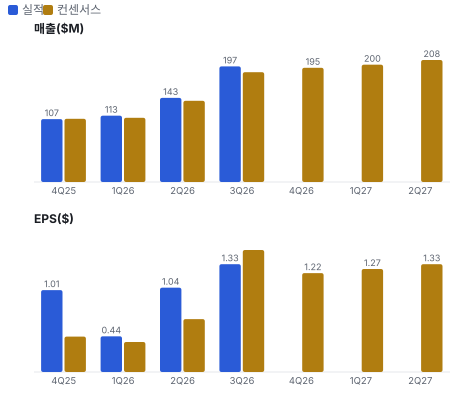

**EPS 리비전**

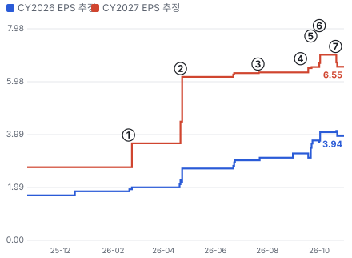

① 26-02-19 4Q25 실적 · EPS 리비전 +33%
② 26-04-21 1Q26 실적 · EPS 리비전 +69%
③ 26-07-21 2Q26 실적 · EPS 리비전 +1%
④ 26-09-09 ITC 337-TA-1526 제소 · EPS 리비전 +2%
⑤ 26-09-21 3Q 전망 상향(QoQ 20% 초과) · EPS 리비전 +1%
⑥ 26-10-01 3Q 전망 재상향(QoQ 30% 초과) · EPS 리비전 +7%
⑦ 26-10-20 3Q26 실적, 로열티 기준선 \$43M · EPS 리비전 -6%

**밸류에이션 주가 시나리오**

**주가별 업사이드**

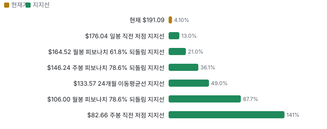

**어닝콜 변화별 주주가치 영향**

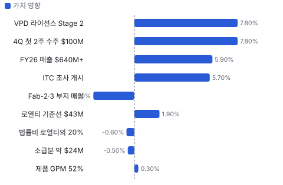

**최근 4개 분기 주가 변화 분석**

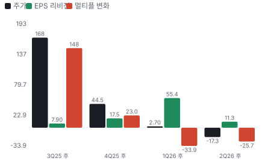

**멀티플 프리미엄**

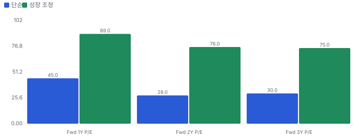

**합리적 멀티플**

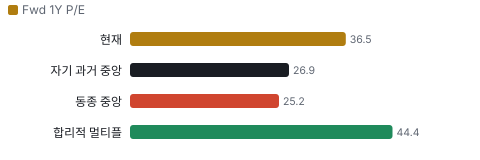

**일별 거래량 분해**

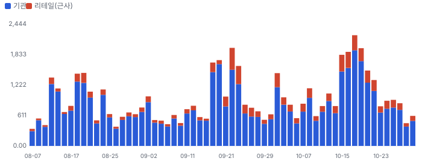

**기관 자금 흐름**

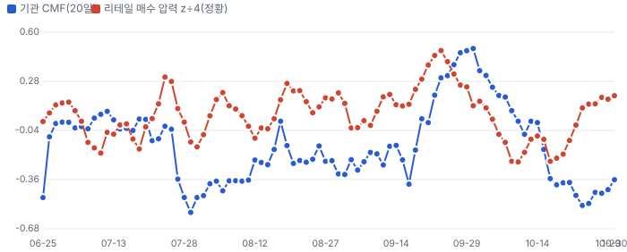

**몬테카를로**

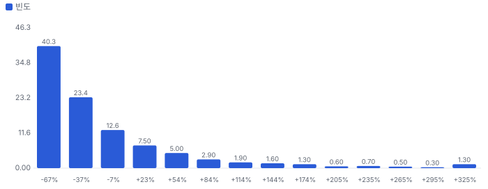

해석: 3,000번 중 792번(26%)에서 가치가 지금 주가 이상이었다. 가정을 흔들어도 지금 주가를 뒷받침하지 못하는 경우가 더 많다. 가운데 값은 0.58배이고, 열 번 중 여덟 번은 0.24~1.78배 사이에 든다.

## 내러티브

> **기업가치를 결정하는 이야기:** 제품은 AI 가속기용 전력 모듈이고, 그 특허에서 원가 없는 로열티가 나온다. 시장이 묻는 것은 로열티가 반복되느냐, 제품이 Fab-1(매사추세츠 앤도버 공장) 캐파를 넘어 언제 늘어나느냐다. 로열티 기준선 연 \$172M은 법률비 20%와 세금을 빼면 EPS 약 \$2.3이다. Fwd 1Y EPS \$5.24의 44%가 여기서 나온다.

> **멀티플·EPS 프리미엄**
> **멀티플:** 프리미엄은 남아 있다. Fwd 1Y P/E 36.5배는 6/30 74.8배에서 반 토막 났지만 동종 중앙값 25.2배보다 45% 높다. 이 프리미엄은 'IP 라이선서' 이야기가 만든다. ITC 판단 전까지는 약속이다.
> **EPS:** EPS 추정은 위로 갔지만 폭이 작다. FY2027이 7/22 \$6.35에서 10/22 \$6.56으로 +3%다. 같은 기간 주가는 −17%다. 하락은 전부 배수에서 나왔다. 추정치 표본은 2명이고, 범위는 FY2027 \$5.49~6.56이다.

### 투자자들은 왜 열광했나

열광의 정점은 6월이었다. 첫째, 로열티다. 2026년 초 분기 \$15M이던 라이선스 수입에 '부품사가 IP 회사가 된다'는 기대가 붙었고, 이 기대는 뒤에 \$30M, \$67M으로 숫자가 됐다. 둘째, 희소성이다. 48V에서 칩까지 전류를 곧장 넣는 구조를 양산하는 상장사가 드물다. 셋째, ITC 승소 이력이다. 식은 이유는 세 가지다. 3Q 로열티에 소급분이 섞였다. 10/22 하루 −15.7%는 동종 동반 하락이었고 10/30도 그랬다. 내부자 장내 매수가 없고 CEO가 \$310대에서 팔았다.

### 무엇이 기업가치를 바꾸나

> **구조적 체질 변화**
> **변화:** 부품사에서 IP 수입이 큰 회사로 옮기고 있다. 3Q 로열티는 매출의 34%이고 총이익의 약 49%다. 라이선스 수입은 2023년 \$15.9M에서 TTM \$126.6M으로 늘었다.
> **증거:** 10-K 라이선스 수입, 3Q 콜. 10-Q는 3Q 증가가 새 계약 때문이라고 적었다.
> **반증:** 4Q 로열티가 \$43M 아래로 내려가거나 초기 계약 갱신이 지연된다.

> **고부가 믹스 확장**
> **변화:** 총이익률이 3Q 68.3%로 전 분기 58.0%에서 올랐다. 제품만 약 52%(추정)다.
> **증거:** 10-Q 총이익률, 관세·운임 감소 포함. 듀티 환급 \$2.8M이 끼어 있어 제품 개선폭은 일부 일회성이다.
> **반증:** 제품 총이익률이 2분기 연속 47% 아래.

> **기술 혁신**
> **변화:** 병목은 칩 바로 앞 몇 mm다. 전압을 낮추면 전류가 커지고 손실은 전류의 제곱으로 늘어난다. 2세대 VPD가 이 지점을 겨냥한다. 800V는 랙 분배 문제이고 회사는 몇 %p 효율일 뿐이라고 본다.
> **증거:** 3Q 콜. 성능 수치는 모두 회사 주장이고 제3자 측정은 찾지 못했다. 선도 고객 밖 채택은 '아직 초기'라고 말했다.
> **반증:** 대형 고객이 IVR 구조를 Vicor 없이 양산 채택한다.

> **실행 속도**
> **변화:** 견적 납기 기준이다. 2025 10-K 값이고 이후 캐파가 빠듯해져 지금은 더 길 수 있다. **납품 리드타임 22~28주.** 피어 비교 미확인. 이전 대비 미확인.
> **증거:** 2025 10-K. 동종의 같은 기준 값은 찾지 못했다.
> **반증:** 4Q 제품 매출이 +10%를 밑돌아 캐파 제약이 더 강하다는 것이 드러난다.

> **M&A**
> **변화:** 해당 없음(9개월 현금흐름에 인수 지출이 없고 콜에서 언급도 없다). 창업자가 79.1%를 쥐고 있어 피인수도 그의 결정이다.
> **증거:** 10-Q 현금흐름, 2026 위임장.
> **반증:** 창업자 지분 변동이나 승계 계획 공시.

> **정책·입법 연관성**
> **재정정책:** 반도체 투자 세액공제 48D가 2025 감세법으로 25%에서 35%로 올랐다. 2025년 말 뒤 사용을 시작한 자산이 대상이고 착공은 2026-12-31까지여야 한다. Fab-2(뉴햄프셔 메리맥 2공장) 첫 장비는 2027년 2분기라 착공 인정 여부가 곧 현금 문제다. 회사는 이 점을 말하지 않았다. VICR은 2023·2024분 \$19.5M을 2026년에 현금으로 받았고 2025분 \$3.7M이 미수다. Fab-2 적용 여부는 미확인이다. 반증: Fab-2가 착공 요건을 못 맞추거나 투자비에 적용이 안 된다고 공시한다. 의회 동의 10/10 — 하원 5/5(2025 감세법 본회의 통과) · 상원 5/5(2025 감세법 본회의 통과).
> **행정명령:** 해당 없음(이 회사 실적에 직접 닿는 행정명령을 확인하지 못했다). 관세 비용은 10-Q에 보이지만 듀티 환급 \$2.8M으로 줄었고 2025년 10% 할증으로 전가했다. 10-Q, 10-K.
> **연관입법:** 관세법 337조가 ITC 수입금지의 근거다. 위반 판정 뒤 대통령 검토 60일을 거친다. 48D 착공 시한 연장 법안은 확인하지 못했다. 19 U.S.C. 1337, 관보 공고. 반증: 법원이 ITC 명령을 뒤집거나 대통령이 거부한다.

> **CAPEX 낙수효과**
> **변화:** 돈은 하이퍼스케일러 → AI 칩 회사 → 서버 위탁 생산사 → VICR로 내려온다. 고객 이름은 공시하지 않아 경로는 미확인이다. 3Q 미국 매출 비중이 64%로 오른 것이 유일한 공시 단서다.
> **증거:** 10-Q 수출 36.1%. 2025 한 고객 11.1%.
> **반증:** 수주잔고가 2분기 연속 줄거나 하이퍼스케일러 CAPEX 가이던스가 내려간다.

### 내러티브 근거

> '전력 부품사가 전력 IP 라이선서로' — 로열티가 분기 \$43M까지 올라와 이야기가 숫자가 됐다. 주가는 고점 \$379.78에서 50% 빠졌고 시장은 소급분·캐파·AI 전력 배수를 먼저 넣었다. 동종 대비 멀티플 차이 +45% 중 회사 고유 몫은 -18%다. 단계는 확산, 쏠림은 중간(커뮤니티 강세 쏠림, 대형 IB 커버리지 얇음)이다.

> **VPD 특허 로열티의 반복화** · 강화
> **논리:** 부품사가 IP 라이선서가 되어 원가 없는 매출이 이익률을 끌어올린다
> **숫자:** 로열티 \$14.5M(4Q25) → \$66.6M(3Q26), 기준선 \$43M = 연 \$172M, 법률비 약 20% 차감 시 순 약 \$138M
> **반증:** 4Q 로열티가 \$43M 미만이거나 2027년 초 라이선스 갱신 지연

> **2세대 VPD 다고객 채택** · 진행
> **논리:** 전류 밀도 3→5 A/mm²로 경쟁 VR(전압 조정기)·IVR 한계를 넘어 선도 고객 밖으로 확산
> **숫자:** 4Q 첫 2주 수주 \$100M, Advanced(Vicor 고밀도 모듈 제품군 이름) 매출 +112% YoY, 수주잔고 \$406M
> **반증:** 2027년 상반기까지 선도 고객 밖 설계 수주 언급 없음

> **Fab-2·3 캐파 선택권** · 진행
> **논리:** 부지·건물을 먼저 확보해 수요 확인 뒤 장비를 넣는다
> **숫자:** 합산 약 5배 이상 언급, Fab-2 첫 장비 2027년 2분기, 투자비 미공개
> **반증:** 2027년 2분기 장비 반입 지연 또는 투자비가 영업현금을 크게 초과

> **ITC 수입금지 압박** · 진행
> **논리:** 337-TA-1526 진행과 단가 상승표가 후발 라이선시를 앞당긴다
> **숫자:** 1526 피신청인 20개 법인, 1484 ALJ(ITC 행정판사) 최종 판단 2027-05-20. 조사 개시 후 단가 월 약 5% 상승(회사 설명), 하이퍼스케일러 2곳 문의
> **반증:** ITC 예비 판정이 비침해 또는 특허 무효

> **IVR·경쟁 대체(약세)** · 미확인
> **논리:** 온다이 IVR과 MPWR(미국 전력 반도체 회사)·Infineon 등 VR 진영이 1.8V 구조로 추격해 VPD 필요 면적이 줄어든다
> **숫자:** 회사 주장 IVR 삽입 손실 10~15%·전류 이득 2.5 vs VPD 40배 — 회사 수치, 제3자 검증 없음
> **반증:** 하이퍼스케일러가 Vicor 없이 IVR 구조를 양산 채택

> **로열티 덩어리성·갱신 절벽(약세)** · 확산
> **논리:** 소급분이 빠지고 2년 계약이 2027년 말 재협상되면 기준선이 흔들린다
> **숫자:** 3Q 기준선 위 약 \$23.6M, 3Q 로열티가 매출의 34%·영업이익의 약 75%(순액 기준 Chiip 추정)
> **반증:** 2027년 상반기 로열티 분기 \$50M 이상 유지

> **AI 전력 배수 압축(약세)** · 확산
> **논리:** AI 투자 지속성 의심이 고배수 전력주를 먼저 누른다
> **숫자:** EV/매출 6/30 32.9배 → 10/30 14.8배(−55%), Fwd 1Y P/E 74.8배 → 36.5배
> **반증:** EV/매출이 동종 MPWR 15배 위에서 안정되고 AI 전력주 동반 반등

## 포트폴리오

| 제품·서비스 | 구분 | 무엇 | 쓰는 곳 | 돈 버는 방식 |
|---|---|---|---|---|
| Advanced Products(VPD·NBM(48V를 12V 등으로 낮추는 Vicor 변환 모듈) 모듈) | 제품 | 48V를 받아 칩 근처에서 낮은 전압·큰 전류로 바꾸는 고밀도 모듈이다 | AI 가속기 서버, 데이터센터 | 3Q 로열티 포함 \$138.9M, 제품만 약 \$72M(추정) |
| 특허 라이선스 | 서비스 | 전력 공급 구조 특허를 쓰는 회사에서 판매액 연동 로열티를 받는다 | 전력 모듈사, 서버 위탁 생산사 | 3Q \$66.6M, 기준선 분기 \$43M. 법률비는 로열티의 약 20% |
| Brick Products(방산·산업용 변환기 제품군) | 제품 | 방산·산업용 표준·맞춤 DC-DC(직류 전압 변환) 변환기다 | 항공우주, 방산, 철도, 시험 장비 | 3Q \$58.3M(+30%) |
| 2세대 VPD | 기술 | 칩 바로 아래에서 전류를 40배 이상 키운다고 회사가 말하는 구조다 | 차세대 AI 가속기 | 4Q 첫 2주 수주 \$100M에 대량 주문 포함. 수치는 회사 주장 |

## 수주·파이프라인

> **2026-09-30 기준 6건.** 확정 \$0.41B. 공시 12개월 수주잔고 \$0.41B. 서로 겹치는 항목은 합계에서 뺐다.

**실행 속도와 방해 요인**
| 항목 | 상태 | 실행 속도 | 방해 요인 |
|---|---|---|---|
| 제품 수주잔고(12개월 내 출하) | 확정 | 2Q \$380M → 3Q \$406M(+7%), 회사 일정·취소 정책 적용 | Fab-1 캐파 · 고객 일정 변경 |
| 4Q 첫 2주 수주 | 조건부 | 3Q 말 뒤 2주에 \$100M, 선도 고객 2세대 대량 주문 포함 | 출하는 Fab-1 캐파에 묶임 |
| 로열티 기준선 연환산 | 조건부 | 분기 최소 \$43M, 초기 2년 계약 | 2027년 말 전후 갱신 · 소급분 비반복 |
| 하이퍼스케일러 2곳 포괄 라이선스 | 협상 | ITC 개시 전 문의, Stage 2(소송 전 협상 단계의 로열티 단가)·3 단가 제시 | 계약 미체결 · ITC 일정 |
| ITC 1484·1526 피신청인 전환 | 파이프라인 | 1484 ALJ 최종 판단 2027-05-20, 목표일 2027-09-20. 1526 목표일 미공고 | 비침해·무효 판단 · 국내 산업 요건 · 대통령 검토 60일 |
| Fab-2·Fab-3(뉴햄프셔 후크셋 3공장 부지) 캐파 | 파이프라인 | 합산 약 5배 언급, Fab-2 첫 장비 2027년 2분기, 투자비 미공개 | 투자비 미공개 · 수율 · 48D 착공 시한 |

## 해자

> 가장 단단한 해자는 특허를 수입금지로 집행하는 능력이다. 제품 해자는 회사 수치뿐이라 아직 제3자로 확인되지 않았다.

> **특허 + ITC 집행력** · 강함
> **해자:** 특허를 소송으로 끝내지 않고 미국 수입금지 절차로 밀어 라이선스를 끌어낸다.
> **근거:** 337-TA-1370에서 2025년 2월 제한적 배제명령과 중지명령을 받았다. 다만 일부 폭스콘 계열은 '761 특허 라이선스를 인정받았고 설계 변경품은 면제됐다. 1484는 2027-05-20 ALJ 최종 판단, 1526은 20개 법인이 대상이다.
> **숫자:** TTM 로열티 \$126.6M, 라이선스 수입 2023 \$15.9M → 2025 \$57.4M
> **깨지는 조건:** 1484나 1526에서 비침해·무효 판단이 나오거나 국내 산업 요건을 못 넘는다

> **자체 공정의 고밀도 모듈** · 보통
> **해자:** 전기도금 SM-ChiP(표면 실장형 ChiP 모듈) 등 독자 공정을 Andover(매사추세츠주 도시) 공장에서 직접 돌린다. 팹리스 경쟁사와 달리 물량과 공정을 함께 쥔다.
> **근거:** 10-K는 독자 제조 공정을 적었다. 그러나 대부분을 한 공장에서 만들고 일부 핵심 부품은 단일 공급원이다.
> **숫자:** 3Q 제품 총이익률 약 52%(추정), 수주잔고 \$406M
> **깨지는 조건:** Fab-2 첫 장비가 2027년 2분기를 넘기거나 제품 총이익률이 2분기 연속 47% 아래로 돌아간다

> **전류 밀도·전류 이득** · 보통
> **해자:** 회사는 2세대 VPD가 3 A/mm², 전류 이득 40배 이상으로 IVR의 삽입 손실 10~15%·이득 2.5배를 앞선다고 말한다.
> **근거:** 모두 회사 수치다. 제3자 측정은 찾지 못했다. 경쟁사 쪽 값은 미확인이다.
> **숫자:** 미확인
> **깨지는 조건:** 대형 고객이 Vicor 없이 IVR 구조를 양산 채택한다

> **단가 사다리와 최혜 조항** · 약함
> **해자:** 늦게 맺을수록 단가가 오르는 구조로 후발 라이선시를 앞당긴다.
> **근거:** 회사 설명뿐이고 계약서는 공개되지 않았다. 초기 계약은 2년이라 2027년 말 전후 갱신이 시험대다.
> **숫자:** 조사 개시 뒤 단가 월 약 +5%(회사 설명)
> **깨지는 조건:** 갱신 단가가 내려가거나 갱신이 지연된다

## 경영진·네트워크

> 창업자 1인 회사다. 의결권 79.1%, 특허 150건 이상, 79세다. 승계 계획은 공개 자료에서 찾지 못했다.

> **Patrizio Vinciarelli** · 창업자·회장·사장·CEO · 1981
> **프로필:** 79세. 로마대 물리학 박사. CERN(유럽 입자물리연구소) 연구원, 프린스턴 고등연구소 연구원을 거쳐 1981년 창업했다. 전력 변환 특허 150건 이상 보유. 보통주 864만 주(10/2)와 Class B 1,102만 주로 의결권 79.1%(3/31)다. 10/1~2 4만 주를 약 \$12.5M에 팔았다
> **비즈니스:** 외부 상장사 이사 경력은 위임장에 없다. 이사회 11명 중 7명이 비독립이다
> **정계:** 미확인
> **동문:** CERN, 프린스턴 고등연구소 경력. 이사 Eichten(Class B 690,700주, 창업 초기 투자자, Fermilab(미국 입자물리연구소) 명예 연구원)과 물리학계 인연이나 관계의 내용은 미확인
> **사모임:** 미확인

> **Andrew T. D'Amico** · 이사·IP 총괄 고문 · 2006
> **프로필:** 특허 변호사 18년 경력, 2006년부터 회사 IP 담당. 라이선스를 직접 협상한다. 7/23 33,562주 매도 계획을 채택했다
> **비즈니스:** 협상한 라이선스 로열티의 3%를 인센티브로 받는다(합계 상한 \$1M, 합의로 증액 가능). 2025 총수령 \$2.07M
> **정계:** 미확인
> **동문:** George Washington 대학 로스쿨
> **사모임:** 미확인

> **James F. Schmidt** · CFO·이사 · 2021
> **프로필:** Analog Devices에서 재무·엔지니어링·운영·영업을 거쳐 2021년 합류했다
> **비즈니스:** 아날로그 반도체 경력
> **정계:** 미확인
> **동문:** 미확인
> **사모임:** 미확인

**네트워크 정량화**
| 연결 | 강도 | 닿는 매출 | 가중 노출 | 매출 대비 | 근거 |
|---|---|---|---|---|---|
| 비즈니스: D'Amico가 협상을 맡는 라이선스 사업. TTM 로열티 전액이 그의 계약이라는 공시는 없다 | 4/5 | \$0.13B | \$0.10B | 18% | TTM 로열티 \$126.6M 2026 위임장, 컨센서스 KPI |
| 비즈니스: 이사 Anderson의 IceMOS(미국 전력 반도체 소재 회사)와 맺은 특허 라이선스. 로열티는 발생하지 않았다 | 5/5 | \$0.00B | \$0.00B | 0% | 로열티 미발생 2026 위임장 |
| 정계: 로비·선거자금 연결은 확인하지 않았다 | 0/5 | 미확인 | 미확인 | 미확인 | 미확인 없음 |

가중 노출은 연결이 닿는 매출의 크기다. 연결이 그 매출을 만들었다는 뜻이 아니며, 인과는 공개 자료로 입증하지 못한다.

## 약세 논리 및 셀온 조건

| 약세 논리 | 근거 | 반박 | 가를 자료 |
|---|---|---|---|
| 로열티는 소송 합의금의 연장이다 | 2025년 합의금 \$45M, 3Q 기준선 위 \$23.6M, 초기 계약 2년. 10-Q는 일부 계약을 현금 수령 때 인식한다고 적었다 | 회사가 기준선 \$43M을 처음 제시했고 신규 계약 없이도 그만큼이라고 했다 | 4Q·1Q27 로열티, 2027년 말 갱신 조건 |
| ITC는 양날의 칼이다 | 1370에서도 설계 변경품은 면제됐고 일부 폭스콘 계열은 라이선스를 인정받았다. 1526에서 위원회는 국내 산업 요건 기록을 주문했고 OUII(ITC 불공정수입조사국)는 불참한다 | 1370 승소 이력이 있고 피신청인이 20개 법인이라 합의 압력이 크다 | 1484 ALJ 최종 판단(2027-05-20), 1526 목표일 |
| IVR·VR 진영이 소켓을 가져간다 | 회사도 일부 레일은 IVR일 수 있다고 했고 2세대 채택은 '아직 초기'다. MPS·Infineon은 ITC 피신청인이면서 경쟁사다 | 회사 수치로는 전류 이득 40배 대 2.5배다. 제3자 측정은 없다 | 대형 고객 양산 채택, 경쟁사 VPD 출하 |
| 캐파가 성장을 막는다 | Fab-1이 거의 만석이고 Fab-2 첫 장비는 2027년 2분기다. 대부분을 한 공장에서 만든다 | 4Q 제품 +10%는 증분 캐파로 가능하다고 회사는 말했다 | 4Q 제품 매출, Fab-2 투자비 |
| 지배구조와 승계 | 창업자 79세, 의결권 79.1%, 선임 사외이사 없음. 승계 계획은 공개 자료에서 찾지 못했다. 장내 매수 0건, CEO는 \$310대에서 매도 | 특허 150건 이상을 낸 창업자가 아직 경영하는 것이 강점이기도 하다 | 승계 공시, 2027 위임장 |
| 배수가 아직 높다 | Fwd 1Y P/E 36.5배로 동종 중앙값 25.2배보다 45% 높다. 베타 2.38, 공매도 잔고 10.8% | 2023~25년 초 21~30배 구간을 웃돌지만 로열티 비중이 그때와 다르다 | AI 전력 동종 배수, 대형 IB 커버리지 |

> **셀온 조건**
> **조건 1:** 4Q 로열티가 \$43M 미만이거나 초기 라이선스 갱신 실패가 공시된다
> **조건 2:** 2027년 상반기까지 2세대 VPD 선도 고객 밖 설계 수주 언급이 없고 Fab-2 장비 반입도 늦어진다
> **조건 3:** 하이퍼스케일러의 IVR 단독 양산 채택이나 MPS·Infineon의 VPD 대량 출하가 확인된다(경쟁 증설)
> **조건 4:** 1484 ALJ 최종 판단에서 비침해·무효가 나온다
> **조건 5:** 제품 총이익률이 2분기 연속 47% 아래로 내려간다

## 어닝콜 변화

**직전 콜 대비 새로 나오거나 바뀐 내용 → 가치 영향**
| 항목 | 내용 | 직전 콜 | 최신 콜 | 모델 동인 이동 | 확신도 | 가치 영향 |
|---|---|---|---|---|---|---|
| 업데이트 | FY2026 매출 기준 | FY26 \$600M 초과 | 4Q 제품 +10% + 로열티 최소 \$43M → FY 약 \$640M 이상(환산) | 기준연도 매출 +\$0.04B | 1.0 | +5.9% |
| 신규 | 로열티 기준선 | 2Q 로열티 \$30.4M, 신규 계약 없다는 보수적 전제 | 분기 최소 \$43M(연환산 \$172M), 회사가 반복 매출로 재정의 | 목표 이익률 +3.0% | 0.8 | +1.9% |
| 신규 | 첫 순수 VPD 라이선스 | NBM 중심 라이선스 | 주요 AI OEM(완제품 제조사) Stage 2, 4분기 초 추가 구매주문 | 1년차 성장률 +3.0% | 0.8 | +7.8% |
| 신규 | ITC 337-TA-1526 | 2027년 최종 판정 전 신규 계약 없다고 가정 | 9/9 제소, 10/9 개시. 피신청인 20개 법인(델타일렉트로닉스·Infineon·Luxshare(중국 전자부품 위탁 생산사)·MPS·Flex(미국 전자제품 위탁 생산사)·Celestica(캐나다 전자제품 위탁 생산사)·콴타·폭스콘 계열). Stage 3(소송 진행 단계의 로열티 단가) 단가 월 약 +5% | 성장 지속(감속 계수) +2.0% | 0.3 | +5.7% |
| 업데이트 | 제품 총이익률 | 2Q 약 46.7%(설비 이전 비용) | 3Q 약 52.2%(로열티 총이익률 100% 가정한 Chiip 추정) | 출발 이익률 +2.0% | 1.0 | +0.3% |
| 신규 | 2세대 VPD 대량 주문 | 2세대 개발 완료·데모 준비 | 4Q 첫 2주 \$100M, 선도 고객 2세대 대량 주문 포함 | 1년차 성장률 +3.0% | 0.8 | +7.8% |
| 부정 | 소급 로열티 | 로열티에 소급·일회성 없음 전제 없음 | 3Q \$66.6M − 기준선 \$43M = 약 \$23.6M이 기준선 위(비반복 일부, 크기 비공개) | 출발 이익률 -4.0% | 0.8 | -0.5% |
| 부정 | 법률 비용 | 2Q 약 \$5M | 3Q \$16.1M, 근시일 로열티의 약 20% | 목표 이익률 -1.0% | 1.0 | -0.6% |
| 부정 | Fab-2·3 투자 | Fab-1 내 증설 | 뉴햄프셔 2곳 매입, 투자비 미공개, 2027년 2분기 첫 장비 | 매출÷투하자본 -20.0% | 0.8 | -3.1% |
| 반복 | 장기 목표 | \$2.5B·70%·40% | 이번 콜 재언급 없음(캐파 5배로 간접) | 장기 성장 수렴값 — | 0.5 | +0.0% |
| **합계** | 단독 합 |  |  | 동시 적용 +26.1% |  | **+25.1%** |

**사건별 EPS 리비전**
| # | 날짜 | 구분 | 사건 | CY2026 EPS 전→후 | CY2027 EPS 전→후 | 리비전 | 주가 반응 |
|---|---|---|---|---|---|---|---|
| ① | 26-02-19 | 실적 | 4Q25 실적 | \$1.85 → \$2.00 | \$2.76 → \$3.66 | +32.6% | -1.8% |
| ② | 26-04-21 | 실적 | 1Q26 실적 | \$2.12 → \$2.71 | \$3.66 → \$6.17 | +68.7% | +9.5% |
| ③ | 26-07-21 | 실적 | 2Q26 실적 | \$3.02 → \$3.12 | \$6.31 → \$6.34 | +0.6% | -7.1% |
| ④ | 26-09-09 | 내러티브 | ITC 337-TA-1526 제소 | \$3.28 → \$3.12 | \$6.34 → \$6.50 | +2.4% | -4.9% |
| ⑤ | 26-09-21 | 내러티브 | 3Q 전망 상향(QoQ 20% 초과) | \$3.12 → \$3.72 | \$6.50 → \$6.54 | +0.7% | +19.8% |
| ⑥ | 26-10-01 | 내러티브 | 3Q 전망 재상향(QoQ 30% 초과) | \$3.72 → \$4.08 | \$6.54 → \$7.00 | +7.0% | +6.8% |
| ⑦ | 26-10-20 | 실적 | 3Q26 실적, 로열티 기준선 \$43M | \$4.08 → \$3.94 | \$7.00 → \$6.55 | -6.4% | +7.1% |

**해석:** 4개 구간 누적 주가 +229% = EPS 리비전 +119% × 멀티플 +50%. 더 크게 움직인 쪽은 **EPS 리비전**이다.

## 밸류에이션

> **목표주가 \$199, 업사이드 +4%.** 자리는 약세와 기본 사이(약세 쪽 14%)이고 도달 확률은 약 52%다. 기본 \$213, 강세 \$361(+89%), 약세 \$109(-43%). DCF 기준 업사이드는 기본 -42%, 강세 +22%, 약세 -74%다(WACC 11.5%).

EPS는 GAAP 기준이다. 회사가 조정 실적을 내지 않는다.

시나리오 기본 \$213과 DCF 기본은 크게 갈린다. DCF 기본 업사이드는 −42%(약 \$111)다. 시나리오는 12개월 뒤에도 P/E 30.4배가 유지된다고 보고, DCF는 현금을 10년 할인해 그 기대를 인정하지 않는다. 목표주가 \$199는 그 사이이고, 확률 가중값은 \$219다. 몬테카를로의 5년 2배 확률 21%, 3배 10%, 10배 1%는 DCF 가치 분포 기준이고 주가 분포가 아니다. 10배는 시가총액 약 \$88B, 매출 약 \$9.2B(P/E 30배·순이익률 32%, 추정)로 회사 목표의 3.7배다. 그래서 텐배거가 아니라 2배 안쪽 후보로 본다.

> **약세 \$109 (-43%)** · 확률 30%
> **가정:** 22.8배 × EPS \$4.80
> **근거:** 로열티가 \$43M에 머물고 제품은 Fab-1에 묶인다. 4Q27~3Q28 EPS 컨센서스 하단 \$6.97보다 31% 낮다

> **기본 \$213 (+11%)** · 확률 45%
> **가정:** 30.4배 × EPS \$7.00
> **근거:** 라이선시 1~2곳이 늘고 Fab-2가 2027년 하반기에 기여한다. 컨센서스 범위 \$6.97~\$8.0의 하단이다. 표본이 2명이라 하단을 쓴다

> **강세 \$361 (+89%)** · 확률 25%
> **가정:** 38.0배 × EPS \$9.50
> **근거:** 하이퍼스케일러 라이선스와 2세대 VPD 다고객 채택이 함께 온다. 컨센서스 상단보다 19% 높다

**멀티플 선정 — Fwd 1Y P/E**
| 단계 | 조정 | 근거 |
|---|---|---|
| 동종 중앙값 | 25.2배 | 범위 15.5~27.9배, 5곳 |
| 펀더멘털 | +20% | 성장·이익률·ROIC로 본 합리적 멀티플 44.4배와의 차이의 일부만 인정 |
| 해자 | +6% | 특허 + ITC 집행력 강함 · 자체 공정의 고밀도 모듈 보통 · 전류 밀도·전류 이득 보통 · 단가 사다리와 최혜 조항 약함 |
| 내러티브 | +5% | 단계 확산 |
| 사이클·실행 판단 | -10% | 로열티는 원가가 없어 동종보다 높은 배수를 받을 만하다. 다만 3Q 로열티에 소급분이 섞여 있고 공장이 한 곳이며 79세 창업자에게 의사결정이 몰려 있어 프리미엄 일부를 깎는다 |
| **선정** | **30.4배** | 지금 36.5배 |

**동종 레인지**
| 회사 | Fwd 1Y P/E | Fwd 2Y P/E | Fwd 3Y P/E | 성장 | 영업이익률 | ROIC |
|---|---|---|---|---|---|---|
| MPWR | 27.9 | 21.5 | 16.7 | 62% | 41% | 46% |
| ADI(미국 아날로그 반도체 회사) | 25.0 | 21.7 | 18.8 | 33% | 52% | 14% |
| TXN(미국 아날로그 반도체 회사) | 26.2 | 23.1 | 20.5 | 24% | 48% | 32% |
| AEIS | 15.5 | 13.4 | 10.8 | 40% | 24% | 27% |
| VRT | 25.2 | 20.4 | 16.2 | 42% | 25% | 51% |
| **Vicor** | 36.5 | 27.4 | 21.7 |  |  |  |

지금 주가가 요구하는 5년 매출 CAGR 44%, 기본 시나리오 28%. 몬테카를로 중앙값 업사이드 -42%.

> 의사결정 보조(투자자문 아님): ① 매수 매력: 연 기대수익 +7.7% (자기자본비용 11.5% 대비 -3.8%p) · 자본비용 초과 확률 26% · 안전마진 0.24 → 정량 신호 약함 / ② 위험 예산 지표(이론): 0% — 기대수익이 자기자본비용에 못 미침(무위험 대비 켈리 14%는 참고) · 5년 하위10% -63% · 30%+ 손실 확률 36% / ③ 상방(5년): 기대 1.45배 · 2배 21% · 3배 10% · 10배 1% · 상위10% 3.04배

## 시장 평가

> **셀사이드(IB 애널리스트)**
> **한 줄:** 커버리지는 얇고 일방 강세다 — 대형 IB 개시가 멀티플 사건이 될 수 있지만 지금은 질문이 '이 로열티가 얼마나 지속되나'로 모인다
> **애널리스트 의견:** 5명 — 강력 매수 4·매수 1·보유 0·매도 0 — 의견은 일방 강세, 표본이 작다
> **목표가 평균·범위:** \$372.6 (\$303~\$450, 5명) — 10/30 종가 대비 평균 +95% — IB 기대의 증거(Chiip 목표가 아님)
> **EPS 추정 변화:** FY2027 6.345 → 6.705(10/21) → 6.555(10/22) — 콜 다음 날 소폭 하향 — 소급분을 뺀 기준선 반영
> **3Q 콜 질문 증권사:** Needham(미국 투자은행)·Roth·Craig-Hallum(미국 투자은행)·DMB Capital(미국 리서치사) — 초점 = 소급분 크기·라이선스 갱신·Fab-2·3 투자비. 대형 IB 없음

> **바이사이드(기관 투자자)**
> **한 줄:** 성장 펀드는 들어왔지만 내부자 매수는 없다 — 13F는 고점 전 분기 값이라 7~10월 하락의 주체는 아직 모른다
> **13F 기관(2Q26):** 473곳 · 순 +0.56백만 주 · 증가 150·감소 118 — T. Rowe(미국 자산운용사)·Driehaus(미국 자산운용사)·JPMorgan(미국 투자은행) 증가, BlackRock(미국 자산운용사)·FMR(미국 자산운용사 Fidelity) 감소
> **펀드 레터(3Q23~2Q26):** 최근 강세 3(Polen(미국 성장주 운용사)·John Hancock(미국 자산운용사) 비중 2.87%·Kathmandu(미국 자산운용사)) · 과거 약세 3(Hunterbrook(미국 공매도 리서치 매체) 러시아 부품·Bear Cave(미국 공매도 리서치 뉴스레터) 숏 리포트 인용·Carillon(미국 자산운용사) 매도) — 강세는 AI 전력, 과거 약세는 고객·평판
> **내부자 장내 거래:** 누적 매수 0·매도 178 — CEO 10/1~2 4만 주 약 \$12.5M — 가격 \$310대에서 매도, 지금은 그보다 38% 낮다. 대주주 CEO의 분산 매도일 수 있어 단정 불가
> **자사주 한도:** \$150M(8/25), 시총의 1.7% — 9개월 현금 사용 항목에 매입 없음

> **언론·업계**
> **한 줄:** VICR 낙폭은 개별 뉴스보다 AI 전력 업종 배수 조정과 함께 움직였다(정황)
> **업종 기사:** 'AI 전력주 1주일 7~13% 하락'(Fool(미국 투자 매체 Motley Fool) 10/28) vs GE Vernova(미국 전력 장비 회사) 수주 급증(Barron's(미국 경제 주간지) 10/28) — 업종 숫자는 강한데 배수만 흔들린다
> **10/30 동반 하락:** VICR −7.5%, AEIS −7.4%, VRT −5.5%, NVDA −4.2%, MPWR +1.1% — 회사 고유 뉴스를 찾지 못했다

## 체크리스트

| 시점 | 무엇 | 의미 |
|---|---|---|
| 2026년 11월 중순 | 3Q 13F | 6월 고점 뒤 누가 팔았나 |
| 2026년 11월 하순(추정) | 1526 ALJ 배정·목표일 | 개시 뒤 45일 안 설정 관행, 판단 시점 |
| 2026-12-31 | 48D 착공 시한 | Fab-2 세액공제 35% 적용 여부 |
| 2027-02-18(예상) | 4Q 실적 | 로열티 \$43M 대비, 제품 +10%, Fab-2 투자비 |
| 2027년 2분기 | Fab-2 첫 장비 | 장비 반입 일정 준수 |
| 2027-05-20 | 1484 ALJ 최종 판단 | 수입금지 압력, 후발 라이선스 시점 |
| 2027년 말 전후 | 초기 2년 라이선스 갱신 | 로열티 기준선의 지속성 |

## 재발행 기록 — 양식 3 전환

| 항목 | 전(2026-10-30) | 후(2026-11-02) |
|---|---|---|
| 기준가 | \$206.62(10/29) | \$191.09(10/30 확정 종가) |
| 기준 멀티플 | EV/매출 16.1배 | Fwd 1Y P/E 36.5배, 동종 5곳 |
| 업사이드 기준 | 확률 가중 \$219(+6%) | 목표주가 \$199(+4%), 등급 Neutral. 확률 가중 \$219(+14%)는 요인 하나로 남겼다 |
| ITC 337-TA-1526 | 폭스콘 계열 조사 | 피신청인 20개 법인. MPS·Infineon·델타일렉트로닉스·Luxshare·Flex·Celestica·콴타·폭스콘 계열. 관보 공고로 고쳤다 |
| 1484 일정 | 2027년 최종 판정 | ALJ 최종 판단 2027-05-20, 목표일 2027-09-20 |
| 고객 집중 | 미확인 | 2025 한 고객 11.1%. 2026 값은 10-Q에 없다 |
| 설비 약정 | 콜 잔여 \$48.6M | 10-Q 약정 \$14.0M과 콜 잔여 \$48.6M을 나눠 적었다. 기준 차이는 미확인이다 |
| Fab-2·3 | 부지 매입 | 10-Q에 금액·주석이 없다. 투자비와 48D 적용 여부는 미확인이다 |
| 손익분기 로열티 | 제품 5배 기준 분기 \$71M | 분기 \$61M. 주가 하락분을 반영했다 |
| 새로 넣은 것 | 없음 | 해자, 경영진, 수주, 정책(48D 착공 시한), 목표주가·구매 등급 |

## 출처
- Vicor 3Q26 10-Q https://www.sec.gov/Archives/edgar/data/751978/000119312526431231/vicr-20260930.htm
- Vicor 2025 10-K https://www.sec.gov/Archives/edgar/data/751978/000119312526085102/vicr-20251231.htm
- 2026 위임장 https://www.sec.gov/Archives/edgar/data/751978/000119312526194790/vicr-20260428.htm
- 3Q 실적 8-K https://www.sec.gov/Archives/edgar/data/751978/000119312526425697/d153882dex991.htm
- 자사주 8-K https://www.sec.gov/Archives/edgar/data/751978/000119312526370420/d161606d8k.htm
- 337-TA-1526 관보 공고 https://public-inspection.federalregister.gov/2026-20993.pdf
- 337-TA-1484 위원회 공고 https://www.usitc.gov/sites/default/files/secretary/fed_reg_notices/337/337_1484_notice03242026sgl.pdf
- 337-TA-1370 최종 판단 https://www.govinfo.gov/content/pkg/FR-2025-02-20/html/2025-02831.htm
- Fab 부지 보도자료 https://www.globenewswire.com/news-release/2026/09/11/3360412/0/en/vicor-acquires-sites-for-additional-chip-fabs.html
- 48D 개정 해설 https://www.bakertilly.com/insights/advanced-manufacturing-credits-section-48d
- 10-Q
- 3Q 콜
- 3Q 콜·보도자료
- 관보·USITC 공고

_구매 등급·목표주가 모두 규칙이 계산한 모델 값으로, 개인의 보유 종목·자금 사정을 반영하지 않는다 · 공개 자료 기반 분석이며 투자 권유가 아님 · 1차 판정, 미검증 · Chiip ten-bagger_