# 텐배거 리포트 2026-10-30 — Vicor(VICR) — 로열티는 진짜가 됐다, 그러나 가격은 회사 목표 그 너머를 산다

> 2026-10-30 · Vicor(VICR) · 기업: AI 가속기에 전기를 수직으로 넣는 고밀도 전력 모듈(VPD)을 자체 팹에서 만들고, 관련 특허를 라이선스해 로열티를 받는 미국 회사

## Chiip View
**컨빅션 중 · 알파 6.4/10 · 업사이드 +6%**

이야기는 숫자가 됐다 — 로열티 \$14.5M(4Q25) → \$66.6M(3Q26), 회사가 처음 준 기준선이 분기 최소 \$43M(연 \$172M), 제품 총이익률 약 52%(Chiip 추정), 수주잔고 \$406M, 4분기 첫 2주 수주 \$100M. 그런데 3Q는 깨끗한 숫자가 아니다. 기준선 위 약 \$23.6M은 소급성이고, 이를 빼면 분기 EPS는 약 \$1.0(보고 \$1.33)이다. 주가는 고점 \$379.78에서 −46%지만 그동안 빠진 것은 배수뿐이고, 지금도 EV/매출 16.1배로 MPWR 15.4배보다 높다. 로열티 기준선 전액을 30배로 쳐도 \$3.3B라, 제품 사업에 FY2027 추정 매출의 약 8배가 남는다. DCF(WACC 11.54%)는 낙관적으로 덮어쓴 기본 시나리오에서도 0.53배이고, 시장 내포 5년 매출 CAGR 46.4%는 2031년 매출 약 \$4.3B — 회사 목표 \$2.5B의 1.7배다. 다만 동종 심리를 그대로 받는 상대가치(합리적 멀티플 25.9배)는 1.53배로 정반대다 — 결론은 AI 전력 업종 배수가 유지되느냐에 달렸다. Chiip 판단: 기술·IP 논지는 강화됐지만 현금흐름 근거 없이 업종 심리에 기대는 가격이라 2배 알파 후보로는 부족하다. 가를 숫자는 분기 로열티 \$71M(제품 5배 기준 손익분기)과 선도 고객 밖 2세대 VPD 채택이다. 10배는 매출 약 \$9.9B가 필요해 닫혀 있다.

업사이드 기준: 판단 시나리오 확률 가중 \$219.5 ÷ 현재가 \$206.62 − 1, 12~18개월·할인 안 함·FY2028 EPS × P/E 기준(DCF 아님) — 가격 목표가 아니라 시나리오 확률 가중 지표

## 한 장 요약
- **① 10배가 되려면?** 시가총액 약 \$95B. P/E 30배·순이익률 32%(회사 장기 영업이익률 목표 40% 기준)면 **매출 약 \$9.9B** — 회사 목표 \$2.5B의 4배, FY2026 약 \$644M의 15배. 10년 CAGR 약 31%. 몬테카를로 5,000회: 5년 뒤 10배 0%, 3배 9%, 2배 18%. 5년 안 10배에 필요한 매출 CAGR 101.6%는 표본 367개에서 상위 0%로 찍힌다(Bessembinder 2018 — 10배는 희귀 사건). **텐배거 경로는 닫혀 있다.**
- **② 지금 가격은 무엇을 가정하나?** DCF로는 5년 매출 CAGR **46.4%**(표본 367개 중 상위 4%) — 2031년 약 \$4.3B, 회사 목표의 1.7배. P/E로는 12개월 뒤 28배(동종 AI 전력·아날로그 26~28배 구간에 맞춘 가정)면 FY2028 EPS **약 \$7.4** — Fiscal 7.15와 Zacks 8.6 사이. 사업부로 나누면 로열티 기준선 가치 \$3.3B를 빼고 제품에 FY2027 매출(Chiip 추정 \$729M)의 약 **7.9배**가 남는다. AEIS 3.4배, VRT 5.1배, MPWR 9.5배(선행).
- **③ 3Q 콜에서 무엇이 바뀌었나?** 좋아진 것: 첫 순수 VPD 라이선스(AI OEM, Stage 2), **로열티 기준선 \$43M**, ITC 337-TA-1526 개시로 후발 라이선시 단가가 월 약 5%씩 상승, Fab-2·3 부지 확보(약 5배), 제품 GPM 약 46.7% → 52.2%. 나빠진 것: 법률비 \$16.1M(로열티의 약 20%), 소급분 크기 답변 회피, 2세대 VPD의 선도 고객 밖 채택은 '아직 초기'로 표현 후퇴, 수주잔고 증가율 +26% → +7%.
- **④ 왜 EPS가 빗나갔는데 매출은 넘었나?** 매출 \$197.1M은 Zacks 추정 \$187.2M을 넘었지만 EPS \$1.33은 Fiscal 1.50·Zacks 1.385를 밑돌았다. 원인은 사업이 아니라 세금·법률비다 — 세율이 2Q −27.9%에서 3Q +19.6%로 정상화됐고 법률비가 \$11.1M 늘었다. 세전 이익은 \$38.9M → \$78.7M으로 2배가 됐다. 거꾸로 **4Q25·2Q26의 큰 EPS 상회는 세금 환입 덕**이었다 — 분기 EPS 시계열을 액면으로 읽으면 안 된다.
- **⑤ 무엇을 보면 판단이 바뀌나?** 강세 쪽: 2027년 2월 4Q 실적에서 로열티 \$55M 이상, 하이퍼스케일러 첫 VPD 라이선스, 2세대 VPD 선도 고객 밖 설계 수주, Fab-2 투자비가 영업현금 안에서 공개. 약세 쪽: 로열티 \$43M 미달, 2027년 말 라이선스 갱신 지연, ITC 불리한 예비 판정, 하이퍼스케일러의 IVR 단독 양산 채택.

## 핵심 숫자
| 항목 | 값 | 설명 |
|---|---|---|
| 주가 (10/29) | \$206.62 | 6/30 고점 \$379.78 대비 −46% · 10/30 미확정 표시 \$189.02 |
| 시가총액 / EV | \$9.54B / \$9.03B | 현금 \$513M·차입 0·리스 \$7M(9/30) |
| 3Q 매출 / 로열티 | \$197.1M / \$66.6M | +78.5% YoY · 로열티가 매출의 34% |
| 4Q 하한(환산) | 약 \$186.5M | 제품 +10% \$143.5M + 로열티 최소 \$43M |
| EV/매출 · 선행 P/E | 16.1배 · 39.4배 | 6/30 EV/매출 32.9배 · MPWR 15.4배·TXN 14.0배 |
| 시장 내포 5년 CAGR | 46.4% | 2031 매출 약 \$4.3B vs 회사 목표 \$2.5B |

읽는 법 — '배' = 현금흐름으로 계산한 주주가치 ÷ 지금 시가총액(1.0배 = 지금 주가가 현금흐름으로 설명됨, 0.5배 = 절반만 설명됨). DCF 내재가치 = 회사 가이던스·컨센서스로 만든 미래 현금흐름을 자본비용으로 할인한 값. 몬테카를로 = 가정을 무작위로 3,000번 바꿔 본 분포.

## ① 주가와 배수 — 고점 −46%는 전부 배수에서 나왔다

**그림 1 · VICR 일별 종가(\$, 2025-10~2026-10)**

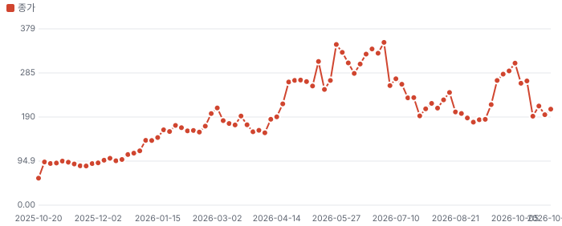

**그림 2 · VICR EV/매출(배, 2023-07~2026-10, 월말 표본)**

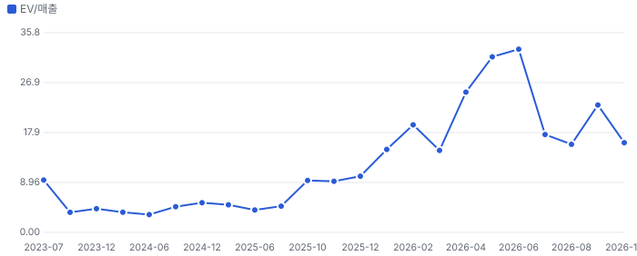

주가는 2025년 10월 \$58에서 2026년 6월 \$380으로 6.5배 올랐다. 그 사이 EV/매출은 4.7배에서 32.9배가 됐다. 지금 16.1배는 고점의 절반이지만 2023~2025년 평상 범위(3~10배)의 위다. 7~10월 하락에서 FY2027 Zacks EPS 추정은 6.345 → 6.555로 오히려 올랐다 — 이번 조정은 이익이 아니라 배수의 일이다. 10/15~16 이틀 −22%는 공개 사건을 찾지 못했다(원인 미확인, 월 옵션 만기·AI 전력주 동반 약세와 겹침).

> 시장은 VICR을 부품사로 보느냐 IP 라이선서로 보느냐를 두고 흔들린다. 16배는 이미 IP 쪽 가격이고, 지금 답은 아직 반반이다.

## ② 실적 — 소급을 빼면 무엇이 남나

**그림 3 · 분기 매출 구성(백만\$, 3Q25~4Q26 회사 제시 하한)**

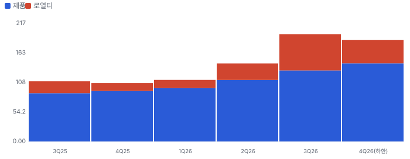

**그림 4 · 수주잔고(백만\$, 분기 말)**

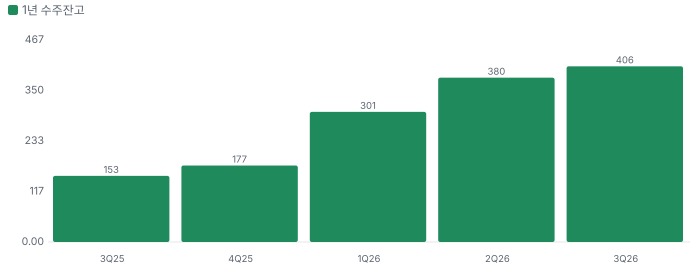

| 항목 | 2Q26 | 3Q26 | 3Q 소급 제외(Chiip 추정) |
|---|---|---|---|
| 매출 | \$143.4M | \$197.1M | 약 \$173.5M |
| 로열티 | \$30.4M | \$66.6M | \$43.0M |
| 총이익률 | 58.0% | 68.3% | 약 64.0% |
| 제품 총이익률(로열티 100% 가정) | 약 46.7% | 약 52.2% | 약 52.2% |
| 법률비 | 약 \$5M | \$16.1M | 약 \$11.4M(소급분의 20% 차감) |
| 영업이익 | \$34.9M | \$72.1M | 약 \$53M(약 31%) |
| 세율 | −27.9% | 19.6% | 21% 가정 |
| 희석 EPS | \$1.04 | \$1.33 | 약 \$1.0 |

소급 제외 열은 기준선 \$43M을 정상 로열티로 놓은 Chiip 계산이다. 회사는 소급분 크기를 밝히지 않았고, CEO는 '비반복이라 부른 것이 계속 반복됐다'고 답했다. 회사 주장대로 라이선스가 늘면 덩어리 수입이 다시 나올 수 있어 \$23.6M은 상한에 가까운 추정이다. 다만 연환산 정상 EPS 약 \$4.0이면 \$206.62는 약 52배다.

금지표 점검: '기준선 \$43M'은 회사가 신규 계약 없이 기대한다고 한 **가이던스**이지 확정 사실이 아니다. 초기 계약은 2년 단위이고 CFO는 '반복'이라 불렀지만, Q2에 공개된 최신 계약의 인식액은 분기 \$5~15M으로 들쭉날쭉했다.

## ③ 사업과 병목 — 엔지니어 관점

AI 가속기는 0.5V 안팎의 낮은 전압에 수천 A를 먹는다. 전력을 낮추려 전압을 낮추면 전류가 커지고, 전류가 커지면 저항 손실이 전류의 제곱으로 늘어난다. 그래서 **마지막 몇 mm**, 즉 전압을 내려 칩에 넣는 지점(point of load)이 병목이다. 수직 전력 공급(VPD, vertical power delivery)은 변환 단을 칩 바로 아래에 붙여 이 거리를 없앤다.

- 해결 기술: 경쟁 진영은 전압 조정기(VR, 12V→6V→1.8V로 내려가는 중간 버스 구조)를 칩 가까이 옮긴다. Vicor는 48V를 곧장 전류 증폭하는 Factorized Power 구조다.
- 회사 수치: 2세대 VPD 3 A/mm², 5~6 A/mm² 경로, 전류 이득 40배 이상, 800V 논쟁은 몇 %p 효율일 뿐 진짜 병목은 point of load라고 주장. **모두 회사 주장이고 제3자 측정은 확인하지 못했다.**
- 양산성: 3차원 인터커넥트를 쓰는 독자 공정, Andover Fab-1이 거의 만석. 팹 2는 메리맥 33만 제곱피트 건물, 팹 3은 후크셋 54에이커. Fab-2 첫 장비는 2027년 2분기로, 병목 공정부터 단계 투입. 금지표: 부지 매입은 공급 증가가 아니다 — 장비 반입·가동·수율·출하 순으로 본다.
- 고객 채택: 선도 고객의 2세대 대량 주문은 확인했지만 고객명은 비공개. Q&A 질문자가 거론한 고객명에 회사는 답하지 않았다(사실로 쓰지 않음). 고객 집중도 수치는 이번 회차에 10-Q로 확인하지 못했다(미확인).
- 경제성: 라이선스 단가는 집행 단계별로 오르고 ITC 조사 개시 후 월 약 5% 오른다(회사 설명). 최혜 라이선시 조항이 있어 후발 할인이 어렵다. 그만큼 소송 결과에 따라 전체 구조가 흔들린다.
- Greenwood & Hanson (2015) 경쟁 무시 점검: 높은 마진은 경쟁을 부른다. MPWR(시총 \$58B, 매출 \$3.7B)은 Vicor의 7배 규모로 같은 소켓을 노리고, IVR 진영에는 하이퍼스케일러가 붙어 있다.

## ④ 10배 경로 — 숫자로

| 항목 | 값 | 근거 |
|---|---|---|
| 현재 시가총액 | \$9.54B | Fiscal.ai 10/29 |
| 10배 시가총액 | \$95.4B | ×10 |
| 필요 순이익(P/E 30배) | 약 \$3.2B | 배수 가정 |
| 필요 매출(순이익률 32%) | 약 \$9.9B | 회사 장기 영업이익률 목표 40% × (1−세율 21%) |
| 회사 장기 목표 대비 | 약 4배 | 매출 \$2.5B·기간 미제시 |
| 10년 매출 CAGR(FY2026 \$644M →) | 약 31% | Chiip 계산 |
| 5년 안 10배 필요 CAGR | 101.6% | 현금흐름 할인(DCF) 엔진 — 표본 367개에서 상위 0% 표기 |
| 5년 뒤 2배·3배·10배 확률 | 18%·9%·0% | 몬테카를로 5,000회 |

> 10배는 회사 스스로의 최대 목표의 4배가 필요하다 — 닫혀 있다. 시가총액 구간 B1(\$1~10B) 후보로 watch.csv에는 '2배 알파 검증 대상'으로 올린다. 다만 지금 가격에선 2배 경로도 시장 내포 성장보다 높은 CAGR 51%(표본 상위 4%)가 필요하다.

## ⑤ 핵심 변수와 손익분기 — 분기 로열티

**그림 5 · \$206.62를 정당화하는 분기 로열티(백만\$, 제품 EV/선행 매출 배수별)**

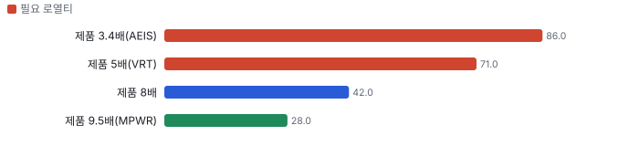

- 계산식: 시총 \$9.54B − 현금 \$0.51B − 제품 가치(FY2027 제품 매출 \$729M × 배수) = 로열티 가치. 이를 30배로 나눠 순이익, 세율 21%·법률비 20%를 되돌려 분기 로열티를 구했다.
- FY2027 제품 매출 \$729M은 4Q \$143.5M에서 분기 +10%를 이어 간 Chiip 추정이다(Q1 157·Q2 173·Q3 190·Q4 209). 캐파 제약으로 낮아지면 필요 로열티는 올라간다.
- 기준선 \$43M이면 시장은 제품에 8배를 주고 있다. 5배가 정상이라면 로열티는 분기 **\$71M**, 즉 기준선의 1.65배까지 가야 한다 — 3Q 소급 포함 수치 \$66.6M보다 높다.
- 두 번째 변수: FY2028 EPS. P/E 28배면 \$7.38이 손익분기다. Fiscal 7.15는 아래, Zacks 8.6은 위 — 그 \$1.45 차이가 곧 라이선시 추가 여부다.

## 어닝콜 변화·컨센서스·멀티플 프리미엄·EPS 리비전

**방법:** 직전 콜(2026-07-21) → 최신 콜(2026-10-20)에서 새로 나오거나 바뀐 항목을 DCF 기본 시나리오의 동인 이동으로 옮기고, 그 변화가 없었을 때(동인을 되돌린 DCF) 대비 주주가치 변화를 잰다. 확신도: 확정 1.0 · 회사 가이던스 0.8 · 경영진 목표·장기 발언 0.5 · 정황 0.3. '반복'은 직전 콜과 같은 말이라 가치 영향 0.

**직전 콜 대비 새로 나오거나 바뀐 내용 → 가치 영향 (DCF 기본 시나리오 주주가치 기준)**
| 항목 | 내용 | 직전 콜 | 최신 콜 | 모델 동인 이동 | 확신도 | 단독 Δ가치 | 확신도 가중 |
|---|---|---|---|---|---|---|---|
| 업데이트 | FY2026 매출 기준 | FY26 \$600M 초과 | 4Q 제품 +10% + 로열티 최소 \$43M → FY 약 \$640M 이상(환산) | 기준연도 매출 +\$0.04B | 1.0 | +5.9% | +5.9% |
| 신규 | 로열티 기준선 | 2Q 로열티 \$30.4M, 신규 계약 없다는 보수적 전제 | 분기 최소 \$43M(연환산 \$172M), 회사가 반복 매출로 재정의 | 목표 이익률 +3.0% | 0.8 | +1.9% | +1.5% |
| 신규 | 첫 순수 VPD 라이선스 | NBM 중심 라이선스 | 주요 AI OEM Stage 2, 4분기 초 추가 구매주문 | 1년차 성장률 +3.0% | 0.8 | +7.7% | +6.2% |
| 신규 | ITC 337-TA-1526 | 2027년 최종 판정 전 신규 계약 없다고 가정 | Foxconn 대상 조사 개시, 수입금지 요청, Stage 3 단가 월 +5% 수준 | 성장 지속(감속 계수) +2.0% | 0.3 | +5.7% | +1.7% |
| 업데이트 | 제품 총이익률 | 2Q 약 46.7%(설비 이전 비용) | 3Q 약 52.2%(로열티 총이익률 100% 가정한 Chiip 추정) | 출발 이익률 +2.0% | 1.0 | +0.3% | +0.3% |
| 신규 | 2세대 VPD 대량 주문 | 2세대 개발 완료·데모 준비 | 4Q 첫 2주 \$100M, 선도 고객 2세대 대량 주문 포함 | 1년차 성장률 +3.0% | 0.8 | +7.7% | +6.2% |
| 부정 | 소급 로열티 | 로열티에 소급·일회성 없음 전제 없음 | 3Q \$66.6M − 기준선 \$43M = 약 \$23.6M이 기준선 위(비반복 일부, 크기 비공개) | 출발 이익률 -4.0% | 0.8 | -0.5% | -0.4% |
| 부정 | 법률 비용 | 2Q 약 \$5M | 3Q \$16.1M, 근시일 로열티의 약 20% | 목표 이익률 -1.0% | 1.0 | -0.6% | -0.6% |
| 부정 | Fab-2·3 투자 | Fab-1 내 증설 | 뉴햄프셔 2곳 매입, 투자비 미공개, 2027년 2분기 첫 장비 | 매출÷투하자본 -20.0% | 0.8 | -3.1% | -2.5% |
| 반복 | 장기 목표 | \$2.5B·70%·40% | 이번 콜 재언급 없음(캐파 5배로 간접) | 장기 성장 수렴값 — | 0.5 | +0.0% | +0.0% |
| **합계** | 단독 합 / 확신도 가중 합 |  |  | 동시 적용 +26.0% |  | **+25.0%** | **+18.3%** |

**그림 6 · 콜 변화 항목별 주주가치 영향 (%)**

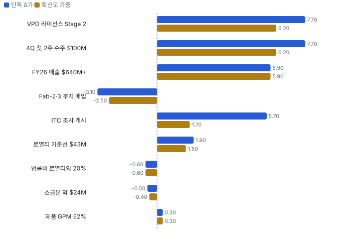
_직전 콜 정보만으로 본 가치 4.14 → 최신 \$5.21B(시가총액 9.84의 0.42배 → 0.53배)_

**읽는 법:** 확신도 가중 합 +18.3%이 '이번 콜로 기업가치가 얼마나 바뀌었나'에 대한 Chiip 기준값이다. 단독 합(+25.0%)과 동시 적용(+26.0%)의 차이는 동인끼리 곱해지는 상호작용(예: 성장 × 이익률). 경영진 발언(확신도 0.5 이하) 비중이 크면 다음 분기 숫자로 확인될 때까지 가치로 다 넣지 않는다.

**실적 vs 컨센서스 — 최근 4개 분기 (이익 지표는 조정 기준, 발표 직전 추정)**
| 분기 | 지표 | 실적 | 컨센서스 | 서프라이즈 | 추정 출처 |
|---|---|---|---|---|---|
| 2025Q4 | 매출 | \$107.3M | \$111.4M | -3.7% | Zacks |
| 2026Q1 | 매출 | \$113M | \$112.9M | +0.1% | Zacks |
| 2026Q2 | 매출 | \$143.4M | \$138.7M | +3.4% | Zacks |
| 2026Q3 | 매출 | \$197.1M | \$187.2M | +5.3% | Zacks |

**그림 7 · 분기별 서프라이즈 (%) — 최근 4개 분기**

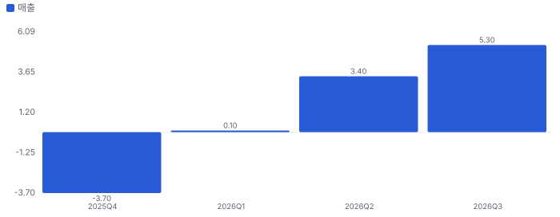

**컨센서스 리비전 — 2Q 콜(7/21) 직후 Zacks(2026-07-23) → 지금(2026-10-22), 같은 분기끼리**
| 분기 | 지표 | 직전 | 지금 | 리비전 |
|---|---|---|---|---|
| 2026Q4 | 매출(백만\$) | 191 | 188.4 | -1.3% |
| FY2026 | 매출(백만\$) | 603 | 641.9 | +6.5% |
| FY2027 | 매출(백만\$) | 999 | 988.7 | -1.0% |
| FY2028 | 매출(백만\$) | 1,222 | 1,255 | +2.8% |
| FY2026 | EPS | 3.12 | 3.94 | +26.3% |
| FY2027 | EPS | 6.345 | 6.555 | +3.3% |
| FY2028 | EPS | 8.15 | 8.595 | +5.5% |
| **합계 3분기** | EPS | 17.62 | 19.09 | **+8.4%** |
| **합계 4분기** | 매출(백만\$) | 3,015 | 3,074 | **+2.0%** |

**그림 8 · 같은 기간 주가 변화 분해 = EPS 리비전 × 멀티플 변화 (%)**

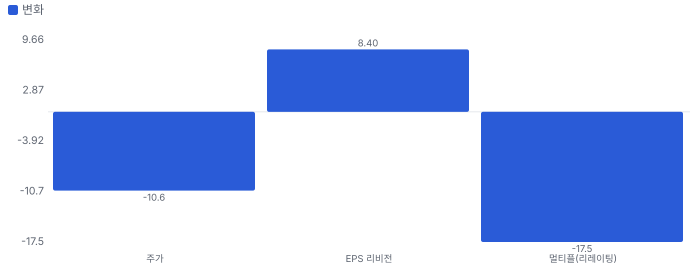
_(1 + 주가 변화) = (1 + EPS 리비전) × (1 + 멀티플 변화). EPS 리비전은 위 표의 같은 분기 합 기준_

**해석:** 이 기간 주가 -10.6% 중 EPS 추정 변화가 +8.4%, 멀티플 변화가 -17.5% — 주가를 움직인 것은 **멀티플(시장이 붙이는 배수) 변화**이다. 이익 추정은 오르는데 주가가 내렸다면 시장은 숫자가 아니라 지속성·위험(할인율)을 다시 매긴 것이다.

리비전 출처: Fiscal.ai analyst_estimates history(Zacks) — 같은 기간끼리. Data provided by Zacks Investment Research, Inc., www.zacksdata.com

**멀티플 프리미엄 — 동종 중앙값 대비 (성장 조정 = 배수 ÷ 최근 분기 전년 대비 매출 성장%, 한 분기 성장이라 변동이 크다)**
| 지표 | 대상 | 동종 중앙값(범위) | 프리미엄 | 성장 조정 프리미엄 |
|---|---|---|---|---|
| 선행 P/E | 39.4배 | 26.7배 (16.7~27.6, 5사) | **+48%** | +93% |
| EV/EBITDA | 56.1배 | 29.9배 (16.2~52.1, 6사) | **+88%** | +97% |
| EV/매출 | 16.1배 | 10.6배 (3.2~15.6, 6사) | **+52%** | +105% |

**그림 9 · 멀티플 프리미엄 (%) — 0 = 동종 중앙값**

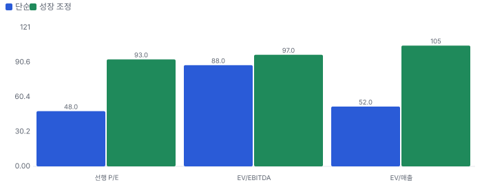

## 내러티브 — 멀티플 프리미엄과 리비전을 끌어올리는 이야기

> **한 줄:** '전력 부품사가 전력 IP 라이선서로' — 로열티가 소급분을 빼고 분기 \$43M까지 올라와 이야기가 숫자가 됐지만, 주가는 고점 \$380에서 46% 빠졌고 시장은 소급분·IVR·캐파 제약을 먼저 넣었다 · 동종 대비 멀티플 차이 +57% 중 회사 고유 몫 -36%(멀티플 엔진) — 내러티브가 설명해야 하는 크기 · 직전 콜 이후 EPS 추정 +8.4%(FY2026, FY2027, FY2028) — 리비전 경로로 이미 숫자가 된 몫 · 단계 확산, 쏠림 중간(커뮤니티 강세 쏠림, 대형 IB 커버리지 얇음)

**내러티브 요인 — 누가 믿고, 멀티플·리비전 중 어디로 작동하나**
| 요인 | 셀사이드 | 바이사이드 | 리테일 | 작동 경로 | 숫자로 바꾸면 | 상태 | 반증 조건 |
|---|---|---|---|---|---|---|---|
| VPD 특허 로열티의 반복화 | 강 | 중 | 강 | 멀티플+리비전 | 로열티 \$14.5M(4Q25) → \$66.6M(3Q26), 기준선 \$43M = 연 \$172M, 법률비 약 20% 차감 시 순 약 \$138M | 강화 | 4Q 로열티가 \$43M 미만이거나 2027년 초 라이선스 갱신 지연 |
| 2세대 VPD 다고객 채택 | 강 | 강 | 중 | 리비전 | 4Q 첫 2주 수주 \$100M, Advanced 매출 +112% YoY, 수주잔고 \$406M | 진행 | 2027년 상반기까지 선도 고객 밖 설계 수주 언급 없음 |
| Fab-2·3 캐파 선택권 | 중 | 중 | 약 | 멀티플 | 합산 약 5배 이상 언급, Fab-2 첫 장비 2027년 2분기, 투자비 미공개 | 진행 | 2027년 2분기 장비 반입 지연 또는 투자비가 영업현금을 크게 초과 |
| ITC 수입금지 압박 | 중 | 약 | 중 | 리비전 | 조사 개시 후 단가 월 약 5% 상승(회사 설명), 하이퍼스케일러 2곳 문의 | 진행 | ITC 예비 판정이 비침해 또는 특허 무효 |
| IVR·경쟁 대체(약세) | 중 | 중 | 약 | 멀티플 | 회사 주장 IVR 삽입 손실 10~15%·전류 이득 2.5 vs VPD 40배 — 회사 수치, 제3자 검증 없음 | 미확인 | 하이퍼스케일러가 Vicor 없이 IVR 구조를 양산 채택 |
| 로열티 덩어리성·갱신 절벽(약세) | 강 | 강 | 약 | 멀티플 | 3Q 기준선 위 약 \$23.6M, 3Q 로열티가 매출의 34%·영업이익의 약 75%(순액 기준 Chiip 추정) | 확산 | 2027년 상반기 로열티 분기 \$50M 이상 유지 |
| AI 전력 배수 압축(약세) | 중 | 강 | 중 | 멀티플 | EV/매출 6/30 32.9배 → 10/29 16.1배(−51%), 같은 기간 FY27 EPS 추정(Zacks) 소폭 상승 | 확산 | EV/매출이 동종 MPWR 15배 위에서 안정되고 AI 전력주 동반 반등 |

- **VPD 특허 로열티의 반복화** — 부품사가 IP 라이선서가 되어 원가 없는 매출이 이익률을 끌어올린다 (바뀌는 입력: 이익률·ROIC) [3Q 콜·Fiscal KPI]
- **2세대 VPD 다고객 채택** — 전류 밀도 3→5 A/mm²로 경쟁 VR·IVR 한계를 넘어 선도 고객 밖으로 확산 (바뀌는 입력: 성장·점유율) [3Q 콜]
- **Fab-2·3 캐파 선택권** — 부지·건물을 먼저 확보해 수요 확인 뒤 장비를 넣는다 (바뀌는 입력: 성장 상한·재투자) [3Q 콜·보도자료]
- **ITC 수입금지 압박** — 337-TA-1526 진행과 단가 상승표가 후발 라이선시를 앞당긴다 (바뀌는 입력: 로열티 성장·기간) [3Q 콜·Hon Hai 공시]
- **IVR·경쟁 대체(약세)** — 온다이 IVR과 MPWR·Infineon 등 VR 진영이 1.8V 구조로 추격해 VPD 필요 면적이 줄어든다 (바뀌는 입력: 성장 기간·위험) [3Q Q&A(DMB Capital)]
- **로열티 덩어리성·갱신 절벽(약세)** — 소급분이 빠지고 2년 계약이 2027년 말 재협상되면 기준선이 흔들린다 (바뀌는 입력: 이익의 질) [3Q Q&A(Needham·Craig-Hallum)]
- **AI 전력 배수 압축(약세)** — AI 투자 지속성 의심이 고배수 전력주를 먼저 누른다 (바뀌는 입력: 배수) [Fiscal.ai daily ratios·Zacks]

**셀사이드(IB 애널리스트)**
| 지표 | 값 | 추세·해석 | 출처 |
|---|---|---|---|
| 애널리스트 의견(Zacks) | 5명 — 강력 매수 4·매수 1·보유 0·매도 0 | 의견은 일방 강세, 표본이 작다 | Fiscal.ai analyst_ratings — Data provided by Zacks Investment Research, Inc., www.zacksdata.com |
| 목표가 평균·범위(Zacks) | \$372.6 (\$303~\$450, 5명) | 10/29 종가 대비 평균 +80% — IB 기대의 증거(Chiip 목표가 아님) | 같은 곳, 2026-10-23 |
| EPS 추정 변화(Zacks) | FY2027 6.345 → 6.705(10/21) → 6.555(10/22) | 콜 다음 날 소폭 하향 — 소급분을 뺀 기준선 반영 | Fiscal.ai analyst_estimates history |
| 3Q 콜 질문 증권사 | Needham·Roth·Craig-Hallum·DMB Capital | 초점 = 소급분 크기·라이선스 갱신·Fab-2·3 투자비. 대형 IB 없음 | Fiscal.ai ir_events_transcript(q3-2026) |

**셀사이드(IB 애널리스트) 해석:** 커버리지는 얇고 일방 강세다 — 대형 IB 개시가 멀티플 사건이 될 수 있지만 지금은 질문이 '이 로열티가 얼마나 지속되나'로 모인다

**바이사이드(기관 투자자)**
| 지표 | 값 | 추세·해석 | 출처 |
|---|---|---|---|
| 13F 기관(2026Q2) | 473곳 · 순 +0.56백만 주 · 증가 150·감소 118 | T. Rowe·Driehaus·JPMorgan 증가, BlackRock·FMR 감소 | Fiscal.ai institutional_holders 2026Q2(45일 지연) |
| 펀드 레터(2023Q3~2026Q2) | 최근 강세 3(Polen·John Hancock 비중 2.87%·Kathmandu) · 과거 약세 3(Hunterbrook 러시아 부품·Bear Cave 숏 리포트 인용·Carillon 매도) | 강세는 AI 전력, 과거 약세는 고객·평판 | Fiscal.ai company_fund_letters |
| 내부자 장내 거래 | 누적 매수 0·매도 178 — CEO 10/1~2 4만 주 약 \$12.5M | 가격 \$310대에서 매도, 지금은 그보다 33% 낮다. 대주주 CEO의 분산 매도일 수 있어 단정 불가 | Fiscal.ai insider_transactions |

**바이사이드(기관 투자자) 해석:** 성장 펀드는 들어왔지만 내부자 매수는 없다 — 13F는 고점 전 분기 값이라 7~10월 하락의 주체는 아직 모른다

**리테일(레딧·텔레그램·X)**
| 지표 | 값 | 추세·해석 | 출처 |
|---|---|---|---|
| 레딧(ApeWisdom) | 상위 목록 밖 | 언급 적음 — 리테일 쏠림 신호 없음 | radar/portfolio.py fetch_ape 2026-10-30 |
| 커뮤니티 기사 제목(45일) | 13건 — SA 강세 장문 4편·Zacks 'Bull of the Day' | 독립 약세 장문 0건 | knowledge/narratives/evidence/co-vicor.json 2026-10-30 |

**리테일(레딧·텔레그램·X) 해석:** 레딧은 조용하고 SA·Zacks 쪽 강세만 일방적이다 — 쏠림은 얇은 커뮤니티 층에 있다

**언론·업계**
| 지표 | 값 | 추세·해석 | 출처 |
|---|---|---|---|
| 업종 기사 | 'AI 전력주 1주일 7~13% 하락'(Fool 10/28) vs GE Vernova 수주 급증(Barron's 10/28) | 업종 숫자는 강한데 배수만 흔들린다 | narrative_sources 2026-10-30 |

**언론·업계 해석:** VICR 낙폭은 개별 뉴스보다 AI 전력 업종 배수 조정과 함께 움직였다(정황)

**읽는 법:** '멀티플' 요인은 같은 이익에 더 높은 배수를 주게 하는 이야기(지속성·위험 감소·희소성), '리비전' 요인은 추정 이익 자체를 올리는 이야기(수주·가격·이익률). 회사 고유 프리미엄이 큰데 리비전 근거가 약하면 이야기가 숫자보다 앞서 있다(과밀 위험). 커뮤니티·IB 의견은 사실이 아니라 시장 기대의 증거다. 틀: Damodaran(2017) Narrative and Numbers, Shiller(2019) Narrative Economics.

## 밸류에이션 — 맥킨지·IB 방식(현금흐름 할인(DCF) 엔진)

**방법:** 맥킨지식 재무 재구성(NOPAT·투하자본·ROIC) → 바텀업 WACC → FCFF DCF + 가치 동인 계속가치(ROIC·성장) → 경제적 이익 항등 검증 → 시나리오·몬테카를로 → 가격 내포 기대(역DCF)와 매출 성장 기저율. 단위 \$B, 모든 가치는 **현재 시가총액 대비 배수**로 표기(목표주가 아님).

**할인율(WACC) 구성**
| 항목 | 값 |
|---|---|
| 무위험(미 10년) | 5.05% |
| 주식 위험 프리미엄 | 4.20% |
| 레버드 베타(바텀업) | 1.49 (무레버 1.49) |
| 국가위험 | 0.23% |
| 자기자본비용 | 11.54% |
| 부채비중 | 0% |
| WACC | **11.54%** |
| 영구성장 | 3.5% |

**시나리오별 DCF 주주가치 ÷ 현재 시가총액(\$9.8B)**
| 시나리오 | 확률 | 주주가치(\$B) | 지금 | 5년 뒤(할인 전) | 5년 매출 CAGR | 5년차 영업이익률 |
|---|---|---|---|---|---|---|
| 기본 | 50% | 5.2 | **0.53배** | 0.87배 | 27.8% | 32% |
| 강세 | 30% | 11.0 | **1.11배** | 1.88배 | 41.8% | 34% |
| 약세 | 20% | 2.4 | **0.24배** | 0.37배 | 6.2% | 31% |

**읽는 법:** '배'는 PER·EV/매출 같은 멀티플이 아니라 **DCF로 계산한 주주가치 ÷ 지금 시가총액**이다. 1.0배 = 그 시나리오 가정이 지금 주가와 같은 가치, 0.3배 = 가정대로면 주가의 30%만 현금흐름으로 설명된다. '5년 뒤'는 5년 뒤 시점의 주주가치(그때 돈, 할인 전)를 지금 시가총액으로 나눈 값 — 지금 사서 5년 들고 있을 때 그 시점 내재가치가 지금 가격의 몇 배인가. 매년 약 WACC만큼 커진다(배당 없음, 적자 현금흐름은 차입으로 메운다고 가정).

기본 시나리오 분해: 기업가치 4.7 = 1~10년 현금흐름 현재가치 1.8 + 11년차 이후(계속가치) \$2.9B(초기 재투자가 커서 1~10년 합이 음수면 계속가치가 기업가치의 100%를 넘는다) · 순현금 0.5 · ROIC 1년차 57% → 5년차 44% · 경제적 이익 항등 오차 1.9e-16(DCF와 EP 가치가 같아야 정상) · 할인율 +50bp → 가치 -5.4%

**그림 10 · 몬테카를로 3,000회 — 지금 가치/시가총액 분포 (%)**

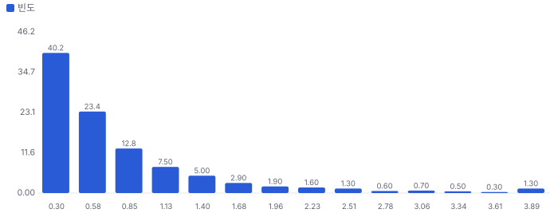
_P10 0.22 · P50 0.53 · P90 1.63 · 기대 0.80배 · 30% 이상 고평가 확률 63% · 5년 뒤 ≥1.5배 27% · ≥2배 18% · ≥3배 9% · ≥10배 0%_

**그림 11 · 가격 내포 기대 vs 필요 성장 (5년 매출 CAGR %)**

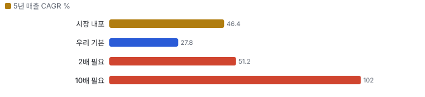
_시장 내포 기저율 상위 4%(n=367, 전체) · 기본 기저율 상위 15%(n=367, 전체) · 2배 필요 성장 기저율 상위 4% · 10배 필요 성장 기저율 상위 0% — 기저율: 같은 매출 규모 미국 상장사가 실제로 달성한 5년 CAGR 분포(SEC 재무)_

**민감도 — 기본 시나리오 가치/시총(매출 경로 고정, 장기 이익률 × 매출÷투하자본)**
|  | 매출÷투하자본 0.75 | 매출÷투하자본 1.4 | 매출÷투하자본 1.5 | 매출÷투하자본 2.5 |
|---|---|---|---|---|
| 장기 이익률 15% | 0.12 | 0.24 | 0.25 | 0.30 |
| 장기 이익률 30% | 0.39 | 0.51 | 0.52 | 0.57 |
| 장기 이익률 35% | 0.48 | 0.60 | 0.61 | 0.66 |
| 장기 이익률 40% | 0.58 | 0.69 | 0.70 | 0.76 |

매출÷투하자본 = 매출 1달러를 늘리는 데 드는 설비·운전자본(높을수록 가볍다). 장기 이익률은 4년차 목표와 이후 수렴값을 같이 바꾼 것. 계속가치는 RONIC = WACC(11년차 이후 성장은 가치를 만들지 않는다는 맥킨지 보수 가정) · 다른 축: WACC −1%p 0.60배 · WACC +1%p 0.47배 · RONIC 20%(11년차 이후 성장이 가치 창출) 0.58배

**동종 레인지와 펀더멘털 내재 멀티플 (EV/매출, 최근 12개월)**
| 회사 | EV/매출 | 성장 | 영업이익률 | ROIC 영업권 포함/제외 | 매출÷투하자본(영업권 제외) | 펀더멘털 내재 | 시장÷내재 |
|---|---|---|---|---|---|---|---|
| MPWR | 15.3 | 40% | 30% | 33% / 33% | 1.41 | 5.0 | 3.05 |
| ADI | 15.6 | 34% | 36% | 10% / 10% | 0.34 | 2.2 | 6.97 |
| TXN | 14.0 | 20% | 41% | 27% / 27% | 0.84 | 4.5 | 3.13 |
| AEIS | 4.7 | 25% | 13% | 15% / 15% | 1.40 | 1.2 | 3.82 |
| VRT | 7.2 | 35% | 20% | 41% / 41% | 2.59 | 3.2 | 2.22 |
| BELFA | 3.2 | 21% | 16% | 14% / 14% | 1.06 | 1.4 | 2.30 |
| **동종 중앙** | 10.6 |  |  |  |  |  | 3.09 |
| **Vicor** | 16.6 |  |  |  |  | 8.4 | 1.98 |

**그림 12 · EV/매출 — 과거·동종·펀더멘털·합리적 멀티플 (배)**

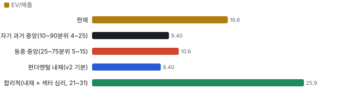
_펀더멘털 내재 = 같은 WACC·계속가치 규칙으로 각 회사의 성장·이익률·자본 회전율을 자본화한 EV ÷ 매출. 섹터 심리 = 동종의 시장 ÷ 내재 배율_

**할인·프리미엄 분해:** Vicor의 EV/매출은 동종 중앙 대비 **+57%** = 동종과 같은 섹터 심리를 받는다면 펀더멘털(성장·이익률·ROIC)로 정당한 몫 +144% × Vicor에만 얹힌 기업 고유 몫 **-36%**(두 몫을 곱하면 전체). 심리를 빼고 펀더멘털만 비교하면 동종 중앙 내재 대비 +206%. 기업 고유 몫이 양(+)이면 시장이 동종보다 더 큰 기대를 얹은 것(할인이 덜 됐다), 음(−)이면 더 할인한 것이다 — Rhodes-Kropf·Robinson·Viswanathan(2005)의 '기업 고유 오차 vs 섹터 오차' 분해 방식.

**합리적 멀티플:** 25.9배(섹터 심리 25~75분위 20.8~30.6배) → 주주가치 ÷ 시가총액 **1.53배**(1.24~1.80배). 현재 16.6배와의 차이가 시장이 동종보다 더 얹은 기대다.

동종 6사 회귀(시장 EV/매출 = 2.5 + 2.54 × 펀더멘털 내재, R² 0.52) — Bhojraj·Lee(2002)의 '펀더멘털로 정당화되는 멀티플'. Vicor에 대입하면 23.9배.

**ROIC에 비례하는 정상 상태 멀티플 (맥킨지 가치 동인: EV/NOPAT = (1 − g/ROIC) ÷ (WACC − g))**
| ROIC | EV/NOPAT | EV/매출 @영업이익률 15% | EV/매출 @영업이익률 22% | EV/매출 @영업이익률 30% | EV/매출 @영업이익률 40% |
|---|---|---|---|---|---|
| 10% | 8.1 | 1.0 | 1.4 | 1.9 | 2.6 |
| 15% | 9.5 | 1.1 | 1.7 | 2.3 | 3.0 |
| 20% | 10.3 | 1.2 | 1.8 | 2.4 | 3.2 |
| 30% | 11.0 | 1.3 | 1.9 | 2.6 | 3.5 |
| 50% | 11.6 | 1.4 | 2.0 | 2.7 | 3.7 |

정상 상태 교차 확인: DCF 기본 시나리오의 5년차 ROIC 42%·영업이익률 32%이면 정상 상태 EV/NOPAT 11.4배(5년차 EV/매출 3.3배). 이를 지금으로 할인하면 주주가치 ÷ 시가총액 0.54배 — 고성장 기업은 현재 멀티플이 아니라 정상 상태 멀티플을 할인해 비교한다(맥킨지 『Valuation』 멀티플 장).

**데이터 검증 — 원자료(Fiscal.ai·SEC) ↔ 밸류에이션 입력 대조 10.0/10**
| 검사 | 결과 | 내용 |
|---|---|---|
| 원자료 스냅숏 | 통과 | 조회 시각 2026-10-30T22:20:00+09:00 |
| 시가총액 대조 | 통과 | 가격 206.62 × 표지 주식 0.0461486 = 9.54 vs 원자료 개요 9.5352 |
| 가격 일치 | 통과 | 206.62 vs 206.62 |
| 현금·차입 대조 | 통과 | 현금 0.5131 vs 0.5131 · 차입(리스 포함) 0.0072 vs 0.0072 |
| TTM 매출 = 4분기 합 | 통과 | 0.5607 vs 0.5607(4분기) |
| TTM 영업이익 = 4분기 합 | 통과 | 0.1396 vs 0.1396 |
| 투하자본 = 재무상태표 | 통과 | 0.4006 vs 자기자본+차입+리스−현금 0.401 |
| 연간 컨센서스 = 분기 합 | 통과 | FY2025 None vs 0.1073 · FY2026 0.648 vs 0.6480 · FY2027 0.85 vs 0.8500 · FY2028 1.05 vs 1.0500 |
| 회사 가이던스 반영 | 통과 | 회사 3Q 콜(2026-10-20): 4Q 제품 매출 약 +10% QoQ(3Q 제품 \$130.5M → 약 \$143.5M) + 로열티 최소 \$43 |
| 희석 주식(출처·같은 날짜) | 통과 | 잠재 주식 0.001479 vs SEC None · 기본 주식 날짜 2026-10-19 / 희석 날짜 2026-10-19 |
| 어닝콜 톤 = 실적 레이더 | 통과 | 사용 up · 레이더 기준 up(톤 변화 0.5, 가이던스 raise) |
| 동종사 4곳 이상·기준 표기 | 통과 | 6곳 · 기준 ttm |
| 매출·이익률 기준 명시(SBC 처리) | 통과 | 매출 gaap · 이익률 gaap |

**동인 출처 — 어느 자료가 어느 변수가 됐나**
| 동인 | 출처·값 |
|---|---|
| rev0 | 회사 가이던스 중간값 [0.64, 0.648] (회사 3Q 콜(2026-10-20): 4Q 제품 매출 약 +10% QoQ(3Q 제품 \$130.5M → 약 \$143.5M) + 로열티 최소 \$43M(신규 계약 없음 전제) = 4Q 약 \$186.5M 이상 → FY2026 약 \$640M 이상(Chiip 환산, 회사가 합계로 제시하지 않음). 2Q 콜의 'FY2026 \$600M 초과'에서 상향) |
| growth | 컨센서스 1년차 32.0%, 2년차 23.5% |
| margin | 1~2년차 컨센서스 32.0%, 35.2% 고정 → 목표 35%(3년차, 덮어쓰기) → 장기 수렴 30% |
| s2c | 재무 재구성 증분 매출/투하자본 1.4 |
| range | 컨센서스 최저·최고 추정 → 1년차 성장 8.7%~55.3% |
| probs | 어닝콜 톤 'up' 규칙 {'bear': 0.2, 'base': 0.5, 'bull': 0.3} |
| overrides | 규칙값이 사업을 잘못 그려 두 가지를 덮어썼다. ① 성장: Fiscal FY27 \$850M(+32%)은 4Q 환산 분기 \$186.5M(연 \$746M)에서 분기 +4%대만 가정 — 회사가 말한 4Q 제품 +10%가 이어지면 FY27은 약 \$900~980M(로열티 \$172~250M + 제품 \$729M), Zacks는 \$989M. 두 값 사이의 \$900M(+40%)을 쓰고, 2번째 팹 덕에 감속을 0.70 → 0.80으로 늦췄다. ② 장기 이익률: 규칙 15%는 범용 하드웨어 기준 — 로열티가 섞이고 동종 TXN 41%·ADI 36%·MPWR 30%, 회사 목표 40%라 장기 수렴을 30%로 올렸다 |
| shares | 완전 희석 = 기본 0.0461486(2026-10-19) + 옵션·RSU·워런트·전환 0.0015 — 3분기 희석 가중평균 47,609천 주(3Q 콜 CFO·Fiscal.ai) − 기본 가중평균 46,130천  |

> 의사결정 보조(투자자문 아님): ① 매수 매력: 연 기대수익 +5.9% (자기자본비용 11.5% 대비 -5.7%p) · 자본비용 초과 확률 23% · 안전마진 0.22 → 정량 신호 약함 / ② 위험 예산 지표(이론): 0% — 기대수익이 자기자본비용에 못 미침(무위험 대비 켈리 4%는 참고) · 5년 하위10% -66% · 30%+ 손실 확률 39% / ③ 상방(5년): 기대 1.33배 · 2배 18% · 3배 9% · 10배 0% · 상위10% 2.79배

## 수급 — 누가 왜 샀나(Chiip Flow)

> **한 줄:** 최근 20거래일 거래의 리테일 몫은 16.0%(직전 60일 13.2%) — 거래는 주로 기관이 만든다. 기관 자금 흐름(CMF 20일) -0.42로 기관 분산 쪽, 리테일 매수 압력 z +0.65로 리테일 순매수 정황. 이상 거래일에 늘어난 거래량의 86%가 기관 몫.

**그림 13 · 일별 거래량 분해 — 리테일 근사(도매 체결사) vs 기관(거래소·다크풀) (천 주)**

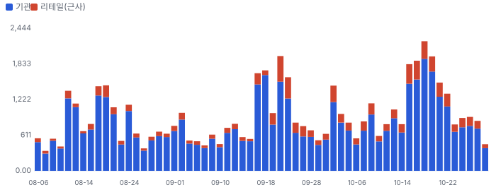
_리테일 = 장외(TRF) 거래량 × 그 주 FINRA 비ATS 리테일 도매 체결사 비중(최근 2주는 직전 4주 평균 — 추정). 기관 = 전체 − 리테일._

**그림 14 · 기관 자금 흐름(CMF 20일)과 리테일 매수 압력(z ÷ 4로 같은 눈금)**

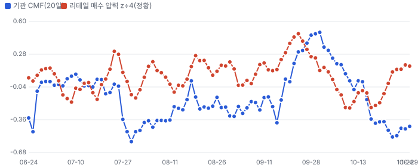
_CMF > 0: 기관 거래가 몰린 날 종가가 고가 쪽(매집). 리테일 압력: 장외 공매도 비율의 60일 z — 마켓메이커가 리테일 매수에 공매도로 물량을 대는 구조라 높을수록 리테일 순매수 쪽(정황)._

**이상 거래일 — 왜 늘었나, 누가 늘렸나(최근 120거래일, RVOL ≥ 1.8 또는 z ≥ 2)**
| 날짜 | RVOL | 주가 | 종가 위치 | 늘어난 거래량 | 증가분 분해 | 원인 태그 |
|---|---|---|---|---|---|---|
| 2026-06-26 | 5.0배 | -1.4% | +1.00 | 3.25M | 기관 102% · 리테일 -2% | 원인 미확인(공개 사건 없음) |
| 2026-10-19 | 2.8배 | -0.4% | -1.00 | 1.44M | 기관 86% · 리테일 14% | 원인 미확인(공개 사건 없음) |
| 2026-09-22 | 2.6배 | +19.8% | +1.00 | 1.22M | 기관 71% · 리테일 29% | 원인 미확인(공개 사건 없음) |
| 2026-09-18 | 2.5배 | +2.9% | +1.00 | 1.03M | 기관 101% · 리테일 -1% | 분기 만기·지수 정기 변경 |
| 2026-10-16 | 2.5배 | -12.9% | -1.00 | 1.12M | 기관 80% · 리테일 20% | 월 옵션 만기 |
| 2026-10-20 | 2.5배 | +7.1% | +1.00 | 1.16M | 기관 86% · 리테일 14% | 실적 발표 · 3Q 실적·콜(장전) — 매출 상회·EPS 하회 |
| 2026-09-17 | 2.5배 | +17.7% | +1.00 | 991K | 기관 89% · 리테일 11% | 원인 미확인(공개 사건 없음) |
| 2026-07-21 | 2.4배 | -7.1% | -1.00 | 1.04M | 기관 89% · 리테일 11% | 실적 발표 · 2Q 실적·콜(장전) |

**주간 체결 장소별 비중 — FINRA 확정치(최신 주 2026-10-05, 약 2주 지연)**
| 주 시작 | 전체(주) | 거래소 | ATS(다크풀) | 리테일 도매 | 기타 장외 |
|---|---|---|---|---|---|
| 2026-08-31 | 3.43M | 52.6% | 30.3% | 11.3% | 5.8% |
| 2026-09-07 | 2.25M | 56.1% | 26.6% | 11.8% | 5.6% |
| 2026-09-14 | 5.33M | 56.7% | 25.7% | 10.2% | 7.3% |
| 2026-09-21 | 6.16M | 44.8% | 26.4% | 23.9% | 4.9% |
| 2026-09-28 | 4.29M | 48.8% | 25.9% | 18.9% | 6.4% |
| 2026-10-05 | 3.99M | 49.7% | 26.4% | 18.0% | 5.9% |

**읽는 법:** 리테일 몫이 늘면서 주가가 오르면 리테일 주도 랠리(되돌림 위험 큼), 기관 CMF가 +로 돌며 거래량이 늘면 기관 매집 쪽이다. 근거: 리테일 식별은 Boehmer·Jones·Zhang·Zhang(2021, JF)의 장외 도매 체결 방식, 자금 흐름은 Chaikin Money Flow. 한계: 도매 체결사 물량에 일부 기관 주문이 섞이고, 리테일 지정가 주문 일부는 거래소로 간다 — 근사치다. 지표일 뿐 매매 권유가 아니다.

## 가격 구간 — 월·주·일 피보나치와 겹침 구간

> **한 줄:** 현재가 \$206.62 — 바로 위 저항 \$225~227(+9.4%, 강도 2.0), 바로 아래 지지 \$176(-14.8%, 강도 2.0). 가격 구간 지표일 뿐 매수·매도 권유가 아니다.

**지지·저항 겹침 구간(서로 다른 기준선이 ±1.2% 안에 모인 곳, 강도 = 겹친 기준선 수)**
| 구간 | 가격 | 현재가 대비 | 강도 | 겹친 기준선 |
|---|---|---|---|---|
| 저항 3 | \$330 | +59.7% | 2.0 | 50일 최고(거래 범위) · 일봉 스윙 고점 |
| 저항 2 | \$297~300 | +44.3% | 2.5 | 라운드 \$300 · 월봉 피보 23.6% · 일봉 피보 78.6% |
| 저항 1 | \$225~227 | +9.4% | 2.0 | 200일 이동평균 · 50일 이동평균 |
| 지지 1 | \$176 | -14.8% | 2.0 | 50일 최저(거래 범위) · 일봉 스윙 저점 |

**시간 단위별 피보나치 되돌림(\$)**
| 단위 | 지배 스윙 | 다리 | 23.6% | 38.2% | 50% | 61.8% | 78.6% |
|---|---|---|---|---|---|---|---|
| 월봉 | \$31.46(2024-04-01) → \$379.78(2026-06-30) | 상승 | 297.6 | 246.7 | 205.6 | 164.5 | 106.0 |
| 주봉 | \$82.66(2025-11-21) → \$379.78(2026-06-30) | 상승 | 309.7 | 266.3 | 231.2 | 196.2 | 146.2 |
| 일봉 | \$176.04(2026-10-23) → \$330.00(2026-10-01) | 하락 | 212.4 | 234.9 | 253.0 | 271.2 | 297.1 |

**그림 15 · 월봉 — 장기 스윙 되돌림**

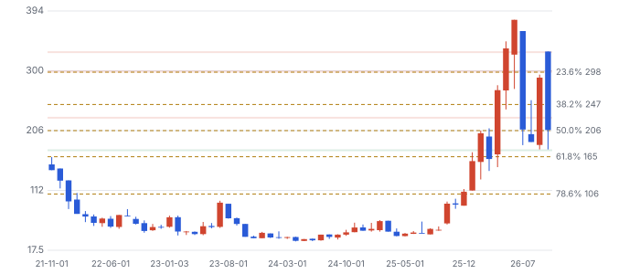
_지배 스윙: 최근 60개월 최저↔최고 — 저점 \$31.46(2024-04-01) · 고점 \$379.78(2026-06-30), 상승 다리. 점선 = 피보나치 되돌림, 띠 = 겹침 구간(초록 지지·빨강 저항). 캔들: 빨강 상승·파랑 하락._

**그림 16 · 주봉 — 52주 스윙 되돌림**

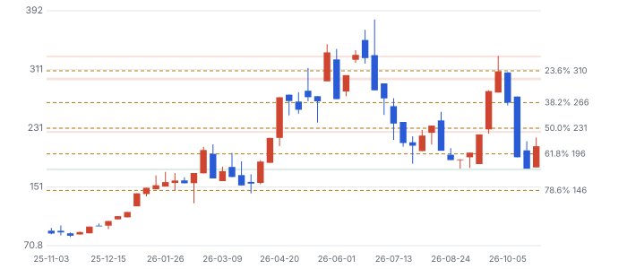
_지배 스윙: 최근 52주 최저↔최고 — 저점 \$82.66(2025-11-21) · 고점 \$379.78(2026-06-30), 상승 다리. 점선 = 피보나치 되돌림, 띠 = 겹침 구간(초록 지지·빨강 저항). 캔들: 빨강 상승·파랑 하락._

**그림 17 · 일봉 — 마지막 완료 스윙 되돌림(최근 90거래일)**

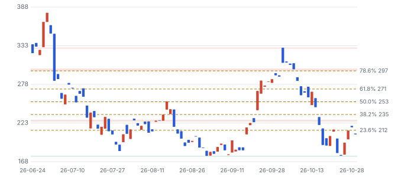
_지배 스윙: ATR 지그재그 20.2% 마지막 완료 다리 — 저점 \$176.04(2026-10-23) · 고점 \$330.00(2026-10-01), 하락 다리. 점선 = 피보나치 되돌림, 띠 = 겹침 구간(초록 지지·빨강 저항). 캔들: 빨강 상승·파랑 하락._

**기법과 근거:** 스윙은 ATR 지그재그(임계 = max(월 20%·주 10%·일 5%, 2.5×ATR14)), 되돌림 23.6~78.6%·확장 127.2·161.8%. 함께 본 기준선: 50·200일 이동평균과 50·150·200일 거래 범위 고저(Brock·Lakonishok·LeBaron 1992, JF), 라운드 넘버(\$50 단위, Osler 2003 JF·Osler 2000 FRBNY EPR). 피보나치 비율 자체의 학술 근거는 약하다 — 다수가 같은 선에 주문을 두는 데서 오는 효과로 보고, 여러 기준선이 겹친 구간만 강하게 본다. 월봉은 최근 60개월(Fiscal.ai 장기 월봉) · 고가·저가는 Fiscal.ai 일봉에 없어 시가·종가로 근사(스윙 고저가 실제보다 좁게 잡힐 수 있다).

## ⑥ 판단 시나리오 — FY2028 EPS × P/E(12~18개월)

**그림 18 · 판단 시나리오 주가(\$, 12~18개월, 현재 \$206.62)**

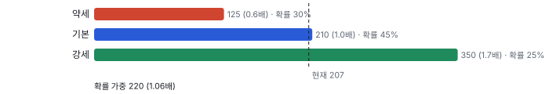

확률 가중 \$219.5(+6%). 숫자는 Chiip 판단이고 목표가가 아니다. 약세 확률을 강세보다 높게 둔 까닭은 소급을 뺀 정상 이익이 낮고, 평상 배수 범위보다 위에 있으며, 내부자 장내 매수가 없기 때문이다.

세 렌즈가 갈린다: **현금흐름 DCF 0.53배 · 판단 시나리오 1.06배 · 상대가치 합리적 멀티플 1.53배**(1.24~1.80배). 상대가치는 동종의 시장 배수 ÷ 내재 배수(섹터 심리)를 Vicor 펀더멘털에 곱한 값이라, 지금 AI 전력·아날로그 업종에 붙은 기대가 유지된다는 전제다. 또 소급이 든 TTM 이익률과 40% 성장 가정을 입력으로 쓴다. 7~10월에 줄어든 것이 바로 그 업종 배수이므로, 1.53배는 안전마진이 아니라 업종 심리에 대한 조건부 값으로 읽는다.

> DCF와 차이의 원인: DCF 기본 0.53배(약 \$110 상당)는 WACC 11.54%(베타 1.49)·영구성장 3.5%로 현금을 10년 할인한다. 시나리오는 12~18개월 뒤에도 28배가 유지된다고 가정해 그 할인을 건너뛴다. 즉 \$210은 '다음 사람이 28배를 내준다'는 전제의 가격이다. 현금흐름만으로 지금 가격을 넘는 시나리오는 강세(1.11배)뿐이고, 할인율을 2%p 낮춰도(듀레이션 약 11년 기준 약 +24%) 기본은 약 0.66배다.

## ⑦ 반대 검증 — 가장 강한 약세 논리

| 약세 논리 | 지금 근거 | 가를 자료 | Chiip 평가 |
|---|---|---|---|
| 로열티는 소송 합의금의 연장이다 | 2Q25 \$45M 합의금, 3Q 기준선 위 \$23.6M, 2년 계약 | 4Q·1Q 로열티, 2027년 말 갱신 조건 | 가장 강하다 — 반복성은 아직 2분기 표본 |
| IVR·VR 진영이 소켓을 가져간다 | 회사 스스로 '일부 레일은 IVR일 수 있다', 2세대 채택 '초기' | 하이퍼스케일러 양산 채택, 경쟁사 VPD 출하 | 미확인 — 회사 수치만 있음 |
| 캐파가 성장을 막는다 | Fab-1 거의 만석, 2027년 2분기 전 증설 없음 | 4Q 제품 +10% 달성, 수주잔고 증가율 | 2027년 상반기까지는 사실에 가깝다 |
| ITC는 양날의 칼이다 | 337-TA-1526 진행 중, 특허 분쟁 결과 불확실 | 예비 판정(2027년 전망, 일정 미확인) | 결과 전까지 할인 요인 |
| 내부자가 판다 | 장내 매수 0·매도 178, CEO 약 \$12.5M(약 \$310) | CEO 지분 분산 계획 여부(서류 미확인) | 신호로는 약함, 그러나 매수 부재는 사실 |

강세 쪽 반론도 적는다. 시장이 FY2027을 낮게 잡았을 수 있다 — Fiscal \$850M은 분기 성장 +4%대를 뜻해 회사 표현보다 보수적이고, Zacks \$989M이 맞다면 EPS 경로는 위쪽이다. 이번 DCF 기본은 \$900M을 썼다. 또 Hunterbrook의 러시아 부품 지적(2025Q3)은 평판 위험이나 이번 실적과 연결되는 증거는 찾지 못했다.

## ⑧ 킬 조건과 체크리스트

- 킬 1: 4Q 로열티 \$43M 미만 또는 2027년 말까지 초기 라이선스 갱신 실패 공시
- 킬 2: 2027년 상반기까지 2세대 VPD 선도 고객 밖 설계 수주 언급 없음 + Fab-2 장비 반입 지연
- 킬 3(경쟁 증설): 하이퍼스케일러의 IVR 단독 양산 채택 또는 MPWR·Infineon의 VPD 대량 출하 확인
- 킬 4: ITC 예비 판정 비침해·특허 무효

| 시점 | 무엇 | 의미 |
|---|---|---|
| 10/30 개장 후 | 미확정 표시 \$189.02 확인 | 실제 −8.5%면 원인 특정, 이 리포트 수치 재평가 |
| 2027-02 중순(예상) | 4Q 실적·콜 | 로열티 \$43M 대비, 제품 +10%, Fab-2 투자비 공개 여부 |
| 2027년 2분기 | Fab-2 첫 장비 | 장비 반입 일정 준수 |
| 2027년 | ITC 절차(2Q 콜: 2차 사건 최종 판정 2027년, 337-TA-1526 일정 미확인) | 수입금지 압력, 후발 라이선스 시점 |
| 2027년 말 전후 | 초기 2년 라이선스 갱신 | 로열티 기준선의 지속성 |

## 출처
- Fiscal.ai MCP 2026-10-30 22시 조회: stock_prices·daily_ratios·shares_outstanding·financials_standardized·segments_and_kpis·company_estimates·ir_events_transcript(q3-2026·q2-2026)·institutional_holders(2026Q2)·insider_transactions·fund_letters·company_news·company_peers·company_filings
- Zacks 추정·목표가·의견: Data provided by Zacks Investment Research, Inc., www.zacksdata.com (https://www.zacksdata.com)
- 10-Q 2026-09-30: https://www.sec.gov/Archives/edgar/data/751978/000119312526431231/vicr-20260930.htm
- 3Q 실적 보도자료: https://www.globenewswire.com/news-release/2026/10/20/3384210/0/en/vicor-corporation-reports-results-for-the-third-quarter-ended-september-30-2026.html
- Fab 부지 매입: https://www.globenewswire.com/news-release/2026/09/11/3360412/0/en/vicor-acquires-sites-for-additional-chip-fabs.html
- ITC 337-TA-1526(Hon Hai 공시): https://www.investegate.co.uk/announcement/rns/hon-hai-precision-industry-co-ltd--hhpd/statement-on-u-s-itc-section-337-investigation/9816713
- Fiscal.ai 회사 페이지: https://fiscal.ai/company/NasdaqGS-VICR
- 크라우딩 근거: knowledge/narratives/evidence/co-vicor.json 2026-10-30(커뮤니티 제목 13건, 독립 약세 장문 0건)·ApeWisdom 상위 목록 밖
- 동종: MPWR·ADI·TXN·AEIS·VRT·BELFA(Fiscal.ai 최근 4분기 합·daily ratios 2026-10-29). 선행 배수는 EV ÷ Fiscal 선행 4분기 매출
- 기저율: Bessembinder (2018) JFE 129(3) · Greenwood & Hanson (2015) QJE 130(1)
- 데이터 정제: Fiscal 일봉 2026-07-18(토요일, 시가 0)·10/30(거래량 48주) 제외, 3Q 영업현금은 콜 값 \$69.7M 사용(Fiscal 표준화 \$50.2M). 3Q 매출 추정은 Fiscal \$121.5M이 낡아 Zacks 사용
- 트랜스크립트는 라이선스 자료 — 요지만 자기 말로. 노션 Stocks: 이번 회차 ±7일 어닝콜·컨센서스 입력 종목 없음(색인 대상 0) — 알파 순. ISC·대덕전자(알파 6.4)는 Fiscal 회사 키가 없어 건너뜀
- 보강 적용: D-20261029-01(기저율·경쟁 무시) · D-20261029-03(크라우딩 출처) · D-20261029-06(경계값 n개 표기) · 원칙 P-20261029-01(기업 1줄) · X-20261029-08(번호 접두)

_연구 후보이지 매수 권유가 아닙니다 · 공개 자료 기반 분석이며 투자 권유가 아님 · 1차 판정, 미검증 · Chiip ten-bagger_