# 텐배거 리포트 2026-10-31 — Coherent — 숫자는 올랐고 배수가 반토막 났다, 11/4가 첫 시험대

> 2026-10-31 · Coherent(COHR) · 기업: AI 데이터센터용 광 트랜시버와 InP 레이저 칩을 수직 계열로 만드는 광학·반도체 회사

## Chiip View
**컨빅션 중 · 알파 6.3/10 · 업사이드 +28%**

시장은 증설 뒤 가격 하락을 먼저 넣었다. 수요 근거는 강하지만 FCF(잉여현금흐름)가 음수라 DCF(현금흐름 할인 평가)는 받쳐 주지 않는다. 10배 사다리는 없고 2배 조건부 후보이며 11/4 총이익률이 가른다

## 한 장 요약
- **① 기업가치를 결정하는 내러티브** **시장이 산 이야기는 'AI 데이터센터가 구리에서 빛으로 넘어가고, 그 빛을 만드는 레이저 칩이 병목'이라는 것이다.** FY2026(회계연도 2026년) 매출 \$7.12B(+23%), FQ4 데이터센터 매출은 전분기보다 24% 늘었다. 그런데 주가는 6/2 종가 \$426.89에서 10/30 \$210.32로 −51%다. 숫자가 나빠진 게 아니다. FY2027 EPS 컨센서스(시장 평균 추정)는 8월 실적 전보다 13% 올랐고 하락은 전부 배수에서 나왔다. 이제 값은 공급이 풀린 뒤에도 가격이 버티느냐로 갈린다. 11/4 실적이 첫 시험대다.
- **② 2·3·5배가 되려면?** **2배** 시가총액 \$85.05B = 매출 \$17.57B(5년 CAGR(연평균 성장률) 10.4%) · OPM(영업이익률) 29.0% · EPS \$18.41(5년 CAGR 26.9%), 5년 뒤 확률 20%, 조건부 · **3배** 시가총액 \$128B = 매출 \$26.36B(5년 CAGR 19.7%) · OPM 29.0% · EPS \$27.62(5년 CAGR 37.6%), 5년 뒤 확률 5%, 조건부 · **5배** 시가총액 \$213B = 매출 \$43.93B(5년 CAGR 32.6%) · OPM 29.0% · EPS \$46.03(5년 CAGR 52.4%), 5년 뒤 확률 0%, 경로 미확인. 2배는 컨센서스가 맞으면 닿고, 3배부터는 CPO·OCS가 새 시장을 만들어야 한다. 시가총액 \$41B라 10배 사다리는 없다.
- **③ 수주는 어디까지 왔나?** NVIDIA 다년 구매 약정·용량 권리 미확인, 100% 매출 미확인 · 장기 공급 계약(복수 전략 고객) 미확인, 100% 매출 미확인 · 6인치 InP 생산능력 미확인, 100% 매출 미확인. 수주잔고와 계약 금액을 공개하지 않아 합계를 낼 수 없다. 일정과 능력으로만 잰다.
- **지금 가격이 가정하는 것은?** Fwd 1Y P/E 20.2배, FY2028 컨센서스 EPS \$13.88~\$15.00 기준 14.0~15.2배다. 동종 중앙값 28.2배보다 28% 낮다. 시장 내포 5년 매출 CAGR은 21.1%로, 같은 크기 기업 중 **n=102 기준 상위 17%**다. 싼 배수가 곧 낮은 기대는 아니다.
- **콜에서 무엇이 바뀌었나?** FQ4 데이터센터 매출 +24% QoQ(전 분기 대비), InP 2배가 한 분기 앞당겨졌다. 새로 나온 것은 PhotonLink 12월 분기 첫 매출과 취리히 6인치다. 나쁜 쪽은 CAPEX(설비투자)다. 분기 \$290M에서 \$556M으로 늘었다.
- **주가는 왜 빠졌나?** 8/11 이후 주가 −36%, FY2027 EPS 추정 +13%다. 계산하면 배수가 **−43%**다. 10월 하락은 광 업종 전체가 함께 팔렸고 회사 단독 악재는 확인되지 않는다. 금리 10년물 4.98%도 듀레이션이 긴 이 주식에 불리하다.
- **무엇이 판단을 바꾸나?** 11/4 장 마감 후 실적이다. 매출 가이던스(회사가 제시한 전망) \$2.2~2.4B보다 **총이익률 40.5% 달성 여부와 2Q 가이던스**가 중요하다. 부족이 가격 결정력으로 남아 있는지를 보여 주는 숫자이기 때문이다.

## 핵심 숫자
| 항목 | 값 | 설명 |
|---|---|---|
| 주가(10/30) | \$210.32 | 6/2 종가 고점 대비 −51% |
| 시가총액 | \$41.2B | 희석 전, 완전 희석 \$42.5B |
| Fwd 1Y P/E | 20.2배 | 동종 중앙값 28.2배 |
| FY2027 EPS 컨센서스 | \$9.44~\$10.40 | 8월 실적 전 \$8.38 |
| FY2027 CAPEX 컨센서스 | \$2.6B | 매출의 24%, FCF 약 −\$0.8B |
| 다음 사건 | 11/4 | 1Q FY27 실적, 장 마감 후 |

## ① 내러티브 — 기업가치와 멀티플·EPS 프리미엄을 결정하는 이야기

> **기업가치를 결정하는 이야기:** 트랜시버는 전기 신호를 빛으로 바꾸는 부품이고, 그 심장이 인듐인화물(InP) 레이저 칩이다. 이 회사는 칩부터 모듈까지 직접 만든다. 부족할 때는 내부 칩이 이익률과 납품 우선권이 되지만, 공장을 먼저 지어야 하므로 자본을 많이 쓴다. 그래서 기업가치는 세 숫자로 갈린다. 6인치 InP 물량, 총이익률(지금 40.2%), 그리고 FY2027 설비투자 약 \$2.6B가 언제 현금으로 돌아오느냐다.

- **멀티플 프리미엄:** Fwd 1Y P/E 20.2배로 동종 중앙값 28.2배보다 28% 낮고, 6월 말 48.9배의 절반 아래다. Lumentum은 36.6배다. 프리미엄이 아니라 할인이다.
- **EPS 프리미엄:** FY2027 EPS 컨센서스는 FQ4 실적 전 \$8.38에서 \$9.44로 +13%이고, 상단 추정은 \$10.40이다. 주가는 8/11 종가 대비 −36%다.

### 투자자들은 왜 열광했나

세 가지가 겹쳤다. 3월 NVIDIA가 \$2B를 넣고 다년 구매를 약정했고, 6인치 InP가 3인치보다 높은 수율을 냈으며, 데이터센터 성장이 다시 빨라졌다. 주가는 2025년 4월 저점 \$49 부근에서 2026년 6월 \$427까지 약 8.7배가 됐다. 식은 이유는 회사 밖에도 있다. Fwd 1Y P/E가 49배까지 올랐고, 10월에는 광 업종 전체가 함께 팔렸다. 단일 악재는 확인되지 않는다. 펀드 레터에는 3분기부터 설비투자 우려가 나타났다.

### 무엇이 기업가치를 바꾸나

- **구조적 체질 변화** (멀티플+리비전(추정치 수정) · 진행 중) — 산업용 레이저 회사에서 AI 광통신 회사로 바뀌었다. 데이터센터·통신 부문이 FQ4 매출의 79%다. 차입 부담도 줄어 레버리지가 2.0배에서 0.7배가 됐다. 증거: FQ4 콜. 부채 상환 \$513M, 3월 분기 보통주 발행 \$2.02B. 반증: 데이터센터 매출 비중이 3개 분기 연속 내려간다.
- **고부가 믹스 확장** (멀티플+리비전 · 진행 중) — 800G에서 1.6T로, 트랜시버에서 OCS·CPO 레이저로 옮겨 간다. 비GAAP(회사가 일회성 항목을 뺀 조정 기준) 총이익률은 FY2026 들어 39%대에서 40.2%로 올랐다. 증거: FQ4 비GAAP 총이익률 40.2%, 전년 대비 +215bp. 회사는 가격 개선과 6인치 원가 절감을 이유로 든다. 반증: 11/4 비GAAP 총이익률이 가이던스 중간값 40.5% 아래.
- **기술 혁신** (멀티플 · 진행 중) — 6인치 InP는 웨이퍼당 칩 수가 많아 원가를 낮춘다. 텍사스·스웨덴에서 EML·CW 레이저·포토다이오드를 생산 중이고 취리히가 2027년 상반기에 합류한다. 증거: FQ4 콜: 6인치 수율이 3인치를 넘었다. 다만 수율 수치는 공개하지 않는다. 반증: 경쟁사가 6인치 InP 양산을 같은 비용으로 따라잡는다.
- **실행 속도** (리비전 · 진행 중) — 해당 없음(회사와 동종 모두 납품 리드타임 숫자를 공개하지 않아 미확인이다). 대신 생산능력 일정으로 잰다. InP 2배가 계획보다 한 분기 앞섰다. 증거: FQ3·FQ4 콜. 6월 분기 레이저 출하 +80% YoY(전년 동기 대비). 반증: 2027년 말 재차 2배 목표가 늦춰진다.
- **M&A** (멀티플 · 완료) — 항공우주·방위 사업을 팔아 현금을 만들고 본업에 집중했다. 새 대형 인수 없이 재투자가 자본 배분의 우선이다. 증거: 2025-09 분기 사업 매각 대금 \$391M(현금흐름표). 반증: 대형 인수로 레버리지가 다시 2배를 넘는다.
- **재정정책(행정부)** (리비전 · 진행 중) — 첨단제조 세액공제가 미국 내 InP 공장 투자 회수를 돕는다. 셔먼(텍사스) 공장에 얼마나 적용되는지는 공시로 대조하지 못해 미확인이다. **의회 동의 10/10** — 하원 5/5(세액공제 확대 법안 본회의 통과) · 상원 5/5(같은 법안 본회의 통과). 증거: 셔먼 공장이 NVIDIA 투자금의 미국 확장 대상으로 거론됐다(보도). 반증: 세액공제 조건 변경으로 대상에서 빠진다.
- **행정명령(행정부)** — 해당 없음(이 회사 매출을 직접 바꾸는 행정명령을 이번 회차에 확인하지 못했다). 중국 경쟁사·수출 통제는 위험 요인으로 본다. **의회 동의 2/10** — 하원 1/5(의회 논의 확인 안 됨) · 상원 1/5(의회 논의 확인 안 됨).
- **연관입법(의회)** — 해당 없음(이 회사 매출을 직접 바꾸는 계류 법안을 콜에서 찾지 못했다).
- **CAPEX 낙수효과(대기업 투자가 아래 공급망으로 번지는 효과)** (리비전 · 진행 중) — 하이퍼스케일러 투자가 광으로 흘러오지만 금지표대로 공급 관계를 따져야 한다. 확인된 고리는 NVIDIA 구매 약정과 복수 고객 장기 계약이다. 증거: FQ3 콜: 다년 수요 약정과 선투자를 담은 장기 공급 계약을 체결하거나 마무리 중. 금액과 고객명은 대부분 비공개. 반증: 대형 고객이 내재화나 제2 공급원으로 물량을 옮긴다.

### 이 회사의 제품·서비스·기술

- **제품 — 데이터센터 트랜시버:** 서버·스위치 사이 전기 신호를 빛으로 바꾸는 800G·1.6T 모듈 쓰는 곳: AI 클러스터 내부 연결. 돈 버는 방식: 데이터센터·통신 부문이 FQ4 매출의 79%, 세부 금액은 쪼개 쓰지 않았다.
- **제품 — 통신 부품:** 데이터센터 간 연결과 통신망용 코히런트 모듈·펌프 레이저 쓰는 곳: DCI, 스케일 어크로스, 통신망. 돈 버는 방식: FY2026 약 +54%.
- **기술 — InP·CPO 레이저(PhotonLink):** 외부 레이저 모듈, 아이솔레이터, 편광 유지 광섬유까지 묶은 통합 광학 쓰는 곳: CPO·NPO 스위치. 돈 버는 방식: 12월 분기 첫 매출 예정.
- **제품 — OCS:** 전기 변환 없이 빛의 경로를 바꾸는 광 회선 스위치 쓰는 곳: 데이터센터 스케일 아웃·업. 돈 버는 방식: 매출 미공개, 회사 추정 시장 \$4B+.
- **제품 — 산업 부문:** 산업용 레이저와 소재 쓰는 곳: 제조·반도체 장비·디스플레이. 돈 버는 방식: FQ4 매출의 약 21%.

## ② 배수 사다리 — 2·3·5배가 되려면

> **시가총액 \$42.53B → 2·3·5배까지 본다.** 시가총액이 커질수록 볼 배수를 줄인다(\$30B 미만 10배, \$30B~\$100B 5배, \$100B 이상 2배까지). 숫자는 출구 P/E 22배·OPM 29.0%·순이익률 22.0% 기준이다. 출구 P/E 22배는 지금 동종 중앙값 28배보다 낮게 잡았다. 영업이익률 29%·순이익률 22%는 FY2029 컨센서스에서 계산했고, 주식 수는 2억 1,000만 주로 희석을 넣었다. 표의 지금 줄 매출은 FY2027 컨센서스, EPS는 FY2026 실적이고 시가총액은 완전 희석 기준이다.

**배수 단계별 필요 조건 — 2·3·5배**
| 배수 | 목표 시가총액 | 필요 매출 | 매출 CAGR 5년 / 10년 | OPM | 필요 EPS | EPS CAGR 5년 / 10년 |
|---|---|---|---|---|---|---|
| **지금** | \$42.53B | \$10.73B | - | 22.7% | \$5.60 | - |
| **2배** | \$85.05B | \$17.57B | 10.4% / 5.1% | 29.0% | \$18.41 | 26.9% / 12.6% |
| **3배** | \$128B | \$26.36B | 19.7% / 9.4% | 29.0% | \$27.62 | 37.6% / 17.3% |
| **5배** | \$213B | \$43.93B | 32.6% / 15.1% | 29.0% | \$46.03 | 52.4% / 23.4% |

**배수 단계별 달성 가능성**
| 배수 | 지금 매출 대비 | DCF 역산 5년 CAGR | 5년 뒤 확률 | 판정 |
|---|---|---|---|---|
| **2배** | 1.6배 | 25.9% (상위 13%, n=102) | 20% | 조건부 |
| **3배** | 2.5배 | 38.1% (상위 5%, n=102) | 5% | 조건부 |
| **5배** | 4.1배 | 54.4% (상위 2%, n=102) | 0% | 경로 미확인 |

**그림 9 · 배수 단계별 필요 매출 vs 회사 경로 (\$B)**

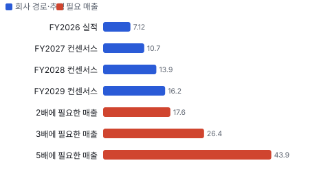

### 2배 — \$85.05B · 조건부

- **필요 조건:** 매출 \$17.57B(5년 CAGR 10.4%) · OPM 29.0% · EPS \$18.41(5년 CAGR 26.9%)
- **어떻게 성장해야 하나:** FY2029 컨센서스 수준을 그대로 맞추면 닿는다. InP 2배가 예정대로 돌고, CPO·OCS가 트랜시버 가격 하락을 메워야 한다.
- **펀더멘털 전망:** 컨센서스가 이미 이 경로를 넣고 있다. 관건은 숫자가 아니라 그때 시장이 22배를 주느냐다.

### 3배 — \$128B · 조건부

- **필요 조건:** 매출 \$26.36B(5년 CAGR 19.7%) · OPM 29.0% · EPS \$27.62(5년 CAGR 37.6%)
- **어떻게 성장해야 하나:** FY2029 컨센서스보다 약 50% 큰 매출이 필요하다. CPO가 트랜시버를 잠식하지 않고 시장을 키우고, OCS가 조 단위 사업이 되어야 한다.
- **펀더멘털 전망:** 회사 추정 CPO 증분 시장 \$15B+와 OCS \$4B+의 상당 부분을 가져가는 그림이다. 지금 근거로는 가능성만 말할 수 있다.

### 5배 — \$213B · 경로 미확인

- **필요 조건:** 매출 \$43.93B(5년 CAGR 32.6%) · OPM 29.0% · EPS \$46.03(5년 CAGR 52.4%)
- **어떻게 성장해야 하나:** 컨센서스의 약 2.5배 매출이 필요하다.
- **펀더멘털 전망:** 공시된 계획과 생산능력 일정으로는 설명되지 않는다.

## ③ 수주·파이프라인 — 진척도와 남은 수익

> **2026-06-30 기준 수주·파이프라인 6건, 건별 확정 수주 금액은 공개되지 않았다.** 미확정 건은 확정 합계에 넣지 않았다. 수익은 항목별 마진 가정을 곱한 추정이다. 서로 겹치거나 금액을 모르는 항목은 합계에서 뺐다.

**수주·파이프라인 진척**
| 항목 | 상태 | 진척도 | 실행 속도 | 방해 요인 |
|---|---|---|---|---|
| NVIDIA 다년 구매 약정·용량 권리 | 프레임워크 | 미확인 | 2026-03 체결, \$2B 지분 투자는 현금 유입 완료 | 비독점 계약 · Lumentum에도 같은 규모 투자 · 약정 금액 미공개 |
| 장기 공급 계약(복수 전략 고객) | 조건부 | 미확인 | 다년 수요 약정과 선투자, 기간이 2020년대 말까지 이어지는 계약 다수. 일부는 가격 개선 포함 | InP 공급 속도 · 고객명·금액 미공개 |
| 6인치 InP 생산능력 | 파이프라인 | 미확인 | 2배는 계획보다 한 분기 앞섬, 2027년 말까지 다시 2배 이상 | 장비 납기 · 취리히 전환 · 아이솔레이터·광섬유 제약 |
| PhotonLink(CPO·NPO) | 파이프라인 | 미확인 | 12월 분기 첫 매출 예정, 회사 추정 증분 시장 \$15B+는 시장 규모이지 수주가 아니다 | CPO 채택 시점 · 400mW 레이저 공급 · 경쟁사 Lumentum |
| OCS | 파이프라인 | 미확인 | 두 곳에서 생산 확대, 회사 추정 시장 \$4B+ | 구글 자체 OCS · 생산 능력 |
| MultiRail 냉각 | 파이프라인 | 미확인 | 샘플 제공, 2027년 하반기 매출 시작 예상 | 고객 인증 |

**진척도별 수익**
| 항목 | 마진 가정 | 현 진척 매출 | 현 진척 이익 | 100% 매출 | 100% 이익 |
|---|---|---|---|---|---|
| NVIDIA 다년 구매 약정·용량 권리 | 미확인 | 미확인 | 미확인 | 미확인 | 미확인 |
| 장기 공급 계약(복수 전략 고객) | 미확인 | 미확인 | 미확인 | 미확인 | 미확인 |
| 6인치 InP 생산능력 | 미확인 | 미확인 | 미확인 | 미확인 | 미확인 |
| PhotonLink(CPO·NPO) | 미확인 | 미확인 | 미확인 | 미확인 | 미확인 |
| OCS | 미확인 | 미확인 | 미확인 | 미확인 | 미확인 |
| MultiRail 냉각 | 미확인 | 미확인 | 미확인 | 미확인 | 미확인 |

## 주가와 배수 — 이익은 올랐고 배수가 내렸다

**그림 1 · Coherent 월말 주가(\$, 2024-01~2026-10)**

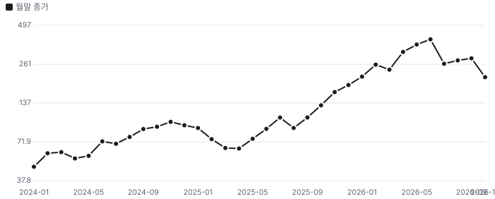

Fwd 1Y P/E는 6월 말 48.9배에서 지금 20.2배로 내려왔다. 2023년 10월 이후 자기 범위 16~49배의 아래쪽이다. 다만 분모가 다르다. 지금 EPS는 3년 전보다 훨씬 크고 추정 상단을 쓴 값이라, 하단 \$9.44로 재면 22.3배다. 뒤의 분해 표에 나오는 19.2배는 달력 연도 기준 추정이라 값이 다르고, 8/12 종가에서 재서 배수 변화도 −45%로 요약의 −43%(8/11 기준)와 다르다.

10/22(−12.5%)와 10/30(−11.3%) 두 날이 이번 하락을 키웠다. 첫날은 업종 동반 매도였고, 둘째 날은 시장 급락과 Morgan Stanley·B. Riley의 목표가 하향이 겹쳤다. 두 건 모두 회사 공시는 없었다.

## 실적 — 매 분기 추정을 넘겼다

**그림 2 · 분기 매출 실적과 컨센서스(\$B, 달력 분기)**

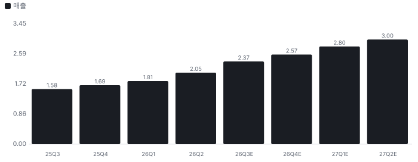

최근 4개 분기 매출과 조정 EPS는 모두 컨센서스 이상이었다. FY2026 비GAAP EPS는 약 59% 늘어 매출 증가율의 2배를 넘었다. 분기 GAAP(미국 회계기준) 영업이익은 \$254M이고 조정 EBIT(이자·세금 차감 전 이익)는 \$446M이다. 둘의 차이가 커서 실적을 말할 때는 조정 기준임을 밝힌다.

현금은 다른 이야기를 한다. FY2026 영업현금흐름은 약 \$80M(46.0+57.9−93.8+69.5)이고 CAPEX는 \$1.10B다. 재고는 3월 \$2.13B에서 6월 \$2.58B로 늘었다. 성장의 값을 지금 치르는 중이다.

## 사업과 병목 — 레이저 다음은 아이솔레이터

병목의 순서는 InP 레이저, 그다음 아이솔레이터, 그다음 광섬유다. 회사는 아이솔레이터와 편광 유지 광섬유도 직접 만들어, 이 구간에서 수직 계열이 무기가 된다. 반면 VCSEL은 여유가 있어 쉽게 두 배로 늘릴 수 있다고 한다.

엔지니어 관점에서 볼 것은 6인치 수율이다. 회사는 3인치보다 낫다고만 하고 숫자를 주지 않는다. 웨이퍼 대구경화는 칩당 원가를 낮추지만, 초고출력 CW 레이저처럼 결함에 민감한 제품에서 같은 수율이 나오는지는 공개 자료로 확인되지 않는다.

금지표를 적용한다. NVIDIA 투자 → 이 회사의 매출 규모는 아직 연결되지 않는다. 구매 약정 금액이 비공개이고 계약은 비독점이며, 같은 날 Lumentum도 같은 규모를 받았다. 장기 계약의 테이크오어페이 조건도 경영진 설명이지 계약서로 확인한 것은 아니다.

## 손익분기 — 멀티플과 DCF가 왜 다른가

**그림 4 · 지금 주가를 정당화하는 FY2028 EPS(\$, P/E 가정별)**

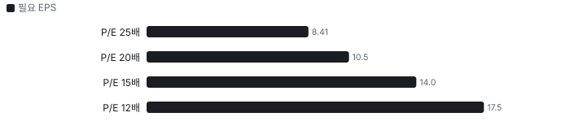

핵심 변수는 FY2028 EPS와 그때의 배수다. 시장이 15배를 준다면 FY2028 EPS **\$14.02**가 손익분기이고, 컨센서스 \$13.88~\$15.00과 거의 같다. 12배까지 내려가면 \$17.53이 필요해 컨센서스 상단을 넘는다. 즉 지금 가격은 숫자 달성과 배수 정상화 둘 다를 요구하지는 않지만, 공급 과잉이 오면 둘이 함께 깎인다.

DCF가 시가총액보다 낮게 나오는 이유는 세 가지다. 할인율이 11.4%로 높고, CAPEX 탓에 앞 3년 현금흐름이 얇으며, 계속가치(예측 기간 이후의 가치)에 프리미엄을 주지 않는다. 멀티플은 내년 이익을 보고 DCF는 그 이익을 만드는 데 드는 현금을 본다. 이 회사에서는 후자가 더 불리하다.

## 어닝콜 변화·컨센서스·멀티플 프리미엄·EPS 리비전

**방법:** 직전 콜(2026-05-06) → 최신 콜(2026-08-12)에서 새로 나오거나 바뀐 항목을 DCF 기본 시나리오의 동인 이동으로 옮기고, 그 변화가 없었을 때(동인을 되돌린 DCF) 대비 주주가치 변화를 잰다. 확신도: 확정 1.0 · 회사 가이던스 0.8 · 경영진 목표·장기 발언 0.5 · 정황 0.3. '반복'은 직전 콜과 같은 말이라 가치 영향 0.

**직전 콜 대비 새로 나오거나 바뀐 내용 → 가치 영향 (DCF 기본 시나리오 주주가치 기준)**
| 항목 | 내용 | 직전 콜 | 최신 콜 | 모델 동인 이동 | 확신도 | 가치 영향 |
|---|---|---|---|---|---|---|
| 업데이트 | 데이터센터 성장 가속 | FQ3 성장 가속 예고 | FQ4 데이터센터 +24% QoQ, FY2026 +41% | 1년차 성장률 +3.0% | 1.0 | +3.7% |
| 신규 | PhotonLink 플랫폼 | CPO 부품 공급 중심 | 레이저 모듈까지 묶은 통합 플랫폼, 12월 분기 첫 매출 | 장기 성장 수렴값 +0.50% | 0.5 | +2.0% |
| 신규 | 취리히 6인치 InP | 텍사스·스웨덴 2곳 | 2027년 상반기 취리히 시작, 6인치 수율이 3인치보다 높음 | 목표 이익률 +0.50% | 0.8 | +0.5% |
| 부정 | 설비투자 급증 | FQ3 CAPEX \$290M | FQ4 \$556M, FY2027 컨센서스 \$2.6B | 매출÷투하자본 -10.0% | 0.8 | -1.8% |
| **합계** | 단독 합 |  |  | 동시 적용 +4.5% |  | **+4.4%** |

**그림 6 · 콜 변화 항목별 주주가치 영향 (%)**

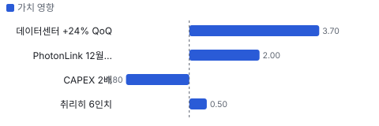

**실적 vs 컨센서스 — 최근 4개 분기 (이익 지표는 조정 기준, 발표 직전 추정)**
| 분기 | 지표 | 실적 | 컨센서스 | 서프라이즈 |
|---|---|---|---|---|
| 2025Q3 | 매출 | \$1,581M | \$1,536M | +2.9% |
| 2025Q3 | OPM | 19.5% | 18.7% | +0.9%p |
| 2025Q3 | EPS | \$1.16 | \$1.04 | +11.1% |
| 2025Q4 | 매출 | \$1,686M | \$1,637M | +3.0% |
| 2025Q4 | OPM | 19.9% | 20.1% | -0.1%p |
| 2025Q4 | EPS | \$1.29 | \$1.22 | +5.7% |
| 2026Q1 | 매출 | \$1,806M | \$1,780M | +1.5% |
| 2026Q1 | OPM | 20.3% | 20.9% | -0.7%p |
| 2026Q1 | EPS | \$1.41 | \$1.41 | +0.2% |
| 2026Q2 | 매출 | \$2,046M | \$1,992M | +2.7% |
| 2026Q2 | OPM | 21.8% | 21.5% | +0.3%p |
| 2026Q2 | EPS | \$1.74 | \$1.62 | +7.6% |

**그림 7 · 분기별 서프라이즈 — 매출·OPM·EPS (%, OPM은 %p), 최근 4개 분기**

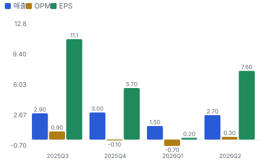

**그림 5 · 지난 12개월 EPS 리비전 추이 — 캘린더 2026·2027년 EPS 추정(\$/주)**

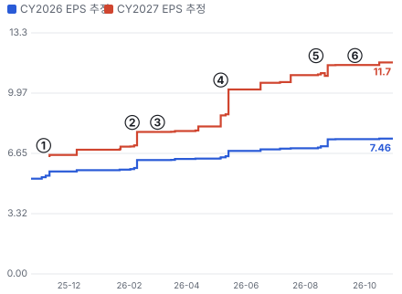

- ① 25-11-05 FQ1 FY26 실적 · EPS 리비전 -
- ② 26-02-04 FQ2 FY26 실적 · EPS 리비전 +11%
- ③ 26-03-02 NVIDIA \$2B 투자·구매 약정 · EPS 리비전 +0%
- ④ 26-05-06 FQ3 FY26 실적 · EPS 리비전 +25%
- ⑤ 26-08-12 FQ4 FY26 실적 · EPS 리비전 +5%
- ⑥ 26-09-21 PhotonLink 발표 · EPS 리비전 +0%

**사건별 EPS 리비전 — 실적 발표·내러티브 변화 때 추정이 어떻게 움직였나**
| # | 날짜 | 구분 | 사건 | CY2026 EPS 전→후 | CY2027 EPS 전→후 | 리비전 | 주가 반응 |
|---|---|---|---|---|---|---|---|
| ① | 25-11-05 | 실적 | FQ1 FY26 실적 | \$5.33 → \$5.65 | - → \$6.56 | - | +18.3% |
| ② | 26-02-04 | 실적 | FQ2 FY26 실적 | \$5.78 → \$6.28 | \$7.03 → \$7.83 | +11.3% | -0.8% |
| ③ | 26-03-02 | 내러티브 | NVIDIA \$2B 투자·구매 약정 | \$6.28 → \$6.29 | \$7.83 → \$7.84 | +0.2% | +15.4% |
| ④ | 26-05-06 | 실적 | FQ3 FY26 실적 | \$6.37 → \$6.78 | \$8.13 → \$10.17 | +25.1% | -7.4% |
| ⑤ | 26-08-12 | 실적 | FQ4 FY26 실적 | \$6.93 → \$7.42 | \$10.96 → \$11.51 | +5.1% | -8.0% |
| ⑥ | 26-09-21 | 내러티브 | PhotonLink 발표 | \$7.43 → \$7.43 | \$11.52 → \$11.52 | +0.0% | +1.3% |

**그림 8 · 최근 4개 분기 주가 변화 분해 = EPS 리비전 × 멀티플 변화 (%, 실적 발표 사이 구간)**

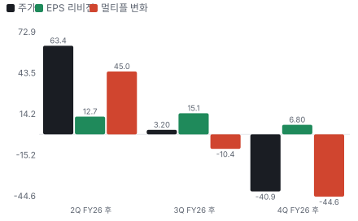

**분기별 주가 분해 — 실적 발표 사이 구간**
| 구간 | 기간 | 주가 | EPS 리비전 | 멀티플 변화 | 선행 P/E 시작 → 끝 |
|---|---|---|---|---|---|
| 2Q FY26 후 | 26-02-04 ~ 26-05-06 | \$211.00 → \$344.67 (+63%) | +13% | +45% | 35.8배 → 47.7배 |
| 3Q FY26 후 | 26-05-06 ~ 26-08-12 | \$344.67 → \$355.64 (+3%) | +15% | -10% | 47.7배 → 37.8배 |
| 4Q FY26 후 | 26-08-12 ~ 26-10-30 | \$355.64 → \$210.32 (-41%) | +7% | -45% | 37.8배 → 19.2배 |

**해석:** 3개 구간 누적 주가 -0% = EPS 리비전 +39% × 멀티플 -28%. 더 크게 움직인 쪽은 **EPS 리비전**이다.

**컨센서스 리비전 — FQ4 실적 직전(2026-07-17) → 지금(2026-10-16), 같은 분기끼리**
| 분기 | 지표 | 직전 | 지금 | 리비전 |
|---|---|---|---|---|
| 2026Q3 | EPS | 1.797 | 1.984 | +10.4% |
| 2026Q4 | EPS | 1.97 | 2.217 | +12.5% |
| 2027Q1 | EPS | 2.121 | 2.466 | +16.3% |
| 2027Q2 | EPS | 2.341 | 2.705 | +15.5% |
| **합계 4분기** | EPS | 8.229 | 9.372 | **+13.9%** |

**멀티플 프리미엄 — 동종 중앙값 대비 (성장 조정 = 배수 ÷ 최근 분기 전년 대비 매출 성장%, 한 분기 성장이라 변동이 크다)**
| 지표 | 대상 | 동종 중앙값(범위) | 프리미엄 | 성장 조정 프리미엄 |
|---|---|---|---|---|
| Fwd 1Y P/E | 20.2배 | 28.2배 (12.5~36.5, 6사) | **-28%** | - |
| Fwd 2Y(12~24개월 뒤 추정 기준) P/E | 14.0배 | 21.2배 (10.9~25.5, 6사) | **-34%** | - |
| Fwd 3Y(24~36개월 뒤 추정 기준) P/E | 11.6배 | 16.1배 (9.9~21.0, 6사) | **-28%** | - |
| Fwd 1Y EV/EBITDA(기업가치 ÷ 상각전영업이익) | 15.3배 | 21.8배 (11.2~28.5, 6사) | **-30%** | - |
| Fwd 2Y EV/EBITDA | 10.7배 | 16.3배 (9.9~18.9, 6사) | **-34%** | - |
| Fwd 3Y EV/EBITDA | 8.8배 | 12.7배 (8.9~15.7, 6사) | **-30%** | - |

**그림 10 · 멀티플 프리미엄 (%) — 0 = 동종 중앙값**

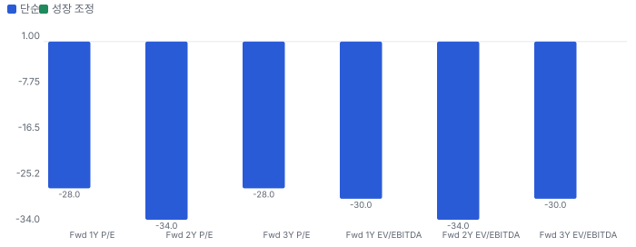

## 내러티브 근거 — 누가 믿고 있나(셀사이드·바이사이드·리테일·언론)

> **한 줄:** 'AI는 구리에서 빛으로 간다'는 이야기는 숫자로 확인됐는데 주가는 고점 대비 절반이 됐다. 시장은 이제 공급 증설이 가격을 얼마나 깎을지를 묻는다 · 동종 대비 멀티플 차이 -28% 중 회사 고유 몫 -39%(멀티플 엔진) — 내러티브가 설명해야 하는 크기 · 직전 콜 이후 EPS 추정 +13.9%(2026Q3, 2026Q4, 2027Q1, 2027Q2) — 리비전 경로로 이미 숫자가 된 몫 · 단계 컨센서스, 쏠림 식는 중

**내러티브 요인 — 누가 믿고, 멀티플·리비전 중 어디로 작동하나**
| 요인 | 셀사이드 | 바이사이드 | 리테일 | 작동 경로 | 숫자로 바꾸면 | 상태 | 반증 조건 |
|---|---|---|---|---|---|---|---|
| 구리에서 광으로 | 강 | 강 | 중 | 멀티플+리비전 | FY2026 데이터센터 매출 +41%, FQ4 +24% QoQ | 강화 | 2개 분기 연속 데이터센터 매출 QoQ 감소 |
| InP 공급 병목 | 강 | 강 | - | 멀티플+리비전 | 내부 InP 능력 2배(9월 분기), 2027년 말 다시 2배 이상, 6월 분기 레이저 출하 +80% YoY | 강화 | 6인치 수율이 3인치 아래로 내려가거나 2배 일정 지연 |
| CPO·NPO 선택권 | 중 | 중 | 중 | 멀티플 | 회사 추정 증분 시장 \$15B+, PhotonLink 첫 매출 12월 분기, NVIDIA 다년 구매 약정(금액 미공개) | 유지 | 2027년 상반기까지 CPO 매출이 숫자로 나오지 않음 |
| OCS 신사업 | 중 | 중 | - | 멀티플+리비전 | 회사 추정 시장 \$4B+, 매출 비공개 | 초기 | OCS 매출을 2027년에도 숫자로 공개하지 못함 |
| 반대 내러티브: 증설 뒤의 공급 과잉 | 중 | 강 | - | 멀티플 | FY2027 CAPEX 컨센서스 \$2.6B(매출의 24%), FCF −\$0.8B, Fwd 1Y P/E 48.9배 → 20.2배 | 강화 | FY2027에 총이익률이 42% 이상으로 오르고 FCF가 흑자로 돌아섬 |

- **구리에서 광으로** — AI 클러스터가 커질수록 전기 연결이 한계에 닿아 광 연결이 늘어난다 (바뀌는 입력: 성장 지속기간)
- **InP 공급 병목** — 레이저 칩이 가장 좁은 길목이고 6인치 전환이 원가와 물량을 동시에 푼다 (바뀌는 입력: 매출·이익률)
- **CPO·NPO 선택권** — 통합 광학이 시장을 키우고 회사는 레이저부터 모듈까지 함께 판다 (바뀌는 입력: 새 시장)
- **OCS 신사업** — 광 회선 스위치가 전력과 지연을 줄이며 고마진 시스템 매출이 된다 (바뀌는 입력: 믹스)
- **반대 내러티브: 증설 뒤의 공급 과잉** — 모두가 InP와 트랜시버를 동시에 늘린다. 부족이 풀리면 가격이 먼저 꺾이고, 이 회사는 FCF가 음수인 채로 그 시점을 맞는다 (바뀌는 입력: 장기 이익률·자본 집약도)

**셀사이드(IB 애널리스트)**
| 지표 | 값 | 추세·해석 |
|---|---|---|
| 애널리스트 의견 | 24명 — 강력 매수 17·매수 1·보유 6·매도 0 | 매도 의견이 없다 |
| 목표가 평균·범위 | \$394(\$262~\$500, 23명) | 10/30 종가 대비 평균 +87%. 기대의 증거이지 Chiip 목표가가 아니다 |
| 10월 목표가 조정 | B. Riley \$345→\$297→\$262, Susquehanna \$425→\$350, Needham \$420→\$380, MS \$375→\$325 | 실적 전에 낮추는 흐름 |
| FQ4 콜 질문 초점 | 6인치 램프·공급 격차·트랜시버 믹스·OCS 수요 | 수요가 아니라 공급 속도를 묻는다 |
| IB(투자은행) 요지(마스터 노션, 라이선스) | 경영진은 공개 계약 외에 비공개 테이크오어페이 계약이 여럿이고 고객이 약정을 넘겨 산다고 설명 | 한 증권사 후속 콜 메모의 자기 말 요약, 경영진 주장이지 계약서 확인은 아니다 |

**셀사이드(IB 애널리스트) 해석:** 셀사이드는 수요를 의심하지 않는다. 쟁점은 InP 공급 속도와 그 뒤의 가격이다

**바이사이드(기관 투자자)**
| 지표 | 값 | 추세·해석 |
|---|---|---|
| 13F(미국 기관투자자 분기 보유 공시) 2Q 보유 기관 | 1,223곳 — 집계 1,000곳 중 증가 408·감소 301 | 집계분 순감소 약 646만 주, 상위 증가는 BlackRock·T. Rowe |
| 전략적 투자자 | NVIDIA \$2B 지분 투자 | 현금 유입은 2026-03 분기 보통주 발행 \$2.02B로 확인 |
| 펀드 레터 | Voya: 비중 확대가 3Q에 수익률을 깎음(설비투자 우려·AI 인프라 매도), Fidelity Mid-Cap: 차익 실현 축소, Touchstone: 2Q 신규 | 긍정 논지가 많지만 3Q부터 설비투자 우려가 등장 |
| 내부자 | 장내 매수 4건·매도 66건 | 매도 우위, 사전 계획 여부 미확인 |

**바이사이드(기관 투자자) 해석:** 장기 자금은 남아 있고, 3Q부터 설비투자 부담이 바이사이드 언어에 들어왔다

**리테일(레딧·텔레그램·X)**
| 지표 | 값 | 추세·해석 |
|---|---|---|
| 리테일 언급 | 레딧·텔레그램 언급 수 미수집 | 이번 회차는 집계하지 못했다 |

**리테일(레딧·텔레그램·X) 해석:** 리테일 쏠림은 FINRA(미국 금융산업규제국) 체결 몫으로만 본다

**언론·업계**
| 지표 | 값 | 추세·해석 |
|---|---|---|
| 주요 사건 | PhotonLink 발표, 10월 광 업종 동반 매도 | 개별 악재보다 업종 전체 조정으로 다뤘다 |

**언론·업계 해석:** 10월 하락의 단일 원인은 확인되지 않는다

## 밸류에이션 — 맥킨지·IB 방식(현금흐름 할인(DCF) 엔진)

**방법:** 맥킨지식 재무 재구성(NOPAT(세후 영업이익)·투하자본·ROIC(투하자본이익률)) → 바텀업 WACC(가중평균자본비용) → FCFF(기업 잉여현금흐름) DCF + 가치 동인 계속가치(ROIC·성장) → 경제적 이익 항등 검증 → 시나리오·몬테카를로(가정을 무작위로 바꿔 수천 번 계산하는 방법) → 가격 내포 기대(역DCF)와 매출 성장 기저율(같은 조건의 과거 사례 빈도). 단위 \$B, 모든 가치는 **현재 시가총액 대비 배수**로 표기(목표주가 아님).

**할인율(WACC) 구성**
| 항목 | 값 |
|---|---|
| 무위험(미 10년) | 4.98% |
| 주식 위험 프리미엄 | 4.20% |
| 레버드 베타(바텀업) | 1.53 (무레버 1.49) |
| 국가위험 | 0.23% |
| 자기자본비용 | 11.65% |
| 부채비중 | 4% |
| WACC | **11.42%** |
| 영구성장 | 3.5% |

**시나리오별 DCF 주주가치 ÷ 현재 시가총액(\$42.5B)**
| 시나리오 | 확률 | 주주가치(\$B) | 지금 | 5년 뒤(할인 전) | 5년 매출 CAGR | 5년차 영업이익률 |
|---|---|---|---|---|---|---|
| 기본 | 50% | 32.8 | **0.77배** | 1.29배 | 13.3% | 27% |
| 강세 | 30% | 51.3 | **1.21배** | 2.04배 | 24.0% | 28% |
| 약세 | 20% | 23.5 | **0.55배** | 0.91배 | 4.4% | 26% |

기본 시나리오 분해: 기업가치 34.3 = 1~10년 현금흐름 현재가치 17.2 + 11년차 이후(계속가치) \$17.1B(초기 재투자가 커서 1~10년 합이 음수면 계속가치가 기업가치의 100%를 넘는다) · 순현금 -1.6 · ROIC 1년차 23% → 5년차 22% · 경제적 이익 항등 오차 0.0e+00(DCF와 EP(경제적 이익) 가치가 같아야 정상) · 할인율 +50bp → 가치 -5.5%

**그림 11 · 몬테카를로 3,000회 — 지금 가치/시가총액 분포 (%)**

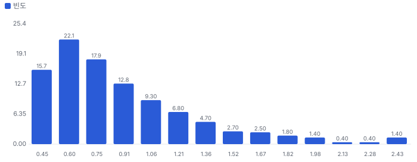

- 읽는 법: 성장률·이익률·재투자·할인율 가정을 무작위로 바꿔 회사 가치를 3,000번 계산했다. 가로축은 그 가치가 지금 시가총액의 몇 배인지, 막대 높이는 그 값이 얼마나 자주 나왔는지를 뜻한다. 1.00이 지금 주가다.
- 해석: 3,000번 중 890번(30%)에서 가치가 지금 주가 이상이었다. 가정을 흔들어도 지금 주가를 뒷받침하지 못하는 경우가 더 많다. 가운데 값은 0.76배이고, 열 번 중 여덟 번은 0.48~1.47배 사이에 든다.
- 3,000번 돌리면 5년 뒤 주주가치가 지금 시가총액의 2배 이상 590번(약 5.1번에 1번) · 3배 이상 154번(약 19번에 1번) · 5배 이상 14번(약 214번에 1번)

**그림 3 · 가격 내포 기대 vs 필요 성장 (5년 매출 CAGR %)**

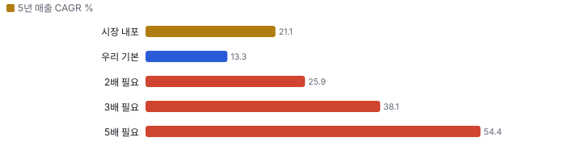

**민감도 — 기본 시나리오 가치/시총(매출 경로 고정, 장기 이익률 × 매출÷투하자본)**
|  | 매출÷투하자본 0.75 | 매출÷투하자본 1.2 | 매출÷투하자본 1.5 | 매출÷투하자본 2.5 |
|---|---|---|---|---|
| 장기 이익률 15% | 0.28 | 0.39 | 0.43 | 0.49 |
| 장기 이익률 27% | 0.66 | 0.77 | 0.81 | 0.87 |
| 장기 이익률 30% | 0.76 | 0.87 | 0.91 | 0.97 |
| 장기 이익률 40% | 1.08 | 1.19 | 1.23 | 1.28 |

매출÷투하자본 = 매출 1달러를 늘리는 데 드는 설비·운전자본(높을수록 가볍다). 장기 이익률은 4년차 목표와 이후 수렴값을 같이 바꾼 것. 계속가치는 RONIC(신규 투자 이익률) = WACC(11년차 이후 성장은 가치를 만들지 않는다는 맥킨지 보수 가정) · 다른 축: WACC −1%p 0.87배 · WACC +1%p 0.69배 · RONIC 20%(11년차 이후 성장이 가치 창출) 0.85배

**기준 멀티플은 Fwd 1Y P/E · Fwd 2Y P/E · Fwd 3Y P/E이다.** 회사가 비GAAP EPS를 분기 가이던스의 기준으로 쓴다. Fwd 1Y는 다음 4개 분기, Fwd 2Y는 5~8번째, Fwd 3Y는 9~12번째 분기 이익 기준이다. 과거 레인지는 Fwd 1Y만 있다.

**동종 레인지와 펀더멘털 내재 멀티플 (Fwd 1Y P/E · Fwd 2Y P/E · Fwd 3Y P/E 추정 기준)**
| 회사 | Fwd 1Y P/E | Fwd 2Y P/E | Fwd 3Y P/E | 성장 | 영업이익률 | ROIC 영업권 포함/제외 | 매출÷투하자본(영업권 제외) | 펀더멘털 내재(Fwd 1Y P/E) | 시장÷내재 |
|---|---|---|---|---|---|---|---|---|---|
| LITE | 36.5 | 25.5 | 21.0 | 117% | 42% | 22% / 22% | 0.65 | 14.3 | 2.55 |
| GLW | 29.9 | 23.6 | 19.4 | 19% | 24% | 26% / 26% | 1.30 | 13.2 | 2.25 |
| FN | 18.9 | 16.2 | 14.4 | 32% | 11% | 17% / 17% | 1.89 | 9.5 | 1.99 |
| MKSI(MKS 인스트루먼트) | 12.5 | 10.9 | 9.9 | 35% | 27% | 31% / 31% | 1.45 | 16.5 | 0.76 |
| CIEN | 29.2 | 20.9 | 16.1 | 34% | 24% | 39% / 39% | 1.97 | 15.3 | 1.90 |
| MTSI | 27.2 | 21.5 | 16.1 | 54% | 38% | 23% / 23% | 0.76 | 9.2 | 2.95 |
| **동종 중앙** | 28.2 | 21.2 | 16.1 |  |  |  |  |  | 2.12 |
| **Coherent** | 20.2 | 14.0 | 11.6 |  |  |  |  | 15.7 | 1.28 |

**그림 12 · Fwd 1Y P/E — 과거·동종·펀더멘털·합리적 멀티플 (배)**

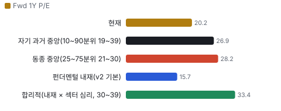

**그림 13 · Fwd 2Y P/E — 과거·동종·펀더멘털·합리적 멀티플 (배)**

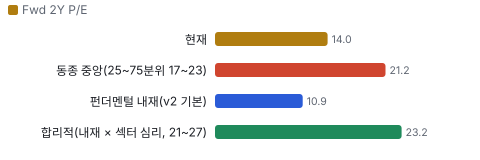

**그림 14 · Fwd 3Y P/E — 과거·동종·펀더멘털·합리적 멀티플 (배)**

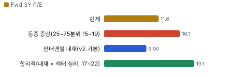

**할인·프리미엄 분해:** Coherent의 Fwd 1Y P/E는 동종 중앙 대비 **-28%** = 동종과 같은 섹터 심리를 받는다면 펀더멘털(성장·이익률·ROIC)로 정당한 몫 +19% × Coherent에만 얹힌 기업 고유 몫 **-39%**(두 몫을 곱하면 전체). 심리를 빼고 펀더멘털만 비교하면 동종 중앙 내재 대비 +14%. 기업 고유 몫이 양(+)이면 시장이 동종보다 더 큰 기대를 얹은 것(할인이 덜 됐다), 음(−)이면 더 할인한 것이다.

**합리적 멀티플:** 33.4배(섹터 심리 25~75분위 30.3~38.9배) → 주주가치 ÷ 시가총액 **1.68배**(1.52~1.96배). 현재 20.2배와의 차이는 시장이 동종만큼의 기대를 주지 않는 몫이다.

**ROIC에 비례하는 정상 상태 멀티플 (맥킨지 가치 동인: EV/NOPAT = (1 − g/ROIC) ÷ (WACC − g))**
| ROIC | EV/NOPAT | EV/EBIT |
|---|---|---|
| 10% | 8.2 | 6.6 |
| 15% | 9.7 | 7.8 |
| 20% | 10.4 | 8.4 |
| 30% | 11.2 | 9.0 |
| 50% | 11.7 | 9.5 |

정상 상태 교차 확인: DCF 기본 시나리오의 5년차 ROIC 22%·영업이익률 27%이면 정상 상태 EV/NOPAT 10.6배. 이를 지금으로 할인하면 주주가치 ÷ 시가총액 0.80배 — 고성장 기업은 현재 멀티플이 아니라 정상 상태 멀티플을 할인해 비교한다.

**데이터 검증 — 원자료 ↔ 밸류에이션 입력 대조 9.3/10**
| 검사 | 결과 | 내용 |
|---|---|---|
| 원자료 스냅숏 | 통과 | 조회 시각 2026-10-31T20:40:00+09:00 |
| 시가총액 대조 | 통과 | 가격 210.32 × 표지 주식 0.195832246 = 41.19 vs 원자료 개요 41.187438 |
| 가격 일치 | 통과 | 210.32 vs 210.32 |
| 현금·차입 대조 | 통과 | 현금 1.98702 vs 1.98702 · 차입(리스 포함) 3.53844 vs 3.53844 |
| TTM(최근 12개월) 매출 = 4분기 합 | 통과 | 7.118181 vs 7.1182(4분기) |
| TTM 영업이익 = 4분기 합 | 통과 | 0.89786 vs 0.8979 |
| 투하자본 = 재무상태표 | 통과 | 12.78962 vs 자기자본+차입+리스−현금 12.790 |
| 연간 컨센서스 = 분기 합 | 통과 | FY2026 None vs 7.1182 · FY2027 10.73 vs 10.7300 |
| 회사 가이던스 반영 | 실패 | FQ4 콜 2026-08-12: 1Q FY27(9월 분기). 연간 가이던스는 내지 않는다 |
| 희석 주식(출처·같은 날짜) | 통과 | 잠재 주식 0.00637 vs SEC(미국 증권거래위원회) None · 기본 주식 날짜 2026-08-10 / 희석 날짜 2026-08-10 |
| 어닝콜 톤 = 실적 레이더 | 통과 | 사용 up · 레이더 기준 up(톤 변화 0.5, 가이던스 raise) |
| 동종사 4곳 이상·기준 표기 | 통과 | 6곳 · 기준 ttm |
| 기준 멀티플 Fwd 1Y(이익 지표) | 통과 | Fwd 1Y P/E · 회사가 비GAAP EPS를 분기 가이던스의 기준으로 쓴다 |
| 매출·이익률 기준 명시(SBC(주식보상비용) 처리) | 통과 | 매출 gaap · 이익률 non_gaap · 비GAAP → SBC 3% 차감 |

> 의사결정 보조(투자자문 아님): ① 매수 매력: 연 기대수익 +8.6% (자기자본비용 11.6% 대비 -3.1%p) · 자본비용 초과 확률 28% · 안전마진 0.48 → 정량 신호 약함 / ② 위험 예산 지표(이론): 0% — 기대수익이 자기자본비용에 못 미침(무위험 대비 켈리 84%는 참고) · 5년 하위10% -21% · 30%+ 손실 확률 5% / ③ 상방(5년): 기대 1.51배 · 2배 20% · 3배 5% · 10배 0% · 상위10% 2.48배

## 수급 — 누가 왜 샀나(Chiip Flow)

> **한 줄:** 최근 20거래일 거래의 리테일 몫은 20.4%(직전 60일 18.4%) — 거래는 주로 기관이 만든다. 기관 자금 흐름(CMF(매집·분산을 재는 자금 흐름 지표) 20일) -0.28로 기관 분산 쪽, 리테일 매수 압력 z -0.37로 리테일 방향 뚜렷하지 않음. 이상 거래일에 늘어난 거래량의 81%가 기관 몫.

**그림 15 · 일별 거래량 분해 — 리테일 근사(도매 체결사) vs 기관(거래소·다크풀) (천 주)**

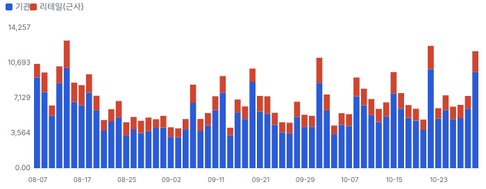

**그림 16 · 기관 자금 흐름(CMF 20일)과 리테일 매수 압력(z ÷ 4로 같은 눈금)**

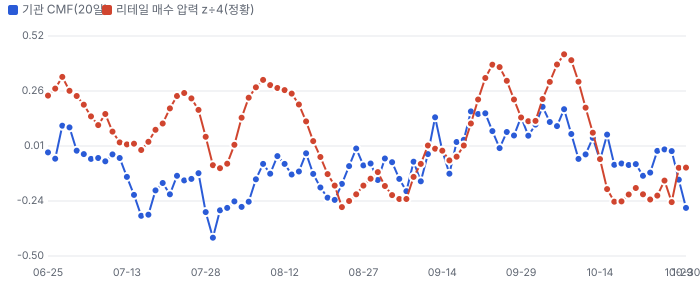

**이상 거래일 — 왜 늘었나, 누가 늘렸나(최근 120거래일, RVOL ≥ 1.8 또는 z ≥ 2)**
| 날짜 | RVOL | 주가 | 종가 위치 | 늘어난 거래량 | 증가분 분해 | 원인 태그 |
|---|---|---|---|---|---|---|
| 2026-08-13 | 2.4배 | -8.0% | -1.00 | 7.47M | 기관 71% · 리테일 29% | 실적 발표 다음 날 · FQ4 실적 다음 날 |
| 2026-10-22 | 2.0배 | -12.5% | -1.00 | 6.26M | 기관 83% · 리테일 17% | 광 업종 동반 매도 |
| 2026-10-30 | 2.0배 | -11.3% | -1.00 | 5.82M | 기관 86% · 리테일 14% | 시장 동반 급락, MS·B. Riley 목표가 하향 · 월말 |
| 2026-08-07 | 1.9배 | +13.4% | +1.00 | 5.14M | 기관 85% · 리테일 15% | 원인 미확인(공개 사건 없음) |
| 2026-10-01 | 1.9배 | +10.9% | +1.00 | 5.37M | 기관 76% · 리테일 24% | 원인 미확인(공개 사건 없음) |
| 2026-08-12 | 1.9배 | +8.2% | -1.00 | 4.85M | 기관 77% · 리테일 23% | 실적 발표 |
| 2026-09-18 | 1.8배 | +7.2% | +1.00 | 4.63M | 기관 92% · 리테일 8% | 분기 만기·지수 정기 변경 |
| 2026-05-29 | 1.8배 | -4.1% | -1.00 | 4.94M | 기관 97% · 리테일 3% | 월말 |

**주간 체결 장소별 비중 — FINRA 확정치(최신 주 2026-10-05, 약 2주 지연)**
| 주 시작 | 전체(주) | 거래소 | ATS(다크풀) | 리테일 도매 | 기타 장외 |
|---|---|---|---|---|---|
| 2026-08-31 | 23.47M | 42.4% | 22.6% | 24.9% | 10.0% |
| 2026-09-07 | 26.39M | 46.6% | 21.0% | 24.2% | 8.2% |
| 2026-09-14 | 36.81M | 48.6% | 20.6% | 20.9% | 9.9% |
| 2026-09-21 | 29.54M | 45.3% | 22.1% | 25.1% | 7.4% |
| 2026-09-28 | 36.18M | 43.1% | 21.2% | 25.9% | 9.9% |
| 2026-10-05 | 32.69M | 40.9% | 24.2% | 24.7% | 10.2% |

## 가격 구간 — 월·주·일 피보나치와 겹침 구간

> **한 줄:** 현재가 \$210.32 — 바로 위 저항 \$280~283(+33.8%, 강도 3.0), 바로 아래 지지 \$208(-1.2%, 강도 3.0). 가격 구간 지표일 뿐 매수·매도 권유가 아니다.

**지지·저항 겹침 구간(서로 다른 기준선이 ±1.2% 안에 모인 곳, 강도 = 겹친 기준선 수)**
| 구간 | 가격 | 현재가 대비 | 강도 | 겹친 기준선 |
|---|---|---|---|---|
| 저항 3 | \$439 | +108.9% | 4.0 | 150일 최고(거래 범위) · 200일 최고(거래 범위) · 월봉 스윙 고점 · 주봉 스윙 고점 |
| 저항 2 | \$342~342 | +62.5% | 3.0 | 50일 최고(거래 범위) · 월봉 피보 23.6% · 일봉 스윙 고점 |
| 저항 1 | \$280~283 | +33.8% | 3.0 | 50일 이동평균 · 월봉 피보 38.2% · 주봉 피보 50.0% |
| 지지 1 | \$208 | -1.2% | 3.0 | 150일 최저(거래 범위) · 50일 최저(거래 범위) · 일봉 스윙 저점 |
| 지지 2 | \$125~126 | -40.3% | 2.0 | 일봉 확장 161.8% · 주봉 스윙 저점 |

**시간 단위별 피보나치 되돌림(\$)**
| 단위 | 지배 스윙 | 다리 | 23.6% | 38.2% | 50% | 61.8% | 78.6% |
|---|---|---|---|---|---|---|---|
| 월봉 | \$26.98(2023-05-01) → \$439.41(2026-06-03) | 상승 | 342.1 | 281.9 | 233.2 | 184.5 | 115.2 |
| 주봉 | \$125.99(2025-11-04) → \$439.41(2026-06-03) | 상승 | 365.4 | 319.7 | 282.7 | 245.7 | 193.1 |
| 일봉 | \$207.82(2026-10-22) → \$341.55(2026-10-05) | 하락 | 239.4 | 258.9 | 274.7 | 290.5 | 312.9 |

**그림 17 · 월봉 — 장기 스윙 되돌림**

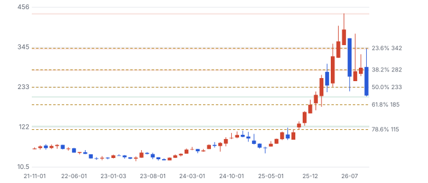

**그림 18 · 주봉 — 52주 스윙 되돌림**

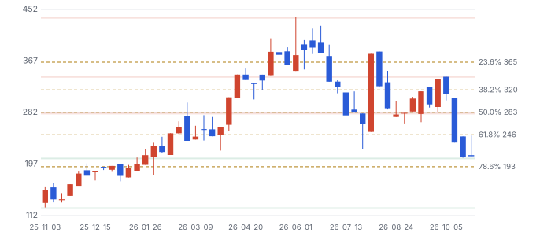

**그림 19 · 일봉 — 마지막 완료 스윙 되돌림(최근 90거래일)**

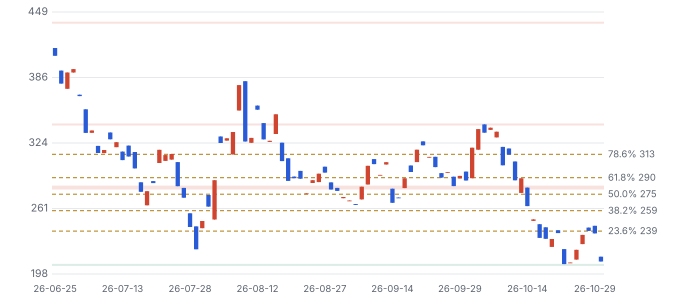

**기법:** 스윙은 ATR(평균 일중 변동폭) 지그재그(임계 = max(월 20%·주 10%·일 5%, 2.5×ATR14)), 되돌림 23.6~78.6%·확장 127.2·161.8%. 함께 본 기준선: 50·200일 이동평균과 50·150·200일 거래 범위 고저, 라운드 넘버(\$50 단위). 피보나치 비율 자체의 학술 근거는 약하다 — 다수가 같은 선에 주문을 두는 데서 오는 효과로 보고, 여러 기준선이 겹친 구간만 강하게 본다. 월봉은 최근 60개월 · 고가·저가는 일봉 자료에 없어 시가·종가로 근사(스윙 고저가 실제보다 좁게 잡힐 수 있다).

## 판단 시나리오 — 2027년 말 기준

**그림 20 · 2027년 말 주가 시나리오(\$, 확률 판단)**

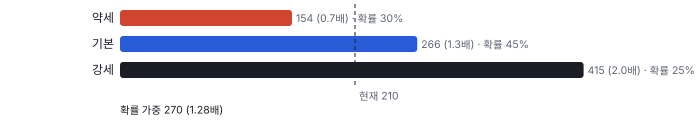

시나리오는 배수 기준이고 확률은 판단이다. 확률 가중값은 \$269.7로 지금의 1.28배다. DCF 내재가치 기본 0.77배보다 높은 이유는 2027년 말 시장 배수가 유지된다고 가정하고 할인도 하지 않기 때문이다. 둘의 차이는 '시장이 이 사이클의 이익을 얼마나 오래간다고 보느냐'의 차이다.

## 반대 검증 — 가장 강한 약세 논리

- **공급 과잉.** 높은 이익은 증설을 부르고 투자자는 경쟁사 증설을 과소평가하는 경향이 있다. Lumentum도 같은 규모의 자금을 받았다. 가를 자료: 1.6T 트랜시버 판매 가격, 중국 경쟁사 증설 발표, 11/4 총이익률.
- **CPO 잠식.** CPO가 커지면 플러그형 트랜시버 매출이 줄어든다. 회사는 CPO와 NPO 콘텐츠가 비슷하다고 하지만 트랜시버 대비 콘텐츠는 말하지 않았다. 가를 자료: 2027년 상반기 CPO 매출과 트랜시버 성장률.
- **현금.** FY2027 FCF 컨센서스가 −\$0.8B다. 현금은 표준화 재무상태표 기준 \$1.99B, 회사 설명 기준 \$2.59B이고 \$0.60B 차이의 구성은 미확인이다. 고객 선투자가 줄면 증자나 차입이 필요하다. 가를 자료: 분기 FCF와 고객 선수금.
- **이미 붐볐던 거래.** 주가는 2025년 4월 저점에서 약 8.7배가 된 뒤 반토막이 났다. 근거는 Fwd 1Y P/E 48.9배(6월 말)와 24명 중 매도 0명이라는 의견 분포다. 기저율로 보면 시가총액 \$10B~\$50B 표본 102곳 중 5년 3배에 필요한 성장은 상위 5% 안쪽이고, 미국 상장주 절반 이상은 생애 수익이 단기 국채에 못 미친다.
- **연간 가이던스 없음.** 회사는 분기만 가이던스를 낸다. 데이터 검증의 '회사 가이던스 반영'은 그래서 실패로 남았다. FY2027 숫자는 컨센서스뿐이다.

## 킬 조건

- 비GAAP 총이익률이 2개 분기 연속 39.5% 아래로 내려간다(부족에서 오는 가격 결정력의 소멸).
- 데이터센터 매출이 2개 분기 연속 QoQ 감소한다.
- 경쟁사 대형 InP·트랜시버 증설 발표 뒤 1.6T 가격 하락이 연 20%를 넘는다는 공시나 콜 언급이 나온다.
- FY2027 FCF가 −\$1.5B보다 나빠져 자기자본 조달이 나온다.

## 체크리스트

| 시점 | 무엇 | 의미 |
|---|---|---|
| 2026-11-04 장 마감 후 | 1Q FY27 실적: 매출 \$2.2~2.4B, 총이익률 39.5~41.5%, EPS \$1.85~2.05 | 총이익률 40.5% 이상이면 가격 결정력 유지 |
| 같은 콜 | 2Q 가이던스, 컨센서스 매출 \$2.54~2.57B | InP 2배가 매출로 넘어오는 속도 |
| 2026년 11월 중순 | 3Q 13F | 7월·10월 조정기 기관 이탈 여부 |
| 2027년 2월 초 | 2Q FY27 실적, PhotonLink 첫 매출 | CPO가 숫자로 나오는지 |
| 2027년 상반기 | 취리히 6인치 시작 | 원가 곡선의 다음 단계 |

## 출처
- Coherent FY2026 4Q 실적 보도자료 https://www.barchart.com/story/news/3812550/coherent-corp-reports-fourth-quarter-and-full-year-fiscal-2026-results
- Coherent 1Q FY27 실적 일정 https://finviz.com/news/402637/coherent-corp-announces-timing-of-fy2027-first-quarter-earnings-release
- NVIDIA 투자 보도(8-K 원문 미대조) https://siliconangle.com/2026/03/02/nvidia-invests-4b-co-packaged-optics-suppliers-lumentum-coherent/
- 라이선스 자료 요지 포함 — 외부 공유 금지
- FQ3·FQ4 콜
- FQ4 콜 2026-08-12
- FQ4 콜·노션 IB 요지
- 보도 2026-03-02·현금흐름표. 8-K 원문 미대조

_연구 후보이지 매수 권유가 아닙니다 · 공개 자료 기반 분석이며 투자 권유가 아님 · 1차 판정, 미검증 · Chiip ten-bagger_