# 텐배거 리포트 2026-11-13 — Coherent — 이익 추정은 22% 올랐고 배수는 42% 줄었다, 이제 현금흐름이 값을 정한다

> 2026-11-13 · Coherent(COHR) · 기업: AI 데이터센터용 광 트랜시버와 InP 레이저 칩을 수직 계열로 만드는 광학·반도체 회사

## Chiip View

**이익은 올랐고 배수는 줄었다.** 1Q FY27 매출 \$2.37B(+50%), 비GAAP EPS \$2.09(+80%)로 컨센서스를 넘었고, 2Q 가이던스는 \$2.55~2.75B, 총이익률 목표는 42%+에서 45%+로 올렸다. PhotonLink(Coherent의 통합 광학 플랫폼, 레이저·광섬유 조립·부품 묶음) 장기 계약 약 \$20B(5년, CY28 초 시작)도 새로 받았다. 그런데 8/11 이후 같은 4개 분기 EPS 추정이 +22% 오르는 동안 주가는 −29%였다 — ==배수가 42% 줄었다.== Fwd 1Y P/E 19.8배는 동종 중앙값 22.3배보다 11% 낮다. 선정 배수 26.9배를 적용한 목표주가는 \$289, 업사이드 +25%, 약세 \$201(−13%), 손익비 6.7이고 구매 등급은 Buy다. DCF 기준 업사이드는 −22%로 낮다 — FY27 CAPEX \$3.65B와 FCF 컨센서스 −\$3.05B를 그대로 넣고 WACC 11.5%로 할인하기 때문이다. 시장과 갈리는 곳은 현금흐름이다. 회사는 'LTA(장기 공급 계약) 대부분에 고객 선급·물량 약정이 붙는다'고 답했고 1분기 계약부채가 \$269M 늘었다. __2Q 영업현금흐름이 다시 적자 폭을 키우면 배수 회복은 늦어진다.__ 다음 확인은 2027-02 2Q 실적이다.

## 대시보드
| 항목 | 값 | 설명 |
|---|---|---|
| 주가 | \$232.08 | 고점 대비 -46% · 1년 +48% |
| 시가총액 | \$47.05B | 완전 희석 기준 · EV \$49.65B |
| 업사이드 | +25% | 목표주가 \$289 · 다운사이드 -13% · 손익비(강세÷약세) 6.7 |
| 구매등급 | Buy | 애널리스트 24명: Strong Buy 18 · Buy 1 · Neutral 5 · Sell 0 · Strong Sell 0 |
| 멀티플 | Fwd 1Y P/E 19.8배 | 동종 중앙값 22.3배 |
| 가이던스 2Q FY27 | \$2,650M · \$2.38 | 컨센서스 \$2,726M · \$2.45 |
| 알파 | 6.3/10 | 텐배거 가능성 점수 |
| 이벤트 | 2Q FY27 실적(예상일 — 전년 2/4 발표 기준, 회사 미공지) | 2027-02-03 |

## 한 장 요약
- **기업가치를 결정하는 내러티브** Coherent는 레이저 칩부터 트랜시버·광 스위치까지 AI 데이터센터 광 연결을 한 회사에서 만든다. 1Q FY27 매출은 \$2.37B(+50%), 비GAAP EPS \$2.09(+80%)였고 2Q 가이던스는 \$2.55~2.75B다. 새로 CPO(공동 패키징 광학, 스위치·가속기 칩 패키지 안에 광 엔진을 붙이는 방식)용 통합 광학 PhotonLink로 5년 약 \$20B 장기 계약을 받았다.
- **밸류에이션 모델로 본 주가 상방은 어디까지인가?** **목표주가 \$289(+25%), 약세와 기본 사이(약세 쪽 20%)다.** 강세 \$436(+88%)는 Fwd 1Y P/E 33.6배를 강세 EPS에 적용한 값이다. 기본 \$312, 약세 \$201. 손익비 6.7, DCF 기준 업사이드 -22%.
- **수주는 어디까지 왔나?** PhotonLink LTA(대형 AI 회사) 0%, 100% 매출 \$20.00B · NVIDIA 다년 구매 약정 미확인, 100% 매출 미확인 · PhotonLink 분기 매출 램프 미확인, 100% 매출 미확인. 수주잔고 총액은 공개하지 않는다. 공개된 계약 금액은 PhotonLink LTA 약 \$20B(5년, CY28 초 시작) 하나다. 회사는 CY27이 사실상 예약됐다고 했다.
- **누가 사 주나?** 최대 고객 10% 초과 고객 2곳(two customers) 28%, 상위 3곳 28%. 공시·회사 발표로 확인한 몫은 0%다.
- **마진과 공급망은 어디가 약한가?** GPM 38.2%, OPM 12.9%. OPM을 가장 흔드는 BOM(제품 원가를 이루는 부품·재료 명세) 항목은 조립·시험 인건비·감가상각이고 가격 +10%에 -1.23%p다. 공급망 신뢰성은 3.7/10(병목 심각)이고 가장 약한 고리는 DSP(디지털 신호 처리 칩, 광 모듈의 신호를 복원하는 칩)·드라이버 IC(집적회로 칩)이다.
- **생산능력은 얼마나 늘어나나?** 현재 명목 캐파 미확인, 착공 이상 증설 0 InP(인화인듐, 데이터센터 레이저 칩의 기판 소재) 내부 생산능력(회사 표현, 배수). FY2028 CAPEX는 매출의 26.0%다.
- **지금 가격은 무엇을 가정하나?** 현금흐름으로 풀면 5년 매출 CAGR **24%**를 가정한다. 기본 시나리오 16%보다 높다 — DCF가 FY27~28 CAPEX \$7.45B를 그대로 비용으로 넣기 때문이다. 이익 배수로 보면 반대다. Fwd 1Y P/E 19.8배, PEG 0.46으로 동종 중앙 0.71보다 싸다. ==같은 회사가 EPS로는 싸고 현금흐름으로는 비싸다.==
- **왜 움직였나?** 8/11 이후 주가는 −29%다. 같은 기간 같은 4개 분기 EPS 추정은 +22% 올랐다 — 하락은 배수에서 왔다(약 −42%). 11/5 실적 다음 날 −13%는 AI 하드웨어 업종 급락과 겹쳤다. 11/9 +17%·11/11 +9% 반등은 업종 반등에 Lumentum의 Marvell 편입 뒤 '남은 독립 레이저 회사' 이야기가 겹친 날이다.
- **1Q FY27 콜에서 무엇이 바뀌었나?** 좋아진 것은 2Q 가이던스 \$2.55~2.75B, FY27 프로포마 성장 60% 초과, FY27 안 첫 \$3B 분기와 FY28 첫 \$4B 분기, 총이익률 목표 45%+, PhotonLink LTA 약 \$20B, DCI(데이터센터 간 연결) 연환산 약 \$1B다. 아쉬운 것은 1분기 FCF 약 −\$868M, 2Q CAPEX 추가 증가, 재고 +\$760M, 그리고 __내부 InP 조달 비중이 1년째 그대로__라는 답이다. 현금 질문(BNP Paribas)에 회사는 LTA 대부분에 고객 선급과 물량 약정이 붙는다고 답했다.
- **무엇이 바뀌면 판단이 달라지나?** 2Q 영업현금흐름이 흑자로 돌고 비GAAP 총이익률이 41.5%를 넘으면 위쪽이다. 3월 분기 PhotonLink가 \$100M을 넘으면 \$20B LTA의 앞단이 확인된다. 2Q 매출이 \$2.55B 아래이거나 추가 차입·증자가 나오면 아래쪽이다. 다음 확인은 2027-02-03(예상) 2Q 실적이다.

## 한눈에 보기

**일봉**

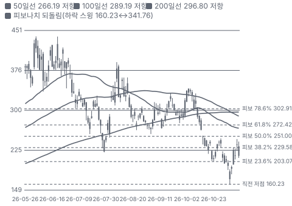

**주봉**

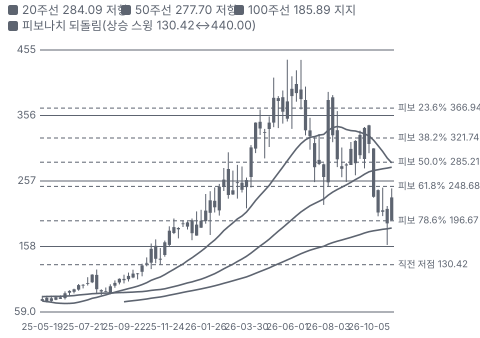

**월봉**

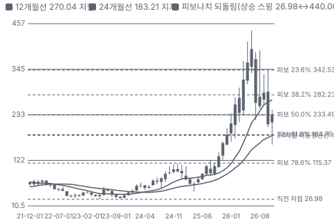

**분기 매출·EPS 실적과 컨센서스**

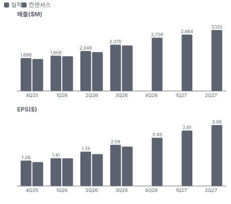

**4Q26 매출 — 지표 추세 vs 가이던스·컨센서스**

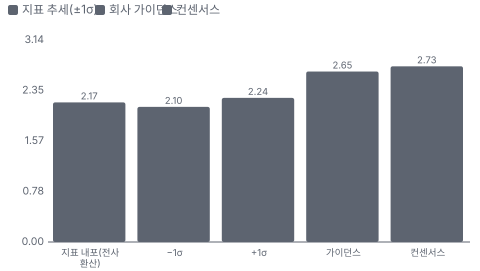

**최근 4개 분기 주가 변화 분석**

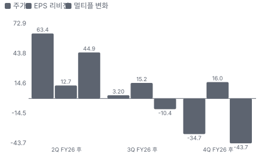

**EPS 리비전**

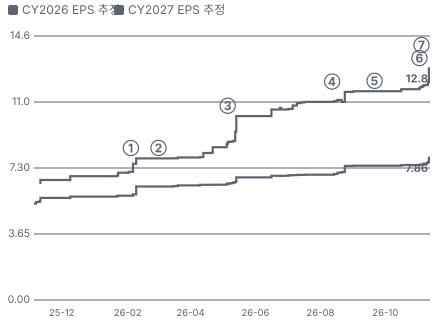

① 26-02-04 2Q FY26 실적 · EPS 리비전 +10%
② 26-03-02 NVIDIA \$2B 투자·구매 약정 · EPS 리비전 +0%
③ 26-05-06 3Q FY26 실적 · EPS 리비전 +18%
④ 26-08-12 4Q FY26 실적 · EPS 리비전 +5%
⑤ 26-09-21 PhotonLink 발표 · EPS 리비전 +0%
⑥ 26-11-02 Marvell-Lumentum 인수 합의 · EPS 리비전 +1%
⑦ 26-11-04 1Q FY27 실적·\$20B LTA · EPS 리비전 +9%

**밸류에이션 주가 시나리오**

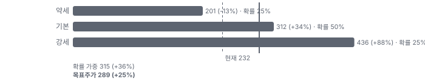

**주가별 업사이드**

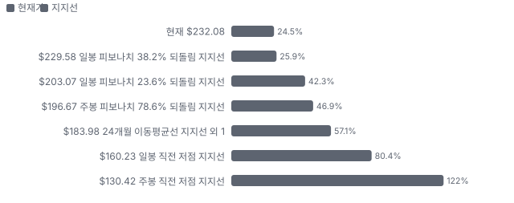
- 제품·서비스 포트폴리오

**고객 믹스(FY2026, 매출 대비)**

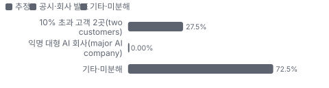

**공급 병목(10점, 낮을수록 병목)**

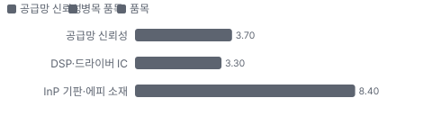

**CAPEX의 매출 대비 비중**

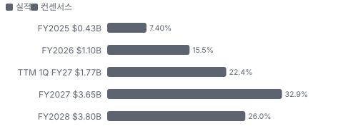

**어닝콜 변화별 주주가치 영향**

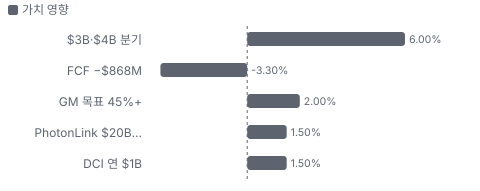

**멀티플 프리미엄(Fwd 1Y P/E, 최근 4개 분기말)**

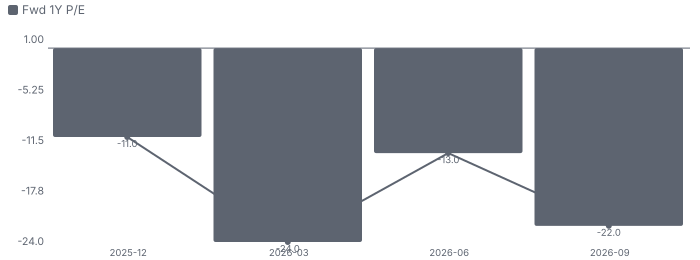

**합리적 멀티플**

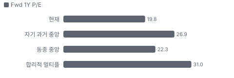

**수주·파이프라인 확실성 사다리**

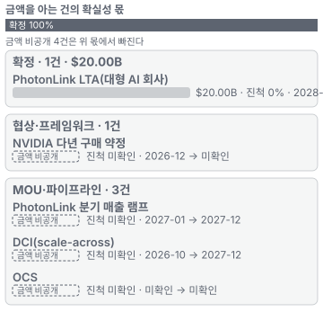

**매출 → 매출총이익 → 영업이익(매출 = 100, 최근 4분기)**

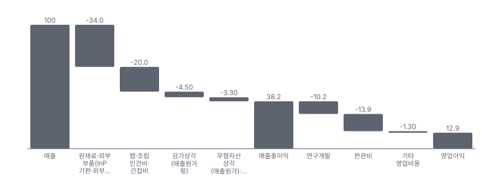

**1년 전 대비 마진 기여(비용 비중 변화의 반대)**

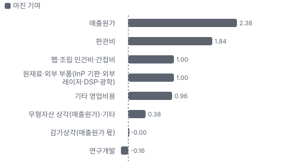

**분기 비용 비중 추이(매출 대비, 공시)**

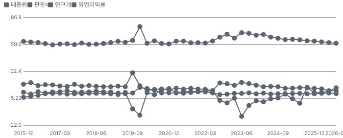

**비용 요인별 매출 대비 비중과 1년 변화**

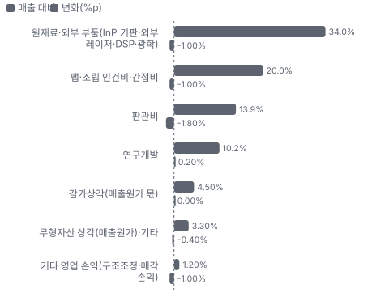

**BOM 항목 가격 +10% 시 OPM 변화**

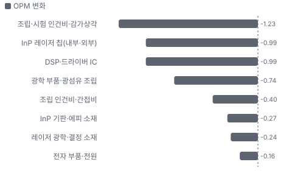

**데이터센터·통신 BOM 원가 몫과 가격 +10% 시 OPM**

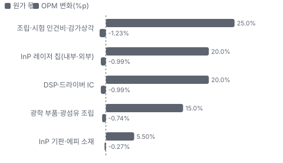

**산업 BOM 원가 몫과 가격 +10% 시 OPM**

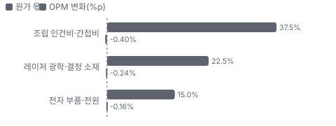

**생산시설별 면적(sq ft, 큰 순) — 생산능력 미공시라 면적을 대용으로**

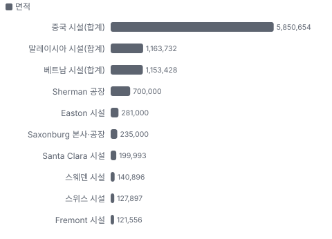

**매출·PPI·수출입 — 최근 16개 분기 같은 축(4Q22 = 100) + 다음 분기 추정**

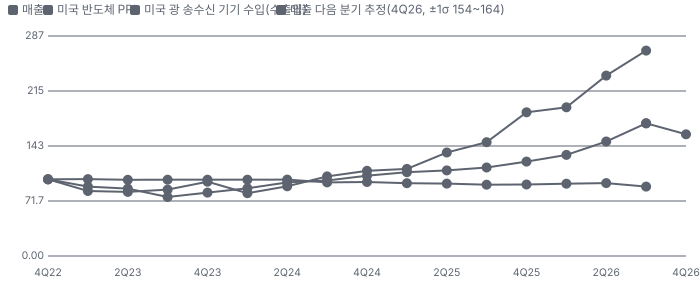

**10년 P·Q 사이클 — 추세(HP 필터) 대비 갭과 8분기 전망**

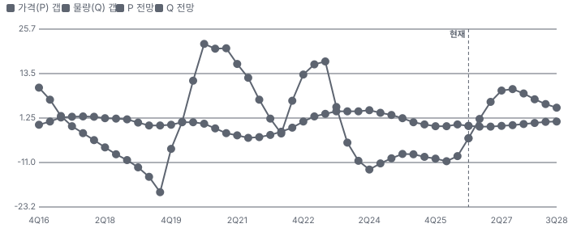

**매출 증가율의 가격·물량 분해와 8분기 전망(전년 대비)**

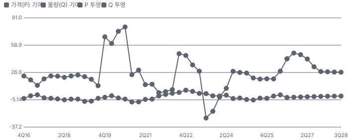

**분기별 매출 증가율 분해**

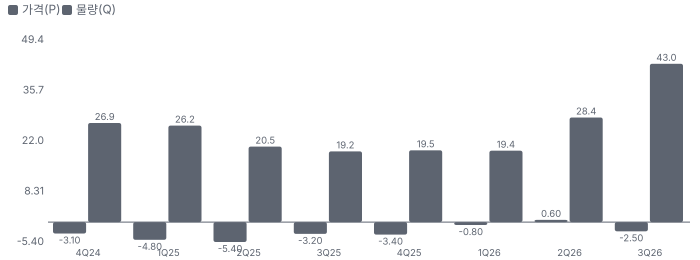

**목표주가 산정 — 약세와 기본 사이(약세 쪽 20%), 도달 확률 약 58%**

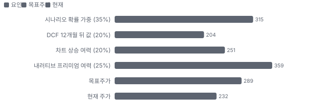

**PEG — 성장 대비 멀티플(낮을수록 성장 대비 쌈)**

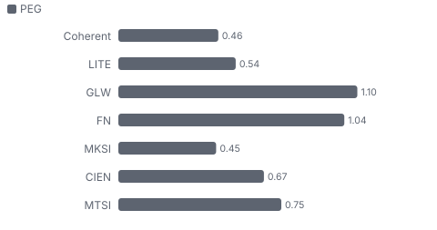

**일봉 지지·저항과 목표주가**

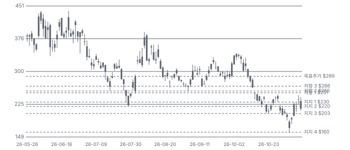

**커뮤니티 언급 수(최근 30일, 채널별)**

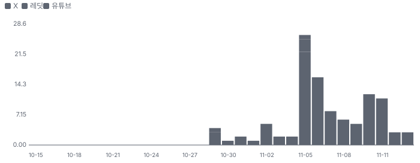

**커뮤니티 게시 수(월, 최근 11개월 — 이번 달은 진행 중)**

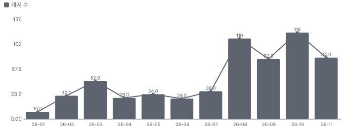

**일별 거래량 분해**

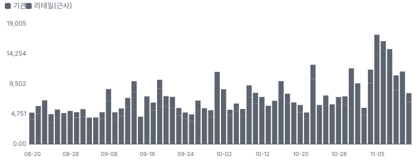

**기관 자금 흐름**

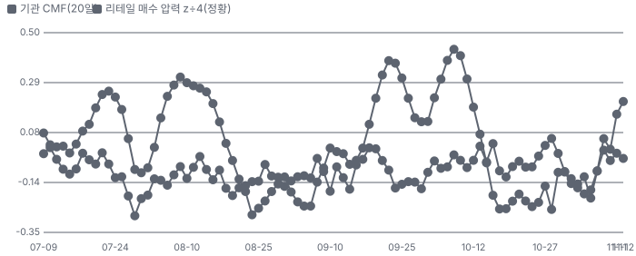

**몬테카를로**

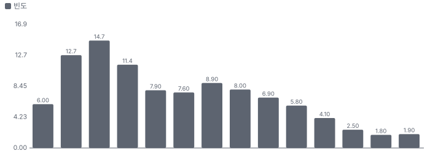

해석: 3,000번 중 111번(4%)에서 가치가 지금 주가 이상이었다. 가정을 흔들어도 지금 주가를 뒷받침하지 못하는 경우가 더 많다. 가운데 값은 0.61배이고, 열 번 중 여덟 번은 0.44~0.90배 사이에 든다.

## 내러티브

> **기업가치를 결정하는 이야기:** 기업가치는 세 고리로 정해진다. ① 트랜시버가 800G(초당 800기가비트 광 모듈 세대)→1.6T(초당 1.6테라비트 광 모듈 세대)로 바뀌며 매출이 붙는다 ② 자체 6인치 InP 레이저 비중이 올라 총이익률이 40%대 초반에서 45%+로 간다 ③ CPO(PhotonLink)·DCI·OCS(광 회로 스위치, 빛을 전기로 바꾸지 않고 경로를 바꾸는 스위치)가 2028년 이후 성장의 길이를 늘린다. 지금 값은 ①을 거의 다 넣었고 ②·③에는 할인이 붙어 있다 — 1분기 FCF −\$868M 때문이다.

> **멀티플·EPS 프리미엄**
> **멀티플:** Fwd 1Y P/E 19.8배로 동종 중앙값 22.3배보다 11% 낮다. 6월 말 49배에서 내려왔다. 매출 성장(TTM +31%)과 1Q 비GAAP 영업이익률 23.2%를 보면 할인은 현금흐름 적자(1Q FCF 약 −\$868M)에서 온다.
> **EPS:** EPS에는 기대가 크게 쌓였다. 같은 4개 분기(12월 분기~내년 9월 분기) EPS 합은 8/11 직전 \$9.47에서 \$11.57로 22% 올랐다. FY27 EPS 컨센서스는 \$8.38에서 \$10.25~\$10.44가 됐다.

### 투자자들은 왜 열광했나

열광은 3월 NVIDIA \$2B 투자 때 시작해 6월 고점(종가 \$426.89)에서 정점이었다. 7월 이후 'AI 설비투자 정점'과 10~11월 AI 하드웨어 업종 매도로 식었다. 11월 실적은 숫자로는 기대를 넘었지만 실적 다음 날 −13%였고, 11/9부터 Lumentum의 Marvell 편입이 'Coherent가 남은 독립 레이저 회사'라는 이야기로 바뀌며 다시 살아났다.

### 무엇이 기업가치를 바꾸나

> **구조적 체질 변화**
> **변화:** 산업용 레이저·소재 회사에서 AI 데이터센터 광 회사로 바뀌었다. 데이터센터·통신 비중이 1년 새 68.9%에서 82.3%로 올랐고 항공·방위·뮌헨 사업을 팔았다.
> **증거:** 세그먼트 · 10-Q
> **반증:** 데이터센터 성장이 꺾여 산업 비중이 다시 커지면 체질 변화가 아니라 사이클이다.

> **고부가 믹스 확장**
> **변화:** 비GAAP 총이익률 40.6%(+184bp YoY). 회사는 신제품(PhotonLink·DCI·OCS)이 마진을 올린다며 목표를 45%+로 올렸다.
> **증거:** 1Q FY27 어닝콜(2026-11-04, 요지만 자기 말로) CFO
> **반증:** 2Q 총이익률이 가이던스 하단 40%에 머물거나 내부 InP 비중이 계속 정체된다.

> **기술 혁신**
> **변화:** PhotonLink(CPO·NPO(근접 패키징 광학, 칩 패키지 바로 옆에 광 엔진을 두는 방식)·칩 간)와 400mW CW 레이저(연속파 레이저, 실리콘 포토닉스·CPO에 빛을 대는 광원). 회사 추정 2030 시장 약 \$30B, 칩당 콘텐츠 최대 약 \$15,000.
> **증거:** 1Q FY27 어닝콜(2026-11-04, 요지만 자기 말로)
> **반증:** scale-up(랙 안 가속기끼리 묶는 연결) CPO·NPO 채택이 2028년 이후로 밀린다.

> **실행 속도**
> **변화:** 해당 없음(납기를 공시하지 않아 잴 수 없다) — 대신 캐파 일정으로 본다: 내부 InP 2배를 계획보다 한 분기 빨리 끝냈다. **납품 리드타임 미확인.** 피어 비교 미확인. 이전 대비 미확인.
> **증거:** 1Q FY27 어닝콜(2026-11-04, 요지만 자기 말로)
> **반증:** 2Q 매출이 가이던스 하단 \$2.55B 아래면 공급이 수요를 못 따라간 것이다.

> **M&A**
> **변화:** 해당 없음(최근 3년 인수 없음 — 매각만 했다). 경쟁사 Lumentum의 Marvell 편입은 경쟁 구도 변화로 기술 혁신·반대 검증에서 다룬다.
> **증거:** 10-Q 주석 7(매각)
> **반증:** Coherent가 대형 인수에 나서면 희석·통합 위험이 생긴다.

> **정책·입법 연관성**
> **재정정책:** CHIPS(미국 반도체지원법)법 예비 합의 \$50M(Sherman(텍사스주 Coherent 6인치 InP 팹 소재지) 팹 확장, 10-K)만 공시로 확인된다. 최종 계약과 지급은 미확인이고 첨단제조 세액공제 적용액도 미확인이다. FY2026 10-K 반증: 세액공제 조건 변경으로 대상에서 빠진다. 의회 동의 10/10 — 하원 5/5(세액공제 확대 법안 본회의 통과) · 상원 5/5(같은 법안 본회의 통과).
> **행정명령:** Microsoft가 중국산 광 트랜시버 규제 계획 중단을 요청했다는 보도(11/10)가 있었다 — 규제는 계획 단계이고 1차 문서를 확인하지 못했다(미확인). 규제가 시행되면 중국 모듈 업체 대비 미국 공급사에 유리하다. 보도 인용(커뮤니티 자료) — 1차 문서 미확인 반증: 규제 계획이 철회되거나 중국 모듈이 계속 허용된다 의회 동의 2/10 — 하원 1/5(행정 조치 계획 단계 — 표결 없음) · 상원 1/5(행정 조치 계획 단계 — 표결 없음).
> **연관입법:** 해당 없음(이 회사 매출을 직접 바꾸는 계류 법안을 콜에서 찾지 못했다).

> **CAPEX 낙수효과**
> **변화:** 하이퍼스케일러 설비투자가 광 수요의 상류다. 노션 IB 자료는 2027 하이퍼스케일러 CAPEX를 \$1.6T 수준으로 유지한다고 본다(작성처 추정).
> **증거:** 노션 IB 자료 요지(MS 설비투자 자금 흐름)
> **반증:** 하이퍼스케일러가 2027 설비투자를 줄인다고 밝힌다(1~2월 실적).

### 내러티브 근거

> 'AI 광 연결의 InP 레이저를 가진 마지막 독립 회사'라는 이야기가 1Q FY27로 숫자를 얻었다 — 데이터센터 +85%, \$20B LTA, 총이익률 목표 45%+. 그러나 배수는 6월 Fwd 1Y P/E 49배에서 20배로 내려왔고 현금흐름은 적자다. 동종 대비 멀티플 차이 -11% 중 회사 고유 몫은 -36%다. 단계는 확산, 쏠림은 중간이다.

> **InP 레이저 수직계열화** · 강화
> **논리:** 1.6T와 CPO가 늘수록 레이저 칩이 먼저 모자라고, 자체 6인치 팹이 가격과 물량을 정한다
> **숫자:** 비GAAP 총이익률 40.6%(+184bp YoY), 목표 45%+
> **반증:** 내부 InP 비중이 2분기 더 정체되고 총이익률이 40%대 초반에 머문다

> **PhotonLink \$20B LTA** · 신규
> **논리:** CPO가 열리면 외부 광원 레이저와 광섬유 조립이 새 시장이 된다
> **숫자:** 5년 약 \$20B(연평균 약 \$4B), CY28 초 시작
> **반증:** 3월 분기 PhotonLink 매출이 \$100M에 못 미친다

> **DCI·OCS 새 성장축** · 강화
> **논리:** 데이터센터 간 연결과 광 스위치가 트랜시버 가격 하락을 메운다
> **숫자:** DCI 연환산 약 \$1B(4배 YoY), 통신 +84%
> **반증:** 통신 매출 증가율이 2분기 연속 30% 아래

> **Lumentum-Marvell 반사이익** · 확산
> **논리:** 독립 광 공급사가 하나 남아 고객 이원화 수요가 Coherent로 온다
> **숫자:** 11/9 +16.8%·11/11 +9.2%(업종 반등과 겹침)
> **반증:** Marvell-Lumentum 거래가 깨지거나 고객 이동이 공시로 확인되지 않는다

> **반대 내러티브 — 현금 소진과 AI 설비투자 정점** · 확산
> **논리:** CAPEX가 매출의 33%라 FCF가 적자다. 수요가 꺾이면 캐파가 짐이 된다
> **숫자:** 1Q FCF 약 −\$868M, FY27 FCF 컨센서스 −\$3.05B, 재고 +\$760M
> **반증:** 2Q 영업현금흐름이 흑자로 돌고 고객 선급이 늘어난다

이미지 없음(아직 생성 전) — 데이터센터·통신·PhotonLink

## 포트폴리오

| 제품·서비스 | 구분 | 무엇 | 쓰는 곳 | 돈 버는 방식 | Mix | Mix 변화(전 분기 대비) |
|---|---|---|---|---|---|---|
| 데이터센터·통신 | 제품 | 800G·1.6T 트랜시버, EML(전계흡수 변조 레이저, 데이터센터 광 신호를 내는 레이저 칩)·CW 레이저, OCS, DCI 모듈·펌프 레이저 | AI 클러스터 안팎 광 연결 | 1Q \$1.95B(+79% YoY), 매출의 82% | 82% | +3.4%p |
| PhotonLink | 기술 | CPO·NPO용 400mW CW 레이저, 레이저 모듈, 광섬유 조립, 아이솔레이터 묶음 | 스위치·가속기 칩 옆 광 엔진 | 12월 분기 소량 → 3월 분기 \$100M 초과 목표 | 미확인 | 미확인 |
| 산업 | 제품 | 엑시머·고체·CO2(이산화탄소 기체 레이저) 레이저, 레이저 광학, 소재·열전 부품 | 반도체 장비·디스플레이·PCB 드릴·핵융합 | 1Q \$419M, 매출의 18%(매각 영향 −15% YoY) | 18% | -3.4%p |

**Mix 변화가 가장 큰 쪽은 산업(-3.4%p, 전 분기 대비).** 계절성 판정: 분기 매출 계절 지수 기준 없음 → 직전 분기와 비교.

## 고객

> **FY2026 최대 고객 10% 초과 고객 2곳(two customers) 28%, 상위 3곳 28%, 집중도 분산.** 공시·회사 발표로 확인한 몫은 매출의 0%이고, 나머지 고객 몫은 추정이거나 미분해다. FY2026에 매출 10%를 넘은 고객이 두 곳이다(10-K, 이름·몫 비공개). 1Q 10-Q는 고객별 몫을 밝히지 않았다. 새 \$20B LTA 상대는 '이름을 들으면 알 대형 AI 회사'로만 나왔다

**고객별 매출 몫(FY2026)**
| 고객 | 몫 | 변화 | 근거 |
|---|---|---|---|
| 10% 초과 고객 2곳(two customers) | 20~35% | 미확인 | 추정 |
| 익명 대형 AI 회사(major AI company) | 0% | +0%p | 회사 발표 |
| NVIDIA(NVIDIA) | 미확인 | 미확인 | 회사 발표 |
| 하이퍼스케일러·장비사(DCI, hyperscalers and equipment makers) | 미확인 | 미확인 | 회사 발표 |
| 기타·미분해 | 72% | - | - |

> **10% 초과 고객 2곳(two customers)** · 추정
> **사는 것:** 트랜시버·레이저
> **추정 근거:** 10-K는 두 곳이 각각 10% 초과라고만 했다 — 합계 범위는 자체추론

> **익명 대형 AI 회사(major AI company)** · 회사 발표
> **사는 것:** PhotonLink(CW 레이저 중심 상위 솔루션)
> **추정 근거:** 매출은 CY28 초부터 — 지금 몫 0

> **NVIDIA(NVIDIA)** · 회사 발표
> **사는 것:** CPO용 400mW CW 레이저·광 부품(다년 약정)
> **추정 근거:** 10% 초과 고객 중 하나인지는 공시되지 않았다(가설)

> **하이퍼스케일러·장비사(DCI, hyperscalers and equipment makers)** · 회사 발표
> **사는 것:** 펌프 레이저·ZR/ZR+(데이터센터 간 장거리용 코히어런트 광 모듈 규격) 모듈·증폭기·ROADM(파장을 원격으로 넣고 빼는 광 전송 장비)
> **추정 근거:** DCI 연환산 약 \$1B를 장비사와 하이퍼스케일러에 직접 판다

## 수주·파이프라인

> **2026-09-30 기준 5건.** 확정 \$20.00B. 서로 겹치는 항목은 합계에서 뺐다.

**실행 속도와 방해 요인**
| 항목 | 상태 | 실행 속도 | 방해 요인 |
|---|---|---|---|
| PhotonLink LTA(대형 AI 회사) | 확정 | CY28 초 매출 시작, 5년 | CPO 채택 일정 · 400mW 레이저 수율 · 고객 수요 재협상 |
| NVIDIA 다년 구매 약정 | 프레임워크 | 2026-03 체결, 400mW CW 레이저 매출이 이번 분기 시작 | 금액 비공개 · 비독점 |
| PhotonLink 분기 매출 램프 | 파이프라인 | 3월 분기 \$100M 초과 → CY27 말 전 분기 \$250M 초과(회사 목표) | scale-up CPO·NPO는 CY27 말~CY28 초 |
| DCI(scale-across(여러 데이터센터를 하나로 잇는 장거리 연결)) | 파이프라인 | 연환산 약 \$1B → CY27 말까지 분기 매출 두 배(회사 목표) | MultiRail(Coherent의 데이터센터 간 광섬유 다중 전송 솔루션) 3월 분기 램프 |
| OCS | 파이프라인 | 2개 사이트 생산 확대, 회사 추정 시장 2030 \$4B 이상 | 구글 자체 OCS · MEMS(초소형 기계 구조를 반도체 공정으로 만드는 기술) 경쟁 |

## 마진 구조

> **GPM 38.2%, OPM 12.9%.** TTM 1Q FY26(3Q25) 대비 GPM +2.4%p, OPM +5.0%p. TTM 매출원가 비중이 64.2%에서 61.8%로 내려갔다. 가격 최적화·투입 원가 하락·수율 개선 덕이다(콜). 1Q FY27 영업이익률은 GAAP 15.9%, 비GAAP 23.2%이고 비GAAP 판관비·연구개발 합은 매출의 17.4%로 1년 전 19.2%보다 낮다. BOM 몫은 공시되지 않아 추정이다

> **매출 100 중 매출원가 61.8, 매출총이익 38.2(최근 4분기, 공시).** 매출원가 요인 중 원재료·외부 부품(InP 기판·외부 레이저·DSP·광학)이 매출의 34.0%로 가장 무겁고, 단가가 +10% 오르면 GPM이 -3.40%p 움직인다. 분기 회귀로 매출 1이 늘 때 매출원가는 0.64 늘고, 매출원가의 고정비 몫은 0%다.

**비용 요인 강도 — 비중·추세·충격(+10%)·탄력**
| 비용 | 구분 | 매출 대비 | 1년 변화 | 마진 기여 | 충격 시 마진 | 매출 탄력 | 고정비 몫 |
|---|---|---|---|---|---|---|---|
| 원재료·외부 부품(InP 기판·외부 레이저·DSP·광학) | 매출원가 요인 | 34.0% | -1.0%p | +1.0%p | -3.40%p | 미확인 | 0% |
| 팹·조립 인건비·간접비 | 매출원가 요인 | 20.0% | -1.0%p | +1.0%p | -2.00%p | 미확인 | 50% |
| 감가상각(매출원가 몫) | 매출원가 요인 | 4.5% | +0.0%p | -0.0%p | -0.45%p | 미확인 | 100% |
| 무형자산 상각(매출원가)·기타 | 매출원가 요인 | 3.3% | -0.4%p | +0.4%p | -0.33%p | 미확인 | 100% |
| 매출원가 | 공시 항목 | 61.8% | -2.4%p | +2.4%p | -6.18%p | 0.64 | 0% |
| 판관비 | 공시 항목 | 13.9% | -1.8%p | +1.8%p | 미확인 | 0.15 | 10% |
| 연구개발 | 공시 항목 | 10.2% | +0.2%p | -0.2%p | 미확인 | 0.10 | 4% |
| 기타 영업비용 | 공시 항목 | 1.3% | -1.0%p | +1.0%p | 미확인 | 0.02 | -11% |

매출 탄력 = 분기 비용을 매출에 회귀한 기울기(매출 1당 변동비), 고정비 몫 = 절편 ÷ 평균 비용. 표본이 8분기 미만이면 미확인. 매출원가 요인 비중은 margin 재료의 추정이 섞여 있고, 공시 매출원가와의 차이는 '기타 매출원가'로 둔다.

**GPM에서 OPM까지(GAAP)**
| 기간 | GPM | 연구개발 | 판관비 | 기타 | OPM |
|---|---|---|---|---|---|
| TTM 1Q FY26(3Q25) | 35.8% | 10.0% | 15.7% | 2.2% | 7.8% |
| TTM 1Q FY27(3Q26) | 38.2% | 10.2% | 13.9% | 1.3% | 12.9% |

**GPM·OPM 최근 4개 분기**
| 분기 | GPM | OPM |
|---|---|---|
| 2025-12 | 36.9% | 10.9% |
| 2026-03 | 37.7% | 11.1% |
| 2026-06 | 38.5% | 12.4% |
| 2026-09 | 39.1% | 15.9% |

**마진을 결정하는 비용 요인 — 비용 +10% 시 OPM**
| 비용 | 매출 대비 | 변화 | 고정비 | OPM |
|---|---|---|---|---|
| 원재료·외부 부품(InP 기판·외부 레이저·DSP·광학) | 34.0% | -1.0%p | 0% | -3.40%p |
| 팹·조립 인건비·간접비 | 20.0% | -1.0%p | 50% | -2.00%p |
| 판관비 | 13.9% | -1.8%p | 80% | -1.39%p |
| 연구개발 | 10.2% | +0.2%p | 70% | -1.02%p |
| 감가상각(매출원가 몫) | 4.5% | +0.0%p | 100% | -0.45%p |
| 무형자산 상각(매출원가)·기타 | 3.3% | -0.4%p | 100% | -0.33%p |
| 기타 영업 손익(구조조정·매각 손익) | 1.2% | -1.0%p | 미확인 | -0.13%p |

**비용을 움직이는 요인**
| 비용 | 요인 |
|---|---|
| 원재료·외부 부품(InP 기판·외부 레이저·DSP·광학, 매출원가) | 외부 레이저 조달 비중·DSP 단가·트랜시버 믹스 · 근거 추정 |
| 팹·조립 인건비·간접비(매출원가) | 제조 인력 45,775명(10-K), 말레이시아·베트남·중국 조립 · 근거 추정 |
| 판관비(판관비) | 무형 상각 포함, 매출 대비 하락(영업 레버리지) · 근거 공시 |
| 연구개발(연구개발) | 트랜시버·PhotonLink·OCS·MultiRail 투자 · 근거 공시 |
| 감가상각(매출원가 몫, 매출원가) | 6인치 InP 증설로 증가(1Q 감가상각 \$77.7M, +47% YoY) · 근거 추정 |
| 무형자산 상각(매출원가)·기타(매출원가) | 과거 인수 상각 · 근거 추정 |
| 기타 영업 손익(구조조정·매각 손익, 기타) | 구조조정·자산 손상 · 근거 공시 |

**데이터센터·통신 BOM — 매출의 82%, GPM 40%(부문 총이익률 미공시 — 회사 비GAAP 40.6% 근처로 둔다(부문 이익률 26.1%는 영업 단계)), 항목 가격 +10% 시**
| 항목 | 원가 몫 | 전가 | 제품 GPM | OPM |
|---|---|---|---|---|
| 조립·시험 인건비·감가상각 | 20~30% | 미확인 | -1.5%p | -1.23%p |
| InP 레이저 칩(내부·외부) | 15~25% | 미확인 | -1.2%p | -0.99%p |
| DSP·드라이버 IC | 15~25% | 미확인 | -1.2%p | -0.99%p |
| 광학 부품·광섬유 조립 | 10~20% | 미확인 | -0.9%p | -0.74%p |
| InP 기판·에피 소재 | 3~8% | 미확인 | -0.3%p | -0.27%p |
| 미분해 | 14% | - | - | - |

**산업 BOM — 매출의 18%, GPM 40%(부문 총이익률 미공시 — 회사 평균 대용(부문 이익률 29.1%)), 항목 가격 +10% 시**
| 항목 | 원가 몫 | 전가 | 제품 GPM | OPM |
|---|---|---|---|---|
| 조립 인건비·간접비 | 30~45% | 미확인 | -2.3%p | -0.40%p |
| 레이저 광학·결정 소재 | 15~30% | 미확인 | -1.4%p | -0.24%p |
| 전자 부품·전원 | 10~20% | 미확인 | -0.9%p | -0.16%p |
| 미분해 | 25% | - | - | - |

조립·시험 인건비·감가상각 가격이 +10% 오르면 영업이익은 -9.6% 움직인다. 판매가 전가를 모르는 항목은 전가 0%로 계산했다.

**BOM 항목 가격을 움직이는 것**
| 항목 | 요인 |
|---|---|
| InP 레이저 칩(내부·외부) | 외부 조달 레이저가 비싸고 내부 6인치가 원가 우위 · 근거 추정 |
| DSP·드라이버 IC | Broadcom·Marvell 공급, 1.6T 세대 부족 · 근거 추정 |
| 광학 부품·광섬유 조립 | 아이솔레이터·렌즈·광섬유 제약(8월 콜) · 근거 추정 |
| InP 기판·에피 소재 | 중국 수출 통제·인듐 가격 · 근거 추정 |
| 조립·시험 인건비·감가상각 | 말레이시아·베트남·중국 조립 · 근거 추정 |
| 레이저 광학·결정 소재 | ZnSe(셀렌화아연, CO2 레이저용 광학 소재)·광학 결정 · 근거 추정 |
| 전자 부품·전원 | 레이저 구동 전원 · 근거 추정 |
| 조립 인건비·간접비 | 고숙련 조립 · 근거 추정 |

**BOM 투입 물가 — PPI 전년비, 2026-11-13 수집**
| 항목 | 미국 | 일본 | 한국 | 대만 |
|---|---|---|---|---|
| InP 레이저 칩(내부·외부) | -2.2%* | 미확인 | 미확인 | 미확인 |
| DSP·드라이버 IC | -2.2%* | 미확인 | 미확인 | 미확인 |
| InP 기판·에피 소재 | -2.2%* | +1.6%* | 미확인 | 미확인 |
| 전자 부품·전원 | +45.8% | +11.5% | +4.5% | +12.1% |

별표는 품목보다 넓은 업종 지수다. 지난 1년 투입 물가를 판매가 전가 뒤 원가에 그대로 넣으면 OPM은 +0.09%p 움직인다(매출원가의 39% 기준).

## 공급망 병목

이미지 없음(아직 생성 전) — 데이터센터·통신

> **공급망 신뢰성 3.7/10, 병목 심각.** 가장 약한 고리는 DSP·드라이버 IC 3.3점이고, 품목 평균은 4.4점이다. 근거가 부족한 2건(InP 레이저 칩(내부·외부) · 아이솔레이터·광섬유 조립)은 점수에서 뺐다. 가장 약한 고리는 InP 레이저 칩 — 내부 캐파를 두 배로 늘렸는데도 외부 조달 비중이 그대로다. 6인치 기판은 공급사 5곳 이상과 장기 계약을 맺었다. 1.6T DSP는 업계 공급 제약 품목이다

**병목과 마진 — 품목 가격 +10% 시 OPM**
| 품목 | 점수 | 판정 | 구분 | OPM |
|---|---|---|---|---|
| DSP·드라이버 IC(필수) | 3.3 | 병목 심각 | 핵심 통제 품목 | -0.99%p |
| InP 기판·에피 소재(필수) | 8.4 | 병목 낮음 | 일반 | -0.27%p |

> **DSP·드라이버 IC** · 3.3/10
> **왜:** 트랜시버 출하가 DSP 수에 묶인다. Marvell이 Lumentum을 사면 DSP 공급사가 경쟁사가 된다
> **병목 요인:** 인증 공급사 2곳 · 캐파 부족 · 리드타임 미확인 · 재인증 미확인 · 1위 점유율 60% · 대만 파운드리 생산 집중 90% · 물량 확보 미확인
> **풀리는 조건:** 미확인

> **InP 기판·에피 소재** · 8.4/10
> **왜:** 인화인듐 기판이 없으면 레이저 팹이 선다 — 중국 수출 통제 위험
> **병목 요인:** 인증 공급사 5곳 · 캐파 균형 · 리드타임 미확인 · 재인증 미확인 · 1위 점유율 40% · 일본(JX·Sumitomo Electric)·중국 집중 60% · 물량 확보 미확인
> **풀리는 조건:** 미확인

**공급사**
| 품목 | 공급사 | 몫 | 근거 |
|---|---|---|---|
| InP 레이저 칩(내부·외부) | Coherent 자체 팹(Sherman·스웨덴, 취리히 2027 상반기, EML·CW 레이저) | 미확인 | 회사 발표 |
| InP 레이저 칩(내부·외부) | 외부 레이저 공급사(이름 미공시, 트랜시버용 레이저 일부) | 미확인 | 회사 발표 |
| InP 기판·에피 소재 | 기판 공급사 5곳 이상(이름 미공시, 3·6인치 InP 기판) | 미확인 | 회사 발표 |
| InP 기판·에피 소재 | 중국 기판 공급사(LOI(계약 의향서) 보도)(6인치 기판 3년 공급 의향서 \$600M 이상) | 미확인 | 보도 |
| DSP·드라이버 IC | Broadcom·Marvell(업계 구조, 광 모듈 DSP) | 미확인 | 추정 |
| 아이솔레이터·광섬유 조립 | Coherent 자체 생산(일부, 아이솔레이터·광섬유 조립) | 미확인 | 회사 발표 |

**무역 통계로 본 공급 지역**
| 품목 | EU 수입처 | 일본 수입처 | EU 1위 전년비 |
|---|---|---|---|
| InP 레이저 칩(내부·외부) | CN(중국) 41% · MY(말레이시아) 23% · JP 19% | 中華人民共和国 32% · マレーシア 21% | -10.7% |
| InP 기판·에피 소재 | JP 37% · CN 20% · US 19% | 中華人民共和国 31% · 台湾 18% | -0.3% |
| DSP·드라이버 IC | CN 36% · VN 26% · TW(대만) 19% | 中華人民共和国 33% · ベトナム 18% | -8.5% |

## 생산능력

> **현재 명목 캐파 미확인, 가동률 미확인.** 착공 이상 증설은 0 InP 내부 생산능력(회사 표현, 배수), 발표까지 합치면 0 InP 내부 생산능력(회사 표현, 배수)이다. TTM 1Q FY27 CAPEX는 \$1.77B로 매출의 22.4%다. 회사는 생산능력을 수치로 공시하지 않는다. 내부 InP 캐파를 1년 새 두 배로(계획보다 한 분기 빨리), CY27 말까지 다시 두 배 이상, 취리히 6인치 2027년 상반기가 회사가 밝힌 계획이다. 1분기 CAPEX \$776M은 매출의 33%다

**생산시설 17곳**(FY2026 10-K Item 2 주요 시설 표 — 미국 6곳·해외 11개 국가 항목(중국·말레이시아·베트남·독일 2·필리핀·영국·스웨덴·한국·핀란드·스위스). 해외 항목은 나라 단위 합계라 실제 시설 수는 더 많다) — 이름·위치를 밝힌 곳 10곳, 소유 3곳 · 임차 4곳 · 소유·임차 3곳. 시설별 생산능력은 공개되지 않았다 — 회사 전체 캐파만 위에 적었다.

**생산시설 17곳 — 명칭·위치·생산능력**
| 시설 | 위치 | 용도 | 생산능력 | 소유·상태 |
|---|---|---|---|---|
| Sherman 공장 | 미국 텍사스 Sherman | 데이터센터·통신 제조(6인치 InP) | 미확인 — 시설별 캐파 미공시 · 면적 700,000 sq ft | 소유 · 증설 중 |
| Easton 시설 | 미국 펜실베이니아 Easton | 산업 제조·연구 | 미확인 — 미공시 · 면적 281,000 sq ft | 임차 · 가동 |
| Saxonburg 본사·공장 | 미국 펜실베이니아 Saxonburg | 산업 제조·연구 | 미확인 — 미공시 · 면적 235,000 sq ft | 소유·임차 · 가동 |
| Santa Clara 시설 | 미국 캘리포니아 Santa Clara | 산업 제조·연구·관리 | 미확인 — 미공시 · 면적 199,993 sq ft | 소유 · 가동 |
| Fremont 시설 | 미국 캘리포니아 Fremont | 데이터센터·통신 제조·연구 | 미확인 — 미공시 · 면적 121,556 sq ft | 임차 · 가동 |
| 중국 시설(합계) | 중국(시 단위 미공시) | 제조·연구·물류 | 미확인 — 미공시 · 면적 5,850,654 sq ft | 소유·임차 · 가동 |
| 말레이시아 시설(합계) | 말레이시아 | 제조·연구 | 미확인 — 미공시 · 면적 1,163,732 sq ft | 소유 · 가동 |
| 베트남 시설(합계) | 베트남 | 제조 | 미확인 — 미공시 · 면적 1,153,428 sq ft | 소유·임차 · 가동 |
| 스웨덴 시설 | 스웨덴 | 데이터센터·통신 제조·연구(6인치 InP) | 미확인 — 미공시 · 면적 140,896 sq ft | 임차 · 가동 |
| 스위스 시설 | 스위스(취리히 6인치 전환 예정) | 제조·연구·물류 | 미확인 — 미공시 · 면적 127,897 sq ft | 임차 · 증설 중 |

**생산능력 확충 계획**
| 계획 | 단계 | 증설 | 가동 시점 | CAPEX |
|---|---|---|---|---|
| 내부 InP 캐파 다시 2배 이상 | 장비 반입 | 미확인 | 2027-12 | 미확인 |
| 취리히 6인치 InP 생산 시작 | 착공 | 미확인 | 2027-06 | 미확인 |
| Sherman 팹 확장(CHIPS 예비 합의 \$50M) | 착공 | 미확인 | 미확인 | 미확인 |

남은 계획의 CAPEX 합계는 \$0.00B(금액 미확인 3건 제외)다. 합계는 FY2028 매출의 0%다.

**증설 방해 요인**
| 계획 | 방해 요인 |
|---|---|
| 내부 InP 캐파 다시 2배 이상 | 6인치 수율·장비 납기 |
| 취리히 6인치 InP 생산 시작 | 3인치→6인치 전환 인증 |
| Sherman 팹 확장(CHIPS 예비 합의 \$50M) | CHIPS 최종 계약 미확인 |

**CAPEX와 매출 대비**
| 기간 | CAPEX | 매출 | 매출 대비 | 구분 |
|---|---|---|---|---|
| FY2025 | \$0.43B | \$5.81B | 7.4% | 실적 |
| FY2026 | \$1.10B | \$7.12B | 15.5% | 실적 |
| TTM 1Q FY27 | \$1.77B | \$7.91B | 22.4% | 실적 |
| FY2027 | \$3.65B | \$11.10B | 32.9% | 컨센서스 |
| FY2028 | \$3.80B | \$14.60B | 26.0% | 컨센서스 |

## 해자

> 자체 6인치 InP 팹과 초고출력 CW 레이저가 진입을 막는다. 다만 내부 조달 비중이 아직 그대로라 원가 해자는 숫자로 덜 나왔다

> **6인치 InP 팹(수직계열화)** · 강함
> **해자:** 텍사스 Sherman·스웨덴에서 6인치 InP로 EML·CW 레이저·포토다이오드를 만들고 수율이 3인치보다 높다. 내부 캐파를 1년 새 두 배로 늘렸고(계획보다 한 분기 빠름) CY27 말까지 다시 두 배 이상이다.
> **근거:** 1Q FY27 어닝콜(2026-11-04, 요지만 자기 말로) CEO
> **숫자:** 1Q EML 생산 사상 최대, 비GAAP 총이익률 40.6%(+184bp YoY)
> **깨지는 조건:** 경쟁사 6인치 전환으로 EML 가격이 내리거나 Sherman 램프가 늦어진다

> **초고출력 CW 레이저(CPO 광원)** · 강함
> **해자:** CPO용 400mW CW 레이저에서 경쟁자는 한 곳뿐이라고 했다. 이 레이저가 \$20B LTA의 중심이다.
> **근거:** 1Q FY27 어닝콜(2026-11-04, 요지만 자기 말로) CEO(Deutsche Bank 질문)
> **숫자:** PhotonLink LTA 약 \$20B(5년), NVIDIA 구매 약정 별도
> **깨지는 조건:** 중국 레이저 업체나 실리콘 포토닉스 광원이 400mW급을 양산한다

> **광 신호 사슬 전체 포트폴리오** · 보통
> **해자:** 레이저·아이솔레이터·열전 냉각기·광섬유 조립·커넥터·OCS까지 한 회사가 판다. Lumentum이 Marvell로 가면 독립 광 공급사가 줄어 고객이 이원화 상대로 찾는다.
> **근거:** 1Q FY27 어닝콜(2026-11-04, 요지만 자기 말로) CEO(Raymond James 질문)
> **숫자:** 칩당(100Tbps) 콘텐츠 최대 약 \$15,000(회사 추정)
> **깨지는 조건:** 고객이 레이저만 사고 나머지를 다른 회사에서 산다(콘텐츠 몫이 낮아진다)

> **장기 계약·고객 선급** · 보통
> **해자:** LTA 대부분이 다년 물량 약정과 고객 선급을 붙인다. CY27은 사실상 예약이 찼고 CY28 주문이 들어온다.
> **근거:** 1Q FY27 어닝콜(2026-11-04, 요지만 자기 말로) CEO(BNP·Barclays 질문), 10-Q 계약부채 +\$269M
> **숫자:** 1분기 계약부채 증가 \$269M
> **깨지는 조건:** LTA 물량이 고객 수요 축소로 재협상된다

## 경영진·네트워크

> CEO Jim Anderson은 Lattice Semiconductor CEO 출신으로 2024년 6월 취임했다. 회사 밖 가장 큰 연결은 지분 \$2B를 산 NVIDIA다. 이사회 개별 경력은 위임장 대조 전이라 미확인이다.

> **Jim Anderson** · CEO · 2024
> **프로필:** Lattice Semiconductor CEO, AMD·Intel 사업부 임원을 지냈다(공개 경력 — 위임장 대조 전)
> **비즈니스:** 취임 뒤 항공·방위·뮌헨 사업 매각과 가격 최적화를 이끌었다
> **정계:** 공개 기록상 공직·정치 활동 미확인
> **동문:** 미확인
> **사모임:** 미확인

> **Sherri Luther** · CFO · 미확인
> **프로필:** 콜에서 총이익률 목표 상향(45%+)을 발표했다
> **비즈니스:** 미확인
> **정계:** 공개 기록상 공직·정치 활동 미확인
> **동문:** 미확인
> **사모임:** 미확인

**네트워크 정량화**
| 연결 | 강도 | 닿는 매출 | 가중 노출 | 매출 대비 | 근거 |
|---|---|---|---|---|---|
| 비즈니스: NVIDIA — 2026-03 보통주 7.79M주(\$2B, 주당 \$256.80) 인수·다년 구매 약정 | 5/5 | \$0.00B | \$0.00B | 0% | 투자와 구매 약정은 공시 확인. NVIDIA 매출 몫은 공시되지 않아 노출 매출을 0으로 둔다 10-Q 주석 12 https://www.sec.gov/Archives/edgar/data/820318/000082031826000023/iivi-20260930.htm |
| 비즈니스: 익명 대형 AI 회사 — PhotonLink LTA 약 \$20B(5년) | 4/5 | \$0.00B | \$0.00B | 0% | 매출은 CY28 초부터라 지금 노출 매출 0 1Q FY27 어닝콜(2026-11-04, 요지만 자기 말로) |
| 정계: Sherman 팹 — CHIPS 예비 합의 \$50M | 2/5 | \$0.00B | \$0.00B | 0% | 예비 합의 단계(최종 계약·지급 미확인) FY2026 10-K https://www.sec.gov/Archives/edgar/data/820318/000082031826000020/iivi-20260630.htm |

가중 노출은 연결이 닿는 매출의 크기다. 연결이 그 매출을 만들었다는 뜻이 아니며, 인과는 공개 자료로 입증하지 못한다.

## 약세 논리 및 셀온 조건

| 약세 논리 | 근거 | 반박 | 가를 자료 |
|---|---|---|---|
| 현금이 타고 있다 | 1Q 영업현금 −\$93M, CAPEX \$776M(매출의 33%), FY27 FCF 컨센서스 −\$3.05B, 기타 신용한도 차입 +\$773M | LTA 대부분에 고객 선급이 붙고 1분기 계약부채가 \$269M 늘었다. 회사는 설비를 여러 제품에 돌려 쓸 수 있다고 했다 | 2Q 영업현금흐름·계약부채(2027-02 10-Q) |
| 원가 해자가 숫자로 안 나온다 | 내부 InP 캐파를 두 배로 늘렸는데 내부·외부 조달 비중이 1년째 같다(콜) | 회사는 마진 효과가 '아직 앞에 있다'고 했고 6인치 수율이 3인치보다 높다 | 2Q 비GAAP 총이익률이 41% 위인지 |
| 재고가 쌓인다 | 재고 \$3.34B, 한 분기 +\$760M(10-Q) | CY27 예약이 찼고 매출이 분기 +16%라 램프용 재고일 수 있다 | 재고 회전일수(2Q 10-Q) |
| 경쟁 구도가 바뀐다 | Marvell이 Lumentum을 사면 DSP·레이저를 한 회사가 묶는다. 중국 레이저·모듈 업체가 증설 중 | 400mW CW 레이저 경쟁자는 한 곳뿐이라고 했고, 독립 공급사 수요가 Coherent로 올 수 있다 | Marvell-Lumentum 규제 심사, 고객 이원화 공시 |
| AI 설비투자 정점 | 10~11월 AI 하드웨어 업종 매도, 실적 다음 날 −13% | 하이퍼스케일러 2027 설비투자 유지 전망(노션 IB 자료 요지), CY28 주문이 들어온다 | 1~2월 하이퍼스케일러 2027 CAPEX 가이던스 |

> **셀온 조건**
> **조건 1:** 2Q FY27 매출이 가이던스 하단 \$2.55B 아래로 나온다
> **조건 2:** 2Q 비GAAP 총이익률이 40% 아래로 내려간다
> **조건 3:** 3월 분기 PhotonLink 매출이 \$100M에 못 미친다
> **조건 4:** 2Q 영업현금흐름 적자가 1Q보다 커지고 추가 차입·증자가 나온다
> **조건 5:** 하이퍼스케일러가 2027 설비투자를 줄인다고 밝힌다

## 어닝콜 변화

**직전 콜 대비 새로 나오거나 바뀐 내용 → 가치 영향**
| 항목 | 내용 | 직전 콜 | 최신 콜 | 모델 동인 이동 | 확신도 | 가치 영향 |
|---|---|---|---|---|---|---|
| 신규 | PhotonLink \$20B LTA | NVIDIA 구매 약정만 공개 | 대형 AI 회사와 5년 약 \$20B, CY28 초부터 매출 | 장기 성장 수렴값 +1.0% | 0.8 | +1.5% |
| 업데이트 | 총이익률 목표 | 장기 42%+(18개월 전 투자자의 날) | CY28 말 전 45% 초과 분기 | 목표 이익률 +2.0% | 0.5 | +2.0% |
| 신규 | 분기 매출 목표 | 분기 가이던스만 | FY27 안에 \$3B, FY28에 \$4B 분기, FY27 프로포마 +60% 초과 | 1년차 성장률 +4.0% | 0.8 | +6.0% |
| 업데이트 | 데이터센터 간 연결 | 통신 FY26 약 +54% | 1Q 통신 +84% YoY, DCI 연환산 약 \$1B, CY27 말까지 두 배 | 1년차 성장률 +1.0% | 0.8 | +1.5% |
| 부정 | 현금흐름 적자 | 4Q FY26 CAPEX \$556M | 1Q 영업현금 −\$93M, CAPEX \$776M, 2Q CAPEX 다시 증가 예고, 기타 신용한도 차입 +\$773M | 매출÷투하자본 -10.0% | 1.0 | -3.3% |
| 반복 | InP 내부 조달 비중 | 내부 캐파 2배 달성 | 내부·외부 조달 비중이 1년 전과 거의 같다, 마진 효과는 아직 앞에 있다 | 출발 이익률 — | 1.0 | +0.0% |
| **합계** | 단독 합 |  |  | 동시 적용 +7.9% |  | **+7.6%** |

**사건별 EPS 리비전**
| # | 날짜 | 구분 | 사건 | CY2026 EPS 전→후 | CY2027 EPS 전→후 | 리비전 | 주가 반응 |
|---|---|---|---|---|---|---|---|
| ① | 26-02-04 | 실적 | 2Q FY26 실적 | \$5.77 → \$6.28 | \$7.09 → \$7.83 | +10.3% | -0.8% |
| ② | 26-03-02 | 내러티브 | NVIDIA \$2B 투자·구매 약정 | \$6.28 → \$6.30 | \$7.83 → \$7.84 | +0.2% | +15.4% |
| ③ | 26-05-06 | 실적 | 3Q FY26 실적 | \$6.44 → \$6.78 | \$8.63 → \$10.17 | +17.9% | -7.4% |
| ④ | 26-08-12 | 실적 | 4Q FY26 실적 | \$6.93 → \$7.42 | \$10.96 → \$11.51 | +5.1% | -8.0% |
| ⑤ | 26-09-21 | 내러티브 | PhotonLink 발표 | \$7.43 → \$7.43 | \$11.55 → \$11.55 | +0.0% | +1.3% |
| ⑥ | 26-11-02 | 내러티브 | Marvell-Lumentum 인수 합의 | \$7.46 → \$7.49 | \$11.66 → \$11.78 | +1.0% | -4.9% |
| ⑦ | 26-11-04 | 실적 | 1Q FY27 실적·\$20B LTA | \$7.49 → \$7.86 | \$11.78 → \$12.81 | +8.8% | -13.0% |

**해석:** 3개 구간 누적 주가 +10% = EPS 리비전 +51% × 멀티플 -27%. 더 크게 움직인 쪽은 **EPS 리비전**이다.

## 거시 지표 싱크로율

> **미국 반도체 PPI(생산자물가지수)와 데이터센터·통신 싱크로율 97%(1분기 = 약 3개월 선행, 전년 대비, 표본 5개·t 7.2·유의·신뢰 참고용).** 이 지표가 내포하는 4Q26 데이터센터·통신은 1.77B(±1σ 1.70B~1.84B, 확정)다. 세그먼트 추정에 나머지 사업(직전 증가율 지속)을 더한 전사 매출은 2.17B(2.10B~2.24B)다. 가이던스는 이보다 +21.9%(범위 위), 컨센서스는 +25.4%(범위 위)다. 레이저 칩은 HS(국제 통일 상품 분류 코드) 8541.41, 트랜시버는 HS 8517.62에 들어간다. 미국 수입이 고객 쪽 반입의 거울이다. 광 모듈 전용 PPI가 없어 반도체 업종 PPI를 대용으로 쓴다

**지표별 싱크로율(상관계수 × 100) — 위 두 줄이 제품 연관성 × 싱크로율로 고른 PPI·수출입 세부 지표**
| 지표 | 비교 대상 | 증가율 기준 | 지표 선행 | 매출(t값) | 영업이익 | 방향 일치 | 표본·신뢰 | 표본 밖 오차(지표/기준선) | 4Q26 추정 매출 |
|---|---|---|---|---|---|---|---|---|---|
| 미국 반도체 PPI | 데이터센터·통신 | 전년 대비 | 1분기(3개월) | 97%(t 7.2) | -17%(4분기) | 20% | 5·참고용 | 미확인 | +46.2% → 1.77B(확정) |
| 미국 광 송수신 기기 수입 | 데이터센터·통신 | 전년 대비 | 2분기(6개월) | 92%(t 4.2) | 52%(2분기) | 100% | 5·참고용 | 미확인 | +74.9% → 2.11B(확정) |
| 미국 레이저 다이오드 수입 | 데이터센터·통신 | 전년 대비 | 0분기(0개월) | 92%(t 4.0) | -40%(3분기) | 40% | 5·참고용 | 미확인 | +64.9% → 1.99B(지표 자기회귀 추정) |

**지표 후보 27개 — 연관성(제품 품목 일치 × 대용 감점 × 매출 비중) × 싱크로율로 고른다. 후보가 많을수록 최대 상관은 우연히 부풀 수 있다**
| 후보 | 종류 | 연관성 | 매출 분기 일치 | 싱크로율(선행) | 점수 | 출처 |
|---|---|---|---|---|---|---|
| 미국 반도체 PPI ✔ | PPI | 1.00 | 100% | 97%(1분기) | 0.97 | 모델 지정 |
| 미국 광 송수신 기기 수입 ✔ | 수출입 | 1.00 | 100% | 92%(2분기) | 0.92 | 모델 지정 |
| 미국 레이저 다이오드 수입 | 수출입 | 1.00 | 100% | 92%(0분기) | 0.92 | 모델 지정 |
| EU(유럽연합) 광 송수신 모듈·통신 기기 부분품 수입(HS 851762) | 수출입 | 0.82 | 94% | 94%(3분기) | 0.77 | 자동 |
| EU 광 송수신 모듈·통신 기기 부분품 수출(HS 851762) | 수출입 | 0.82 | 94% | 91%(4분기) | 0.75 | 자동 |
| 미국 광 송수신 모듈·통신 기기 부분품 수출(HS 851762) | 수출입 | 0.82 | 100% | 76%(0분기) | 0.62 | 자동 |
| 일본 전자용 도핑 화합물 웨이퍼(InP·GaAs(갈륨비소, VCSEL 레이저를 만드는 화합물 반도체 기판) 기판) PPI(업종 대용) | PPI | 0.49 | 100% | 99%(1분기) | 0.48 | 자동 |
| 미국 전자용 도핑 화합물 웨이퍼(InP·GaAs 기판) PPI(업종 대용) | PPI | 0.49 | 100% | 97%(1분기) | 0.48 | 자동 |
| 미국 광 송수신 모듈·통신 기기 부분품 PPI(업종 대용) | PPI | 0.49 | 100% | 97%(1분기) | 0.48 | 자동 |
| EU 전자용 도핑 화합물 웨이퍼(InP·GaAs 기판) PPI(업종 대용) | PPI | 0.49 | 100% | 96%(0분기) | 0.47 | 자동 |
| 미국 HS 901320 수입(산업 대용) | 수출입 | 0.25 | 100% | 88%(3분기) | 0.22 | 자동 |
| 한국 인쇄회로기판 PPI | PPI | 0.25 | 100% | 80%(1분기) | 0.20 | 자동 |

**선행 지표로 본 향후 분기 매출 전망(이미 나온 지표 값 기준, ±1σ)**
| 지표 | 대상 | 분기 | 지표 증가율 | 내포 매출 증가율 | 내포 매출 |
|---|---|---|---|---|---|
| 미국 광 송수신 기기 수입 | 데이터센터·통신 | 4Q26 | +74.3% | +74.9% | 2.11B(2.00B~2.23B) |
| 미국 광 송수신 기기 수입 | 데이터센터·통신 | 1Q27 | +80.4% | +83.1% | 2.49B(2.37B~2.62B) |
| 미국 반도체 PPI | 데이터센터·통신 | 4Q26 | -2.5% | +46.2% | 1.77B(1.70B~1.84B) |
| EU 광 송수신 모듈·통신 기기 부분품 수출(HS 851762) | 데이터센터·통신 | 4Q26 | +11.5% | +49.3% | 1.80B(1.68B~1.92B) |
| EU 광 송수신 모듈·통신 기기 부분품 수출(HS 851762) | 데이터센터·통신 | 1Q27 | +8.3% | +43.8% | 1.96B(1.82B~2.10B) |
| EU 광 송수신 모듈·통신 기기 부분품 수출(HS 851762) | 데이터센터·통신 | 2Q27 | +10.2% | +47.0% | 2.37B(2.21B~2.54B) |
| EU 광 송수신 모듈·통신 기기 부분품 수입(HS 851762) | 데이터센터·통신 | 4Q26 | +12.7% | +64.3% | 1.99B(1.88B~2.09B) |
| EU 광 송수신 모듈·통신 기기 부분품 수입(HS 851762) | 데이터센터·통신 | 1Q27 | +24.9% | +92.7% | 2.62B(2.51B~2.74B) |
| 미국 전자용 도핑 화합물 웨이퍼(InP·GaAs 기판) PPI(업종 대용) | 데이터센터·통신 | 4Q26 | -2.5% | +46.2% | 1.77B(1.70B~1.84B) |
| 일본 전자용 도핑 화합물 웨이퍼(InP·GaAs 기판) PPI(업종 대용) | 데이터센터·통신 | 4Q26 | +1.9% | +70.6% | 2.06B(2.01B~2.11B) |
| 미국 광 송수신 모듈·통신 기기 부분품 PPI(업종 대용) | 데이터센터·통신 | 4Q26 | -2.5% | +46.2% | 1.77B(1.70B~1.84B) |
| 미국 HS 901320 수입(산업 대용) | 산업 | 4Q26 | -14.9% | -50.7% | 236M(217M~255M) |
| 미국 HS 901320 수입(산업 대용) | 산업 | 1Q27 | +6.5% | +8.2% | 480M(463M~498M) |
| 미국 HS 901320 수입(산업 대용) | 산업 | 2Q27 | +9.4% | +16.3% | 501M(484M~518M) |
| 일본 인쇄회로기판 PPI | 산업 | 4Q26 | +10.6% | -26.4% | 351M(331M~372M) |
| 한국 인쇄회로기판 PPI | 산업 | 4Q26 | +4.8% | +11.4% | 532M(508M~556M) |
| 대만 인쇄회로기판 PPI | 산업 | 4Q26 | +6.0% | +5.2% | 502M(474M~530M) |
| 대만 인쇄회로기판 PPI | 산업 | 1Q27 | +12.0% | +17.3% | 521M(495M~547M) |
| EU HS 901310 수출(산업과 같은 4자리 품목군) | 산업 | 4Q26 | +28.7% | -3.3% | 462M(446M~477M) |
| EU HS 901380 수출(산업과 같은 4자리 품목군) | 산업 | 4Q26 | +65.3% | -13.3% | 414M(389M~439M) |
| EU HS 901380 수출(산업과 같은 4자리 품목군) | 산업 | 1Q27 | -20.1% | -2.2% | 434M(411M~457M) |
| EU HS 901380 수출(산업과 같은 4자리 품목군) | 산업 | 2Q27 | +52.3% | -11.6% | 380M(358M~403M) |
| EU HS 901310 수입(산업과 같은 4자리 품목군) | 산업 | 4Q26 | +3.7% | -9.6% | 432M(411M~452M) |
| EU HS 901380 수입(산업과 같은 4자리 품목군) | 산업 | 4Q26 | -11.2% | -18.5% | 389M(359M~420M) |
| EU HS 901390 수입(산업과 같은 4자리 품목군) | 산업 | 4Q26 | +24.4% | +14.9% | 549M(526M~572M) |
| EU HS 901390 수입(산업과 같은 4자리 품목군) | 산업 | 1Q27 | +10.7% | +3.4% | 459M(437M~481M) |
| EU HS 901390 수입(산업과 같은 4자리 품목군) | 산업 | 2Q27 | -2.9% | -8.0% | 396M(375M~417M) |
| 미국 HS 901310 수출(산업과 같은 4자리 품목군) | 산업 | 4Q26 | +0.6% | -11.1% | 425M(397M~452M) |
| 미국 HS 901310 수출(산업과 같은 4자리 품목군) | 산업 | 1Q27 | -7.2% | -12.0% | 391M(365M~417M) |
| 미국 HS 901310 수출(산업과 같은 4자리 품목군) | 산업 | 2Q27 | -24.8% | -13.9% | 371M(346M~396M) |

지표가 k분기 앞서면 이미 발표된 지표로 k분기 뒤까지의 매출 증가율을 회귀식으로 읽는다. 표본이 작거나 t값이 2 미만이면 전망은 참고용이다.

**지표를 고른 이유**
| 지표 | 이유 |
|---|---|
| 미국 반도체 PPI | 업종 가격 대용 |
| 미국 광 송수신 기기 수입 | 트랜시버 반입 |
| 미국 레이저 다이오드 수입 | 레이저 칩 반입 |

다음 분기 추정 = 지표 회귀와 기준선(직전 증가율 지속)을 표본 밖 오차의 역제곱으로 가중 결합한 값이다(예측 결합). 지표가 회귀에 쓴 범위를 벗어나면 범위 끝으로 자르고(외삽 제한), 세그먼트 추정은 나머지 사업을 기준선으로 더해 전사로 바꾼다. 싱크로율은 증가율의 상관계수이며 인과가 아니다. 지표 단위·통화는 원자료 그대로이고 나라끼리 더하지 않는다(EU 수입만 상대국 합계). ±1σ는 회귀 잔차 표준편차이고, 지표를 예측한 분기는 지표 예측 오차까지 더해 넓혔다.

## P·Q 사이클

> **10년 위치: Q형 기업(매출 갭 분산의 0%가 가격) — 가격은 추세 대비 -0.9%(회복, 10년 분위 28%), 물량은 -4.3%(회복, 분위 50%). P 프리미엄 -2%, Q 프리미엄 -4%(매출총이익이 정상(추세) 수준보다 요인별로 이만큼 높거나 낮다).** 전망으로 가격 갭은 4분기 뒤 -0.7%·8분기 뒤 +0.3%, 물량 갭은 +9.2%·+4.1%(물량은 컨센서스 몫 80%를 섞었다).

**10년 P·Q 사이클 위치·프리미엄**
| 항목 | 가격(P) | 물량(Q) |
|---|---|---|
| 추세 대비 갭(현재) | -0.9% | -4.3% |
| 사이클 시계 | 회복 | 회복 |
| 10년 분위 | 28% | 50% |
| 프리미엄(현재) | -2% | -4% |
| 프리미엄 4분기 뒤 | -2% | +9% |
| 프리미엄 8분기 뒤 | +1% | +4% |
| 갭 반감기 | 5분기 | 1분기 |
| 갭 4분기 뒤(80% 범위) | -0.7% (-2.6%~+1.2%) | +9.2% (+2.9%~+16.0%) |
| 갭 8분기 뒤(80% 범위) | +0.3% (-2.1%~+2.8%) | +4.1% (-3.7%~+12.5%) |
| 전망 모형 | 자기회귀모델(과거 2개 시점) | 자기회귀모델(과거 2개 시점) + 컨센서스(분기 컨센서스 4개 + 연간 컨센서스 성장률 FY2027→FY2028 +32%, 4분기 뒤 몫 80%) |

방법: P = 가격 지수 4분기 평균(미국 PPI 반도체·관련 소자 대용 — 회사 판매가가 아니라 업종 가격), Q = TTM 매출 ÷ P. 추세는 로그 레벨의 HP(고출력) 필터(λ 1600)로 정상(mid-cycle) 수준을 잡는다. 프리미엄 = 요인별 매출총이익 증분 ÷ 정상 매출총이익(정상 GPM 37.5% = 10년 중앙값, 물량 증분 마진 37.5% = 전년 대비 ΔGP÷ΔRev 회귀, 가격은 전액 이익 반영). 표본 40개 TTM 분기. 전망: 가격 갭은 BIC(모형 차수를 고르는 정보 기준)로 차수를 고른 자기회귀모델(정상성 보정), 물량은 통계 갭 자기회귀모델과 컨센서스 매출 ÷ 가격 전망(매출 = P × Q)을 분산 역수로 섞는다(Bates·Granger 1969). 끝점 편향을 줄이려고 전망 경로를 이어 붙인 뒤 HP 필터를 다시 건다(Kaiser·Maravall 1999). 80% 범위는 예측 오차(TTM이 4분기씩 겹쳐 생기는 자기상관을 뉴이·웨스트 장기 분산으로 반영)와 애널리스트 범위에서 낸다. 모형 산출이며 가이던스가 아니다.

> **Q 사이클 — 최근 4분기 평균 가격 기여 -1.5%, 물량 기여 +27.6%(전년 대비 로그 증가율).** P 강도 5.4/10, Q 강도 5.3/10, 최근 8분기 중 100%가 같은 요인 우세(구조적). 전망으로는 8분기 안에 전환 신호가 없다(물량은 컨센서스를 섞었다).

**P·Q 사이클 정량**
| 항목 | 가격(P) | 물량(Q) |
|---|---|---|
| 최근 4분기 평균 기여 | -1.5% | +27.6% |
| 강도(0~10, 자기 이력 z) | 5.4 | 5.3 |
| 고유 주기(자기회귀모델 과거 2개 시점일 때) | 미확인 | 미확인 |
| 다음 4분기 투영 평균 | -1.7% | +43.5% |
| 4분기 뒤 투영(80% 범위) | -1.4% (-5.9%~+3.2%) | +33.6% (+26.0%~+41.3%) |
| 장기 평균(표본 → 기저율 수축) | -1.9% → -0.5% | +28.6% → +18.8% |
| 투영 모형 | 자기회귀모델(과거 1개 시점) | 자기회귀모델(과거 1개 시점) + 컨센서스(분기 컨센서스 4개 + 연간 컨센서스 성장률 FY2027→FY2028 +32%) |

가격 근거: 미국 PPI 반도체·관련 소자 대용 — 회사 판매가가 아니라 업종 가격. PPI를 쓰면 회사 판매가가 아니라 업종 가격 대용이다. 로그 증가율이라 가격·물량 기여의 합이 매출 증가율이다. 전망: 가격은 BIC로 차수를 고른 자기회귀모델에 이미 발표된 월간 가격을 먼저 넣고(나우캐스트), 물량은 자기회귀모델과 '컨센서스 매출 증가율 − 가격 전망'을 분산 역수로 섞는다. 장기 평균은 표본 평균을 장기 기저율(가격 연 2%·물량 연 4%) 쪽으로 줄인다 — 고성장 구간만 담긴 표본이 그 성장을 끝없이 잇지 않게. 범위는 4분기 겹친 표본의 자기상관을 반영한다. 모형 산출이며 가이던스가 아니다. 회사 판매가로 잴 수 없는 이유: 출하량·ASP를 공시하지 않는다 — 업종 PPI 대용으로 잰다

## 밸류에이션

> **목표주가 \$289, 업사이드 +25%.** 자리는 약세와 기본 사이(약세 쪽 20%)이고 도달 확률은 약 58%다. 기본 \$312, 강세 \$436(+88%), 약세 \$201(-13%). DCF 기준 업사이드는 기본 -22%, 강세 -46%, 약세 -53%다(WACC 11.5%).

기준 멀티플이 Fwd 1Y(다음 4개 분기)라서 EPS도 같은 기간이다. \$20B LTA는 CY28 초부터 매출이라 다음 4개 분기 EPS에는 들어가지 않는다 — 시나리오가 아니라 배수(성장 지속기간)로 들어간다.

> **약세 \$201 (-13%)** · 확률 25%
> **가정:** 20.1배 × EPS \$10.00
> **근거:** 외부 레이저 조달 비중이 그대로이고 1.6T DSP 부족으로 2~3분기 매출이 가이던스 하단에 머문다. 총이익률 40%, 다음 4개 분기 EPS 약 \$10(컨센서스 하단 아래)

> **기본 \$312 (+34%)** · 확률 50%
> **가정:** 26.9배 × EPS \$11.60
> **근거:** 다음 4개 분기 EPS 컨센서스 \$11.57~\$11.70. 회사 목표대로 FY27 안에 \$3B 분기, PhotonLink 3월 분기 \$100M

> **강세 \$436 (+88%)** · 확률 25%
> **가정:** 33.6배 × EPS \$13.00
> **근거:** 내부 InP 비중이 오르기 시작해 총이익률이 42~43%로 가고 DCI·OCS·PhotonLink가 회사 목표를 앞선다

**멀티플 선정 — Fwd 1Y P/E**
| 단계 | 조정 | 근거 |
|---|---|---|
| 동종 중앙값 | 22.3배 | 범위 10.5~28.9배, 6곳 |
| 펀더멘털 | +20% | 성장·이익률·ROIC로 본 합리적 멀티플 31.0배와의 차이의 일부만 인정 |
| 해자 | +11% | 6인치 InP 팹(수직계열화) 강함 · 초고출력 CW 레이저(CPO 광원) 강함 · 광 신호 사슬 전체 포트폴리오 보통 · 장기 계약·고객 선급 보통 |
| 반복 매출 | +0% | 재료 없음 |
| 수주 전환·가시성 | +0% | 재료 없음 |
| 내러티브 | +5% | 단계 확산 |
| 사이클·실행 판단 | -15% | 1분기 FCF가 약 −\$868M이고 FY27 FCF 컨센서스도 −\$3.05B다. 성장 투자를 기타 신용한도 차입(+\$773M)으로 메우는 중이라 동종 최고(28.9배) 위 배수는 근거가 약하다 — LTA·고객 선급이 가시성을 주는 만큼은 남기고 15% 낮춘다 |
| **선정** | **26.9배** | 지금 19.8배 |

**동종 레인지**
| 회사 | Fwd 1Y P/E | Fwd 2Y P/E | Fwd 3Y P/E | 성장 | 영업이익률 | ROIC |
|---|---|---|---|---|---|---|
| LITE | 19.8 | 14.5 | 11.5 | 113% | 48% | 25% |
| GLW | 28.9 | 22.9 | 18.8 | 19% | 24% | 26% |
| FN | 18.4 | 15.6 | 13.6 | 34% | 11% | 17% |
| MKSI | 10.5 | 8.5 | 6.5 | 34% | 29% | 34% |
| CIEN | 26.8 | 19.1 | 14.8 | 34% | 24% | 39% |
| MTSI | 24.8 | 18.6 | 15.8 | 49% | 41% | 25% |
| **Coherent** | 19.8 | 13.9 | 10.7 |  |  |  |

> **PEG 0.46** — Fwd 1Y P/E 19.8배를 다음 해 EPS 성장 43%로 나눈 값, 동종 중앙 0.71(성장 대비 싸다). 성장률은 Fwd 1Y·2Y P/E에서 역산한 컨센서스라 다음 해 한 해 성장만 반영하고, 성장 지속 기간은 담지 않는다.

**PEG — Fwd 1Y P/E ÷ 다음 해 EPS 성장률**
| 회사 | Fwd 1Y P/E | 다음 해 EPS 성장 | PEG |
|---|---|---|---|
| **Coherent** | 19.8 | +43% | 0.46 |
| LITE | 19.8 | +37% | 0.54 |
| GLW | 28.9 | +26% | 1.10 |
| FN | 18.4 | +18% | 1.04 |
| MKSI | 10.5 | +24% | 0.45 |
| CIEN | 26.8 | +40% | 0.67 |
| MTSI | 24.8 | +33% | 0.75 |

지금 주가가 요구하는 5년 매출 CAGR 24%, 기본 시나리오 16%. 몬테카를로 중앙값 업사이드 -39%.

> 의사결정 보조(투자자문 아님): ① 매수 매력: 5년 보유 가정 연 기대수익 +1.7% — 주주가 요구하는 수익률(자기자본비용) 11.9%보다 -10.2%p · 요구수익률을 넘을 확률 2% · 안전마진 0.44(비관적 경우의 기업가치가 지금 시가총액의 44%) → 정량 신호 약함 / ② 위험 예산 지표(이론): 0% — 기대수익이 요구수익률에 못 미친다(켈리 기준 — 수익·손실 확률로 계산한 이론상 최대 노출 — 0%는 참고) · 5년 뒤 나쁜 경우(하위 10%) -27% · 30% 넘게 잃을 확률 6% / ③ 상방(5년): 평균 1.09배 · 2배 이상 확률 0% · 3배 이상 0% · 10배 이상 0% · 잘 풀린 경우(상위 10%) 1.52배 이상

투입 물가 점검: 지난 1년 PPI를 BOM에 넣으면 OPM +0.09%p다(매출원가의 39% 기준).

## 매수 위치(일봉)

> **현재가 \$232는 '지지 근접'(가장 가까운 일봉 지지 \$230에서 ATR 0.1배 위).** 이 자리에서 목표주가까지 +24.5%, 첫 일봉 저항까지 +8.2%, 다음 지지까지 하방 -1.1%, 손익비 22.7배.

**가격대별 업사이드(일봉 기준)**
| 가격대 | 가격 | 목표주가까지 | 첫 저항까지 | 다음 지지까지 | 손익비 | 근거 기법(강도) |
|---|---|---|---|---|---|---|
| 현재가 | \$232 | +24.5% | +8.2% | -1.1% | 22.7 | - |
| 지지 1 | \$230 | +25.9% | +9.3% | -4.4% | 5.9 | 피보 38.2%(1.0) |
| 지지 2 | \$220 | +31.6% | +4.6% | -7.5% | 4.2 | 120일 지그재그 저점 · 20일선(1.3) |
| 지지 3 | \$203 | +42.3% | +8.1% | -21.1% | 2.0 | 피보 23.6%(1.0) |
| 지지 4 | \$160 | +80.4% | +26.7% | 미확인 | 미확인 | 120일 지그재그 저점 · 스윙 저점(1.8) |

**일봉 저항**
| 저항 | 가격 | 현재가 대비 | 근거 기법(강도) |
|---|---|---|---|
| 저항 1 | \$251 | +8.2% | 피보 50.0%(1.0) |
| 저항 2 | \$255 | +10.0% | 120일 지그재그 저점(0.8) |
| 저항 3 | \$266 | +14.7% | 50일선(1.0) |

일봉만 쓴다(주봉·월봉 제외). 손익비 = 목표주가까지 업사이드 ÷ 다음 지지까지 하방. 가격대별 기대값 참고표이며 매수·매도 시점 지시가 아니다.

## 애널리스트 토론

> **토론 결론 Buy(규칙 등급 Buy).** 이익 추정이 오르는 동안 배수가 크게 줄었다는 논리와 1Q 총이익률 개선 반박이 살아남았다. 현금 소진(FY27 FCF −\$3.05B)은 반박되지 않아 Strong Buy로는 가지 않았다.

**패널 — 등급별 자리**
| 자리 | 핵심 논리 | 틀리는 조건 | 최종 투표 |
|---|---|---|---|
| Strong Buy | 같은 4개 분기 EPS 추정이 22% 오르는 동안 배수가 42% 줄었다 — 이익이 아니라 업종 공포가 값을 내렸다 | 2Q 매출이 가이던스 하단 아래로 나와 이익 추정이 꺾인다 | Buy |
| Buy | \$20B LTA와 45% 총이익률 목표가 2028 이후 성장 길이를 늘렸는데 배수는 그만큼 오르지 않았다 | 3월 분기 PhotonLink가 \$100M에 못 미친다 | Buy |
| Neutral | 이익은 늘지만 현금은 줄어든다 — FCF가 흑자로 도는 시점이 확인되기 전에는 배수 회복을 확신할 수 없다 | 2Q 영업현금흐름이 흑자로 돌고 계약부채(선급)가 더 늘어난다 | Neutral |
| Sell | 원가 해자가 숫자로 안 나온다 — 내부 InP 비중이 1년째 그대로이고 재고가 한 분기에 \$760M 늘었다 | 2Q 총이익률이 41.5%를 넘고 회사가 내부 비중 상승을 밝힌다 | Neutral |
| Strong Sell | AI 설비투자가 꺾이면 CAPEX \$3.65B의 캐파가 짐이 된다 — 레버리지가 1.1배로 올라가는 중이다 | 하이퍼스케일러가 1~2월에 2027 설비투자를 올린다 | Sell |

**투표**
| Strong Buy | Buy | Neutral | Sell | Strong Sell |
|---|---|---|---|---|
| 0 | 2 | 2 | 1 | 0 |

> **개회 · Strong Buy**
> **발언:** 11/12 주가 \$232.08은 다음 4개 분기 EPS의 19.8배다. 6월 말 49배와 비교하면 이익이 아니라 배수가 빠졌다.

> **개회 · Buy**
> **발언:** \$20B LTA는 연평균 약 \$4B로 FY26 매출의 절반이 넘는다. 그런데 Fwd 2Y P/E는 13.9배다.

> **개회 · Neutral**
> **발언:** 1분기 영업현금은 −\$93M, CAPEX는 \$776M이다. 2Q CAPEX는 더 는다고 했다.

> **개회 · Sell**
> **발언:** 캐파를 두 배로 늘렸는데 내부 레이저 비중이 그대로라면 원가 우위는 아직 이야기다.

> **개회 · Strong Sell**
> **발언:** 11/5 하루 −13%는 실적이 아니라 업종 자금 이탈이었다. 그 흐름이 끝났다는 증거가 없다.

> **반박1 · Neutral → Strong Buy**
> **발언:** 19.8배가 싸 보이는 것은 EPS 기준이다. FCF 수익률은 음수다. 배수가 빠진 이유가 공포만은 아니다.

> **반박1 · Strong Buy → Neutral**
> **발언:** 계약부채가 한 분기 \$269M 늘었다. 고객이 캐파 일부를 미리 내고 있다.

> **반박1 · Sell → Buy**
> **발언:** LTA 매출은 CY28 초부터다. 그때까지 확인할 수 있는 것은 PhotonLink \$100M 한 줄이다.

> **반박1 · Buy → Sell**
> **발언:** 1Q 비GAAP 총이익률은 40.6%로 1년 새 +184bp다. 내부 비중이 그대로인데도 가격과 수율로 올렸다.

> **반박1 · Strong Sell → Buy**
> **발언:** 회사 목표 45%는 경영진 목표다. 2Q 가이던스 중간값은 41%로 0.4%p 개선에 그친다.

> **반박2 · Buy → Strong Sell**
> **발언:** CY27 예약이 찼고 CY28 주문이 들어온다고 했다. 설비투자 정점론은 1~2월 하이퍼스케일러 가이던스로 가려진다.

> **반박2 · Neutral → Buy**
> **발언:** 가시성은 인정한다. 그래도 FY28 FCF 컨센서스도 −\$1.2B다. 흑자 전환은 FY29다.

> **반박2 · Strong Buy → Sell**
> **발언:** 재고 +\$760M은 매출 +16% 분기의 램프 재고다. 재고 회전이 늘었는지는 2Q 10-Q로 가린다.

> **반박2 · Sell → Strong Buy**
> **발언:** 업종이 반등한 11/9~11/11의 +37%로 낙폭의 상당 부분을 이미 되찾았다.

> **반박2 · Strong Sell → Neutral**
> **발언:** 현금 소진이 계속되면 증자나 전환사채가 나온다. 그 희석은 지금 주당 가치에 없다.

> **최종 · Strong Buy** · Buy
> **발언:** 이익 추정과 배수가 반대로 움직인 폭이 너무 크다는 주장은 유지한다. 현금흐름 반박은 인정한다.

> **최종 · Buy** · Buy
> **발언:** LTA·마진 목표가 길이를 늘렸다는 판단은 그대로다.

> **최종 · Neutral** · Neutral
> **발언:** 2Q 영업현금흐름이 확인되면 한 단계 올리겠다.

> **최종 · Sell** · Neutral
> **발언:** 총이익률 반박은 인정한다. 내부 비중은 2Q에 다시 본다.

> **최종 · Strong Sell** · Sell
> **발언:** 희석 위험은 남는다.

남은 반대 의견: Strong Sell 자리는 현금 소진이 증자·전환사채로 이어질 희석 위험을 끝까지 남겼다.

패널은 등급별 논리를 대표하는 자리이고 실존 IB의 의견이 아니다.

## 커뮤니티 내러티브

> **커뮤니티는 'Lumentum이 Marvell로 가면 남는 마지막 독립 InP 레이저 회사'와 '\$20B LTA'를 중심으로 다시 낙관 쪽으로 돌았다. 실적 다음 날 −13% 뒤 3거래일에 +37%를 회복했다** 관심 급증 0.0/10(결합 Z -1.5), 최근 7일 신뢰 가중 감성 +0.57(관측 전체 +0.57).

**채널별 내러티브와 기대 소화**
| 채널 | 주된 이야기 | 기대 | 1차 자료 대조 | 비중 |
|---|---|---|---|---|
| X | Lumentum이 Marvell에 편입되면 Coherent가 유일한 독립 InP 레이저·트랜시버·OCS 회사가 된다 | 상향 | 부분 확인 — 회사도 '경쟁 갈등 없는 독립 공급사'를 강조했다(콜). 고객 이동은 미확인 | 30% |
| X | \$20B PhotonLink LTA와 400mW CW 레이저 경쟁자 한 곳 | 상향 | 확인 — 콜 발언. 매출은 CY28 초부터 | 25% |
| X | 1.6T 모듈 부족·업계 출하 전망 상향(증권사 수치 인용) | 상향 | 미확인 — 증권사 추정 인용이며 회사 수치 아님 | 20% |
| X | 중국 6인치 기판 공급 의향서·Microsoft의 중국 광 모듈 규제 반대 보도 | 혼재 | 미확인 — 회사 공시에 없다 | 10% |
| X | 6월 고점 대비 반토막 뒤 반등 초입이라는 차트 해석(파동 분석) | 혼재 | 확인 — 6/3 장중 고점 \$440.00 대비 11/9 종가 \$225.19는 −48.8%(TradingView 일봉). 파동 해석은 의견 | 15% |

**채널별 급증 측정(음이항 Z·CUSUM, 사건형은 포아송 꼬리확률)**
| 채널 | 최근 | 평소 | 급증 | 지속 |
|---|---|---|---|---|
| X | 3일 17건 | 하루 8.7건 | Z -1.5 | - |
| 레딧 | 3일 0건 | 하루 0.1건 | Z -0.4 | - |
| 유튜브 | 3일 0건 | 하루 0.1건 | Z -0.4 | - |

**기대가 바뀐 시점:** 8월 실적 뒤 InP 해자 낙관 → 10월 광 업종 매도와 '차트 약세' → 11/4 실적 다음 날 −13%(업종 급락과 겹침) → 11/9부터 Lumentum-Marvell 반사이익·\$20B LTA로 다시 상향

원천: Quantral(X·레딧·유튜브·서브스택 언급 집계, 작성자 적중률로 신뢰 가중). 커뮤니티 의견은 시장 기대의 증거이지 사실이 아니며, 관심 급증은 주가·펀더멘털 변화가 아니다.

## 시장 평가

> **셀사이드(IB 애널리스트)**
> **한 줄:** 셀사이드는 실적 뒤 이익 추정을 한 번 더 크게 올렸다(11/11 FY27 EPS +6%). JPMorgan 노션 자료 요지도 장기 전망이 실적보다 컸다고 본다 — 목표가는 기대의 증거일 뿐이다
> **애널리스트 의견:** 24명 — 강력 매수 18·매수 1·보유 5·매도 0 — 2026-11-02
> **목표가 평균·범위:** \$365.56 (\$228~\$524.96, 23명) — 2026-11-11
> **FY27 EPS 컨센서스:** \$10.25~\$10.44 — 8/11 전 \$8.38에서 상향
> **직전 콜 질문 초점:** PhotonLink·OCS·45% 마진·InP 내부 비중·중국 경쟁 — JPMorgan·Raymond James·Barclays·Wolfe·Deutsche Bank·Bernstein·Needham·Citi·BNP Paribas·Morgan Stanley

> **바이사이드(기관 투자자)**
> **한 줄:** 바이사이드 자료는 6월 분기 기준이라 이번 낙폭 때의 움직임을 아직 보여주지 않는다
> **13F 기관(2Q26):** 1,223곳 · 순 −6.46M주 · 증가 408·감소 301 — 3Q 13F는 11/14 마감 전
> **내부자:** 집계 범위 장내 매수 4·매도 66건 — 10월 임원 거래는 세금 원천징수

> **언론·업계**
> **한 줄:** 언론은 실적보다 업종 매도와 Lumentum 거래를 다룬다
> **언론:** Seeking Alpha '실적 좋았는데 하락'(11/5)·'중간선거 뒤 낙폭'(11/6)·Reuters MS 중국 광 모듈 보도(11/10) — Northland 상향(11/2)·Stifel 목표가 상향(콜 뒤)

## 체크리스트

| 시점 | 무엇 | 의미 |
|---|---|---|
| 2026-11-14 | 3Q 13F 마감 | 10~11월 낙폭에 기관이 샀는지 팔았는지 |
| 2026-12 분기 | PhotonLink 첫 매출·400mW CW 레이저 NVIDIA 출하 | CPO 매출이 시작되는지 |
| 2027-02-03(예상) | 2Q FY27 실적 | 매출 \$2.55~2.75B, 총이익률 40~42%, 영업현금흐름, 내부 InP 비중 |
| 2027년 1~2월 | 하이퍼스케일러 4Q 실적·2027 CAPEX 가이던스 | 광 수요의 상류 |
| 2027년 상반기 | 취리히 6인치 InP 생산 시작 | 내부 캐파 다음 2배의 첫 단계 |
| 2027-05(예상) | 3Q FY27 실적 | PhotonLink 3월 분기 \$100M 초과 여부 |

## 재발행 기록 — 1Q FY27 실적 업데이트

| 항목 | 전(10/31) | 후(11/13) |
|---|---|---|
| 양식 | 옛 양식(목표주가·등급 없음) | 양식 3 — 마진·공급망·생산능력·고객·경영진·토론·커뮤니티 절 추가 |
| TTM 매출·GAAP 영업이익 | \$7.12B · \$0.90B(FY2026) | \$7.91B · \$1.02B(2025-10~2026-09) |
| 1Q FY27 실적 | 발표 전(가이던스 \$2.2~2.4B·EPS \$1.85~2.05) | 매출 \$2.37B, 비GAAP 총이익률 40.6%, EPS \$2.09, FCF 약 −\$868M |
| 회사 전망 | 1Q 가이던스만 | 2Q \$2.55~2.75B, FY27 프로포마 +60% 초과, \$3B·\$4B 분기, 총이익률 45%+, \$20B LTA |
| FY2027 EPS 컨센서스 | \$9.44~\$10.40 | \$10.25~\$10.44 |
| 주가 · Fwd 1Y P/E | \$210.32 · 20.2배 | \$232.08 · 19.8배 |
| 동종 중앙값 Fwd 1Y P/E | 28.2배 | 22.3배(동종 배수 하락, LITE는 인수 조건에 묶임) |
| 목표주가 · 등급 | 없음(옛 양식) | \$289 · Buy(규칙 Buy, 토론 Buy) |
| 데이터 한계 | — | 원문 서버 직접 호출이 막혀 10-Q·10-K는 브라우저로 열어 확인했다. 이미지 월 예산 초과로 제품 개념도 없음. 3Q 13F는 11/14 마감 전이라 6월 분기 보유 자료를 썼다 |

## 출처
- Coherent 1Q FY27 10-Q https://www.sec.gov/Archives/edgar/data/820318/000082031826000023/iivi-20260930.htm
- Coherent 1Q FY27 실적 8-K https://www.sec.gov/Archives/edgar/data/820318/000119312526447200/d176836d8k.htm
- Coherent FY2026 10-K https://www.sec.gov/Archives/edgar/data/820318/000082031826000020/iivi-20260630.htm
- Coherent FY4Q26 실적 보도자료(8-K EX-99) https://www.sec.gov/Archives/edgar/data/820318/000119312526346860/d128030dex991.htm
- Coherent IR(실적 발표·콜) https://www.coherent.com/company/investor-relations
- 마스터 노션 자료: 미확인 Taiwan_CCL__Increasing_AI_customers_in_2027E_without_any_impact_on_market_share_for_existing_projects.pdf (요지만, 외부 공유 금지)
- 마스터 노션 자료: 미확인 Bernstein_-_US_Networking_-_Connecting_the_dots..._A_primer_on_networking_equipment_in_the_age_of_AI_-_8_Oct_2026.pdf (요지만, 외부 공유 금지)
- 마스터 노션 자료: MS MS_-_Following_AIs_1.6_trillion_Money_Trail_-_Mapping_the_Revenue_Generated_by_the_Capex_Boom(1).pdf (요지만, 외부 공유 금지)
- 마스터 노션 자료: JPM 2026-11-05 JPM_Coherent_Corp_F1Q27__2026-11-05_5527107.pdf (요지만, 외부 공유 금지)
- 마스터 노션 자료: MS 2026-11-09 MS_SKOREA_20261109_1658.pdf (요지만, 외부 공유 금지)
- 마스터 노션 자료: 미확인 2026-11-10 SK hynix Inc. (SKHY) - Morgan Stanley - 2026-11-10.pdf (요지만, 외부 공유 금지)
- 10-Q 주석 12 · 1Q FY27 어닝콜(2026-11-04, 요지만 자기 말로)
- 1Q FY27 어닝콜(2026-11-04, 요지만 자기 말로)
- https://www.sec.gov/Archives/edgar/data/820318/000082031826000020/iivi-20260630.htm
- 10-Q 상각 \$69.5M 중 일부
- 10-Q 현금흐름표 감가상각 중 매출원가 몫 추정
- 10-Q는 매출원가 총액만 공시
- 1Q FY27 어닝콜(2026-11-04, 요지만 자기 말로) — 기판 공급사 5곳 이상과 장기 계약
- 1Q FY27 어닝콜(2026-11-04, 요지만 자기 말로) — 내부·외부 비중 1년째 같음
- FY2026 10-K 시설 표(독일·스위스·미국)
- FY2026 10-K 인력 표
- 업계 구조 — 공시 없음
- 업계 구조 — 공시 없음(1.6T DSP 부족 언급은 커뮤니티 자료)
- 1Q FY27 어닝콜(2026-11-04, 요지만 자기 말로) — PhotonLink 구성품
- 1Q FY27 어닝콜(2026-11-04, 요지만 자기 말로)(Morgan Stanley 질문)
- 업계 구조 — Coherent 공시 없음
- 업계 구조(자체추론)
- 커뮤니티 인용 보도(11/6) — 회사 공시 미대조
- FY2026 10-K https://www.sec.gov/Archives/edgar/data/820318/000082031826000020/iivi-20260630.htm

_구매 등급·목표주가 모두 규칙이 계산한 모델 값으로, 개인의 보유 종목·자금 사정을 반영하지 않는다 · 공개 자료 기반 분석이며 투자 권유가 아님 · 1차 판정, 미검증 · Chiip ten-bagger_