# 텐배거 리포트 2026-11-02 — 주문은 넘치는데 왜 공모가의 39%인가

> 2026-11-02 · ERock(EROC) · 기업: 데이터센터·유틸리티·상업시설에 천연가스 현장 발전 설비를 설계·조립·운영하는 회사

## Chiip View

수요는 증명됐고 납품은 아직이다. 잔고 \$1.7B에 고객 선수금이 붙어 있고 생산은 2028년 초까지 찼다. 그런데 상반기 매출은 \$72M이고 가이던스는 하반기 약 \$378M을 요구한다. 콜 전문을 읽어 보니 2Q 매출의 일부는 El Paso 발전기를 앞당겨 만든 시기 이동이고, Anthropic 470MW는 장비만의 계약이다. 규칙이 고른 구매 등급은 Buy다. 목표주가 \$12로 업사이드 +44%, 약세 다운사이드 −32%, 손익비 4.7이다. **다만 DCF 기본값은 현재가보다 10% 낮다.** 시나리오는 12개월 뒤 EPS \$0.68에 Fwd 1Y P/E 18.8배를 주고, DCF는 고객 선수금 \$361M을 순현금에서 빼고 성장이 약 4%로 식는다고 보기 때문이다. 11/12 3Q 전력 시스템 매출이 납품을, 12/7 해제가 수급을 가른다. 이 종목은 10배 후보가 아니라 납품을 증명해야 하는 후보다.

## 대시보드
| 항목 | 값 | 설명 |
|---|---|---|
| 주가 | \$8.35 | 고점 대비 -55% · 1년 -55% |
| 시가총액 | \$2.28B | EV \$1.68B |
| 업사이드 | +44% | 목표주가 \$12 · 다운사이드 -32% · 손익비 4.7 |
| 구매등급 | Buy | 애널리스트 8명: Strong Buy 7 · Buy 0 · Neutral 1 · Sell 0 · Strong Sell 0 |
| 멀티플 | Fwd 1Y P/E 33.0배 | 동종 중앙값 19.2배 |
| 가이던스 FY26 | \$450M | 컨센서스 \$456M |
| 알파 | 5.8/10 | 텐배거 가능성 점수 |
| 이벤트 | 3Q26 실적(장 시작 전, 콜 08:30 ET) | 2026-11-12 |

## 한 장 요약
- **기업가치를 결정하는 내러티브** ERock(천연가스 현장 발전 회사, 옛 이름 Enchanted Rock)의 기업가치는 **잔고 \$1.7B가 제때 납품되느냐 × 잔고 다음 주문이 이어지느냐**로 정해진다. 시장은 6월 IPO에서 '데이터센터가 전력망을 기다리지 않게 해 주는 회사'에 \$21.50을 줬고, 8월 Anthropic 470MW 주문으로 잔고는 1년 만에 10배가 됐다. 그런데 주가는 공모가 대비 **−61%**인 \$8.35다. 이야기는 틀리지 않았다. 시장의 질문이 '주문이 오나'에서 '상반기 매출 \$72M인 회사가 하반기에 \$378M을 납품할 수 있나, 12/7 해제 물량을 누가 받나'로 바뀌었다.
- **밸류에이션 모델로 본 주가 상방은 어디까지인가?** **목표주가 \$12(+44%), 약세와 기본 사이(약세 쪽 11%)다.** 강세 \$21(+153%)는 Fwd 1Y P/E 23.5배를 강세 EPS에 적용한 값이다. 기본 \$13, 약세 \$6. 손익비 4.7, DCF 기준 업사이드 -10%.
- **수주는 어디까지 왔나?** El Paso 366MW(EPE(El Paso Electric, 미국 텍사스·뉴멕시코 유틸리티)·Meta) 미확인, 100% 매출 \$0.29B · Anthropic 470MW(금액 추정) 미확인, 100% 매출 \$0.40B · 그 밖의 잔고 미확인, 100% 매출 \$1.01B. 건별 진척은 공개되지 않는다. 발전기 매출은 공장 인수 시험이나 현장 도착 때 잡혀 설치 기반보다 먼저 움직이므로 3Q 전력 시스템 매출이 첫 측정값이다.
- **지금 가격은 무엇을 가정하나?** 완전 희석 시가총액은 \$2.28B이고 Class A(상장 주식)만 세면 \$0.40B다. 순현금 \$0.60B로 EV는 \$1.68B인데, 납품으로 소진될 고객 선수금 몫 \$0.36B를 빼면 \$2.04B다. 현금흐름으로 풀면 5년 매출 CAGR **46%**를 요구한다. 기본 시나리오 43%보다 조금 높다. 즉 가격은 잔고 전환 뒤에도 주문이 이어진다고 가정한다. FY2028 컨센서스 매출 \$2.17B는 아직 잔고 밖이고, Fwd 2Y P/E 10.7배는 시장이 그 추정을 크게 믿지 않는다는 뜻이다.
- **왜 움직였나?** 8/12 +22.8%, 8/13 +13.3%는 2Q 실적과 Anthropic 주문이다. 8/18~20 −25%는 푸에르토리코 승인 철회 뒤다. 10/14 −14.1%, 10/22 −12.0%는 회사 소식이 아니라 업종 급락이다. 10/30 −6.9%는 회사 사건을 찾지 못해 원인 미확인이다. 8/17 \$17.40에서 −52%이고 공모가 \$21.50에서 −61%다.
- **2Q 콜에서 무엇이 바뀌었나?** 첫 콜이라 직전 콜이 없어 424B4와 비교했다. 좋아진 것은 잔고 \$1.3B → \$1.7B, 파이프라인 2Q 3배 이상, 협상 중 계약의 가격·이익률 상승이다. 새로 나온 것은 2028년 초까지 매진, 계약률 65%면 증설 검토, 공장 1.2GW에 \$15~20M·12개월이다. 아쉬운 것은 2Q 매출 일부가 시기 이동이고 가격 상승은 2028년 이후 반영된다는 점이다. 회사는 MW(메가와트)당 가격과 상장 때 언급된 고객의 이름을 답하지 않았다.
- **무엇이 바뀌면 판단이 달라지나?** 3Q 매출이 컨센서스 \$167M 근처이고 가이던스가 유지되며 2028년분 주문이나 Anthropic 설치 계약이 나오면 기본~강세 쪽이다. 3Q 매출이 \$134M 아래이거나 가이던스가 내려가면 약세 \$6 쪽이다. 2026년 잔고 전환 \$360~390M은 MW당 약 \$0.8M이면 약 450~490MW다(추정, 설치 매출이 섞여 있어 상한). 12/7 전후 등록 매각 신고도 본다.

## 한눈에 보기

**일봉**

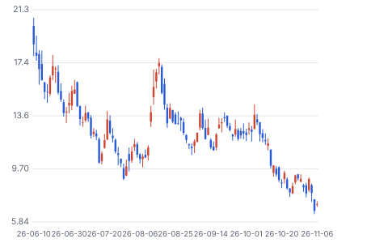

**주봉**

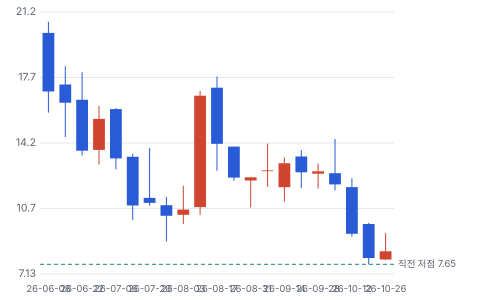

**월봉**

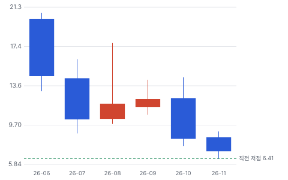

**분기 매출·EPS 실적과 컨센서스**

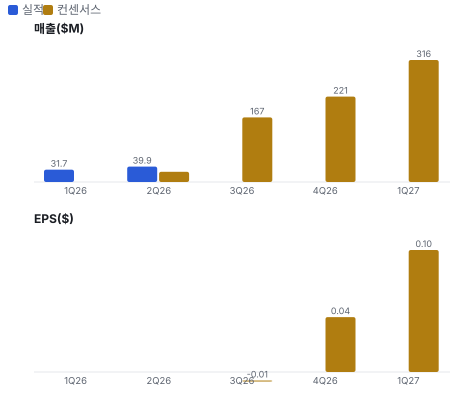

**EPS 리비전**

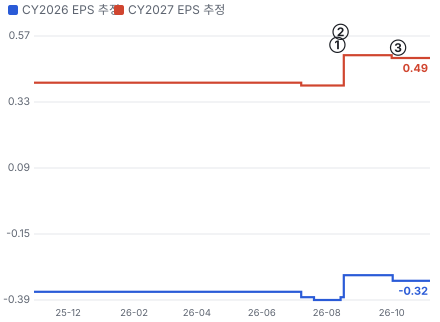

① 26-08-11 2Q26 실적, 잔고 \$1.7B·첫 가이던스 · EPS 리비전 +27%
② 26-08-14 푸에르토리코 계약 승인 철회 · 실적 창과 겹침
③ 26-10-07 HD건설기계 엔진 공급 계약 · EPS 리비전 +0%

**밸류에이션 주가 시나리오**

**주가별 업사이드**

**어닝콜 변화별 주주가치 영향**

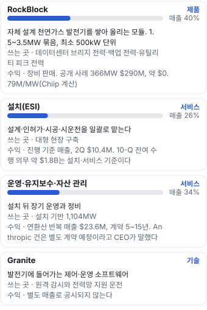

**멀티플 프리미엄**

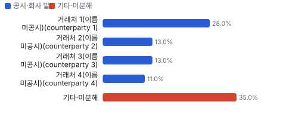

**합리적 멀티플**

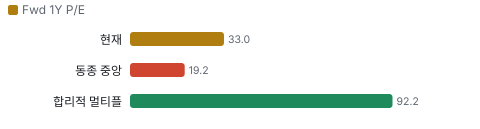

**일별 거래량 분해**

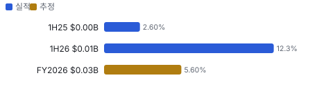

**기관 자금 흐름**

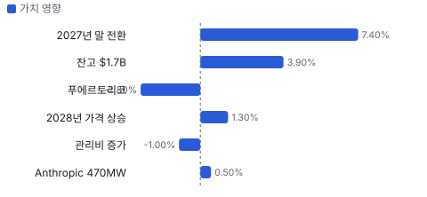

**몬테카를로**

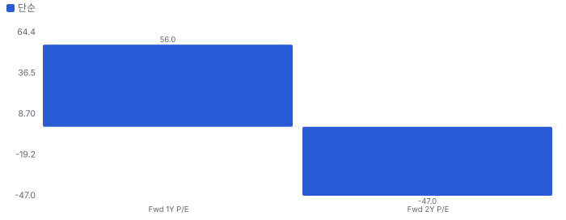

해석: 3,000번 중 1,243번(41%)에서 가치가 지금 주가 이상이었다. 지금 주가를 뒷받침하는 경우와 그렇지 않은 경우가 반반에 가깝다. 가운데 값은 0.87배이고, 열 번 중 여덟 번은 0.38~2.17배 사이에 든다.

## 내러티브

> **기업가치를 결정하는 이야기:** 이 회사는 천연가스 발전기를 조립해 파는 회사다. 그래서 값은 수요 전망이 아니라 세 숫자로 갈린다. 납품 속도(연 1.2GW 조립 능력), MW당 가격(계약 사례 약 \$0.8M, Chiip 계산), 잔고 뒤의 신규 주문이다. 전력망 대기가 끝나도 현장 발전기가 백업·피크 전력으로 남으면 일회성 장비 판매가 반복 서비스로 이어진다. 남지 않으면 호황기 장비주로 평가받는다.

> **멀티플·EPS 프리미엄**
> **멀티플:** 시장이 쓰는 시가총액이 자료마다 다르다. Class A만 세면 \$0.40B, A+B는 \$1.83B, 교환 가능한 Class M(경영진·기존 주주의 교환 가능 유닛)까지 넣은 완전 희석은 **\$2.28B**다. 이 리포트는 \$2.28B를 쓴다. Fwd 1Y P/E 33.0배는 동종 중앙값 19.2배보다 높지만 이익이 막 시작되는 구간이라서다. Fwd 2Y 10.7배, Fwd 3Y 7.1배로 내려가므로 시장은 FY2028 추정을 크게 믿지 않는다.
> **EPS:** EPS는 FY2026 −\$0.32, FY2027 \$0.49, FY2028 \$1.20(2명, \$0.96~\$1.44)이다. 이익이 나지 않는 구간이라 EPS 리비전보다 잔고와 매출 전환이 먼저다. 2Q 뒤 FY2027 EPS는 \$0.39에서 \$0.49로 올랐다.

### 투자자들은 왜 열광했나

세 가지가 겹쳤다. 전력망 접속 대기가 길어졌고, 터빈 납기가 길어졌고, AI 고객이 직접 전력을 사기 시작했다. 8/11 2Q 발표에서 매출이 컨센서스 \$20~27M을 크게 넘는 \$39.9M, 잔고 \$1.7B, Anthropic 470MW가 나오자 주가는 8/12 +22.8%, 8/13 +13.3%로 뛰어 8/17 \$17.40까지 갔다. 식은 이유는 셋이다. 8/14 푸에르토리코 감독위가 계약 승인을 철회하고 수사기관에 넘겼고 주가는 8/18~20 사흘 −25%였다. 10/14 −14.1%, 10/22 −12.0%는 회사 소식이 아니라 업종 급락이다(같은 날 Bloom −9.2%·−8.7%, GE Vernova(미국 전력 장비 회사) −6.2%·−10.6%). 그 위에 12/7 보호예수 해제가 다가온다.

### 무엇이 기업가치를 바꾸나

> **구조적 체질 변화**
> **변화:** 소형 백업 전원 회사에서 대형 데이터센터 전력 장비 회사로 바뀌는 중
> **증거:** 잔고 증가는 거의 전부 데이터센터 고객이다(10-Q). 유틸리티·상업 고객 잔고는 오히려 줄었다. 파이프라인은 2Q에 3배 이상 늘었고 회사는 조립 능력을 연말 1.2GW로 늘린다
> **반증:** 2026 매출 가이던스 하향

> **고부가 믹스 확장**
> **변화:** 서비스 꼬리 매출이 쌓이지만 아직 믹스를 바꾸지 못한다
> **증거:** 연환산 반복 서비스 매출 \$23.6M, 설치 기반 1,104MW, 갱신율 100%. 2Q 감가상각 전 마진은 제품 약 25%, 설치 약 22%, 서비스 약 18%다(Chiip 계산). 회사는 서비스를 고마진이라 말하지만 숫자는 아직 그렇지 않다. 협상 중 계약의 가격 상승은 2028년 이후 반영된다
> **반증:** 서비스 마진이 2027년에도 20% 아래

> **기술 혁신**
> **변화:** 저배출 천연가스 발전 묶음 RockBlock(ERock의 천연가스 발전기 모듈)과 제어 소프트웨어 Granite(ERock 발전기 운영·제어 소프트웨어)
> **증거:** RockBlock은 500kW 단위로 쌓고 설치 면적이 비슷한 가스 설비의 약 절반이다. 회사는 10초 전 부하, CARB-DG(캘리포니아 대기자원위원회 분산 발전 배출 인증) 충족을 내세운다. 왕복동 엔진 자체는 표준 기술이고 Caterpillar·INNIO(오스트리아 가스엔진 회사)·Wärtsilä가 같은 시장에 있어 기술 독점으로 보기는 어렵다
> **반증:** 대형 고객이 경쟁사 엔진으로 옮긴다

> **실행 속도**
> **변화:** 신규 계약 납품 12~18개월은 강점이지만 생산이 2028년 초까지 찼다. 지금 주문하면 더 늦을 수 있다 **납품 리드타임 12~18개월.** 피어 중앙값 39개월보다 62% 짧다(가스터빈(회사 콜) 48개월 · Caterpillar 가스 프라임 장비(2차 자료) 24~36개월). 이전 대비 미확인.
> **증거:** 10-Q는 신규 계약 대부분을 12~18개월 납품으로 적는다. 콜 기준 가스터빈 납기는 4년 이상이고, 2차 자료 기준 Caterpillar 가스 프라임 장비는 2028년 하반기~2029년까지 밀렸다. 기준이 주문→납품이라 주문→가동 값은 뺐다
> **반증:** 3Q 매출이 컨센서스 \$167M의 80% 아래로 나온다

> **M&A**
> **변화:** 해당 없음 — 이번 구간의 내러티브 동인이 아니다
> **증거:** 순현금을 인수에 쓴다는 계획은 확인되지 않았다. 다만 IPO 순수입 \$554M 중 약 \$185M은 기존 주주 지분 재매입에 쓰였다
> **반증:** 대형 인수 발표

> **정책·입법 연관성**
> **재정정책:** 해당 없음(보조금·세액공제에 기댄 수요가 아니다. 수요는 민간 AI 투자에서 나온다)
> **행정명령:** 에너지부가 2025-10-23 FERC(미국 연방에너지규제위원회)에 20MW 초과 대형 부하 연결 규칙을 지시했다. 행정명령이 아니라 장관 지시이고 최종 상태는 미확인이다. 대형 부하가 망 증설비를 부담하면 현장 발전의 상대 가치가 오른다 에너지부 지시, 로펌 해설 반증: FERC가 관할을 거부하거나 법원이 막는다 의회 동의 2/10 — 하원 1/5(의결 기록 미확인) · 상원 1/5(의결 기록 미확인).
> **연관입법:** 주법이 먼저다. 텍사스 SB 6(텍사스 대형 부하 관리법)은 75MW 이상 대형 부하에 위기 때 부하 차단을 요구한다. 주지사의 8/3 지시로 Batch Zero(텍사스 전력망 운영기구의 대형 부하 일괄 연결 심사) 분류 통지가 미뤄졌고 감사 보고는 12/10, 공공요금위원회 보고는 12/17이다. 연방 SPEED Act(미국 연방 인허가 절차 단축 법안)는 2025-12 하원 통과 뒤 상원 정체로 파악된다 Utility Dive·Troutman 해설, 2Q 콜. 회사는 영향이 없었다고 했다 반증: 감사가 현장 발전 결합 부하까지 제한한다

> **CAPEX 낙수효과**
> **변화:** 하이퍼스케일러·AI 기업 투자가 현장 전력 주문으로 내려온다
> **증거:** 공급 관계가 확인된 곳만 적는다. Meta의 El Paso 투자 \$10B → El Paso Electric → ERock 366MW, Anthropic 470MW 직접 주문, 지역 유틸리티 366MW \$290M. 고객 투자 총액이 ERock 매출이 되는 것은 아니고, 계약이 있는 몫만 매출이다
> **반증:** 고객이 납기 연기·계약 취소

### 내러티브 근거

> '전력망을 기다리지 않고 데이터센터를 켠다'는 이야기는 Meta·Anthropic 주문으로 숫자가 됐다. 지금 가격을 가르는 쟁점은 수요가 아니라 납품 실행, 잔고 다음 주문, 12/7 보호예수 해제다. 동종 대비 멀티플 차이 +72% 중 회사 고유 몫은 -64%다. 단계는 확산, 쏠림은 낮음(공모가 대비 −61%, 리테일 언급 집계 없음, 다만 유통 주식이 적어 작은 수급에도 크게 움직임)이다.

> **전력 대기 우회(Speed-to-Power)** · 강화
> **논리:** 전력망 접속에 수년이 걸리는 동안 현장 발전으로 데이터센터를 먼저 켠다. 터빈보다 납기가 짧다.
> **숫자:** 북버지니아 접속 대기 약 7년(10-Q), 신규 계약 납품 12~18개월(10-Q)
> **반증:** 하이퍼스케일러가 현장 발전 계약을 줄이거나 접속 대기가 짧아진다

> **Anthropic·Meta 대형 고객** · 유지
> **논리:** AI 대형 고객이 직접 주문하면서 잔고가 10배가 됐다. Anthropic 건은 장비만이고 설치·서비스는 별도다.
> **숫자:** 잔고 \$0.2B → \$1.7B(1년), Anthropic 470MW, El Paso 366MW
> **반증:** 2026년 안에 잔고가 늘지 않거나 고객이 납기를 미룬다

> **증설 레버리지** · 유지
> **논리:** 조립 중심 공장이라 적은 설비투자로 연 1.2GW까지 늘린다.
> **숫자:** 1H26 CAPEX \$8.8M, 공장 1.2GW당 \$15~20M·12개월, 고객 선수금 등 계약부채 \$528M
> **반증:** Hyperion(ERock 휴스턴 신규 조립 공장) 램프 지연으로 2026 가이던스 하향

> **서비스 꼬리 매출** · 유지
> **논리:** 설치 기반이 늘면 유지보수 매출이 쌓인다.
> **숫자:** 연환산 반복 서비스 매출 \$23.6M(TTM 매출의 약 15%), 갱신율 100%(회사 값). 2Q 서비스 마진은 약 18%로 제품 약 25%보다 낮다
> **반증:** 대형 고객이 유지보수를 직접 하거나 별도 입찰로 뺀다

> **반대 내러티브: 브리지 전력은 일회성이다** · 유지
> **논리:** 전력망이 연결되면 수요가 끝나고, 잔고는 고객 몇 곳에 몰려 있으며, 경쟁사도 같은 시장으로 들어온다.
> **숫자:** 2Q 고객 4곳이 매출의 65%, 거래처 1곳이 매출채권의 62%. Bloom은 연 2GW 증설
> **반증:** 2028년분 신규 주문이 Anthropic·Meta 밖에서 \$0.5B 이상 나온다

> **반대 내러티브: 지배구조와 수급** · 강화
> **논리:** 유통 주식이 적고 12/7 해제 물량이 그 약 6.9배이며, 푸에르토리코 사건이 끝나지 않았다.
> **숫자:** 유동 주식 약 2,791만 주 vs Class A 2,027만 + Class B(기존 주주의 교환 가능 주식) 1억 7,123만 주 해제
> **반증:** 해제 뒤 대주주 등록 매각이 없고 사건이 회사 책임 없이 종결

## 포트폴리오

| 제품·서비스 | 구분 | 무엇 | 쓰는 곳 | 돈 버는 방식 |
|---|---|---|---|---|
| RockBlock | 제품 | 자체 설계 천연가스 발전기를 쌓아 올리는 모듈. 1.5~3.5MW 묶음, 최소 500kW 단위 | 데이터센터 브리지 전력·백업 전력·유틸리티 피크 전력 | 장비 판매. 공개 사례 366MW \$290M, 약 \$0.79M/MW(Chiip 계산) |
| 설치(ESI(설계·시공·설치 서비스)) | 서비스 | 설계·인허가·시공·시운전을 일괄로 맡는다 | 대형 현장 구축 | 진행 기준 매출, 2Q \$10.4M. 10-Q 잔여 수행 의무 약 \$1.8B는 설치·서비스 기준이다 |
| 운영·유지보수·자산 관리 | 서비스 | 설치 뒤 장기 운영과 정비 | 설치 기반 1,104MW | 연환산 반복 매출 \$23.6M, 계약 5~15년. Anthropic 건은 별도 계약 예정이라고 CEO가 말했다 |
| Granite | 기술 | 발전기에 들어가는 제어·운영 소프트웨어 | 원격 감시와 전력망 지원 운전 | 별도 매출로 공시되지 않는다 |

## 수주·파이프라인

> **2026-06-30 기준 6건.** 확정 \$1.70B. 공시 수주잔고 \$1.70B. 서로 겹치는 항목은 합계에서 뺐다.

**실행 속도와 방해 요인**
| 항목 | 상태 | 실행 속도 | 방해 요인 |
|---|---|---|---|
| El Paso 366MW(EPE·Meta) | 확정 | 착공, 콜 기준 약 15개월 시운전 목표. 2Q에 발전기 일부 조기 생산 | 조립 램프(설치 기반 분기 45MW → 목표 분기 300MW) · 일부 부품 단일 공급원 · 취소·연기 조건 비공개 |
| Anthropic 470MW(금액 추정) | 확정 | 생산 매진 2028년 초까지 | 장비만 계약, 설치·서비스 별도 · 조립 램프(설치 기반 분기 45MW → 목표 분기 300MW) · 일부 부품 단일 공급원 |
| 그 밖의 잔고 | 확정 | 회사는 대부분 2027년 말까지 전환된다고 함 | 조립 램프(설치 기반 분기 45MW → 목표 분기 300MW) · 일부 부품 단일 공급원 · 취소·연기 조건 비공개 |
| Anthropic 설치·서비스 | 협상 | 회사는 통상 절차로 뒤따른다고 함 | 계약 미체결 |
| 상장 때 언급된 고객 후속 단계 | 협상 | 회사는 이름과 일정을 답하지 않았다 | 미공개 |
| 유틸리티·데이터센터 파이프라인 | 파이프라인 | 2Q에 3배 이상 증가, 규모 미공개 | 잔고가 아니다 |

## 해자

> 엔진 자체가 아니라 응답 속도·배출·운영 기록의 묶음이 해자다. 조립 공장은 해자가 아니다.

> **디젤을 대체하는 응답 속도** · 보통
> **해자:** 천연가스 발전기가 디젤 백업 자리를 맡을 만큼 빨리 부하를 받아 한 설비로 브리지·백업·피크 용도를 겸한다.
> **근거:** 회사는 10초 안에 전 부하를 받고 경쟁 가스 설비는 45초 이상이라고 밝혔다. AI 부하 변동에 배터리가 적게 든다고 주장한다. 제3자 시험값은 미확인
> **숫자:** 10초 vs 45초 이상(회사 주장)
> **깨지는 조건:** Caterpillar·INNIO가 같은 응답을 인증 시험으로 내거나 대형 고객이 배터리 결합 설비를 고른다

> **배출 인증과 인허가 속도** · 보통
> **해자:** 저배출이 허가 기간을 줄여 도심 가까이 설치할 수 있게 한다.
> **근거:** 회사는 CARB-DG를 충족한 첫 천연가스 엔진이라고 밝혔다. 캘리포니아 수자원국 약 150MW를 계약에서 첫 상업 운전까지 1년 안에 끝냈다. 물을 쓰지 않는다
> **숫자:** 디젤 대비 최대 99% 저배출(회사 주장), 약 50MW 이틀 설치
> **깨지는 조건:** 경쟁사가 같은 인증을 받거나 허가 기준이 완화돼 인증 값이 사라진다

> **운영 기록과 유틸리티 채널** · 보통
> **해자:** 15년 운영 데이터와 유틸리티 추천이 대형 고객 진입을 돕는다.
> **근거:** 400여 곳, 설치 기반 1,104MW, 서비스 갱신율 100%(회사 값). CEO는 하이퍼스케일러가 유틸리티에 공급사를 묻고 ERock이 추천된다고 말했다. 다만 Anthropic·El Paso 규모의 납품 기록은 아직 없다
> **숫자:** 반복 서비스 매출 \$23.6M, 2Q 서비스 매출 \$13.4M
> **깨지는 조건:** 서비스 갱신율 하락, 고객이 O&M(운영·유지보수)을 분리 입찰

> **자본 경량 조립 공장** · 약함
> **해자:** 1.2GW 공장을 12개월, \$15~20M에 지을 수 있어 증설은 빠르다. 그러나 같은 이유로 진입 장벽이 되지 못한다.
> **근거:** CEO는 증설 속도가 차별점이라고 했다. 실제 병목은 공장이 아니라 엔진 블록·발전기 같은 부품이다. 그래서 HD건설기계(한국 건설기계 회사) 계약이 나왔다
> **숫자:** 1GW당 약 \$12.5~17M(Chiip 계산)
> **깨지는 조건:** 해당 없음 — 이 항목은 약한 해자로 본다. 부품 독점 공급 계약이 나오면 상향

## 경영진·네트워크

> 창업자는 물러났고 외부 경영자 Carrington과 최대 주주 EIP(Energy Impact Partners, ERock 최대 주주인 에너지 투자회사)가 회사를 이끈다. 연결은 유틸리티 쪽에 몰려 있다. 연결이 매출을 만들었다는 증거는 없다.

> **John Carrington** · CEO·이사 · 2025-11
> **프로필:** 60세. Stem CEO(2013-12~2024-12), MiaSolé CEO, First Solar, GE(General Electric) 16년 이상
> **비즈니스:** 2025-06부터 ER Holdings(ERock의 운영 지주회사) 이사회 의장, 2025-11부터 CEO
> **정계:** 미확인
> **동문:** University of Colorado Boulder 학사
> **사모임:** 미확인

> **Thomas McAndrew(ERock 창업자)** · 창업자·전 CEO · 2006
> **프로필:** 2006년 회사를 세웠고 2025-06까지 CEO였다. 이후 CEO 자문으로 남았다
> **비즈니스:** Class A 환산 약 2,259만 주 보유 신고, 등록 권리 보유
> **정계:** 미확인
> **동문:** 미확인
> **사모임:** 미확인

> **Hans Kobler** · 이사, EIP 창업자 · 2024-12
> **프로필:** EIP 창업자·매니징 파트너, 에너지 기술 투자 25년
> **비즈니스:** EIP 투자자에 유틸리티·에너지 회사가 있다고 424B4가 적는다. EIP는 약 1억 281만 주 보유 신고
> **정계:** 미확인
> **동문:** 미확인
> **사모임:** 미확인

> **Dan Brouillette** · 이사 · 2025-06
> **프로필:** 15대 미국 에너지부 장관(2019-12~2021-01), EEI(미국 투자자 소유 유틸리티 협회) CEO(2023-10~2025-01). 지금 Torridon Group 공동 의장
> **비즈니스:** 유틸리티 협회 수장 이력
> **정계:** 전 에너지부 장관. 로비 등록·기부 기록은 미확인
> **동문:** 미확인
> **사모임:** 미확인

**네트워크 정량화**
| 연결 | 강도 | 닿는 매출 | 가중 노출 | 매출 대비 | 근거 |
|---|---|---|---|---|---|
| 비즈니스: EIP 투자자에 유틸리티가 포함되고 유틸리티가 ERock의 판매 채널이다 | 3/5 | \$0.29B | \$0.17B | 107% | 유틸리티가 산 공개 사례 El Paso 366MW \$290M. EPE가 EIP 투자자인지는 미확인 424B4, 2Q 콜 |
| 정계: 전 에너지부 장관·전 EEI CEO가 이사다 | 4/5 | 미확인 | 미확인 | 미확인 | 인허가·유틸리티 접근에 닿지만 금액으로 환산할 자료가 없다 424B4 |
| 비즈니스: 이사 Satterthwaite는 Cummins 전 사장·COO로 발전기 업계 경력이 길다 | 4/5 | 미확인 | 미확인 | 미확인 | 부품 조달·업계 인력에 닿지만 금액 미공개 424B4 |

가중 노출은 연결이 닿는 매출의 크기다. 연결이 그 매출을 만들었다는 뜻이 아니며, 인과는 공개 자료로 입증하지 못한다.

## 약세 논리 및 셀온 조건

| 약세 논리 | 근거 | 반박 | 가를 자료 |
|---|---|---|---|
| 브리지 전력은 일회성이다 | 전력망이 연결되면 발전기는 피크용으로 내려간다. 서비스 매출도 작다 | El Paso는 연결 뒤 유틸리티 요금 기반 자산으로 옮기는 구조다. 다만 사례 하나다 | 2028년분 주문, 연결 뒤 계약 형태 |
| 고객 집중 | 2Q 4곳이 매출의 65%, 1곳이 매출채권의 62%. 잔고의 고객별 내역은 비공개다 | 상업·유틸리티 고객 약 50곳의 기반이 있다 | FY2026 10-K 고객 비중 |
| 경쟁과 낮은 진입 장벽 | 1.2GW 공장이 \$15~20M이다. Bloom·Caterpillar·INNIO·Wärtsilä가 같은 시장에 있다 | 납기와 응답 속도 차이가 있다. 다만 응답값은 회사 주장이다 | 신규 수주 가격, 2028년 마진 |
| 수급 | 유통 주식의 약 6.9배(Class M 포함 약 8.7배)가 12/7 풀린다. 주관사는 일찍 풀어 줄 수도 있다. EIP는 약 1억 281만 주를 신고했다 | 주가는 일정을 안다. 공모가의 39%에서 파는 기존 주주는 적을 수 있다 | 등록 매각 신고, 13D 변경 |
| 부품 병목 | 엔진 블록 등 일부가 단일 공급원이다. 10-Q는 6/30 구매 약정이 없다고 적었고 HD건설기계 계약은 그 뒤다 | HD() 계약이 2027~28년 물량을 받친다 | 3Q 10-Q 구매 약정 |
| 텍사스 규제와 푸에르토리코 | Batch Zero 통지가 미뤄졌고 감사 결과가 12월에 나온다. 푸에르토리코 건은 수사기관에 넘어갔다 | 회사는 텍사스 영향이 없다고 했고 푸에르토리코는 이름 도용을 주장한다 | 12/10·12/17 보고, 수사 결과 |

확인한 것은 2Q 고객 네 곳 28·13·13·11%, 매출채권 62% 고객 한 곳, 제한 현금 \$34M, 6/30 구매 약정 없음이다. 10-Q에서 정부 지원·전략 계약은 찾지 못했다. 미확인은 잔고의 고객별 내역, Anthropic 계약 금액, 제3자 응답 시험값이다. 상장 전 3Q25·4Q25 분기값이 공시되지 않아 데이터 검증은 8.6/10이다. EPS 추정은 2~3명뿐이다. 기저율도 본다. 5년 뒤 2배 이상 30%, 3배 이상 14%, 10배는 0%이고 모두 DCF 가치 분포 기준이라 주가 분포가 아니다. 등급이 Buy인데 DCF가 낮은 것은 위 시나리오 절의 세 가지 차이 때문이다.

> **셀온 조건**
> **조건 1:** 11/12에 2026 매출 가이던스 하한이 \$435M 아래로 내려간다
> **조건 2:** 3Q 매출이 컨센서스 \$167M의 80%인 \$134M에 못 미친다(Chiip 기준)
> **조건 3:** 2027년 3월까지 잔고가 \$1.7B 아래로 줄어든다
> **조건 4:** 대형 고객이 납기를 미루거나 계약을 줄였다고 공시한다
> **조건 5:** 경쟁사가 응답 속도와 저배출을 같은 인증으로 맞추고 2028년분 가격이 내려간다
> **조건 6:** 푸에르토리코 조사에서 회사나 임원의 책임이 공식 제기된다

## 어닝콜 변화

**직전 콜 대비 새로 나오거나 바뀐 내용 → 가치 영향**
| 항목 | 내용 | 직전 콜 | 최신 콜 | 모델 동인 이동 | 확신도 | 가치 영향 |
|---|---|---|---|---|---|---|
| 업데이트 | 수주잔고 | 약 \$1.3B(3/31) | 약 \$1.7B(6/30) | 성장 지속(감속 계수) +2.0% | 1.0 | +3.9% |
| 업데이트 | 잔고 전환 시점 | 약 3년(424B4) | 대부분 2027년 말까지 전환, 2026년 \$360~390M(콜) | 1년차 성장률 +15.0% | 0.8 | +7.1% |
| 신규 | Anthropic 470MW 장비 주문, 생산 매진 2028년 초까지 | 없음 | 470MW 주문(장비만) | 장기 성장 수렴값 +0.20% | 1.0 | +0.9% |
| 신규 | 첫 연간 가이던스 | 없음 | 매출 \$435~465M, 조정 EBITDA \$3~9M | 기준연도 매출 — | 0.8 | +0.0% |
| 부정 | 일반관리비 증가 | 1Q \$20.9M | 2Q \$27.3M | 출발 이익률 -1.0% | 1.0 | -1.2% |
| 부정 | 푸에르토리코 계약 승인 철회, 수사 회부 | 언급 없음 | 서명 도용 주장, 조사 진행 | 할인율(WACC) +0.20% | 0.3 | -2.5% |
| 신규 | 협상 중 계약의 가격·이익률 상승, 반영은 2028년 이후 | 언급 없음 | 가격·이익률 긍정, 2028년 이후 반영 | 목표 이익률 +0.50% | 0.5 | +1.4% |
| 부정 | 2Q 매출 일부는 El Paso 발전기 조기 생산, 연간 물량 증가가 아니다 | 없음 | 시기 이동이라고 CFO가 명시 | 기준연도 매출 — | 1.0 | +0.0% |
| **합계** | 단독 합 |  |  | 동시 적용 +9.4% |  | **+9.7%** |

**사건별 EPS 리비전**
| # | 날짜 | 구분 | 사건 | CY2026 EPS 전→후 | CY2027 EPS 전→후 | 리비전 | 주가 반응 |
|---|---|---|---|---|---|---|---|
| ① | 26-08-11 | 실적 | 2Q26 실적, 잔고 \$1.7B·첫 가이던스 | \$-0.39 → \$-0.30 | \$0.39 → \$0.50 | +27.4% | +22.8% |
| ② | 26-08-14 | 내러티브 | 푸에르토리코 계약 승인 철회 | \$-0.39 → \$-0.30 | \$0.39 → \$0.50 | 실적 창과 겹침 | +6.8% |
| ③ | 26-10-07 | 내러티브 | HD건설기계 엔진 공급 계약 | \$-0.32 → \$-0.32 | \$0.49 → \$0.49 | +0.0% | -4.1% |

## 밸류에이션

> **목표주가 \$12, 업사이드 +44%.** 자리는 약세와 기본 사이(약세 쪽 11%)이고 도달 확률은 약 49%다. 기본 \$13, 강세 \$21(+153%), 약세 \$6(-32%). DCF 기준 업사이드는 기본 -10%, 강세 +107%, 약세 -57%다(WACC 10.0%).

기준 멀티플이 Fwd 1Y라서 EPS도 12개월 뒤의 다음 4개 분기(3Q27~2Q28)를 쓴다. 이 기간 컨센서스는 \$0.78이다. 지금의 Fwd 1Y EPS \$0.25는 이익이 막 시작되는 구간이라 쓰지 않았다. DCF 기본이 시나리오보다 낮은 이유는 세 가지다. 값의 시점이 오늘이고, 고객 선수금 \$361M(주당 약 \$1.3)을 순현금에서 뺐고, 5년 뒤 성장이 약 4%로 식는다. 브리지 수요가 호황이면 시나리오가 과대다. 약세 \$6은 납품 지연까지만 담는다. 계약 취소나 대규모 차질은 DCF 약세 −57% 쪽이다.

> **약세 \$6 (-32%)** · 확률 30%
> **가정:** 14.1배 × EPS \$0.40
> **근거:** 램프가 늦어 FY2027 매출 약 \$1.0B에 그치고 2028년분 주문이 없다. 해제 물량이 나온다

> **기본 \$13 (+53%)** · 확률 50%
> **가정:** 18.8배 × EPS \$0.68
> **근거:** 잔고가 2028년 초까지 전환되고 이익률이 약 11%다. 컨센서스 \$0.78보다 약 13% 낮게 잡았다

> **강세 \$21 (+153%)** · 확률 20%
> **가정:** 23.5배 × EPS \$0.90
> **근거:** 납품이 가이던스대로 가고 2028년분 주문과 Anthropic 설치 계약이 나온다

**멀티플 선정 — Fwd 1Y P/E**
| 단계 | 조정 | 근거 |
|---|---|---|
| 동종 중앙값 | 19.2배 | 범위 10.1~46.6배, 6곳 |
| 펀더멘털 | +20% | 성장·이익률·ROIC로 본 합리적 멀티플 92.2배와의 차이의 일부만 인정 |
| 해자 | +3% | 디젤을 대체하는 응답 속도 보통 · 배출 인증과 인허가 속도 보통 · 운영 기록과 유틸리티 채널 보통 · 자본 경량 조립 공장 약함 |
| 내러티브 | +5% | 단계 확산 |
| 사이클·실행 판단 | -30% | 펀더멘털 +20%는 고객 선수금 때문에 투하자본이 0에 가까워 생긴 착시다. 첫 이익 전이고 추정이 2~3명이며 납품 기록이 없고 12/7 해제 물량도 크다. 조정 상한인 −30%를 쓴다 |
| **선정** | **18.8배** | 지금 33.0배 |

**동종 레인지**
| 회사 | Fwd 1Y P/E | Fwd 2Y P/E | 성장 | 영업이익률 | ROIC |
|---|---|---|---|---|---|
| BE | 46.6 | 37.1 | 111% | 21% | 28% |
| GNRC | 14.7 | 9.3 | 6% | 10% | 9% |
| CMI | 16.5 | 15.5 | 3% | 11% | 17% |
| CAT | 21.9 | 18.7 | 20% | 19% | 20% |
| GEV | 41.5 | 34.0 | 17% | 6% | - |
| AMRC | 10.1 | 13.0 | 9% | 7% | 3% |
| **ERock** | 33.0 | 10.7 |  |  |  |

지금 주가가 요구하는 5년 매출 CAGR 46%, 기본 시나리오 43%. 몬테카를로 중앙값 업사이드 -13%.

> 의사결정 보조(투자자문 아님): ① 매수 매력: 연 기대수익 +11.5% (자기자본비용 10.0% 대비 +1.4%p) · 자본비용 초과 확률 41% · 안전마진 0.38 → 정량 신호 약함 / ② 위험 예산 지표(이론): 1/4 켈리 10.0% (상한 10%) · 5년 하위10% -42% · 30%+ 손실 확률 17% / ③ 상방(5년): 기대 1.72배 · 2배 30% · 3배 14% · 10배 0% · 상위10% 3.40배

## 시장 평가

> **셀사이드(IB 애널리스트)**
> **한 줄:** 셀사이드는 잔고 전환을 믿고 질문은 가격과 증설로 옮겨 갔다. 추정이 2~3명뿐이라 컨센서스 한 숫자에 기대면 안 된다.
> **의견 분포:** 8명 중 Strong Buy 7·Neutral 1 — 상장 주관사 비중이 커 보이는 구성(자체 해석)
> **목표가 평균·범위:** \$22.14 (\$18~\$28) — 지금 주가의 2.7배. 주가를 따라오지 못했다
> **최근 변화:** JPM(JPMorgan) \$21 → \$18(10/19), BofA(뱅크 오브 아메리카) \$19 유지(10/3), Clear Street 매수 개시(9/30) — 하향은 주가를 뒤따른 수준
> **EPS 추정 표본:** 분기 2명, FY2028 2명 — FY2027 \$0.38~\$0.71, FY2028 \$0.96~\$1.44. 표본이 매우 적다
> **콜 질문 초점:** MW당 가격(MS(Morgan Stanley)), 증설(JPM), 선수금(Guggenheim) — 수요보다 잔고의 질과 현금 시차를 묻는다

> **바이사이드(기관 투자자)**
> **한 줄:** 기관은 공모로 들어왔고 아직 시험 중이다. 진짜 수급 변수는 기관 신규 매수가 아니라 기존 주주의 매각이다.
> **13F 2Q26 보유 기관:** 77곳, 2,639만 주 — Class A의 약 55%, 완전 희석 주식의 약 9.7%
> **상위 보유:** T. Rowe 228만·Cinctive 195만·Ameriprise 183만·MFS(미국 자산운용사) 178만·AB(AllianceBernstein, 미국 자산운용사) 170만·Citadel 151만 — 상장 직후 분기라 증감 비교 불가
> **내부자:** 상장 후 장내 매수·매도 기록 없음 — 상장 당일 회사 재매입 거래만 있다
> **기존 주주:** Class B 1억 7,123만 주, Energy Impact Partners가 이사회에 있다 — 12/7부터 매각 가능 물량
> **기관 CMF(최근 20일):** −0.06 — 분산 쪽이지만 크지 않다

> **언론·업계**
> **한 줄:** 언론은 '누가 주문했나'에 쏠려 있다. 하반기 납품이 실제로 나오는지는 11/12 전까지 어디에도 없다.
> **2026-08:** Anthropic 470MW 주문 — IPO 뒤 첫 대형 호재. 8/12·13 이틀 +39%
> **2026-08:** 푸에르토리코 계약 승인 철회 — ERock은 이름·서명 무단 사용을 주장, 감독위는 수사기관에 회부
> **2026-10:** HD건설기계 엔진 공급 계약 — 약 ₩390B, 2027~28년. 한국 언론이 크게 다뤘다
> **2026-10:** CRO(최고매출책임자) 교체, Google Cloud 출신 영입 — 하이퍼스케일러 영업 강화 신호. 성과는 미확인

## 체크리스트

| 시점 | 무엇 | 의미 |
|---|---|---|
| 2026-11-12 장 시작 전 | 3Q 실적, 콜 08:30 ET(미국 동부 시각) | 매출 컨센서스 \$167M, 전력 시스템 매출, Anthropic 설치 계약, 구매 약정 |
| 2026-11 중순 | 13F 3Q 공시 | 공모 물량이 어디로 갔나 |
| 2026-12-07 | 보호예수 해제 | Class A 약 2,027만 주와 Class B·M 교환 물량, 등록 매각 여부 |
| 2026-12-10 | 텍사스 감사 보고 | Batch Zero 재개 조건 |
| 2026-12-17 | 텍사스 공공요금위원회 회의 | 데이터센터 연결 판단 |
| 2027년 1분기 | FY2026 실적, FY2027 가이던스 | \$1.44B 컨센서스의 시험, 2028년분 주문 |

## 재발행 기록 — 양식 3 전환

| 무엇을(전 → 후) | 왜 | 근거 |
|---|---|---|
| 옛 양식 → 양식 3, 같은 주소 | 마스터 지시 | 2026-11-02 지시 |
| 콜 전문 미확보 → 전문 반영 | 2Q 콜 전문을 확보했다 | 2026-08-12 콜 |
| 2026년 잔고 전환 \$360~390M 2차 자료 → 1차 확인 | 콜에서 CFO가 말했다 | 2026-08-12 콜 |
| Anthropic 470MW 설명 → 장비만, 설치·서비스 별도 | 잔고와 총수익을 구분해야 한다 | 보도자료·콜 |
| HD건설기계·감독위 건의 종류 8-K → 보도 | EDGAR(미국 증권거래위원회 공시 시스템)에 해당 8-K가 없다 | EDGAR 목록 |
| 새 사건 추가 | CRO 선임 10/28, 텍사스 일정 12/10·12/17 | 보도자료·Troutman 해설 |
| 기본 \$11(13배 × FY2028 EPS \$0.85) → 기본 \$13(18.8배 × 12개월 뒤 EPS \$0.68) | 양식 3은 멀티플을 엔진이 고른다 | 멀티플 선정 표 |
| 확률 가중 \$11.4(+37%) → 목표주가 \$12(+44%), 구매 등급 Buy | 양식 3의 규칙 계산 | 목표주가 산정 |
| 데이터 검증 8.6/10 유지 | 상장 전 3Q25·4Q25 분기값이 공시되지 않았다 | 424B4·10-Q |

## 출처
- ERock 10-Q 2026-06-30: https://www.sec.gov/Archives/edgar/data/2110029/000119312526346922/eroc-20260630.htm
- ERock 2Q26 실적 보도자료(8-K EX-99.1, 2026-08-11): https://www.sec.gov/Archives/edgar/data/2110029/000119312526344714/eroc-ex99_1.htm
- ERock 424B4 2026-06-10: https://www.sec.gov/Archives/edgar/data/2110029/000119312526265898/d12401d424b4.htm
- EIP Schedule 13D(2026-06-18): https://www.sec.gov/Archives/edgar/data/2110029/000119312526275971/xslSCHEDULE_13D_X02/primary_doc.xml
- McAndrew Schedule 13G/A(2026-09-04): https://www.sec.gov/Archives/edgar/data/2110029/000213856826000002/xslSCHEDULE_13G_X02/primary_doc.xml
- 푸에르토리코 재정감독위원회 발표(2026-08-14): https://oversightboard.pr.gov/oversight-board-revokes-approval-of-prepa-contract-with-power-expectations/
- San Juan Daily Star 연방 조사 보도: https://www.sanjuandailystar.com/post/federal-probe-focusing-on-power-expectations-contract-intermediaries
- Korea Herald, HD건설기계 공급 계약: https://www.koreaherald.com/article/10896120
- Troutman, 텍사스 데이터센터 연결 중단 해설: https://www.troutman.com/insights/texas-hits-pause-on-data-center-grid-connections-amid-growing-oversight-push/
- Utility Dive, 텍사스 SB 6: https://www.utilitydive.com/news/texas-law-gives-grid-operator-power-to-disconnect-data-centers-during-crisis/751587
- Trefis, Caterpillar 납기 요약: https://www.trefis.com/articles/620221/what-has-the-market-missed-in-caterpillar-stocks-drop/2026-10-23
- 회사 창업자 소개: https://enchantedrock.com/thomas-mcandrew
- 2Q 콜
- ERock 공개 사례 366MW \$290M · 2Q 콜
- 수주잔고 \$1.7B − 위 두 건 · 10-Q(2026-06-30)
- 잔고 증가분 약 \$0.4B 기준 추정, 금액 미공개 · 2Q 콜

_구매 등급·목표주가 모두 규칙이 계산한 모델 값으로, 개인의 보유 종목·자금 사정을 반영하지 않는다 · 공개 자료 기반 분석이며 투자 권유가 아님 · 1차 판정, 미검증 · Chiip ten-bagger_