# 텐배거 리포트 2026-10-31 — 주문은 넘치는데 왜 공모가의 39%인가

> 2026-10-31 · ERock(EROC) · 기업: 데이터센터·유틸리티·상업시설에 천연가스 현장 발전 설비를 설계·조립·운영하는 회사

## Chiip View
**컨빅션 저 · 알파 5.8/10 · 업사이드 +37%**

시장이 ERock에 준 이야기는 '전력망을 기다리지 않고 데이터센터를 켠다'이고, 수주는 그 이야기를 확인했다 — 잔고 \$1.7B, Anthropic 470MW, Meta 관련 366MW. 그런데 **아직 납품이 없다.** 상반기 매출은 \$72M이고 2Q 설치 기반 증가는 45MW뿐인데, 가이던스(회사가 제시한 전망)는 하반기 약 \$378M을 요구한다. 지금 가격이 말하는 것은 수요 의심이 아니라 실행과 수급 의심이다. 완전 희석 시가총액은 \$2.28B이고 DCF(현금흐름 할인 평가) 기본은 0.90배, 판단 시나리오는 1.37배다. **11/12 3Q 실적이 납품을, 12/7 해제가 수급을 가른다.** 이 종목은 10배 후보가 아니라 2배 조건부 후보다.

## 한 장 요약
- **① 기업가치를 결정하는 내러티브** ERock의 기업가치는 **잔고 \$1.7B가 제때 납품되느냐 × 잔고 다음 주문이 이어지느냐**로 정해진다. 시장은 6월 IPO에서 '데이터센터가 전력망을 기다리지 않게 해 주는 회사'에 \$21.50을 줬고, 8월 Anthropic 470MW 주문으로 잔고는 1년 만에 10배가 됐다. 그런데 주가는 공모가 대비 **−61%**인 \$8.35다. 이야기는 틀리지 않았다. 시장의 질문이 '주문이 오나'에서 '상반기 매출 \$72M인 회사가 하반기에 \$378M을 납품할 수 있나, 12/7 해제 물량을 누가 받나'로 바뀌었다.
- **② 2·3·5·10배가 되려면?** **2배** 시가총액 \$4.56B = 매출 \$2.82B(5년 CAGR(연평균 성장률) 44.4%) · OPM(영업이익률) 12.0% · EPS \$0.98(5년 CAGR 19.0%), 5년 뒤 확률 30%, 조건부 · **3배** 시가총액 \$6.83B = 매출 \$4.23B(5년 CAGR 56.6%) · OPM 12.0% · EPS \$1.47(5년 CAGR 31.7%), 5년 뒤 확률 14%, 경로 미확인 · **5배** 시가총액 \$11.39B = 매출 \$7.05B(5년 CAGR 73.4%) · OPM 12.0% · EPS \$2.46(5년 CAGR 49.6%), 5년 뒤 확률 2%, 닫힘 · **10배** 시가총액 \$22.78B = 매출 \$14.10B(5년 CAGR 99.2%) · OPM 12.0% · EPS \$4.91(5년 CAGR 77.9%), 5년 뒤 확률 0%, 닫힘. 2배는 잔고 밖 주문이 2028년을 채워야 열리고, 3배부터는 납품 능력과 시장 규모 가정이 함께 바뀌어야 한다.
- **지금 가격은 무엇을 가정하나?** 현금흐름으로 풀면 5년 매출 CAGR **46%**, 곧 2031년 매출 약 \$3.0B다. 기본 시나리오 43%(\$2.65B)보다 조금 높다. 같은 매출 경로라면 장기 영업이익률 약 12.4%가 필요하다. 배수로 보면 Fwd 2Y(12~24개월 뒤 추정 기준) P/E 10.7배로 동종 중앙값 17.1배보다 37% 낮다. 시장은 FY2028(회계연도 2028년) 추정을 믿지 않는 값을 넣었다.
- **왜 잔고가 10배인데 공모가의 39%인가?** 세 가지가 겹쳤다. 첫째, 납품이 아직 숫자로 나오지 않았다. 둘째, 유통 주식 약 2,880만 주 위에 12/7 Class A 2,027만 주와 Class B 1억 7,123만 주의 해제가 있다. 셋째, 푸에르토리코 계약 사건으로 지배구조 할인이 붙었다. 10/14 −14.1%, 10/22 −12.0%는 회사 소식이 아니라 업종 급락이었다.
- **2Q에서 무엇이 바뀌었나?** 잔고 실행 기간이 424B4의 약 3년에서 10-Q(미국 분기보고서)의 약 2년으로 짧아졌다. 잔고는 \$1.3B에서 \$1.7B로 늘었다. 첫 연간 가이던스가 나왔다. 관리비는 분기 \$20.9M에서 \$27.3M으로 늘었고 조정 EBITDA는 −\$14.0M이다.
- **무엇이 바뀌면 판단이 바뀌나?** 3Q 매출이 컨센서스(시장 평균 추정) \$167M 근처로 나오고 2028년분 신규 주문이 Anthropic·Meta 밖에서 나오면 기본 시나리오를 올린다. 2026 가이던스가 내려가거나 해제 뒤 대주주 매각이 이어지면 약세 쪽으로 옮긴다.

## 핵심 숫자
| 항목 | 값 | 설명 |
|---|---|---|
| 주가 (10/30) | \$8.35 | 공모가 \$21.50 대비 −61% · 저점 \$7.65 대비 +9% |
| 시가총액 / EV | \$2.28B / \$2.04B | Class A·B·M 완전 희석 기준 · Class A만 세면 \$0.40B |
| 수주잔고 | \$1.7B | 1년 전 \$0.2B · 생산 약정 2028년까지 |
| 2026 매출 가이던스 | \$435~465M | 상반기 \$72M → 하반기 약 \$378M 필요 |
| Fwd P/E 1Y·2Y·3Y | 33.0·10.7·7.1배 | 동종 Fwd 1Y 중앙값 19.2배 |
| DCF ÷ 시가총액 | 0.90배 | 몬테카를로 중앙값 0.87배 · WACC 10.0% |
| 5년 뒤 확률 | 2배 이상 30% | 3배 14% · 5배 2% · 10배 0% |

## ① 내러티브 — 기업가치와 멀티플·EPS 프리미엄을 결정하는 이야기

> **기업가치를 결정하는 이야기:** 이 회사는 천연가스 발전기를 조립해 파는 회사다. 그래서 값은 수요 전망이 아니라 세 숫자로 갈린다. 납품 속도(연 1.2GW 조립 능력), MW당 가격(계약 사례 약 \$0.8M, Chiip 계산), 잔고 뒤의 신규 주문이다. 전력망 대기가 끝나도 현장 발전기가 백업·피크 전력으로 남으면 일회성 장비 판매가 반복 서비스로 이어진다. 남지 않으면 호황기 장비주로 평가받는다.

- **멀티플 프리미엄:** 시장이 쓰는 시가총액이 자료마다 다르다. Class A만 세면 \$0.40B, A+B는 \$1.83B, 교환 가능한 Class M까지 넣은 완전 희석은 **\$2.28B**다. 이 리포트는 \$2.28B를 쓴다. Fwd 1Y P/E 33.0배는 동종 중앙값 19.2배보다 높지만 이익이 막 시작되는 구간이라서다. Fwd 2Y 10.7배, Fwd 3Y(24~36개월 뒤 추정 기준) 7.1배로 내려가므로 시장은 FY2028 추정을 크게 믿지 않는다.
- **EPS 프리미엄:** EPS는 FY2026 −\$0.32, FY2027 \$0.49, FY2028 \$1.20(2명, \$0.96~\$1.44)이다. 이익이 나지 않는 구간이라 EPS 리비전(추정치 수정)보다 잔고와 매출 전환이 먼저다. 2Q 뒤 FY2027 EPS는 \$0.39에서 \$0.49로 올랐다.

### 투자자들은 왜 열광했나

세 가지가 겹쳤다. 전력망 접속 대기가 길어졌고, 터빈 납기가 5~7년으로 늘었고, AI 고객이 직접 전력을 사기 시작했다. 8/11 2Q 발표에서 매출이 컨센서스 \$26.5M을 크게 넘는 \$39.9M, 잔고 \$1.7B, Anthropic 470MW가 나오자 주가는 8/12 +22.8%, 8/13 +13.3%로 뛰어 8/17 \$17.40까지 갔다. 식은 이유는 셋이다. 8/14 푸에르토리코 감독위가 계약 승인을 철회하고 수사기관에 넘겼고 주가는 8/18~20 사흘 −25%였다. 10/14 −14.1%, 10/22 −12.0%는 회사 소식이 아니라 업종 급락이다(같은 날 Bloom −9.2%·−8.7%, GE Vernova −6.2%·−10.6%). 그 위에 12/7 보호예수 해제가 다가온다.

### 무엇이 기업가치를 바꾸나

- **구조적 체질 변화** (매출 · 진행 중, 납품 미증명) — 소형 백업 전원 회사에서 대형 데이터센터 전력 장비 회사로 바뀌는 중 증거: 잔고 증가는 거의 전부 데이터센터 고객이다(10-Q). 유틸리티·상업 고객 잔고는 오히려 줄었다. 2025년 조립을 내재화했고 연 1.2GW를 목표로 한다. 신규 계약 납품은 12~18개월이다 반증: 2026 매출 가이던스 하향
- **고부가 믹스 확장** (이익률 · 미증명) — 서비스 꼬리 매출이 쌓이지만 아직 믹스를 바꾸지 못한다 증거: 연환산 반복 서비스 매출 \$23.6M, 설치 기반 1,104MW. 2Q 감가상각 전 마진은 제품 약 25%, 설치 약 22%, 서비스 약 18%다(Chiip 계산). 서비스가 더 높은 마진이라는 통념과 다르다. 장비 매출이 커지면 비중은 더 작아진다 반증: 서비스 마진이 2027년에도 20% 아래
- **기술 혁신** (멀티플 · 일부 확인) — 저배출 천연가스 발전 묶음 RockBlock과 제어 소프트웨어 Granite 증거: RockBlock은 1.5~3.5MW 단위로 늘리고 Hyperion에서 조립한다. Microsoft 산호세 63MW는 과도 응답 시험을 통과했다고 회사가 밝혔다. 왕복동 엔진 자체는 표준 기술이다. Caterpillar·INNIO·Wärtsilä가 같은 시장에 있어 기술 독점으로 보기는 어렵다 반증: 대형 고객이 경쟁사 엔진으로 옮긴다
- **M&A** (- · 해당 없음) — 해당 없음 — 이번 구간의 내러티브 동인이 아니다 증거: 순현금을 인수에 쓴다는 계획은 확인되지 않았다. 다만 IPO 순수입 \$554M 중 약 \$185M은 기존 주주 지분 재매입에 쓰였다 반증: 대형 인수 발표
- **재정정책** (- · 해당 없음) — 해당 없음 — 보조금·세액공제에 기댄 수요가 아니다 증거: 수요는 민간 AI 투자에서 나온다. 정책 변수는 배출 허가와 전력망 접속 규칙이다. 세제 쪽에서는 절세액의 85%를 기존 주주에게 주는 세금 수취 약정(TRA)이 있어 향후 세금 절감의 대부분이 주주에게 남지 않는다 반증: 연방·주 규칙이 현장 발전 허가를 막는다
- **CAPEX(설비투자) 낙수효과(대기업 투자가 아래 공급망으로 번지는 효과)** (매출 · 확인) — 하이퍼스케일러·AI 기업 투자가 현장 전력 주문으로 내려온다 증거: 공급 관계가 확인된 곳만 적는다. Meta의 El Paso 투자 \$10B → El Paso Electric → ERock 366MW, Anthropic 470MW 직접 주문, 지역 유틸리티 366MW \$290M. 고객 투자 총액이 ERock 매출이 되는 것은 아니고, 계약이 있는 몫만 매출이다 반증: 고객이 납기 연기·계약 취소

### 이 회사의 제품·서비스·기술

- **제품 — RockBlock:** 자체 설계한 천연가스 엔진 발전기를 1.5~3.5MW 묶음으로 만든 모듈 쓰는 곳: 데이터센터 브리지 전력·백업 전력·유틸리티 피크 전력. 돈 버는 방식: 장비 판매. 공개 사례 366MW \$290M, 약 \$0.79M/MW(Chiip 계산).
- **서비스 — 설치(ESI):** 설계·인허가·시공·시운전을 일괄로 맡는다 쓰는 곳: 대형 현장 구축. 돈 버는 방식: 진행 기준 매출, 2Q \$10.4M.
- **서비스 — 운영·유지보수·자산 관리:** 설치 뒤 장기 운영과 정비 쓰는 곳: 설치 기반 1,104MW. 돈 버는 방식: 연환산 반복 매출 \$23.6M. Anthropic 건은 별도 계약 예정으로 보도됐다.
- **기술 — Granite:** 발전기에 들어가는 제어·운영 소프트웨어 쓰는 곳: 원격 감시와 전력망 지원 운전. 돈 버는 방식: 별도 매출로 공시되지 않는다.

## ② 배수 사다리 — 2·3·5·10배가 되려면

> **시가총액 \$2.28B → 2·3·5·10배까지 본다.** 시가총액이 커질수록 볼 배수를 줄인다(\$30B 미만 10배, \$30B~\$100B 5배, \$100B 이상 2배까지). 숫자는 출구 P/E 17배·OPM 12.0%·순이익률 9.5% 기준이다. 출구 P/E 17배는 동종 Fwd 1Y 중앙값 19.2배보다 낮게 뒀다. 호황기 장비주가 성숙기에 받는 수준이다(추정). OPM 12%는 동종 최근 4분기 중앙값 10.8%와 FY2027 컨센서스 11%를 근거로 했고, 순이익률 9.5%는 세금을 뺀 값이다. 기준 EPS가 적자라 EPS CAGR은 FY2027 컨센서스 \$0.49에서 잰다.

**배수 단계별 필요 조건 — 2·3·5·10배**
| 배수 | 목표 시가총액 | 필요 매출 | 매출 CAGR 5년 / 10년 | OPM | 필요 EPS | EPS CAGR 5년 / 10년 |
|---|---|---|---|---|---|---|
| **지금** | \$2.28B | \$0.45B | - | -7.5% | −\$0.32 | - |
| **2배** | \$4.56B | \$2.82B | 44.4% / 20.1% | 12.0% | \$0.98 | 19.0% / 8.0% |
| **3배** | \$6.83B | \$4.23B | 56.6% / 25.1% | 12.0% | \$1.47 | 31.7% / 13.0% |
| **5배** | \$11.39B | \$7.05B | 73.4% / 31.7% | 12.0% | \$2.46 | 49.6% / 19.6% |
| **10배** | \$22.78B | \$14.10B | 99.2% / 41.1% | 12.0% | \$4.91 | 77.9% / 29.2% |

**배수 단계별 달성 가능성**
| 배수 | 지금 매출 대비 | DCF 역산 5년 CAGR | 5년 뒤 확률 | 판정 |
|---|---|---|---|---|
| **2배** | 6.3배 | 54.4% (상위 2%, n=367) | 30% | 조건부 |
| **3배** | 9.4배 | 69.3% (상위 1%, n=367) | 14% | 경로 미확인 |
| **5배** | 15.7배 | 89.3% (상위 0%, n=367) | 2% | 닫힘 |
| **10배** | 31.3배 | 119.1% (상위 0%, n=367) | 0% | 닫힘 |

**그림 9 · 배수 단계별 필요 매출 vs 회사 경로 (\$B)**

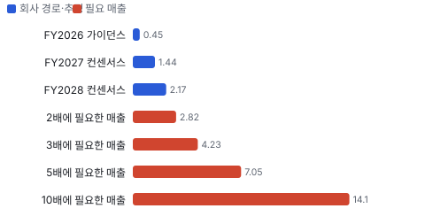

### 2배 — \$4.56B · 조건부

- **필요 조건:** 매출 \$2.82B(5년 CAGR 44.4%) · OPM 12.0% · EPS \$0.98(5년 CAGR 19.0%)
- **어떻게 성장해야 하나:** 주가 약 \$16.7이다. 매출 \$2.8B는 MW당 약 \$0.85M으로 환산하면 연 약 3.3GW로, 목표 조립 능력의 약 2.8배다(Chiip 계산). 공장 증설과 잔고 밖 신규 주문이 함께 필요하다. 다른 길도 있다. FY2028 컨센서스 EPS \$1.20이 맞으면 P/E 14배만 받아도 2배다.
- **펀더멘털 전망:** 2027년까지는 잔고가 받쳐 준다. FY2028 매출 컨센서스 \$2.17B는 아직 잔고 밖이다. 2026년 안에 2028년분 신규 주문이 나오는지가 갈림길이다.

### 3배 — \$6.83B · 경로 미확인

- **필요 조건:** 매출 \$4.23B(5년 CAGR 56.6%) · OPM 12.0% · EPS \$1.47(5년 CAGR 31.7%)
- **어떻게 성장해야 하나:** 매출 \$4.2B는 연 약 5GW다. 5년 뒤 Bloom의 2026년 말 목표 연 2GW의 2배 이상을 혼자 납품해야 한다.
- **펀더멘털 전망:** 브리지 전력이 끝나도 현장 발전이 데이터센터의 표준으로 남아야 한다. 이 가정을 뒷받침할 자료는 아직 없다.

### 5배 — \$11.39B · 닫힘

- **필요 조건:** 매출 \$7.05B(5년 CAGR 73.4%) · OPM 12.0% · EPS \$2.46(5년 CAGR 49.6%)
- **어떻게 성장해야 하나:** 매출 \$7.0B는 지금 Generac 매출 \$4.6B의 약 1.5배다. 연 약 8GW 납품에 해당한다(Chiip 계산).
- **펀더멘털 전망:** 새 제품군이나 자체 발전 소유 모델로 바뀌어야 하는데 그런 계획은 확인되지 않았다.

### 10배 — \$22.78B · 닫힘

- **필요 조건:** 매출 \$14.10B(5년 CAGR 99.2%) · OPM 12.0% · EPS \$4.91(5년 CAGR 77.9%)
- **어떻게 성장해야 하나:** 매출 \$14B는 Generac 지금 매출의 약 3배다. 조립형 발전기 회사의 경로로는 설명되지 않는다.
- **펀더멘털 전망:** 몬테카를로(가정을 무작위로 바꿔 수천 번 계산하는 방법)에서 5년 뒤 10배는 나오지 않았다.

## 주가와 배수 — 이익이 시작되기 전의 배수

상장 4개월이라 과거 레인지가 없다. 첫 거래일 시가 \$20.10이 공모가를 밑돌았고 이후 한 번도 공모가를 넘지 못했다. Fwd 1Y P/E 33.0배는 이익이 막 시작되는 구간의 숫자라 높아 보인다. Fwd 2Y 10.7배, Fwd 3Y 7.1배로 빠르게 내려간다. 동종은 Bloom 46.6배, GE Vernova 41.5배, Caterpillar 21.9배, Cummins 16.5배, Generac 14.7배, Ameresco 10.1배다. 시장은 AI 전력주 일부에 높은 배수를 주지만 ERock에는 FY2028 기준으로 장비주 하단을 준다.

**그림 1 · EROC 주간 종가 (\$, 상장 후)**

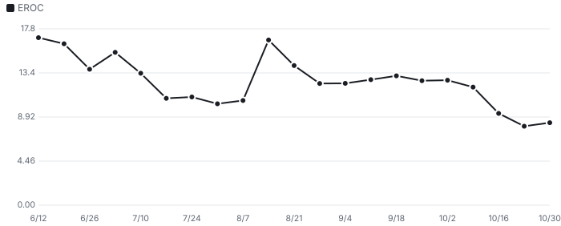

**그림 2 · 동종 Fwd 1Y P/E (배, 2026-10-30)**

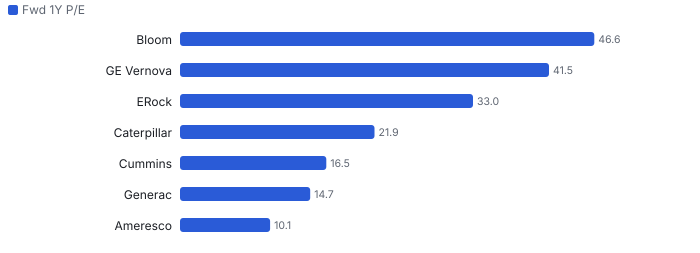

## 실적 — 하반기 \$378M이라는 시험

> 2Q 매출 \$39.9M은 컨센서스 \$26.5M을 크게 넘었지만 전년 \$68.5M보다 낮다. 2026 가이던스 중간값 \$450M을 맞추려면 **하반기 약 \$378M, 상반기의 5.3배**가 필요하다. 조정 EBITDA 가이던스 \$3~9M은 상반기 −\$26.4M을 뒤집어야 나온다.

**그림 4 · 분기 매출 실적과 컨센서스 (\$M)**

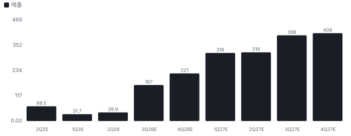

| 2Q26 사업별 | 매출 | 감가상각 전 마진 | 읽을 점 |
|---|---|---|---|
| 장비 | \$16.2M | 약 25% | 납품이 시작되면 가장 먼저 커지는 줄 |
| 설치 | \$10.4M | 약 22% | 진행 기준 매출 |
| 서비스 | \$13.4M | 약 18% | 반복 매출이지만 마진은 가장 낮다 |
| 합계 | \$39.9M | 조정 매출총이익률 22.2% | 매출 대비 관리비 68% |

현금은 좋아 보이지만 해석이 필요하다. 6월 말 현금 \$627M 가운데 고객이 먼저 낸 돈의 비중이 크다. 계약부채가 \$528M이고, 재고·매출채권을 뺀 현금 제외 순운전자본은 −\$361M이다. 납품하면 이 돈은 원가로 나간다. 그래서 순현금을 \$597M이 아니라 \$236M으로 잡았다. 선수금을 빼지 않으면 DCF는 0.90배에서 1.06배가 된다. IPO 순수입 \$554M 가운데 약 \$185M은 기존 주주 지분을 사는 데 쓰였다.

주식 수도 자료마다 다르다. Class A 4,817만 주만 세면 시가총액이 \$0.40B로 나오지만, 경제적 지분의 약 80%는 Class B와 Class M에 있다. EPS 컨센서스 FY2027 \$0.49는 영업이익 컨센서스 \$159M과 맞춰 보면 완전 교환 주식 수 기준이다(Chiip 계산). Class M의 환산 주식 5,237만 주는 6월 말 추정이고, 주가가 낮으면 줄어든다.

## 사업과 병목 — 수요가 아니라 납품이다

병목은 주문이 아니다. 전력망 접속 대기가 북버지니아에서 약 7년이고(10-Q), 대형 터빈 납기가 5~7년으로 늘면서 왕복동 엔진이 대안이 됐다. ERock의 신규 계약 납품은 12~18개월이다. 생산 약정은 2028년까지 찼다. 병목은 발전기 조립과 현장 설치다. 2Q 설치 기반은 1,059MW에서 1,104MW로 45MW 늘었다. 목표 조립 능력 연 1.2GW는 분기 300MW다. 설치 기반은 가동 기준이라 납품보다 늦게 잡히지만, 여섯 배 넘는 램프임은 분명하다.

컨센서스가 잔고를 거의 다 쓴다. 2H26 + FY2027 매출 컨센서스는 \$1.83B이고, 서비스 몫 약 \$0.09B를 빼면 \$1.74B로 잔고 \$1.7B와 비슷하다(Chiip 계산). 회사는 잔고 '대부분'이 2027년 말까지 전환된다고 했다. FY2028 \$2.17B는 아직 잔고 밖이다. MW당 가격은 공개 사례 366MW \$290M으로 약 \$0.79M이고, 잔고 증가분 \$0.4B를 Anthropic 470MW로 나누면 약 \$0.85M이다(추정). 이 값이면 연 1.2GW의 장비 매출은 약 \$1.0B다. FY2027 컨센서스 \$1.44B는 설치 매출을 더해도 빠듯한 숫자다.

**그림 6 · 잔고 vs 컨센서스 vs 조립 능력 (\$B)**

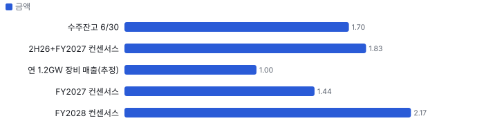

공급망에는 한국 연결고리가 생겼다. HD건설기계가 2027~28년 22리터 가스엔진 롱블록(점화·연료 장치를 뺀 엔진 본체)을 약 3,900억 원, \$291M 규모로 공급한다. ERock에는 엔진 공급원이 넓어지는 일이고, 비용 쪽 숫자다. 대당 가격과 물량은 공개되지 않았다. 424B4는 일부 부품이 단일 공급원이라고 적었다.

| 금지표 점검 | 주장 | 확인 결과 |
|---|---|---|
| 고객 투자 확대 → 특정 공급사 매출 | Meta El Paso \$10B | ERock 몫은 366MW 계약뿐이고 운영 개시 목표는 2027년 중반 |
| 명목 캐파(생산능력) → 판매 가능 생산량 | 연 1.2GW | 2026년 말 목표. Hyperion은 조립을 시작했을 뿐 램프 수치는 미확인 |
| 수주 → 매출 확정 | 잔고 \$1.7B | 밀스톤 선수금이 있으나 취소·연기 조건은 공개되지 않았다 |
| 주가 급락 → 펀더멘털 변화 | 10/14 −14.1%, 10/22 −12.0% | 같은 날 Bloom·GE Vernova·Generac 동반 급락. 회사 사건은 확인되지 않았다 |

| 푸에르토리코 사건 | 내용 |
|---|---|
| 무엇 | PREPA(푸에르토리코 전력청)의 10년 약 \$5.9B, 400MW 임시 발전 계약에 Enchanted Rock이 장비 공급사로 명시됐다 |
| ERock 입장 | 8/7 감독위원회에 프로젝트 당사자가 아니며 이름과 서명이 무단 사용됐다고 통보 |
| 결과 | 8/14 감독위가 승인을 철회하고 해지를 지시, 사안을 수사기관에 회부. 위원회 발표는 ERock의 잘못을 지적하지 않았다 |
| 남은 것 | 상대 회사의 소송에는 ERock이 IPO 때문에 물러섰다는 주장이 있다. 소송상 주장이지 사실 판단이 아니다. 연방 조사는 중개인 쪽에 초점이 있다고 보도됐고 공식 확인은 없다. 10-Q에 관련 언급은 없다 |

## 손익분기 — 잔고 다음 해가 값을 정한다

핵심 변수는 2028년 이후의 매출과 장기 이익률이다. 장기 영업이익률을 바꾸면 DCF ÷ 시가총액은 10%에서 0.79배, 12%에서 0.96배, 14%에서 1.14배다. 1.0배는 약 12.4%다. 매출 경로를 바꾸면 5년차 \$2.09B에서 0.75배, \$2.65B에서 0.90배, \$3.53B에서 1.13배다. 할인율 +50bp면 가치는 −6.1%다.

**그림 7 · 5년차 매출별 DCF ÷ 시가총액 (배, 1.0배 = 지금 주가)**

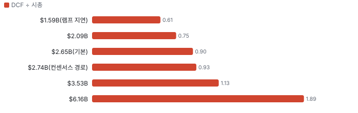

## 어닝콜 변화·컨센서스·멀티플 프리미엄·EPS 리비전

**방법:** 직전 콜(2026-06-10) → 최신 콜(2026-08-12)에서 새로 나오거나 바뀐 항목을 DCF 기본 시나리오의 동인 이동으로 옮기고, 그 변화가 없었을 때(동인을 되돌린 DCF) 대비 주주가치 변화를 잰다. 확신도: 확정 1.0 · 회사 가이던스 0.8 · 경영진 목표·장기 발언 0.5 · 정황 0.3. '반복'은 직전 콜과 같은 말이라 가치 영향 0.

**직전 콜 대비 새로 나오거나 바뀐 내용 → 가치 영향 (DCF 기본 시나리오 주주가치 기준)**
| 항목 | 내용 | 직전 콜 | 최신 콜 | 모델 동인 이동 | 확신도 | 가치 영향 |
|---|---|---|---|---|---|---|
| 업데이트 | 수주잔고 | 약 \$1.3B(3/31) | 약 \$1.7B(6/30) | 성장 지속(감속 계수) +2.0% | 1.0 | +3.9% |
| 업데이트 | 잔고 실행 기간 | 약 3년(424B4) | 약 2년(10-Q) | 1년차 성장률 +15.0% | 0.8 | +7.1% |
| 신규 | Anthropic 470MW 장비 주문, 생산 약정 2028년까지 | 없음 | 470MW 주문 | 장기 성장 수렴값 +0.20% | 1.0 | +0.9% |
| 신규 | 첫 연간 가이던스 | 없음 | 매출 \$435~465M, 조정 EBITDA \$3~9M | 기준연도 매출 — | 0.8 | +0.0% |
| 부정 | 일반관리비 증가 | 1Q \$20.9M | 2Q \$27.3M | 출발 이익률 -1.0% | 1.0 | -1.2% |
| 부정 | 푸에르토리코 계약 승인 철회, 수사 회부 | 언급 없음 | 서명 도용 주장, 조사 진행 | 할인율(WACC(가중평균자본비용)) +0.20% | 0.3 | -2.5% |
| **합계** | 단독 합 |  |  | 동시 적용 +8.0% |  | **+8.3%** |

**그림 10 · 콜 변화 항목별 주주가치 영향 (%)**

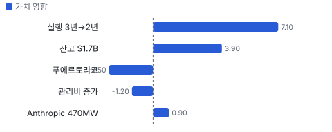

**실적 vs 컨센서스 — 최근 4개 분기 (이익 지표는 조정 기준, 발표 직전 추정)**
| 분기 | 지표 | 실적 | 컨센서스 | 서프라이즈 |
|---|---|---|---|---|
| 2026Q2 | 매출 | \$39.88M | \$26.5M | +50.5% |

**그림 11 · 분기별 서프라이즈 — 매출 (%, OPM은 %p), 최근 4개 분기**

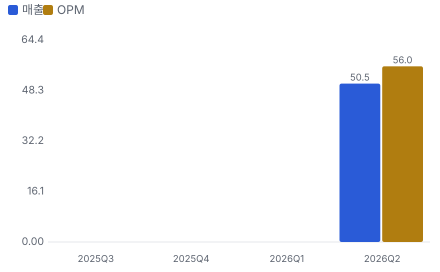

**그림 5 · 지난 12개월 EPS 리비전 추이 — 캘린더 2026·2027년 EPS 추정(\$/주)**

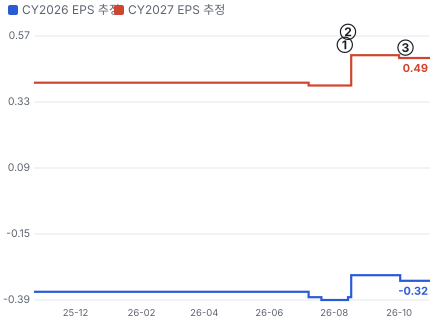

- ① 26-08-11 2Q26 실적, 잔고 \$1.7B·첫 가이던스 · EPS 리비전 +27%
- ② 26-08-14 푸에르토리코 계약 승인 철회 · 실적 창과 겹침
- ③ 26-10-07 HD건설기계 엔진 공급 계약 · EPS 리비전 +0%

**사건별 EPS 리비전 — 실적 발표·내러티브 변화 때 추정이 어떻게 움직였나**
| # | 날짜 | 구분 | 사건 | CY2026 EPS 전→후 | CY2027 EPS 전→후 | 리비전 | 주가 반응 |
|---|---|---|---|---|---|---|---|
| ① | 26-08-11 | 실적 | 2Q26 실적, 잔고 \$1.7B·첫 가이던스 | \$-0.39 → \$-0.30 | \$0.39 → \$0.50 | +27.4% | +22.8% |
| ② | 26-08-14 | 내러티브 | 푸에르토리코 계약 승인 철회 | \$-0.39 → \$-0.30 | \$0.39 → \$0.50 | 실적 창과 겹침 | +6.8% |
| ③ | 26-10-07 | 내러티브 | HD건설기계 엔진 공급 계약 | \$-0.32 → \$-0.32 | \$0.49 → \$0.49 | +0.0% | -4.1% |

**그림 8 · 최근 4개 분기 주가 변화 분해 = EPS 리비전 × 멀티플 변화 (%, 실적 발표 사이 구간)**

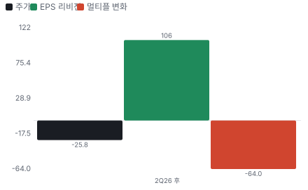

**분기별 주가 분해 — 실적 발표 사이 구간**
| 구간 | 기간 | 주가 | EPS 리비전 | 멀티플 변화 | 선행 P/E 시작 → 끝 |
|---|---|---|---|---|---|
| 2Q26 후 | 26-08-11 ~ 26-10-30 | \$11.25 → \$8.35 (-26%) | +106% | -64% | 132.0배 → 23.5배 |

**해석:** 1개 구간 누적 주가 -26% = EPS 리비전 +106% × 멀티플 -64%. 더 크게 움직인 쪽은 **EPS 리비전**이다.

**컨센서스 리비전 — 2Q 실적 직전(2026-07-08) → 지금(2026-10-02), 같은 분기끼리**
| 분기 | 지표 | 직전 | 지금 | 리비전 |
|---|---|---|---|---|
| 2026Q4 | EPS | 0.015 | 0.045 | +200.0% |
| 2027Q1 | EPS | 0.065 | 0.1 | +53.8% |
| 2027Q2 | EPS | 0.07 | 0.115 | +64.3% |
| 2027Q3 | EPS | 0.125 | 0.175 | +40.0% |
| 2027Q4 | EPS | 0.12 | 0.165 | +37.5% |
| **합계 5분기** | EPS | 0.395 | 0.6 | **+51.9%** |

**멀티플 프리미엄 — 동종 중앙값 대비 (성장 조정 = 배수 ÷ 최근 분기 전년 대비 매출 성장%, 한 분기 성장이라 변동이 크다)**
| 지표 | 대상 | 동종 중앙값(범위) | 프리미엄 | 성장 조정 프리미엄 |
|---|---|---|---|---|
| Fwd 1Y P/E | 33.0배 | 19.2배 (10.1~46.6, 6사) | **+72%** | - |
| Fwd 2Y P/E | 10.7배 | 17.1배 (9.3~37.1, 6사) | **-37%** | - |
| Fwd 1Y EV/EBITDA(기업가치 ÷ 상각전영업이익) | 17.2배 | 14.5배 (10.3~46.4, 6사) | **+19%** | - |

**그림 12 · 멀티플 프리미엄 (%) — 0 = 동종 중앙값**

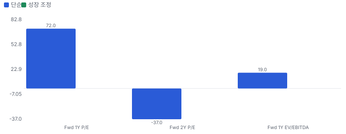

## 내러티브 근거 — 누가 믿고 있나(셀사이드·바이사이드·리테일·언론)

> **한 줄:** '전력망을 기다리지 않고 데이터센터를 켠다'는 이야기는 Meta·Anthropic 주문으로 숫자가 됐다. 지금 가격을 가르는 쟁점은 수요가 아니라 납품 실행, 잔고 다음 주문, 12/7 보호예수 해제다. · 동종 대비 멀티플 차이 +72% 중 회사 고유 몫 -64%(멀티플 엔진) — 내러티브가 설명해야 하는 크기 · 직전 콜 이후 EPS 추정 +51.9%(2026Q4, 2027Q1, 2027Q2, 2027Q3, 2027Q4) — 리비전 경로로 이미 숫자가 된 몫 · 단계 확산, 쏠림 낮음 — 공모가 대비 −61%, 리테일 언급 집계 없음. 다만 유통 주식이 적어 작은 수급에도 크게 움직인다

**내러티브 요인 — 누가 믿고, 멀티플·리비전 중 어디로 작동하나**
| 요인 | 셀사이드 | 바이사이드 | 리테일 | 작동 경로 | 숫자로 바꾸면 | 상태 | 반증 조건 |
|---|---|---|---|---|---|---|---|
| 전력 대기 우회(Speed-to-Power) | 강 | 강 | 약 | 멀티플+리비전 | 북버지니아 접속 대기 약 7년(10-Q), 신규 계약 납품 12~18개월(10-Q) | 강화 | 하이퍼스케일러가 현장 발전 계약을 줄이거나 접속 대기가 짧아진다 |
| Anthropic·Meta 대형 고객 | 강 | 중 | 중 | 리비전 | 잔고 \$0.2B → \$1.7B(1년), Anthropic 470MW, El Paso 366MW | 유지 | 2026년 안에 잔고가 늘지 않거나 고객이 납기를 미룬다 |
| 증설 레버리지 | 강 | 중 | - | 리비전 | 1H26 CAPEX \$8.8M, 고객 선수금 등 계약부채 \$528M | 유지 | Hyperion 램프 지연으로 2026 가이던스 하향 |
| 서비스 꼬리 매출 | 중 | 중 | - | 멀티플 | 연환산 반복 서비스 매출 \$23.6M(TTM(최근 12개월) 매출의 약 15%). 다만 2Q 서비스 마진은 약 18%로 제품 약 25%보다 낮다 | 유지 | 대형 고객이 유지보수를 직접 하거나 별도 입찰로 뺀다 |
| 반대 내러티브: 브리지 전력은 일회성이다 | 약 | 중 | - | 멀티플 | 2Q 고객 4곳이 매출의 65%, 거래처 1곳이 매출채권의 62%. Bloom은 연 2GW 증설 | 유지 | 2028년분 신규 주문이 Anthropic·Meta 밖에서 \$0.5B 이상 나온다 |
| 반대 내러티브: 지배구조와 수급 | 약 | 강 | 약 | 멀티플 | 유동 주식 약 2,880만 주 vs Class A 2,027만 + Class B 1억 7,123만 주 해제 | 강화 | 해제 뒤 대주주 등록 매각이 없고 사건이 회사 책임 없이 종결 |

- **전력 대기 우회(Speed-to-Power)** — 전력망 접속에 수년이 걸리는 동안 현장 발전으로 데이터센터를 먼저 켠다. 터빈보다 납기가 짧다. (바뀌는 입력: 매출 성장률)
- **Anthropic·Meta 대형 고객** — AI 대형 고객이 직접 주문하면서 잔고가 10배가 됐다. (바뀌는 입력: 성장 지속 기간)
- **증설 레버리지** — 조립 중심 공장이라 적은 설비투자로 연 1.2GW까지 늘린다. (바뀌는 입력: 재투자 효율)
- **서비스 꼬리 매출** — 설치 기반이 늘면 유지보수 매출이 쌓인다. (바뀌는 입력: 이익률·위험)
- **반대 내러티브: 브리지 전력은 일회성이다** — 전력망이 연결되면 수요가 끝나고, 잔고는 고객 몇 곳에 몰려 있으며, 경쟁사도 같은 시장으로 들어온다. (바뀌는 입력: 장기 성장률·멀티플)
- **반대 내러티브: 지배구조와 수급** — 유통 주식이 적고 12/7 해제 물량이 그 9배이며, 푸에르토리코 사건이 끝나지 않았다. (바뀌는 입력: 위험(할인율))

**셀사이드(IB 애널리스트)**
| 지표 | 값 | 추세·해석 |
|---|---|---|
| 의견 분포 | 8명 중 강력매수 7·보유 1 | 상장 주관사 비중이 커 보이는 구성(자체 해석) |
| 목표가 평균·범위 | \$22.14 (\$18~\$28) | 지금 주가의 2.7배. 공모가 \$21.50 부근에 머물러 주가를 따라오지 못했다 |
| 최근 변화 | JPM \$21 → \$18(10/19), BofA(뱅크 오브 아메리카) \$19 유지(10/3), Clear Street 매수 개시(9/30) | 하향은 주가를 뒤따른 수준 |
| EPS 추정 표본 | 분기 2명, FY2028 2명 | FY2027 \$0.38~\$0.71, FY2028 \$0.96~\$1.44. 표본이 매우 적다 |

**셀사이드(IB(투자은행) 애널리스트) 해석:** 셀사이드는 모두 잔고 전환을 믿는다. 추정이 2~3명뿐이라 컨센서스 한 숫자에 기대면 안 된다.

**바이사이드(기관 투자자)**
| 지표 | 값 | 추세·해석 |
|---|---|---|
| 13F(미국 기관투자자 분기 보유 공시) 2026Q2 보유 기관 | 77곳, 2,639만 주 | Class A의 약 55%, 완전 희석 주식의 약 9.7% |
| 상위 보유 | T. Rowe 228만·Cinctive 195만·Ameriprise 183만·MFS 178만·AB 170만·Citadel 151만 | 상장 직후 분기라 증감 비교 불가 |
| 내부자 | 상장 후 장내 매수·매도 기록 없음 | 상장 당일 회사 재매입 거래만 있다 |
| 기존 주주 | Class B 1억 7,123만 주, Energy Impact Partners가 이사회에 있다 | 12/7부터 매각 가능 물량 |
| 기관 CMF(최근 20일) | −0.06 | 분산 쪽이지만 크지 않다 |

**바이사이드(기관 투자자) 해석:** 기관은 공모로 들어왔고 아직 시험 중이다. 진짜 수급 변수는 기관 신규 매수가 아니라 기존 주주의 매각이다.

**리테일(레딧·텔레그램·X)**
| 지표 | 값 | 추세·해석 |
|---|---|---|
| 레딧 언급 순위 | 집계 없음 | 상위 목록에 없다 |
| 리테일 거래 몫 | 최근 20일 15.2%(직전 60일 13.9%) | 거래는 주로 기관이 만든다 |
| X 언급 수 | 미수집 | 키 입력 전 |

**리테일(레딧·텔레그램·X) 해석:** 커뮤니티가 끌고 가는 종목은 아니다. 다만 'Anthropic 수혜주' 이야기가 나오면 유통 주식이 적어 쉽게 튄다.

**언론·업계**
| 지표 | 값 | 추세·해석 |
|---|---|---|
| 2026-08 | Anthropic 470MW 주문 | IPO 뒤 첫 대형 호재. 8/12·13 이틀 +39% |
| 2026-08 | 푸에르토리코 계약 승인 철회 | ERock은 이름·서명 무단 사용을 주장, 감독위는 수사기관에 회부 |
| 2026-10 | HD건설기계 엔진 공급 계약 | 약 3,900억 원, 2027~28년. 한국 언론이 크게 다뤘다 |

**언론·업계 해석:** 언론은 '누가 주문했나'에 쏠려 있다. 하반기 납품이 실제로 나오는지는 11/12 전까지 어디에도 없다.

## 밸류에이션 — 맥킨지·IB 방식(현금흐름 할인(DCF) 엔진)

**방법:** 맥킨지식 재무 재구성(NOPAT(세후 영업이익)·투하자본·ROIC(투하자본이익률)) → 바텀업 WACC → FCFF(기업 잉여현금흐름) DCF + 가치 동인 계속가치(ROIC·성장) → 경제적 이익 항등 검증 → 시나리오·몬테카를로 → 가격 내포 기대(역DCF)와 매출 성장 기저율(같은 조건의 과거 사례 빈도). 단위 \$B, 모든 가치는 **현재 시가총액 대비 배수**로 표기(목표주가 아님).

**할인율(WACC) 구성**
| 항목 | 값 |
|---|---|
| 무위험(미 10년) | 4.98% |
| 주식 위험 프리미엄 | 4.20% |
| 레버드 베타(바텀업) | 1.14 (무레버 1.14) |
| 국가위험 | 0.23% |
| 자기자본비용 | 10.01% |
| 부채비중 | 0% |
| WACC | **10.01%** |
| 영구성장 | 3.5% |

**시나리오별 DCF 주주가치 ÷ 현재 시가총액(\$2.3B)**
| 시나리오 | 확률 | 주주가치(\$B) | 지금 | 5년 뒤(할인 전) | 5년 매출 CAGR | 5년차 영업이익률 |
|---|---|---|---|---|---|---|
| 기본 | 50% | 2.1 | **0.90배** | 1.43배 | 42.6% | 12% |
| 강세 | 25% | 4.7 | **2.07배** | 3.27배 | 60.4% | 18% |
| 약세 | 25% | 1.0 | **0.43배** | 0.67배 | 24.0% | 8% |

기본 시나리오 분해: 기업가치 1.8 = 1~10년 현금흐름 현재가치 0.7 + 11년차 이후(계속가치) \$1.2B(초기 재투자가 커서 1~10년 합이 음수면 계속가치가 기업가치의 100%를 넘는다) · 순현금 0.2 · ROIC 1년차 498% → 5년차 34% · 경제적 이익 항등 오차 0.0e+00(DCF와 EP(경제적 이익) 가치가 같아야 정상) · 할인율 +50bp → 가치 -6.1%

**그림 13 · 몬테카를로 3,000회 — 지금 가치/시가총액 분포 (%)**

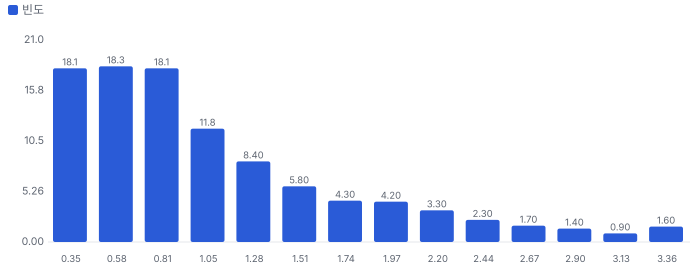

- 읽는 법: 성장률·이익률·재투자·할인율 가정을 무작위로 바꿔 회사 가치를 3,000번 계산했다. 가로축은 그 가치가 지금 시가총액의 몇 배인지, 막대 높이는 그 값이 얼마나 자주 나왔는지를 뜻한다. 1.00이 지금 주가다.
- 해석: 3,000번 중 1,243번(41%)에서 가치가 지금 주가 이상이었다. 지금 주가를 뒷받침하는 경우와 그렇지 않은 경우가 반반에 가깝다. 가운데 값은 0.87배이고, 열 번 중 여덟 번은 0.38~2.17배 사이에 든다.
- 3,000번 돌리면 5년 뒤 주주가치가 지금 시가총액의 2배 이상 890번(약 3.4번에 1번) · 3배 이상 434번(약 6.9번에 1번) · 5배 이상 55번(약 55번에 1번) · 10배 이상 0번

**그림 3 · 가격 내포 기대 vs 필요 성장 (5년 매출 CAGR %)**

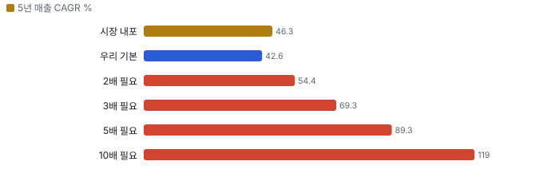

**민감도 — 기본 시나리오 가치/시총(매출 경로 고정, 장기 이익률 × 매출÷투하자본)**
|  | 매출÷투하자본 0.75 | 매출÷투하자본 1.5 | 매출÷투하자본 2.5 | 매출÷투하자본 3 |
|---|---|---|---|---|
| 장기 이익률 12% | 0.02 | 0.65 | 0.90 | 0.96 |
| 장기 이익률 15% | 0.28 | 0.92 | 1.17 | 1.23 |
| 장기 이익률 30% | 1.63 | 2.26 | 2.51 | 2.58 |
| 장기 이익률 40% | 2.52 | 3.16 | 3.41 | 3.47 |

매출÷투하자본 = 매출 1달러를 늘리는 데 드는 설비·운전자본(높을수록 가볍다). 장기 이익률은 4년차 목표와 이후 수렴값을 같이 바꾼 것. 계속가치는 RONIC(신규 투자 이익률) = WACC(11년차 이후 성장은 가치를 만들지 않는다는 맥킨지 보수 가정) · 다른 축: WACC −1%p 1.03배 · WACC +1%p 0.80배 · RONIC 20%(11년차 이후 성장이 가치 창출) 1.04배

**기준 멀티플은 Fwd 1Y P/E · Fwd 2Y P/E이다.** 회사는 EBITDA로 가이던스를 내지만 EBITDA 컨센서스가 FY2027까지만 있어 Fwd 1Y·2Y·3Y를 같은 잣대로 볼 수 있는 지표는 EPS다. FY2027 EBITDA 중 감가상각은 약 25%뿐이다. Fwd 1Y는 다음 4개 분기, Fwd 2Y는 5~8번째, Fwd 3Y는 9~12번째 분기 이익 기준이다. 과거 레인지는 Fwd 1Y만 있다.

**동종 레인지와 펀더멘털 내재 멀티플 (Fwd 1Y P/E · Fwd 2Y P/E 추정 기준)**
| 회사 | Fwd 1Y P/E | Fwd 2Y P/E | 성장 | 영업이익률 | ROIC 영업권 포함/제외 | 매출÷투하자본(영업권 제외) | 펀더멘털 내재(Fwd 1Y P/E) | 시장÷내재 |
|---|---|---|---|---|---|---|---|---|
| BE | 46.6 | 37.1 | 111% | 21% | 28% / 28% | 1.69 | 18.0 | 2.59 |
| GNRC | 14.7 | 9.3 | 6% | 10% | 9% / 9% | 1.12 | 4.4 | 3.30 |
| CMI | 16.5 | 15.5 | 3% | 11% | 17% / 17% | 1.97 | 7.8 | 2.10 |
| CAT | 21.9 | 18.7 | 20% | 19% | 20% / 20% | 1.32 | 12.3 | 1.77 |
| GEV | 41.5 | 34.0 | 17% | 6% | - / - | - | - | - |
| AMRC | 10.1 | 13.0 | 9% | 7% | 3% / 3% | 0.63 | 0.7 | 13.61 |
| **동종 중앙** | 19.2 | 17.1 |  |  |  |  |  | 2.59 |
| **ERock** | 33.0 | 10.7 |  |  |  |  | 35.6 | 0.93 |

**그림 14 · Fwd 1Y P/E — 과거·동종·펀더멘털·합리적 멀티플 (배)**

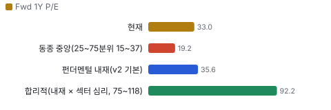

**그림 15 · Fwd 2Y P/E — 과거·동종·펀더멘털·합리적 멀티플 (배)**

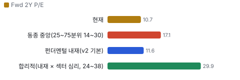

**할인·프리미엄 분해:** ERock의 Fwd 1Y P/E는 동종 중앙 대비 **+72%** = 동종과 같은 섹터 심리를 받는다면 펀더멘털(성장·이익률·ROIC)로 정당한 몫 +381% × ERock에만 얹힌 기업 고유 몫 **-64%**(두 몫을 곱하면 전체). 심리를 빼고 펀더멘털만 비교하면 동종 중앙 내재 대비 +354%. 기업 고유 몫이 양(+)이면 시장이 동종보다 더 큰 기대를 얹은 것(할인이 덜 됐다), 음(−)이면 더 할인한 것이다.

**합리적 멀티플:** 92.2배(섹터 심리 25~75분위 74.8~117.6배) → 주주가치 ÷ 시가총액 **2.33배**(1.94~2.90배). 현재 33.0배와의 차이는 시장이 동종만큼의 기대를 주지 않는 몫이다.

동종 5사 회귀(시장 Fwd 1Y P/E = 4.8 + 1.97 × 펀더멘털 내재, R² 0.85) — 펀더멘털로 정당화되는 멀티플. ERock에 대입하면 75.0배. 표본이 작아 참고용.

**ROIC에 비례하는 정상 상태 멀티플 (맥킨지 가치 동인: EV/NOPAT = (1 − g/ROIC) ÷ (WACC − g))**
| ROIC | EV/NOPAT | EV/EBIT |
|---|---|---|
| 10% | 10.0 | 7.9 |
| 15% | 11.8 | 9.3 |
| 20% | 12.7 | 10.0 |
| 30% | 13.6 | 10.7 |
| 50% | 14.3 | 11.3 |

정상 상태 교차 확인: DCF 기본 시나리오의 5년차 ROIC 33%·영업이익률 12%이면 정상 상태 EV/NOPAT 13.7배. 이를 지금으로 할인하면 주주가치 ÷ 시가총액 1.23배 — 고성장 기업은 현재 멀티플이 아니라 정상 상태 멀티플을 할인해 비교한다.

**데이터 검증 — 원자료 ↔ 밸류에이션 입력 대조 8.6/10**
| 검사 | 결과 | 내용 |
|---|---|---|
| 원자료 스냅숏 | 통과 | 조회 시각 2026-10-31T10:30:00+09:00 |
| 시가총액 대조 | 통과 | 가격 8.35 × 표지 주식 0.21940008 = 1.83 vs 원자료 개요 1.832 |
| 가격 일치 | 통과 | 8.35 vs 8.35 |
| 현금·차입 대조 | 통과 | 현금 0.6266 vs 0.6266 · 차입(리스 포함) 0.0298 vs 0.0298 |
| TTM 매출 = 4분기 합 | 실패 | 0.16219 vs 0.1622(3분기) |
| TTM 영업이익 = 4분기 합 | 실패 | -0.05561 vs -0.0556 |
| 투하자본 = 재무상태표 | 통과 | 0.0204 vs 자기자본+차입+리스−현금 0.020 |
| 연간 컨센서스 = 분기 합 | 통과 | FY2027 1.4444 vs 1.4406 |
| 회사 가이던스 반영 | 통과 | 회사 2Q 실적 보도자료(2026-08-11): 2026 매출 \$435~465M·조정 EBITDA \$3~9M. 2026 잔고 전환 \$360~39 |
| 희석 주식(출처·같은 날짜) | 통과 | 잠재 주식 0.053401 vs SEC(미국 증권거래위원회) 0.053401 · 기본 주식 날짜 2026-08-07 / 희석 날짜 2026-08-07 |
| 어닝콜 톤 = 실적 레이더 | 통과 | 사용 flat · 레이더 기준 flat(톤 변화 None, 가이던스 maintain) |
| 동종사 4곳 이상·기준 표기 | 통과 | 6곳 · 기준 ttm |
| 기준 멀티플 Fwd 1Y(이익 지표) | 통과 | Fwd 1Y P/E · 회사는 EBITDA로 가이던스를 내지만 EBITDA 컨센서스가 FY2027까지만 있어 Fwd 1Y·2Y·3Y를 같은 잣대로 볼 수 있는 지표는 EPS다. FY2027 EBITDA 중 감가상각은 약 25%뿐이다 |
| 매출·이익률 기준 명시(SBC(주식보상비용) 처리) | 통과 | 매출 gaap · 이익률 non_gaap · 비GAAP(회사가 일회성 항목을 뺀 조정 기준) → SBC 2% 차감 |

> 의사결정 보조(투자자문 아님): ① 매수 매력: 연 기대수익 +11.5% (자기자본비용 10.0% 대비 +1.4%p) · 자본비용 초과 확률 41% · 안전마진 0.38 → 정량 신호 약함 / ② 위험 예산 지표(이론): 1/4 켈리 10.0% (상한 10%) · 5년 하위10% -42% · 30%+ 손실 확률 17% / ③ 상방(5년): 기대 1.72배 · 2배 30% · 3배 14% · 10배 0% · 상위10% 3.40배

## 수급 — 누가 왜 샀나(Chiip Flow)

> **한 줄:** 최근 20거래일 거래의 리테일 몫은 15.2%(직전 60일 13.9%) — 거래는 주로 기관이 만든다. 기관 자금 흐름(CMF 20일) -0.06로 기관 분산 쪽, 리테일 매수 압력 z +0.31로 리테일 방향 뚜렷하지 않음. 이상 거래일에 늘어난 거래량의 85%가 기관 몫.

**그림 16 · 일별 거래량 분해 — 리테일 근사(도매 체결사) vs 기관(거래소·다크풀) (천 주)**

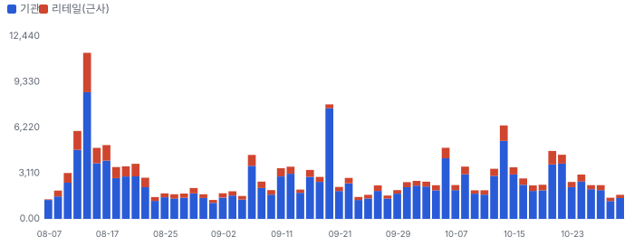

**그림 17 · 기관 자금 흐름(CMF 20일)과 리테일 매수 압력(z ÷ 4로 같은 눈금)**

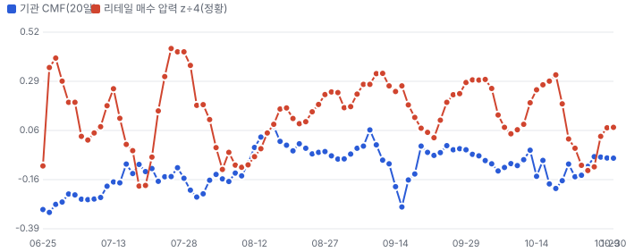

**이상 거래일 — 왜 늘었나, 누가 늘렸나(최근 120거래일, RVOL ≥ 1.8 또는 z ≥ 2)**
| 날짜 | RVOL | 주가 | 종가 위치 | 늘어난 거래량 | 증가분 분해 | 원인 태그 |
|---|---|---|---|---|---|---|
| 2026-09-18 | 4.2배 | +1.5% | +0.44 | 5.92M | 기관 100% · 리테일 0% | 분기 만기·지수 정기 변경 |
| 2026-10-14 | 2.8배 | -14.1% | -0.72 | 4.08M | 기관 82% · 리테일 18% | 업종 동반 급락(BE −9.2%·GNRC −7.6%) |
| 2026-09-08 | 2.5배 | +11.4% | +0.65 | 2.63M | 기관 75% · 리테일 25% | 원인 미확인(공개 사건 없음) |
| 2026-10-06 | 2.3배 | +10.1% | +0.16 | 2.70M | 기관 85% · 리테일 15% | 원인 미확인(공개 사건 없음) |
| 2026-09-14 | 2.1배 | -11.3% | -0.63 | 1.82M | 기관 81% · 리테일 19% | 원인 미확인(공개 사건 없음) |
| 2026-09-11 | 2.0배 | +7.0% | -0.08 | 1.72M | 기관 74% · 리테일 26% | 원인 미확인(공개 사건 없음) |
| 2026-09-16 | 1.9배 | +10.6% | +0.86 | 1.59M | 기관 84% · 리테일 16% | 원인 미확인(공개 사건 없음) |
| 2026-10-21 | 1.8배 | +8.8% | +0.68 | 2.11M | 기관 73% · 리테일 27% | 원인 미확인(공개 사건 없음) |

**주간 체결 장소별 비중 — FINRA 확정치(최신 주 2026-09-21, 약 2주 지연)**
| 주 시작 | 전체(주) | 거래소 | ATS(다크풀) | 리테일 도매 | 기타 장외 |
|---|---|---|---|---|---|
| 2026-08-17 | 18.69M | 49.1% | 23.3% | 22.6% | 5.0% |
| 2026-08-24 | 8.72M | 53.3% | 22.6% | 17.3% | 6.7% |
| 2026-08-31 | 8.14M | 48.1% | 27.1% | 16.3% | 8.4% |
| 2026-09-07 | 12.30M | 54.7% | 21.9% | 17.4% | 6.0% |
| 2026-09-14 | 19.53M | 55.6% | 17.9% | 11.3% | 15.2% |
| 2026-09-21 | 10.36M | 51.9% | 23.6% | 14.9% | 9.6% |

## 가격 구간 — 월·주·일 피보나치와 겹침 구간

> **한 줄:** 현재가 \$8.35 — 바로 위 저항 \$10.71~10.73(+28.4%, 강도 2.0), 바로 아래 지지 \$7.65(-8.4%, 강도 2.0). 가격 구간 지표일 뿐 매수·매도 권유가 아니다.

**지지·저항 겹침 구간(서로 다른 기준선이 ±1.2% 안에 모인 곳, 강도 = 겹친 기준선 수)**
| 구간 | 가격 | 현재가 대비 | 강도 | 겹친 기준선 |
|---|---|---|---|---|
| 저항 3 | \$12.55~12.64 | +50.8% | 2.0 | 일봉 피보 50.0% · 주봉 피보 38.2% |
| 저항 2 | \$11.50~11.52 | +37.8% | 2.0 | 50일 이동평균 · 일봉 피보 78.6% |
| 저항 1 | \$10.71~10.73 | +28.4% | 2.0 | 일봉 스윙 저점 · 주봉 피보 23.6% |
| 지지 1 | \$7.65 | -8.4% | 2.0 | 50일 최저(거래 범위) · 주봉 스윙 저점 |

**시간 단위별 피보나치 되돌림(\$)**
| 단위 | 지배 스윙 | 다리 | 23.6% | 38.2% | 50% | 61.8% | 78.6% |
|---|---|---|---|---|---|---|---|
| 월봉 | \$7.65(2026-10-23) → \$20.70(2026-06-10) | 하락 | 10.7 | 12.6 | 14.2 | 15.7 | 17.9 |
| 주봉 | \$7.65(2026-10-23) → \$20.70(2026-06-10) | 하락 | 10.7 | 12.6 | 14.2 | 15.7 | 17.9 |
| 일봉 | \$10.71(2026-09-02) → \$14.39(2026-10-06) | 상승 | 13.5 | 13.0 | 12.6 | 12.1 | 11.5 |

**그림 18 · 월봉 — 장기 스윙 되돌림**

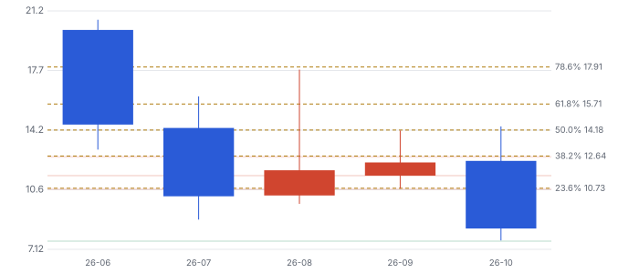

**그림 19 · 주봉 — 52주 스윙 되돌림**

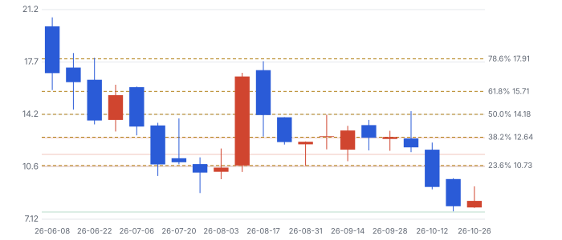

**그림 20 · 일봉 — 마지막 완료 스윙 되돌림(최근 90거래일)**

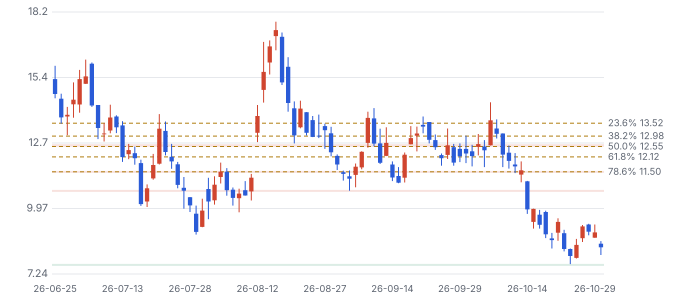

**기법:** 스윙은 ATR(평균 일중 변동폭) 지그재그(임계 = max(월 20%·주 10%·일 5%, 2.5×ATR14)), 되돌림 23.6~78.6%·확장 127.2·161.8%. 함께 본 기준선: 50·200일 이동평균과 50·150·200일 거래 범위 고저, 라운드 넘버(\$50 단위). 피보나치 비율 자체의 학술 근거는 약하다 — 다수가 같은 선에 주문을 두는 데서 오는 효과로 보고, 여러 기준선이 겹친 구간만 강하게 본다. 상장 후 100거래일뿐이라 월·주봉 스윙은 상장 이후 전체 구간이다(장기 지지·저항으로 읽지 말 것) · 고가·저가 근사.

## 판단 시나리오 — 2027년 말 기준

**그림 21 · 판단 시나리오 (주가 \$, 2027년 말 기준, 배수 × FY2028 EPS)**

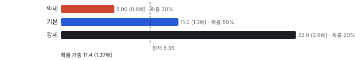

이 시나리오는 배수 기준이다. 확률 가중 \$11.4는 지금 주가의 1.37배이고, 오늘 가치로 할인하면 약 1.22배다. DCF 기본 0.90배와 차이가 난다. 원인은 아래와 같다.

| 차이 | DCF | 배수 시나리오 | 크기 |
|---|---|---|---|
| 시점 | 오늘 가치 | 2027년 말 가격, 할인 전 | 1.37배 → 약 1.22배 |
| 이익의 지속성 | 5년 뒤 성장 약 4%, 이익률 11%로 수렴 | FY2028 EPS에 배수를 준다 | 브리지 수요가 호황이면 배수 쪽이 과대 |
| 고객 선수금 | \$0.36B를 순현금에서 뺐다 | 반영하지 않는다 | 0.16배 |

밸류에이션 절의 '합리적 멀티플' 2.33배는 쓰지 않는다. 이익이 막 시작되는 Fwd 1Y EPS에 ROIC 35.6%를 곱한 값이고, 투하자본이 고객 선수금 때문에 거의 0이라 이 회사에는 맞지 않는다. 주가는 2027년 말까지 납품과 수급이 움직이고, 장기 가치는 브리지 다음 수요가 정한다.

## 반대 검증 — 가장 강한 약세 논리

| 약세 논리 | 근거 | 가를 자료 |
|---|---|---|
| 브리지 전력은 일회성이다 | 전력망이 연결되면 발전기는 피크용으로 내려간다. 서비스 매출도 작다 | 2028년분 주문, 전력망 연결 뒤 계약 형태 |
| 고객 집중 | 2Q 고객 4곳이 매출의 65%, 거래처 1곳이 매출채권의 62% | 10-K(미국 연차보고서) 고객 비중, 잔고 내 고객 수 |
| 경쟁 | Bloom 연 2GW, Caterpillar·INNIO·Wärtsilä 대형 수주. 왕복동 엔진은 독점 기술이 아니다 | 신규 수주 가격, 마진 |
| 수급 | 유통 주식의 약 9배가 12/7 해제. 경제적 지분의 약 80%가 기존 주주 | 해제 후 등록 매각, 교환 조건 |
| 지배구조 | 푸에르토리코 조사, 세금 절감의 85%를 기존 주주에게 주는 약정 | 조사 결과, 소송 경과 |

강세 측 반론도 적는다. 생산 약정이 2028년까지 찼고, 고객 선수금으로 운전자본을 조달하며, 차입금이 없고 \$250M 신용 한도가 비어 있다. Fwd 2Y P/E 10.7배는 FY2028 컨센서스가 절반만 맞아도 동종 중앙값 근처다. 주가는 이미 해제 일정을 안다.

자료의 한계도 밝힌다. 2Q 어닝콜 전문을 확보하지 못해 콜 질의응답은 빠졌고, 2026년 잔고 전환 \$360~390M과 Hyperion 투자 약 \$15M은 2차 요약 자료의 값이다. 상장 전 3Q25·4Q25 분기 실적은 공시되지 않아 데이터 검증이 8.6/10이다. EPS 추정은 2~3명뿐이다. Class B·M 교환 조건의 세부와 잔고의 고객별 내역은 미확인이다.

기저율도 본다. 몬테카를로 기준 5년 뒤 주주가치가 지금의 2배 이상일 확률은 30%, 3배 이상은 14%, 5배 이상은 2%다. 시장 내포 CAGR 46%는 같은 매출 규모 미국 상장사의 상위 4% 성장이다. 가치 수렴을 가정한 연 기대수익은 +11.5%로 자기자본비용 10.0%보다 조금 높을 뿐이다.

## 킬 조건

- 11/12에 2026 매출 가이던스 하한이 \$435M 아래로 내려간다.
- 2027년 3월까지 잔고가 \$1.7B 아래로 줄어든다. 납품을 신규 주문이 채우지 못한다는 뜻이다.
- 대형 고객이 납기를 미루거나 계약을 줄였다고 공시한다.
- 푸에르토리코 조사에서 회사나 임원의 책임이 공식 제기된다.

## 체크리스트

| 시점 | 무엇 | 의미 |
|---|---|---|
| 2026-11-12 | 3Q 실적, 장 시작 전, 콜 08:30 ET | 매출 컨센서스 \$167M, 하반기 램프의 첫 증거. 설치 기반 증가 MW |
| 2026-11-중순 | 13F 3Q 공시 | 기관 보유 변화, 공모 물량이 어디로 갔나 |
| 2026-12-07 | 보호예수 해제 | Class A 약 2,027만 주, Class B·M 교환 조건. 등록 매각 여부 |
| 2027년 1분기 | FY2026 실적, FY2027 가이던스 | \$1.44B 컨센서스의 시험, 2028년분 주문 |

## 출처
- ERock 10-Q 2026-06-30: https://www.sec.gov/Archives/edgar/data/2110029/000119312526346922/eroc-20260630.htm
- ERock 2Q26 실적 보도자료(8-K EX-99.1, 2026-08-11): https://www.sec.gov/Archives/edgar/data/2110029/000119312526344714/eroc-ex99_1.htm
- ERock 424B4 2026-06-09: https://www.sec.gov/Archives/edgar/data/2110029/000119312526265898/d12401d424b4.htm
- 푸에르토리코 재정감독위원회 발표(2026-08-14): https://oversightboard.pr.gov/oversight-board-revokes-approval-of-prepa-contract-with-power-expectations/
- San Juan Daily Star 연방 조사 보도: https://www.sanjuandailystar.com/post/federal-probe-focusing-on-power-expectations-contract-intermediaries
- Korea Herald, HD건설기계 공급 계약: https://www.koreaherald.com/article/10896120
- 2Q 콜 요약(2차 자료): https://quartr.com/events/erock-inc-eroc-q2-2026_FT8SuO7H

_연구 후보이지 매수 권유가 아닙니다 · 공개 자료 기반 분석이며 투자 권유가 아님 · 1차 판정, 미검증 · Chiip ten-bagger_