# 텐배거 리포트 2026-10-31 — 기록 실적을 냈는데 왜 한 달 만에 −41%인가

> 2026-10-31 · FormFactor(FORM) · 기업: 반도체 웨이퍼 테스트용 프로브 카드와 측정 시스템 제조 — HBM 등 고대역폭 메모리 포함

## Chiip View
**컨빅션 중 · 알파 6.0/10 · 업사이드 +20%**

프로브 카드 병목은 실적으로 확인됐다. 3Q 매출 \$280.5M, 기준 총이익률 53%, 텍사스 공장 첫 출하까지 나왔다. 그런데 **기존 공장은 한계에 닿았고 2027년 총이익률은 오르지 않는다.** 주가 −41%로 Fwd 1Y P/E는 21.0배까지 내려와 동종보다 싸졌다. 다만 현금흐름으로 풀면 지금 값도 5년 매출 CAGR(연평균 성장률) 27%를 요구하고, 이는 회사 2030년 목표보다 훨씬 높다. **멀티플은 싸고 DCF(현금흐름 할인 평가)는 비싸다.** 가르는 것은 2027년 상반기 Farmers Branch 램프다. 10배 후보가 아니라 2배 조건부 후보다.

## 한 장 요약
- **① 기업가치를 결정하는 내러티브** **시장이 산 이야기는 'AI 칩은 많아질수록 검사가 어렵고, 프로브 카드가 그 길목'이라는 것이다.** 3Q 매출 \$280.5M(+38% YoY(전년 동기 대비)), 비GAAP(회사가 일회성 항목을 뺀 조정 기준) EPS \$1.04다. 그런데 주가는 10/2 \$149에서 10/30 \$87.53으로 −41%다. 실적이 나쁜 것이 아니다. 기존 공장이 한계에 닿아 4Q 매출 가이던스(회사가 제시한 전망)가 +1.6% QoQ(전 분기 대비)에 그쳤고, 2027년 총이익률이 53% 수준에 머문다고 했다. 이제 값은 텍사스 공장이 얼마나 빨리 차느냐로 갈린다.
- **② 2·3·5·10배가 되려면?** **2배** 시가총액 \$13.88B = 매출 \$2.22B(5년 CAGR 16.2%) · OPM(영업이익률) 30.0% · EPS \$7.00(5년 CAGR 19.4%), 5년 뒤 확률 0%, 조건부 · **3배** 시가총액 \$20.82B = 매출 \$3.33B(5년 CAGR 26.0%) · OPM 30.0% · EPS \$10.50(5년 CAGR 29.5%), 5년 뒤 확률 0%, 경로 미확인 · **5배** 시가총액 \$34.70B = 매출 \$5.55B(5년 CAGR 39.5%) · OPM 30.0% · EPS \$17.51(5년 CAGR 43.5%), 5년 뒤 확률 0%, 닫힘 · **10배** 시가총액 \$69.39B = 매출 \$11.10B(5년 CAGR 60.3%) · OPM 30.0% · EPS \$35.01(5년 CAGR 64.8%), 5년 뒤 확률 0%, 닫힘. 캐파(생산능력) 숫자는 2배까지 그럴듯하고 그 위는 지금 근거가 없다.
- **③ 수주는 어디까지 왔나?** 2030 목표 모델 증분 매출(FY2025(회계연도 2025년) \$0.785B 대비) 24%, 100% 매출 \$0.81B · GPU용 프로브 카드(세계 최대 파운드리향) 미확인, 100% 매출 미확인 · 맞춤형 칩(ASIC) 프로브 카드 미확인, 100% 매출 미확인. 건별 수주 금액은 공개되지 않아, 목표 모델 증분만 수치로 잰다.
- **지금 가격은 무엇을 가정하나?** 현금흐름으로 풀면 5년 매출 CAGR **27%**, 곧 2031년 매출 약 \$3.5B다. 회사 2030년 목표 \$1.6B를 크게 넘고 기저율(같은 조건의 과거 사례 빈도) 상위 16% 값이다. 배수로 보면 정반대다. Fwd 2Y(12~24개월 뒤 추정 기준) P/E 16.6배로 동종 중앙값 18.8배보다 12% 낮다. 시장은 이익은 믿지만 그 이익이 오래 간다고는 절반만 믿는다.
- **왜 기록 실적인데 주가가 빠졌나?** 실적 다음 이틀 −21%다. 회사 사건으로 확인된 것은 둘이다. 4Q 매출이 +1.6% QoQ로 공장 한계에 닿았고, 2027년 총이익률이 53% 수준에 머문다고 했다. 3Q 총이익률 56.5%에도 약 380bp 비반복분이 있었다. 10/30은 나스닥 −3.5%, 인텔 −29%가 겹친 날이라 회사 요인과 나누기 어렵다.
- **3Q 콜에서 무엇이 바뀌었나?** 기준 총이익률 51% → 53%, Farmers Branch 첫 출하가 계획보다 앞섬, 2027년 말 연 \$400M 능력 제시, GPU용 카드 첫 수백만 달러 출하, Triton 2026년 \$30M 이상으로 상향이다. 나빠진 것은 공장 한계와 2027년 이익률 정체다.
- **무엇이 바뀌면 판단이 바뀌나?** 2027년 1Q·2Q에 매출이 Farmers Branch 선형 램프를 따라 오르고 총이익률이 53%를 지키면 2배 경로가 열린다. 반대로 인증 지연이나 HBM(고대역폭 메모리) 물량 조절로 매출이 평탄하면 FY2028 EPS 추정이 내려가고 지금 P/E는 싸지 않다.

## 핵심 숫자
| 항목 | 값 | 설명 |
|---|---|---|
| 주가 (10/30) | \$87.53 | 10/2 \$149 대비 −41% · 6/30 고점 대비 −45% |
| 시가총액 / EV | \$6.84B / \$6.47B | 희석 기준 \$6.94B · 순현금 \$368M · Teradyne \$300M 클로징 전 |
| 3Q 매출·EPS | \$280.5M · \$1.04 | 가이던스 상단 초과 · YoY +38% |
| 4Q 가이던스 | \$285M · \$0.95 | +1.6% QoQ · 총이익률 54% |
| Fwd P/E 1Y·2Y·3Y | 21.0·16.6·14.1배 | 동종 Fwd 1Y 중앙값 25.0배 |
| DCF ÷ 시가총액 | 0.69배 | 몬테카를로 중앙값 0.67배 · WACC 10.9% |
| 시장 내포 5년 CAGR | 27% | 회사 2030 목표 약 11% · 기본 시나리오 16% |

## ① 내러티브 — 기업가치와 멀티플·EPS 프리미엄을 결정하는 이야기

> **기업가치를 결정하는 이야기:** 프로브 카드는 웨이퍼를 자르기 전에 칩마다 전기를 흘려 불량을 가려내는 바늘 묶음이다. 칩 설계마다 전용으로 만들어 소모품처럼 반복 매출이 난다. 칩이 비싸고 복잡할수록 불량 칩을 걸러내는 값이 커지므로 고객은 가격보다 성능과 납기를 본다. 그래서 기업가치는 세 숫자로 갈린다. 공장 능력(지금 연 약 \$1.14B, 2027년 말 +\$400M), 기준 총이익률(53%), 그리고 GPU·맞춤형 칩 점유율이다.

- **멀티플 프리미엄:** Fwd 1Y P/E 21.0배로 동종 중앙값 25.0배보다 16% 낮고 자기 지난 1년 평균 약 48배의 절반 아래다. 프리미엄은 사라졌다.
- **EPS 프리미엄:** FY2027 EPS 컨센서스(시장 평균 추정)는 2Q 실적 전 \$2.76에서 \$3.81로 +38% 올랐다. 주가는 7/29 종가 대비 +5%라 차이는 전부 배수 하락이다.

### 투자자들은 왜 열광했나

세 가지가 겹쳤다. HBM 최종 스택 검사에서 강한 자리를 잡았고, 기준 총이익률이 53%까지 올라왔으며, 5월 투자자의 날에 2030년 매출 \$1.6B·EPS \$5 목표를 내놨다. 주가는 2025년 8월 \$29에서 2026년 6월 \$160까지 5.5배가 됐다. 식은 이유도 분명하다. Fwd 1Y P/E가 4월 말 72배까지 올랐고, 실적 뒤에는 나스닥 −3.5%·인텔 −29%가 겹쳤다.

### 무엇이 기업가치를 바꾸나

- **구조적 체질 변화** (멀티플+리비전(추정치 수정) · 진행 중) — 믹스가 좋아야 이익이 나던 회사에서 믹스가 나빠도 이익이 나는 회사로 바뀌었다. 3Q는 DDR5가 늘고 HBM이 줄었는데도 DRAM 카드 매출이 기록 수준을 유지했고 총이익률도 높았다. 증거: 기준 총이익률 2Q 51% → 3Q 53%. 회사는 DRAM 카드 원가 절감의 효과라고 설명했고 가격 기여는 거의 없다고 했다. 반증: HBM 비중이 다시 늘었는데 총이익률이 오르지 않으면 원가 절감이 아니라 일회성이었다는 뜻이다.
- **고부가 믹스 확장** (멀티플+리비전 · 초기) — 모바일 중심 파운드리 매출이 서버 CPU·GPU·맞춤형 칩으로 넓어진다. 첨단 MEMS 프로브가 필요한 영역이다. 증거: 파운드리·로직 3Q \$134.0M, +10% QoQ. 세계 최대 파운드리에 단일 GPU 설계용으로 수백만 달러어치를 출하했다. 2Q 콜에서는 이 고객 매출에 GPU가 없다고 했다. 반증: 2027년 GPU·맞춤형 칩 점유 확대가 숫자로 나오지 않는다.
- **기술 혁신** (멀티플 · 진행 중) — HBM 최종 스택 고속 검사와 광 프로브가 차별점이다. Triton은 CPO의 첫 시험 공정을 맡는다. 증거: Triton 2025년 매출 0, 2026년 \$30M 이상. Keystone Photonics 인수로 광 결합 기술을 내재화했다. 회사는 2030년 서비스 시장을 \$400M로 본다. 반증: 경쟁사가 CPO 시험에서 표준을 가져가거나 NPO·플러그형으로 옮겨 가며 수요가 분산된다.
- **실행 속도** (리비전 · 진행 중) — 해당 없음(회사와 경쟁사 모두 프로브 카드 납기를 숫자로 공개하지 않는다). 대신 공장 일정으로 잰다. 첫 매출 출하가 2026년 말~2027년 초 계획에서 10월로 앞당겨졌다. 증거: 3Q 콜. 조립·시험 공정 인증을 마쳤고 MEMS 전공정은 2027년에 더한다. 2027년 말 연 \$400M 능력까지 대체로 선형 램프다. 반증: 2027년 상반기 콜에서 인증 지연이나 능력 목표 하향이 나온다.
- **M&A** (멀티플 · 완료) — 1년 전 Keystone Photonics를 인수해 광 프로브를 확보했고 이번에 조직과 기술을 더 긴밀히 통합하기로 했다. 대형 인수는 없다. 증거: 3Q 콜. 자본 배분 원칙은 재투자·선별 인수·희석 상쇄 자사주로 그대로다. 3Q 자사주 매입은 없었다. 반증: Teradyne 자금으로 대형 인수에 나서 이익률이 희석된다.
- **재정정책(행정부)** (리비전 · 진행 중) — 연방 첨단제조 세액공제가 공장 투자 회수를 돕는다. Farmers Branch에 얼마나 적용되는지는 공시로 확인하지 못했다. 확인된 지원은 텍사스 주 기금 \$24.2M이다. **의회 동의 10/10** — 하원 5/5(세액공제 확대 법안 본회의 통과) · 상원 5/5(같은 법안 본회의 통과). 증거: 2Q 콜(텍사스 반도체 혁신 기금 \$24.2M, 시 인센티브 별도). 반증: 보조금 조건을 못 지켜 환수된다.
- **행정명령(행정부)** (리비전 · 일회성) — IEEPA 관세 환급이 3Q 총이익률에 약 300bp, \$8.6M 보탰고 4Q에 약 \$2M이 더 들어온다. 이후 혜택은 없다. **의회 동의 2/10** — 하원 1/5(행정부 조치로 하원 표결 없음) · 상원 1/5(행정부 조치로 상원 표결 없음). 증거: 3Q 콜 CFO(최고재무책임자). 4Q 영향은 약 70bp. 반증: 새 관세가 부품 원가를 다시 올린다.
- **연관입법(의회)** — 해당 없음(이 회사 매출을 직접 바꾸는 계류 법안을 콜과 공시에서 찾지 못했다).
- **CAPEX(설비투자) 낙수효과(대기업 투자가 아래 공급망으로 번지는 효과)** (리비전 · 진행 중) — AI 투자가 테스트로 흘러오지만 회사 매출은 고객 CAPEX가 아니라 칩 설계 수와 웨이퍼 수에 달렸다. 증거: 세계 최대 파운드리가 2개 분기 연속 10% 이상 고객이고, 서버 CPU 고객도 4Q에 10% 고객이 될 수 있다. 공급 관계는 콜로 확인했다. 반증: HBM 물량 조절이나 AI 칩 설계 지연으로 카드 주문이 줄어든다.

### 이 회사의 제품·서비스·기술

- **제품 — 파운드리·로직 프로브 카드:** 웨이퍼 상태의 CPU·GPU·모바일 칩을 시험하는 MEMS 바늘 카드 쓰는 곳: 서버 CPU, 네트워크, GPU, 맞춤형 칩. 돈 버는 방식: 3Q \$134.0M, 매출의 48%.
- **제품 — DRAM·HBM 프로브 카드:** 동시에 많은 칩을 찍는 메모리 카드와 HBM 스택 고속 검사 카드 쓰는 곳: DDR5, HBM4, HBM4E·HBM5 설계 진행. 돈 버는 방식: 3Q \$84.9M, 매출의 30%.
- **제품 — 시스템(Triton 포함):** 엔지니어링 프로브 스테이션, 저온 시스템, CPO 광 시험 장비 쓰는 곳: 연구소 시험에서 양산 전 광 시험까지. 돈 버는 방식: 3Q \$59.5M, 총이익률 61%(비반복 포함).

## ② 배수 사다리 — 2·3·5·10배가 되려면

> **시가총액 \$6.94B → 2·3·5·10배까지 본다.** 시가총액이 커질수록 볼 배수를 줄인다(\$30B 미만 10배, \$30B~\$100B 5배, \$100B 이상 2배까지). 숫자는 출구 P/E 25배·OPM 30.0%·순이익률 25.0% 기준이다. 출구 P/E 25배는 동종 중앙값이다. 영업이익률 30%·순이익률 25%는 회사 목표 매출 \$1.6B·EPS \$5와 희석 후 약 8,100만 주에서 계산한 값이다.

**배수 단계별 필요 조건 — 2·3·5·10배**
| 배수 | 목표 시가총액 | 필요 매출 | 매출 CAGR 5년 / 10년 | OPM | 필요 EPS | EPS CAGR 5년 / 10년 |
|---|---|---|---|---|---|---|
| **지금** | \$6.94B | \$1.05B | - | 25.4% | \$2.88 | - |
| **2배** | \$13.88B | \$2.22B | 16.2% / 7.8% | 30.0% | \$7.00 | 19.4% / 9.3% |
| **3배** | \$20.82B | \$3.33B | 26.0% / 12.2% | 30.0% | \$10.50 | 29.5% / 13.8% |
| **5배** | \$34.70B | \$5.55B | 39.5% / 18.1% | 30.0% | \$17.51 | 43.5% / 19.8% |
| **10배** | \$69.39B | \$11.10B | 60.3% / 26.6% | 30.0% | \$35.01 | 64.8% / 28.4% |

**배수 단계별 달성 가능성**
| 배수 | 지금 매출 대비 | 프로브 카드 시장 점유 | DCF 역산 5년 CAGR | 5년 뒤 확률 | 판정 |
|---|---|---|---|---|---|
| **2배** | 2.1배 | 74.0% | 33.0% (상위 7%, n=163) | 0% | 조건부 |
| **3배** | 3.2배 | 111.0% | 44.9% (상위 4%, n=163) | 0% | 경로 미확인 |
| **5배** | 5.3배 | 185.1% | 60.6% (상위 1%, n=163) | 0% | 닫힘 |
| **10배** | 10.6배 | 370.1% | 83.6% (상위 0%, n=163) | 0% | 닫힘 |

**그림 9 · 배수 단계별 필요 매출 vs 회사 경로 (\$B)**

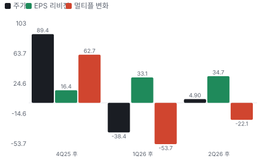

### 2배 — \$13.88B · 조건부

- **필요 조건:** 매출 \$2.22B(5년 CAGR 16.2%) · OPM 30.0% · EPS \$7.00(5년 CAGR 19.4%)
- **어떻게 성장해야 하나:** 회사 목표 \$1.6B를 넘어야 한다. 2027년 말 캐파 위로 공장을 더 늘리고, GPU·맞춤형 칩 점유를 넓히고, Triton이 서비스 시장 \$400M의 상당 부분을 가져가는 경로다.
- **펀더멘털 전망:** 시스템 비중이 지금처럼 약 21%라면 프로브 카드 매출 약 \$1.75B가 필요하다. 시장이 연 10% 큰다고 가정하면 2031년 약 \$4.8B이고 점유율은 지금 약 29%에서 36%로 올라야 한다. 2027년 말 캐파 약 \$1.54B까지는 보이지만 그 위는 회사가 말하지 않았다.

### 3배 — \$20.82B · 경로 미확인

- **필요 조건:** 매출 \$3.33B(5년 CAGR 26.0%) · OPM 30.0% · EPS \$10.50(5년 CAGR 29.5%)
- **어떻게 성장해야 하나:** 프로브 카드 시장이 커지는 속도보다 훨씬 빠르게 점유를 늘려야 한다. 시장 약 \$3.0B 기준으로 숫자가 시장 전체에 가깝다.
- **펀더멘털 전망:** 시장 자체가 2배 커지는 시나리오가 필요하다. 지금 근거로는 말할 수 없다.

### 5배 — \$34.70B · 닫힘

- **필요 조건:** 매출 \$5.55B(5년 CAGR 39.5%) · OPM 30.0% · EPS \$17.51(5년 CAGR 43.5%)
- **어떻게 성장해야 하나:** 지금의 사업 범위로는 닿지 않는다. 테스트 장비나 다른 시장으로 넓혀야 한다.
- **펀더멘털 전망:** 공시된 계획에 이런 경로는 없다.

### 10배 — \$69.39B · 닫힘

- **필요 조건:** 매출 \$11.10B(5년 CAGR 60.3%) · OPM 30.0% · EPS \$35.01(5년 CAGR 64.8%)
- **어떻게 성장해야 하나:** 프로브 카드 시장 전체의 3배를 넘는 매출이 필요하다.
- **펀더멘털 전망:** 텐배거 후보가 아니라 2배 조건부 후보다.

## ③ 수주·파이프라인 — 진척도와 남은 수익

> **2026-09-26 기준 수주·파이프라인 5건, 건별 확정 수주 금액은 공개되지 않았다.** 미확정 건은 확정 합계에 넣지 않았다. 수익은 항목별 마진 가정을 곱한 추정이다. 서로 겹치거나 금액을 모르는 항목은 합계에서 뺐다.

**수주·파이프라인 진척**
| 항목 | 상태 | 진척도 | 실행 속도 | 방해 요인 |
|---|---|---|---|---|
| 2030 목표 모델 증분 매출(FY2025 \$0.785B 대비) | 파이프라인 | 24% | 앞섬(계획 14%, +10%p), 이대로면 2028-10 완료 | 메모리 사이클 · AI 칩 수요 |
| GPU용 프로브 카드(세계 최대 파운드리향) | 파이프라인 | 미확인 | 단일 설계 수백만 달러 출하, 2027년 점유 확대 목표 | Farmers Branch 캐파 · 경쟁사 점유 · 설계별 인증 |
| 맞춤형 칩(ASIC) 프로브 카드 | 파이프라인 | 미확인 | 다수 인증·출하, 양산 물량은 캐파에 막힘 | Farmers Branch 캐파 · 고객 ASIC 일정 |
| Triton CPO·광 시험 | 파이프라인 | 미확인 | 2026년 매출 \$30M 이상(연초 \$10~20M), 2030년 서비스 시장 \$400M은 시장 규모이지 수주가 아니다 | CPO 채택 시점 · 단일 생태계 의존 |
| Farmers Branch 캐파(연 매출 능력) | 파이프라인 | 미확인 | 첫 양산품 출하 10월로 계획보다 앞섬, 2027년 말까지 대체로 선형 | 장비·인력 확보 속도 · 고객 인증 기간 · MEMS 전공정 2027년 도입 |

**진척도별 수익**
| 항목 | 마진 가정 | 현 진척 매출 | 현 진척 이익 | 100% 매출 | 100% 이익 |
|---|---|---|---|---|---|
| 2030 목표 모델 증분 매출(FY2025 \$0.785B 대비) | 비GAAP 영업이익 30% | \$0.20B | \$0.06B | \$0.81B | \$0.24B |
| GPU용 프로브 카드(세계 최대 파운드리향) | 미확인 | 미확인 | 미확인 | 미확인 | 미확인 |
| 맞춤형 칩(ASIC) 프로브 카드 | 미확인 | 미확인 | 미확인 | 미확인 | 미확인 |
| Triton CPO·광 시험 | 미확인 | 미확인 | 미확인 | 미확인 | 미확인 |
| Farmers Branch 캐파(연 매출 능력) | 매출총이익 53% | 미확인 | 미확인 | \$0.40B | \$0.21B |

**합계**
| 구분 | 100% 매출 | 현 진척 매출 | 현 진척 이익 | 100% 이익 |
|---|---|---|---|---|
| **미확정 합계** | \$0.81B | \$0.20B | \$0.06B | \$0.24B |

## ④ 주가와 배수 — 이익은 올랐고 배수가 반토막 났다

**그림 1 · FORM 주간 종가 (\$, 최근 1년)**

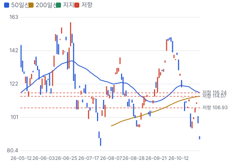

넉 달 사이 주가는 \$160 → \$83 → \$150 → \$88을 오갔다. 7/29 \$83에서 8/17 \$138까지 66% 올랐고, 10월에 다시 \$87로 왔다. Fwd 1Y P/E는 6월 말 65배에서 21.0배로 내려왔다. 2Q 실적 전과 비교해 FY2027 EPS 컨센서스는 38% 올랐다. 이번 하락은 이익 하향이 아니라 배수 축소다.

10/5 거래량 1,391만 주는 평소의 약 12배였고 주가는 −0.8%에 그쳤다. 그 주 장외 체결 비중이 39%로 평소의 약 4배라 대량 거래의 흔적으로 보이지만 주체는 확인하지 못했다. Teradyne 8-K(미국 수시공시) 사건일(10/6) 전날이고 공식 발표는 10/12여서 연결할 근거가 없다.

## ⑤ 실적 — 비반복을 빼도 좋았고, 그래서 한계가 보였다

> 3Q 비GAAP 총이익률 56.5%에서 관세 환급과 양자 부품 원가 효과 약 380bp를 빼면 52.5~53%다. EPS \$1.04 중 약 \$0.09가 관세 환급이다. 환급을 뺀 EPS는 약 \$0.95로 4Q 가이던스 중간값과 같다.

**그림 2 · 분기 매출 실적과 전망 (\$M)**

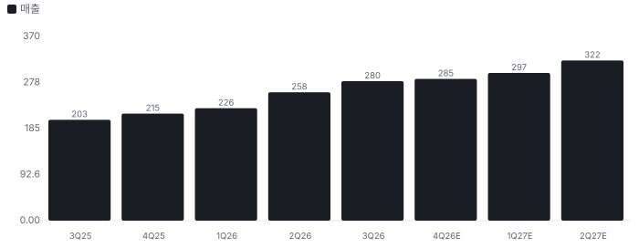

| 3Q26 사업별 | 매출 | QoQ | 읽을 점 |
|---|---|---|---|
| 파운드리·로직 | \$134.0M | +10% | 서버 CPU와 GPU가 끌었다 |
| DRAM | \$84.9M | 약 0% | HBM 감소를 DDR5가 메웠다 |
| 플래시 | \$2.2M | 미확인 | 비중이 작다 |
| 시스템 | \$59.5M | +23% | Triton이 끌었다 |

주문이 아니라 생산이 매출을 정한다. 회사는 지금 공장에서 더 뽑아낼 여지가 한계에 닿았다고 했다. 4Q 가이던스의 작은 증가폭이 그 증거다. 현금은 잘 들어온다. 3Q 잉여현금 \$64.8M이고 현금·유가증권은 \$395M이다.

## ⑥ 사업과 병목 — 공백은 2027년 상반기다

병목은 주문이 아니라 캐파다. Chiip 계산으로 지금 기존 공장의 매출 능력은 4Q 연환산 약 \$1.14B다. 여기에 Farmers Branch가 2027년 말 연 \$400M을 더한다. 회사가 말한 대로 0에서 시작해 대체로 선형으로 오르면 2027년 안에 더해지는 매출은 평균 약 \$200M이다. 그러면 FY2027 매출 상한은 약 \$1.34B다(추정). 이 공장은 파운드리·로직 전용이고, 전공정이 들어오면 Livermore의 DRAM 캐파가 풀린다.

**그림 4 · FY2027 매출 전망 vs 캐파 상한 (\$B)**

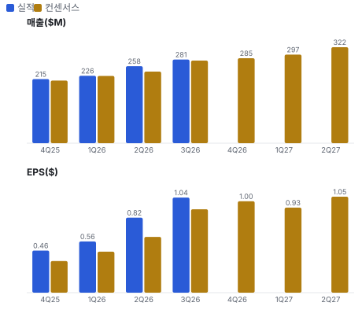

**2030년 목표는 사실상 2028년 캐파다.** 2027년 말 능력 약 \$1.54B는 목표 \$1.6B에 거의 닿는다. 시장 쟁점은 목표 달성이 아니라 공장이 찼을 때 총이익률이 55%로 가느냐다. 회사는 3Q 콜에서 장기적으로 목표 모델에 가깝게 간다고 답했지만 공장 단독 이익률은 주지 않았다.

| 금지표 점검 | 주장 | 확인 결과 |
|---|---|---|
| 샘플 출하 → 양산 성공 | Farmers Branch 첫 출하 | 조립·시험 인증과 양산품 첫 출하까지다. MEMS 전공정은 2027년, 수율은 미확인 |
| 명목 캐파 → 판매 가능 생산량 | 연 \$400M | 회사 표현도 매출이 아니라 능력이다. 램프 일정과 수율을 봐야 한다 |
| 협력 → 매출 확보 | Teradyne \$300M | 지분 투자와 기술 협력이다. 물량·독점 조건은 공개되지 않았다 |
| 주가 급락 → 펀더멘털 변화 | −41% | EPS 추정은 내려가지 않았다. 다만 3Q 뒤 추정 대부분이 아직 갱신 전이다 |

## ⑦ 손익분기 — 멀티플과 DCF가 왜 다른가

두 방법의 답이 크게 다르다. DCF는 0.69배, 합리적 멀티플은 1.52배다. 차이는 세 곳에서 온다. DCF는 SBC(주식보상비용)를 비용으로 빼 장기 영업이익률을 27%로 두고, 할인율이 10.9%이며, 영구 구간 재투자 수익을 자본비용과 같게 둔다. 멀티플은 지금 동종이 받는 섹터 심리를 그대로 쓴다.

장기 이익률을 바꾸면 DCF ÷ 시가총액은 27%에서 0.69배, 30%에서 0.76배, 40%에서 1.00배다. 현금흐름만으로 지금 주가를 설명하려면 장기 이익률 40%나 5년 CAGR 27%가 필요하다. 어느 쪽도 회사 목표 범위 밖이다. 그래서 이 주식은 사이클 상단의 이익에 업종 배수를 준 값이고, 배수가 유지된다는 전제가 들어 있다.

## 어닝콜 변화·컨센서스·멀티플 프리미엄·EPS 리비전

**방법:** 직전 콜(2026-07-29) → 최신 콜(2026-10-28)에서 새로 나오거나 바뀐 항목을 DCF 기본 시나리오의 동인 이동으로 옮기고, 그 변화가 없었을 때(동인을 되돌린 DCF) 대비 주주가치 변화를 잰다. 확신도: 확정 1.0 · 회사 가이던스 0.8 · 경영진 목표·장기 발언 0.5 · 정황 0.3. '반복'은 직전 콜과 같은 말이라 가치 영향 0.

**직전 콜 대비 새로 나오거나 바뀐 내용 → 가치 영향 (DCF 기본 시나리오 주주가치 기준)**
| 항목 | 내용 | 직전 콜 | 최신 콜 | 모델 동인 이동 | 확신도 | 가치 영향 |
|---|---|---|---|---|---|---|
| 업데이트 | 기준 총이익률 | 2Q 51% | 3Q 53%, 2027년 비슷 | 목표 이익률 +1.0% | 0.8 | +0.8% |
| 신규 | Farmers Branch 능력 | 2027년 내내 램프, 2028년 초 초기 목표 | 2027년 말 연 \$400M 능력, 첫 출하 10월 | 1년차 성장률 +3.0% | 0.8 | +5.2% |
| 신규 | GPU 프로브 카드 | 2Q 10% 고객 매출에 GPU 없음 | 수백만 달러 출하, 2027년 점유 확대 목표 | 장기 성장 수렴값 +0.50% | 0.5 | +1.8% |
| 업데이트 | Triton 매출 | 연초 \$10~20M | 2026년 \$30M 이상 | 기준연도 매출 +\$0.01B | 1.0 | +0.4% |
| 부정 | 기존 공장 한계 | 분기 +9~14% | 4Q +1.6% QoQ | 1년차 성장률 -2.0% | 0.8 | -3.3% |
| **합계** | 단독 합 |  |  | 동시 적용 +4.7% |  | **+4.8%** |

**그림 6 · 콜 변화 항목별 주주가치 영향 (%)**

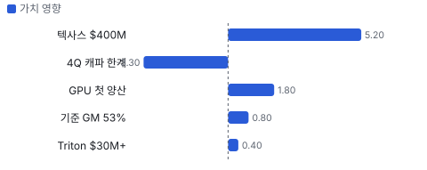

**실적 vs 컨센서스 — 최근 4개 분기 (이익 지표는 조정 기준, 발표 직전 추정)**
| 분기 | 지표 | 실적 | 컨센서스 | 서프라이즈 |
|---|---|---|---|---|
| 2025Q4 | 매출 | \$215.2M | \$210.1M | +2.4% |
| 2025Q4 | OPM | 17.2% | 14.2% | +2.9%p |
| 2025Q4 | EPS | \$0.46 | \$0.35 | +32.9% |
| 2026Q1 | 매출 | \$226.1M | \$225.6M | +0.2% |
| 2026Q1 | OPM | 21.5% | 17.6% | +4.0%p |
| 2026Q1 | EPS | \$0.56 | \$0.45 | +25.0% |
| 2026Q2 | 매출 | \$258.2M | \$240.1M | +7.6% |
| 2026Q2 | OPM | 27.9% | 22.3% | +5.5%p |
| 2026Q2 | EPS | \$0.82 | \$0.61 | +34.4% |
| 2026Q3 | 매출 | \$280.5M | \$277M | +1.3% |
| 2026Q3 | OPM | 33.5% | 29.6% | +3.9%p |
| 2026Q3 | EPS | \$1.04 | \$0.91 | +14.0% |

**그림 7 · 분기별 서프라이즈 — 매출·OPM·EPS (%, OPM은 %p), 최근 4개 분기**

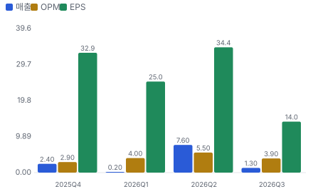

**그림 5 · 지난 12개월 EPS 리비전 추이 — 캘린더 2026·2027년 EPS 추정(\$/주)**

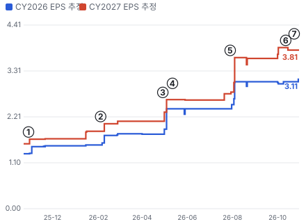

- ① 25-10-29 3Q25 실적 · EPS 리비전 +7%
- ② 26-02-04 4Q25 실적 · EPS 리비전 +9%
- ③ 26-04-29 1Q26 실적 · EPS 리비전 +25%
- ④ 26-05-12 투자자의 날 목표 모델 제시 · 실적 창과 겹침
- ⑤ 26-07-29 2Q26 실적 · EPS 리비전 +32%
- ⑥ 26-10-12 Teradyne \$300M 투자 발표 · EPS 리비전 -2%
- ⑦ 26-10-28 3Q26 실적 · EPS 리비전 +0%

**사건별 EPS 리비전 — 실적 발표·내러티브 변화 때 추정이 어떻게 움직였나**
| # | 날짜 | 구분 | 사건 | CY2026 EPS 전→후 | CY2027 EPS 전→후 | 리비전 | 주가 반응 |
|---|---|---|---|---|---|---|---|
| ① | 25-10-29 | 실적 | 3Q25 실적 | \$1.32 → \$1.49 | \$1.56 → \$1.67 | +6.7% | +24.2% |
| ② | 26-02-04 | 실적 | 4Q25 실적 | \$1.53 → \$1.76 | \$1.86 → \$2.04 | +9.4% | +17.2% |
| ③ | 26-04-29 | 실적 | 1Q26 실적 | \$1.79 → \$2.40 | \$2.10 → \$2.62 | +24.5% | +0.3% |
| ④ | 26-05-12 | 내러티브 | 투자자의 날 목표 모델 제시 | \$2.40 → \$2.40 | \$2.62 → \$2.62 | 실적 창과 겹침 | -12.8% |
| ⑤ | 26-07-29 | 실적 | 2Q26 실적 | \$2.40 → \$3.05 | \$2.76 → \$3.63 | +31.6% | +26.3% |
| ⑥ | 26-10-12 | 내러티브 | Teradyne \$300M 투자 발표 | \$3.05 → \$3.05 | \$3.87 → \$3.81 | -1.6% | -6.7% |
| ⑦ | 26-10-28 | 실적 | 3Q26 실적 | \$3.05 → \$3.11 | \$3.81 → \$3.81 | +0.0% | -11.6% |

**그림 8 · 최근 4개 분기 주가 변화 분해 = EPS 리비전 × 멀티플 변화 (%, 실적 발표 사이 구간)**

**분기별 주가 분해 — 실적 발표 사이 구간**
| 구간 | 기간 | 주가 | EPS 리비전 | 멀티플 변화 | 선행 P/E 시작 → 끝 |
|---|---|---|---|---|---|
| 4Q25 후 | 26-02-04 ~ 26-04-29 | \$71.57 → \$135.53 (+89%) | +16% | +63% | 45.7배 → 71.6배 |
| 1Q26 후 | 26-04-29 ~ 26-07-29 | \$135.53 → \$83.45 (-38%) | +33% | -54% | 71.6배 → 32.0배 |
| 2Q26 후 | 26-07-29 ~ 26-10-30 | \$83.45 → \$87.53 (+5%) | +35% | -22% | 32.0배 → 23.7배 |

**해석:** 3개 구간 누적 주가 +22% = EPS 리비전 +109% × 멀티플 -41%. 더 크게 움직인 쪽은 **EPS 리비전**이다.

**컨센서스 리비전 — 2Q 실적 직전(2026-07-28) → 지금(2026-10-29), 같은 분기끼리**
| 분기 | 지표 | 직전 | 지금 | 리비전 |
|---|---|---|---|---|
| 2026Q4 | EPS | 0.64 | 0.798 | +24.7% |
| 2027Q1 | EPS | 0.5667 | 0.8375 | +47.8% |
| 2027Q2 | EPS | 0.6367 | 0.9175 | +44.1% |
| 2027Q3 | EPS | 0.66 | 1 | +51.5% |
| 2027Q4 | EPS | 0.67 | 1.07 | +59.7% |
| **합계 5분기** | EPS | 3.173 | 4.623 | **+45.7%** |

**멀티플 프리미엄 — 동종 중앙값 대비 (성장 조정 = 배수 ÷ 최근 분기 전년 대비 매출 성장%, 한 분기 성장이라 변동이 크다)**
| 지표 | 대상 | 동종 중앙값(범위) | 프리미엄 | 성장 조정 프리미엄 |
|---|---|---|---|---|
| Fwd 1Y P/E | 21.0배 | 25.0배 (19.5~28.4, 5사) | **-16%** | - |
| Fwd 2Y P/E | 16.6배 | 18.8배 (14.2~25.4, 5사) | **-12%** | - |
| Fwd 3Y(24~36개월 뒤 추정 기준) P/E | 14.1배 | 16.9배 (12.3~23.5, 5사) | **-17%** | - |
| Fwd 1Y EV/EBITDA(기업가치 ÷ 상각전영업이익) | 17.3배 | 21.9배 (14.5~27.8, 5사) | **-21%** | - |
| Fwd 2Y EV/EBITDA | 13.7배 | 17.6배 (9.4~23.5, 5사) | **-23%** | - |
| Fwd 3Y EV/EBITDA | 11.7배 | 16.3배 (8.2~20.7, 5사) | **-28%** | - |

**그림 10 · 멀티플 프리미엄 (%) — 0 = 동종 중앙값**

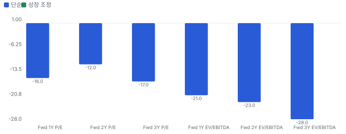

## 내러티브 근거 — 누가 믿고 있나(셀사이드·바이사이드·리테일·언론)

> **한 줄:** '테스트가 AI 칩의 병목'이라는 이야기는 실적으로 확인됐는데, 주가는 10/2 이후 −41%다. 시장은 이익이 아니라 캐파 한계와 2027년 이익률 정체를 먼저 넣었다 · 동종 대비 멀티플 차이 -16% 중 회사 고유 몫 -35%(멀티플 엔진) — 내러티브가 설명해야 하는 크기 · 직전 콜 이후 EPS 추정 +45.7%(2026Q4, 2027Q1, 2027Q2, 2027Q3, 2027Q4) — 리비전 경로로 이미 숫자가 된 몫 · 단계 확산, 쏠림 보통

**내러티브 요인 — 누가 믿고, 멀티플·리비전 중 어디로 작동하나**
| 요인 | 셀사이드 | 바이사이드 | 리테일 | 작동 경로 | 숫자로 바꾸면 | 상태 | 반증 조건 |
|---|---|---|---|---|---|---|---|
| 테스트 강도 상승 | 강 | 중 | 약 | 멀티플+리비전 | TTM(최근 12개월) 매출 \$980M, YoY +29%, 3Q 파운드리·로직 +10% QoQ | 강화 | 2027년 파운드리·로직 매출이 2분기 연속 감소 |
| 기준 총이익률 재평가 | 강 | 중 | - | 멀티플+리비전 | 기준 총이익률 51% → 53%, 2027년도 비슷 | 유지 | 2027년 분기 비GAAP 총이익률 51% 미만 |
| 광 테스트 선점 | 중 | 중 | 중 | 멀티플 | Triton 2025년 0 → 2026년 \$30M 이상, 2030년 서비스 시장 \$400M(회사 추정) | 강화 | 2027년 Triton 매출이 2026년을 넘지 못함 |
| Teradyne 동맹 | 중 | 강 | - | 멀티플 | \$300M, 시가총액의 약 4% | 유지 | 클로징 무산, 또는 Teradyne의 프로브 카드 내재화 |
| 반대 내러티브: 사이클 정점의 이익률 | 중 | 강 | - | 멀티플 | 3Q 총이익률 56.5% 중 약 380bp 비반복, 주가 고점 대비 −45% | 강화 | 2027년 상반기 총이익률 53% 이상 유지와 EPS 상향 |

- **테스트 강도 상승** — HBM·GPU·맞춤형 칩이 복잡해질수록 웨이퍼 단계 검사가 비싸지고 프로브 카드 사양이 올라간다 (바뀌는 입력: 성장 지속기간)
- **기준 총이익률 재평가** — DRAM 원가 절감으로 믹스에 덜 흔들리는 회사가 됐다 (바뀌는 입력: 장기 이익률)
- **광 테스트 선점** — CPO가 퍼지면 Triton이 첫 공정 표준이 된다 (바뀌는 입력: 새 시장)
- **Teradyne 동맹** — 테스트 장비사 Teradyne과 지분으로 묶여 개방형 테스트 생태계를 유지한다 (바뀌는 입력: 경쟁 강도)
- **반대 내러티브: 사이클 정점의 이익률** — 주문이 넘칠 때 찍은 이익률이고, 공장 램프와 AI 투자 둔화가 겹치면 배수가 먼저 깎인다 (바뀌는 입력: 할인율·장기 이익률)

**셀사이드(IB 애널리스트)**
| 지표 | 값 | 추세·해석 |
|---|---|---|
| 애널리스트 의견 | 11명 — 강력 매수 6·보유 5·매도 0 | 의견이 갈린다. 실적 후 Needham 보유 유지 |
| 목표가 평균·범위 | \$154 (\$110~\$200, 10명) | 10/30 종가 대비 평균 +76%. 기대의 증거이지 Chiip 목표가가 아니다 |
| 실적 전후 목표가 | B. Riley \$165→\$150(10/19), Evercore \$140 | 실적 전에 이미 낮추기 시작했다 |
| 3Q 콜 질문 초점 | 2027 총이익률·HBM 사양 축소·증설 가속·GPU 기여 | 질문한 7곳 중 5곳이 캐파와 총이익률 |

**셀사이드(IB(투자은행) 애널리스트) 해석:** 셀사이드의 쟁점은 수요가 아니라 얼마나 빨리 공장을 채우고 이익률을 지키느냐다

**바이사이드(기관 투자자)**
| 지표 | 값 | 추세·해석 |
|---|---|---|
| 13F(미국 기관투자자 분기 보유 공시) 2Q 보유 기관 | 473곳 — 증가 134·감소 158 | 순감소 약 772만 주. 이유는 미확인 |
| 전략적 투자자 | Teradyne 223만 주·\$300M, 주당 약 \$134(계산) | 지금 주가보다 53% 높은 값. 클로징은 4Q 예정 |
| 내부자 | CEO 8/14·9/16·10/14 장내 매도 합계 약 4.5만 주 | 사전 계획 여부 미확인 |

**바이사이드(기관 투자자) 해석:** 장기 전략 자본은 들어오는데 기관은 2분기에 줄였다. 3Q 13F가 11월 중순 나온다

**리테일(레딧·텔레그램·X)**
| 지표 | 값 | 추세·해석 |
|---|---|---|
| 리테일 체결 몫(FINRA(미국 금융산업규제국)) | 20일 3.7%, 직전 60일 7.2% | 급락 구간에 리테일 몫이 줄었다 |

**리테일(레딧·텔레그램·X) 해석:** 리테일이 끌고 내린 주가가 아니다. 거래는 기관이 만들었다

**언론·업계**
| 지표 | 값 | 추세·해석 |
|---|---|---|
| 주요 사건 | Farmers Branch 개소, Teradyne 투자 | 공장과 파트너십 위주 |

**언론·업계 해석:** 언론은 공장 개소와 Teradyne 투자를 중심으로 다뤘다

## 밸류에이션 — 맥킨지·IB 방식(현금흐름 할인(DCF) 엔진)

**방법:** 맥킨지식 재무 재구성(NOPAT(세후 영업이익)·투하자본·ROIC(투하자본이익률)) → 바텀업 WACC(가중평균자본비용) → FCFF(기업 잉여현금흐름) DCF + 가치 동인 계속가치(ROIC·성장) → 경제적 이익 항등 검증 → 시나리오·몬테카를로(가정을 무작위로 바꿔 수천 번 계산하는 방법) → 가격 내포 기대(역DCF)와 매출 성장 기저율. 단위 \$B, 모든 가치는 **현재 시가총액 대비 배수**로 표기(목표주가 아님).

**할인율(WACC) 구성**
| 항목 | 값 |
|---|---|
| 무위험(미 10년) | 4.98% |
| 주식 위험 프리미엄 | 4.20% |
| 레버드 베타(바텀업) | 1.35 (무레버 1.35) |
| 국가위험 | 0.23% |
| 자기자본비용 | 10.86% |
| 부채비중 | 0% |
| WACC | **10.86%** |
| 영구성장 | 3.5% |

**시나리오별 DCF 주주가치 ÷ 현재 시가총액(\$6.9B)**
| 시나리오 | 확률 | 주주가치(\$B) | 지금 | 5년 뒤(할인 전) | 5년 매출 CAGR | 5년차 영업이익률 |
|---|---|---|---|---|---|---|
| 기본 | 50% | 4.8 | **0.69배** | 1.10배 | 16.0% | 27% |
| 강세 | 30% | 5.4 | **0.77배** | 1.24배 | 17.5% | 28% |
| 약세 | 20% | 3.5 | **0.50배** | 0.79배 | 7.9% | 26% |

기본 시나리오 분해: 기업가치 4.4 = 1~10년 현금흐름 현재가치 2.2 + 11년차 이후(계속가치) \$2.3B(초기 재투자가 커서 1~10년 합이 음수면 계속가치가 기업가치의 100%를 넘는다) · 순현금 0.4 · ROIC 1년차 38% → 5년차 34% · 경제적 이익 항등 오차 0.0e+00(DCF와 EP(경제적 이익) 가치가 같아야 정상) · 할인율 +50bp → 가치 -5.0%

**그림 11 · 몬테카를로 3,000회 — 지금 가치/시가총액 분포 (%)**

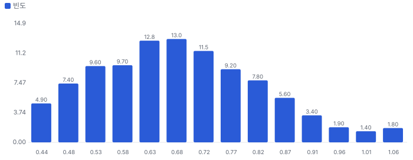

- 읽는 법: 성장률·이익률·재투자·할인율 가정을 무작위로 바꿔 회사 가치를 3,000번 계산했다. 가로축은 그 가치가 지금 시가총액의 몇 배인지, 막대 높이는 그 값이 얼마나 자주 나왔는지를 뜻한다. 1.00이 지금 주가다.
- 해석: 3,000번 중 79번(3%)에서 가치가 지금 주가 이상이었다. 가정을 흔들어도 지금 주가를 뒷받침하지 못하는 경우가 더 많다. 가운데 값은 0.67배이고, 열 번 중 여덟 번은 0.50~0.88배 사이에 든다.
- 3,000번 돌리면 5년 뒤 주주가치가 지금 시가총액의 2배 이상 2번(약 1500번에 1번) · 3배 이상 0번 · 5배 이상 0번 · 10배 이상 0번

**그림 3 · 가격 내포 기대 vs 필요 성장 (5년 매출 CAGR %)**

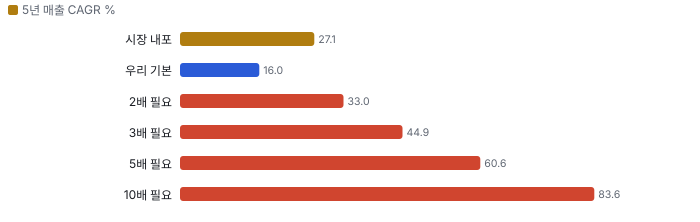

**민감도 — 기본 시나리오 가치/시총(매출 경로 고정, 장기 이익률 × 매출÷투하자본)**
|  | 매출÷투하자본 0.75 | 매출÷투하자본 1.5 | 매출÷투하자본 1.6 | 매출÷투하자본 2.5 |
|---|---|---|---|---|
| 장기 이익률 15% | 0.27 | 0.39 | 0.40 | 0.44 |
| 장기 이익률 27% | 0.56 | 0.68 | 0.69 | 0.73 |
| 장기 이익률 30% | 0.64 | 0.75 | 0.76 | 0.80 |
| 장기 이익률 40% | 0.88 | 1.00 | 1.00 | 1.04 |

매출÷투하자본 = 매출 1달러를 늘리는 데 드는 설비·운전자본(높을수록 가볍다). 장기 이익률은 4년차 목표와 이후 수렴값을 같이 바꾼 것. 계속가치는 RONIC(신규 투자 이익률) = WACC(11년차 이후 성장은 가치를 만들지 않는다는 맥킨지 보수 가정) · 다른 축: WACC −1%p 0.77배 · WACC +1%p 0.62배 · RONIC 20%(11년차 이후 성장이 가치 창출) 0.76배

**기준 멀티플은 Fwd 1Y P/E · Fwd 2Y P/E · Fwd 3Y P/E이다.** 회사가 비GAAP EPS를 가이던스·목표 모델의 기준으로 쓴다. Fwd 1Y는 다음 4개 분기, Fwd 2Y는 5~8번째, Fwd 3Y는 9~12번째 분기 이익 기준이다. Fwd 3Y는 추정이 끝난 뒤 최대 3개 분기를 마지막 회계연도 추정 성장률로 연장했다. 과거 레인지는 Fwd 1Y만 있다.

**동종 레인지와 펀더멘털 내재 멀티플 (Fwd 1Y P/E · Fwd 2Y P/E · Fwd 3Y P/E 추정 기준)**
| 회사 | Fwd 1Y P/E | Fwd 2Y P/E | Fwd 3Y P/E | 성장 | 영업이익률 | ROIC 영업권 포함/제외 | 매출÷투하자본(영업권 제외) | 펀더멘털 내재(Fwd 1Y P/E) | 시장÷내재 |
|---|---|---|---|---|---|---|---|---|---|
| TER | 28.4 | 22.5 | 20.2 | 16% | 30% | 34% / 34% | 1.36 | 11.8 | 2.40 |
| ONTO | 19.5 | 17.0 | 15.2 | 53% | 33% | 16% / 16% | 0.58 | 9.1 | 2.13 |
| CAMT | 25.0 | 18.8 | 16.9 | 44% | 33% | 19% / 19% | 0.72 | 13.2 | 1.90 |
| NVMI | 27.3 | 25.4 | 23.5 | 13% | 39% | 20% / 20% | 0.64 | 10.3 | 2.65 |
| COHU | 21.8 | 14.2 | 12.3 | 39% | 19% | 11% / 11% | 0.72 | 9.4 | 2.31 |
| **동종 중앙** | 25.0 | 18.8 | 16.9 |  |  |  |  |  | 2.31 |
| **FormFactor** | 21.0 | 16.6 | 14.1 |  |  |  |  | 14.1 | 1.49 |

**그림 12 · Fwd 1Y P/E — 과거·동종·펀더멘털·합리적 멀티플 (배)**

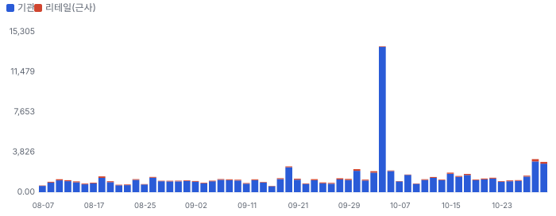

**그림 13 · Fwd 2Y P/E — 과거·동종·펀더멘털·합리적 멀티플 (배)**

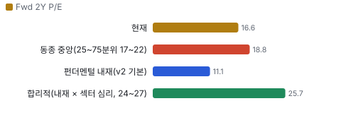

**그림 14 · Fwd 3Y P/E — 과거·동종·펀더멘털·합리적 멀티플 (배)**

**할인·프리미엄 분해:** FormFactor의 Fwd 1Y P/E는 동종 중앙 대비 **-16%** = 동종과 같은 섹터 심리를 받는다면 펀더멘털(성장·이익률·ROIC)로 정당한 몫 +30% × FormFactor에만 얹힌 기업 고유 몫 **-35%**(두 몫을 곱하면 전체). 심리를 빼고 펀더멘털만 비교하면 동종 중앙 내재 대비 +37%. 기업 고유 몫이 양(+)이면 시장이 동종보다 더 큰 기대를 얹은 것(할인이 덜 됐다), 음(−)이면 더 할인한 것이다.

**합리적 멀티플:** 32.6배(섹터 심리 25~75분위 30.1~33.9배) → 주주가치 ÷ 시가총액 **1.52배**(1.41~1.58배). 현재 21.0배와의 차이는 시장이 동종만큼의 기대를 주지 않는 몫이다.

동종 5사 회귀(시장 Fwd 1Y P/E = 9.6 + 1.37 × 펀더멘털 내재, R² 0.39) — 펀더멘털로 정당화되는 멀티플. FormFactor에 대입하면 29.0배. 표본이 작아 참고용.

**ROIC에 비례하는 정상 상태 멀티플 (맥킨지 가치 동인: EV/NOPAT = (1 − g/ROIC) ÷ (WACC − g))**
| ROIC | EV/NOPAT | EV/EBIT |
|---|---|---|
| 10% | 8.8 | 7.3 |
| 15% | 10.4 | 8.6 |
| 20% | 11.2 | 9.3 |
| 30% | 12.0 | 10.0 |
| 50% | 12.6 | 10.5 |

정상 상태 교차 확인: DCF 기본 시나리오의 5년차 ROIC 34%·영업이익률 27%이면 정상 상태 EV/NOPAT 12.2배. 이를 지금으로 할인하면 주주가치 ÷ 시가총액 0.74배 — 고성장 기업은 현재 멀티플이 아니라 정상 상태 멀티플을 할인해 비교한다.

**데이터 검증 — 원자료 ↔ 밸류에이션 입력 대조 10.0/10**
| 검사 | 결과 | 내용 |
|---|---|---|
| 원자료 스냅숏 | 통과 | 조회 시각 2026-10-31T17:00:00+09:00 |
| 시가총액 대조 | 통과 | 가격 87.53 × 표지 주식 0.078120725 = 6.84 vs 원자료 개요 6.8379 |
| 가격 일치 | 통과 | 87.53 vs 87.53 |
| 현금·차입 대조 | 통과 | 현금 0.395412 vs 0.395412 · 차입(리스 포함) 0.02776 vs 0.02776 |
| TTM 매출 = 4분기 합 | 통과 | 0.980096 vs 0.9801(4분기) |
| TTM 영업이익 = 4분기 합 | 통과 | 0.179534 vs 0.1795 |
| 투하자본 = 재무상태표 | 통과 | 0.813632 vs 자기자본+차입+리스−현금 0.814 |
| 연간 컨센서스 = 분기 합 | 통과 | FY2026 1.049933 vs 1.0499 · FY2027 1.351 vs 1.3510 · FY2028 1.62 vs 1.6200 |
| 회사 가이던스 반영 | 통과 | 3Q 실적 보도자료·콜 2026-10-28: 4Q 매출 \$285M ± \$10M + 1~3Q 실적 \$764.9M |
| 희석 주식(출처·같은 날짜) | 통과 | 잠재 주식 0.00116 vs SEC(미국 증권거래위원회) None · 기본 주식 날짜 2026-07-29 / 희석 날짜 2026-07-29 |
| 어닝콜 톤 = 실적 레이더 | 통과 | 사용 up · 레이더 기준 up(톤 변화 0.5, 가이던스 raise) |
| 동종사 4곳 이상·기준 표기 | 통과 | 5곳 · 기준 ttm |
| 기준 멀티플 Fwd 1Y(이익 지표) | 통과 | Fwd 1Y P/E · 회사가 비GAAP EPS를 가이던스·목표 모델의 기준으로 쓴다 |
| 매출·이익률 기준 명시(SBC 처리) | 통과 | 매출 gaap · 이익률 non_gaap · 비GAAP → SBC 4% 차감 |

> 의사결정 보조(투자자문 아님): ① 매수 매력: 연 기대수익 +1.6% (자기자본비용 10.9% 대비 -9.3%p) · 자본비용 초과 확률 2% · 안전마진 0.50 → 정량 신호 약함 / ② 위험 예산 지표(이론): 0% — 기대수익이 자기자본비용에 못 미침(무위험 대비 켈리 0%는 참고) · 5년 하위10% -23% · 30%+ 손실 확률 4% / ③ 상방(5년): 기대 1.08배 · 2배 0% · 3배 0% · 10배 0% · 상위10% 1.39배

## 수급 — 누가 왜 샀나(Chiip Flow)

> **한 줄:** 최근 20거래일 거래의 리테일 몫은 3.7%(직전 60일 7.2%) — 거래는 주로 기관이 만든다. 기관 자금 흐름(CMF(매집·분산을 재는 자금 흐름 지표) 20일) -0.39로 기관 분산 쪽, 리테일 매수 압력 z -0.16로 리테일 방향 뚜렷하지 않음. 이상 거래일에 늘어난 거래량의 97%가 기관 몫.

**그림 15 · 일별 거래량 분해 — 리테일 근사(도매 체결사) vs 기관(거래소·다크풀) (천 주)**

**그림 16 · 기관 자금 흐름(CMF 20일)과 리테일 매수 압력(z ÷ 4로 같은 눈금)**

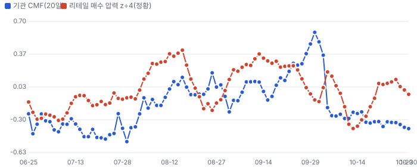

**이상 거래일 — 왜 늘었나, 누가 늘렸나(최근 120거래일, RVOL ≥ 1.8 또는 z ≥ 2)**
| 날짜 | RVOL | 주가 | 종가 위치 | 늘어난 거래량 | 증가분 분해 | 원인 태그 |
|---|---|---|---|---|---|---|
| 2026-10-05 | 11.9배 | -0.8% | -1.00 | 12.75M | 기관 100% · 리테일 -0% | 원인 미확인(공개 사건 없음) |
| 2026-06-26 | 6.8배 | -12.1% | -1.00 | 9.34M | 기관 100% · 리테일 -0% | 원인 미확인(공개 사건 없음) |
| 2026-05-12 | 2.7배 | -12.8% | -1.00 | 2.62M | 기관 82% · 리테일 18% | 원인 미확인(공개 사건 없음) |
| 2026-10-29 | 2.6배 | -11.6% | -1.00 | 1.94M | 기관 92% · 리테일 8% | 실적 발표 다음 날 · 3Q 실적 다음 날 · 레이더 기사 4건 |
| 2026-10-30 | 2.4배 | -10.2% | -1.00 | 1.66M | 기관 94% · 리테일 6% | 나스닥 −3.5%·인텔 −29% 동반 급락 · 3Q 실적 다음 날 다음 날 · 월말 · 레이더 기사 2건 |
| 2026-09-18 | 2.2배 | +6.1% | +1.00 | 1.37M | 기관 100% · 리테일 0% | 분기 만기·지수 정기 변경 |
| 2026-05-13 | 2.1배 | -2.1% | -1.00 | 1.80M | 기관 81% · 리테일 19% | 원인 미확인(공개 사건 없음) |
| 2026-09-30 | 2.0배 | +9.6% | +1.00 | 1.09M | 기관 92% · 리테일 8% | 월말 |

**주간 체결 장소별 비중 — FINRA 확정치(최신 주 2026-10-05, 약 2주 지연)**
| 주 시작 | 전체(주) | 거래소 | ATS(다크풀) | 리테일 도매 | 기타 장외 |
|---|---|---|---|---|---|
| 2026-08-31 | 5.29M | 53.6% | 33.5% | 6.1% | 6.8% |
| 2026-09-07 | 4.54M | 55.8% | 31.4% | 6.8% | 6.0% |
| 2026-09-14 | 6.59M | 57.3% | 27.0% | 5.7% | 9.9% |
| 2026-09-21 | 5.18M | 51.2% | 31.1% | 8.8% | 8.9% |
| 2026-09-28 | 7.99M | 51.9% | 29.7% | 9.0% | 9.4% |
| 2026-10-05 | 19.53M | 47.8% | 9.9% | 3.3% | 39.0% |

## 가격 구간 — 월·주·일 피보나치와 겹침 구간

> **한 줄:** 현재가 \$87.53 — 바로 위 저항 \$94.25~95.03(+8.1%, 강도 2.0),  가격 구간 지표일 뿐 매수·매도 권유가 아니다.

**지지·저항 겹침 구간(서로 다른 기준선이 ±1.2% 안에 모인 곳, 강도 = 겹친 기준선 수)**
| 구간 | 가격 | 현재가 대비 | 강도 | 겹친 기준선 |
|---|---|---|---|---|
| 저항 3 | \$116.24~117.27 | +33.2% | 3.0 | 50일 이동평균 · 일봉 피보 61.8% · 주봉 피보 38.2% |
| 저항 2 | \$106.93~107.69 | +22.6% | 2.0 | 월봉 피보 38.2% · 일봉 피보 78.6% |
| 저항 1 | \$94.25~95.03 | +8.1% | 2.0 | 50일 최저(거래 범위) · 일봉 스윙 저점 |

**시간 단위별 피보나치 되돌림(\$)**
| 단위 | 지배 스윙 | 다리 | 23.6% | 38.2% | 50% | 61.8% | 78.6% |
|---|---|---|---|---|---|---|---|
| 월봉 | \$23.18(2025-04-01) → \$159.93(2026-06-30) | 상승 | 127.7 | 107.7 | 91.6 | 75.4 | 52.4 |
| 주봉 | \$48.25(2025-11-14) → \$159.93(2026-06-30) | 상승 | 133.6 | 117.3 | 104.1 | 90.9 | 72.1 |
| 일봉 | \$95.03(2026-09-03) → \$150.64(2026-10-05) | 상승 | 137.5 | 129.4 | 122.8 | 116.3 | 106.9 |

**그림 17 · 월봉 — 장기 스윙 되돌림**

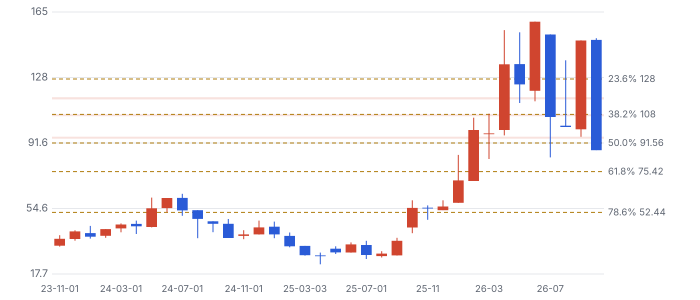

**그림 18 · 주봉 — 52주 스윙 되돌림**

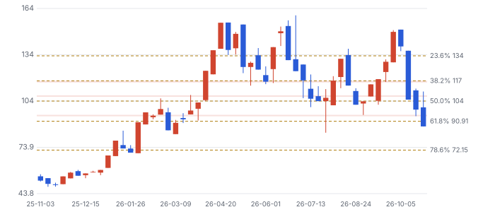

**그림 19 · 일봉 — 마지막 완료 스윙 되돌림(최근 90거래일)**

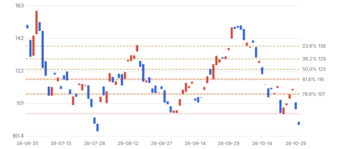

**기법:** 스윙은 ATR(평균 일중 변동폭) 지그재그(임계 = max(월 20%·주 10%·일 5%, 2.5×ATR14)), 되돌림 23.6~78.6%·확장 127.2·161.8%. 함께 본 기준선: 50·200일 이동평균과 50·150·200일 거래 범위 고저, 라운드 넘버(\$50 단위). 피보나치 비율 자체의 학술 근거는 약하다 — 다수가 같은 선에 주문을 두는 데서 오는 효과로 보고, 여러 기준선이 겹친 구간만 강하게 본다. 월봉은 최근 60개월 · 고가·저가는 일봉 자료에 없어 시가·종가로 근사(스윙 고저가 실제보다 좁게 잡힐 수 있다).

## 판단 시나리오 — 2027년 말 기준

**그림 20 · 판단 시나리오 (주가 \$, 2027년 말 기준, 배수 × FY2028 EPS)**

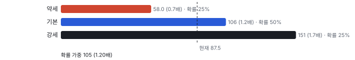

확률 가중값은 \$105로 지금의 1.20배다. DCF 0.69배보다 높은 이유는 시나리오가 2년 뒤 업종 배수를 쓰기 때문이다. 배수가 15배로 내려가는 사이클 하강이면 기본 EPS에서도 \$72다. 이 차이가 이 판단의 가장 큰 불확실성이다.

## 반대 검증 — 가장 강한 약세 논리

| 약세 논리 | 근거 | 가를 자료 |
|---|---|---|
| 사이클 정점의 이익률 | GAAP(미국 회계기준) 영업이익이 1Q \$16.6M에서 3Q \$81.6M으로 뛰었다. 메모리 호황이 꺾이면 카드 주문도 줄어든다 | 2027년 HBM4E·HBM5 설계 수, 메모리 3사 CAPEX |
| 캐파가 차기 전에 수요가 꺾인다 | 공장 고정비가 먼저 들어온다. 램프 비용 2026년 \$25~30M, 2027년 CAPEX도 2026년과 비슷 | 2027년 1Q·2Q 매출과 총이익률 |
| 경쟁 | 로직 MEMS 카드 시장 1위는 Technoprobe이고 회사 자료상 2024년 점유율 60%다. Micronics Japan도 프로브 카드 매출이 1Q +51%다 | GPU·맞춤형 칩 점유, 2027년 파운드리·로직 매출 |
| Teradyne 동맹의 한계 | Teradyne은 2023~2024년 Technoprobe와도 지분 거래를 했다. 이번 투자에 독점 조건은 공개되지 않았다 | 투자 계약서, 공동 고객 사례 |
| 고객 집중 | 세계 최대 파운드리가 2개 분기 연속 10% 이상이고, 서버 CPU 고객도 4Q에 10%를 넘을 전망이다 | 10-K(미국 연차보고서) 고객 비중 |

## 킬 조건

- 2027년 상반기 비GAAP 총이익률이 분기 기준 51% 아래로 내려간다.
- 2027년 1Q 또는 2Q 매출이 전 분기보다 줄어든다. 캐파가 아니라 수요가 막았다는 뜻이다.
- 회사가 2027년 말 연 \$400M 능력 목표를 낮춘다.
- Teradyne 투자가 클로징되지 않는다.

## 체크리스트

| 시점 | 무엇 | 의미 |
|---|---|---|
| 2026년 11월 초 | 3Q 10-Q(미국 분기보고서) | 고객 비중·보조금·Teradyne 클로징 공시 |
| 2026년 11월 중순 | 13F 3Q 공시 | 2Q 순감소가 이어졌나 |
| 2027년 2월 초(예상) | 4Q 실적 | 1Q27 가이던스, 공장 램프 첫 숫자, 총이익률 53~54% |
| 2027년 상반기 | 1Q·2Q 실적 | 선형 램프 여부, GPU·맞춤형 칩 매출 |

## 출처
- FormFactor 3Q26 실적 보도자료: https://www.sec.gov/Archives/edgar/data/0001039399/000103939926000040/ex9901-earningsreleasexq326.htm
- FormFactor 8-K 2026-10-13(Teradyne 투자): https://www.sec.gov/Archives/edgar/data/0001039399/000103939926000037/form-20261006.htm
- FormFactor·Teradyne 보도자료 2026-10-12: https://www.sec.gov/Archives/edgar/data/0001039399/000103939926000037/ex-991.htm
- Technoprobe 회사 자료 2026년 5월: https://www.technoprobe.com/wp-content/uploads/2026/05/Technoprobe-Company-Presentation-May-2026.pdf
- FormFactor 3Q26·2Q26 어닝콜(요지만 자기 말로)
- 2026년 5월 투자자의 날·2Q 콜. 진척 = TTM \$0.98B − FY2025 \$0.785B
- 3Q 콜 2026-10-28

_연구 후보이지 매수 권유가 아닙니다 · 공개 자료 기반 분석이며 투자 권유가 아님 · 1차 판정, 미검증 · Chiip ten-bagger_