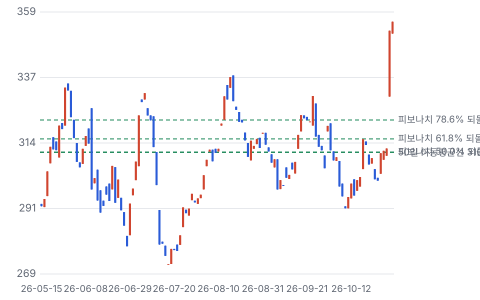
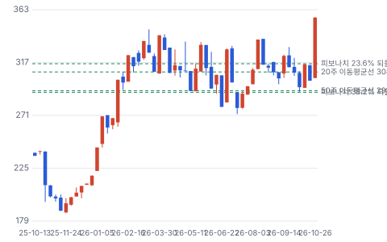
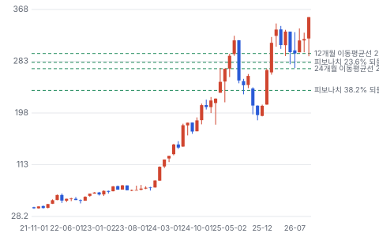
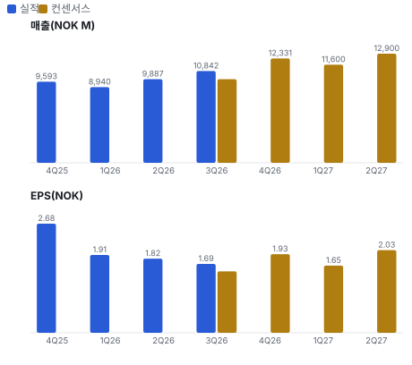
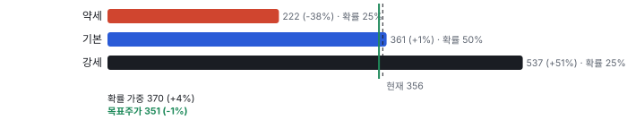
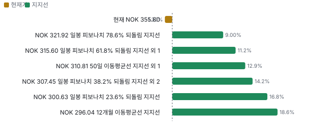
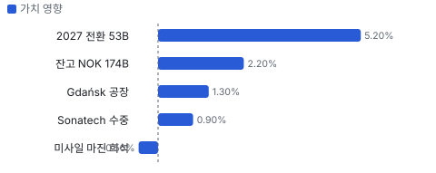
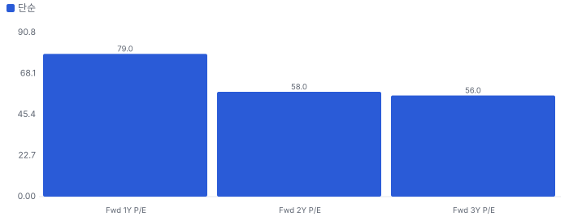
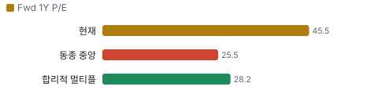
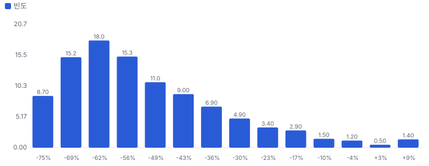

# 텐배거 리포트 2026-11-02 — 수주는 사상 최대인데 왜 값이 더 무거워졌나

> 2026-11-02 · Kongsberg Gruppen(KOG) · 기업: NASAMS 방공·NSM·JSM 미사일·원격 무기 스테이션과 수중 로봇·소형 위성을 만드는 노르웨이 방산 회사

## Chiip View

수요는 의심할 곳이 없다. 3Q 수주 NOK 23.3B, 잔고 NOK 174.2B, book-to-bill 2.06이다. 그런데 **좋은 소식은 값에 들어가 있다.** Fwd 1Y P/E 45.5배는 동종 중앙값의 약 1.8배이고, 3Q에 Zone 5(저가 대량 미사일 회사, 2026년 인수)가 미사일 부문 마진을 깎기 시작했다. **잔고의 질은 최상이지만 진입 가격은 비싸다.** 가르는 것은 2027년 매출이 잔고 전환 NOK 53B를 얼마나 넘느냐와 미사일 마진 회복이다.

## 대시보드
| 항목 | 값 | 설명 |
|---|---|---|
| 주가 | NOK 355.80 | 고점 대비 +0% · 1년 +48% |
| 시가총액 | NOK 312.96B | EV NOK 310.07B |
| 업사이드 | -1% | 목표주가 NOK 351 · 다운사이드 -38% · 손익비 1.3 |
| 구매등급 | Neutral | 애널리스트 등급 미확인 |
| 멀티플 | Fwd 1Y P/E 45.5배 | 동종 중앙값 25.5배 |
| 가이던스 | 없음 | 회사가 숫자를 내지 않았다 |
| 알파 | 5.5/10 | 텐배거 가능성 점수 |
| 이벤트 | 4Q26 실적(회사 일정 확정) | 2027-02-11 |

## 한 장 요약
- **기업가치를 결정하는 내러티브** **시장이 산 이야기는 '유럽이 방공과 미사일을 사고, Kongsberg가 그 표준을 쥐었다'는 것이다.** 3Q 회사 기준 매출 NOK 11.3B(+50% YoY), 수주 NOK 23.3B, 잔고 NOK 174.2B로 기록이다. 주가는 3Q 발표일에 +13%로 분할 보정 기준 52주 고점을 넘겼다. 문제는 값이다. Fwd 1Y P/E 45.5배는 2029년 매출 NOK 100B 목표까지 상당 부분 먼저 낸 값이다.
- **밸류에이션 모델로 본 주가 상방은 어디까지인가?** **목표주가 NOK 351(-1%), 약세와 기본 사이(약세 쪽 7%)다.** 강세 NOK 537(+51%)는 Fwd 1Y P/E 42.9배를 강세 EPS에 적용한 값이다. 기본 NOK 361, 약세 NOK 222. 손익비 1.3, DCF 기준 업사이드 -56%.
- **수주는 어디까지 왔나?** 수주잔고 전체(9/30) 미확인, 100% 매출 NOK 174.20B · Belgium NASAMS(노르웨이·미국 공동 개발 중거리 방공 체계) 미확인, 100% 매출 NOK 10.00B · Netherlands NASAMS 추가 미확인, 100% 매출 NOK 1.50B. 건별 진척은 공개되지 않아 잔고 전체로 잰다. 회사 집계는 50% 합작사 지분을 포함한다.
- **지금 가격은 무엇을 가정하나?** FY2028 컨센서스 EPS NOK 10.48의 34배다. 매출로는 2028년 NOK 66B를 넘어 회사의 2029년 목표 NOK 100B로 가는 경로를 믿는 값이다. 컨센서스 성장 경로로는 2029년 목표가 빠듯하다.
- **왜 3Q 발표일에 주가가 13% 올랐나?** 매출 +50%, EBIT 마진 16.4%, 수주 NOK 23.3B가 모두 강했고 잔고 중 2027년분이 약 NOK 9B 늘었다. 일회성 규모는 회사가 숫자로 답하지 않았다.
- **3Q 콜에서 무엇이 바뀌었나?** 잔고 NOK 158B → 174.2B, Belgium NASAMS 약 NOK 10B, Gdańsk 공장 2028 상반기, Sonatech(미 해군 수중 음향 공급사) 인수 완료다. 나빠진 것은 미사일 부문 마진 16.5% → 11.6%다.
- **무엇이 바뀌면 판단이 바뀌나?** 주가가 시나리오 기본값보다 충분히 낮아지거나, 2027년 잔고 전환과 미사일 마진이 예상을 넘어 FY2028 EPS가 올라가면 등급이 오른다. 휴전으로 유럽 예산이 줄면 배수가 먼저 내려간다.

## 한눈에 보기

**일봉**

**주봉**

**월봉**

**분기 매출·EPS 실적과 컨센서스**

**밸류에이션 주가 시나리오**

**주가별 업사이드**

**어닝콜 변화별 주주가치 영향**

**멀티플 프리미엄**

**합리적 멀티플**

**몬테카를로**

해석: 3,000번 중 56번(2%)에서 가치가 지금 주가 이상이었다. 가정을 흔들어도 지금 주가를 뒷받침하지 못하는 경우가 더 많다. 가운데 값은 0.44배이고, 열 번 중 여덟 번은 0.29~0.75배 사이에 든다.

## 내러티브

> **기업가치를 결정하는 이야기:** Kongsberg는 NASAMS 방공과 NSM(해군 타격 미사일)·JSM(F-35 내부 탑재 공대지·공대함 미사일) 미사일을 파는 방산 회사다. 2026년 4월 선박 부문을 떼어내 순수 방산·수중·우주 기업이 됐다. 수주가 몇 년치 매출을 미리 고정하므로 기업가치는 세 가지로 갈린다. 잔고를 얼마나 빨리 매출로 바꾸나, Zone 5가 깎는 마진을 얼마나 빨리 회복하나, 그리고 2029년 NOK 100B 이후 수주가 이어지나다.

> **멀티플·EPS 프리미엄**
> **멀티플:** Fwd 1Y P/E 45.5배로 동종 중앙값 25.5배보다 79% 높다. Saab 38.5배보다도 높다. 다만 다른 집계의 선행 EPS NOK 11.55를 쓰면 30.8배다. 프리미엄이 크다는 판단은 같지만 폭은 집계에 따라 다르다.
> **EPS:** FY2026~FY2028 컨센서스 EPS는 NOK 7.35 → 8.59 → 10.48이다. 지금 값은 FY2028 EPS의 34배다. 추정 이력이 없어 리비전 폭은 미확인이다. 3Q 뒤 증권사 목표가 상향이 간접 증거다.

### 투자자들은 왜 열광했나

유럽 방공 수요가 커지면서 수주가 매출을 크게 앞질렀다. 6월 자본시장의 날에 2029년 NOK 100B, 2033년 NOK 150B, 영업이익률 16% 이상을 냈다. 3Q 매출 +50%, EBIT +66%가 그 길을 숫자로 보여 줬다.

### 무엇이 기업가치를 바꾸나

> **구조적 체질 변화**
> **변화:** Maritime(2026년 4월 분할한 선박 장비 부문) 분할로 방산·수중·우주만 남았다. 민수 사이클이 빠지고 잔고 중심 회사가 됐다.
> **증거:** 2026년 4월 분할 완료. 분할 몫은 그룹 가치의 24%. 잔고 NOK 174.2B는 TTM 매출의 4.4배.
> **반증:** 방산 비중이 커진 만큼 단일 고객군 위험이 커진다.

> **고부가 믹스 확장**
> **변화:** Defence Systems 마진이 20.6%까지 올랐다. 다만 Zone 5가 미사일 부문 마진을 16.5%에서 11.6%로 낮췄다.
> **증거:** 3Q 콜. 회사는 Zone 5가 2029년 나머지 사업 수준 마진에 닿는다고 했다.
> **반증:** 2028년에도 미사일 부문 마진이 14% 아래다.

> **기술 혁신**
> **변화:** NASAMS에 White Spike(저가 방공 요격 미사일)를 더하고 장거리 요격(FREYA(유럽·우크라이나 장거리 탄도 요격 사업))과 수중 자율 체계로 넓힌다.
> **증거:** NASAMS 사용국 18곳, JSM 6개국, 미 정부 AUV(자율 수중 무인기) 계약.
> **반증:** FREYA 시험이 지연되거나 경쟁 체계가 표준을 가져간다.

> **실행 속도**
> **변화:** 해당 없음(납기를 숫자로 공개하지 않아 피어와 비교할 수 없다). 대신 잔고 전환으로 잰다. 4Q 7%, 2027년 30%, 2028년 이후 63%다.
> **증거:** 3Q 콜. 2027년분은 전 분기보다 약 NOK 9B 늘었다.
> **반증:** 2027년 매출이 잔고 전환 수준에 못 미친다.

> **M&A**
> **변화:** Zone 5와 Sonatech를 인수했다. 두 건 합계 기업가치는 약 6B(콜 표기, 통화 미확인)다.
> **증거:** 3Q 인수 현금 유출 NOK 1.3B, 2Q NOK 3.8B. 유지 보상금은 앞으로 인건비로 잡힌다.
> **반증:** 유지 보상금과 통합 비용이 마진 회복을 늦춘다.

> **정책·입법 연관성**
> **재정정책:** 해당 없음(미국 의회 표결 대상이 아니다). 회사는 유럽이 2030년까지 안보 지출을 최대 €800B 늘릴 계획이라고 인용했다. 3Q 콜 CEO. 예산 성립과 계약은 나라별로 따로 확인해야 한다. 반증: 휴전 뒤 예산이 줄어든다.
> **행정명령:** 해당 없음(이 회사 매출을 직접 바꾸는 미국 행정명령을 찾지 못했다). 노르웨이의 말레이시아 수출 허가 취소는 2Q 실적에 반영됐다. 2Q 콜.
> **연관입법:** 해당 없음(계류 법안 영향을 콜과 공시에서 찾지 못했다).

> **CAPEX 낙수효과**
> **변화:** 유럽 방위 예산이 Kongsberg 수주로 내려온다. 공급 관계는 계약 공시로 확인된다.
> **증거:** Belgium·Netherlands·Germany·Canada 계약. 2025년 매출은 Norway 28%, 유럽 30%, 북미 31%다.
> **반증:** 예산 집행이 지연되면 계약이 뒤로 밀린다.

### 내러티브 근거

> 유럽 재무장의 대표 수혜주라는 이야기는 이미 값에 들어 있다. 쟁점은 수요가 아니라 2029년 매출 NOK 100B까지 가는 실행과 마진이다. 동종 대비 멀티플 차이 +79% 중 회사 고유 몫은 +61%다. 단계는 컨센서스, 쏠림은 높음이다.

> **유럽 방공 재무장** · 강화
> **논리:** 유럽이 방공을 사고 NASAMS가 표준이 됐다
> **숫자:** 잔고 NOK 174.2B, book-to-bill 2.06
> **반증:** 2027년 book-to-bill 1 미만

> **저가 대량 미사일** · 유지
> **논리:** Zone 5가 고가 NSM·JSM 위에 물량 사업을 얹는다
> **숫자:** 중기 연 매출 NOK 10B 기대, 2029년 마진 동등 목표
> **반증:** 유럽 생산 계약이 2027년에 나오지 않는다

> **방산 순수 기업 재평가** · 유지
> **논리:** Maritime 분할로 순수 방산·수중·우주 기업이 됐다
> **숫자:** Fwd 1Y P/E 45.5배, 동종 중앙값 25.5배. 다른 집계로는 30.8배
> **반증:** 멀티플이 Saab 수준 아래로 내려간다

> **반대 내러티브: 이미 값이 다 들어갔다** · 강화
> **논리:** 휴전이나 예산 지연이 오면 배수가 먼저 깎인다
> **숫자:** 지금 값은 FY2028 EPS의 34배
> **반증:** 2027년 EPS 상향과 마진 유지

## 포트폴리오

| 제품·서비스 | 구분 | 무엇 | 쓰는 곳 | 돈 버는 방식 |
|---|---|---|---|---|
| NASAMS 방공 | 제품 | 중거리 지대공 방공 체계 | 18개국 사용 | Defence Systems 3Q 매출 NOK 5.4B, 마진 20.6%(무기 스테이션 포함) |
| NSM·JSM 미사일 | 제품 | 대함·공대지 정밀 타격 미사일 | 함정·F-35 | Missiles & Aerostructures 3Q 매출 NOK 4.0B, 마진 11.6%(Zone 5 포함) |
| Protector(원격 사격 통제 무기 스테이션) | 제품 | 차량·함정용 원격 무기 스테이션 | 육군 차량, 대드론 | Defence Systems에 포함 |
| Zone 5 | 제품 | White Spike·Rusty Dagger(저가 장거리 타격 미사일) 저가 대량 미사일 | 미국 정부, 유럽 협의 중 | 중기 연 매출 NOK 10B 기대(회사) |
| Discovery(수중 로봇·소형 위성 부문) | 제품 | 자율 수중 무인기, 소나, 소형 위성 | 민수·해군 | 3Q 매출 NOK 2.0B, 조정 마진 17.5% |
| Patria(핀란드 장갑차 회사, 49.9% 지분) 지분 | 서비스 | 핀란드 장갑차 회사 지분 | 6x6·TRAXX(Patria 궤도 장갑차) | 3Q 지분 이익 NOK 159M, 잔고에는 미포함 |

## 수주·파이프라인

> **2026-09-30 기준 6건.** 확정 NOK 174.20B. 공시 수주잔고 NOK 174.20B. 서로 겹치는 항목은 합계에서 뺐다.

**실행 속도와 방해 요인**
| 항목 | 상태 | 실행 속도 | 방해 요인 |
|---|---|---|---|
| 수주잔고 전체(9/30) | 확정 | 4Q 7%, 2027년 30%(NOK 53B), 2028년 이후 63%(NOK 109B) | 공급망·인력 · 신공장 램프 · 수출 허가 |
| Belgium NASAMS | 확정 | 3Q 계약, 사상 최대 NASAMS | 체계 통합 · 유도탄 공급 |
| Netherlands NASAMS 추가 | 확정 | 3Q 계약 | 체계 통합 |
| Kuwait NASAMS(Raytheon 경유) | 확정 | 2026-06-30 계약 약 \$400M(NOK 환산은 회사 금액이 아닌 근사). 2Q 수주에는 없었고 3Q 수주 포함 여부는 미확인 | 미국 FMS(미국 정부 대외군사판매) 절차 · 중동 정세 |
| JSM 2Q 수주 3건(Germany·US·Canada) | 확정 | 2Q 계약 | 미사일 공장 램프 |
| Zone 5 중기 연 매출 | 파이프라인 | 회사는 2029년 나머지 사업 수준 마진을 목표로 한다. 미국 정부 계약 위주로 양산 준비 | Fort Worth 양산 램프 · 유럽 생산 파트너 · 경쟁 |

## 해자

> 경쟁을 막는 것은 방공 체계의 표준 지위와 F-35 탑재 자격이다. 공장을 먼저 깐 것도 납기 우위를 만든다. 단가가 오른다는 증거는 아직 없다.

> **NASAMS 사용국 표준** · 강함
> **해자:** 사용국이 18곳으로 늘면서 같은 체계를 쓰는 나라끼리 훈련·정비·유도탄을 나눠 쓴다. 한 번 도입하면 바꾸기 어렵고 후속 주문이 이어진다.
> **근거:** 3Q에 Belgium이 18번째 사용국이 됐고 Netherlands가 추가 주문을 냈다. Kuwait는 미국 FMS 경로로 계약했다.
> **숫자:** 사용국 18곳 · Belgium 약 NOK 10B는 사상 최대 NASAMS 계약 · Kuwait 약 \$400M
> **깨지는 조건:** 유럽 경쟁 체계가 NATO(북대서양조약기구) 입찰에서 NASAMS를 연달아 이긴다.

> **F-35 탑재 미사일 자격** · 강함
> **해자:** JSM은 F-35 내부 무장창에 들어가는 미사일이다. 항공기 통합과 시험에 오랜 시간이 들어 뒤따라오는 회사가 단기간에 대체하기 어렵다.
> **근거:** Canada가 6번째 선택국이 됐다. 2Q 수주에 Germany·US·Canada JSM 3건 합계 NOK 10.9B가 있다.
> **숫자:** 선택국 6곳 · 2Q 수주 NOK 10.9B
> **깨지는 조건:** 경쟁 미사일이 F-35 내부 무장 통합을 끝내고 JSM 사용국이 넘어간다.

> **선제 공장 투자** · 보통
> **해자:** 수요가 확정되기 전에 Norway 미사일 공장, Horten(노르웨이 수중 장비 공장), 미국·호주 공장, Gdańsk를 깔았다. 그래서 물량이 먼저 늘었다. 다만 회사가 캐파가 충분하다고 말한 것은 공급이 희소하지 않다는 뜻이기도 해서 가격 결정력으로 잇지 않는다.
> **근거:** 3Q 콜. Gdańsk 2028 상반기 생산, Horten 45,000㎡ 입주. EBIT 마진 16.4%(작년 14.8%). 계약 단가는 공개되지 않아 ASP 추세는 미확인이다.
> **숫자:** 잔고 = TTM 매출의 4.4배 · 2027년분 NOK 53B · TTM CAPEX 약 NOK 3.1B
> **깨지는 조건:** 2027년 매출이 잔고 전환 NOK 53B 수준에 못 미친다.

## 경영진·네트워크

> 최대 주주가 정부이자 큰 고객이다. 연결은 문서로 확인되지만 수주를 만들었다는 증거는 없다. 1814년 설립 회사라 창업자는 없다.

> **Eirik Lie** · 사장·CEO · 2026-04
> **프로필:** 1990년 입사해 방산 부문에서만 일했다. 소프트웨어 개발에서 시작해 2017년 Defence Systems 대표, 이후 Defence & Aerospace 대표를 거쳤다. 10년 재임한 Geir Håøy에 이어 분할 완료일에 CEO가 됐다.
> **비즈니스:** KSAT(Kongsberg 위성 지상국 회사)·NanoAvionics(소형 위성 제조사) 의장, Patria 이사를 지냈다. 현직 여부는 회사 소개 날짜가 달라 미확인이다.
> **정계:** 공직 이력 미확인. 해군 사관 후보 학교를 다녔다.
> **동문:** Kongsberg 공대 컴퓨터 공학. 동문 연결은 미확인이다.
> **사모임:** 미확인

> **Eivind Reiten** · 이사회 의장 · 2017
> **프로필:** Norsk Hydro에서 23년 일했고 마지막 9년은 CEO였다. Telenor·Norske Skog 의장도 지냈다.
> **비즈니스:** Stena Group·Anaxo Capital 자문 이사회 의장, Globeleq 이사(회사 소개 기준, 날짜 미표기).
> **정계:** 노르웨이 석유·에너지부 장관 이력이 있다. 임기는 이번 회차에 1차 자료로 확인하지 못했다.
> **동문:** 미확인
> **사모임:** 미확인

**네트워크 정량화**
| 연결 | 강도 | 닿는 매출 | 가중 노출 | 매출 대비 | 근거 |
|---|---|---|---|---|---|
| 정계: 노르웨이 정부 — 지분 50.004%(무역·산업·수산부)이자 Norway 매출의 대부분을 낸다 | 5/5 | NOK 8.89B | NOK 8.89B | 23% | 2025년 Norway 매출. 국방부 몫은 따로 공개된 값을 찾지 못했다 Annual Report 2025 p.17·109 |
| 비즈니스: Lie CEO — Patria 이사 경력. Kongsberg가 49.9% 지분 보유 | 2/5 | NOK 0.16B | NOK 0.06B | 0% | 3Q 지분 이익. 매출이 아니고 잔고에도 없다 회사 소개, 3Q 콜 |
| 동문: 공개 자료에서 사업과 닿는 동문 연결을 찾지 못했다 | 0/5 | 미확인 | 미확인 | 미확인 | 미확인 없음 |

가중 노출은 연결이 닿는 매출의 크기다. 연결이 그 매출을 만들었다는 뜻이 아니며, 인과는 공개 자료로 입증하지 못한다.

## 약세 논리 및 셀온 조건

| 약세 논리 | 근거 | 가를 자료 |
|---|---|---|
| 좋은 소식이 값에 있다 | Fwd 1Y P/E 45.5배, 동종 중앙값 25.5배. Rheinmetall은 매출 성장이 더 빠른데 26.5배다. 다른 집계로는 30.8배라 추정 간격이 크다 | 2027년 EPS 상향 폭, 동종 배수 |
| 휴전과 예산 지연 | 유럽 수요는 정치 결정이다. 회사가 인용한 €800B는 계획이지 계약이 아니다 | 나라별 예산 성립, 2027년 book-to-bill |
| 정부가 주주이자 고객 | 정부 지분 50.004%, 2025년 매출의 28%가 Norway다. 수출 허가도 정부가 쥔다. 2Q에는 말레이시아 허가 취소가 실적에 반영됐다 | Norway 매출 비중, 수출 허가 공시 |
| Zone 5 마진 희석 | 미사일 부문 마진 11.6%. 유지 보상금은 현금보다 비용이 먼저 잡힌다 | 2027년 부문 마진, 유럽 생산 계약 |
| 일회성 효과 | 3Q 마진에 유리한 프로젝트 믹스가 있었고 회사는 규모를 말하지 않았다 | 4Q·1Q 마진 |
| 현금 품질 | 현금 상당 부분이 고객 선수금이고 분기마다 크게 움직인다. 2Q 영업현금흐름은 NOK −1.9B였다 | 운전자본, 연간 영업현금흐름 |
| 확인 못 한 자료 | 회사는 연간 숫자 가이던스를 내지 않는다. 연차보고서의 구매 약정·제한 현금·10% 초과 고객·정부 지원 주석은 이번 회차에 찾지 못했다 | 2026 연차보고서(2027-03-22) |

> **셀온 조건**
> **조건 1:** 2027년 매출이 잔고 전환 NOK 53B 수준에 그친다.
> **조건 2:** 2027년 미사일·항공구조물 마진이 11%대에 머문다.
> **조건 3:** 2027년 연간 book-to-bill이 1 아래로 내려간다.
> **조건 4:** 2029년 매출 NOK 100B 목표를 낮춘다.

## 어닝콜 변화

**직전 콜 대비 새로 나오거나 바뀐 내용 → 가치 영향**
| 항목 | 내용 | 직전 콜 | 최신 콜 | 모델 동인 이동 | 확신도 | 가치 영향 |
|---|---|---|---|---|---|---|
| 업데이트 | 수주잔고 | NOK 158B | NOK 174.2B, book-to-bill 2.06 | 장기 성장 수렴값 +0.50% | 1.0 | +2.2% |
| 업데이트 | 2027 잔고 전환 | 약 NOK 44B | NOK 53B | 1년차 성장률 +3.0% | 0.8 | +5.2% |
| 부정 | 미사일·항공구조물 마진 | 16.5%(작년 3Q) | 11.6% | 목표 이익률 -0.50% | 0.8 | -0.5% |
| 신규 | 폴란드 공장 | 준비 중 | 2028 상반기 생산 시작 | 장기 성장 수렴값 +0.30% | 0.5 | +1.3% |
| 신규 | Sonatech 인수 | 미완료 | 9월 완료 | 장기 성장 수렴값 +0.20% | 0.5 | +0.9% |
| **합계** | 단독 합 |  |  | 동시 적용 +9.2% |  | **+9.0%** |

## 밸류에이션

> **목표주가 NOK 351, 업사이드 -1%.** 자리는 약세와 기본 사이(약세 쪽 7%)이고 도달 확률은 약 53%다. 기본 NOK 361, 강세 NOK 537(+51%), 약세 NOK 222(-38%). DCF 기준 업사이드는 기본 -56%, 강세 -36%, 약세 -68%다(WACC 8.5%).

2027년 말 시점에 FY2028 EPS를 적용했다. 재무는 재무제표 기준이고, 회사 발표 매출·EBIT는 50% 합작사 지분을 비례 포함해 조금 더 크다.

2026년 4월 Maritime 분할 전 주가는 시가 갭으로 보정해 읽었다(추정). 회사가 밝힌 분할 몫 24%로 보정하면 분할 전 가격이 조금 더 낮아지지만, 지금 값이 52주 고점이라는 판단은 같다.

DCF 기본 시나리오는 5년 매출 CAGR 16%로 회사 목표보다 낮다. FY2026 컨센서스 NOK 42B에서 2029년 NOK 100B로 가려면 3년 CAGR 34%가 필요하다. 기본 시나리오 주가가 DCF보다 높은 이유는 2027년 말 업종 배수를 쓰기 때문이다.

> **약세 NOK 222 (-38%)** · 확률 25%
> **가정:** 25.8배 × EPS NOK 8.60
> **근거:** 잔고 전환 지연, Zone 5 마진 회복 지연, 휴전 뒤 배수 하락

> **기본 NOK 361 (+1%)** · 확률 50%
> **가정:** 34.4배 × EPS NOK 10.50
> **근거:** 컨센서스 경로, 2028년 매출 NOK 66B, EBIT 마진 17.5%

> **강세 NOK 537 (+51%)** · 확률 25%
> **가정:** 42.9배 × EPS NOK 12.50
> **근거:** 2028년 매출 NOK 75B 안팎, 2029년 목표 경로, 마진 18% 중반

**멀티플 선정 — Fwd 1Y P/E**
| 단계 | 조정 | 근거 |
|---|---|---|
| 동종 중앙값 | 25.5배 | 범위 20.9~54.8배, 6곳 |
| 펀더멘털 | +5% | 성장·이익률·ROIC로 본 합리적 멀티플 28.2배와의 차이의 일부만 인정 |
| 해자 | +10% | NASAMS 사용국 표준 강함 · F-35 탑재 미사일 자격 강함 · 선제 공장 투자 보통 |
| 내러티브 | +0% | 단계 컨센서스 |
| 사이클·실행 판단 | +20% | 동종 중앙값은 저성장 대형사가 끌어내린다. 매출 성장 20% 안팎인 Saab·Hensoldt·Rheinmetall 중앙값은 38.5배이고 잔고가 매출의 4.4배다 |
| **선정** | **34.4배** | 지금 45.5배 |

**동종 레인지**
| 회사 | Fwd 1Y P/E | Fwd 2Y P/E | Fwd 3Y P/E | 성장 | 영업이익률 | ROIC |
|---|---|---|---|---|---|---|
| RHM | 26.5 | 19.9 | 14.0 | 62% | 20% | 21% |
| SAAB | 38.5 | 30.4 | 24.2 | 24% | 11% | 18% |
| LDO | 24.4 | 21.5 | 18.3 | 15% | 10% | 13% |
| HO | 20.9 | 18.9 | 16.7 | 8% | 13% | 36% |
| HAG | 54.8 | 40.5 | 28.7 | 17% | 15% | 15% |
| BA | 23.0 | 21.1 | 19.0 | 15% | 12% | 15% |
| **Kongsberg Gruppen** | 45.5 | 33.7 | 29.1 |  |  |  |

지금 주가가 요구하는 5년 매출 CAGR 39%, 기본 시나리오 16%. 몬테카를로 중앙값 업사이드 -56%.

> 의사결정 보조(투자자문 아님): ① 매수 매력: 연 기대수익 -6.4% (자기자본비용 8.5% 대비 -14.9%p) · 자본비용 초과 확률 2% · 안전마진 0.29 → 정량 신호 약함 / ② 위험 예산 지표(이론): 0% — 기대수익이 자기자본비용에 못 미침(무위험 대비 켈리 0%는 참고) · 5년 하위10% -58% · 30%+ 손실 확률 57% / ③ 상방(5년): 기대 0.72배 · 2배 0% · 3배 0% · 10배 0% · 상위10% 1.11배

## 시장 평가

> **셀사이드(IB 애널리스트)**
> **한 줄:** 셀사이드는 3Q 뒤 목표가를 올렸다. 쟁점은 수주가 아니라 Zone 5가 깎는 마진과 일회성 효과의 크기다
> **3Q 콜 질문:** 일회성 이익·미사일 마진·2027 전환·Zone 5·Thales(프랑스 방산 전자 회사) 합작 — 질문 대부분이 마진의 질과 실행
> **공개 집계(10/30):** 애널리스트 11명, 합의 Buy, 평균 목표가 NOK 403 — 지금 가격보다 13% 높다. 기대의 증거이지 결론이 아니다
> **3Q 뒤 목표가 변경:** Nordea·SB1(노르웨이 SpareBank 1 계열 증권사) Markets NOK 425, DNB(노르웨이 최대 은행 계열 증권사) Carnegie NOK 420 — 모두 상향이고 Buy 유지다
> **EPS 추정 간격:** FY2027 NOK 8.59와 다른 집계 NOK 11.55 — Fwd P/E가 45.5배인지 30배대인지 집계마다 다르다

> **바이사이드(기관 투자자)**
> **한 줄:** 기관별 매매 자료는 받지 못했다. 미국 13F 대상이 아니다. 정부 지분이 절반이라 유동 물량이 작아 배수가 움직일 때 폭이 커질 수 있다(추정)
> **주가 반응:** 3Q 발표일 +13%, 다음 날 +1% — 분할 보정 기준 52주 고점을 넘겼다(추정)
> **주주 구성:** 노르웨이 정부 50.004%, 외국인 25.4%, 상위 10곳 64.6% — 2025년 말 기준. 유동 주식은 절반 아래다

> **언론·업계**
> **한 줄:** 언론은 수주를 다루고, 마진 희석은 콜 질문에서 주로 나왔다
> **주요 사건:** Belgium 계약, Gdańsk 공장, Sonatech — 수주와 공장 중심

## 체크리스트

| 시점 | 무엇 | 의미 |
|---|---|---|
| 2026년 안 | FREYA 시험, Thales 합작 승인 | 장거리 방공·암호 통신 사업 |
| 2027년 2월 11일 | 4Q 실적 | 2027년 매출 힌트, 일회성 뺀 마진 |
| 2027년 상반기 | Zone 5 유럽 생산 계약 | 회사가 2027년을 중요한 해로 꼽았다 |
| 2028년 상반기 | Gdańsk 공장 생산 | 유럽 캐파 확대 |

## 재발행 기록 — 양식 3 전환

- 목표주가: 시나리오 기준 업사이드 → 목표주가 기준 업사이드로 바꿨다.
- 경영진·네트워크 절을 새로 넣었다. 정부 지분 50.004%와 Norway 매출을 연결했다.
- 해자: 일반 항목 3개 → 회사별로 NASAMS 표준·F-35 탑재 자격·선제 공장 3개로 다시 썼다. 공급 병목 ASP 항목은 근거가 없어 뺐다.
- 수주: Kuwait NASAMS 약 \$400M을 추가했다.
- 시장 평가: 애널리스트 '미확인' → 공개 집계 11명·평균 목표가 NOK 403을 기대의 증거로 넣었다.
- 다음 실적일: 2027년 2월 초(예상) → 2월 11일(회사 일정).
- 추정 간격: FY2027 EPS NOK 8.59와 다른 집계 NOK 11.55의 차이를 새로 적었다.
- 연차보고서 주주·지역 매출·수익 인식 주석을 대조했다. 구매 약정·제한 현금·10% 초과 고객·정부 지원 주석은 찾지 못해 미확인이다.

## 출처
- Kongsberg 3Q26 실적 발표 2026-10-29(https://www.kongsberg.com/news/news-archive/2026/q3-2026-kongsberg-delivers-a-strong-third-quarter-with-a-record-high-order-backlog/)
- Kongsberg 3Q26·2Q26·1Q26 콜(요지만 자기 말로)
- Kongsberg Annual Report 2025 p.17·18·106·109·110·164
- Kongsberg 이사회·경영진 페이지(https://www.kongsberg.com/about-us/management-and-organisation/)
- Kongsberg 2Q CEO 글 2026-07-13(https://www.kongsberg.com/news/news-archive/2026/ceos-perspective-record-backlog-clear-growth-path/)
- StockAnalysis KOG 공개 페이지 2026-10-30(https://stockanalysis.com/quote/osl/KOG/)
- 오슬로 증권거래소 KOG 종가 2026-10-30
- 2Q 콜 2026-07-13
- 2Q·3Q 콜
- 3Q 콜 2026-10-29
- 회사 공시 2026-06-30, 2Q CEO 글

_구매 등급·목표주가 모두 규칙이 계산한 모델 값으로, 개인의 보유 종목·자금 사정을 반영하지 않는다 · 공개 자료 기반 분석이며 투자 권유가 아님 · 1차 판정, 미검증 · Chiip ten-bagger_