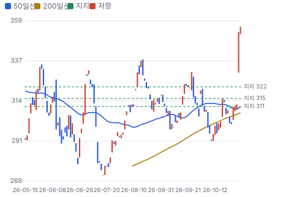
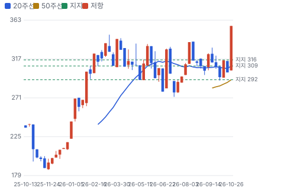
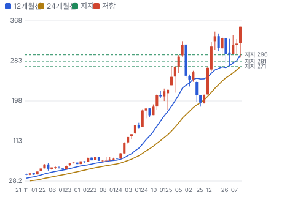
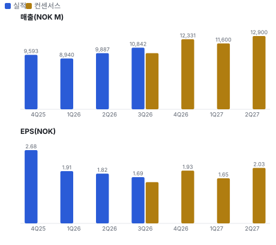
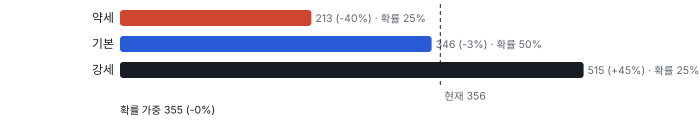
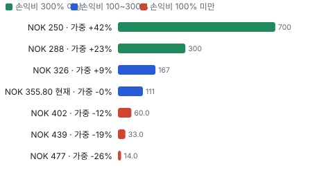
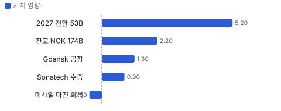
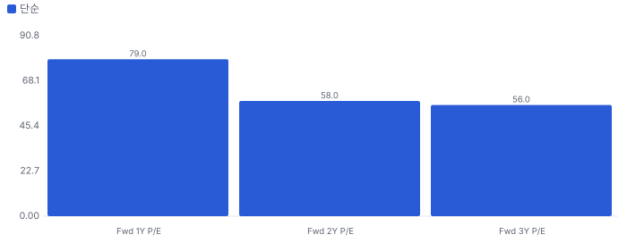
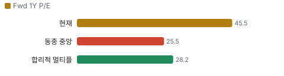
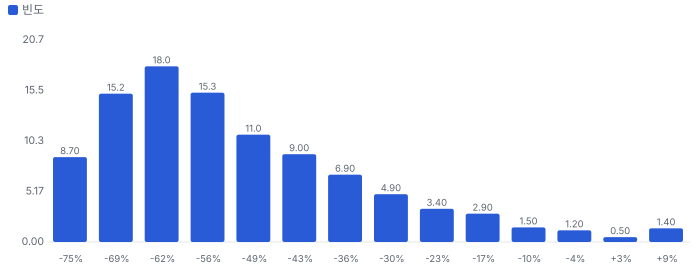

# 텐배거 리포트 2026-10-31 — 수주는 사상 최대인데 왜 값이 더 무거워졌나

> 2026-10-31 · Kongsberg Gruppen(KOG) · 기업: NASAMS 방공·NSM·JSM 미사일·원격 무기 스테이션과 수중 로봇·소형 위성을 만드는 노르웨이 방산 회사

## Chiip View

수요는 의심할 곳이 없다. 3Q 수주 NOK 23.3B, 잔고 NOK 174.2B, book-to-bill 2.06이다. 그런데 **좋은 소식은 값에 들어가 있다.** Fwd 1Y P/E 45.5배는 동종 중앙값의 약 1.8배이고, 3Q에 Zone 5(저가 대량 미사일 회사, 2026년 인수)가 미사일 부문 마진을 깎기 시작했다. **잔고의 질은 최상이지만 진입 가격은 비싸다.** 가르는 것은 2027년 매출이 잔고 전환 NOK 53B를 얼마나 넘느냐와 미사일 마진 회복이다.

## 대시보드
| 항목 | 값 | 설명 |
|---|---|---|
| 주가 | NOK 355.80 | 고점 대비 +0% · 1년 +48% |
| 시가총액 | NOK 312.96B | EV NOK 310.07B |
| 업사이드 | 0% | 다운사이드 -40% · 손익비 111% |
| 구매등급 | Neutral | 애널리스트 등급 미확인 |
| 멀티플 | Fwd 1Y P/E 45.5배 | 동종 중앙값 25.5배 |
| 가이던스 | 없음 | 회사가 숫자를 내지 않았다 |
| 알파 | 5.5/10 | 텐배거 가능성 점수 |
| 이벤트 | 4Q26 실적 | 2027-02 초(예상) |

## 한 장 요약
- **기업가치를 결정하는 내러티브** **시장이 산 이야기는 '유럽이 방공과 미사일을 사고, Kongsberg가 그 표준을 쥐었다'는 것이다.** 3Q 회사 기준 매출 NOK 11.3B(+50% YoY), 수주 NOK 23.3B, 잔고 NOK 174.2B로 기록이다. 주가는 3Q 발표일에 +13%로 분할 보정 기준 52주 고점을 넘겼다. 문제는 값이다. Fwd 1Y P/E 45.5배는 2029년 매출 NOK 100B 목표까지 상당 부분 먼저 낸 값이다.
- **밸류에이션 모델로 본 주가 상방은 어디까지인가?** **강세 NOK 515(+45%)까지 열려 있다.** Fwd 1Y P/E 41.2배를 강세 EPS에 적용한 값이다. 기본 NOK 346, 약세 NOK 213, 확률 가중 NOK 355(0%). 손익비 111%, DCF 기준 업사이드 -56%.
- **수주는 어디까지 왔나?** 수주잔고 전체(9/30) 미확인, 100% 매출 NOK 174.20B · Belgium NASAMS(노르웨이·미국 공동 개발 중거리 방공 체계) 미확인, 100% 매출 NOK 10.00B · Netherlands NASAMS 추가 미확인, 100% 매출 NOK 1.50B. 건별 진척은 공개되지 않아 잔고 전체로 잰다. 회사 집계는 50% 합작사 지분을 포함한다.
- **지금 가격은 무엇을 가정하나?** FY2028 컨센서스 EPS NOK 10.48의 34배다. 매출로는 2028년 NOK 66B를 넘어 회사의 2029년 목표 NOK 100B로 가는 경로를 믿는 값이다. 컨센서스 성장 경로로는 2029년 목표가 빠듯하다.
- **왜 3Q 발표일에 주가가 13% 올랐나?** 매출 +50%, EBIT 마진 16.4%, 수주 NOK 23.3B가 모두 강했고 잔고 중 2027년분이 약 NOK 9B 늘었다. 일회성 규모는 회사가 숫자로 답하지 않았다.
- **3Q 콜에서 무엇이 바뀌었나?** 잔고 NOK 158B → 174.2B, Belgium NASAMS 약 NOK 10B, Gdańsk 공장 2028 상반기, Sonatech(미 해군 수중 음향 공급사) 인수 완료다. 나빠진 것은 미사일 부문 마진 16.5% → 11.6%다.
- **무엇이 바뀌면 판단이 바뀌나?** 주가가 시나리오 기본값보다 충분히 낮아지거나, 2027년 잔고 전환과 미사일 마진이 예상을 넘어 FY2028 EPS가 올라가면 등급이 오른다. 휴전으로 유럽 예산이 줄면 배수가 먼저 내려간다.

## 한눈에 보기

**일봉**

**주봉**

**월봉**

**분기 매출·EPS 실적과 컨센서스**

**밸류에이션 주가 시나리오**

**업사이드·주가별 손익비**

**어닝콜 변화별 주주가치 영향**

**멀티플 프리미엄**

**합리적 멀티플**

**몬테카를로**

해석: 3,000번 중 56번(2%)에서 가치가 지금 주가 이상이었다. 가정을 흔들어도 지금 주가를 뒷받침하지 못하는 경우가 더 많다. 가운데 값은 0.44배이고, 열 번 중 여덟 번은 0.29~0.75배 사이에 든다.

## 내러티브

> **기업가치를 결정하는 이야기:** Kongsberg는 NASAMS 방공과 NSM(해군 타격 미사일)·JSM(F-35 내부 탑재 공대지·공대함 미사일) 미사일을 파는 방산 회사다. 2026년 4월 선박 부문을 떼어내 순수 방산·수중·우주 기업이 됐다. 수주가 몇 년치 매출을 미리 고정하므로 기업가치는 세 가지로 갈린다. 잔고를 얼마나 빨리 매출로 바꾸나, Zone 5가 깎는 마진을 얼마나 빨리 회복하나, 그리고 2029년 NOK 100B 이후 수주가 이어지나다.

> **멀티플·EPS 프리미엄**
> **멀티플:** Fwd 1Y P/E 45.5배로 동종 중앙값 25.5배보다 79% 높다. Saab 38.5배보다도 높다. 프리미엄이 크다.
> **EPS:** FY2026~FY2028 컨센서스 EPS는 NOK 7.35 → 8.59 → 10.48이다. 지금 값은 FY2028 EPS의 34배다. 추정 이력이 없어 리비전 폭은 미확인이다.

### 투자자들은 왜 열광했나

유럽 방공 수요가 커지면서 수주가 매출을 크게 앞질렀다. 6월 자본시장의 날에 2029년 NOK 100B, 2033년 NOK 150B 목표를 냈다. 3Q 매출 +50%, EBIT +66%가 그 길을 숫자로 보여 줬다.

### 무엇이 기업가치를 바꾸나

> **구조적 체질 변화**
> **변화:** Maritime(2026년 4월 분할한 선박 장비 부문) 분할로 방산·수중·우주만 남았다. 민수 사이클이 빠지고 잔고 중심 회사가 됐다.
> **증거:** 2026년 4월 분할 완료. 잔고 NOK 174.2B는 TTM 매출의 4.4배.
> **반증:** 방산 비중이 커진 만큼 단일 고객군 위험이 커진다.

> **고부가 믹스 확장**
> **변화:** Defence Systems 마진이 20.6%까지 올랐다. 다만 Zone 5가 미사일 부문 마진을 16.5%에서 11.6%로 낮췄다.
> **증거:** 3Q 콜. 회사는 Zone 5가 2029년 나머지 사업 수준 마진에 닿는다고 했다.
> **반증:** 2028년에도 미사일 부문 마진이 14% 아래다.

> **기술 혁신**
> **변화:** NASAMS에 White Spike(저가 방공 요격 미사일)를 더하고 장거리 요격(FREYA(유럽·우크라이나 장거리 탄도 요격 사업))과 수중 자율 체계로 넓힌다.
> **증거:** NASAMS 사용국 18곳, JSM 6개국, 미 정부 AUV(자율 수중 무인기) 계약.
> **반증:** FREYA 시험이 지연되거나 경쟁 체계가 표준을 가져간다.

> **실행 속도**
> **변화:** 해당 없음(납기를 숫자로 공개하지 않는다). 대신 잔고 전환으로 잰다. 4Q 7%, 2027년 30%, 2028년 이후 63%다.
> **증거:** 3Q 콜. 2027년분은 전 분기보다 약 NOK 9B 늘었다.
> **반증:** 2027년 매출이 잔고 전환 수준에 못 미친다.

> **M&A**
> **변화:** Zone 5와 Sonatech를 인수했다. 두 건 합계 기업가치는 약 6B(콜 표기, 통화 미확인)다.
> **증거:** 3Q 인수 현금 유출 NOK 1.3B, 2Q NOK 3.8B. 유지 보상금은 앞으로 인건비로 잡힌다.
> **반증:** 유지 보상금과 통합 비용이 마진 회복을 늦춘다.

> **재정정책(행정부)**
> **변화:** 해당 없음(미국 의회 표결 대상이 아니다). 회사는 유럽이 2030년까지 안보 지출을 최대 €800B 늘릴 계획이라고 인용했다.
> **증거:** 3Q 콜 CEO. 예산 성립과 계약은 나라별로 따로 확인해야 한다.
> **반증:** 휴전 뒤 예산이 줄어든다.

> **행정명령(행정부)**
> **변화:** 해당 없음(이 회사 매출을 직접 바꾸는 미국 행정명령을 찾지 못했다). 노르웨이의 말레이시아 수출 허가 취소는 2Q 실적에 반영됐다.
> **증거:** 2Q 콜.

> **연관입법(의회)**
> **변화:** 해당 없음(계류 법안 영향을 콜과 공시에서 찾지 못했다).

> **CAPEX 낙수효과**
> **변화:** 유럽 방위 예산이 Kongsberg 수주로 내려온다. 공급 관계는 계약 공시로 확인된다.
> **증거:** Belgium·Netherlands·Germany·Canada 계약.
> **반증:** 예산 집행이 지연되면 계약이 뒤로 밀린다.

### 내러티브 근거

> 유럽 재무장의 대표 수혜주라는 이야기는 이미 값에 들어 있다. Fwd 1Y P/E 45.5배가 묻는 것은 수요가 아니라 2029년 매출 NOK 100B까지 가는 실행과 마진이다 동종 대비 멀티플 차이 +79% 중 회사 고유 몫은 +61%다. 단계는 컨센서스, 쏠림은 높음이다.

> **유럽 방공 재무장** · 강화
> **논리:** 유럽이 방공을 사고 NASAMS가 표준이 됐다
> **숫자:** 잔고 NOK 174.2B, book-to-bill 2.06
> **반증:** 2027년 book-to-bill 1 미만

> **저가 대량 미사일** · 유지
> **논리:** Zone 5가 고가 NSM·JSM 위에 물량 사업을 얹는다
> **숫자:** 중기 연 매출 NOK 10B 기대, 2029년 마진 동등 목표
> **반증:** 유럽 생산 계약이 2027년에 나오지 않는다

> **방산 순수 기업 재평가** · 유지
> **논리:** Maritime 분할로 순수 방산·수중·우주 기업이 됐다
> **숫자:** Fwd 1Y P/E 45.5배, 동종 중앙값 25.5배
> **반증:** 멀티플이 Saab 수준 아래로 내려간다

> **반대 내러티브: 이미 값이 다 들어갔다** · 강화
> **논리:** 휴전이나 예산 지연이 오면 배수가 먼저 깎인다
> **숫자:** 지금 값은 FY2028 EPS의 34배
> **반증:** 2027년 EPS 상향과 마진 유지

**셀사이드(IB 애널리스트)**
| 지표 | 값 | 해석 |
|---|---|---|
| 3Q 콜 질문 | 일회성 이익·미사일 마진·2027 전환·Zone 5·Thales 합작 | 질문 대부분이 마진의 질과 실행 |
| 애널리스트 등급·목표가 | 미확인 | 이 종목은 데이터 커버리지가 없다 |

셀사이드의 쟁점은 수주가 아니라 Zone 5가 깎는 마진과 일회성 효과의 크기다

**바이사이드(기관 투자자)**
| 지표 | 값 | 해석 |
|---|---|---|
| 주가 반응 | 3Q 발표일 +13%, 다음 날 +1% | 분할 보정 기준 52주 고점을 넘겼다(추정) |

기관 수급 자료는 이번에 받지 못했다. 미국 13F 대상이 아니다

**언론·업계**
| 지표 | 값 | 해석 |
|---|---|---|
| 주요 사건 | Belgium 계약, Gdańsk 공장, Sonatech | 수주와 공장 중심 |

언론은 수주를 다루고, 마진 희석은 콜 질문에서 주로 나왔다

## 포트폴리오

> **NASAMS 방공** · 제품
> **무엇:** 중거리 지대공 방공 체계
> **쓰는 곳:** 18개국 사용
> **돈 버는 방식:** Defence Systems 3Q 매출 NOK 5.4B, 마진 20.6%(무기 스테이션 포함)

> **NSM·JSM 미사일** · 제품
> **무엇:** 대함·공대지 정밀 타격 미사일
> **쓰는 곳:** 함정·F-35
> **돈 버는 방식:** Missiles & Aerostructures 3Q 매출 NOK 4.0B, 마진 11.6%(Zone 5 포함)

> **Protector** · 제품
> **무엇:** 차량·함정용 원격 무기 스테이션
> **쓰는 곳:** 육군 차량, 대드론
> **돈 버는 방식:** Defence Systems에 포함

> **Zone 5** · 제품
> **무엇:** White Spike·Rusty Dagger(저가 장거리 타격 미사일) 저가 대량 미사일
> **쓰는 곳:** 미국 정부, 유럽 협의 중
> **돈 버는 방식:** 중기 연 매출 NOK 10B 기대(회사)

> **Discovery** · 제품
> **무엇:** 자율 수중 무인기, 소나, 소형 위성
> **쓰는 곳:** 민수·해군
> **돈 버는 방식:** 3Q 매출 NOK 2.0B, 조정 마진 17.5%

> **Patria 지분** · 서비스
> **무엇:** 핀란드 장갑차 회사 지분
> **쓰는 곳:** 6x6·TRAXX(Patria 궤도 장갑차)
> **돈 버는 방식:** 3Q 지분 이익 NOK 159M, 잔고에는 미포함

## 수주·파이프라인

> **2026-09-30 기준 수주·파이프라인 5건, 확정 NOK 174.20B.** 공시 수주잔고는 NOK 174.20B다. 미확정 건은 확정 합계에 넣지 않았다. 수익은 항목별 마진 가정을 곱한 추정이다. 서로 겹치거나 금액을 모르는 항목은 합계에서 뺐다.

**수주·파이프라인 진척**
| 항목 | 상태 | 진척도 | 실행 속도 | 방해 요인 |
|---|---|---|---|---|
| 수주잔고 전체(9/30) | 확정 | 미확인 | 4Q 7%, 2027년 30%(NOK 53B), 2028년 이후 63%(NOK 109B) | 공급망·인력 · 신공장 램프 · 수출 허가 |
| Belgium NASAMS | 확정 | 미확인 | 3Q 계약, 사상 최대 NASAMS | 체계 통합 · 유도탄 공급 |
| Netherlands NASAMS 추가 | 확정 | 미확인 | 3Q 계약 | 체계 통합 |
| JSM 2Q 수주 3건(Germany·US·Canada) | 확정 | 미확인 | 2Q 계약 | 미사일 공장 램프 |
| Zone 5 중기 연 매출 | 파이프라인 | 미확인 | 회사는 2029년 나머지 사업 수준 마진을 목표로 한다. 미국 정부 계약 위주로 양산 준비 | Fort Worth 양산 램프 · 유럽 생산 파트너 · 경쟁 |

**진척도별 수익**
| 항목 | 마진 가정 | 현 진척 매출 | 현 진척 이익 | 100% 매출 | 100% 이익 |
|---|---|---|---|---|---|
| 수주잔고 전체(9/30) | EBIT 16% | 미확인 | 미확인 | NOK 174.20B | NOK 28.57B |
| Belgium NASAMS | 미확인 | 미확인 | 미확인 | NOK 10.00B | 미확인 |
| Netherlands NASAMS 추가 | 미확인 | 미확인 | 미확인 | NOK 1.50B | 미확인 |
| JSM 2Q 수주 3건(Germany·US·Canada) | 미확인 | 미확인 | 미확인 | NOK 10.90B | 미확인 |
| Zone 5 중기 연 매출 | 미확인 | 미확인 | 미확인 | NOK 10.00B | 미확인 |

**합계**
| 구분 | 100% 매출 | 현 진척 매출 | 현 진척 이익 | 100% 이익 |
|---|---|---|---|---|
| **확정 합계** | NOK 174.20B | 미확인 | 미확인 | NOK 28.57B |

확정 수주를 100% 끝내면 남는 이익은 NOK 28.57B로 시가총액의 9%다.

## 해자

> 해자의 핵심은 캐파를 먼저 깔아 둔 것이다. 잔고가 TTM 매출의 4.4배이고 공장을 미국·호주·폴란드로 넓힌다. 반면 ASP가 구조적으로 오른다는 증거는 없다.

> **공급 병목에 따른 구조적 ASP 상승** · 약함
> **해자:** 회사는 지금 캐파로 잔고를 소화하고 새 사업도 받을 수 있다고 했다. 병목이 없다는 뜻이라 가격 결정력의 근거가 되지 않는다. 계약 단가는 공개되지 않아 ASP 추세는 미확인이다.
> **근거:** 3Q 콜. Defence Systems 마진 20.6%는 물량·실행·프로젝트 믹스 효과로 설명했다.
> **숫자:** EBIT 마진 16.4%(작년 14.8%)
> **깨지는 조건:** 증설 지연으로 납기가 늘고 단가가 오르면 이 판정은 올라간다.

> **기술 혁신에 따른 구조적 ASP 상승** · 보통
> **해자:** NASAMS는 사용국 18곳으로 중거리 방공 표준이 됐고 JSM은 F-35 탑재 선택지다. 교체가 어려운 체계지만, 이것이 단가 상승으로 이어졌는지는 공개 자료로 확인하지 못했다.
> **근거:** NASAMS 18개국, JSM 6개국 선택, Belgium 약 NOK 10B는 사상 최대 NASAMS 계약.
> **숫자:** ASP 미확인
> **깨지는 조건:** 유럽 경쟁 체계가 NASAMS 입찰을 가져간다.

> **선제 CAPEX에 따른 Q 사이클** · 강함
> **해자:** 수요가 확정되기 전에 Norway 미사일 공장, Horten(노르웨이 수중 장비 공장), 미국·호주 공장, Gdańsk를 깔았다. 그래서 물량이 먼저 늘고 2027년 잔고 전환이 NOK 53B로 커졌다.
> **근거:** 3Q 콜. 폴란드 2028 상반기 생산, Horten 45,000㎡ 입주, 3Q 매출 +50%.
> **숫자:** 잔고 NOK 174.2B = TTM 매출의 4.4배 · 2027년분 NOK 53B · 2028년 이후 NOK 109B · TTM CAPEX 약 NOK 3.1B
> **깨지는 조건:** 2027년 매출이 잔고 전환 NOK 53B 수준에 못 미친다.

## 약세 논리 및 셀온 조건

| 약세 논리 | 근거 | 가를 자료 |
|---|---|---|
| 좋은 소식이 값에 있다 | Fwd 1Y P/E 45.5배, 동종 중앙값 25.5배. Rheinmetall은 매출 성장이 더 빠른데 26.5배다 | 2027년 EPS 상향 폭, 동종 배수 |
| 휴전과 예산 지연 | 유럽 수요는 정치 결정이다. 회사가 인용한 €800B는 계획이지 계약이 아니다 | 나라별 예산 성립, 2027년 book-to-bill |
| Zone 5 마진 희석 | 미사일 부문 마진 11.6%. 유지 보상금은 현금보다 비용이 먼저 잡힌다 | 2027년 부문 마진, 유럽 생산 계약 |
| 일회성 효과 | 3Q 마진에 유리한 프로젝트 믹스가 있었고 회사는 규모를 말하지 않았다 | 4Q·1Q 마진 |
| 현금 품질 | 현금 상당 부분이 고객 선수금이고 분기마다 크게 움직인다. 2Q 영업현금흐름은 NOK −1.9B였다 | 운전자본, 연간 영업현금흐름 |

> **셀온 조건**
> **조건 1:** 2027년 매출이 잔고 전환 NOK 53B 수준에 그친다.
> **조건 2:** 2027년 미사일·항공구조물 마진이 11%대에 머문다.
> **조건 3:** 2027년 연간 book-to-bill이 1 아래로 내려간다.
> **조건 4:** 2029년 매출 NOK 100B 목표를 낮춘다.

## 어닝콜 변화

**직전 콜 대비 새로 나오거나 바뀐 내용 → 가치 영향**
| 항목 | 내용 | 직전 콜 | 최신 콜 | 모델 동인 이동 | 확신도 | 가치 영향 |
|---|---|---|---|---|---|---|
| 업데이트 | 수주잔고 | NOK 158B | NOK 174.2B, book-to-bill 2.06 | 장기 성장 수렴값 +0.50% | 1.0 | +2.2% |
| 업데이트 | 2027 잔고 전환 | 약 NOK 44B | NOK 53B | 1년차 성장률 +3.0% | 0.8 | +5.2% |
| 부정 | 미사일·항공구조물 마진 | 16.5%(작년 3Q) | 11.6% | 목표 이익률 -0.50% | 0.8 | -0.5% |
| 신규 | 폴란드 공장 | 준비 중 | 2028 상반기 생산 시작 | 장기 성장 수렴값 +0.30% | 0.5 | +1.3% |
| 신규 | Sonatech 인수 | 미완료 | 9월 완료 | 장기 성장 수렴값 +0.20% | 0.5 | +0.9% |
| **합계** | 단독 합 |  |  | 동시 적용 +9.2% |  | **+9.0%** |

**실적 vs 컨센서스**
| 분기 | 지표 | 실적 | 컨센서스 | 서프라이즈 |
|---|---|---|---|---|
| 4Q25 | 매출 | 9,593 MNOK | - | - |
| 4Q25 | EPS | 2.68 NOK | - | - |
| 1Q26 | 매출 | 8,940 MNOK | - | - |
| 1Q26 | EPS | 1.91 NOK | - | - |
| 2Q26 | 매출 | 9,887 MNOK | - | - |
| 2Q26 | EPS | 1.82 NOK | - | - |
| 3Q26 | 매출 | 10,842 MNOK | 9,888 MNOK | +9.6% |
| 3Q26 | EPS | 1.69 NOK | 1.508 NOK | +12.1% |

## 밸류에이션

> **확률 가중 NOK 355, 업사이드 0%.** 강세 NOK 515(+45%), 약세 NOK 213(-40%). DCF 기준 업사이드는 기본 -56%, 강세 -36%, 약세 -68%다(WACC 8.5%).

2027년 말 시점에 FY2028 EPS를 적용했다. 주가는 2026년 4월 Maritime 분할 전 값을 시가 갭으로 보정해 읽었다(추정). 재무는 재무제표 기준이고, 회사 발표 매출·EBIT는 50% 합작사 지분을 비례 포함해 조금 더 크다. DCF 기본 시나리오는 5년 매출 CAGR 16%로 회사 목표보다 낮다. FY2026 컨센서스 NOK 42B에서 2029년 NOK 100B로 가려면 3년 CAGR 34%가 필요하다. 기본 시나리오 주가가 DCF보다 높은 이유는 2027년 말 업종 배수를 쓰기 때문이다.

**주가 시나리오**
| 시나리오 | 확률 | 멀티플 | EPS | 주가 | 업사이드 | 근거 |
|---|---|---|---|---|---|---|
| 약세 | 25% | 24.7배 | NOK 8.60 | NOK 213 | -40% | 잔고 전환 지연, Zone 5 마진 회복 지연, 휴전 뒤 배수 하락 |
| 기본 | 50% | 33.0배 | NOK 10.50 | NOK 346 | -3% | 컨센서스 경로, 2028년 매출 NOK 66B, EBIT 마진 17.5% |
| 강세 | 25% | 41.2배 | NOK 12.50 | NOK 515 | +45% | 2028년 매출 NOK 75B 안팎, 2029년 목표 경로, 마진 18% 중반 |

**멀티플 선정 — Fwd 1Y P/E**
| 단계 | 조정 | 근거 |
|---|---|---|
| 동종 중앙값 | 25.5배 | 범위 20.9~54.8배, 6곳 |
| 펀더멘털 | +5% | 성장·이익률·ROIC로 본 합리적 멀티플 28.2배와의 차이의 일부만 인정 |
| 해자 | +4% | 공급 병목 약함 · 기술 혁신 보통 · 선제 CAPEX 강함 |
| 내러티브 | +0% | 단계 컨센서스 |
| 사이클·실행 판단 | +20% | 동종 중앙값은 저성장 대형사가 끌어내린다. 매출 성장 20% 안팎인 Saab·Hensoldt·Rheinmetall 중앙값은 38.5배이고 잔고가 매출의 4.4배다 |
| **선정** | **33.0배** | 지금 45.5배 |

**동종 레인지**
| 회사 | Fwd 1Y P/E | Fwd 2Y P/E | Fwd 3Y P/E | 성장 | 영업이익률 | ROIC |
|---|---|---|---|---|---|---|
| RHM | 26.5 | 19.9 | 14.0 | 62% | 20% | 21% |
| SAAB | 38.5 | 30.4 | 24.2 | 24% | 11% | 18% |
| LDO | 24.4 | 21.5 | 18.3 | 15% | 10% | 13% |
| HO | 20.9 | 18.9 | 16.7 | 8% | 13% | 36% |
| HAG | 54.8 | 40.5 | 28.7 | 17% | 15% | 15% |
| BA | 23.0 | 21.1 | 19.0 | 15% | 12% | 15% |
| **Kongsberg Gruppen** | 45.5 | 33.7 | 29.1 |  |  |  |

**민감도 — DCF 업사이드(장기 이익률 × 매출÷투하자본)**
|  | 매출÷투하자본 0.75 | 매출÷투하자본 1.5 | 매출÷투하자본 2.5 |
|---|---|---|---|
| 장기 이익률 15% | -76% | -66% | -62% |
| 장기 이익률 17% | -71% | -61% | -56% |
| 장기 이익률 30% | -37% | -27% | -23% |
| 장기 이익률 40% | -11% | -1% | +3% |

지금 주가가 요구하는 5년 매출 CAGR 39%, 기본 시나리오 16%. 몬테카를로 중앙값 업사이드 -56%.

> 의사결정 보조(투자자문 아님): ① 매수 매력: 연 기대수익 -6.4% (자기자본비용 8.5% 대비 -14.9%p) · 자본비용 초과 확률 2% · 안전마진 0.29 → 정량 신호 약함 / ② 위험 예산 지표(이론): 0% — 기대수익이 자기자본비용에 못 미침(무위험 대비 켈리 0%는 참고) · 5년 하위10% -58% · 30%+ 손실 확률 57% / ③ 상방(5년): 기대 0.72배 · 2배 0% · 3배 0% · 10배 0% · 상위10% 1.11배

## 수급

**지지선·저항선**
| 봉 | 지지 | 저항 |
|---|---|---|
| 일봉 | 피보 78.6% NOK 321.92 · 피보 61.8% NOK 315.42 · 피보 50.0% NOK 310.85 | - |
| 주봉 | 피보 23.6% NOK 315.79 · 20주선 NOK 308.61 · 50주선 NOK 292.40 | - |
| 월봉 | 12개월선 NOK 296.04 · 피보 23.6% NOK 281.47 · 24개월선 NOK 271.18 | - |

## 체크리스트

| 시점 | 무엇 | 의미 |
|---|---|---|
| 2026년 안 | FREYA 시험, Thales 합작 승인 | 장거리 방공·암호 통신 사업 |
| 2027년 2월 초(예상) | 4Q 실적 | 2027년 매출 힌트, 일회성 뺀 마진 |
| 2027년 상반기 | Zone 5 유럽 생산 계약 | 회사가 2027년을 중요한 해로 꼽았다 |
| 2028년 상반기 | Gdańsk 공장 생산 | 유럽 캐파 확대 |

## 출처
- Kongsberg 3Q26 실적 콜 2026-10-29(요지만 자기 말로)
- Kongsberg 2Q26 콜 2026-07-13(요지만 자기 말로)
- Kongsberg 1Q26 콜(요지만 자기 말로)
- 오슬로 증권거래소 KOG 종가 2026-10-30
- 2Q 콜 2026-07-13
- 2Q·3Q 콜
- 3Q 콜 2026-10-29

_구매 등급은 업사이드·손익비 규칙이 계산한 모델 등급으로, 개인의 보유 종목·자금 사정을 반영하지 않는다 · 공개 자료 기반 분석이며 투자 권유가 아님 · 1차 판정, 미검증 · Chiip ten-bagger_