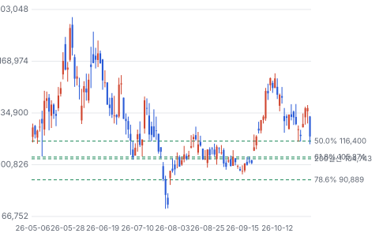
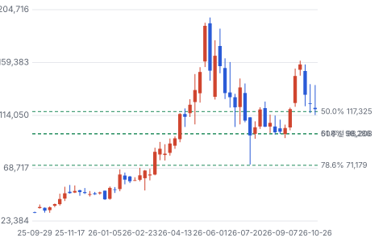
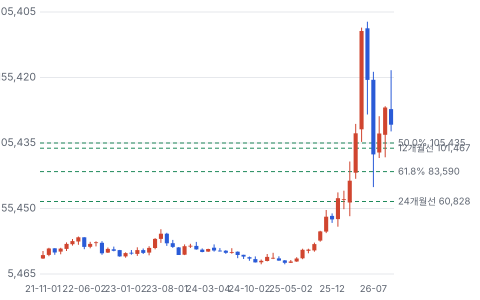
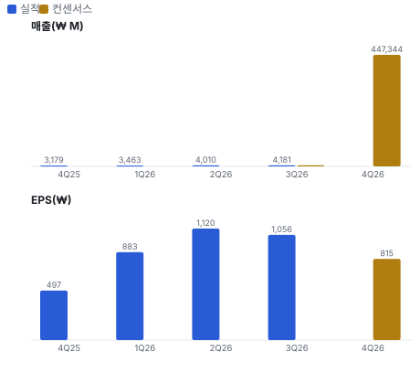
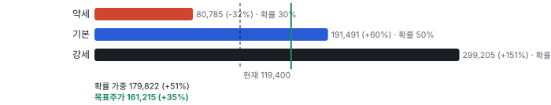
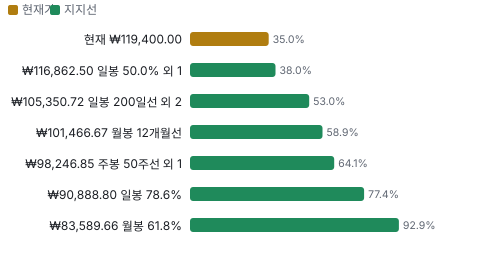
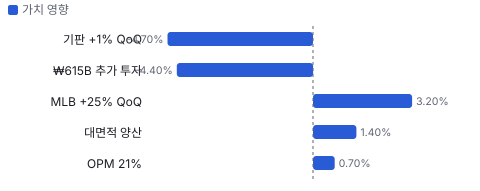
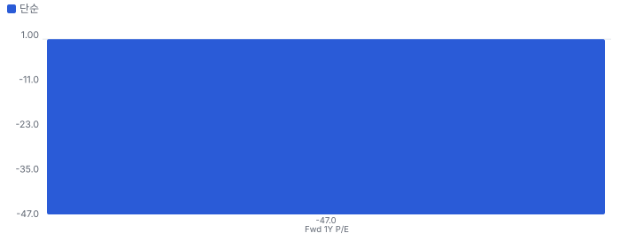
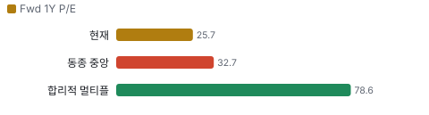
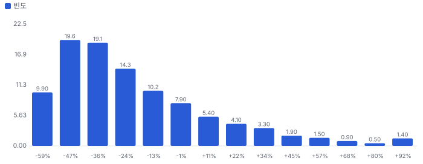

# 텐배거 리포트 2026-11-01 — 3Q 이익은 넘었는데 ₩1.3T 증설이 먼저 왔다

> 2026-11-01 · 대덕전자(353200) · 기업: 메모리·모바일·서버 칩용 패키지 기판과 항공·네트워크용 다층 기판을 만드는 회사

## Chiip View

이익은 확인됐다. 3Q 영업이익 ₩87.9B는 컨센서스 약 ₩76.6B를 15% 넘었고 OPM은 21.0%다. **문제는 다음 계약이다.** 올해 투자 공시 ₩1.325T는 FY2025 자기자본의 1.5배이고, 재원은 보유 자금과 외부 차입이며 LTA(장기공급계약) 체결은 확인되지 않았다. 3Q 매출 증가분의 84%가 MLB(다층 인쇄회로기판)였고 패키지기판은 +1% QoQ로 멈췄다. **멀티플은 싸고 DCF는 비싸다.** 가르는 것은 11/4 설명회와 연내 LTA 공시, 4Q 메모리 기판 값 인상이다.

## 대시보드
| 항목 | 값 | 설명 |
|---|---|---|
| 주가 | ₩119,400.00 | 고점 대비 -37% · 1년 +278% |
| 시가총액 | ₩5,947.08B | EV ₩5,678.25B |
| 업사이드 | +35% | 목표주가 ₩161,215 · 다운사이드 -32% · 손익비 4.7 |
| 구매등급 | Buy | 애널리스트 9명: Strong Buy 9 · Buy 0 · Neutral 0 · Sell 0 · Strong Sell 0 |
| 멀티플 | Fwd 1Y P/E 25.7배 | 동종 중앙값 32.7배 |
| 가이던스 | 없음 | 회사가 숫자를 내지 않았다 |
| 알파 | 6.4/10 | 텐배거 가능성 점수 |
| 이벤트 | 3Q 기관투자자 설명회 | 2026-11-04 |

## 한 장 요약
- **기업가치를 결정하는 내러티브** **시장이 산 이야기는 'AI와 메모리 호황이 기판 부족을 부른다'는 것이다.** 3Q 영업이익률 21%가 숫자로 보여 줬다. 그러나 올해 투자 공시 ₩1.325T는 FY2025 자기자본의 1.5배이고 LTA 체결은 아직 확인되지 않았다. 지금 값은 FY2027 EPS 6,530원(iM)의 18.3배다.
- **밸류에이션 모델로 본 주가 상방은 어디까지인가?** **목표주가 ₩161,215(+35%), 약세와 기본 사이(약세 쪽 27%)다.** 강세 ₩299,205(+151%)는 Fwd 1Y P/E 37.4배를 강세 EPS에 적용한 값이다. 기본 ₩191,491, 약세 ₩80,785. 손익비 4.7, DCF 기준 업사이드 -29%.
- **수주는 어디까지 왔나?** 복수 빅테크 LTA 미확인, 100% 매출 미확인 · 전사 연 매출 캐파 증설 미확인, 100% 매출 KRW 550.00B · MLB 캐파 연 ₩300B 미확인, 100% 매출 미확인. 회사는 수주잔고를 공개하지 않는다. 확인되는 것은 투자 공시와 협의 중인 LTA뿐이다.
- **지금 가격은 무엇을 가정하나?** 배수와 현금흐름이 다른 답을 낸다. Fwd 1Y P/E 25.7배는 동종 중앙값 32.7배보다 21% 낮지만 한국 기판사 17~22배보다는 높다. 현금흐름으로 풀면 지금 값은 5년 매출 CAGR **29%**를 요구한다. 기본 시나리오 17%의 1.7배이고, DCF 기본값은 현재가보다 29% 낮다(WACC 9.4%).
- **왜 움직였나?** 10/30 −13.6%는 업종 −9.33%와 함께 나왔다. 3Q 잠정실적 보도는 16시 이후라 정규장 반응은 11/2에 나온다(공시 접수 시각은 미대조). 네이버 인용 기사의 종가는 116,400원으로 달라 확인이 필요하다.
- **3Q에서 무엇이 바뀌었나?** 좋아진 것은 OPM 21.0%, MLB ₩71.8B(+25% QoQ), AI용 대면적 FC-BGA(서버·네트워크 칩용 대면적 고성능 패키지 기판) 양산 시작이다. 나빠진 것은 패키지기판 +1% QoQ, 영업외 손실 약 ₩21.9B(원인 미확인), 순이익 −5.7% QoQ다. 콜 전문은 없고 설명회는 11/4다.
- **무엇이 바뀌면 판단이 바뀌나?** LTA가 공시되고 선급금 금액이 나오면 증설 위험이 줄어 멀티플 할인이 작아진다. 4Q 메모리 기판 값이 10% 오르면 연 ₩24.7B 증익이다(iM 추정). 반대로 LTA 없이 차입이 늘고 OPM이 18% 아래로 내려가면 약세 시나리오가 현실이 된다.

## 한눈에 보기

**일봉**

**주봉**

**월봉**

**분기 매출·EPS 실적과 컨센서스**

**밸류에이션 주가 시나리오**

**주가별 업사이드**

**어닝콜 변화별 주주가치 영향**

**멀티플 프리미엄**

**합리적 멀티플**

**몬테카를로**

해석: 3,000번 중 644번(21%)에서 가치가 지금 주가 이상이었다. 가정을 흔들어도 지금 주가를 뒷받침하지 못하는 경우가 더 많다. 가운데 값은 0.71배이고, 열 번 중 여덟 번은 0.47~1.27배 사이에 든다.

## 내러티브

> **기업가치를 결정하는 이야기:** 대덕전자는 패키지 기판과 MLB를 만든다. 기업가치는 세 가지로 갈린다. 기판 값 인상이 이어지나, 증설분이 계약으로 채워지나, 감가상각 3배를 이익이 이기느냐다.

> **멀티플·EPS 프리미엄**
> **멀티플:** FY2026 추정 P/E 25.7배로 한국 동종 17~22배보다 높고 대만·일본 43~75배보다 낮다.
> **EPS:** FY2026 추정 4,654원에서 FY2027 추정 6,530원으로 +40%다. 리비전 이력은 미확인이다.

### 투자자들은 왜 열광했나

주가가 2025년 10월 3만 원대에서 2026년 6월 장중 198,000원까지 올랐다. 영업이익이 FY2025 ₩49.1B에서 1~3Q ₩209.4B로 뛰었기 때문이다. 이후 7월 말 74,500원, 10월 161,000원, 10/30 119,400원으로 크게 흔들렸다.

### 무엇이 기업가치를 바꾸나

> **구조적 체질 변화**
> **변화:** 메모리 기판 회사에서 FC-BGA·MLB 비중이 큰 회사로 옮겨 간다.
> **증거:** 3Q 비중 FC-CSP(모바일·메모리 칩용 소형 패키지 기판) 43%, FC-BGA 22%, CSP(칩 크기 패키지 기판) 18%, MLB 17%
> **반증:** 메모리 호황이 꺾이면 이익률이 FY2023~24 수준으로 돌아간다

> **고부가 믹스 확장**
> **변화:** 매출은 +4.3% QoQ인데 영업이익은 +25%다.
> **증거:** 3Q OPM 21.0%, 2Q 17.5%
> **반증:** OPM이 2개 분기 연속 18% 아래

> **기술 혁신**
> **변화:** AI용 대면적 FC-BGA 양산을 시작했다.
> **증거:** 디일렉 3Q 보도. 고객·물량 미확인
> **반증:** 대면적 수율 문제나 인증 지연

> **실행 속도**
> **변화:** 해당 없음(납기를 숫자로 공개하지 않는다). 대신 증설 속도로 잰다. 안산 MLB 증설은 ₩50B 투입으로 2분기에 끝났다.
> **증거:** 디일렉 3Q
> **반증:** 2027년 2분기 FC-BGA 증설 지연

> **M&A**
> **변화:** 뉴프렉스(연성회로기판 회사, 안산 공장 매각) 안산 공장을 ₩52.8B에 인수했다.
> **증거:** 디일렉 10/22
> **반증:** 공장 전환이 늦어진다

> **정책·입법 연관성**
> **재정정책:** 해당 없음(미국 재정 사업과 연결된 회사 자료를 찾지 못했다. 미국 생산 거점도 확인되지 않는다).
> **행정명령:** 해당 없음(특정 행정명령이 매출을 바꿨다는 회사 자료를 찾지 못했다).
> **연관입법:** 해당 없음(대덕전자 매출을 직접 바꾸는 법안을 찾지 못했다. 한국 세액공제 수혜액은 미확인이다).

> **CAPEX 낙수효과**
> **변화:** AI 투자가 기판 수요로 내려온다. 대덕의 고객별 매출은 미확인이다.
> **증거:** 금지표상 고객 투자가 곧 공급사 매출은 아니다. 3Q FC-BGA는 2Q와 비슷했다
> **반증:** LTA 체결이 없다

### 내러티브 근거

> AI 기판 부족과 메모리 기판 값 인상이 이야기의 축이다. 3Q에 이익은 확인됐고, 쟁점은 ₩1.3T 증설이 계약으로 채워지느냐다. 동종 대비 멀티플 차이 -22% 중 회사 고유 몫은 -67%다. 단계는 컨센서스, 쏠림은 식는 중이다.

> **메모리 기판 값 인상** · 강화
> **논리:** 메모리 호황이 기판 값으로 번진다
> **숫자:** 10% 인상 시 연 ₩24.7B 증익(iM)
> **반증:** 4Q에 인상이 확인되지 않는다

> **AI 대면적 FC-BGA** · 유지
> **논리:** AI 서버가 대면적 기판 수요를 키운다
> **숫자:** 3Q FC-BGA 약 ₩92B, 2Q와 같은 수준
> **반증:** 2027년 상반기까지 FC-BGA 매출이 늘지 않는다

> **MLB 캐파 2배** · 강화
> **논리:** AI·항공 수요를 캐파로 받는다
> **숫자:** 3Q 증가분 ₩17.1B 중 MLB가 ₩14.3B
> **반증:** 4Q MLB가 ₩70B 아래로 내려간다

> **반대: 증설 과잉** · 강화
> **논리:** 모든 회사가 증설하면 값이 먼저 꺾인다
> **숫자:** 투자 ₩1.325T는 FY2025 자기자본의 148%, 감가상각 ₩84.6B → ₩253.4B(키움, 10/22 공시 전)
> **반증:** LTA로 선급금과 물량이 확정된다

**셀사이드(IB 애널리스트)**
| 지표 | 값 | 해석 |
|---|---|---|
| 애널리스트 의견 | 9명 전원 매수 | 쏠림이 크다 |
| 목표가 평균 | ₩196,111 | 현재가 대비 +64%. 기대의 증거다 |
| 목표가 일부 | iM ₩190,000, 키움 ₩240,000 | 실적 전 값이다. 실적 뒤 변경은 미확인 |

컨센서스 매수가 이미 완성됐다. 3Q 뒤 목표가 변화는 11/2부터 나온다

**바이사이드(기관 투자자)**
| 지표 | 값 | 해석 |
|---|---|---|
| 기관·외국인 수급 | 미확인 | 한국 종목 공개 자료를 받지 못했다 |

바이사이드 층은 미확인이다

**언론·업계**
| 지표 | 값 | 해석 |
|---|---|---|
| 주요 보도 | ₩1.325T 투자, 기판 값 인상 | 증설이 주제가 됐다 |

언론 관심은 실적보다 증설로 옮겨 갔다

## 포트폴리오

| 제품·서비스 | 구분 | 무엇 | 쓰는 곳 | 돈 버는 방식 |
|---|---|---|---|---|
| FC-CSP | 제품 | 모바일 AP(모바일 중앙처리칩), 차량 레이더, SSD(낸드 기반 저장장치) 컨트롤러, GDDR7(그래픽 메모리 7세대)·DDR5(서버·PC용 5세대 D램)용 기판 | 메모리·모바일·차량 | 3Q 비중 43%, 약 ₩180B |
| FC-BGA | 제품 | 자율주행, 광모듈, 네트워크, 컨트롤러용 대면적 기판 | 데이터센터·차량 | 3Q 비중 22%, 약 ₩92B |
| CSP | 제품 | NAND(낸드 플래시 메모리), LPDDR5(저전력 D램 5세대), SoCAMM(저전력 서버 메모리 모듈), CXL(서버 메모리 확장 연결 규격)용 기판 | 메모리 | 3Q 비중 18%, 약 ₩75B |
| MLB | 제품 | AI 서버, 네트워크, 군용, 항공, 반도체 검사기용 고다층 기판 | 서버·항공·방산 | 3Q ₩71.8B, 비중 17% |

## 수주·파이프라인

> **2026-10-30 기준 3건.** 건별 확정 금액은 공개되지 않았다. 서로 겹치는 항목은 합계에서 뺐다.

**실행 속도와 방해 요인**
| 항목 | 상태 | 실행 속도 | 방해 요인 |
|---|---|---|---|
| 복수 빅테크 LTA | 협상 | iM은 4분기 안 마무리 계획으로 썼다 | 체결 미확인 · 선급금 금액 미공개 |
| 전사 연 매출 캐파 증설 | 파이프라인 | ₩1.6T(2026) → ₩2.1~2.2T(2028), iM 추정 | 장비 반입 · 고객 인증 · 증설 경쟁 |
| MLB 캐파 연 ₩300B | 파이프라인 | 3Q부터 가동. 안산 약 ₩50B 투입, 2분기 완료 | AI 비중 2%(2Q) |

## 해자

> 해자는 고객 인증과 항공·군용 MLB다. 규모는 일본·대만 선두보다 작고 증설 경쟁이 시작됐다.

> **고성능 기판 고객 인증** · 보통
> **해자:** AI용 대면적 FC-BGA는 고객 인증을 통과해야 양산에 들어간다. 회사가 3Q에 양산을 시작했다.
> **근거:** 3Q FC-BGA 비중 22%, 약 ₩92B. 고객명·점유율은 미확인
> **숫자:** 가동률 2분기 말 90% 초반(키움, 라인 구분 없음)
> **깨지는 조건:** 대면적 제품이 2027년 상반기에도 매출 비중을 못 늘린다

> **항공·군용 MLB 인증** · 보통
> **해자:** 항공과 군용은 인증 기간이 길고 교체가 드물어 이익률이 높다.
> **근거:** 2Q MLB 매출 중 항공 32%, 네트워크 30%, 군용 22%, AI 2%
> **숫자:** 3Q MLB ₩71.8B, +69% YoY
> **깨지는 조건:** 캐파 증설 뒤 AI 비중이 늘어도 이익률이 내려간다

> **고객 자금 증설** · 약함
> **해자:** 고객 선급금으로 증설하면 수요와 재원이 함께 확보된다. 아직 계약이 확인되지 않았다.
> **근거:** 10/22 공시 재원은 보유 자금과 외부 차입이다. 선급금은 언론·증권사 서술이고 금액은 미확인
> **숫자:** 미확인
> **깨지는 조건:** 연내 LTA 공시가 없고 차입이 늘어난다

## 경영진·네트워크

> 전문경영인과 오너 지주사 체제다. 고객 연결을 문서로 확인한 것은 없다.

> **신영환** · 대덕전자 대표이사 · 2020
> **프로필:** 삼성전기 출신 전문경영인
> **비즈니스:** 삼성전기 경력. 그 밖의 이력 미확인
> **정계:** 미확인
> **동문:** 미확인
> **사모임:** 미확인

> **김영재** · 지주사 ㈜대덕 대표 · 2004
> **프로필:** 서울대 공업화학, KAIST(한국과학기술원) 석사. 1983년 입사, 2004년 사장. 2020년 분할 뒤 지주사 대표
> **비즈니스:** 지주사 ㈜대덕을 통해 대덕전자를 지배. 2026년 3월 대덕전자 이사회 자리를 넘겼다
> **정계:** 미확인
> **동문:** 미확인
> **사모임:** 미확인

> **김정식** · 창업주(작고) · 1972
> **프로필:** 1972년 회사 설립, 2000년 대표 퇴임
> **비즈니스:** 미확인
> **정계:** 미확인
> **동문:** 미확인
> **사모임:** 해동과학문화재단 설립

**네트워크 정량화**
| 연결 | 강도 | 닿는 매출 | 가중 노출 | 매출 대비 | 근거 |
|---|---|---|---|---|---|
| 비즈니스: 대표의 삼성전기 경력 | 2/5 | 미확인 | 미확인 | 미확인 | 고객별 매출이 공개되지 않아 노출 금액을 잡지 못했다 비즈워치 2026-06-01 |
| 비즈니스: 지주사 ㈜대덕 계열 지배 구조 | 3/5 | 미확인 | 미확인 | 미확인 | 계열 거래액 미확인 비즈워치 2026-06-01 |

가중 노출은 연결이 닿는 매출의 크기다. 연결이 그 매출을 만들었다는 뜻이 아니며, 인과는 공개 자료로 입증하지 못한다.

## 약세 논리 및 셀온 조건

| 약세 논리 | 근거 | 가를 자료 |
|---|---|---|
| 증설이 계약보다 먼저 왔다 | 투자 ₩1.325T + 뉴프렉스 공장 ₩52.8B. 10/22 공시는 생산능력 증가분과 품목을 밝히지 않았고 재원은 보유 자금과 외부 차입이다. LTA는 협의 단계로만 보도됐다 | 11/4 설명회, LTA 공시, 3Q 분기보고서 선수금 |
| 감가상각이 이익을 먼저 깎는다 | 키움은 감가상각을 2026년 ₩84.6B, 2028년 ₩253.4B로 봤다. 이 값은 10/22 투자 전이다 | 4Q·1Q 감가상각, 2027년 OPM |
| 경쟁사도 증설한다 | 기판 값이 오르면 공급이 따라온다. Ibiden·Unimicron·삼성전기의 증설 규모는 이 리포트에서 대조하지 못했다 | 동종사 콜, 장비 발주, ABF(절연 필름 기반 고성능 칩 기판) 가격 |
| 메모리 호황에 묶였다 | FC-CSP와 CSP가 3Q 매출의 61%다. FY2023 매출은 −30.9%, 순이익은 −86%였다 | 메모리 업체 재고, 기판 값 |
| 패키지기판이 멈췄다 | 3Q +1% QoQ. FC-BGA는 2Q와 3Q 모두 약 ₩92B다. 호황 이야기와 달리 3Q 성장은 MLB가 만들었다 | 4Q 패키지기판 매출, 대면적 비중 |
| 영업외 손실 | 3Q 영업외 손익이 약 −₩21.9B로 2Q 약 +₩4.5B에서 돌아섰다. 원인은 미확인이다 | 3Q 분기보고서 |
| 자료 한계 | Fwd 1Y는 동종사와 맞추려고 진행 회계연도 추정을 썼다. 현금 ₩277B는 증권사 2026년 말 추정이고, 3Q 재무상태표·희석 증권·고객 비중은 대조하지 못했다. 3Q 영업이익 컨센서스 약 ₩76.6B는 iM 기사에서 역산한 값이다. 회사 숫자 가이던스는 없다 | 3Q 분기보고서, 11/4 설명회 자료 |

> **셀온 조건**
> **조건 1:** 2027년 3월까지 LTA나 선급금 공시가 없고 차입이 ₩300B를 넘는다.
> **조건 2:** OPM이 2개 분기 연속 18% 아래로 내려간다.
> **조건 3:** 패키지기판 매출이 2개 분기 연속 줄어든다.
> **조건 4:** 메모리 기판 값 인하나 주요 고객 물량 감소가 공시·콜로 확인된다.

## 어닝콜 변화

**직전 콜 대비 새로 나오거나 바뀐 내용 → 가치 영향**
| 항목 | 내용 | 직전 콜 | 최신 콜 | 모델 동인 이동 | 확신도 | 가치 영향 |
|---|---|---|---|---|---|---|
| 업데이트 | 영업이익률 | 17.5%(2Q) | 21.0%(3Q) | 출발 이익률 +2.0% | 1.0 | +0.7% |
| 업데이트 | MLB 매출 | ₩57.5B | ₩71.8B | 1년차 성장률 +2.0% | 1.0 | +3.2% |
| 부정 | 패키지기판 매출 | +18% QoQ(2Q) | +1% QoQ(3Q) | 1년차 성장률 -3.0% | 1.0 | -4.7% |
| 신규 | 연내 세 번째 시설투자 | ₩710B | ₩1.325T | 매출÷투하자본 -20.0% | 0.8 | -4.4% |
| 신규 | AI용 대면적 FC-BGA | 개발 대응 | 양산 시작 | 장기 성장 수렴값 +0.50% | 0.5 | +1.4% |
| **합계** | 단독 합 |  |  | 동시 적용 -3.9% |  | **-3.7%** |

**실적 vs 컨센서스**
| 분기 | 지표 | 실적 | 컨센서스 | 서프라이즈 |
|---|---|---|---|---|
| 4Q25 | 매출 | ₩317.9B | - | - |
| 4Q25 | OPM | 9.1% | - | - |
| 4Q25 | EPS | 497 원 | - | - |
| 1Q26 | 매출 | ₩346.3B | - | - |
| 1Q26 | OPM | 14.8% | - | - |
| 1Q26 | EPS | 883 원 | - | - |
| 2Q26 | 매출 | ₩401B | - | - |
| 2Q26 | OPM | 17.5% | - | - |
| 2Q26 | EPS | 1,120 원 | - | - |
| 3Q26 | 매출 | ₩418.1B | ₩429.8B | -2.7% |
| 3Q26 | OPM | 21.0% | 17.8% | +3.2%p |
| 3Q26 | EPS | 1,056 원 | - | - |

## 밸류에이션

> **목표주가 ₩161,215, 업사이드 +35%.** 자리는 약세와 기본 사이(약세 쪽 27%)이고 도달 확률은 약 56%다. 기본 ₩191,491, 강세 ₩299,205(+151%), 약세 ₩80,785(-32%). DCF 기준 업사이드는 기본 -29%, 강세 +9%, 약세 -48%다(WACC 9.4%).

2027년 EPS에 진행 회계연도 기준 멀티플을 곱했다. 약세는 최근 4개 분기 EPS 수준이고, 강세는 영업이익 ₩510B 수준으로 잡았다.

**목표주가 산정**
| 요인 | 비중 | 가리키는 주가 | 위치(−1 약세 · 0 기본 · +1 강세) | 근거 |
|---|---|---|---|---|
| 시나리오 확률 가중 | 35% | ₩179,822 | -0.11 | 약세·기본·강세 확률로 가중 |
| DCF 12개월 뒤 값 | 20% | ₩92,265 | -0.90 | 기본 DCF를 자기자본비용 9.4%로 1년 굴림 |
| 차트 상승 여력 | 20% | ₩159,921 | -0.29 | 상승 추세, 둘째 저항선 피보나치 되돌림 23.6% |
| 내러티브 프리미엄 여력 | 25% | ₩191,360 | -0.00 | 단계 컨센서스, 기본 이익에 옮긴 멀티플 적용 |
| **목표주가** |  | **₩161,215** | **-0.27** | 약세와 기본 사이(약세 쪽 27%) |

**주가 시나리오**
| 시나리오 | 확률 | 멀티플 | EPS | 주가 | 업사이드 | 근거 |
|---|---|---|---|---|---|---|
| 약세 | 30% | 22.4배 | ₩3600.00 | ₩80,785 | -32% | 메모리 기판 값이 꺾이고 증설 감가상각이 먼저 잡혀 EPS가 최근 4개 분기 3,556원 수준에 머문다 |
| 기본 | 50% | 29.9배 | ₩6400.00 | ₩191,491 | +60% | FY2027 영업이익 ₩412~429B 범위. 10/22 투자의 감가상각을 반영해 iM EPS 6,530원보다 조금 낮췄다 |
| 강세 | 20% | 37.4배 | ₩8000.00 | ₩299,205 | +151% | LTA로 물량과 값이 고정되고 FC-BGA 증설분이 2027년 2분기부터 차며 OPM이 23%를 넘는다 |

**멀티플 선정 — Fwd 1Y P/E**
| 단계 | 조정 | 근거 |
|---|---|---|
| 동종 중앙값 | 32.7배 | 범위 17.1~64.7배, 6곳 |
| 펀더멘털 | +20% | 성장·이익률·ROIC로 본 합리적 멀티플 78.6배와의 차이의 일부만 인정 |
| 해자 | +2% | 고성능 기판 고객 인증 보통 · 항공·군용 MLB 인증 보통 · 고객 자금 증설 약함 |
| 내러티브 | +0% | 단계 컨센서스 |
| 사이클·실행 판단 | -30% | 동종 중앙값은 대만·일본 ABF 회사가 끌어올린다. 한국 상장 기판사는 17~22배이고, 증설로 감가상각이 3배가 되며 사이클이 깊다 |
| **선정** | **29.9배** | 지금 25.7배 |

**동종 레인지**
| 회사 | Fwd 1Y P/E | 성장 | 영업이익률 | ROIC |
|---|---|---|---|---|
| 심텍 | 22.2 | 22% | 4% | 4% |
| 이수페타시스 | 22.3 | 26% | 20% | 23% |
| 코리아써키트 | 17.1 | 8% | 6% | 12% |
| Ibiden | 53.3 | 14% | 18% | 20% |
| Unimicron | 43.1 | 13% | 13% | 27% |
| Nan Ya PCB(인쇄회로기판) | 64.7 | 28% | 12% | 11% |
| **대덕전자** | 25.7 |  |  |  |

지금 주가가 요구하는 5년 매출 CAGR 29%, 기본 시나리오 17%. 몬테카를로 중앙값 업사이드 -29%.

> 의사결정 보조(투자자문 아님): ① 매수 매력: 연 기대수익 +4.1% (자기자본비용 9.4% 대비 -5.3%p) · 자본비용 초과 확률 20% · 안전마진 0.47 → 정량 신호 약함 / ② 위험 예산 지표(이론): 0% — 기대수익이 자기자본비용에 못 미침(무위험 대비 켈리 0%는 참고) · 5년 하위10% -29% · 30%+ 손실 확률 9% / ③ 상방(5년): 기대 1.22배 · 2배 9% · 3배 1% · 10배 0% · 상위10% 1.94배

## 수급

**지지선**
| 봉 | 지지선 |
|---|---|
| 일봉 | 피보 50.0% ₩116,400.00 · 피보 61.8% ₩105,874.40 · 200일선 ₩104,742.75 · 피보 78.6% ₩90,888.80 |
| 주봉 | 피보 50.0% ₩117,325.00 · 피보 61.8% ₩98,285.70 · 50주선 ₩98,208.00 · 피보 78.6% ₩71,178.90 |
| 월봉 | 피보 50.0% ₩105,435.00 · 12개월선 ₩101,466.67 · 피보 61.8% ₩83,589.66 · 24개월선 ₩60,827.92 |

## 체크리스트

| 시점 | 무엇 | 의미 |
|---|---|---|
| 2026-11-02 | 정규장 첫 반응, 증권사 목표가 변경 | 3Q 수치에 대한 시장 판단 |
| 2026-11-04 | 3Q 기관투자자 설명회 | LTA, 선급금, 기판 값, 영업외 손실 원인 |
| 2026년 11월 중순 | 3Q 분기보고서 | 현금·차입·선수금 실측 |
| 2027-01-29(예상) | 4Q 실적 | 메모리 기판 값 인상 반영, MLB ₩70B 유지 |
| 2027년 2분기 | FC-BGA 증설분 가동 | 물량이 계약으로 찼는가 |

## 출처
- 대덕전자 2026년 2분기 경영실적: https://file.irgo.co.kr/data/BOARD/ATTACH_PDF/AXZAQKY869UZ6FTNS6GEEK_HQUFQYVYF2202683163740.pdf
- 디일렉 3Q 실적 2026-10-30: https://www.thelec.kr/news/articleView.html?idxno=64624
- 디지털투데이 3Q 잠정실적 2026-10-30: https://www.digitaltoday.co.kr/disclosure/articleView.html?idxno=711448
- 리드경제 3Q 실적 2026-10-30: https://www.leadeconomy.co.kr/news/articleView.html?idxno=10779
- 톱스타뉴스 10/30 주가 2026-10-31: https://topstarnews.net/news/articleView.html?idxno=16264495
- 디일렉 ₩615B 투자 2026-10-22: https://www.thelec.kr/news/articleView.html?idxno=64153
- 스마트투데이 iM 2026-10-19: https://www.smarttoday.co.kr/ko-kr/articles/112855
- 스마트투데이 키움 2026-10-12: https://www.smarttoday.co.kr/ko-kr/articles/112508
- 파이낸셜포스트 iM 2026-09-28: https://www.financialpost.co.kr/news/articleView.html?idxno=277478
- 핀포인트뉴스 교보 2026-10-25: https://www.pinpointnews.co.kr/news/articleView.html?idxno=498211
- 비즈워치 지배구조 2026-06-01: https://news.bizwatch.co.kr/article/governance/2026/05/30/0001
- 잡포스트 11/4 설명회 2026-10-26: https://www.job-post.co.kr/news/articleView.html?idxno=234523
- 디일렉 10/22, 스마트투데이 10/19
- 디일렉 3Q, 스마트투데이 10/19
- 스마트투데이 10/19

_구매 등급·목표주가 모두 규칙이 계산한 모델 값으로, 개인의 보유 종목·자금 사정을 반영하지 않는다 · 공개 자료 기반 분석이며 투자 권유가 아님 · 1차 판정, 미검증 · Chiip ten-bagger_