# 텐배거 리포트 2026-11-01 — GE Vernova — 터빈은 2031년까지 찼다, 시장은 그다음 계약을 묻는다

> 2026-11-01 · GE Vernova(GEV) · 기업: 가스터빈·풍력·전력망 장비를 만드는 전력 인프라 회사

## Chiip View

수요는 숫자로 확인됐다. 3Q 수주 \$29.3B, 잔고 \$196.7B, 조정 EBITDA 마진 15.4%다. **문제는 다음 계약과 현금의 질이다.** 신규 가스 계약은 2Q 20GW에서 3Q 11GW로 줄었고 회사는 2027 분기도 2026 하반기와 비슷하다고 했다. 9개월 영업현금 \$16.7B보다 계약부채 증가 \$19.5B가 더 크다. 시가총액의 7%인 현금 대부분이 고객 돈이라는 뜻이다. 주가는 고점 대비 −28%지만 Fwd 1Y EV/EBITDA 23.8배는 동종 중앙값보다 여전히 66% 높다. 가르는 것은 1월 백로그 마진과 1Q27 신규 계약이다.

## 대시보드
| 항목 | 값 | 설명 |
|---|---|---|
| 주가 | \$857.87 | 고점 대비 -27% · 1년 +47% |
| 시가총액 | \$229.63B | EV \$216.52B |
| 업사이드 | +6% | 목표주가 \$909 · 다운사이드 -29% · 손익비 2.4 |
| 구매등급 | Neutral | 애널리스트 31명: Strong Buy 23 · Buy 2 · Neutral 5 · Sell 0 · Strong Sell 1 |
| 멀티플 | Fwd 1Y EV/EBITDA 24.1배 | 동종 중앙값 14.3배 |
| 가이던스 4Q26 | \$13,915M | 컨센서스 \$13,845M |
| 알파 | 5.3/10 | 텐배거 가능성 점수 |
| 이벤트 | 4Q26 실적, 백로그 마진 공개, 2030 행사 일정 | 2027-01 하순(예상) |

## 한 장 요약
- **기업가치를 결정하는 내러티브** **시장이 산 이야기는 'AI 전력의 병목은 터빈이고 터빈은 세 회사만 만든다'는 것이다.** 3Q 수주 \$29.3B, 잔고 \$196.7B, 가스 계약 122GW로 수요는 숫자로 확인됐다. 그런데 주가는 종가 고점 \$1,174.86에서 \$857.87로 −27%다. 쟁점이 터빈 부족에서 신규 계약 정점으로 옮겨 갔기 때문이다. 3Q 신규 계약은 11GW로 2Q 20GW의 절반이고 회사는 2027 분기도 비슷하다고 했다.
- **밸류에이션 모델로 본 주가 상방은 어디까지인가?** **목표주가 \$909(+6%), 약세와 기본 사이(약세 쪽 20%)다.** 강세 \$1,465(+71%)는 Fwd 1Y EV/EBITDA 26.1배를 강세 EBITDA에 적용한 값이다. 기본 \$986, 약세 \$606. 손익비 2.4, DCF 기준 업사이드 -34%.
- **수주는 어디까지 왔나?** 장비 RPO(계약했지만 아직 매출로 잡지 않은 금액) 미확인, 100% 매출 \$104B · 서비스 RPO 미확인, 100% 매출 \$92.67B · 가스 슬롯 예약 58GW 미확인, 100% 매출 미확인. 확정 잔고는 \$196.7B다. 가스 슬롯 58GW는 금액이 공개되지 않았고 주문 전환 전이라 확정 합계에 넣지 않았다.
- **지금 가격은 무엇을 가정하나?** 현금흐름으로 풀면 5년 매출 CAGR **21.7%**다. 기본 시나리오 12.6%의 약 1.7배이고 컨센서스의 2026~2030 약 14%보다 높다. 고객 선수금을 순현금에서 뺀 DCF 기본값은 현재가보다 34% 낮다. 단 이 계산은 선수금 전액을 부채로 본 보수적 처리다.
- **왜 움직였나?** 실적과 가이던스는 상향이었는데 주가는 10/28 −1.9%, 10/30 −3.4%였다. 7/21 이후 −20.5%는 EPS가 아니라 멀티플 하락에서 나왔다. 10/22 −10.6%는 회사 사건을 찾지 못해 원인 미확인이다. 쟁점은 신규 계약이다. 금액 수주가 강해도 GW(기가와트) 기준 신규 계약이 줄면 시장은 뒤를 보는 숫자로 읽는다.
- **3Q 콜에서 무엇이 바뀌었나?** 좋아진 것은 2026 매출 가이던스 \$1B 상향, 마진 13.5~14.5%, FCF \$16~17B, Power 마진 19~21%, 연말 계약 130GW 이상이다. 나빠진 것은 분기 신규 계약 11GW, 2027 분기도 비슷하다는 발언, 4Q kW당 가격이 3Q보다 낮다는 설명이다. 새로 나온 것은 Trench(고전압 부싱·계기용 변압기·코일 회사) \$9B 인수와 자사주 한도 \$20B다.
- **무엇이 바뀌면 판단이 달라지나?** 1월 Power 백로그 마진이 크게 오르고 1Q27 신규 계약이 15GW를 넘으면 정점론이 약해진다. 반대로 분기 신규 계약이 8GW 아래로 내려가거나 가스 수주 가격이 2025년 4분기 대비 +10% 아래로 내려가면 프리미엄의 근거가 줄어든다.

## 한눈에 보기

**일봉**

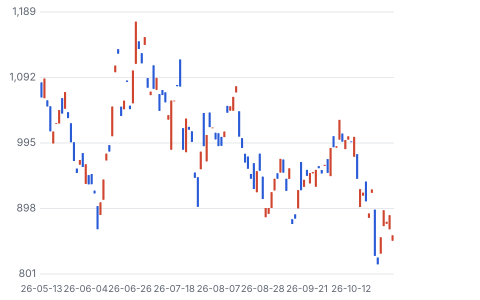

**주봉**

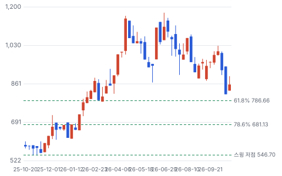

**월봉**

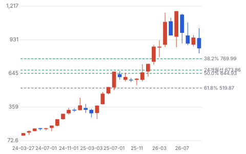

**분기 매출·EPS 실적과 컨센서스**

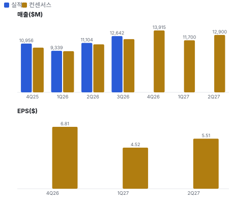

**EPS 리비전**

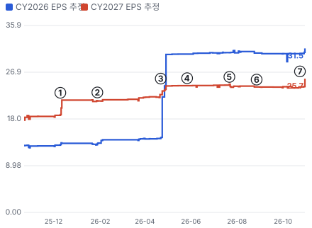

① 25-12-10 2028 전망 제시 행사, 다음 날 EPS 상향 · EPS 리비전 +16%
② 26-01-28 4Q25 실적 · EPS 리비전 +1%
③ 26-04-22 1Q26 실적, 가스 계약 100GW · EPS 리비전 +7%
④ 26-05-27 CEO, 주 정부의 데이터센터 반발 언급 · EPS 리비전 +0%
⑤ 26-07-22 2Q26 실적, 신규 계약 20GW · EPS 리비전 -1%
⑥ 26-08-27 CFO 교체 공시 · EPS 리비전 -0%
⑦ 26-10-28 3Q26 실적, 신규 계약 11GW · EPS 리비전 +7%

**밸류에이션 주가 시나리오**

**주가별 업사이드**

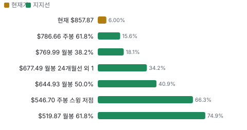

**어닝콜 변화별 주주가치 영향**

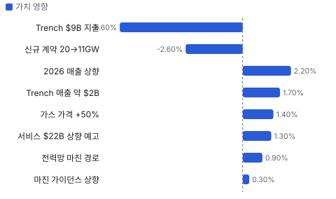

**최근 4개 분기 주가 변화 분석**

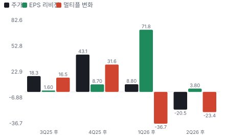

**멀티플 프리미엄**

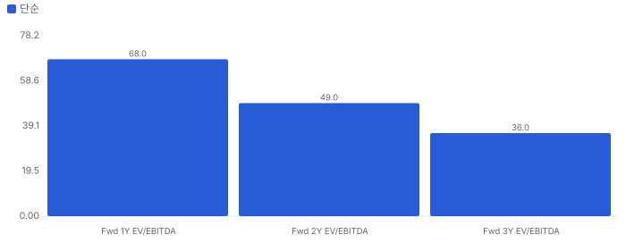

**합리적 멀티플**

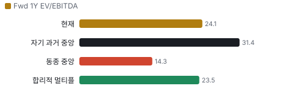

**일별 거래량 분해**

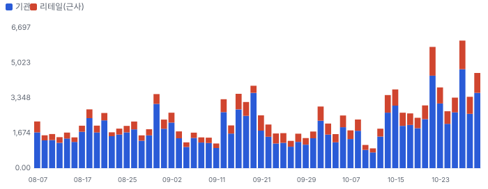

**기관 자금 흐름**

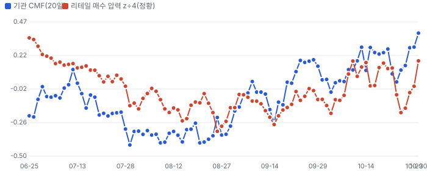

**몬테카를로**

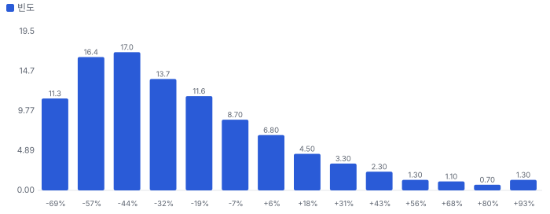

해석: 3,000번 중 629번(21%)에서 가치가 지금 주가 이상이었다. 가정을 흔들어도 지금 주가를 뒷받침하지 못하는 경우가 더 많다. 가운데 값은 0.66배이고, 열 번 중 여덟 번은 0.36~1.24배 사이에 든다.

## 내러티브

> **기업가치를 결정하는 이야기:** 값은 세 줄로 나뉜다. 가스 장비(5GW/분기 × kW당 가격), 설치 기반 서비스(서비스 RPO \$92.7B), 전력망 장비(장비 잔고 \$42.2B)다. 2028년까지의 이익은 잔고가 거의 정해 놓았고, 값을 가르는 것은 2029년 이후 물량과 경쟁사 증설 뒤의 가격이다.

> **멀티플·EPS 프리미엄**
> **멀티플:** Fwd 1Y EV/EBITDA 24.1배로 동종 중앙값 14.3배보다 68% 높다. 고객 선수금 현금을 빼면 25.9배다. 올해 고점 35.9배에서는 많이 내려왔다.
> **EPS:** FY2027 EPS 컨센서스는 \$21.66~\$25.68이고 상단은 2Q 뒤 \$24.18에서 +6.2% 올랐다. 그사이 주가는 −20%라 차이는 전부 배수 하락이다.

### 투자자들은 왜 열광했나

2024년 분사 뒤 터빈 슬롯 부족, 데이터센터 전력, Prolec 인수가 겹쳤다. 주가는 분사 첫 달 말 \$153.71에서 6월 말 종가 고점 \$1,174.86까지 약 7.6배가 됐다. 식은 이유도 차례로 나왔다. 5월 CEO가 주 정부의 데이터센터 반발을 언급했고, 8월 CFO 교체가 공시됐고, 10/28 신규 계약 11GW가 나왔다.

### 무엇이 기업가치를 바꾸나

> **구조적 체질 변화**
> **변화:** 적자 풍력 회사에서 전력 장비 이익 회사로 바뀌었다
> **증거:** 조정 EBITDA 마진 3Q 15.4%, 전년 대비 +690bp. Wind가 3Q 흑자
> **반증:** 2027 조정 EBITDA 마진이 2026 하반기보다 낮다

> **고부가 믹스 확장**
> **변화:** 서비스 비중은 당분간 줄지만 2030년대에 다시 오른다
> **증거:** 3Q 장비 +26%, 서비스 +6%. 2027~2028 서비스 이행 물량 증가
> **반증:** 서비스 수주 증가율이 한 자릿수로 내려간다

> **기술 혁신**
> **변화:** HA(GE Vernova의 대형 고효율 가스터빈 제품군) 효율과 MV-UPS(데이터센터용 중전압 무정전 전원장치)·SST(반도체 소자로 전압을 바꾸는 고체 변압기)가 축이다. SST는 2027년 이후다
> **증거:** 첫 MV-UPS 주문, 6MW SST 수상 통지, 소형 원자로 스웨덴 선정
> **반증:** 800V DC(AI 데이터센터의 차세대 직류 배전) 전환이 2028년 이후로 밀린다

> **실행 속도**
> **변화:** 분기 5GW를 달성했고 납기는 길어졌다. 고객에게는 긴 납기가 부담이다 **납품 리드타임 4~5년.** 피어 비교 미확인. 이전 대비 미확인.
> **증거:** 3Q 5GW 출하, 2026 말이면 2031년 물량의 절반 이상 계약. Wood Mackenzie(에너지 리서치 회사) 평균 납기 약 5년(2차 자료)
> **반증:** 2028 연 24GW 목표가 밀린다

> **M&A**
> **변화:** Prolec GE(2026년 2월 전량 인수한 북미 변압기 회사)에 이어 Trench로 핵심 부품을 안으로 들인다
> **증거:** Trench \$9B, 2028 EBITDA 기준 시너지 전 13배, 2027년 말 종결 예상
> **반증:** 규제 승인 지연 또는 2028 마진 36% 미달

> **정책·입법 연관성**
> **재정정책:** OBBBA(2025년 미국 세제·재정 법률)가 풍력 PTC(발전량 기준 생산세액공제)를 조기 종료한다. 회사 매출에는 Wind 쪽 역풍이고, 2Q 콜은 미국 약 10GW 리파워링이 요건을 이미 충족했다고 했다 2Q 콜, 공법 119-21 반증: 리파워링 수주가 2027에 나오지 않는다 의회 동의 10/10 — 하원 5/5(H.R.1 하원 본회의 통과) · 상원 5/5(상원 본회의 통과).
> **행정명령:** Section 232(안보 사유 수입 관세 조항) 조사가 풍력 터빈 관세를 다룬다. 회사는 결과가 나와야 주문 가시성이 생긴다고 했다 2Q·3Q 콜 반증: 관세 결정 뒤에도 미국 육상 수주가 늘지 않는다 의회 동의 2/10 — 하원 1/5(행정부 조치로 관련 표결을 찾지 못했다) · 상원 1/5(같음).
> **연관입법:** ADVANCE Act(소형 원자로 인허가를 줄이는 2024년 미국 법)가 소형 원자로 인허가를 줄인다. 데이터센터 인허가의 주 단위 반발은 별도 변수다 2024년 시행, 2026년 5월 CEO 발언 반증: NRC(미국 원자력규제위원회) 심사 기간이 줄지 않는다

> **CAPEX 낙수효과**
> **변화:** 전력회사와 하이퍼스케일러 투자가 수주로 온다. 다만 가스 고객의 80%는 전통 고객이다
> **증거:** 가스 고객 약 100곳, 25개국, 데이터센터 약 20%. Electrification 2026 누적 데이터센터 수주 \$6B 초과
> **반증:** Electrification 데이터센터 수주가 2분기 연속 감소

### 내러티브 근거

> 'AI 전력 병목의 핵심 공급사'는 시장 전체가 아는 이야기다. 쟁점은 터빈이 부족한가가 아니라 신규 계약이 정점을 지났는가로 옮겨 갔다. 동종 대비 멀티플 차이 +68% 중 회사 고유 몫은 +3%다. 단계는 컨센서스, 쏠림은 낮아짐이다.

> **가스터빈 부족과 가격** · 강화
> **논리:** 슬롯이 2031년까지 차 가격이 오른다
> **숫자:** 2026 가스 수주 가격 2025 대비 약 +50%. Power 마진 3Q 21.4%
> **반증:** 4Q·1Q 가스 수주 가격이 2025년 4분기 대비 +10% 아래

> **서비스 연금** · 유지
> **논리:** HA 설치가 늘면 2030년대 정비 매출이 쌓인다
> **숫자:** 서비스 RPO \$92.7B. 2035 Power 서비스 \$22B 목표는 보수적이라는 발언
> **반증:** 2030 목표 행사에서 서비스 목표 상향이 없다

> **전력망 수요** · 강화
> **논리:** 송전 투자와 데이터센터가 변압기·스위치기어를 끌어간다
> **숫자:** Electrification 장비 잔고 \$42.2B, +60% YoY. 2026 누적 데이터센터 수주 \$6B 초과
> **반증:** 4Q Electrification 수주가 3Q \$5.4B 아래

> **자본 배치** · 강화
> **논리:** 현금이 넘쳐 인수와 자사주를 동시에 한다
> **숫자:** 자사주 한도 \$20B, 누적 평균 약 \$635. Trench \$9B
> **반증:** 선수금 유입 둔화로 FCF 가이던스 미달

> **반대 내러티브: 계약 정점** · 강화
> **논리:** 신규 계약이 정점을 지나면 강한 수주도 뒤를 보는 숫자다
> **숫자:** 분기 신규 계약 2Q 20GW → 3Q 11GW. 2027 분기도 2026 하반기와 비슷
> **반증:** 1Q27 신규 계약 15GW 이상

> **반대 내러티브: 선수금 현금** · 강화
> **논리:** FCF 대부분이 고객 선금이라 지속되지 않는다
> **숫자:** 9개월 영업현금 \$16.7B, 계약부채 증가 \$19.5B
> **반증:** 2027 FCF가 \$11.5B 추정 상단 \$15B에 근접

**셀사이드(IB 애널리스트)**
| 지표 | 값 | 해석 |
|---|---|---|
| 애널리스트 의견 | 31명 — 강력 매수 23·매수 2·보유 5·강력 매도 1 | 압도적으로 긍정이다 |
| 목표가 평균·범위 | \$1,202 (\$470~\$1,450, 27명) | 10/30 종가 대비 평균 +40%. 기대의 증거이지 Chiip 목표가가 아니다 |
| 실적 뒤 목표가 | RBC(캐나다 은행 RBC) \$1,225 → \$1,230, JPM(J.P. Morgan) \$1,150 → \$1,035 | JPM은 추정을 올리고 목표 배수를 내렸다 |
| 3Q 콜 질문 초점 | 계약 전환·마진 출발점·Trench·고객 자금 조달 | 11곳 중 3곳이 슬롯·계약 지속성을 물었다 |

셀사이드는 숫자를 올리면서 배수를 깎는다. 이익이 아니라 지속성을 의심하기 시작했다

**바이사이드(기관 투자자)**
| 지표 | 값 | 해석 |
|---|---|---|
| 13F 2분기 보유 기관 | 3,235곳, 상위 2,000곳 순증 275만 주 | 1,049곳 증가·691곳 감소, 공개까지 45일 지연 |
| 주요 증가 | Fisher +356만 주, BlackRock +104만 주 | Fisher는 사실상 신규 수준이다 |
| 펀드 레터 | 최근 분기 롱 다수, The Bear Cave는 CFO 교체를 경고 | 다수가 7월 하락을 비중 확대 기회로 적었다 |
| 내부자 장내 | 매수 0건·매도 4건 | 최근 Wind CEO·회계책임자 매도 |

대형 기관은 팔지 않았다. 다만 13F는 6월 말 기준이라 3분기 하락을 담지 못한다

**언론·업계**
| 지표 | 값 | 해석 |
|---|---|---|
| 3Q 평가 | Barron's는 수요 강세, IBD(인베스터스 비즈니스 데일리)는 신규 주문·슬롯이 크게 빗나갔다고 씀 | 같은 분기를 정반대로 읽었다 |
| Seeking Alpha | 세 번 연속 상향에도 시장이 의심한다는 글 | 역발상 논조가 나왔다 |

언론은 수요와 계약 둔화로 갈렸다

## 포트폴리오

| 제품·서비스 | 구분 | 무엇 | 쓰는 곳 | 돈 버는 방식 |
|---|---|---|---|---|
| 가스터빈 | 제품 | HA 대형과 항공 파생 터빈 | 전력회사와 데이터센터 발전 | Power 3Q 매출 \$6.07B, 분기 출하 5GW |
| 터빈 정비·부품 | 서비스 | 장기 서비스 계약과 업그레이드 | 가동 중인 발전소 | 회사 전체 서비스 3Q \$4.30B, 서비스 RPO \$92.7B |
| 전력망 장비 | 제품 | 변압기·스위치기어·HVDC(장거리 고압 직류 송전)·변전소 | 전력회사와 데이터센터 | Electrification 3Q \$3.86B, 마진 19.1% |
| 풍력 | 제품 | 육상·해상 터빈 | 재생 발전 | Wind 3Q \$2.74B, EBITDA \$72M, 2026 손실 \$400~500M |
| MV-UPS·SST·소형 원자로 | 기술 | 차세대 데이터센터 전력과 원자력 | AI 데이터센터, 원전 사업자 | 초기 단계, 매출 미미 |

## 수주·파이프라인

> **2026-09-30 기준 6건.** 확정 \$197B, 미확정 \$1.50B. 공시 잔여 수행의무(RPO) \$197B.

**실행 속도와 방해 요인**
| 항목 | 상태 | 실행 속도 | 방해 요인 |
|---|---|---|---|
| 장비 RPO | 확정 | 1년 안 33%, 2년 안 60%, 5년 안 97% 인식 | 가스 생산 증설 · EPC(발전소 설계·조달·시공 회사) 일정 · 주조·단조 공급 |
| 서비스 RPO | 확정 | 1년 안 16%, 5년 안 54%, 10년 안 78% | 부품 공급의 장비 출하 경합 · 2027~2028 이행 물량 증가 |
| 가스 슬롯 예약 58GW | 파이프라인 | 3Q에 13GW가 주문으로 전환 | 고객 프로젝트 일정 · EPC 확약 |
| Barmer(인도 라자스탄의 HVDC 사업) HVDC | 파이프라인 | 4Q 수주 반영 예정 | 계약 절차 |
| 스웨덴 소형 원자로 1.2GW | 파이프라인 | 기술 선정 단계 | 사업 결정 · 인허가 |
| 6MW 옥외 SST | 파이프라인 | 수상 통지, 4Q 계약 절차 | 800V DC 전환 속도 · 시제품 시험 |

## 해자

> 해자는 설치 기반 서비스와 3사 과점 슬롯이다. 다만 슬롯 해자는 증설이 끝나는 2030년 전후에 시험받는다.

> **가스터빈 설치 기반 서비스** · 강함
> **해자:** 터빈을 판 뒤 20년 넘게 정비·부품을 맡는다. 다른 회사가 이 부품을 대체하기 어렵다.
> **근거:** 3Q 10-Q 서비스 RPO \$92.7B. 2Q 콜에서 HA 130기 가동, 325기 계약. 3Q 콜 질문 기준 HA 1기당 20년 서비스 매출 약 \$500M
> **숫자:** 서비스 RPO는 3Q 전체 매출의 7.3배이고 78%가 10년 안에 인식된다
> **깨지는 조건:** 가동률이 낮아 정비 주기가 늘어난다. 제3자 정비사가 HA 점유를 얻는다

> **대형 터빈 3사 과점과 납기 순번** · 강함
> **해자:** 대형 터빈은 GE(미국 General Electric) Vernova·Siemens Energy·Mitsubishi가 나눠 갖고, 2030년 물량이 대부분 팔렸다.
> **근거:** BNEF(블룸버그 에너지 리서치) 추정 3사 제조 용량 약 66%(2차 자료). 회사는 2032년 슬롯도 팔았다고 밝혔다
> **숫자:** 계약 122GW ÷ 연 생산 20GW = 약 6.1년 치. 2026 가스 수주 가격은 2025 대비 약 +50%
> **깨지는 조건:** 업계 용량이 BNEF 전망대로 67GW → 102GW로 늘고 가스 수주 가격이 전년 대비 내려간다

> **고객 선수금 자금 구조** · 보통
> **해자:** 슬롯 예약과 주문 선금이 증설과 자사주 재원이 된다.
> **근거:** 3Q 10-Q 계약부채 \$45.7B, 연초 \$25.8B. 9개월 영업현금 \$16.7B 중 계약부채 증가가 \$19.5B
> **숫자:** 계약부채는 유형자산 \$7.8B의 5.8배다
> **깨지는 조건:** 신규 계약이 줄어 선금 유입이 멈춘다. 그때는 현금이 납품 비용으로 빠진다

> **전력망 핵심 부품 수직 통합** · 보통
> **해자:** Prolec GE와 Trench로 변압기와 부싱 공급을 안에 둔다.
> **근거:** 3Q 콜: 부싱은 변압기 자재비의 5~8%이고 고객이 공급사를 지정한다. Electrification 장비 잔고 \$42.2B
> **숫자:** Trench 2028 매출 약 \$2B, EBITDA 마진 약 36%, 시너지 전 13배
> **깨지는 조건:** 규제 승인 지연, 또는 Electrification 마진이 20%에서 멈춘다

## 경영진·네트워크

> 창업자 없는 분사 회사다. CEO는 GE 가스 사업에서 컸고, 이사회에 전 AEP(미국 전력회사 American Electric Power) 회장이 있다. 공개 자료로 확인한 정치 연결은 없다.

> **Scott Strazik** · 사장·CEO · 2024(이사)
> **프로필:** 47세. GE에서 25년 넘게 재무·운영을 맡았고 그중 10년 이상이 전력 사업이다
> **비즈니스:** 가스 전력 고객 관계가 주 경력이다
> **정계:** 미확인
> **동문:** 미확인
> **사모임:** 미확인

> **Steve Angel** · 독립 비상임 의장 · 2024
> **프로필:** 70세. CSX(미국 철도 회사) 사장·CEO, 글로벌 산업 가스 회사 CEO 경력
> **비즈니스:** CSX 이사회 겸직
> **정계:** 미확인
> **동문:** 미확인
> **사모임:** 미확인

> **Claire McDonough(신임 CFO Claire McDonough)** · CFO 내정 · 2027-01-01
> **프로필:** 45세. 2021년부터 Rivian(미국 전기차 회사) CFO. 그전 J.P. Morgan 등
> **비즈니스:** 자본시장 경력
> **정계:** 미확인
> **동문:** 미확인
> **사모임:** 미확인

**네트워크 정량화**
| 연결 | 강도 | 닿는 매출 | 가중 노출 | 매출 대비 | 근거 |
|---|---|---|---|---|---|
| 비즈니스: CEO의 가스 전력 고객 관계 — Power 부문 | 4/5 | \$22.26B | \$17.81B | 40% | Power TTM 매출 5,749+4,971+5,477+6,067 위임장 경력, 3Q 10-Q 부문 매출 |
| 비즈니스: 이사 Nicholas Akins(전 AEP 회장·CEO) — 전력회사 고객층 | 2/5 | 미확인 | 미확인 | 미확인 | AEP와의 거래 규모를 공시에서 찾지 못했다 2026 위임장 |
| 정계: 정부·의회 직책 연결 | 0/5 | 미확인 | 미확인 | 미확인 | 위임장·10-K에서 찾지 못했다. 로비 공시는 이번 회차에 확인하지 못했다 2026 위임장 |

가중 노출은 연결이 닿는 매출의 크기다. 연결이 그 매출을 만들었다는 뜻이 아니며, 인과는 공개 자료로 입증하지 못한다.

## 약세 논리 및 셀온 조건

| 약세 논리 | 근거 | 반박 | 가를 자료 |
|---|---|---|---|
| 신규 계약이 이미 정점이다 | 2Q 20GW → 3Q 11GW. 회사도 2027 분기가 2026 하반기와 비슷하다고 했다 | 11GW도 분기 출하 5GW의 2.2배라 잔고는 계속 는다 | 4Q 13GW 이상, 1Q27 신규 계약 |
| FCF가 선금으로 부풀었다 | 9개월 영업현금 \$16.7B, 계약부채 증가 \$19.5B. 증가분을 빼면 −\$2.8B이고 그 안에 현금 세금 \$2.7B가 있다 | 선금은 취소 방어 장치이고 잔고가 줄기 전에는 빠지지 않는다 | 2027 FCF, 계약부채 ÷ 매출 |
| 증설이 가격을 깎는다 | BNEF는 업계 용량이 2025년 67GW에서 2030년 102GW로 는다고 본다. Mitsubishi는 2년에 두 배를 말한다 | 회사는 앞으로 5~6년 수급이 균형이라고 본다. 다만 자기 증설을 고려한 말이다 | 경쟁사 수주 가격, 2029~2030 슬롯 가격 |
| 2001~2004년이 반복된다 | 터빈 주문이 대량 취소된 전례가 있다. 데이터센터 고객 비중은 약 20%다 | 3Q 콜은 취소·전환 둔화가 없다고 답했고 선금 조건도 그대로다 | 슬롯 → 주문 전환율, 취소 공시 |

> **셀온 조건**
> **조건 1:** 분기 신규 가스 계약 8GW 미만이 2분기 이어진다
> **조건 2:** 가스 수주 가격이 2025년 4분기 대비 +10% 아래로 내려간다
> **조건 3:** 계약부채가 전분기 대비 감소한다
> **조건 4:** 슬롯 예약 취소가 공시되거나 콜에서 언급된다
> **조건 5:** 경쟁사가 2029~2030 납기 슬롯을 더 낮은 가격으로 판다는 공시가 나온다

## 어닝콜 변화

**직전 콜 대비 새로 나오거나 바뀐 내용 → 가치 영향**
| 항목 | 내용 | 직전 콜 | 최신 콜 | 모델 동인 이동 | 확신도 | 가치 영향 |
|---|---|---|---|---|---|---|
| 업데이트 | 2026 매출 가이던스 | \$45.5~46.5B | \$46.5~47.5B | 기준연도 매출 +\$1.00B | 0.8 | +2.2% |
| 업데이트 | 2026 조정 EBITDA 마진 | 12~14% | 13.5~14.5% | 출발 이익률 +1.0% | 0.8 | +0.3% |
| 업데이트 | Power 마진·가스 가격 | Power 17~19%, 상반기 가격 +20% 이상 | Power 19~21%, 2026 가스 수주 가격 2025 대비 약 +50% | 목표 이익률 +1.5% | 0.8 | +1.4% |
| 부정 | 분기 신규 가스 계약 | 2Q 20GW | 3Q 11GW(슬롯 8GW·주문 3GW), 2027도 2026 하반기와 비슷 | 장기 성장 수렴값 -1.0% | 0.8 | -2.6% |
| 신규 | Trench 인수 대금 | 없음 | \$9B, 2027년 말 종결 예상, 현금·차입 절반씩 | 순차입 +\$9.00B | 0.8 | -5.6% |
| 신규 | Trench 2028 기여 | 없음 | 2028 매출 약 \$2B, 조정 EBITDA 마진 약 36% | 성장 지속(감속 계수) +1.0% | 0.8 | +1.7% |
| 신규 | Electrification 마진 경로 | 2026 18~20% | 30% 질문에 그 방향이라고 답, 2030 목표는 다음 행사 | 목표 이익률 +1.0% | 0.5 | +0.9% |
| 업데이트 | Power 서비스 2035 목표 | 2035 \$22B | 다음 행사에서 보수적이었다고 확인될 가능성 | 장기 성장 수렴값 +0.50% | 0.5 | +1.3% |
| **합계** | 단독 합 |  |  | 동시 적용 -0.9% |  | **-0.3%** |

**실적 vs 컨센서스**
| 분기 | 지표 | 실적 | 컨센서스 | 서프라이즈 |
|---|---|---|---|---|
| 4Q25 | 매출 | \$10,956M | \$10,041M | +9.1% |
| 1Q26 | 매출 | \$9,339M | \$9,250M | +1.0% |
| 2Q26 | 매출 | \$11,104M | \$10,789M | +2.9% |
| 3Q26 | 매출 | \$12,642M | \$11,956M | +5.7% |

**사건별 EPS 리비전**
| # | 날짜 | 구분 | 사건 | CY2026 EPS 전→후 | CY2027 EPS 전→후 | 리비전 | 주가 반응 |
|---|---|---|---|---|---|---|---|
| ① | 25-12-10 | 내러티브 | 2028 전망 제시 행사, 다음 날 EPS 상향 | \$12.92 → \$13.27 | \$18.65 → \$21.58 | +15.7% | +15.6% |
| ② | 26-01-28 | 실적 | 4Q25 실적 | \$13.00 → \$13.96 | \$21.47 → \$21.64 | +0.8% | +2.7% |
| ③ | 26-04-22 | 실적 | 1Q26 실적, 가스 계약 100GW | \$14.20 → \$30.35 | \$22.64 → \$24.29 | +7.3% | +13.7% |
| ④ | 26-05-27 | 내러티브 | CEO, 주 정부의 데이터센터 반발 언급 | \$30.41 → \$30.59 | \$24.35 → \$24.38 | +0.1% | -3.6% |
| ⑤ | 26-07-22 | 실적 | 2Q26 실적, 신규 계약 20GW | \$30.70 → \$30.80 | \$24.46 → \$24.26 | -0.8% | -8.7% |
| ⑥ | 26-08-27 | 내러티브 | CFO 교체 공시 | \$30.62 → \$30.49 | \$24.10 → \$24.09 | -0.0% | +0.1% |
| ⑦ | 26-10-28 | 실적 | 3Q26 실적, 신규 계약 11GW | \$30.50 → \$31.50 | \$24.10 → \$25.68 | +6.5% | -1.9% |

**컨센서스 리비전**
| 분기 | 지표 | 직전 | 지금 | 리비전 |
|---|---|---|---|---|
| 4Q26 | EPS | 6.65 | 6.807 | +2.4% |
| 1Q27 | EPS | 4.715 | 4.515 | -4.2% |
| 2Q27 | EPS | 5.378 | 5.505 | +2.4% |
| 3Q27 | EPS | 5.918 | 6.313 | +6.7% |
| 4Q27 | EPS | 8.148 | 9.97 | +22.4% |
| **합계 5분기** | EPS | 30.81 | 33.11 | **+7.5%** |

**해석:** 4개 구간 누적 주가 +47% = EPS 리비전 +97% × 멀티플 -26%. 더 크게 움직인 쪽은 **EPS 리비전**이다.

## 밸류에이션

> **목표주가 \$909, 업사이드 +6%.** 자리는 약세와 기본 사이(약세 쪽 20%)이고 도달 확률은 약 58%다. 기본 \$986, 강세 \$1,465(+71%), 약세 \$606(-29%). DCF 기준 업사이드는 기본 -34%, 강세 +0%, 약세 -60%다(WACC 9.9%).

2027년 말 시점에 FY2028 EBITDA를 적용했다. Trench는 2027년 말 종결 예상이라 시나리오 EBITDA에 넣지 않았고, 대금 \$9B의 절반은 차입이다. 순현금은 고객 선수금을 빼지 않은 재무상태표 값이라 시나리오 주가가 DCF보다 높게 나온다.

**목표주가 산정**
| 요인 | 비중 | 가리키는 주가 | 위치(−1 약세 · 0 기본 · +1 강세) | 근거 |
|---|---|---|---|---|
| 시나리오 확률 가중 | 35% | \$1,011 | +0.05 | 약세·기본·강세 확률로 가중 |
| DCF 12개월 뒤 값 | 20% | \$619 | -0.96 | 기본 DCF를 자기자본비용 10.0%로 1년 굴림 |
| 차트 상승 여력 | 20% | \$935 | -0.13 | 하락 추세, 첫째 저항선 피보나치 되돌림 38.2% |
| 내러티브 프리미엄 여력 | 25% | \$986 | -0.00 | 단계 컨센서스, 기본 이익에 옮긴 멀티플 적용 |
| **목표주가** |  | **\$909** | **-0.20** | 약세와 기본 사이(약세 쪽 20%) |

**주가 시나리오**
| 시나리오 | 확률 | 멀티플 | EBITDA | 주가 | 업사이드 | 근거 |
|---|---|---|---|---|---|---|
| 약세 | 25% | 15.7배 | \$9.50B | \$606 | -29% | 신규 계약 감소가 가격으로 번지고 Wind 손실이 이어진다. FY2028 EBITDA 추정 하단 |
| 기본 | 50% | 20.9배 | \$12.00B | \$986 | +15% | 분기 5GW 출하, 높은 가격 물량 인식, Electrification 마진 20% 초반. FY2028 EBITDA 컨센서스 |
| 강세 | 25% | 26.1배 | \$14.50B | \$1,465 | +71% | 가격 효과가 더 빨리 잡히고 Wind 흑자 전환. FY2028 EBITDA 추정 상단 |

**멀티플 선정 — Fwd 1Y EV/EBITDA**
| 단계 | 조정 | 근거 |
|---|---|---|
| 동종 중앙값 | 14.3배 | 범위 12.1~20.0배, 5곳 |
| 펀더멘털 | +20% | 성장·이익률·ROIC로 본 합리적 멀티플 23.5배와의 차이의 일부만 인정 |
| 해자 | +11% | 가스터빈 설치 기반 서비스 강함 · 대형 터빈 3사 과점과 납기 순번 강함 · 고객 선수금 자금 구조 보통 · 전력망 핵심 부품 수직 통합 보통 |
| 내러티브 | +0% | 단계 컨센서스 |
| 사이클·실행 판단 | +15% | 계약 잔고가 2031년까지 물량을 채워 이익 가시성이 동종보다 길고 서비스 RPO \$92.7B가 있다. 다만 FCF가 선수금으로 부풀어 있고 신규 계약이 줄어 할증을 끝까지 주지 않는다 |
| **선정** | **20.9배** | 지금 24.1배 |

**동종 레인지**
| 회사 | Fwd 1Y EV/EBITDA | Fwd 2Y EV/EBITDA | Fwd 3Y EV/EBITDA | 성장 | 영업이익률 | ROIC |
|---|---|---|---|---|---|---|
| ENR(독일 Siemens Energy) | 12.1 | 9.3 | 8.4 | 18% | 12% | 146% |
| ETN(미국 전력 장비 회사 Eaton) | 20.0 | 16.9 | 14.8 | 17% | 19% | 11% |
| VRT(미국 데이터센터 전력·냉각 회사 Vertiv) | 17.6 | 14.4 | 11.4 | 42% | 25% | 55% |
| HUBB(미국 전력 부품 회사 Hubbell) | 14.3 | 13.3 | 12.5 | 15% | 23% | 14% |
| CMI(미국 엔진 회사 Cummins) | 12.4 | 11.2 | 10.2 | 11% | 12% | 20% |
| **GE Vernova** | 24.1 | 19.8 | 15.6 |  |  |  |

지금 주가가 요구하는 5년 매출 CAGR 22%, 기본 시나리오 13%. 몬테카를로 중앙값 업사이드 -34%.

> 의사결정 보조(투자자문 아님): ① 매수 매력: 연 기대수익 +3.2% (자기자본비용 10.0% 대비 -6.7%p) · 자본비용 초과 확률 20% · 안전마진 0.36 → 정량 신호 약함 / ② 위험 예산 지표(이론): 0% — 기대수익이 자기자본비용에 못 미침(무위험 대비 켈리 0%는 참고) · 5년 하위10% -45% · 30%+ 손실 확률 22% / ③ 상방(5년): 기대 1.17배 · 2배 9% · 3배 1% · 10배 0% · 상위10% 1.95배

## 수급

> **한 줄:** 최근 20거래일 거래의 리테일 몫은 22.1%(직전 60일 18.4%) — 거래는 주로 기관이 만든다. 기관 자금 흐름(CMF 20일) +0.38로 기관 매집 쪽, 리테일 매수 압력 z +0.74로 리테일 순매수 정황. 이상 거래일에 늘어난 거래량의 82%가 기관 몫.

**이상 거래일 — 왜 늘었나, 누가 늘렸나(최근 120거래일, RVOL ≥ 1.8 또는 z ≥ 2)**
| 날짜 | RVOL | 주가 | 종가 위치 | 늘어난 거래량 | 증가분 분해 | 원인 태그 |
|---|---|---|---|---|---|---|
| 2026-10-28 | 2.9배 | -1.9% | +1.00 | 3.98M | 기관 76% · 리테일 24% | 실적 발표 · 3Q 실적·Trench 인수·신규 계약 11GW · 레이더 기사 3건 |
| 2026-10-22 | 2.9배 | -10.6% | -1.00 | 3.76M | 기관 74% · 리테일 26% | 원인 미확인(공개 사건 없음) |
| 2026-06-10 | 2.4배 | -5.8% | -1.00 | 3.04M | 기관 84% · 리테일 16% | 원인 미확인(공개 사건 없음) |
| 2026-05-29 | 2.3배 | -2.8% | -1.00 | 2.91M | 기관 90% · 리테일 10% | 월말 |
| 2026-10-30 | 2.1배 | -3.4% | +1.00 | 2.37M | 기관 79% · 리테일 21% | 실적 사흘 뒤 하락, JPM 등 목표가 조정 뒤 · 월말 · 레이더 기사 4건 |
| 2026-10-15 | 2.1배 | -1.6% | +1.00 | 1.93M | 기관 77% · 리테일 23% | 원인 미확인(공개 사건 없음) |
| 2026-10-14 | 1.9배 | -6.2% | -1.00 | 1.66M | 기관 70% · 리테일 30% | 원인 미확인(공개 사건 없음) |
| 2026-10-23 | 1.9배 | -1.5% | -1.00 | 1.82M | 기관 79% · 리테일 21% | 원인 미확인(공개 사건 없음) |

**주간 체결 장소별 비중 — FINRA 확정치(최신 주 2026-10-05, 약 2주 지연)**
| 주 시작 | 전체(주) | 거래소 | ATS(다크풀) | 리테일 도매 | 기타 장외 |
|---|---|---|---|---|---|
| 2026-08-31 | 11.49M | 51.9% | 22.8% | 18.7% | 6.6% |
| 2026-09-07 | 5.80M | 48.2% | 24.6% | 19.0% | 8.1% |
| 2026-09-14 | 15.96M | 49.3% | 21.4% | 19.9% | 9.4% |
| 2026-09-21 | 9.23M | 39.9% | 21.5% | 30.2% | 8.4% |
| 2026-09-28 | 9.89M | 45.2% | 23.8% | 24.5% | 6.5% |
| 2026-10-05 | 9.37M | 43.0% | 22.7% | 25.3% | 9.0% |

**지지선**
| 봉 | 지지선 |
|---|---|
| 일봉 | - |
| 주봉 | 피보 61.8% \$786.66 · 피보 78.6% \$681.13 · 스윙 저점 \$546.70 |
| 월봉 | 피보 38.2% \$769.99 · 24개월선 \$673.86 · 피보 50.0% \$644.93 · 피보 61.8% \$519.87 |

## 체크리스트

| 시점 | 무엇 | 의미 |
|---|---|---|
| 2026년 11월 중순 | 13F 3Q 공시 | 7~9월 하락에서 대형 기관이 줄였나 |
| 2026년 11월 | Siemens Energy 회계연도 실적 | 경쟁사 가스 수주 가격과 증설 |
| 2027년 1월 하순(예상) | 4Q 실적 | Power·Electrification 백로그 마진, 4Q 계약 13GW 이상, 잔고 \$200B |
| 2027년 1분기 | CFO 교체와 2030 목표 행사 일정 | 서비스 \$22B 상향, Electrification 마진 경로 |
| 2027년 4월(예상) | 1Q27 실적 | 분기 신규 계약 15GW 이상인가 |
| 2027년 말 | Trench 종결 | 규제 승인과 차입 \$4.5B |

## 출처
- GE Vernova 3Q26 10-Q https://www.sec.gov/Archives/edgar/data/1996810/000199681026000163/gev-20260930.htm
- GE Vernova 3Q26 실적 보도자료 https://www.sec.gov/Archives/edgar/data/1996810/000199681026000162/gevpressrelease3q26.htm
- GE Vernova 2Q26 10-Q https://www.sec.gov/Archives/edgar/data/1996810/000199681026000148/gev-20260630.htm
- GE Vernova FY2025 10-K https://www.sec.gov/Archives/edgar/data/1996810/000199681026000015/gev-20251231.htm
- GE Vernova 2026 위임장 https://www.sec.gov/Archives/edgar/data/1996810/000199681026000049/gev-20260402.htm
- CFO 교체 8-K https://www.sec.gov/Archives/edgar/data/1996810/000199681026000153/gev-20260825.htm
- BNEF 가스터빈 제조 용량 전망(2차 자료) https://oenergetice.cz/en/technology/gas-turbine-queue-lengthens-as-manufacturing-capacity-set-to-rise-significantly-by-2030
- Wood Mackenzie 가스터빈 가격·납기 https://www.woodmac.com/press-releases/gas-turbine-prices-soar-195-as-market-faces-supply-demand-crisis
- Bernstein 콘퍼런스 CEO 발언 보도 https://streetinsider.com/Investing/GE+Vernova+shares+fall+after+CEO+expresses+caution+on+data+centers/26555560.html
- 라이선스 자료 요지 포함 — 외부 공유 금지
- 마스터 노션 자료: JPM 2026-10-29 JPM_GE_Vernova_Power_SRA_2026-10-29_5510883.pdf (요지만, 외부 공유 금지)
- 3Q 10-Q 주석 9
- 3Q 보도자료
- 3Q 콜
- 3Q 콜 Q&A

_구매 등급·목표주가 모두 규칙이 계산한 모델 값으로, 개인의 보유 종목·자금 사정을 반영하지 않는다 · 공개 자료 기반 분석이며 투자 권유가 아님 · 1차 판정, 미검증 · Chiip ten-bagger_