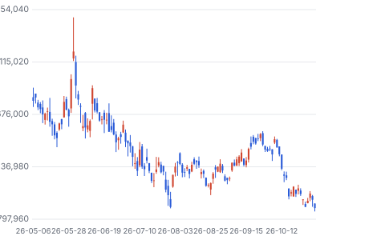
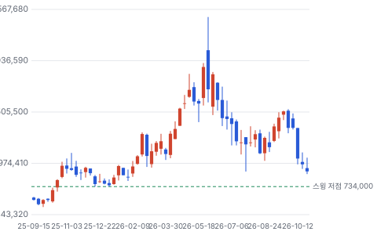
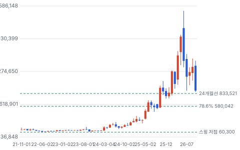
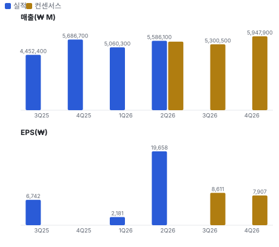
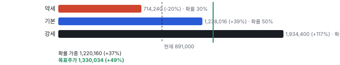
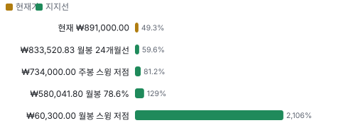
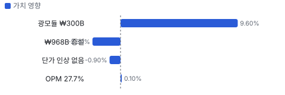
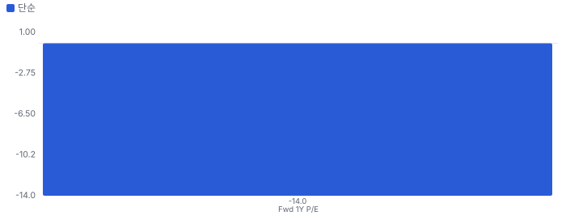
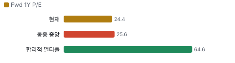
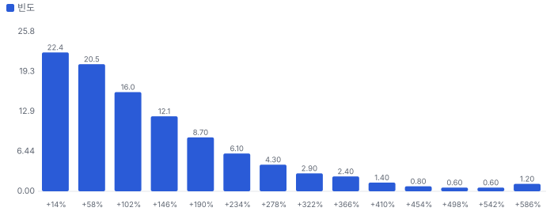

# 텐배거 리포트 2026-11-02 — 시가총액의 92%가 자회사 지분이다 — 시장은 CCL에 얼마를 내고 있나

> 2026-11-02 · 두산(000150) · 기업: AI 서버용 CCL을 만드는 전자BG를 직접 운영하고 두산에너빌리티·두산로보틱스를 거느린 지주회사

## Chiip View

CCL(동박적층판, 회로기판의 기초 소재)은 멀쩡한데 주식이 자회사에 끌려갔다. 2Q 자체사업 영업이익은 ₩212B, OPM 27.7%이고 공장은 100% 넘게 돈다. 그러나 주가는 6월 장중 고점보다 64% 낮고 7/30 저점 900,000원마저 내줬다. **10/28~30 시가총액 감소 약 ₩1.7T는 두산에너빌리티 지분 시가 감소 약 ₩1.4~1.6T와 거의 같다.** 상장 지분 시가가 우선주 포함 시가총액의 92%이니 CCL 값이 작게 남는다. 다만 이 계산은 별도 차입 추정에 기댄다. 11/9 3Q에서 전자BG(두산의 CCL 사업부) 영업이익 ₩200B대 초반 유지와 엔비디아향 물량, 실트론 차입 조건을 본다.

## 대시보드
| 항목 | 값 | 설명 |
|---|---|---|
| 주가 | ₩891,000.00 | 고점 대비 -60% · 1년 +19% |
| 시가총액 | ₩12,685.17B | EV ₩13,898.67B |
| 업사이드 | +49% | 목표주가 ₩1,330,034 · 다운사이드 -20% · 손익비 5.9 |
| 구매등급 | Strong Buy | 애널리스트 12명: Strong Buy 9 · Buy 2 · Neutral 1 · Sell 0 · Strong Sell 0 |
| 멀티플 | Fwd 1Y P/E 24.4배 | 동종 중앙값 25.6배 |
| 가이던스 | 없음 | 회사가 숫자를 내지 않았다 |
| 알파 | 6.2/10 | 텐배거 가능성 점수 |
| 이벤트 | 3Q26 실적(예상) | 2026-11-09 |

## 한 장 요약
- **기업가치를 결정하는 내러티브** **시장이 산 이야기는 'AI 서버 CCL 병목을 쥔 회사'다.** 숫자는 그 이야기를 지지한다. 2Q 자체사업 영업이익 ₩212B, OPM 27.7%, 공장 가동률 100% 초과다. 그러나 주가는 6월 고점 대비 −64%이고, 지금 값은 7/30 저점 900,000원 아래다. 이유는 CCL이 아니라 **지분가치와 차입**에서 나왔다.
- **밸류에이션 모델로 본 주가 상방은 어디까지인가?** **목표주가 ₩1,330,034(+49%), 기본과 강세 사이(강세 쪽 13%)다.** 강세 ₩1,934,400(+117%)는 Fwd 1Y P/E 29.8배를 강세 EPS에 적용한 값이다. 기본 ₩1,238,016, 약세 ₩714,240. 손익비 5.9, DCF 기준 업사이드 +96%.
- **수주는 어디까지 왔나?** SK실트론 70.61% 인수 미확인, 100% 매출 미확인 · 엔비디아향 CCL 연간 미확인, 100% 매출 KRW 1,110.00B · 광모듈용 CCL 연간 미확인, 100% 매출 KRW 300.00B. 회사는 수주잔고를 공개하지 않는다. 확인되는 것은 투자 결의와 SK실트론 계약이고, 고객 물량은 증권사 추정이다.
- **지금 가격은 무엇을 가정하나?** 상장 두 자회사 지분 시가 ₩12.4T에 NAV(순자산가치) 할인 38%를 걸면 ₩7.7T다. 그러면 자체사업에 붙은 값은 약 ₩7.0T이고 FY2027 영업이익 추정 ₩1.25T의 5.6배다. 할인 없이 지분을 시가로 치면 약 ₩2.2T, 1.8배다. Fwd 1Y P/E 24.4배는 2Q 일회성이 든 EPS 기준이고, 일회성을 뺀 27,260원 기준으로는 32.7배다. **싸 보이는 것은 EV 쪽이고 P/E는 싸지 않다.**
- **왜 움직였나?** 10/29 한수원이 체코 두코바니(체코 신규 원전 부지) 시공 협상을 끝냈다. 두산에너빌리티가 10/28 62,000원에서 10/30 53,600~54,800원으로 내렸고, 두산은 1,013,000원에서 891,000원으로 내렸다. 10/15 −13.5%는 공시가 없었고 원인은 미확인이다. CCL 쪽 새 악재는 찾지 못했다.
- **2Q에서 무엇이 바뀌었나?** 좋아진 것은 자체사업 OPM 26.7% → 27.7%, 광모듈 CCL 연 전망 ₩200B대 → ₩300B대다. 부담은 단가가 그대로라 물량과 믹스로만 벌고 있다는 점과, ₩968.4B 증설 가동이 2028년 하반기라는 점이다. 3Q 전문과 숫자는 11/9 뒤에 다시 반영한다.
- **무엇이 바뀌면 판단이 바뀌나?** 3Q 전자BG 영업이익이 ₩200B 아래로 내려가거나 엔비디아향이 줄면 CCL 이야기가 깨진다. 별도 순차입금이 추정 ₩1.2T보다 크게 높으면 DCF와 SOTP(사업별 가치 합산)가 함께 내려간다. 반대로 두산에너빌리티가 내리는 날 두산이 덜 빠지면 할인이 줄기 시작했다는 신호다.

## 한눈에 보기

**일봉**

**주봉**

**월봉**

**분기 매출·EPS 실적과 컨센서스**

**밸류에이션 주가 시나리오**

**주가별 업사이드**

**어닝콜 변화별 주주가치 영향**

**멀티플 프리미엄**

**합리적 멀티플**

**몬테카를로**

해석: 3,000번 중 2,908번(97%)에서 가치가 지금 주가 이상이었다. 가정을 흔들어도 지금 주가를 뒷받침하는 경우가 더 많다. 가운데 값은 1.97배이고, 열 번 중 여덟 번은 1.14~3.98배 사이에 든다.

## 내러티브

> **기업가치를 결정하는 이야기:** 두산의 값은 세 덩어리다. 전자BG가 버는 돈, 두산에너빌리티·두산로보틱스 지분, 그리고 SK실트론을 사며 늘어나는 차입이다. 상장 지분 시가가 우선주 포함 시가총액의 92%라 전자BG에 붙은 값이 작다. 할인을 얼마나 거느냐가 답을 가른다.

> **멀티플·EPS 프리미엄**
> **멀티플:** FY2026 추정 P/E 24.4배로 CCL 동종 중앙값 25.6배보다 조금 낮다. 다만 FY2026 EPS에 2Q 일회성이 들어 있어 일회성을 뺀 약 27,260원 기준으로는 32.7배다.
> **EPS:** FY2026 컨센서스 범위 27,260~36,462원, Chiip 추정 FY2027 52,000원이다. 공개 FY2027 EPS 컨센서스는 찾지 못했고 리비전 이력은 미확인이다.

### 투자자들은 왜 열광했나

주가는 2025년 9월 53만 원대에서 2026년 6월 1일 장중 248.9만 원까지 4.7배 올랐다. 전자BG 영업이익이 2025년 ₩485B로 뛰었고 엔비디아 공급망 지위가 알려졌다. 이후 6월 2일 −12.9%, 7/31 실트론 계약일 +30%, 10/15 −13.5%로 크게 흔들렸다. 식은 이유는 실적 악화가 아니다. 대규모 차입 인수, 체코 협상 종료, 고점 부담이 겹쳤다.

### 무엇이 기업가치를 바꾸나

> **구조적 체질 변화**
> **변화:** 중공업 지주에서 CCL·웨이퍼·테스트를 가진 반도체 소재 회사로 옮겨 간다.
> **증거:** SK실트론 70.61% ₩2.3T, 100% 기준 최대 ₩3.3T
> **반증:** 종결 뒤에도 시장이 지주 할인을 그대로 둔다

> **고부가 믹스 확장**
> **변화:** AI 가속기·광모듈용 CCL 비중이 늘어 이익률이 오른다. 단가가 아니라 믹스와 물량 효과다.
> **증거:** 자체사업 OPM 26.7% → 27.7%. 대신은 단가 변화가 작다고 봤다
> **반증:** 3Q OPM 27% 미만

> **기술 혁신**
> **변화:** 절연층을 13㎛로 줄이고 M9(M8 다음 저손실 CCL 등급)급을 개발했다.
> **증거:** 전자BG 인터뷰, 하나 9/28. 고객 인증 물량은 미확인
> **반증:** M10(M9 다음 CCL 등급) 공급사에서 빠진다

> **실행 속도**
> **변화:** 해당 없음(납기를 숫자로 공개하지 않는다). 대신 증설 속도로 잰다. 4Q 네트워크 캐파 +25%, 큰 증설은 2028년 하반기다.
> **증거:** 하나 9/28, 9/17 공시 보도
> **반증:** 4Q 신규 라인 양산이 늦어진다

> **M&A**
> **변화:** SK실트론을 삼정KPMG(회계법인) 평가 하단 ₩2.3T에 샀다. EBITDA 초과분 공유 언아웃이 붙었다.
> **증거:** 비즈워치 8/4. 2027~2034년 초과분의 40% × 70.61%
> **반증:** 순차입 ₩2.6T를 떠안은 뒤 웨이퍼 업황이 꺾인다

> **정책·입법 연관성**
> **재정정책:** 해당 없음(두산 CCL 매출과 연결된 미국 재정 사업을 찾지 못했다).
> **행정명령:** 해당 없음(두산을 직접 겨냥한 행정명령을 찾지 못했다).
> **연관입법:** 해당 없음(개정 상법의 자사주 소각 규정 외에 매출을 바꾸는 법안을 찾지 못했다).

> **CAPEX 낙수효과**
> **변화:** 빅테크 AI 투자가 엔비디아 서버를 거쳐 CCL로 내려온다. 두산은 이 고리가 가장 또렷한 편이다.
> **증거:** 엔비디아향 ₩1.11T 전망은 증권사 추정이고 회사는 고객별 매출을 공시하지 않는다
> **반증:** 북미 CSP(클라우드 서비스 사업자) CAPEX 삭감

### 내러티브 근거

> AI 서버 CCL 병목을 쥔 회사라는 이야기다. 증권사 12곳 중 11곳이 매수이지만 주가는 6월 고점의 36% 수준이다. 동종 대비 멀티플 차이 -5% 중 회사 고유 몫은 -62%다. 단계는 컨센서스, 쏠림은 식는 중이다.

> **엔비디아 CCL 병목** · 유지
> **논리:** AI 서버 고급 CCL은 물량이 모자라 두산이 다 판다
> **숫자:** 엔비디아향 2026년 ₩1.11T, 2025년 ₩652.5B(메리츠)
> **반증:** 3Q 전자BG 매출이 ₩700B 미만이거나 엔비디아향이 QoQ 감소

> **광모듈 CCL 2번째 성장축** · 강화
> **논리:** 800G·1.6T 광트랜시버가 새 매출을 만든다
> **숫자:** 연 전망 ₩200B대 → ₩300B대, OPM 10% → 20~30%대
> **반증:** 연 매출 ₩300B 미달

> **지주 할인 축소** · 유지
> **논리:** 소각과 사업 재편으로 NAV 할인이 줄어든다
> **숫자:** 대신 할인 38%. 소각 후 발행주식 1,851만 주
> **반증:** 두산에너빌리티 지분 매각·PRS(주가수익스와프, 지분 담보 자금 조달) 추가로 지분가치가 줄어든다

> **반도체 소재 회사 전환** · 유지
> **논리:** CCL·웨이퍼·테스트를 묶어 AI 반도체 회사로 재평가된다
> **숫자:** SK실트론 EBITDA ₩600B 이상(DS(DS투자증권), 2025년 기준)
> **반증:** 인수 종결 뒤 차입이 늘고 시너지 숫자가 없다

> **반대: 값은 CCL이 아니라 자회사가 흔든다** · 강화
> **논리:** 시가총액의 대부분이 상장 자회사 지분가치라 원전 뉴스에 끌려간다
> **숫자:** 두 상장 자회사 지분 시가 약 ₩12.4T, 우선주 포함 시가총액 약 ₩13.5T
> **반증:** 자회사 주가가 빠지는 날 두산이 덜 빠진다

> **반대: 2차 공급사 진입** · 강화
> **논리:** 루빈(엔비디아 차세대 AI 가속기) 세대에서 대만 업체가 물량을 가져간다
> **숫자:** Elite Material TTM 매출 +89% YoY, TUC +87% YoY
> **반증:** 메리츠 ₩277.3B를 넘는 3Q 엔비디아향이 확인된다

**셀사이드(IB 애널리스트)**
| 지표 | 값 | 해석 |
|---|---|---|
| 애널리스트 의견 | 매수 11, 중립 1 | 매도 없음 |
| 목표가 평균 | ₩2,229,167 | 현재가 대비 +150%. 기대의 증거다 |
| 목표가 일부 | 대신 ₩1.97M, 메리츠 ₩2.40M, 하나 ₩2.42M | 모두 SOTP. 대신 NAV 할인 38% |

목표가와 주가의 거리가 벌어졌다. 숫자 전망보다 지분가치 가정이 주가를 끌어 내린 쪽이다

**바이사이드(기관 투자자)**
| 지표 | 값 | 해석 |
|---|---|---|
| 외국인 소진율 | 21.35% | 10/30 기준 |
| 드러켄밀러 면담 | 9/22 보도 | 면담 사실만 있다. 지분 취득은 미확인 |

기관 순매수 자료는 받지 못했다. 바이사이드 층은 대부분 미확인이다

**언론·업계**
| 지표 | 값 | 해석 |
|---|---|---|
| 주요 보도 | SK실트론 인수, ₩968.4B 증설, 체코 협상 종료 | CCL보다 자회사 뉴스가 주가를 흔든다 |

10/15 −13.5%는 공시 없이 나왔고 보도도 원인을 특정하지 못했다

## 포트폴리오

| 제품·서비스 | 구분 | 무엇 | 쓰는 곳 | 돈 버는 방식 |
|---|---|---|---|---|
| AI 가속기용 CCL | 제품 | GPU(그래픽 처리 장치) 서버 보드의 기초 소재 | 엔비디아 블랙웰(엔비디아 현행 AI 가속기 플랫폼)·베라 루빈(엔비디아 차세대 AI 가속기 플랫폼) | 3Q 엔비디아향 추정 ₩277.3B |
| 네트워크·광모듈용 CCL | 제품 | 스위치와 광트랜시버 기판 소재 | 800G·1.6T | 광모듈 3Q 추정 ₩105.9B, 연 약 ₩300B |
| 상장 자회사 지분 | 서비스 | 두산에너빌리티(가스터빈·원전), 두산로보틱스 | 지분가치 | 시가 약 ₩12.4T |
| SK실트론(인수 대기) | 기술 | 실리콘 웨이퍼, SiC(실리콘 카바이드 전력 반도체 소재) 웨이퍼 | 메모리·전력 반도체 | EBITDA 연 ₩600B 이상(DS, 2025년 기준) |

## 수주·파이프라인

> **2026-10-30 기준 5건.** 건별 확정 금액은 공개되지 않았다. 서로 겹치는 항목은 합계에서 뺐다.

**실행 속도와 방해 요인**
| 항목 | 상태 | 실행 속도 | 방해 요인 |
|---|---|---|---|
| SK실트론 70.61% 인수 | 조건부 | 계약금 10% 지급, 2027-01-31 종결 예정 | 잔여 29.39% 협상 · 인수금융 ₩2.5T · 언아웃 |
| 엔비디아향 CCL 연간 | 파이프라인 | 3Q 추정 ₩277.3B, +34.7% QoQ | 루빈 일정 · T-글래스(저열팽창 유리섬유 천) · 2차 공급사 |
| 광모듈용 CCL 연간 | 파이프라인 | 3Q 추정 ₩105.9B, 2Q의 2배 이상 | 1.6T 전환 시점 |
| CCL 증설 국내·창수(중국 장쑤성 도시, 두산 CCL 법인 소재지) ₩968.4B | 파이프라인 | 연 매출 캐파 ₩2.8T → ₩5.4T(2028), 하나 추정. 태국 포함 | 가동 2028년 하반기 · 금융 차입 · 중국 공장 규제 위험 |
| 태국 신공장 약 ₩180B | 파이프라인 | 2028년 하반기 양산 목표 | 고객 인증 |

## 해자

> 해자는 엔비디아 인증과 얇은 절연층 기술이다. 다만 루빈 세대의 독점은 다툼이 있고, 핵심 소재 T-글래스는 남의 손에 있다.

> **엔비디아 인증 지위** · 보통
> **해자:** 블랙웰 컴퓨트 트레이(GPU가 들어가는 서버 보드 묶음)용 CCL을 사실상 단독으로 공급했고 베라 루빈 공급망에도 들어갔다.
> **근거:** 메리츠 3Q 북미 엔비디아향 ₩277.3B 추정, 2026년 ₩1.11T 전망. 씨티는 루빈용 유일 인증이라 썼고, 궈밍치 메모는 M10 시험에 공급사 2곳이 추가됐다고 썼다. 양쪽이 충돌한다
> **숫자:** 분기 엔비디아향이 자체사업 매출의 약 36%(3Q 추정 ÷ 2Q 실적 기준)
> **깨지는 조건:** 루빈 램프에서 Elite Material이나 TUC가 컴퓨트 트레이 물량을 나눠 가진다

> **얇은 절연층 기술** · 보통
> **해자:** 유기 필러를 넣어 절연 두께를 18㎛에서 13㎛로 줄였다.
> **근거:** 전자BG 사장 인터뷰 보도. '13㎛는 두산만 가능'은 회사 쪽 말이고 고객·경쟁사 확인은 없다
> **숫자:** 18㎛ → 13㎛
> **깨지는 조건:** 대만 업체가 같은 두께로 고객 인증을 받는다

> **풀가동 캐파** · 보통
> **해자:** 공급이 모자라 가동률이 100%를 넘고, 다음 증설분은 2028년에 나온다. 그때까지는 수요가 넘친다.
> **근거:** 증평 122%, 김천 106%. 투자 ₩968.4B 가동은 2028년 하반기부터
> **숫자:** 연 매출 캐파 ₩2.8T(2026) → ₩5.4T(2028), 하나 추정
> **깨지는 조건:** Elite Material·중국 업체의 증설이 먼저 가동돼 2027년에 공급이 풀린다

> **T-글래스 조달** · 약함
> **해자:** 고급 CCL의 핵심 원단은 Nittobo가 세계 약 90%를 쥔다. 두산도 부족을 인정했다.
> **근거:** 전자BG 사장 9/11 인터뷰, 닛토보 점유율 보도. 두산의 장기 공급 계약 물량은 미확인
> **숫자:** 리드타임 약 2년(딘스티커 10/6)
> **깨지는 조건:** 해당 없음 — 조달 물량이 공시되면 판정을 올린다

## 경영진·네트워크

> 오너 경영 지주사다. 엔비디아와의 관계는 공급 계약이 핵심이고 오너 연결이 만든 매출은 입증되지 않는다.

> **박정원** · 두산그룹 회장 · 2016
> **프로필:** 1962년생. 고려대 경영학과, 보스턴대 MBA(경영학 석사). 1985년 입사, 2012~2016년 ㈜두산 회장, 2016년 3월 그룹 회장
> **비즈니스:** 최대주주. 본인 7.87%, 특수관계인 포함 약 41%. 2020년 위기 때 비주력 사업을 팔았다
> **정계:** 미확인
> **동문:** 고려대·대일고. 사업 연결은 미확인
> **사모임:** 미확인

> **박두병** · 초대 회장(작고) · 미확인
> **프로필:** 박정원 회장의 조부
> **비즈니스:** 미확인
> **정계:** 미확인
> **동문:** 미확인
> **사모임:** 미확인

**네트워크 정량화**
| 연결 | 강도 | 닿는 매출 | 가중 노출 | 매출 대비 | 근거 |
|---|---|---|---|---|---|
| 비즈니스: 엔비디아향 CCL 공급 관계 | 2/5 | ₩1,110.00B | ₩444.00B | 18% | 메리츠 2026년 엔비디아향 매출 전망. 공급 계약이지 인맥이 아니다 이투데이 10/1, 로이터 6/8 제목 |

가중 노출은 연결이 닿는 매출의 크기다. 연결이 그 매출을 만들었다는 뜻이 아니며, 인과는 공개 자료로 입증하지 못한다.

## 약세 논리 및 셀온 조건

| 약세 논리 | 근거 | 가를 자료 |
|---|---|---|
| 싸 보이는 것은 할인 착시다 | 지주 할인은 영구적일 수 있다. 대신도 38%를 걸었고 PRS로 로보틱스 지분 1,170만 주가 이미 담보다. 지분을 시가로 치는 계산은 팔 수 없는 값이다 | 3Q 뒤 NAV 할인 변화, 추가 담보 공시 |
| 자회사 주가가 비싸다 | 두산에너빌리티 FY2026 추정 P/E 103배다. 지분가치 ₩10.7T가 흔들리면 두산이 먼저 맞는다. 메리츠·한투가 체코 뒤 목표가를 내렸다 | 11/4 두산에너빌리티 3Q, 시공 재입찰 |
| 엔비디아 독점이 깨진다 | 씨티는 루빈용 유일 인증이라 썼지만 궈밍치 메모는 M10 시험 공급사 2곳 추가를 적었다. Elite Material TTM 매출 +89% YoY, TUC +87% YoY다 | 3Q 엔비디아향 매출, 루빈 램프 |
| 차입 인수가 값을 낮춘다 | 실트론 70.61% ₩2.3T에 순차입 ₩2.6T가 딸려 온다. 잔여 29.39%까지 사면 최대 ₩3.3T이고 언아웃이 2034년까지 간다. 웨이퍼 업황이 꺾이면 레버리지가 양날이다 | 2027-01-31 종결 조건, 잔여 지분 가격 |
| 단가가 안 오른다 | 대신은 제품 단가가 전년과 비슷하고 물량이 20~30% 늘었다고 봤다. 2028년 전까지 캐파가 묶여 물량에도 상한이 있다 | 3Q OPM, 4Q 신규 라인 25% |
| 경쟁사도 증설한다 | CCL 호황은 공급을 부른다. 두산 캐파도 ₩2.8T → ₩5.4T이고 대만·중국 증설 규모는 이 리포트에서 대조하지 못했다 | 동종사 증설 공시, CCL 가격 |
| T-글래스 병목 | Nittobo가 세계 약 90%다. 두산의 장기 공급 물량은 미확인이다 | 닛토보 증설, 전자BG 콜 발언 |
| 자료 한계 | 별도 차입 ₩2.9T는 NICE(NICE신용평가) 총차입금/EBITDA 4.7배로 만든 추정이다. 한신평 표의 ₩4.9T 순차입 항목은 기준이 달라 쓰지 않았다. 이 값이면 주당 약 ₩260K이 낮아진다. 3Q25·4Q25 자체사업, 투하자본, FY2027·28 EPS도 추정이다. DART(금융감독원 전자공시)는 robots.txt 차단으로 분기보고서 네 곳을 대조하지 못했고, 고객 비중은 미확인이다. 두산테스나 지분은 넣지 않았다 멀티플 선정의 펀더멘털 +20%는 자체사업 성장으로 잰 값이라 연결 이익 전체에 주면 후하다. 이를 빼면 멀티플 약 18.7배, 기본 약 ₩972,000(+9%)이고 등급은 내려간다. | 3Q 분기보고서, 11/9 실적 자료 |

> **셀온 조건**
> **조건 1:** 전자BG 영업이익이 2개 분기 연속 QoQ 감소한다.
> **조건 2:** 자체사업 OPM이 2개 분기 연속 25% 아래로 내려간다.
> **조건 3:** 엔비디아향 CCL 일부를 다른 공급사가 가져갔다는 사실이 회사나 고객 자료로 확인된다.
> **조건 4:** 실트론 종결 뒤 별도 순차입이 늘어 신용등급 전망이 긍정적에서 안정적으로 내려간다.

## 어닝콜 변화

**직전 콜 대비 새로 나오거나 바뀐 내용 → 가치 영향**
| 항목 | 내용 | 직전 콜 | 최신 콜 | 모델 동인 이동 | 확신도 | 가치 영향 |
|---|---|---|---|---|---|---|
| 업데이트 | 광모듈용 CCL 연 매출 전망 | 약 ₩200B대 | 약 ₩300B대 | 1년차 성장률 +3.0% | 0.8 | +9.6% |
| 업데이트 | 자체사업 영업이익률 | 26.7%(1Q) | 27.7%(2Q) | 출발 이익률 +1.0% | 1.0 | +0.1% |
| 신규 | CCL 증설 결의 | 태국 약 ₩180B | 국내 ₩421B + 창수 ₩547B 추가 | 매출÷투하자본 -20.0% | 1.0 | -2.3% |
| 부정 | 제품 단가 | 미확인 | 전년과 비슷, 물량 +20~30% | 목표 이익률 -1.0% | 0.8 | -0.9% |
| **합계** | 단독 합 |  |  | 동시 적용 +6.5% |  | **+6.5%** |

**실적 vs 컨센서스**
| 분기 | 지표 | 실적 | 컨센서스 | 서프라이즈 |
|---|---|---|---|---|
| 3Q25 | 매출 | ₩4.45T | - | - |
| 3Q25 | OPM | 5.3% | - | - |
| 3Q25 | EPS | 6,742 원 | - | - |
| 4Q25 | 매출 | ₩5.69T | - | - |
| 4Q25 | OPM | 4.8% | - | - |
| 4Q25 | EPS | -8,271 원 | - | - |
| 1Q26 | 매출 | ₩5.06T | - | - |
| 1Q26 | OPM | 6.7% | - | - |
| 1Q26 | EPS | 2,181 원 | - | - |
| 2Q26 | 매출 | ₩5.59T | ₩5.52T | +1.2% |
| 2Q26 | OPM | 8.7% | 8.3% | +0.5%p |
| 2Q26 | EPS | 19,658 원 | - | - |

## 밸류에이션

> **목표주가 ₩1,330,034, 업사이드 +49%.** 자리는 기본과 강세 사이(강세 쪽 13%)이고 도달 확률은 약 40%다. 기본 ₩1,238,016, 강세 ₩1,934,400(+117%), 약세 ₩714,240(-20%). DCF 기준 업사이드는 기본 +96%, 강세 +220%, 약세 +20%다(WACC 9.3%).

공개된 FY2027 EPS 컨센서스를 찾지 못해 세 EPS는 Chiip 추정이다. 4월 공개 리포트의 38,787원은 전자BG 전망이 오르기 전 값이라 쓰지 않았다. DCF는 자체사업에 상장 지분을 38% 할인해 더한 값이고, P/E 경로는 연결 지배이익이다. 두 값이 다른 이유는 DCF가 CCL 호황이 5년 이어지는 경로를 담고, P/E는 2027년 한 해만 보며 지주 할인을 판단 조정으로 낮췄기 때문이다.

**목표주가 산정**
| 요인 | 비중 | 가리키는 주가 | 위치(−1 약세 · 0 기본 · +1 강세) | 근거 |
|---|---|---|---|---|
| 시나리오 확률 가중 | 35% | ₩1,220,160 | -0.03 | 약세·기본·강세 확률로 가중 |
| DCF 12개월 뒤 값 | 20% | ₩1,911,119 | +0.97 | 기본 DCF를 자기자본비용 9.7%로 1년 굴림 |
| 차트 상승 여력 | 20% | ₩1,109,570 | -0.25 | 하락 추세, 첫째 저항선 피보나치 되돌림 78.6% |
| 내러티브 프리미엄 여력 | 25% | ₩1,237,600 | -0.00 | 단계 컨센서스, 기본 이익에 옮긴 멀티플 적용 |
| **목표주가** |  | **₩1,330,034** | **+0.13** | 기본과 강세 사이(강세 쪽 13%) |

**주가 시나리오**
| 시나리오 | 확률 | 멀티플 | EPS | 주가 | 업사이드 | 근거 |
|---|---|---|---|---|---|---|
| 약세 | 30% | 17.9배 | ₩40000.00 | ₩714,240 | -20% | 루빈 물량을 나눠 주고 전자BG 영업이익이 ₩900B대에 머문다. 실트론 이자가 얹힌다 |
| 기본 | 50% | 23.8배 | ₩52000.00 | ₩1,238,016 | +39% | 전자BG 영업이익 약 ₩1.15T(메리츠 ₩1.18T보다 조금 낮게), 일회성 뺀 FY2026 약 27,000원에서 출발. Chiip 추정이다 |
| 강세 | 20% | 29.8배 | ₩65000.00 | ₩1,934,400 | +117% | 광모듈과 1.6T 믹스로 OPM이 33%를 넘고 실트론 이익이 온기로 더해진다 |

**멀티플 선정 — Fwd 1Y P/E**
| 단계 | 조정 | 근거 |
|---|---|---|
| 동종 중앙값 | 25.6배 | 범위 12.3~37.9배, 5곳 |
| 펀더멘털 | +20% | 성장·이익률·ROIC로 본 합리적 멀티플 64.6배와의 차이의 일부만 인정 |
| 해자 | +3% | 엔비디아 인증 지위 보통 · 얇은 절연층 기술 보통 · 풀가동 캐파 보통 · T-글래스 조달 약함 |
| 내러티브 | +0% | 단계 컨센서스 |
| 사이클·실행 판단 | -30% | 동종 중앙값은 순수 CCL 회사 값이다. 두산은 지주 구조라 대신도 NAV에 38% 할인을 걸었고, FY2026 EPS에는 2Q 일회성이 들어 있다 |
| **선정** | **23.8배** | 지금 24.4배 |

**동종 레인지**
| 회사 | Fwd 1Y P/E | 성장 | 영업이익률 | ROIC |
|---|---|---|---|---|
| Elite Material | 36.1 | 26% | 26% | 38% |
| ITEQ | 37.9 | 41% | 9% | 10% |
| Shengyi | 25.6 | 14% | 22% | 25% |
| Kingboard Laminates | 12.3 | 40% | 21% | 19% |
| 이수페타시스 | 22.3 | 26% | 20% | 23% |
| **두산** | 24.4 |  |  |  |

지금 주가가 요구하는 5년 매출 CAGR -1%, 기본 시나리오 25%. 몬테카를로 중앙값 업사이드 +97%.

> 의사결정 보조(투자자문 아님): ① 매수 매력: 연 기대수익 +27.0% (자기자본비용 9.7% 대비 +17.4%p) · 자본비용 초과 확률 85% · 안전마진 1.14 → 정량 신호 강함 / ② 위험 예산 지표(이론): 1/4 켈리 10.0% (상한 10%) · 5년 하위10% +45% · 30%+ 손실 확률 0% / ③ 상방(5년): 기대 3.31배 · 2배 72% · 3배 44% · 10배 1% · 상위10% 5.83배

## 수급

**지지선**
| 봉 | 지지선 |
|---|---|
| 일봉 | - |
| 주봉 | 스윙 저점 ₩734,000.00 |
| 월봉 | 24개월선 ₩833,520.83 · 피보 78.6% ₩580,041.80 · 스윙 저점 ₩60,300.00 |

## 체크리스트

| 시점 | 무엇 | 의미 |
|---|---|---|
| 2026-11-04 | 두산에너빌리티 3Q 실적 | 체코 뒤 지분가치의 바닥 |
| 2026-11-09(예상) | 두산 3Q 실적 | 전자BG 영업이익 ₩204~226B 추정 범위, 엔비디아향 ₩277B 추정 |
| 2026년 11월 중순 | 3Q 분기보고서 | 별도 현금·차입 실측, 차입 추정 교체 |
| 2026년 4Q | 네트워크 CCL 신규 라인 +25% | 캐파 제약이 풀리는가 |
| 2027-01-31 | SK실트론 인수 종결 | 차입 규모와 잔여 지분 가격 |
| 2028년 하반기 | 국내·창수·태국 증설 가동 | 캐파 2배가 물량으로 차는가 |

## 출처
- 대신 3Q 전망 더파워 2026-10-19: https://www.thepowernews.co.kr/view.php?ud=20261019141142714de3f0aa1be_7
- 대신 파이낸셜포스트 2026-10-19: https://www.financialpost.co.kr/news/articleView.html?idxno=281059
- 메리츠 이투데이 2026-10-01: https://www.etoday.co.kr/news/view/2631199
- 하나 이코노믹리뷰 2026-09-28: https://www.econovill.com/news/articleView.html?idxno=751977
- 하나 핀포인트뉴스 2026-09-29: https://www.pinpointnews.co.kr/news/articleView.html?idxno=490745
- 2Q 실적 이투데이 2026-07-27: https://www.etoday.co.kr/news/view/2607910
- 1Q 자체사업 ZDNet 2026-04-29: https://zdnet.co.kr/view/?no=20260429170905
- 가동률·공급 지위 머니투데이 2026-06-04: https://www.mt.co.kr/industry/2026/06/04/2026060321235968654
- 자사주 소각 ZDNet 2026-09-17: https://zdnet.co.kr/view/?no=20260917135612
- SK실트론 허프포스트 2026-08: https://www.huffingtonpost.kr/article/259216
- SK실트론 자금 비즈워치 2026-08-04: https://news.bizwatch.co.kr/article/industry/2026/08/04/0008
- PRS 서울경제 2025-12-24: https://www.sedaily.com/article/14162217
- NICE 등급 전망 파이낸셜뉴스 2026-06-29: https://www.fnnews.com/news/202606291559049852
- 한국신용평가 ㈜두산 2026-06-30: https://m.kisrating.com/fileDown.do?menuCd=R8&gubun=2&fileName=rs20260630-52.pdf
- 지분 현황 요약: https://etfshopping.com/stock/034020/company
- 체코 협상 종료 부산일보 2026-11-01: https://www.busan.com/view/busan/view.php?code=2026110117035043286
- 10/30 시세 중앙이코노미뉴스: https://www.joongangenews.com/news/articleView.html?idxno=559992
- M10 공급사 보도·Rubin 공급 Digitimes: https://apps.digitimes.com/news/a20251121PD242.html
- 9/17 공시 보도, 하나 9/28
- 대신 10/19, 메리츠 10/1
- 머니투데이 6/4 계열 보도
- 메리츠 인용 이투데이 10/1
- 허프포스트 8/3, 비즈워치 8/4, 더파워 10/19

_구매 등급·목표주가 모두 규칙이 계산한 모델 값으로, 개인의 보유 종목·자금 사정을 반영하지 않는다 · 공개 자료 기반 분석이며 투자 권유가 아님 · 1차 판정, 미검증 · Chiip ten-bagger_