# 텐배거 리포트 2026-11-02 — 이익은 나왔는데 시장은 3배만 준다, 싸움은 2028년 이익이다

> 2026-11-02 · SK하이닉스(000660) · 기업: 메모리 반도체(DRAM·HBM·낸드) 설계·제조, AI 가속기용 HBM 1위권

## Chiip View

3Q는 숫자로 답했다. 영업이익 ₩83.3T, OPM 80%, 순현금 ₩98.7T다. 그래도 시장은 Fwd 1Y P/E 3.0배만 준다. **이 값은 이익이 곧 줄어든다는 가정이다.** OPM을 42%까지 낮춰도 지금 주가는 5년 매출 CAGR −9%를 요구한다. **우리는 2027년 이익은 이 가격이 가정하는 것보다 낫고, 2029년 이후는 알 수 없다고 본다.** LTA(장기 공급 계약) 금액과 가격 하단이 공개되지 않아서다. 목표주가는 ₩2,084,111, 업사이드 +40%이고 Buy다. 선정 멀티플은 3.8배로 IB의 7배에 한참 못 미친다. 약세는 ₩876,878(−41%)로 낙폭도 크다. 나스닥 ADR(미국 주식예탁증서)이 코스피보다 42.6% 비싸다는 점은 같은 주식의 값이 아직 정해지지 않았다는 뜻이다. 가를 것은 11월 분기보고서의 계약부채와 1Q27 고정거래가격이다.

## 대시보드
| 항목 | 값 | 설명 |
|---|---|---|
| 주가 | ₩1,484,000.00 | 고점 대비 -49% · 1년 +208% |
| 시가총액 | ₩1,046,476.73B | EV ₩959,332.73B |
| 업사이드 | +40% | 목표주가 ₩2,084,111 · 다운사이드 -41% · 손익비 2.4 |
| 구매등급 | Buy | 애널리스트 43명: Strong Buy 37 · Buy 4 · Neutral 2 · Sell 0 · Strong Sell 0 |
| 멀티플 | Fwd 1Y P/E 3.0배 | 동종 중앙값 4.2배 |
| 가이던스 | 없음 | 회사가 숫자를 내지 않았다 |
| 알파 | 6.1/10 | 텐배거 가능성 점수 |
| 이벤트 | 4Q26 실적(예상) | 2027-01-28 |

## 한 장 요약
- **기업가치를 결정하는 내러티브** 기업가치는 지금 이익이 아니라 이 이익이 몇 년 가느냐로 정해진다. 3Q OPM 80%는 확인됐다. 시장은 그래도 Fwd 1Y P/E 3배를 준다.
- **밸류에이션 모델로 본 주가 상방은 어디까지인가?** **목표주가 ₩2,084,111(+40%), 기본과 강세 사이(강세 쪽 22%)다.** 강세 ₩2,922,928(+97%)는 Fwd 1Y P/E 4.7배를 강세 EPS에 적용한 값이다. 기본 ₩1,848,045, 약세 ₩876,878. 손익비 2.4, DCF 기준 업사이드 +123%.
- **수주는 어디까지 왔나?** 2027 HBM(AI 가속기 옆에 쌓는 고대역폭 메모리) 물량·가격 타결 미확인, 100% 매출 미확인 · LTA 14개 고객 미확인, 100% 매출 미확인 · M15X(청주 신규 DRAM·HBM 팹) 램프 미확인, 100% 매출 미확인. 회사는 수주잔고 금액을 공개하지 않는다. 확인되는 것은 LTA 고객 수·캐파 비중과 증설 일정이다. 금지표대로 LTA는 매출 확정이 아니다.
- **지금 가격은 무엇을 가정하나?** Fwd 1Y P/E 3.0배, Fwd 2Y 2.5배다. 마이크론 4.8배, 샌디스크 5.0배보다 낮다. 영업이익이 3년 남짓 이어지면 시가총액 ₩1,046T를 채운다. 장기 OPM을 42%로 낮춘 DCF에서도 지금 값은 5년 매출 CAGR −9%를 요구한다. 시장은 이번 호황을 곧 끝날 사건으로 본다.
- **DCF는 +123%인데 왜 목표주가는 +40%인가?** DCF는 매출이 FY2028 수준에서 정체하고 OPM이 42%로 내려온다고 두지만 한 번의 깊은 하락은 넣지 않는다. 그래서 약세도 +90%로 나오고, 시나리오 약세 −41%와 어긋난다. 메모리의 실제 위험은 이 경로다. 그래서 목표주가에서 DCF 비중은 20%이고, 나머지는 시나리오·차트·내러티브다. 몬테카를로의 '손실 확률 0%'도 DCF 가치 분포 기준이고 주가 분포가 아니다.
- **왜 움직였나?** 6월 고점 ₩2,987,000에서 10월 장중 ₩1,171,000까지 −61% 빠졌다. 7월 ADR 상장 뒤 차익실현과 피크아웃 우려가 먼저였다. 최근 1개월은 코스피 −15%, 회사 −19%다. 3Q 뒤 10/28 +10.9%, 10/29 +2.6%로 올랐고 10/30 −7.1%로 되돌렸다. 10/30 하락의 원인은 확인하지 못했다.
- **3Q에서 무엇이 바뀌었나?** 좋아진 것은 LTA 약 10곳 → 14곳, 2027 HBM 물량·가격 타결, HBM과 일반 DRAM(D램 메모리)의 수익성 격차 축소, 환원 ₩100T다. 나빠진 것은 낸드 ASP 상승률 +50%대 중반 → +20%대 중반, 비트 소폭 감소, 2027 CAPEX 대폭 증가, 솔리다임 IPO 중단이다. 순이익은 −57.7% QoQ이지만 2Q 투자자산 이익 ₩63.3T가 3Q 평가손 ₩22.9T로 바뀐 영향이 크다. 영업이익으로 읽어야 한다.
- **나스닥과 코스피 값 차이는 무엇을 말하나?** ADS(ADR 한 단위) 10개가 보통주 1주다. 11/2 13시 ADR은 \$157.23이고 환산하면 ₩2,114,508로 코스피 ₩1,483,000보다 42.6% 높다. 회사는 7월에 ADR을 \$149에 팔았고(보도 기준, 주당 \$1,490), 8~10월에는 코스피에서 평균 ₩1,688,426에 샀다. ₩1,345 환산 약 \$1,255다. 비싼 시장에서 팔고 싼 시장에서 샀다. 새 자사주 ₩20T도 같은 효과다. 프리미엄이 어느 쪽으로 닫힐지는 모른다.
- **무엇이 바뀌면 판단이 바뀌나?** 계약부채가 크게 늘고 LTA 가격 하단이 드러나면 할증 근거가 생겨 멀티플을 올린다. 1Q27 고정거래가격이 내려가거나 2027 CAPEX와 환원 합계가 영업현금흐름을 넘으면 기본 시나리오를 낮춘다.

## 한눈에 보기

**일봉**

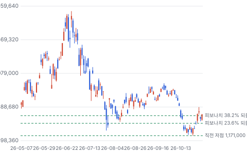

**주봉**

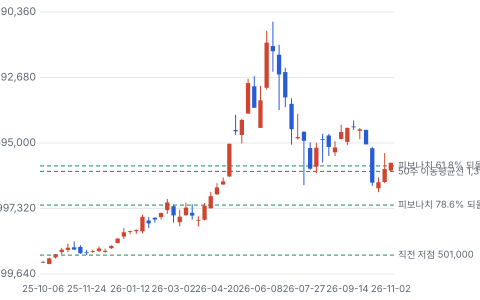

**월봉**

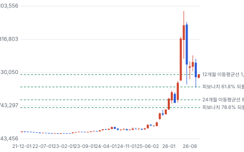

**분기 매출·EPS 실적과 컨센서스**

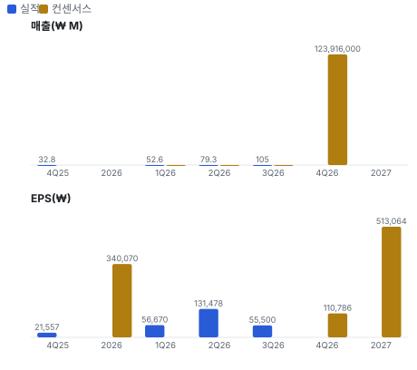

**EPS 리비전**

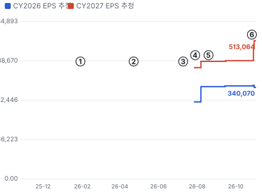

① 26-01-29 4Q25 실적 · EPS 리비전 -
② 26-04-23 1Q26 실적 · EPS 리비전 -
③ 26-07-10 나스닥 ADR 상장 · EPS 리비전 -
④ 26-07-29 2Q26 실적 · EPS 리비전 +6%
⑤ 26-08-19 ₩40T 자사주 결의 · EPS 리비전 +0%
⑥ 26-10-28 3Q26 실적·환원 ₩100T · EPS 리비전 +17%

**밸류에이션 주가 시나리오**

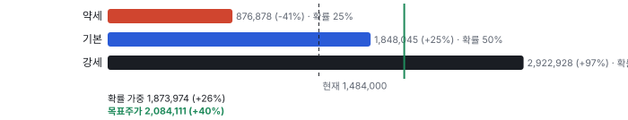

**주가별 업사이드**

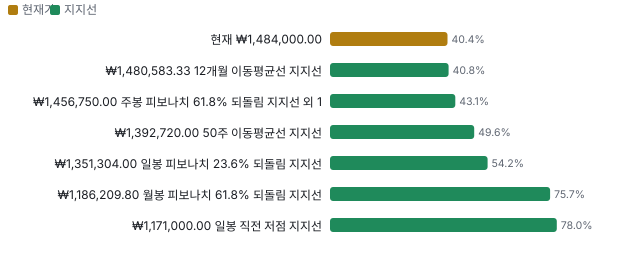

**어닝콜 변화별 주주가치 영향**

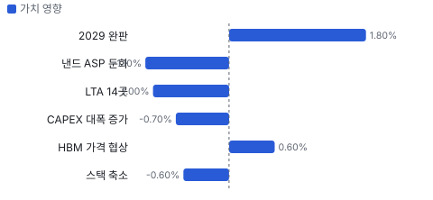

**최근 4개 분기 주가 변화 분석**

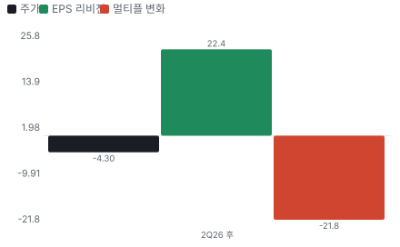

**멀티플 프리미엄**

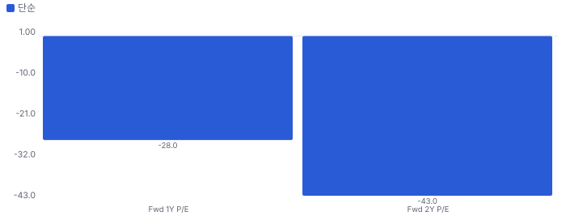

**합리적 멀티플**

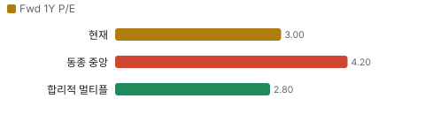

**몬테카를로**

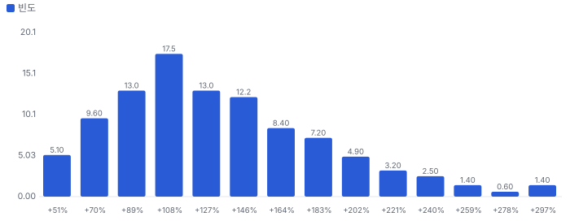

해석: 3,000번 중 3,000번(100%)에서 가치가 지금 주가 이상이었다. 가정을 흔들어도 지금 주가를 뒷받침하는 경우가 더 많다. 가운데 값은 2.24배이고, 열 번 중 여덟 번은 1.72~3.09배 사이에 든다.

## 내러티브

> **기업가치를 결정하는 이야기:** 분기 영업이익 ₩83.3T면 연 ₩333T이고, 시가총액은 ₩1,046T다. 이 이익이 3년 남짓 이어지면 시가총액을 채운다. 시장은 그만큼 오래가지 않는다고 본다. 회사는 LTA·완판·환원으로 그 반대를 말한다.

> **멀티플·EPS 프리미엄**
> **멀티플:** Fwd 1Y P/E 3.0배로 마이크론 4.8배, 샌디스크 5.0배보다 낮다. 같은 추정으로 ADR은 4.2배다.
> **EPS:** FY2027 EPS 컨센서스는 7월 ₩413,000에서 10월 ₩513,000으로 +24%다(₩1,345 고정 환산). 리비전은 올랐는데 주가는 내렸다.

### 투자자들은 왜 열광했나

메모리가 AI의 병목이라는 이야기로 주가는 2025년 10월 ₩428,000에서 2026년 6월 ₩2,987,000까지 7배가 됐다. 7월 ADR 상장 뒤 피크아웃 우려가 번졌고, 10월에는 AI 투자 속도와 HBM 사양 축소 우려까지 겹쳐 장중 고점 대비 −50%가 됐다.

### 무엇이 기업가치를 바꾸나

> **구조적 체질 변화**
> **변화:** 일반 시장가 판매에서 5년 LTA로 일부 이동한다. 캐파 50% 이상을 묶었다.
> **증거:** 14곳, 보증금. 금액과 가격 하단은 비공개다
> **반증:** 다음 하락기에 LTA 가격이 재협상된다

> **고부가 믹스 확장**
> **변화:** HBM4(6세대 고대역폭 메모리)가 4Q에 HBM3E(5세대 고대역폭 메모리)를 넘고 서버 DDR5(서버·PC용 범용 DRAM 규격) 출하가 +40% 이상이었다.
> **증거:** 3Q 콜
> **반증:** HBM 비트 성장 30% 미달

> **기술 혁신**
> **변화:** 회사는 6F²를 끝까지 쓰고 4F²(셀 면적을 줄인 차세대 DRAM 구조)·3D DRAM(셀을 수직으로 쌓는 DRAM)은 뒤로 미룬다. 낸드는 321단 비중을 50%로 올린다.
> **증거:** 3Q 콜. 경쟁사의 신구조 도입 시점은 미확인
> **반증:** 경쟁사가 4F² 양산을 먼저 공시

> **실행 속도**
> **변화:** 해당 없음(납품 리드타임을 공개하지 않아 피어와 비교할 수 없다). 대신 M15X 연말 풀캐파 목표로 잰다.
> **증거:** 3Q 콜
> **반증:** 4Q DRAM 비트가 +20%대 중반을 밑돈다

> **M&A**
> **변화:** 솔리다임 IPO를 접었고 ₩60T 미국 공장 보도는 미확정이다. 대형 M&A 준비설이 있다(독점 단서 FI-0005, 공개 미확인).
> **증거:** 6-K 10/22·10/29. 키옥시아 간접 지분 차익은 특별배당으로 돌린다
> **반증:** 확정 공시

> **정책·입법 연관성**
> **재정정책:** 미국 CHIPS(미국 반도체지원법) 직접 보조 최대 \$458M과 대출 최대 \$570M이 조건부로 걸려 있다. F-1/A. 인디애나 2H28 목표, 마일스톤 지급 반증: 지급 조건 미충족 의회 동의 10/10 — 하원 5/5(2022 CHIPS법 본회의 통과) · 상원 5/5(2022 CHIPS법 본회의 통과).
> **행정명령:** 2026년 1월 232조 포고령은 일부 첨단 칩 25%이고 데이터센터 등 용도 면제가 있다. 메모리 별도 관세는 이번 조사에서 확인하지 못했다. 2026-01-14 포고령 해설 반증: 메모리 포함 품목 관세 공표 의회 동의 2/10 — 하원 1/5(포고령이라 의결이 없다) · 상원 1/5(포고령이라 의결이 없다).
> **연관입법:** 해당 없음(이번 회차에 미국 입법 진행 건을 확인하지 못했다. 한국 반도체특별법 단계도 미확인이다).

> **CAPEX 낙수효과**
> **변화:** 고객 CAPEX가 메모리로 오고, 회사 CAPEX는 장비사로 간다. 회사는 2027 글로벌 CSP(대형 클라우드 사업자) CAPEX +60% 이상 추정을 인용했다.
> **증거:** 3Q 콜. 인용 수치는 외부 조사기관 값이고 회사 공급 몫은 미확인
> **반증:** 빅테크 2027 CAPEX 가이던스 하향

### 내러티브 근거

> 메모리가 더 이상 순환주가 아니라는 이야기를 셀사이드는 믿고 주가는 믿지 않는다. 동종 대비 멀티플 차이 -28% 중 회사 고유 몫은 +6%다. 단계는 컨센서스, 쏠림은 셀사이드는 쏠렸고 가격은 믿지 않는다이다.

> **LTA가 사이클을 바꾼다** · 강화
> **논리:** 5년 계약과 보증금이 하락기를 막는다
> **숫자:** 27~28 캐파 50% 이상, 14곳
> **반증:** 분기보고서 계약부채가 작거나 LTA 재협상 보도

> **HBM 가격 상승** · 강화
> **논리:** HBM4 값이 올라 일반 DRAM과 수익성 차이가 준다
> **숫자:** HBM OPM 70%대 후반 추정(IB), 일반 DRAM 80%대 중반
> **반증:** 1H27 HBM 이익률이 하락

> **주주환원** · 강화
> **논리:** FCF 50% 이상 환원이 주가 하단이 된다
> **숫자:** FY26 ₩100T, 시가총액의 9.6%
> **반증:** 2027 CAPEX로 환원이 줄어든다

> **ADR 프리미엄 해소** · 유지
> **논리:** 나스닥 값이 맞다면 코스피가 따라 올라간다
> **숫자:** +42.6%, 패리티 ₩2,114,508
> **반증:** 프리미엄이 ADR 하락으로 해소된다

> **반대: 2027년 피크** · 유지
> **논리:** 수요 파괴·증설·AI 자금이 겹쳐 1H27에 가격이 꺾인다
> **숫자:** Fwd 1Y P/E 3배가 곧 이익 감소 가정이다
> **반증:** 1Q27 고정거래가격 상승과 HBM 2028 협상 상향

## 포트폴리오

| 제품·서비스 | 구분 | 무엇 | 쓰는 곳 | 돈 버는 방식 |
|---|---|---|---|---|
| HBM | 제품 | GPU(그래픽 처리 장치) 옆에 쌓는 AI용 메모리 | AI 가속기 | 매출 비중 비공개, FY26 HBM 비트 +30% 목표 |
| 서버 DRAM(DDR5)·저전력 모듈 | 제품 | 데이터센터 서버 메모리 | AI·일반 서버 | DRAM 매출 3Q ₩78.0T(IB 추정), ASP +20%대 후반 |
| 낸드·eSSD(기업용 SSD) | 제품 | 데이터 저장 칩과 기업용 SSD(낸드 저장 장치) | AI 추론 캐시, 데이터센터 저장 | 낸드 매출 3Q ₩25.8T(IB 추정) |

## 수주·파이프라인

> **2026-10-28 기준 6건.** 확정 KRW 0.00B. 서로 겹치는 항목은 합계에서 뺐다.

**실행 속도와 방해 요인**
| 항목 | 상태 | 실행 속도 | 방해 요인 |
|---|---|---|---|
| 2027 HBM 물량·가격 타결 | 확정 | 주요 고객과 협상을 끝냈다고 3Q 콜에서 밝혔다 | 스택 축소 · 고객의 HBM 사양 조정 |
| LTA 14개 고객 | 조건부 | 분기 사이 약 10곳 → 14곳. 2027~28 캐파의 50% 이상 | 가격은 합의 범위 안 변동 · 보증금 액수 비공개 · 고객 자금 조달 |
| M15X 램프 | 파이프라인 | 연말 풀캐파 목표. 설계 캐파 8.5만 장은 IB 추정 | 후공정 인력·장비 |
| 용인 1기 Y1-1(용인 1기 첫 팹) | 파이프라인 | 2Q27 가동은 IB 추정. 회사는 클린룸을 단계적으로 연다고 했다 | 수요 확인에 따른 장비 반입 조절 |
| 인디애나 패키징 | 파이프라인 | 약 ₩5.9T, 첫 클린룸 2H28 목표 | 재지정 소송 · 보조금 마일스톤 |
| 솔리다임 미국 낸드 신공장 | 파이프라인 | ₩60T 보도에 회사는 확정된 바 없다고 공시. 한 달 안에 다시 공시 | IPO 자금 조달 중단 · 낸드 ASP 둔화 |

## 해자

> 해자는 HBM 양산 경험과 자금력이다. 점유율은 내려가는 중이고 LTA의 가격 하단은 공개되지 않았다.

> **HBM 양산 수율과 세대 선점** · 보통
> **해자:** 12단 적층과 후공정 전체 수율을 먼저 끌어올린 경험이 물량을 만든다
> **근거:** 회사는 HBM4가 계획 수율을 넘어 목표를 올렸다고 밝혔다. 숫자는 없다. 외부 추정 HBM 비트 점유율은 2025년 59% → 2026년 50%다
> **숫자:** 고객 요청 물량이 공급 가능량의 2배 이상
> **깨지는 조건:** HBM4E(HBM4 다음 세대 고대역폭 메모리)에서 삼성전자가 첫 공급사가 되거나 2027년 점유율이 45% 아래로 내려간다

> **장기 계약과 보증금** · 보통
> **해자:** 5년 LTA가 물량을 묶고 보증금이 취소를 막는다
> **근거:** 14곳, 2027~28년 캐파의 50% 이상. 다만 가격은 합의된 범위 안에서 시장을 따라간다고 설명했고 보증금 액수는 없다
> **숫자:** 캐파 50% 이상
> **깨지는 조건:** 3Q 분기보고서에 계약부채가 늘지 않거나 고객이 물량을 재협상한다

> **자금력과 증설 선택권** · 강함
> **해자:** 순현금으로 호황에 증설하고 불황에 버틸 수 있다
> **근거:** 9/30 순현금 ₩98.7T, 부채비율 5%. 건물을 먼저 짓고 클린룸은 단계적으로 연다
> **숫자:** 연 CAPEX ₩40T대 후반의 약 2년 치
> **깨지는 조건:** 2027 CAPEX와 환원 합계가 영업현금흐름을 넘는다

## 경영진·네트워크

> 연결이 닿는 매출의 핵심은 최대 고객 23.9%다. 연결이 그 매출을 만들었다고 볼 근거는 없다.

> **최태원** · SK그룹 회장 · 미확인
> **프로필:** 최대주주 SK스퀘어(20.07%) 위의 SK 지주 체계를 이끈다
> **비즈니스:** 2026년 3월 GTC(엔비디아 개발자 행사), 6월 서울 회동에서 엔비디아 CEO와 공개 접촉
> **정계:** 9월 코리아소사이어티 갈라 참석. 정치 성향은 쓰지 않는다
> **동문:** 미확인
> **사모임:** 미확인

> **곽노정** · 대표이사 사장 · 미확인
> **프로필:** 3Q 콜에서 솔리다임 IPO 중단을 직접 설명했다
> **비즈니스:** 6월 엔비디아 CEO 회동 배석
> **정계:** 미확인
> **동문:** 미확인
> **사모임:** 미확인

**네트워크 정량화**
| 연결 | 강도 | 닿는 매출 | 가중 노출 | 매출 대비 | 근거 |
|---|---|---|---|---|---|
| 비즈니스: 엔비디아로 추정되는 최대 고객 | 3/5 | ₩39,862.00B | ₩23,917.20B | 9% | F-1/A 최대 고객 2025년 23.9%, 1Q26 14.8%. 고객명 공시는 없고 TTM에 1Q 비중을 곱했다 F-1/A, 공개 회동 보도 |
| 정계: 미국 인디애나 보조금 | 4/5 | ₩616.00B | ₩492.80B | 0% | 조건부 직접 보조 최대 \$458M, ₩1,345 환산. 마일스톤 조건 F-1/A, 2024-12 상무부 발표 |
| 동문: 공개 자료 없음 | 0/5 | 미확인 | 미확인 | 미확인 | 미확인 미확인 |
| 사모임: 공개 자료 없음 | 0/5 | 미확인 | 미확인 | 미확인 | 미확인 미확인 |

가중 노출은 연결이 닿는 매출의 크기다. 연결이 그 매출을 만들었다는 뜻이 아니며, 인과는 공개 자료로 입증하지 못한다.

## 약세 논리 및 셀온 조건

| 약세 논리 | 근거 | 가를 자료 |
|---|---|---|
| 메모리는 늘 정점에서 가장 싸다 | 낮은 P/E는 이익 정점의 전형이다. 회사 OPM은 2023년 영업적자에서 3Q 80%가 됐다. 이 회복 속도만큼 내려올 수도 있다 | 1Q27 고정거래가격, 고객 재고 |
| LTA는 바닥을 보장하지 않는다 | 가격은 합의 범위 안에서 시장을 따라간다. 범위 폭과 보증금 액수는 비공개다. 회사가 말한 완판에는 아직 협의 중인 물량도 들어 있다 | 3Q 분기보고서 계약부채 |
| 이중 주문과 수요 파괴 | IB도 이중 주문 가능성을 인정한다. 회사는 PC(개인용 컴퓨터)·모바일 출하 감소를 말했다. 값이 오르면 수요가 먼저 꺾이는 곳이다 | PC·스마트폰 출하, CSP CAPEX |
| 공급 경쟁 | 외부 추정 HBM 비트 점유율은 59%에서 50%로 내려간다. 삼성전자가 HBM4를 먼저 출하했다는 보도도 있다. 회사는 2027 CAPEX를 크게 늘리고 경쟁사도 늘린다 | HBM4E 첫 공급사, 경쟁사 장비 발주 |
| HBM 사양 축소 | 12단에서 8단으로 낮아지면 회사는 다이당 용량으로 상쇄된다고 답했다. 랙당 메모리 축소 보도는 일자를 확인하지 못했다 | 2027 GPU 사양표 |
| 고객 자금이 메모리로 되돌아온다 | 메모리 기업의 벤더 파이낸싱 논의 단서가 있다(독점 단서 FI-0008, 공개 미확인). 10/19 공개된 ₩2T 보증은 고객이 아니라 소부장 협력사 대상이라 이 단서를 지지하지 않는다. 고객 대상 금융이 사실이면 수요의 질을 낮춘다 | 분기보고서 금융보증·매출채권 |
| 순이익은 믿기 어렵다 | 3Q 순이익은 −57.7% QoQ다. 2Q 투자자산 이익 ₩63.3T가 3Q 평가손 ₩22.9T로 돌아섰고 환손실도 ₩11.6T다. EPS 기준 멀티플은 이 때문에 왜곡된다 | 3Q 분기보고서 투자자산 |
| 자료 한계 | 회사 매출 가이던스가 없어 데이터 검사 한 항목이 미통과다. 3Q 재무상태표·구매 약정·제한 현금·교환사채 잔액은 분기보고서 전이라 미확인이다. 자기자본은 추정이다. 동종 Fwd P/E는 삼성전자·키옥시아·난야를 다음 분기 × 4로 근사했다. 이번 분기 보고서가 나오면 다시 대조한다 | 3Q 분기보고서(11월 중순) |

> **셀온 조건**
> **조건 1:** 1Q27 고정거래가격이 DRAM 기준 전 분기보다 내려간다.
> **조건 2:** 3Q 분기보고서 계약부채가 2Q보다 크게 늘지 않아 LTA 보증금이 작다고 드러난다.
> **조건 3:** 4Q DRAM 비트가 +20%대 중반 가이던스를 밑돈다.
> **조건 4:** 2027 CAPEX와 환원 합계가 영업현금흐름을 넘어 순현금이 줄어든다.
> **조건 5:** HBM4E 첫 공급사 지위를 잃거나 LTA 재협상 보도가 1차 자료로 확인된다.

## 어닝콜 변화

**직전 콜 대비 새로 나오거나 바뀐 내용 → 가치 영향**
| 항목 | 내용 | 직전 콜 | 최신 콜 | 모델 동인 이동 | 확신도 | 가치 영향 |
|---|---|---|---|---|---|---|
| 업데이트 | LTA | 약 10곳 | 14곳, 27~28 캐파 50% 이상, 5년 기준, 보증금 포함 | 성장 지속(감속 계수) -2.0% | 0.8 | -1.0% |
| 신규 | 완판 기간 | 언급 없음 | DRAM·HBM 2029년까지 사실상 완판, 협의 물량 포함 | 장기 성장 수렴값 +0.50% | 0.5 | +1.8% |
| 업데이트 | HBM 수익성 | 협상 중 | 2027 물량·가격 타결, 일반 DRAM과 수익성 격차 축소 | 목표 이익률 +1.0% | 0.8 | +0.6% |
| 부정 | 2027 CAPEX | 2026 ₩40T대 후반 | 2027 크게 증가, IB 추정 ₩61T | 매출÷투하자본 -5.0% | 0.8 | -0.7% |
| 부정 | 낸드 가격 | ASP +50%대 중반 | ASP +20%대 중반, 비트 소폭 감소 | 1년차 성장률 -2.0% | 1.0 | -1.1% |
| 부정 | HBM 스택 | 언급 없음 | 일부 고객 사양 조정 인정, 12단→8단도 다이당 용량으로 상쇄 | 1년차 성장률 -1.0% | 0.3 | -0.6% |
| **합계** | 단독 합 |  |  | 동시 적용 -1.1% |  | **-1.0%** |

**사건별 EPS 리비전**
| # | 날짜 | 구분 | 사건 | CY2026 EPS 전→후 | CY2027 EPS 전→후 | 리비전 | 주가 반응 |
|---|---|---|---|---|---|---|---|
| ① | 26-01-29 | 실적 | 4Q25 실적 | - → - | - → - | - | +2.4% |
| ② | 26-04-23 | 실적 | 1Q26 실적 | - → - | - → - | - | +0.2% |
| ③ | 26-07-10 | 내러티브 | 나스닥 ADR 상장 | - → - | - → - | - | -15.4% |
| ④ | 26-07-29 | 실적 | 2Q26 실적 | ₩285,947 → ₩342,706 | ₩413,184 → ₩436,587 | +5.7% | -9.6% |
| ⑤ | 26-08-19 | 내러티브 | ₩40T 자사주 결의 | ₩342,706 → ₩342,706 | ₩436,587 → ₩436,587 | +0.0% | +12.7% |
| ⑥ | 26-10-28 | 실적 | 3Q26 실적·환원 ₩100T | ₩345,463 → ₩340,070 | ₩439,290 → ₩513,064 | +16.8% | +10.9% |

**해석:** 1개 구간 누적 주가 -4% = EPS 리비전 +22% × 멀티플 -22%. 더 크게 움직인 쪽은 **EPS 리비전**이다.

## 밸류에이션

> **목표주가 ₩2,084,111, 업사이드 +40%.** 자리는 기본과 강세 사이(강세 쪽 22%)이고 도달 확률은 약 42%다. 기본 ₩1,848,045, 강세 ₩2,922,928(+97%), 약세 ₩876,878(-41%). DCF 기준 업사이드는 기본 +123%, 강세 +178%, 약세 +90%다(WACC 11.9%).

순이익은 세율 24%, 이자수익 소폭, 주식 수 약 6.9억 주로 계산했다. 2027년 평균 주식 수는 자사주 소각을 가정한 추정이다. 투자자산 평가손익은 넣지 않았다.

> **약세 ₩876,878 (-41%)** · 확률 25%
> **가정:** 2.8배 × EPS ₩310000.00
> **근거:** 2H27에 DRAM·낸드 값이 내려 FY27 영업이익 ₩280T. 4Q 추정 연환산 약 ₩430T보다 35% 낮다

> **기본 ₩1,848,045 (+25%)** · 확률 50%
> **가정:** 3.8배 × EPS ₩490000.00
> **근거:** 영업이익 ₩440T. 3Q 뒤 IB 두 곳 ₩454~481T보다 조금 낮게 뒀다

> **강세 ₩2,922,928 (+97%)** · 확률 25%
> **가정:** 4.7배 × EPS ₩620000.00
> **근거:** HBM 가격과 범용 DRAM 강세가 겹쳐 영업이익 ₩560T

**멀티플 선정 — Fwd 1Y P/E**
| 단계 | 조정 | 근거 |
|---|---|---|
| 동종 중앙값 | 4.2배 | 범위 2.9~5.0배, 5곳 |
| 펀더멘털 | -16% | 성장·이익률·ROIC로 본 합리적 멀티플 2.8배와의 차이의 일부만 인정 |
| 해자 | +7% | HBM 양산 수율과 세대 선점 보통 · 장기 계약과 보증금 보통 · 자금력과 증설 선택권 강함 |
| 내러티브 | +0% | 단계 컨센서스 |
| 사이클·실행 판단 | +0% | LTA가 하방을 막는지 금액이 공개되지 않았고 2027 CAPEX가 크게 늘어 할증을 주지 않는다. 다만 HBM 가격 타결과 순현금은 동종보다 낫기에 할인도 하지 않는다 |
| **선정** | **3.8배** | 지금 3.0배 |

**동종 레인지**
| 회사 | Fwd 1Y P/E | 성장 | 영업이익률 | ROIC |
|---|---|---|---|---|
| 마이크론 | 4.8 | 109% | 75% | 76% |
| 샌디스크 | 5.0 | 72% | 73% | 121% |
| 삼성전자 | 3.6 | 22% | 46% | 60% |
| 키옥시아 | 2.9 | 75% | 70% | 104% |
| 난야테크놀로지 | 4.2 | 127% | 57% | 64% |
| **SK하이닉스** | 3.0 |  |  |  |

지금 주가가 요구하는 5년 매출 CAGR -9%, 기본 시나리오 15%. 몬테카를로 중앙값 업사이드 +124%.

> 의사결정 보조(투자자문 아님): ① 매수 매력: 연 기대수익 +30.2% (자기자본비용 11.9% 대비 +18.3%p) · 자본비용 초과 확률 100% · 안전마진 1.72 → 정량 신호 강함 / ② 위험 예산 지표(이론): 1/4 켈리 10.0% (상한 10%) · 5년 하위10% +170% · 30%+ 손실 확률 0% / ③ 상방(5년): 기대 3.74배 · 2배 100% · 3배 78% · 10배 0% · 상위10% 5.00배

## 시장 평가

> **셀사이드(IB 애널리스트)**
> **한 줄:** 목표가는 시장 기대의 증거일 뿐이다. 7배 P/E나 합산가치는 모두 업황이 길다는 가정에서 나온다
> **투자의견:** 43명 중 Buy 계열 41 — 매도 0
> **평균 목표주가:** ₩3,250,762 — 현재가의 2.2배
> **IB 요지(마스터 노션, 라이선스):** Citi ₩3,000,000, 제이피모건 ₩2,900,000 — 제이피모건 상향, FY27~28 EPS +15~21%

> **바이사이드(기관 투자자)**
> **한 줄:** 달러 자금은 비싸게 사고 한국 시장은 싸게 판다. 어느 쪽이 맞는지는 전환 경로가 가른다
> **ADR 프리미엄:** +42.6% — 같은 주식인데 나스닥이 코스피보다 비싸다
> **13F 보유 기관:** 210곳 — ADR 기준
> **고점 대비:** −50% — 6월 ₩2,987,000 → ₩1,484,000

> **언론·업계**
> **한 줄:** 언론의 질문은 3Q 숫자가 아니라 언제 꺾이느냐다
> **피크아웃 보도:** 7월 이후 지속 — 메모리 가격 부담·고객 저항
> **루빈 메모리 축소 보도:** 일자 미확인 — 랙당 55TB → 28TB 공급망 보도

## 체크리스트

| 시점 | 무엇 | 의미 |
|---|---|---|
| 2026년 11월 중순 | 3Q 분기보고서 | 계약부채, 투자자산, 구매 약정, 제한 현금 |
| 2026년 11월 말 | 솔리다임 신공장 재공시, 11/30 배당 기준일 | ₩60T 투자 여부와 환원 여력 |
| 2026년 12월 말 | 4Q 고정거래가격 | 가격 상승 폭이 얼마나 줄었나 |
| 2027년 1월 28일까지 | ₩20T 자사주 매입 종료 | 환원 실행, ₩10T는 소각 |
| 2027년 1월 말(예상) | 4Q 실적과 2027 CAPEX | HBM 수익성, 환원 상향 여부 |

## 출처
- 3Q 잠정실적 6-K 2026-10-28: https://www.sec.gov/Archives/edgar/data/2120882/000119312526434994/d162547d6k.htm
- 주주환원 계획 6-K 2026-10-28: https://www.sec.gov/Archives/edgar/data/2120882/000119312526435008/d236990d6k.htm
- 자사주 취득 결정 6-K 2026-10-28: https://www.sec.gov/Archives/edgar/data/2120882/000119312526435019/d165312d6k.htm
- 3Q 배당 6-K 2026-10-28: https://www.sec.gov/Archives/edgar/data/2120882/000119312526435015/d236994d6k.htm
- 자사주 취득 결과 6-K 2026-10-26: https://www.sec.gov/Archives/edgar/data/2120882/000119312526430986/d370650d6k.htm
- 솔리다임 공장 보도 해명 6-K 2026-10-29: https://www.sec.gov/Archives/edgar/data/2120882/000119312526436872/d183583d6k.htm
- 솔리다임 IPO 중단 6-K 2026-10-22: https://www.sec.gov/Archives/edgar/data/2120882/000119312526429184/d159239d6k.htm
- F-1/A 2026-07-06: https://www.sec.gov/Archives/edgar/data/2120882/000119312526295501/d32785df1a.htm
- 머니투데이 3Q 컨센서스 2026-10-19: https://www.mt.co.kr/article/2026101913371799572
- MTN 협력사 ₩2T 금융 지원 2026-10-19: https://news.mtn.co.kr/article/2026101918002727179
- TrendForce HBM 2026-06-23: https://www.trendforce.com/research/download/RP260623IP3
- 다음 15% 급락 보도 2026-07: https://v.daum.net/v/zmzOqmDgEx
- Inside Indiana Business CHIPS: https://insideindianabusiness.com/articles/feds-finalize-deal-to-give-sk-hynix-458m-for-west-lafayette-facility
- White & Case 232조 해설: https://www.whitecase.com/insight-alert/president-trump-orders-narrowly-targeted-25-section-232-tariff-certain-advanced
- MTN 최태원 코리아소사이어티 2026-09-29: https://news.mtn.co.kr/news-detail/2026092910465682567
- 라이선스 자료 요지 포함 — 외부 공유 금지
- 마스터 노션 자료: JPM 2026-10-28 JPM_SK_Hynix_Clear_3Q_be_2026-10-28_5512662.pdf (요지만, 외부 공유 금지)
- 마스터 노션 자료: 미확인 SK_Hynix_000660KS_3Q26_Review_Robust_Earnings_and_Attractive_Shareholder.pdf (요지만, 외부 공유 금지)
- 3Q 콜
- 3Q 콜, IB 요지
- 6-K 10/29
- F-1/A

_구매 등급·목표주가 모두 규칙이 계산한 모델 값으로, 개인의 보유 종목·자금 사정을 반영하지 않는다 · 공개 자료 기반 분석이며 투자 권유가 아님 · 1차 판정, 미검증 · Chiip ten-bagger_