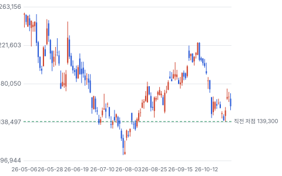
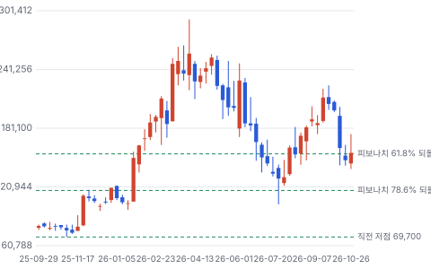
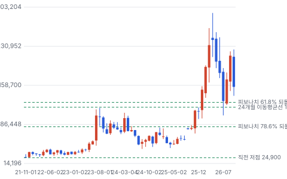
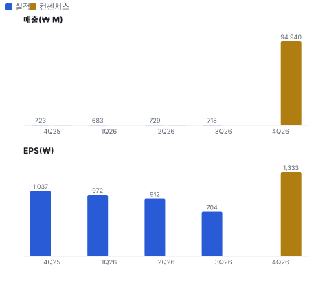
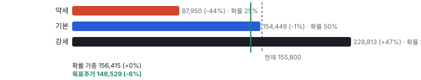
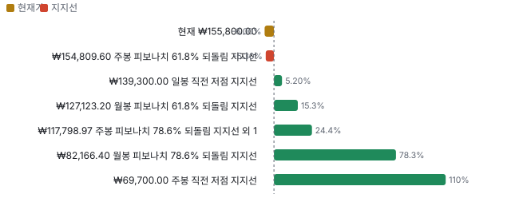
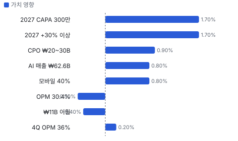
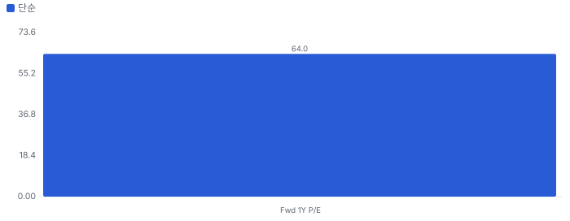
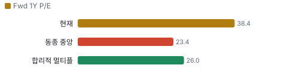
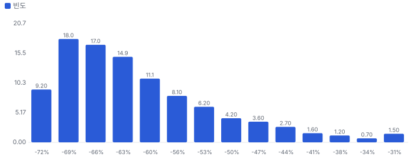

# 텐배거 리포트 2026-11-02 — 수요가 아니라 공장이 막았다, 4Q 가이던스의 ₩11B는 이월이다

> 2026-11-02 · ISC(095340) · 기업: AI 칩·모바일·메모리 칩을 출하 전에 검사할 때 쓰는 실리콘 러버 테스트 소켓을 만드는 회사

## Chiip View

수요는 확인됐다. AI 매출은 3Q ₩62.6B로 매출의 87%이고, 회사는 2027년 최소 +30%를 처음 숫자로 냈다. **문제는 숫자의 질이다.** 3Q는 시장 기대를 밑돌았고, 4Q 가이던스 중앙값 ₩92B에서 이월 ₩11B를 빼면 ₩81B다. 3Q 매출에 이월분을 더한 ₩82.8B보다 낮다. **2027년 +30%는 늘어나는 CAPA(생산능력)가 거의 다 차야 나온다.** 가르는 것은 4Q OPM 36%, 글로벌 고객 3년 LTA(장기공급계약), 3Q 분기보고서 선수금이다.

## 대시보드
| 항목 | 값 | 설명 |
|---|---|---|
| 주가 | ₩155,800.00 | 고점 대비 -43% · 1년 +103% |
| 시가총액 | ₩3,294.08B | EV ₩2,935.09B |
| 업사이드 | -6% | 목표주가 ₩146,529 · 다운사이드 -44% · 손익비 1.1 |
| 구매등급 | Neutral | 애널리스트 8명: Strong Buy 8 · Buy 0 · Neutral 0 · Sell 0 · Strong Sell 0 |
| 멀티플 | Fwd 1Y P/E 38.4배 | 동종 중앙값 23.4배 |
| 가이던스 4Q26 | ₩920M | 컨센서스 ₩949M |
| 알파 | 6.1/10 | 텐배거 가능성 점수 |
| 이벤트 | 3Q 분기보고서 제출 기한(예상) | 2026-11-16 |

## 한 장 요약
- **기업가치를 결정하는 내러티브** **시장이 산 이야기는 'AI 칩이 늘수록 소켓이 모자란다'는 것이다.** 3Q에 그 말이 맞았지만 매출로는 나오지 못했다. 소켓 후공정이 막혀 ₩11B가 10월로 밀렸고 OPM은 30.4%였다. 지금 값은 FY2027 EPS 5,520원의 28배다.
- **밸류에이션 모델로 본 주가 상방은 어디까지인가?** **목표주가 ₩146,529(-6%), 약세와 기본 사이(약세 쪽 12%)다.** 강세 ₩228,813(+47%)는 Fwd 1Y P/E 35.8배를 강세 EPS에 적용한 값이다. 기본 ₩154,449, 약세 ₩87,950. 손익비 1.1, DCF 기준 업사이드 -63%.
- **수주는 어디까지 왔나?** 3Q 이월 매출 100%, 100% 매출 KRW 11.00B · LTA 7개사 미확인, 100% 매출 미확인 · 글로벌 고객 3년 LTA 미확인, 100% 매출 미확인. 회사는 수주잔고를 공개하지 않는다. 확인되는 것은 이월 ₩11B와 CAPA 일정, 금액 없는 LTA다.
- **지금 가격은 무엇을 가정하나?** FY2026 추정 P/E 38.4배는 리노공업 23.4배의 1.6배다. FY2027 EPS 5,520원으로는 28.2배다. 시장은 2027년 고성장을 이미 값에 넣었다. FY2026 추정 EPS 4,058원은 3Q 전 값이다. 1~3Q 순이익 ₩54.6B에 4Q 컨센서스 1,333원을 더하면 약 3,920원이고, 이 기준 P/E는 39.8배다.
- **왜 움직였나?** 10월 주가는 −27%(9/30 ₩213,500 → 10/30 ₩155,800)로 같은 달 코스피 약 −16%보다 크게 빠졌다. 10/15 −15.3%의 원인은 확인하지 못했다. 실적 뒤에는 10/27 +7.6%, 10/28 +9.6%로 올랐다. 실적을 놓쳤는데 올랐으니 시장은 4Q 가이던스를 샀다. 10/30에는 −6.3%로 일부 되돌렸다.
- **3Q에서 무엇이 바뀌었나?** 좋아진 것은 2027년 CAPA 270만 개 → 300만 개, 모바일 점유율 40%, 분기 가이던스 공시 시작이다. 나빠진 것은 OPM 30.4%로 2Q 자료의 '35~40%'에 못 미쳤고, 순이익이 ₩14.9B로 −23% QoQ인 점이다. 순이익 감소 원인은 미확인이다.
- **회사 설명에서 안 맞는 숫자는?** 회사는 환율로 영업이익이 ₩5B 줄었다면서, 기존 환율이면 ₩23.6B라고 적었다. ₩21.8B + ₩5B는 ₩26.8B다. 어느 쪽이 맞는지는 미확인이다. 가이던스 기준 환율은 ₩1,300이고 10/30 시세는 ₩1,333이다. 환율이 그대로면 4Q 매출에 약 ₩2.2B 도움이 된다(단순 계산, 추정).
- **무엇이 바뀌면 판단이 바뀌나?** 글로벌 고객과 3년 LTA가 체결되고 선수금이 분기보고서에 잡히면 점유율 논쟁이 끝나 멀티플 할인이 줄어든다. 반대로 4Q OPM이 32.5% 아래이거나 ₩87B를 밑돌면 '이연' 해석이 깨진다.

## 한눈에 보기

**일봉**

**주봉**

**월봉**

**분기 매출·EPS 실적과 컨센서스**

**밸류에이션 주가 시나리오**

**주가별 업사이드**

**어닝콜 변화별 주주가치 영향**

**멀티플 프리미엄**

**합리적 멀티플**

**몬테카를로**

해석: 3,000번 중 0번(0%)에서 가치가 지금 주가 이상이었다. 가정을 흔들어도 지금 주가를 뒷받침하지 못하는 경우가 더 많다. 가운데 값은 0.37배이고, 열 번 중 여덟 번은 0.30~0.53배 사이에 든다.

## 내러티브

> **기업가치를 결정하는 이야기:** ISC(이 리포트의 회사, 아이에스시)는 칩을 출하 전에 검사할 때 쓰는 실리콘 러버 소켓을 만든다. 기업가치는 세 가지로 갈린다. CAPA가 수주를 따라가나, ASP(평균 판매 단가) 인상이 환율을 이기나, 핵심 고객 점유율이 유지되나다.

> **멀티플·EPS 프리미엄**
> **멀티플:** FY2026 추정 P/E 38.4배로 리노공업 23.4배보다 높고 윈웨이 47.7배보다 낮다. 리노공업 OPM은 49%다.
> **EPS:** FY2026 추정 4,058원에서 FY2027 추정 5,520원으로 +36%다. 둘 다 3Q 전 추정이고 리비전 이력은 미확인이다.

### 투자자들은 왜 열광했나

주가는 2025년 10월 ₩80K 안팎에서 2026년 4월 장중 292,500원까지 올랐다. AI 매출 비중이 2025년 68%에서 3Q 87%로 뛰었기 때문이다. 이후 목표가가 내려갔고 10/30 종가는 155,800원으로 장중 고점보다 47% 낮다.

### 무엇이 기업가치를 바꾸나

> **구조적 체질 변화**
> **변화:** 메모리 소켓 회사에서 비메모리 AI 소켓 회사로 옮겼다.
> **증거:** 3Q 비메모리 85%, 메모리 15%. AI 매출 비중 87%
> **반증:** AI 매출 비중이 80% 아래로 내려간다

> **고부가 믹스 확장**
> **변화:** CPU(중앙 처리 장치), ASIC(특정 고객용 맞춤 AI 칩), HBM4E(6세대 고대역폭 메모리 개량판), SOCAMM2(서버용 저전력 메모리 모듈 2세대)로 품목이 넓어졌다.
> **증거:** AI DC(AI 데이터센터) ₩53.0B. AI 메모리 연간 누적 ₩20B 전망
> **반증:** 4Q OPM이 가이던스 하단 32.5%를 밑돈다

> **기술 혁신**
> **변화:** 모듈형 소켓 WiDER-Max(ISC의 모듈형 테스트 소켓)로 북미 ASIC 고객 초도 양산 수주를 받았다.
> **증거:** 3Q 콜 요약. 물량은 미확인
> **반증:** 2027년 ASIC 매출이 숫자로 나오지 않는다

> **실행 속도**
> **변화:** 해당 없음(납기를 숫자로 공개하지 않는다). 대신 증설로 잰다. 2Q에 2027년 270만 개라던 CAPA를 300만 개로 올렸다.
> **증거:** FAB1(베트남 1공장) 10월, FAB2(베트남 2공장) 2Q27, 송도 1Q28
> **반증:** FAB2가 2Q27을 넘긴다

> **M&A**
> **변화:** 해당 없음(2026년 인수 공시를 찾지 못했다). 최대주주 SKC(SK그룹 소재 회사, ISC 최대주주) 지분만 45.0%에서 48.5%로 늘었다.
> **증거:** 2025 사업보고서
> **반증:** SKC 지분 매각이나 합병 추진

> **정책·입법 연관성**
> **재정정책:** 해당 없음(미국 재정 사업과 연결된 회사 자료를 찾지 못했다. 생산 거점은 한국·베트남이다).
> **행정명령:** 해당 없음(특정 행정명령이 매출을 바꿨다는 회사 자료를 찾지 못했다).
> **연관입법:** 해당 없음(ISC 매출을 직접 바꾸는 법안을 찾지 못했다. 중국 메모리 공급의 수출통제 해당 여부는 미확인이다).

> **CAPEX 낙수효과**
> **변화:** AI 칩 투자가 소켓 수요로 내려온다. 고객 두 곳이 매출의 각각 15%대다.
> **증거:** 2025년 A사 ₩35.1B, B사 ₩32.9B. 실명 없음
> **반증:** A사나 B사 매출이 줄어든다

### 내러티브 근거

> AI 칩이 늘수록 소켓 소모가 늘고, 값도 오른다는 이야기다. 3Q에 수요가 아니라 공급이 막혔다는 점이 확인됐다. 쟁점은 2027년 +30%를 CAPA로 낼 수 있느냐다. 동종 대비 멀티플 차이 +64% 중 회사 고유 몫은 +47%다. 단계는 컨센서스, 쏠림은 식는 중이다.

> **AI 칩 다변화** · 강화
> **논리:** GPU(그래픽 처리 장치)에서 CPU, ASIC으로 소켓 고객이 넓어진다
> **숫자:** AI DC 3Q ₩53.0B, 분기 첫 ₩50B 돌파
> **반증:** 4Q AI DC가 ₩53.0B 아래로 내려간다

> **소켓 값 인상** · 강화
> **논리:** 메모리 호황과 공급 부족이 ASP를 올린다
> **숫자:** 메모리 비중 15%. 추가 인상분은 1Q27 매출에 반영
> **반증:** 1Q27 OPM이 4Q 가이던스 중앙값 36%를 밑돈다

> **모바일 점유율 2배** · 강화
> **논리:** 2나노 AP(모바일 중앙처리칩) 양산 테스트 물량을 넓힌다
> **숫자:** 20% → 40%, 2027 상반기 물량 확보
> **반증:** 2027 상반기 모바일 매출이 전년 대비 줄어든다

> **LTA로 사이클 완화** · 유지
> **논리:** 가격 하한과 선수금이 멀티플을 지킨다
> **숫자:** 금액 미확인. 2027 LTA 매출 50% 이상 전망(삼성, 7월 집계)
> **반증:** 3Q 분기보고서 선수금이 늘지 않고 글로벌 고객 LTA가 안 나온다

> **반대: 점유율 이탈** · 유지
> **논리:** 경쟁사가 핵심 고객 물량을 가져간다
> **숫자:** 회사가 콜에서 직접 루머를 언급했다. 숫자는 미확인
> **반증:** 해당 고객과 3년 LTA가 체결된다

## 포트폴리오

| 제품·서비스 | 구분 | 무엇 | 쓰는 곳 | 돈 버는 방식 |
|---|---|---|---|---|
| 테스트 소켓 | 제품 | 칩과 테스터를 잇는 실리콘 러버 소모품 | GPU·CPU·ASIC·AP·메모리 | 2025년 매출의 75%, ₩165.9B |
| 테스트 부품·상품 | 제품 | 소켓 주변 부품과 장비 | 테스트 공정 | 2025년 매출의 23%, ₩51.6B |
| AI DC 소켓 | 제품 | 데이터센터 칩 양산·시스템 테스트 소켓 | CPU·ASIC·GPU | 3Q ₩53.0B |
| 모바일 소켓 | 사업 | 2나노 플래그십 AP 양산 테스트 | 북미 스마트폰 고객 | 2025년 매출의 22%, 3Q 미확인 |

## 수주·파이프라인

> **2026-10-30 기준 5건.** 확정 KRW 11.00B. 서로 겹치는 항목은 합계에서 뺐다.

**실행 속도와 방해 요인**
| 항목 | 상태 | 실행 속도 | 방해 요인 |
|---|---|---|---|
| 3Q 이월 매출 | 확정 | 회사는 10월 전액 반영이라고 밝혔다 | 소켓 후공정 병목(해소했다고 회사가 설명) |
| LTA 7개사 | 협상 | 체결했다고 밝혔지만 NDA(비밀유지계약)로 고객명·금액 비공개. 조건은 가격 하한·최소 주문 수량·선수금 | 금액 미공개 · 공시 없음 |
| 글로벌 고객 3년 LTA | 협상 | 메모리·비메모리 포함 협의 중 | 체결 미확인 · 고객 이탈 루머 |
| CAPA 245만 → 500만 개 | 파이프라인 | FAB1 10월, FAB2 2Q27, 송도 1Q28 가동 | 소켓 후공정 병목 · 고객 양산 일정 |
| CPO(광 부품을 칩 패키지에 함께 넣는 기술) 소켓 | 파이프라인 | 2027년 연 ₩20~30B 전망 | CPO 양산 시점 |

## 해자

> 해자는 고객별 소켓 인증과 실리콘 러버 양산 경험이다. 수치로 확인되는 것은 이익률이 아니라 점유율 주장이고, 그 주장은 회사 말이다.

> **양산 소켓 인증과 교체 비용** · 보통
> **해자:** 소켓은 칩별로 설계하고 테스터에 맞춰 인증을 받는다. 양산에 한 번 들어가면 그 칩 세대 안에서는 바꾸기 어렵다.
> **근거:** 회사는 북미 CPU 고객 내 100%, 북미 모바일 고객 양산 테스트 20% → 40%를 밝혔다. 모두 회사 설명이고 독립 확인은 없다
> **숫자:** 특허 등록 471건, 연구개발비 매출의 6%
> **깨지는 조건:** 차세대 칩에서 점유율이 내려간다. 세대가 바뀌면 인증을 새로 받기 때문이다

> **실리콘 러버 양산 규모** · 보통
> **해자:** 고속·미세 피치 칩은 신호 경로가 짧은 러버 소켓이 유리하다. 회사는 연 245만 개를 만들고 2029년 최대 500만 개로 늘린다.
> **근거:** 3Q 기준 CAPA 245만 개, 가동률 100%. 리노공업도 2026년 말 공장 이전으로 생산능력을 2배 이상 늘린다
> **숫자:** OPM 30.4%, 리노공업 49.3%, 윈웨이 23.6%
> **깨지는 조건:** 경쟁사 증설 뒤 ASP가 내려간다. 리노공업의 이익률 격차는 ISC 해자가 더 강하다는 근거가 아니다

> **LTA 구조** · 약함
> **해자:** 가격 하한, 최소 주문 수량, 선수금이 붙으면 사이클 충격이 줄어든다. 7개사와 맺었다고 회사가 밝혔다.
> **근거:** 고객명과 금액은 NDA로 비공개다. 규모를 숫자로 잴 수 없다
> **숫자:** 미확인
> **깨지는 조건:** 3Q 분기보고서 선수금이 늘지 않는다

## 경영진·네트워크

> SKC가 48.5%를 쥔 계열사다. 창업자는 2021년 경영권을 넘겼다. 대표 경력은 공개 자료에서 찾지 못했다.

> **김정렬** · 대표이사 · 미확인
> **프로필:** 미확인
> **비즈니스:** 2023년 SKC 인수 때 김종우 SK엔펄스 대표와 공동 대표로 보도됐다
> **정계:** 미확인
> **동문:** 미확인
> **사모임:** 미확인

> **유지한** · 대표이사(사업보고서 표지 기준) · 2025
> **프로필:** 미확인
> **비즈니스:** 2025.3 사내이사 선임. 2026.3 주총 변동 표가 깨져 사임 여부를 판독하지 못했다
> **정계:** 미확인
> **동문:** 미확인
> **사모임:** 미확인

> **정영배** · 창업자 · 미확인
> **프로필:** 2021년 헬리오스PE(사모펀드)에 경영권 지분을 매각했다
> **비즈니스:** 매각 뒤 공동 경영. 현재 지분과 직책은 미확인
> **정계:** 미확인
> **동문:** 미확인
> **사모임:** 2021년 성남상공회의소 회장 선출

**네트워크 정량화**
| 연결 | 강도 | 닿는 매출 | 가중 노출 | 매출 대비 | 근거 |
|---|---|---|---|---|---|
| 비즈니스: 최대주주 SKC 48.5%, SK 계열 | 3/5 | 미확인 | 미확인 | 미확인 | A사·B사 실명이 없어 계열 관련 매출을 잴 수 없다. 2023년 인수 때 삼성·하이닉스 사이 고심 보도가 있었다 2025 사업보고서, MTN(머니투데이방송) 2023-07-10 |

가중 노출은 연결이 닿는 매출의 크기다. 연결이 그 매출을 만들었다는 뜻이 아니며, 인과는 공개 자료로 입증하지 못한다.

## 약세 논리 및 셀온 조건

| 약세 논리 | 근거 | 가를 자료 |
|---|---|---|
| 가이던스의 성장은 이월이다 | 4Q 중앙값 ₩92B − 이월 ₩11B = ₩81B. 3Q 매출 + 이월 = ₩82.8B. 순수 흐름은 −2.2%다. 다만 FAB1은 10월에야 가동했고 3Q 모바일 수주가 4Q 매출이어서, 이 비교는 보수적이다 | 4Q 매출, 1Q27 가이던스 |
| +30%는 CAPA가 다 차야 나온다 | 2027년 분기 평균 ₩99B는 이월 뺀 4Q ₩81B의 +22%다. CAPA 245만 → 300만 개도 +22%다. 회사가 300만 개에 '가동률 80% 기준'이라 적어, 뜻에 따라 출하가 더 적을 수 있다 | 회사 CAPA 정의, FAB2 2Q27 가동 |
| 점유율 이탈 루머 | 회사가 콜에서 직접 언급하고 LTA 체결이 되면 루머로 끝난다고 답했다. 곧 아직 체결 전이다. 10/15 −15.3%와의 관련은 미확인이다 | 글로벌 고객 3년 LTA 공시 |
| 리노공업이 더 싸고 더 번다 | 리노공업은 OPM 49.3%에 23.4배, ISC는 30.4%에 38.4배다. 리노공업도 2026년 말 생산능력을 2배 이상 늘린다. 경쟁사 증설은 값을 먼저 누른다 | 2027 소켓 ASP, 리노공업 신공장 가동 |
| 사이클이 깊다 | FY2023 매출 −21.6%, 영업이익 ₩10.7B였다. AI 비중이 높아도 소모품이라 고객 양산이 멈추면 바로 줄어든다 | 고객 재고, AI 칩 출하 |
| 고객이 집중됐다 | 2025년 A사 ₩35.1B, B사 ₩32.9B로 합계 매출의 31%다. B사는 2024년 ₩2.6B에서 뛰었다. 실명은 없다 | 3Q 분기보고서, 2026 사업보고서 |
| 순이익이 영업이익과 갈렸다 | 3Q 영업이익 +2.4% QoQ, 순이익 −23.3% QoQ다. 환차손이 유력하지만 원인은 미확인이다 | 3Q 분기보고서 |
| 소송과 지급 약정 | (주)한화 공사대금 ₩7.4B 1심이 진행 중이고, ATK(ISC가 양수한 사업 부문, 세부 내용 미확인) 성과 기반 지급 잔액은 ₩1.8B다. 규모는 작다 | 분기보고서 주석 |
| 자료 한계 | 회사 요약만 읽었고 콜 전문은 없다. 3Q 시장 전망치 숫자, 3Q 재무상태표, 구매 약정, 3Q 뒤 FY2027 추정, 수급은 대조하지 못했다. DART(금융감독원 전자공시시스템)는 robots로 막혀 있어 KIND(한국거래소 공시 사이트) 사업보고서를 썼고 뒷부분은 읽지 못했다 | 3Q 분기보고서, 증권사 리뷰 원문 |

> **셀온 조건**
> **조건 1:** 4Q 매출이 ₩87B 아래이거나 OPM이 32.5% 아래다.
> **조건 2:** 1Q27 가이던스 중앙값이 4Q 실적보다 낮고, 이유가 비수기가 아니다.
> **조건 3:** 글로벌 고객 LTA가 2027년 3월까지 체결되지 않고 해당 고객 점유율 하락이 확인된다.
> **조건 4:** FAB2 양산이 3Q27 이후로 밀린다.
> **조건 5:** 소켓 ASP 인하가 콜이나 경쟁사 자료로 확인된다.

## 어닝콜 변화

**직전 콜 대비 새로 나오거나 바뀐 내용 → 가치 영향**
| 항목 | 내용 | 직전 콜 | 최신 콜 | 모델 동인 이동 | 확신도 | 가치 영향 |
|---|---|---|---|---|---|---|
| 업데이트 | AI 매출 | ₩59.1B(2Q) | ₩62.6B(3Q), 매출의 87% | 1년차 성장률 +1.0% | 1.0 | +0.8% |
| 업데이트 | CAPA | 2026 200만, 2027 270만 | 2026 245만, 2027 300만 | 1년차 성장률 +2.0% | 0.8 | +1.7% |
| 신규 | 2027 성장 전망 | 숫자 없음 | 2026 대비 최소 +30% | 1년차 성장률 +2.0% | 0.5 | +1.7% |
| 신규 | 분기 가이던스 | 없음 | 4Q 매출 ₩92B, 영업이익 ₩33.3B(중앙값) | 출발 이익률 +1.0% | 0.8 | +0.2% |
| 업데이트 | 모바일 점유율 | 20% | 북미 고객 양산 테스트 40%, 2027 상반기 물량 확보 | 1년차 성장률 +1.0% | 0.8 | +0.8% |
| 신규 | CPO 매출 | 숫자 없음 | 2027 연 ₩20~30B | 장기 성장 수렴값 +0.50% | 0.5 | +0.9% |
| 부정 | 3Q 이익률 | 2Q 자료의 3Q 35~40% | 30.4% | 출발 이익률 -2.0% | 1.0 | -0.5% |
| 부정 | 소켓 후공정 병목 | 일회성 비용이 쟁점 | 수주를 다 못 내 ₩11B가 10월로 밀렸다 | 1년차 성장률 -0.50% | 1.0 | -0.4% |
| **합계** | 단독 합 |  |  | 동시 적용 +5.2% |  | **+5.2%** |

## 밸류에이션

> **목표주가 ₩146,529, 업사이드 -6%.** 자리는 약세와 기본 사이(약세 쪽 12%)이고 도달 확률은 약 54%다. 기본 ₩154,449, 강세 ₩228,813(+47%), 약세 ₩87,950(-44%). DCF 기준 업사이드는 기본 -63%, 강세 -51%, 약세 -69%다(WACC 11.9%).

순이익은 세율 20%, 이자수익 연 ₩9~11B, 주식 수 2,114만 주로 계산했다. 회사 하한 +30%는 2026년 중앙값 ₩305B에서 ₩396.5B다.

> **약세 ₩87,950 (-44%)** · 확률 25%
> **가정:** 21.5배 × EPS ₩4100.00
> **근거:** 핵심 고객 물량이 빠지거나 FAB2가 늦어 매출 ₩335B, OPM 30%. 영업이익 ₩100B 수준이다

> **기본 ₩154,449 (-1%)** · 확률 50%
> **가정:** 28.6배 × EPS ₩5400.00
> **근거:** 회사 하한대로 매출 약 ₩397B, OPM 33%. 영업이익 ₩130B에 이자수익을 더했다. 7월 공개 추정 5,520원과 비슷하다

> **강세 ₩228,813 (+47%)** · 확률 25%
> **가정:** 35.8배 × EPS ₩6400.00
> **근거:** ASP 인상과 ASIC 양산이 겹쳐 매출 ₩440B, OPM 36%. 영업이익 ₩158B 수준이다

**멀티플 선정 — Fwd 1Y P/E**
| 단계 | 조정 | 근거 |
|---|---|---|
| 동종 중앙값 | 23.4배 | 범위 12.1~47.6배, 7곳 |
| 펀더멘털 | +6% | 성장·이익률·ROIC로 본 합리적 멀티플 26.0배와의 차이의 일부만 인정 |
| 해자 | +2% | 양산 소켓 인증과 교체 비용 보통 · 실리콘 러버 양산 규모 보통 · LTA 구조 약함 |
| 내러티브 | +0% | 단계 컨센서스 |
| 사이클·실행 판단 | +15% | 2027년 성장은 회사 하한 +30%로 리노공업 +18%(DS(DS투자증권) 추정)보다 높다. 동종 표의 성장은 TTM 대비라 ISC(+8%)와 바로 맞댈 수 없다. LTA 미공시와 3Q 미달로 상단은 쓰지 않는다 |
| **선정** | **28.6배** | 지금 38.4배 |

**동종 레인지**
| 회사 | Fwd 1Y P/E | 성장 | 영업이익률 | ROIC |
|---|---|---|---|---|
| 리노공업 | 23.4 | 4% | 49% | 48% |
| 티에스이 | 16.4 | 25% | 22% | 26% |
| Micronics Japan | 18.4 | 22% | 28% | 26% |
| Yamaichi | 12.1 | 18% | 24% | 29% |
| Technoprobe | 45.1 | 43% | 30% | 26% |
| 윈웨이 | 47.6 | 50% | 24% | 59% |
| FormFactor | 26.1 | 7% | 21% | 20% |
| **ISC** | 38.4 |  |  |  |

지금 주가가 요구하는 5년 매출 CAGR 60%, 기본 시나리오 16%. 몬테카를로 중앙값 업사이드 -63%.

> 의사결정 보조(투자자문 아님): ① 매수 매력: 연 기대수익 -9.4% (자기자본비용 11.9% 대비 -21.3%p) · 자본비용 초과 확률 0% · 안전마진 0.30 → 정량 신호 약함 / ② 위험 예산 지표(이론): 0% — 기대수익이 자기자본비용에 못 미침(무위험 대비 켈리 0%는 참고) · 5년 하위10% -56% · 30%+ 손실 확률 77% / ③ 상방(5년): 기대 0.61배 · 2배 0% · 3배 0% · 10배 0% · 상위10% 0.84배

## 시장 평가

> **셀사이드(IB 애널리스트)**
> **한 줄:** 아쉬운 분기를 이연으로 해석하는 쪽으로 모였다. 3Q 뒤 FY2027 추정 변화는 미확인이다
> **애널리스트 의견:** 8명 전원 매수 — 쏠림이 크다
> **최신 목표가:** 하나 ₩250,000(유지) — 현재가 대비 +60%. 기대의 증거다
> **목표가 흐름:** 5월 ₩300,000 안팎 → 7월 ₩200,000~250,000 — 2Q 뒤 이미 한 번 내렸다
> **3Q 리뷰 제목:** 삼성 '여전히 공급이 관건', IBK(IBK투자증권) '잠시 늦춘 걸음' — 네 곳 모두 매수 유지. 본문은 못 읽었다

> **바이사이드(기관 투자자)**
> **한 줄:** 바이사이드 층은 거의 미확인이다
> **최대주주:** SKC 48.5% — 유통 물량이 절반 수준이다
> **기관·외국인 수급:** 미확인 — 한국 종목 공개 자료를 받지 못했다
> **액티브 ETF 편입:** 9월 보도 1건 — 숫자는 유료 기사라 미확인이다

> **언론·업계**
> **한 줄:** 언론은 이월을 공급 문제로 받아들였다
> **주요 보도:** 공장 부족, 4Q 최대 실적 — 언론은 회사 설명을 그대로 전했다

## 체크리스트

| 시점 | 무엇 | 의미 |
|---|---|---|
| 2026년 11월 중순 | 3Q 분기보고서 | 순이익 감소 원인, 선수금, 환차손, 현금 |
| 2026년 4분기 | 글로벌 고객 3년 LTA | 점유율 논쟁의 답 |
| 2027년 1월 말(예상) | 4Q 실적과 1Q27 가이던스 | OPM 36%, 이연 해석 검증 |
| 1Q27 실적 | 메모리 ASP 인상 반영 | 값 인상이 이익률로 넘어오는가 |
| 2027년 2분기 | FAB2 가동 | +30%의 CAPA 근거 |

## 출처
- ISC 3Q 실적발표 컨퍼런스콜 주요 내용 요약(IRGO 2026-10-27): https://m.irgo.co.kr/IR-COMP/095340
- ISC 2Q 잠정실적 주요 내용 요약(IRGO 2026-07-27): https://m.irgo.co.kr/IR-COMP/095340
- ISC 2025 사업보고서(KIND 2026-03-18): https://kind.krx.co.kr/external/2026/03/18/000082/20260318000201/11011.htm
- IRGO 리포트 목록: https://m.irgo.co.kr/IR-ROOM/095340/-IR-ROOM
- 뉴스핌 3Q 2026-10-27: https://www.newspim.com/news/view/20261027000245
- 디지털투데이 3Q 2026-10-27: https://www.digitaltoday.co.kr/disclosure/articleView.html?idxno=710143
- 한국경제 3Q 2026-10-27: https://www.hankyung.com/article/202610277103i
- 핀포인트뉴스 하나증권 2026-11-01: https://www.pinpointnews.co.kr/news/articleView.html?idxno=500288
- 머니투데이 하나증권 2026-06-24: https://www.mt.co.kr/stock/2026/06/24/2026062407580772640
- 뉴스핌 한화투자증권 2026-05-26: https://www.newspim.com/news/view/20260526000049
- 알파증류소 2Q 리뷰 2026-07-28: https://alphadistill.com/report/2614
- 파이낸셜뉴스 10월 코스피 2026-11-01: https://www.fnnews.com/news/202611011825270581
- 파이낸셜뉴스 리노공업 2026-10-06: https://www.fnnews.com/news/202610060835530838
- 아시아경제 SKC 인수 2023-10-04: https://www.asiae.co.kr/en/article/2023100416125297161
- MTN SKC 인수 2023-07-10: https://news.mtn.co.kr/news-detail/2023071015404074724
- 서울신문 정영배 2021-03-10: https://m.go.seoul.co.kr/news/2021/03/10/20210310500171
- 2Q IR 요약
- 2Q·3Q IR 요약. 금액은 2027 상반기까지 최대치
- 3Q 콜 요약

_구매 등급·목표주가 모두 규칙이 계산한 모델 값으로, 개인의 보유 종목·자금 사정을 반영하지 않는다 · 공개 자료 기반 분석이며 투자 권유가 아님 · 1차 판정, 미검증 · Chiip ten-bagger_