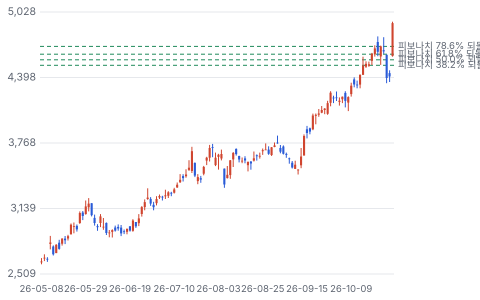
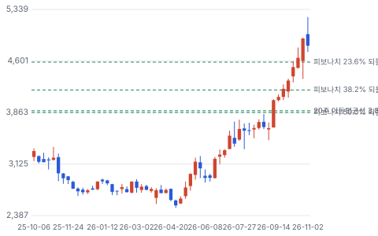
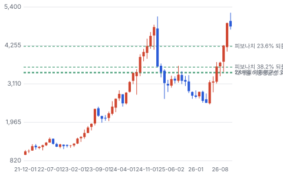
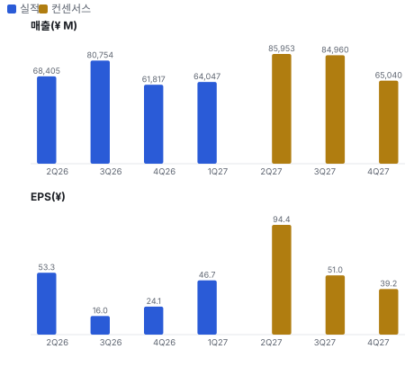
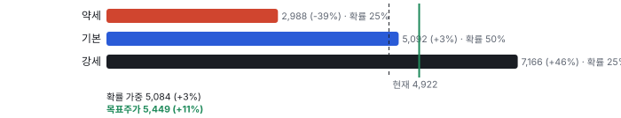
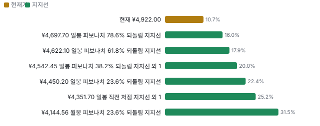
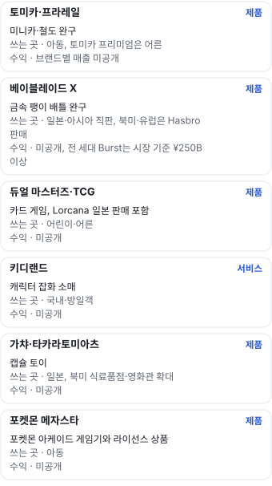
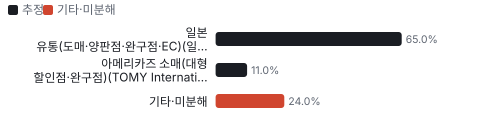
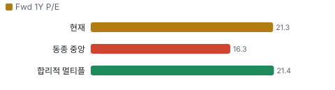
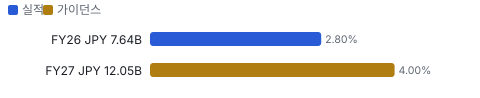

# 텐배거 리포트 2026-11-02 — 2030년 목표를 3년 앞당겼다, 값은 그보다 더 앞서 갔다

> 2026-11-02 · Takara Tomy(7867) · 기업: 베이블레이드·토미카·리카짱·듀얼 마스터즈와 캡슐 토이·키디랜드를 운영하는 일본 2위 완구 회사

## Chiip View

상향은 진짜지만 숫자를 뜯으면 하반기는 오히려 낮아졌다. 상반기 영업이익을 ¥4.8B 올리고 통기는 ¥4.0B만 올려, 하반기 내포가 ¥14.5B → ¥13.7B가 됐다. **보수적 가이던스일 수도, 상반기로 당겨진 물량일 수도 있다.** 주가는 5/12 뒤 +86%이고 그중 EPS는 +11.6%, 나머지는 멀티플이다. 목표주가 ¥5,449는 지금 값보다 11% 높지만 약세까지 −39%라 손익비는 1.2다. **11/10 지역별 매출이 이 둘을 가른다.**

## 대시보드
| 항목 | 값 | 설명 |
|---|---|---|
| 주가 | ¥4,922.00 | 고점 대비 +0% · 1년 +56% |
| 시가총액 | ¥424.25B | EV ¥391.42B |
| 업사이드 | +11% | 목표주가 ¥5,449 · 다운사이드 -39% · 손익비 1.2 |
| 구매등급 | Neutral | 애널리스트 3명: Strong Buy 0 · Buy 2 · Neutral 1 · Sell 0 · Strong Sell 0 |
| 멀티플 | Fwd 1Y P/E 21.3배 | 동종 중앙값 16.3배 |
| 가이던스 FY27 | ¥300,000M · ¥231.29 | 컨센서스 ¥296,000M · ¥239.08 |
| 알파 | 4.3/10 | 텐배거 가능성 점수 |
| 이벤트 | 2Q FY27 상반기 실적(예정일, 회사 공지 미대조) | 2026-11-10 |

## 한 장 요약
- **기업가치를 결정하는 내러티브** **타카라토미의 값은 '아이 장난감 회사'에서 '전 연령·전 지역 IP 놀이 회사'로 바뀌느냐로 정해진다.** 10/29 상향으로 FY27 가이던스가 매출 ¥300B·영업이익 ¥30B가 됐다. 회사가 2024년에 내건 2030년 3월기 목표다. 3년 앞당긴 숫자를 시장이 샀다. 주가는 5/12 ¥2,648에서 10/30 ¥4,922로 +86%다. EPS 가이던스 상향은 +11.6%이고 나머지는 멀티플이다.
- **밸류에이션 모델로 본 주가 상방은 어디까지인가?** **목표주가 ¥5,449(+11%), 기본과 강세 사이(강세 쪽 17%)다.** 강세 ¥7,166(+46%)는 Fwd 1Y P/E 24.3배를 강세 EPS에 적용한 값이다. 기본 ¥5,092, 약세 ¥2,988. 손익비 1.2, DCF 기준 업사이드 -13%.
- **지금 가격은 무엇을 가정하나?** Fwd 1Y P/E 21.3배다. 회사 가이던스 EPS ¥231 기준이고 컨센서스 ¥239면 20.6배다. 동종 중앙값 16.3배보다 높고 일본 IP 회사 반다이남코 24.8배·산리오 23.1배에 가깝다. Chiip 추정 FY28 EPS ¥262로 봐도 18.8배다. 값은 FY27 상향을 넘어 다음 계획까지 묻고 있다.
- **왜 움직였나?** 5/12 ¥2,648에서 10/30 ¥4,922로 +86%다. EPS 가이던스는 +11.6%, 멀티플은 12.8배 → 21.3배로 +67%다. 8/5에는 1Q 영업이익이 컨센서스 ¥3.9B를 넘었는데도 가이던스 유지로 −8.0%였다. 10/29 상향이 시장 기대 약 ¥27B를 ¥3B 넘자 10/30 +11.7%가 나왔다.
- **무엇이 바뀌었나?** 어닝콜은 공개되지 않아 공시로 본다. 상반기 영업이익 ¥11.5B → ¥16.3B, 통기 ¥26B → ¥30B다. 상향액 ¥4B는 상반기 초과 ¥4.8B보다 작다. 그래서 하반기 내포 영업이익은 ¥14.5B → ¥13.7B로 오히려 낮아졌다. 하반기 매출은 ¥155B → ¥150B다. 1Q 관세 환급 약 ¥1.0B는 일회성이다.
- **무엇이 바뀌면 판단이 바뀌나?** 강세로는 11/10에 상반기 영업이익 ¥16.3B를 넘고 하반기를 올리거나, 새 계획이 2030년 목표를 크게 올리는 경우다. 약세로는 2Q 상향분이 미국 ERP(전사 자원 관리 시스템) 지연 물량의 이월로 드러나거나, 일본·아시아 성장률이 꺾이는 경우다.

## 한눈에 보기

**일봉**

**주봉**

**월봉**

**분기 매출·EPS 실적과 컨센서스**

**밸류에이션 주가 시나리오**

**주가별 업사이드**

**어닝콜 변화별 주주가치 영향**

**멀티플 프리미엄**

**합리적 멀티플**

**몬테카를로**

해석: 3,000번 중 899번(30%)에서 가치가 지금 주가 이상이었다. 가정을 흔들어도 지금 주가를 뒷받침하지 못하는 경우가 더 많다. 가운데 값은 0.86배이고, 열 번 중 여덟 번은 0.61~1.23배 사이에 든다.

## 내러티브

> **기업가치를 결정하는 이야기:** 일본 부문이 돈을 벌고 해외는 아직 이익이 얇다. FY26 일본 영업이익 ¥28.3B에 아시아 ¥2.1B, 아메리카즈 ¥0.6B다. 기업가치는 세 가지로 갈린다. 일본의 어른 수요가 구조인가, 아시아·북미가 일본 수준 이익률에 다가가나, 베이블레이드 X(금속 팽이 배틀 완구 4세대)가 끝난 뒤에도 이익이 버티나다.

> **멀티플·EPS 프리미엄**
> **멀티플:** Fwd 1Y P/E 21.3배로 동종 중앙값 16.3배보다 31% 높다. 일본 IP 회사 반다이남코 24.8배·산리오 23.1배에 가깝고 Hasbro 16.7배·Mattel 11.9배와는 멀다. 5/12에는 가이던스 EPS 기준 12.8배였다.
> **EPS:** FY27 EPS 가이던스는 ¥207.26 → ¥231.29로 +11.6%다. 컨센서스는 ¥239다. FY26 EPS ¥131은 영업권 감손 ¥4.86B로 눌린 값이라 FY27 증가율 +76%의 상당 부분은 기저 효과다.

### 투자자들은 왜 열광했나

1Q 뒤에는 오히려 식었다. 영업이익 ¥5.5B로 컨센서스 ¥3.9B를 넘었는데 가이던스를 두어 8/5 주가가 −8.0%였다. 그 뒤 증권사 목표가 상향이 이어졌고, 10/29 상향이 FISCO(일본 금융 정보 회사)가 전한 시장 기대 약 ¥27B를 ¥3B 넘었다. 10/30 +11.7%, 거래량은 평균의 4.5배였다.

### 무엇이 기업가치를 바꾸나

> **구조적 체질 변화**
> **변화:** 아동에서 전 연령으로, 일본에서 아시아로 넓힌다. 회사 전략의 두 축이다.
> **증거:** 회사는 상향 이유로 Kidults(장난감을 사는 어른 수집가)를 맨 앞에 적었다. Kidults 비중은 공시되지 않아 미확인이다.
> **반증:** Kidults 없이도 설명되는 일회성 캐릭터 매출로 드러난다.

> **고부가 믹스 확장**
> **변화:** 영업이익률 FY26 9.0% → FY27 가이던스 10.0%다. 환급 약 ¥1.0B를 빼면 9.7%다.
> **증거:** 1Q 매출총이익률은 39.3%→42.3%로 올랐다(시세 원천 재무).
> **반증:** 하반기 이익률이 전년 하반기 8.8% 아래다.

> **기술 혁신**
> **변화:** 완구는 기술보다 IP와 유통이 값을 정한다. Roblox(미국 온라인 게임 플랫폼) 게임으로 베이블레이드를 디지털과 잇는 시도가 있다.
> **증거:** 베이블레이드 X Roblox 게임 누적 방문 1억 초과. FY26 연구개발비 ¥6.7B.
> **반증:** 디지털 연동이 실물 판매로 이어지지 않는다.

> **실행 속도**
> **변화:** 해당 없음(계절 재고 생산이라 납품 리드타임을 공시하지 않아 피어와 비교할 수 없다). 다만 1Q 미국 ERP 장애로 출하가 늦어졌다. 금액은 미공개다.
> **증거:** 1Q 결산 보도. 2Q 내포 매출 +25.6%에 지연 물량이 섞였는지는 미확인이다.
> **반증:** 11/10 미국 매출이 회복하지 않는다.

> **M&A**
> **변화:** 회사는 성장 투자 ¥40~50B를 쓰겠다고 했다. 진행 중인 건은 공시되지 않았다. FY26에는 미국 자회사 영업권 ¥4.86B를 감손했다.
> **증거:** 유가증권보고서. 
> **반증:** 대형 인수로 순현금 ¥32.8B를 넘어 차입한다.

> **정책·입법 연관성**
> **재정정책:** 해당 없음(회사 매출을 바꾸는 재정 지출이 없다).
> **행정명령:** 해당 없음(지금 작동하는 것은 행정명령이 아니라 판결 뒤 세관 환급 절차다). 미국 대법원이 2026-02-20 IEEPA(미국 국제긴급경제권한법) 관세를 무효로 했고 세관은 4월부터 CAPE(미국 세관의 관세 환급 신청 시스템)로 환급을 받는다. 회사는 1Q에 환급 약 ¥1.0B를 영업이익에 잡았다. 이 환급이 IEEPA 관세분인지는 회사가 밝히지 않아 추정이다. 대체 관세 영향도 미확인이다. 반증: 2Q에도 환급이 더 잡혀 이익 질이 낮아진다.
> **연관입법:** 해당 없음(회사 공시와 보도에서 연관 법안을 찾지 못했다).

> **CAPEX 낙수효과**
> **변화:** 해당 없음(설비투자 사이클과 무관한 소비재다).

### 내러티브 근거

> 시장은 '일본 아이 장난감 회사'를 '어른 수집가와 아시아로 커지는 IP 회사'로 다시 값을 매기고 있다. 쟁점은 이 변화가 구조인지 캐릭터 붐인지다. 동종 대비 멀티플 차이 +31% 중 회사 고유 몫은 -1%다. 단계는 확산, 쏠림은 중간이다.

> **Kidults 전환** · 강화
> **논리:** 어른 수집가가 아동 인구 감소를 메운다
> **숫자:** 회사 비중 미공개. 상향 이유 첫 줄
> **반증:** 일본 부문 성장률이 FY24~FY26 평균 아래로 내려간다

> **아시아 베이블레이드·토미카(다이캐스트 미니카 브랜드)** · 강화
> **논리:** 일본 밖에서 두 브랜드가 커진다
> **숫자:** FY26 아시아 매출 ¥67.5B(−1.1%), 이익 ¥2.1B(−20%)
> **반증:** 11/10 아시아 매출이 전년보다 낮다

> **캐릭터 붐과 소비** · 유지
> **논리:** 치이카와·포켓몬 30주년·오시카츠가 국내 소비를 끈다
> **숫자:** 키디랜드(캐릭터 잡화 소매 체인)·가챠(캡슐 토이 자판기) 금액 미공개
> **반증:** 키디랜드 매출 감소

> **반대 내러티브: 히트가 끝나면 값도 끝난다** · 강화
> **논리:** 2025년 2월 ¥5,119에서 2026년 5월 ¥2,496까지 −51%. 값은 이미 일본 IP 회사 수준이다
> **숫자:** Fwd 1Y P/E 21.3배, 5월 12일 12.8배
> **반증:** FY28 가이던스 영업이익 ¥32B 이상

## 포트폴리오

| 제품·서비스 | 구분 | 무엇 | 쓰는 곳 | 돈 버는 방식 |
|---|---|---|---|---|
| 토미카·프라레일(철도 완구) | 제품 | 미니카·철도 완구 | 아동, 토미카 프리미엄(어른 수집가용 고급 토미카)은 어른 | 브랜드별 매출 미공개 |
| 베이블레이드 X | 제품 | 금속 팽이 배틀 완구 | 일본·아시아 직판, 북미·유럽은 Hasbro 판매 | 미공개, 전 세대 Burst는 시장 기준 ¥250B 이상 |
| 듀얼 마스터즈(자사 트레이딩 카드 게임)·TCG(트레이딩 카드 게임) | 제품 | 카드 게임, Lorcana(디즈니 트레이딩 카드 게임) 일본 판매 포함 | 어린이·어른 | 미공개 |
| 키디랜드 | 서비스 | 캐릭터 잡화 소매 | 국내·방일객 | 미공개 |
| 가챠·타카라토미아츠(캡슐 토이 자회사) | 제품 | 캡슐 토이 | 일본, 북미 식료품점·영화관 확대 | 미공개 |
| 포켓몬 메자스타(포켓몬 아케이드 게임기) | 제품 | 포켓몬 아케이드 게임기와 라이선스 상품 | 아동 | 미공개 |

## 해자

> 경쟁을 막는 것은 일본 안의 장수 브랜드와 판매망이다. 해외와 라이선스는 해자가 아직 얇다. 일본 부문이 영업이익 대부분을 낸다.

> **일본 장수 브랜드와 판매망** · 강함
> **해자:** 토미카·프라레일·리카짱(인형 브랜드)은 수십 년째 세대를 넘겨 팔린다. 부모가 쓰던 브랜드를 다시 사고, 어른 수집 시장으로 번졌다.
> **근거:** FY26 일본 부문 매출 ¥226.2B, 영업이익 ¥28.3B로 부문 이익률 12.5%다. 아메리카즈는 1.9%, 아시아는 3.2%다. 부문 매출에는 내부 거래가 들어 있다.
> **숫자:** 일본 영업이익 ¥28.3B = 전사 ¥24.2B보다 크다(전사 비용 차감 전)
> **깨지는 조건:** 일본 부문 이익률이 두 해 연속 10% 아래로 내려간다.

> **베이블레이드 대회 생태계** · 보통
> **해자:** 팽이는 경기 규칙과 대회가 있어 부품을 계속 산다. 세계 대회와 Roblox 게임이 수요를 이어 준다. 다만 세대마다 붐과 소멸을 반복했다.
> **근거:** 3세대 Burst는 회사 아시아 법인 기준 세계 약 1.7억 개, 시장 기준 매출 ¥250B 이상이다. X의 Roblox 게임은 누적 방문 1억을 넘겼다. X 매출은 공시되지 않아 미확인이다.
> **숫자:** Burst 약 1.7억 개 · X 매출 미확인
> **깨지는 조건:** 회사가 베이블레이드 X 판매 감소를 두 분기 연속 밝힌다.

> **판권 운영 능력** · 보통
> **해자:** 포켓몬·디즈니·트랜스포머 같은 남의 IP를 상품으로 빠르게 바꾼다. 그러나 권리는 남의 것이고 기간이 짧아 가격 결정력이 제한된다.
> **근거:** 유가증권보고서 기준 포켓몬·디즈니 계약은 2027-03-31까지, Hasbro 계약은 2026-12-31까지다. 갱신 여부와 조건은 미확인이다.
> **숫자:** 라이선스 매출 비중 미확인
> **깨지는 조건:** 주요 판권 하나가 경쟁사로 넘어간다.

> **자체 소매·캡슐 판매 접점** · 보통
> **해자:** 키디랜드와 가챠는 도매상을 거치지 않고 인기 캐릭터 수요를 바로 받는다. 이번 상향의 첫 번째 이유도 키디랜드였다.
> **근거:** 회사는 상향 이유 첫머리에 키디랜드 인기 캐릭터 상품을 적었다. 2026년 4월 하라주쿠 오모카도 점(하라주쿠 키디랜드 새 매장)을 열었고, 가챠는 북미 대형 식료품점·영화관으로 넓혔다.
> **숫자:** 키디랜드·가챠 매출 금액 미확인
> **깨지는 조건:** 캐릭터 붐이 식어 키디랜드 매출이 전년보다 줄어든다.

## 경영진·네트워크

> 경영은 회사 안에서 자란 CEO가 맡는다. 미국 자회사를 직접 경험한 점이 해외 전략과 닿는다. 정계·동문 연결은 공개 자료에서 찾지 못했다.

> **도미야마 아키오** · 대표이사 사장 CEO · 2025-04
> **프로필:** 2010년 입사. 2017년 TOMY International(미국·유럽 완구 자회사) 주재, 2018년 같은 회사 CSO(최고 전략 책임자). 2020년 사업 총괄, 2023년 부사장, 2024년 사장 COO를 거쳐 2025년 CEO가 됐다. 지분 862천 주.
> **비즈니스:** 외부 이사회 연결 미확인
> **정계:** 공개 기록 미확인
> **동문:** 미확인
> **사모임:** 미확인

> **고지마 가즈히로** · 대표이사 회장(2026-06 총회 뒤 현직 여부 미확인) · 2025-04
> **프로필:** 미쓰비시상사 출신. 2009년 사외이사로 왔고 CFO·사장 COO·CEO를 거쳤다. 2026년 6월 총회 안건 명단에는 없다.
> **비즈니스:** 미쓰비시상사 경력
> **정계:** 공개 기록 미확인
> **동문:** 미확인
> **사모임:** 미확인

**네트워크 정량화**
| 연결 | 강도 | 닿는 매출 | 가중 노출 | 매출 대비 | 근거 |
|---|---|---|---|---|---|
| 비즈니스: 도미야마 CEO — TOMY International 주재·CSO 경력. 아메리카즈 매출에 닿는다 | 4/5 | ¥30.45B | ¥24.36B | 9% | FY26 아메리카즈 부문 매출 유가증권보고서 세그먼트·임원 현황 |
| 비즈니스: 고지마 회장 — 미쓰비시상사 경력. 사업 연결 증거 없음 | 1/5 | 미확인 | 미확인 | 미확인 | 미확인 임원 현황 |
| 정계: 공개 자료에서 찾지 못했다 | 0/5 | 미확인 | 미확인 | 미확인 | 미확인 없음 |
| 동문: 공개 자료에서 찾지 못했다 | 0/5 | 미확인 | 미확인 | 미확인 | 미확인 없음 |

가중 노출은 연결이 닿는 매출의 크기다. 연결이 그 매출을 만들었다는 뜻이 아니며, 인과는 공개 자료로 입증하지 못한다.

## 약세 논리 및 셀온 조건

| 약세 논리 | 근거 | 가를 자료 |
|---|---|---|
| 멀티플이 이익보다 먼저 갔다 | 5/12 이후 +86% 중 EPS는 +11.6%다. 일본 IP 회사와 달리 자체 영상·게임이 없고 일본 밖 이익이 얇다 | FY28 가이던스, 새 계획 |
| 히트 사이클 | 2025년 2월 ¥5,119에서 2026년 5월 ¥2,496까지 −51%. 2010년대 초에도 2세대 붐 뒤 반 토막이 났다(시기 일치, 인과는 추정). 베이블레이드 X는 일본 출시 4년 차다 | 베이블레이드 X·아시아 매출(11/10, 2027-02) |
| 이익의 질 | 1Q 영업이익 ¥5.5B에 환급 약 ¥1.0B가 들어 있다. 빼면 전년 ¥4.6B 대비 약 −2%다 | 2Q 일회성 항목 |
| 2Q 쏠림 | 2Q 내포 매출 +25.6%는 1Q +7.7%보다 훨씬 높다. 미국 ERP 지연 물량이 넘어왔을 수 있다(추정). 그러면 하반기 수요와 무관하다 | 11/10 지역별 매출 |
| 해외 수익성 | FY26 아메리카즈 이익률 1.9%, 아시아 3.2%, 유럽 적자다. 미국 자회사 영업권 ¥4.86B를 감손했다 | 지역별 이익 |
| 판권 만기 | Hasbro 계약 2026-12-31, 포켓몬·디즈니 2027-03-31까지다. 매출 비중과 갱신 조건은 미확인이다 | 유가증권보고서, 갱신 공시 |
| 확인 못 한 자료 | JPX(일본거래소그룹) 원문은 자동 접속이 막혀 공시 전재·유가증권보고서 텍스트로 대조했다. 구매 약정·제한 현금·10% 초과 고객·정부 지원은 읽은 범위에 없었고 주석 전문은 미대조다. FY26 3·4Q 영업이익은 근사다 | FY27 2Q 반기보고서 |

> **셀온 조건**
> **조건 1:** 11/10 상반기 영업이익이 ¥16.3B에 못 미치거나 하반기 내포 ¥13.7B를 낮춘다.
> **조건 2:** 환급을 뺀 상반기 영업이익 증가율이 +30%에 못 미친다.
> **조건 3:** 회사가 아시아 또는 베이블레이드 X 감소를 두 분기 연속 밝힌다.
> **조건 4:** 2027년 5월 FY28 영업이익 가이던스가 FY27 실적보다 낮다.

## 어닝콜 변화

**직전 콜 대비 새로 나오거나 바뀐 내용 → 가치 영향**
| 항목 | 내용 | 직전 콜 | 최신 콜 | 모델 동인 이동 | 확신도 | 가치 영향 |
|---|---|---|---|---|---|---|
| 업데이트 | FY27 매출 가이던스 | ¥285B | ¥300B | 기준연도 매출 +15.00 BJPY(십억 엔) | 0.8 | +4.8% |
| 업데이트 | FY27 영업이익률 가이던스 | 9.1% | 10.0% | 출발 이익률 +0.88% | 0.8 | +0.5% |
| 부정 | 관세 환급은 일회성 | 없음 | 1Q 약 ¥1.0B | 출발 이익률 -0.33% | 1.0 | -0.2% |
| 신규 | 아시아 베이블레이드 X·토미카 | FY26 아시아 매출 −1.1% | 상반기 호조(회사 표현) | 장기 성장 수렴값 +0.20% | 0.5 | +0.6% |
| **합계** | 단독 합 |  |  | 동시 적용 +5.7% |  | **+5.7%** |

**해석:** 이 기간 주가 +85.9% 중 EPS 추정 변화가 +11.6%, 멀티플 변화가 +66.6% — 주가를 움직인 것은 **멀티플(시장이 붙이는 배수) 변화**이다. 

## 밸류에이션

> **목표주가 ¥5,449, 업사이드 +11%.** 자리는 기본과 강세 사이(강세 쪽 17%)이고 도달 확률은 약 44%다. 기본 ¥5,092, 강세 ¥7,166(+46%), 약세 ¥2,988(-39%). DCF 기준 업사이드는 기본 -13%, 강세 +8%, 약세 -25%다(WACC 7.5%).

EPS는 FY28 Chiip 추정이다. 공개 컨센서스는 FY27까지만 있어 FY28·FY29는 시나리오 가정이고, 멀티플은 엔진이 고른다.

DCF는 기본 영업이익률을 10.5%에 묶고 성장을 2%로 감속시킨다. 시나리오는 2027년 말 일본 동종 쪽 배수가 유지된다고 본다. 새 계획이 2030년 목표를 크게 올리면 시나리오 렌즈가, 히트 사이클이 꺾이면 DCF 렌즈가 맞다.

> **약세 ¥2,988 (-39%)** · 확률 25%
> **가정:** 14.6배 × EPS ¥205.00
> **근거:** 베이블레이드 X가 식고 환급이 빠져 FY28 영업이익 ¥27B 안팎

> **기본 ¥5,092 (+3%)** · 확률 50%
> **가정:** 19.4배 × EPS ¥262.00
> **근거:** FY27 영업이익 ¥32B 안팎으로 가이던스를 조금 넘고 FY28 매출 +5%, 영업이익률 10.5%, 자사주 소각 효과

> **강세 ¥7,166 (+46%)** · 확률 25%
> **가정:** 24.3배 × EPS ¥295.00
> **근거:** 아시아·북미가 겹쳐 FY28 매출 +10%, 영업이익률 11.5%, 새 계획 상향

**멀티플 선정 — Fwd 1Y P/E**
| 단계 | 조정 | 근거 |
|---|---|---|
| 동종 중앙값 | 16.3배 | 범위 10.3~24.8배, 6곳 |
| 펀더멘털 | +16% | 성장·이익률·ROIC로 본 합리적 멀티플 21.4배와의 차이의 일부만 인정 |
| 해자 | +8% | 일본 장수 브랜드와 판매망 강함 · 베이블레이드 대회 생태계 보통 · 판권 운영 능력 보통 · 자체 소매·캡슐 판매 접점 보통 |
| 내러티브 | +5% | 단계 확산 |
| 사이클·실행 판단 | -10% | 반다이남코·산리오는 자체 IP와 15~39% 이익률이 받치는 배수다. 타카라토미는 이익률 10%에 남의 판권이 섞이고 세대 교체마다 이익이 흔들렸다. 5/12에는 12.8배였다 |
| **선정** | **19.4배** | 지금 21.3배 |

**동종 레인지**
| 회사 | Fwd 1Y P/E | 성장 | 영업이익률 | ROIC |
|---|---|---|---|---|
| Bandai Namco | 24.8 | 6% | 15% | 29% |
| Sanrio | 23.1 | 16% | 39% | 141% |
| Hasbro | 16.7 | 0% | 31% | 37% |
| Happinet | 15.8 | 11% | 3% | 49% |
| Mattel | 11.9 | 3% | 9% | 8% |
| Spin Master | 10.3 | 2% | 9% | 9% |
| **Takara Tomy** | 21.3 |  |  |  |

지금 주가가 요구하는 5년 매출 CAGR 8%, 기본 시나리오 4%. 몬테카를로 중앙값 업사이드 -14%.

> 의사결정 보조(투자자문 아님): ① 매수 매력: 연 기대수익 +4.3% (자기자본비용 7.5% 대비 -3.1%p) · 자본비용 초과 확률 25% · 안전마진 0.61 → 정량 신호 약함 / ② 위험 예산 지표(이론): 0% — 기대수익이 자기자본비용에 못 미침(무위험 대비 켈리 97%는 참고) · 5년 하위10% -16% · 30%+ 손실 확률 3% / ③ 상방(5년): 기대 1.24배 · 2배 3% · 3배 0% · 10배 0% · 상위10% 1.71배

## 시장 평가

> **셀사이드(IB 애널리스트)**
> **한 줄:** 셀사이드는 추천 쪽이지만 목표가가 주가를 따라가지 못했다. 11/10 뒤 목표가 수정이 다음 재료다
> **커버리지:** 3명: Buy 2, Neutral 1 — 표본이 작다
> **공개 목표가 평균:** ¥4,203(지금 값보다 15% 낮음) — 상향 전 값이 섞였을 가능성이 크다. 기대의 증거이지 결론이 아니다
> **5월 뒤 의견:** SBI(일본 증권 그룹)증권 Buy 상향·¥4,400, 도카이도쿄 ¥4,210, SMBC(일본 미쓰이스미토모 금융 그룹)닛코 상향 — 방향은 모두 위
> **상향 전 기대:** 영업이익 약 ¥27B(FISCO) — 새 가이던스 ¥30B가 11% 높다

> **바이사이드(기관 투자자)**
> **한 줄:** 일본 종목이라 미국 13F와 체결 회사별 자료가 없다. 기관·개인 구분은 할 수 없다
> **주주 구성:** 신탁 계정 12.45%·3.74%, 司不動産 7.43% — 2026-03-31 기준. 신탁 계정 뒤 실제 보유자는 미확인
> **거래량:** 10/30 267만 주, 최근 290거래일 평균 59만 주의 4.5배 — 거래량 증가의 주체는 미확인(미국 공매도 자료 대상 아님)

> **언론·업계**
> **한 줄:** 언론은 어른 수요를 내세웠지만 회사는 금액을 공개하지 않았다
> **상향 보도:** Reuters·DZH(일본 금융 정보 회사)·FISCO, Kidults 중심 — 캐릭터와 어른 수요가 제목에 올랐다

## 체크리스트

| 시점 | 무엇 | 의미 |
|---|---|---|
| 2026-11-10(예정) | 상반기 실적 | ¥16.3B 초과 여부, 2Q 환급, 지역별 매출, 미국 회복 |
| 2026-11~12월 | 증권사 목표가 수정 | 평균 ¥4,203이 주가를 따라오는지 |
| 2026-12-31 | Hasbro 계약 만기 | 갱신 공시 |
| 2027-02 초(예상) | 3분기 실적 | 북미 연말 성수기 |
| 2027-05 | FY27 실적·FY28 가이던스·새 계획 가능성 | 2030년 목표 다음 숫자 |

## 출처
- 회사 업적 예상 수정 2026-10-29 15:30 공시(보도 전재 원문, 경로 TradingView 뉴스)
- 1Q 결산 보도 2026-08-04(https://gamebiz.jp/news/430539)
- FY26 유가증권보고서 텍스트(https://edinetdb.jp/company/E02450/text?fy=2026)
- 중장기 경영전략 2030 요약(https://edinetdb.jp/company/E02450/midterm-plans/)
- 주주·임원 현황 집계(https://www.kabutore.biz/genzaikabuka/okabunushi7867.html)
- 베이블레이드 X 판매 전망(https://takaratomyasia.com/news/417)
- 미국 IEEPA 관세 판결·환급 절차 해설(https://natlawreview.com/article/us-supreme-court-invalidates-ieepa-tariffs-temporary-section-122-surcharge-now)
- 증권사 의견 변경 보도(SBI 8/10·도카이도쿄 8/26·SMBC닛코 9/11) — 요지만, 결론에 쓰지 않음
- 도쿄증권거래소 7867 종가 2026-10-30

_구매 등급·목표주가 모두 규칙이 계산한 모델 값으로, 개인의 보유 종목·자금 사정을 반영하지 않는다 · 공개 자료 기반 분석이며 투자 권유가 아님 · 1차 판정, 미검증 · Chiip ten-bagger_