# 텐배거 리포트 2026-11-08 — 2030년 목표를 3년 앞당겼다, 11/10이 하반기를 가른다

> 2026-11-08 · Takara Tomy(7867) · 기업: 베이블레이드·토미카·리카짱·듀얼 마스터즈와 캡슐 토이·키디랜드를 운영하는 일본 2위 완구 회사

## Chiip View

상향은 진짜지만 숫자를 뜯으면 하반기는 오히려 낮아졌다. 상반기 영업이익을 ¥4.8B 올리고 통기는 ¥4.0B만 올려, 하반기 내포가 ¥14.5B → ¥13.7B가 됐다. **보수적 가이던스일 수도, 상반기로 당겨진 물량일 수도 있다.** 주가는 5/12 ¥2,648 → 11/6 ¥4,819로 +82%이고 그중 EPS 가이던스는 +11.6%, 나머지 +63%는 멀티플이다. 11/5 장중 사상 최고 ¥5,230을 찍고 11/6 −7.4%로 밀렸다(원인 미확인). 규칙 등급은 Buy이고 토론도 Buy를 유지했지만 Neutral 2표가 남았다. **11/10 상반기 실적과 하반기 계획이 이 둘을 가른다.**

## 대시보드
| 항목 | 값 | 설명 |
|---|---|---|
| 주가 | ¥4,819 | 고점 대비 -7% · 1년 +51% |
| 시가총액 | ¥424.25B | 완전 희석 기준 · EV ¥391.42B |
| 업사이드 | +16% | 목표주가 ¥5,595 · 다운사이드 -36% · 손익비(강세÷약세) 1.5 |
| 구매등급 | Buy | 애널리스트 3명: Strong Buy 0 · Buy 2 · Neutral 1 · Sell 0 · Strong Sell 0 |
| 멀티플 | Fwd 1Y P/E 20.8배 | 동종 중앙값 16.3배 |
| 가이던스 FY27 | ¥300,000M · ¥231.29 | 컨센서스 ¥296,000M · ¥239.08 |
| 알파 | 4.3/10 | 텐배거 가능성 점수 |
| 이벤트 | 2Q FY27 상반기 실적(예정일, 회사 공지 미대조) | 2026-11-10 |

## 한 장 요약
- **기업가치를 결정하는 내러티브** **타카라토미의 값은 '아이 장난감 회사'에서 '전 연령·전 지역 IP 놀이 회사'로 바뀌느냐로 정해진다.** 10/29 상향으로 FY27 가이던스가 매출 ¥300B·영업이익 ¥30B가 됐다. 회사가 2024년에 내건 2030년 3월기 목표다. 3년 앞당긴 숫자를 시장이 샀다. 주가는 5/12 ¥2,648에서 11/6 ¥4,819로 +82%다. EPS 가이던스 상향은 +11.6%이고 나머지는 멀티플이다.
- **밸류에이션 모델로 본 주가 상방은 어디까지인가?** **목표주가 ¥5,595(+16%), 기본과 강세 사이(강세 쪽 15%)다.** 강세 ¥7,421(+54%)는 Fwd 1Y P/E 25.2배를 강세 EPS에 적용한 값이다. 기본 ¥5,273, 약세 ¥3,094. 손익비 1.5, DCF 기준 업사이드 +8%.
- **누가 사 주나?** 최대 고객 일본 유통(도매·양판점·완구점·EC(온라인 쇼핑몰 판매))(일본 부문) 65%, 상위 3곳 76%. 공시·회사 발표로 확인한 몫은 0%다.
- **마진과 공급망은 어디가 약한가?** GPM 40.3%, OPM 9.0%. OPM을 가장 흔드는 BOM(제품 원가를 이루는 부품·재료 명세) 항목은 위탁·자사 공장 생산 가공비이고 가격 +10%에 -1.52%p다. 공급망 신뢰성은 4.9/10(병목 주의)이고 가장 약한 고리는 판권 로열티다.
- **생산능력은 얼마나 늘어나나?** 현재 명목 캐파 미확인, 착공 이상 증설 0 미확인(생산 수량 미공시). FY27 CAPEX는 매출의 4.0%다.
- **지금 가격은 무엇을 가정하나?** 11/6 종가 ¥4,819는 Fwd 1Y P/E 20.8배다. 회사 가이던스 EPS ¥231 기준이고 컨센서스 ¥239면 20.2배다. 반다이남코 24.8배·산리오 23.1배(10/30 기준)에 가깝다. Chiip 추정 FY28 EPS ¥262로 봐도 18.4배다. 값은 FY27 상향을 넘어 다음 계획까지 묻고 있다.
- **왜 움직였나?** 5/12 ¥2,648에서 11/6 ¥4,819로 +82%다. 같은 기간 EPS 가이던스는 +11.6%, 멀티플은 12.8배 → 20.8배로 +63%다. 8/5에는 1Q 영업이익이 컨센서스 ¥3.9B를 넘었는데도 가이던스 유지로 −8.0%였다. 10/29 상향이 시장 기대 약 ¥27B를 ¥3B 넘자 10/30 +11.7%가 나왔다. 11/5 +8.5%·11/6 −7.4%는 공시·보도로 원인을 찾지 못했다.
- **무엇이 바뀌었나?** 어닝콜 전문은 공개되지 않아 공시로 본다. 상반기 영업이익 ¥11.5B → ¥16.3B, 통기 ¥26B → ¥30B다. 상향액 ¥4B는 상반기 초과 ¥4.8B보다 작다. 그래서 하반기 내포 영업이익은 ¥14.5B → ¥13.7B로 낮아졌다. 하반기 매출은 ¥155B → ¥150B다. 1Q 관세 환급 약 ¥1.0B는 일회성이다. 회사 답변 없음 — 질의응답이 공개되지 않는다.
- **무엇이 바뀌면 판단이 바뀌나?** 강세로는 11/10에 상반기 영업이익 ¥16.3B를 넘고 하반기를 올리는 경우다(가를 자료: 11/10 결산 단신). 약세로는 2Q 상향분이 미국 ERP 지연 물량의 이월로 드러나는 경우다(가를 자료: 11/10 지역별 매출). Hasbro 판매 계약 갱신 여부는 2026-12-31 전후 공시로 가른다.

## 한눈에 보기

**일봉**

**주봉**

**월봉**

**분기 매출·EPS 실적과 컨센서스**

**밸류에이션 주가 시나리오**

**주가별 업사이드**

**제품·서비스 포트폴리오**

**고객 믹스(FY26, 매출 대비)**

**공급 병목(10점, 낮을수록 병목)**

**CAPEX의 매출 대비 비중**

**어닝콜 변화별 주주가치 영향**

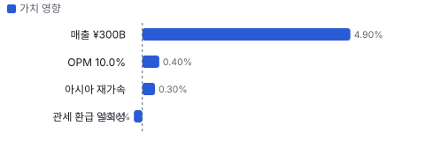

**멀티플 프리미엄(현재값 — 최근 4개 분기 추이 재료 없음)**

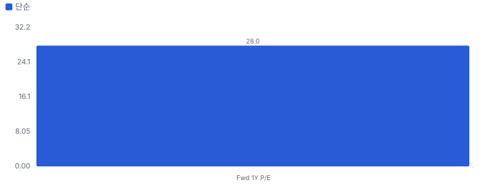

**합리적 멀티플**

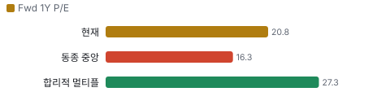

**몬테카를로**

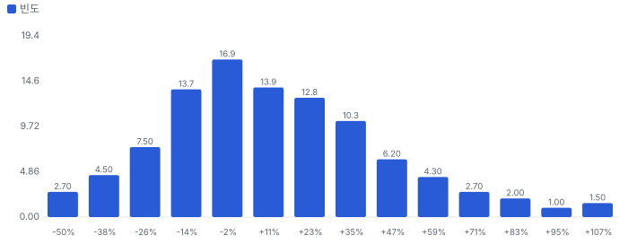

해석: 3,000번 중 1,847번(62%)에서 가치가 지금 주가 이상이었다. 가정을 흔들어도 지금 주가를 뒷받침하는 경우가 더 많다. 가운데 값은 1.08배이고, 열 번 중 여덟 번은 0.73~1.57배 사이에 든다.

**매출 → 매출총이익 → 영업이익(매출 = 100, 최근 4분기)**

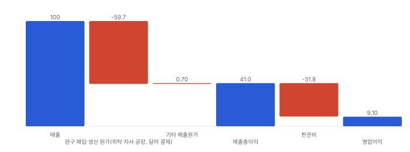

**1년 전 대비 마진 기여(비용 비중 변화의 반대)**

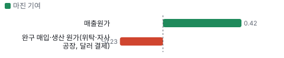

**분기 비용 비중 추이(매출 대비, 공시)**

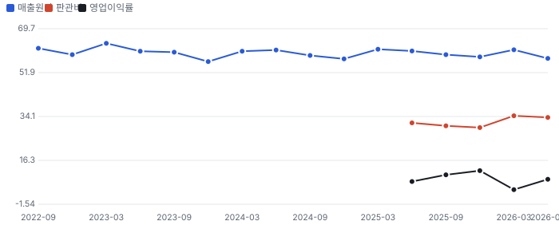

**매출 100의 쓰임(최근 4개 분기)**

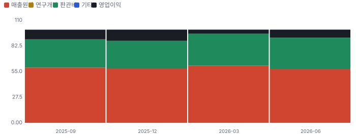

**비용 요인별 매출 대비 비중과 1년 변화**

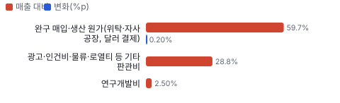

**BOM 항목 가격 +10% 시 OPM 변화**

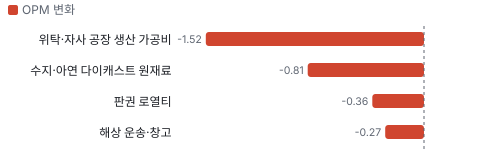

**일본 완구·카드 BOM 원가 몫과 가격 +10% 시 OPM**

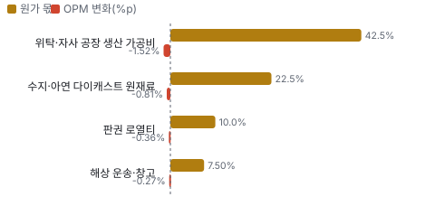

**매출 증가율의 가격·물량 분해와 AR(2) 투영(전년 대비)**

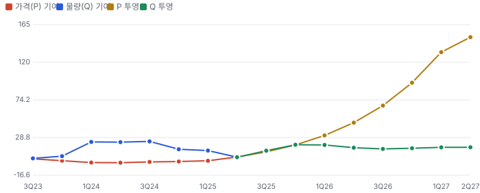

**분기별 매출 증가율 분해**

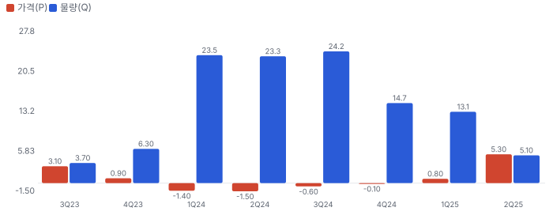

**목표주가 산정 — 기본과 강세 사이(강세 쪽 15%), 도달 확률 약 44%**

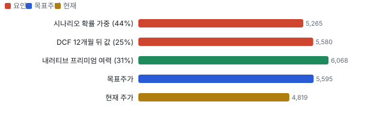

**일봉 지지·저항과 목표주가**

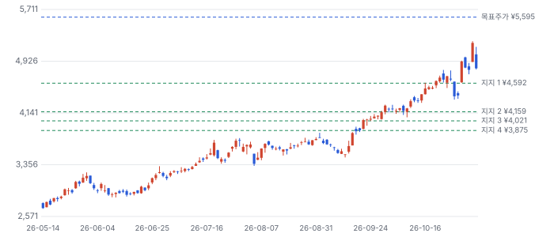

## 내러티브

> **기업가치를 결정하는 이야기:** 일본 부문이 돈을 벌고 해외는 아직 이익이 얇다. FY26 일본 영업이익 ¥28.3B에 아시아 ¥2.1B, 아메리카즈 ¥0.6B다. 기업가치는 세 가지로 갈린다. 일본의 어른 수요가 구조인가, 아시아·북미가 일본 수준 이익률에 다가가나, 베이블레이드 X(금속 팽이 배틀 완구 4세대)가 끝난 뒤에도 이익이 버티나다.

> **멀티플·EPS 프리미엄**
> **멀티플:** Fwd 1Y P/E 20.8배(11/6)로 동종 중앙값 16.3배(10/30 기준)보다 28% 높다. 일본 IP 회사 반다이남코 24.8배·산리오 23.1배에 가깝고 Hasbro 16.7배·Mattel 11.9배와는 멀다. 5/12에는 가이던스 EPS 기준 12.8배였다.
> **EPS:** FY27 EPS 가이던스는 ¥207.26 → ¥231.29로 +11.6%다. 컨센서스는 ¥239다. FY26 EPS ¥131은 영업권 감손 ¥4.86B로 눌린 값이라 FY27 증가율 +76%의 상당 부분은 기저 효과다.

### 투자자들은 왜 열광했나

1Q 뒤에는 오히려 식었다. 영업이익 ¥5.5B로 컨센서스 ¥3.9B를 넘었는데 가이던스를 두어 8/5 주가가 −8.0%였다. 그 뒤 증권사 목표가 상향이 이어졌고, 10/29 상향이 FISCO가 전한 시장 기대 약 ¥27B를 ¥3B 넘었다. 10/30 +11.7%, 거래량은 평균의 4.5배였다.

### 무엇이 기업가치를 바꾸나

> **구조적 체질 변화**
> **변화:** 아동에서 전 연령으로, 일본에서 아시아로 넓힌다. 회사 전략의 두 축이다.
> **증거:** 회사는 상향 이유로 Kidults(장난감을 사는 어른 수집가)를 맨 앞에 적었다. Kidults 비중은 공시되지 않아 미확인이다.
> **반증:** Kidults 없이도 설명되는 일회성 캐릭터 매출로 드러난다.

> **고부가 믹스 확장**
> **변화:** 영업이익률 FY26 9.0% → FY27 가이던스 10.0%다. 환급 약 ¥1.0B를 빼면 9.7%다.
> **증거:** 1Q 매출총이익률은 39.3%→42.3%로 올랐다(시세 원천 재무).
> **반증:** 하반기 이익률이 전년 하반기 8.8% 아래다.

> **기술 혁신**
> **변화:** 완구는 기술보다 IP와 유통이 값을 정한다. Roblox(미국 온라인 게임 플랫폼) 게임으로 베이블레이드를 디지털과 잇는 시도가 있다.
> **증거:** 베이블레이드 X Roblox 게임 누적 방문 1억 초과. FY26 연구개발비 ¥6.7B.
> **반증:** 디지털 연동이 실물 판매로 이어지지 않는다.

> **실행 속도**
> **변화:** 해당 없음(계절 재고 생산이라 납품 리드타임을 공시하지 않아 피어와 비교할 수 없다). 다만 1Q 미국 ERP 장애로 출하가 늦어졌다. 금액은 미공개다.
> **증거:** 1Q 결산 보도. 2Q 내포 매출 +25.6%에 지연 물량이 섞였는지는 미확인이다.
> **반증:** 11/10 미국 매출이 회복하지 않는다.

> **M&A**
> **변화:** 회사는 성장 투자 ¥40~50B를 쓰겠다고 했다. 진행 중인 건은 공시되지 않았다. FY26에는 미국 자회사 영업권 ¥4.86B를 감손했다.
> **증거:** 유가증권보고서. 
> **반증:** 대형 인수로 순현금 ¥32.8B를 넘어 차입한다.

> **정책·입법 연관성**
> **재정정책:** 해당 없음(회사 매출을 바꾸는 재정 지출이 없다).
> **행정명령:** 해당 없음(지금 작동하는 것은 행정명령이 아니라 판결 뒤 세관 환급 절차다). 미국 대법원이 2026-02-20 IEEPA(미국 국제긴급경제권한법) 관세를 무효로 했고 세관은 4월부터 CAPE(미국 세관의 관세 환급 신청 시스템)로 환급을 받는다. 회사는 1Q에 환급 약 ¥1.0B를 영업이익에 잡았다. 이 환급이 IEEPA 관세분인지는 회사가 밝히지 않아 추정이다. 대체 관세 영향도 미확인이다. 반증: 2Q에도 환급이 더 잡혀 이익 질이 낮아진다.
> **연관입법:** 해당 없음(회사 공시와 보도에서 연관 법안을 찾지 못했다).

> **CAPEX 낙수효과**
> **변화:** 해당 없음(설비투자 사이클과 무관한 소비재다).

### 내러티브 근거

> 시장은 '일본 아이 장난감 회사'를 '어른 수집가와 아시아로 커지는 IP 회사'로 다시 값을 매기고 있다. 쟁점은 이 변화가 구조인지 캐릭터 붐인지다. 동종 대비 멀티플 차이 +28% 중 회사 고유 몫은 -24%다. 단계는 확산, 쏠림은 중간이다.

> **Kidults 전환** · 강화
> **논리:** 어른 수집가가 아동 인구 감소를 메운다
> **숫자:** 회사 비중 미공개. 상향 이유 첫 줄
> **반증:** 일본 부문 성장률이 FY24~FY26 평균 아래로 내려간다

> **아시아 베이블레이드·토미카(다이캐스트 미니카 브랜드)** · 강화
> **논리:** 일본 밖에서 두 브랜드가 커진다
> **숫자:** FY26 아시아 매출 ¥67.5B(−1.1%), 이익 ¥2.1B(−20%)
> **반증:** 11/10 아시아 매출이 전년보다 낮다

> **캐릭터 붐과 소비** · 유지
> **논리:** 치이카와·포켓몬 30주년·오시카츠가 국내 소비를 끈다
> **숫자:** 키디랜드(캐릭터 잡화 소매 체인)·가챠(캡슐 토이 자판기) 금액 미공개
> **반증:** 키디랜드 매출 감소

> **반대 내러티브: 히트가 끝나면 값도 끝난다** · 강화
> **논리:** 2025-02-07 장중 고점 ¥5,119에서 2026-05-01 장중 저점 ¥2,496까지 −51%. 값은 이미 일본 IP 회사 수준이다
> **숫자:** Fwd 1Y P/E 20.8배(11/6), 5월 12일 12.8배
> **반증:** FY28 가이던스 영업이익 ¥32B 이상

## 포트폴리오

| 제품·서비스 | 구분 | 무엇 | 쓰는 곳 | 돈 버는 방식 | Mix | Mix 변화(전년 대비) |
|---|---|---|---|---|---|---|
| 토미카·프라레일(철도 완구) | 제품 | 미니카·철도 완구 | 아동, 토미카 프리미엄(어른 수집가용 고급 토미카)은 어른 | 브랜드별 매출 미공개 | 미확인 | 미확인 |
| 베이블레이드 X | 제품 | 금속 팽이 배틀 완구 | 일본·아시아 직판, 북미·유럽은 Hasbro 판매 | 미공개, 전 세대 Burst는 시장 기준 ¥250B 이상 | 미확인 | 미확인 |
| 듀얼 마스터즈(자사 트레이딩 카드 게임)·TCG(트레이딩 카드 게임) | 제품 | 카드 게임, Lorcana(디즈니 트레이딩 카드 게임) 일본 판매 포함 | 어린이·어른 | 미공개 | 미확인 | 미확인 |
| 키디랜드 | 서비스 | 캐릭터 잡화 소매 | 국내·방일객 | 미공개 | 미확인 | 미확인 |
| 가챠·타카라토미아츠 | 제품 | 캡슐 토이 | 일본, 북미 식료품점·영화관 확대 | 미공개 | 미확인 | 미확인 |
| 포켓몬 메자스타(포켓몬 아케이드 게임기) | 제품 | 포켓몬 아케이드 게임기와 라이선스 상품 | 아동 | 미공개 | 미확인 | 미확인 |

## 고객

> **FY26 최대 고객 일본 유통(도매·양판점·완구점·EC, 일본 부문) 65%, 상위 3곳 76%, 집중도 집중.** 공시·회사 발표로 확인한 몫은 매출의 0%이고, 나머지 고객 몫은 추정이거나 미분해다. 불특정 다수 소비자에게 도매·양판점·직영점·온라인으로 판다. 10% 넘는 단일 거래처는 이번에 읽은 유가증권보고서 본문에 없다(주요 판매처 주석 미열람). 완구 도매 해피넷과 판매 거래가 있다고 공시했다. 지역 몫은 부문 매출로만 어림한다

**고객별 매출 몫(FY26)**
| 고객 | 몫 | 변화 | 근거 |
|---|---|---|---|
| 일본 유통(도매·양판점·완구점·EC, 일본 부문) | 60~70% | 미확인 | 추정 |
| 아메리카즈 소매(대형 할인점·완구점, TOMY International) | 10~12% | -1%p | 추정 |
| 해피넷(완구 도매) | 미확인 | 미확인 | 공시 |
| 아시아 유통·직판(아시아 부문) | 미확인 | 미확인 | 추정 |
| 기타·미분해 | 24% | - | - |

> **일본 유통(도매·양판점·완구점·EC, 일본 부문)** · 추정
> **사는 것:** 토미카·프라레일·리카짱(인형 브랜드)·베이블레이드 X·듀얼 마스터즈
> **추정 근거:** 일본 부문 ¥226.2B(내부 거래 포함) ÷ 연결 ¥270.5B를 내부 거래만큼 낮춘 범위

> **아메리카즈 소매(대형 할인점·완구점, TOMY International)** · 추정
> **사는 것:** 유아·농기계 완구·가챠
> **추정 근거:** 부문 매출 ÷ 연결 매출. 부문 매출에 내부 거래가 섞일 수 있다. 직전 몫 12.4% = FY25 부문 ¥31.1B ÷ 연결 ¥250.2B

> **해피넷(완구 도매)** · 공시
> **사는 것:** 완구 전반(도매)
> **추정 근거:** 몫은 공시 미확인

> **아시아 유통·직판(아시아 부문)** · 추정
> **사는 것:** 베이블레이드 X·가챠
> **추정 근거:** 아시아 부문에는 제조 자회사의 일본향 내부 매출이 크게 섞여 외부 몫을 알 수 없다

## 마진 구조

> **GPM 40.3%, OPM 9.0%.** FY25(2025-03) 대비 GPM -0.2%p, OPM -1.0%p. 변동비는 매출의 69%이고, 매출이 10% 늘면 OPM은 +2.0%p 움직인다. FY26 매출원가율 59.7%로 전년 59.5%와 거의 같다. 영업이익률이 9.9% → 9.0%로 내린 것은 판관비 쪽이다(판관비율 30.6% → 31.3%). 완구는 대부분 해외에서 달러로 사 오므로 엔·달러와 위탁 생산 단가가 매출원가를 정한다

> **매출 100 중 매출원가 59.0, 매출총이익 41.0(최근 4분기, 공시).** 매출원가 요인 중 완구 매입·생산 원가(위탁·자사 공장, 달러 결제)이 매출의 59.7%로 가장 무겁고, 단가가 +10% 오르면 GPM이 -5.97%p 움직인다. 분기 회귀로 매출 1이 늘 때 매출원가는 0.53 늘고, 매출원가의 고정비 몫은 12%다.

**비용 요인 강도 — 비중·추세·충격(+10%)·탄력**
| 비용 | 구분 | 매출 대비 | 1년 변화 | 마진 기여 | 충격 시 마진 | 매출 탄력 | 고정비 몫 |
|---|---|---|---|---|---|---|---|
| 완구 매입·생산 원가(위탁·자사 공장, 달러 결제) | 매출원가 요인 | 59.7% | +0.2%p | -0.2%p | -5.97%p | 미확인 | 10% |
| 매출원가 | 공시 항목 | 59.0% | -0.4%p | +0.4%p | -5.90%p | 0.53 | 12% |
| 판관비 | 공시 항목 | 31.8% | 미확인 | 미확인 | 미확인 | 미확인 | 미확인 |

매출 탄력 = 분기 비용을 매출에 회귀한 기울기(매출 1당 변동비), 고정비 몫 = 절편 ÷ 평균 비용. 표본이 8분기 미만이면 미확인. 매출원가 요인 비중은 margin 재료의 추정이 섞여 있고, 공시 매출원가와의 차이는 '기타 매출원가'로 둔다.

**GPM에서 OPM까지(J-GAAP(연결))**
| 기간 | GPM | 연구개발 | 판관비 | 기타 | OPM |
|---|---|---|---|---|---|
| FY25(2025-03) | 40.5% | 0.0% | 30.6% | 0.0% | 9.9% |
| FY26(2026-03) | 40.3% | 0.0% | 31.3% | 0.0% | 9.0% |

**GPM·OPM 최근 4개 분기**
| 분기 | GPM | OPM |
|---|---|---|
| 2025-09 | 40.8% | 10.4% |
| 2025-12 | 41.7% | 12.1% |
| 2026-03 | 38.8% | 4.4% |
| 2026-06 | 42.3% | 8.6% |

**마진을 결정하는 비용 요인 — 비용 +10% 시 OPM**
| 비용 | 매출 대비 | 변화 | 고정비 | OPM |
|---|---|---|---|---|
| 완구 매입·생산 원가(위탁·자사 공장, 달러 결제) | 59.7% | +0.2%p | 10% | -5.97%p |
| 광고·인건비·물류·로열티 등 기타 판관비 | 28.8% | 미확인 | 50% | -2.88%p |
| 연구개발비 | 2.5% | 미확인 | 70% | -0.25%p |

**비용을 움직이는 요인**
| 비용 | 요인 |
|---|---|
| 완구 매입·생산 원가(위탁·자사 공장, 달러 결제, 매출원가) | 엔·달러, 중국·베트남 생산 단가, 수지·아연 가격 · 근거 공시 |
| 광고·인건비·물류·로열티 등 기타 판관비(판관비) | 방송 광고·직영점 확대·물류센터 임차(이치카와 연 ¥1.0B) · 근거 공시 |
| 연구개발비(판관비) | 신상품 개발 인력 · 근거 공시 |

**일본 완구·카드 BOM — 매출의 60%, GPM 40%(부문 GPM 미공시 — 회사 FY26 GPM. 비중 60%는 일본 부문 매출 ¥226.2B(내부 거래 포함)에서 내부 거래를 뺀 추정), 항목 가격 +10% 시**
| 항목 | 원가 몫 | 전가 | 제품 GPM | OPM |
|---|---|---|---|---|
| 위탁·자사 공장 생산 가공비 | 35~50% | 미확인 | -2.5%p | -1.52%p |
| 수지·아연 다이캐스트 원재료 | 15~30% | 미확인 | -1.3%p | -0.81%p |
| 판권 로열티 | 5~15% | 미확인 | -0.6%p | -0.36%p |
| 해상 운송·창고 | 5~10% | 미확인 | -0.4%p | -0.27%p |
| 미분해 | 18% | - | - | - |

위탁·자사 공장 생산 가공비 가격이 +10% 오르면 영업이익은 -17.0% 움직인다. 판매가 전가를 모르는 항목은 전가 0%로 계산했다.

**BOM 항목 가격을 움직이는 것**
| 항목 | 요인 |
|---|---|
| 위탁·자사 공장 생산 가공비 | 중국 편중에서 베트남으로 옮기는 중이라 단가가 움직인다(유가증권보고서) · 근거 추정 |
| 수지·아연 다이캐스트 원재료 | 토미카 다이캐스트 차체, 플라스틱 부품 · 근거 추정 |
| 판권 로열티 | 남의 IP 상품이 늘면 로열티가 매출원가 몫을 키운다 · 근거 추정 |
| 해상 운송·창고 | 아시아 공장에서 일본·미국으로 실어 온다 · 근거 추정 |

## 공급망 병목

> **공급망 신뢰성 4.9/10, 병목 주의.** 가장 약한 고리는 판권 로열티 3.5점이고, 품목 평균은 7.1점이다. 근거가 부족한 1건(수지·아연 다이캐스트 원재료)은 점수에서 뺐다. 상품 대부분을 해외에서 만든다. 자사 제조 자회사(태국·베트남·선전)와 홍콩 위탁처를 쓰고 중국 비중을 베트남으로 옮기는 중이다. 가장 약한 고리는 공장이 아니라 판권 계약이다 — Hasbro 판매 계약이 2026-12-31, 포켓몬·디즈니 판권이 2027-03-31에 끝난다(자동·협의 갱신 조항)

**병목과 마진 — 품목 가격 +10% 시 OPM**
| 품목 | 점수 | 판정 | 구분 | OPM |
|---|---|---|---|---|
| 판권 로열티(필수) | 3.5 | 병목 심각 | 출하 차질 위험 | -0.36%p |
| 위탁·자사 공장 생산 가공비(필수) | 7.9 | 관리 가능 | 가격 위험 | -1.52%p |

> **판권 로열티** · 3.5/10
> **왜:** 계약이 끊기면 그 IP 상품 출하가 멈추고 대체가 없다. 매출 몫은 공시되지 않았다
> **병목 요인:** 인증 공급사 1곳 · 캐파 빠듯 · 리드타임 미확인 · 재인증 12개월 · 1위 점유율 100% · 지역 집중 미확인 · 물량 확보 장기계약
> **풀리는 조건:** 갱신 공시(Hasbro 2026-12-31 전후, 포켓몬·디즈니 2027-03 전후)

> **위탁·자사 공장 생산 가공비** · 7.9/10
> **왜:** 자사 공장이 있어 물량은 묶여 있지만 지역 집중과 미국 관세가 비용을 흔든다
> **병목 요인:** 인증 공급사 미확인 · 캐파 균형 · 리드타임 미확인 · 재인증 6개월 · 1위 점유율 미확인 · 중국(생산 편중을 회사가 밝힘 — 60%는 추정) 집중 60% · 물량 확보 내재화
> **풀리는 조건:** 베트남 이전 진척(회사 발표 기준)

**공급사**
| 품목 | 공급사 | 몫 | 근거 |
|---|---|---|---|
| 판권 로열티 | Hasbro(트랜스포머 등 로봇 완구 일본 밖 독점 판매권(1983-11~2026-12-31, 이의 없으면 자동 갱신)) | 미확인 | 공시 |
| 판권 로열티 | 소학관집영사프로덕션(포켓몬 캐릭터 국내 완구 사용(허락 2027-03-31까지)) | 미확인 | 공시 |
| 판권 로열티 | 월트디즈니재팬(국내 일반 완구·베이비 상품(2026-04~2027-03)) | 미확인 | 공시 |
| 위탁·자사 공장 생산 가공비 | TOMY (Thailand)(완구 제조(100% 자회사)) | 미확인 | 공시 |
| 위탁·자사 공장 생산 가공비 | TOMY (Vietnam)(완구 제조(하이퐁, 100% 자회사)) | 미확인 | 공시 |
| 위탁·자사 공장 생산 가공비 | TOMY (Shenzhen)·TOMY (Hong Kong, 제조·위탁 제조) | 미확인 | 공시 |
| 위탁·자사 공장 생산 가공비 | 중국 외부 위탁 공장(완구 위탁 생산) | 미확인 | 추정 |
| 수지·아연 다이캐스트 원재료 | 미공시(수지·아연 합금) | 미확인 | 추정 |

## 생산능력

> **현재 명목 캐파 미확인, 가동률 미확인.** 착공 이상 증설은 0 미확인(생산 수량 미공시), 발표까지 합치면 0 미확인(생산 수량 미공시)이다. FY26 CAPEX는 JPY 7.64B로 매출의 2.8%다. 자사 공장은 태국·베트남·선전에 있지만 명목 캐파와 가동률은 공시되지 않는다. 설비 투자는 공장 증설이 아니라 금형·가챠 기기·직영점·기간 시스템이다. FY27 계획 합계는 ¥12.0B로 FY26 실적 ¥7.6B보다 크고, 늘어난 몫의 대부분은 기간 시스템 ¥4.4B(2029년 2월까지)다

**생산능력 확충 계획**
| 계획 | 단계 | 증설 | 가동 시점 | CAPEX |
|---|---|---|---|---|
| 금형(본사·아츠·토미텍) | 발표 | 미확인 | 2027-03 | JPY 5.29B |
| 기간 시스템 | 착공 | 미확인 | 2029-02 | JPY 4.39B |
| 가챠·아뮤즈먼트 기기(아츠) | 발표 | 미확인 | 2027-03 | JPY 1.62B |
| 키디랜드 점포 | 착공 | 미확인 | 2027-05 | JPY 0.75B |

남은 계획의 CAPEX 합계는 JPY 12.05B다. 합계는 FY27 매출의 4%다.

**증설 방해 요인**
| 계획 | 방해 요인 |
|---|---|
| 금형(본사·아츠·토미텍) | 신상품 수 |
| 기간 시스템 | 미국 ERP 지연 전례 |
| 가챠·아뮤즈먼트 기기(아츠) | 설치 장소 |
| 키디랜드 점포 | 입지 |

**CAPEX와 매출 대비**
| 기간 | CAPEX | 매출 | 매출 대비 | 구분 |
|---|---|---|---|---|
| FY26 | JPY 7.64B | JPY 270.45B | 2.8% | 실적 |
| FY27 | JPY 12.05B | JPY 300.00B | 4.0% | 가이던스 |

## 해자

> 경쟁을 막는 것은 일본 안의 장수 브랜드와 판매망이다. 해외와 라이선스는 해자가 아직 얇다. 일본 부문이 영업이익 대부분을 낸다.

> **일본 장수 브랜드와 판매망** · 강함
> **해자:** 토미카·프라레일·리카짱은 수십 년째 세대를 넘겨 팔린다. 부모가 쓰던 브랜드를 다시 사고, 어른 수집 시장으로 번졌다.
> **근거:** FY26 일본 부문 매출 ¥226.2B, 영업이익 ¥28.3B로 부문 이익률 12.5%다. 아메리카즈는 1.9%, 아시아는 3.2%다. 부문 매출에는 내부 거래가 들어 있다.
> **숫자:** 일본 영업이익 ¥28.3B = 전사 ¥24.2B보다 크다(전사 비용 차감 전)
> **깨지는 조건:** 일본 부문 이익률이 두 해 연속 10% 아래로 내려간다.

> **베이블레이드 대회 생태계** · 보통
> **해자:** 팽이는 경기 규칙과 대회가 있어 부품을 계속 산다. 세계 대회와 Roblox 게임이 수요를 이어 준다. 다만 세대마다 붐과 소멸을 반복했다.
> **근거:** 3세대 Burst는 회사 아시아 법인 기준 세계 약 1.7억 개, 시장 기준 매출 ¥250B 이상이다. X의 Roblox 게임은 누적 방문 1억을 넘겼다. X 매출은 공시되지 않아 미확인이다.
> **숫자:** Burst 약 1.7억 개 · X 매출 미확인
> **깨지는 조건:** 회사가 베이블레이드 X 판매 감소를 두 분기 연속 밝힌다.

> **판권 운영 능력** · 보통
> **해자:** 포켓몬·디즈니·트랜스포머 같은 남의 IP를 상품으로 빠르게 바꾼다. 그러나 권리는 남의 것이고 기간이 짧아 가격 결정력이 제한된다.
> **근거:** 유가증권보고서 기준 포켓몬·디즈니 계약은 2027-03-31까지, Hasbro 계약은 2026-12-31까지다. 갱신 여부와 조건은 미확인이다.
> **숫자:** 라이선스 매출 비중 미확인
> **깨지는 조건:** 주요 판권 하나가 경쟁사로 넘어간다.

> **자체 소매·캡슐 판매 접점** · 보통
> **해자:** 키디랜드와 가챠는 도매상을 거치지 않고 인기 캐릭터 수요를 바로 받는다. 이번 상향의 첫 번째 이유도 키디랜드였다.
> **근거:** 회사는 상향 이유 첫머리에 키디랜드 인기 캐릭터 상품을 적었다. 2026년 4월 하라주쿠 오모카도 점(하라주쿠 키디랜드 새 매장)을 열었고, 가챠는 북미 대형 식료품점·영화관으로 넓혔다.
> **숫자:** 키디랜드·가챠 매출 금액 미확인
> **깨지는 조건:** 캐릭터 붐이 식어 키디랜드 매출이 전년보다 줄어든다.

## 경영진·네트워크

> 경영은 회사 안에서 자란 CEO가 맡는다. 미국 자회사를 직접 경험한 점이 해외 전략과 닿는다. 정계·동문 연결은 공개 자료에서 찾지 못했다.

> **도미야마 아키오** · 대표이사 사장 CEO · 2025-04
> **프로필:** 2010년 입사. 2017년 TOMY International 주재, 2018년 같은 회사 CSO(최고 전략 책임자). 2020년 사업 총괄, 2023년 부사장, 2024년 사장 COO를 거쳐 2025년 CEO가 됐다. 지분 862천 주.
> **비즈니스:** 외부 이사회 연결 미확인
> **정계:** 공개 기록 미확인
> **동문:** 미확인
> **사모임:** 미확인

> **고지마 가즈히로** · 대표이사 회장(2026-06 총회 뒤 현직 여부 미확인) · 2025-04
> **프로필:** 미쓰비시상사 출신. 2009년 사외이사로 왔고 CFO·사장 COO·CEO를 거쳤다. 2026년 6월 총회 안건 명단에는 없다.
> **비즈니스:** 미쓰비시상사 경력
> **정계:** 공개 기록 미확인
> **동문:** 미확인
> **사모임:** 미확인

**네트워크 정량화**
| 연결 | 강도 | 닿는 매출 | 가중 노출 | 매출 대비 | 근거 |
|---|---|---|---|---|---|
| 비즈니스: 도미야마 CEO — TOMY International 주재·CSO 경력. 아메리카즈 매출에 닿는다 | 4/5 | ¥30.45B | ¥24.36B | 9% | FY26 아메리카즈 부문 매출 유가증권보고서 세그먼트·임원 현황 |
| 비즈니스: 고지마 회장 — 미쓰비시상사 경력. 사업 연결 증거 없음 | 1/5 | 미확인 | 미확인 | 미확인 | 미확인 임원 현황 |
| 정계: 공개 자료에서 찾지 못했다 | 0/5 | 미확인 | 미확인 | 미확인 | 미확인 없음 |
| 동문: 공개 자료에서 찾지 못했다 | 0/5 | 미확인 | 미확인 | 미확인 | 미확인 없음 |

가중 노출은 연결이 닿는 매출의 크기다. 연결이 그 매출을 만들었다는 뜻이 아니며, 인과는 공개 자료로 입증하지 못한다.

## 약세 논리 및 셀온 조건

| 약세 논리 | 근거 | 가를 자료 |
|---|---|---|
| 멀티플이 이익보다 먼저 갔다 | 5/12 이후 +82% 중 EPS는 +11.6%다. 일본 IP 회사와 달리 자체 영상·게임이 없고 일본 밖 이익이 얇다 | FY28 가이던스, 새 계획 |
| 히트 사이클 | 2025-02-07 장중 고점 ¥5,119에서 2026-05-01 장중 저점 ¥2,496까지 −51%. 2010년대 초에도 2세대 붐 뒤 반 토막이 났다(시기 일치, 인과는 추정). 베이블레이드 X는 일본 출시 4년 차다 | 베이블레이드 X·아시아 매출(11/10, 2027-02) |
| 이익의 질 | 1Q 영업이익 ¥5.5B에 환급 약 ¥1.0B가 들어 있다. 빼면 전년 ¥4.6B 대비 약 −2%다 | 2Q 일회성 항목 |
| 2Q 쏠림 | 2Q 내포 매출 +25.6%는 1Q +7.7%보다 훨씬 높다. 미국 ERP 지연 물량이 넘어왔을 수 있다(추정). 그러면 하반기 수요와 무관하다 | 11/10 지역별 매출 |
| 해외 수익성 | FY26 아메리카즈 이익률 1.9%, 아시아 3.2%, 유럽 적자다. 미국 자회사 영업권 ¥4.86B를 감손했다 | 지역별 이익 |
| 판권 만기 | Hasbro 판매 계약 2026-12-31(이의 없으면 자동 갱신), 포켓몬 허락 2027-03-31, 디즈니 2027-03-31까지다. 매출 비중은 미공시다 | 갱신 공시, FY27 유가증권보고서(2027-06) |
| 확인 못 한 자료 | JPX(일본거래소그룹) 원문은 자동 접속이 막혀 공시 전재·유가증권보고서 텍스트로 대조했다. 주요 판매처·매출원가 내역·구매 약정 주석(경리 상황)은 미열람이다. FY26 3·4Q 영업이익은 근사다 | FY27 2Q 반기보고서 |

> **셀온 조건**
> **조건 1:** 11/10 상반기 영업이익이 ¥16.3B에 못 미치거나 하반기 내포 ¥13.7B를 낮춘다.
> **조건 2:** 환급을 뺀 상반기 영업이익 증가율이 +30%에 못 미친다.
> **조건 3:** 회사가 아시아 또는 베이블레이드 X 감소를 두 분기 연속 밝힌다.
> **조건 4:** 2027년 5월 FY28 영업이익 가이던스가 FY27 실적보다 낮다.

## 어닝콜 변화

**직전 콜 대비 새로 나오거나 바뀐 내용 → 가치 영향**
| 항목 | 내용 | 직전 콜 | 최신 콜 | 모델 동인 이동 | 확신도 | 가치 영향 |
|---|---|---|---|---|---|---|
| 업데이트 | FY27 매출 가이던스 | ¥285B | ¥300B | 기준연도 매출 +15.00 BJPY(십억 엔) | 0.8 | +4.9% |
| 업데이트 | FY27 영업이익률 가이던스 | 9.1% | 10.0% | 출발 이익률 +0.88% | 0.8 | +0.4% |
| 부정 | 관세 환급은 일회성 | 없음 | 1Q 약 ¥1.0B | 출발 이익률 -0.33% | 1.0 | -0.2% |
| 신규 | 아시아 베이블레이드 X·토미카 | FY26 아시아 매출 −1.1% | 상반기 호조(회사 표현) | 장기 성장 수렴값 +0.20% | 0.5 | +0.3% |
| **합계** | 단독 합 |  |  | 동시 적용 +5.4% |  | **+5.4%** |

**해석:** 이 기간 주가 +85.9% 중 EPS 추정 변화가 +11.6%, 멀티플 변화가 +66.6% — 주가를 움직인 것은 **멀티플(시장이 붙이는 배수) 변화**이다. 

## P·Q 사이클

> **Q 사이클 — 최근 4분기 평균 가격 기여 +1.4%, 물량 기여 +14.3%(전년 대비 로그 증가율).** P 강도 5.5/10, Q 강도 5.0/10, 최근 8분기 중 88%가 같은 요인 우세(구조적). AR(2) 투영으로는 3분기 뒤(1Q26) P 사이클로 전환. 회사가 판매 수량·단가를 공시하지 않는다 — 미국 완구 제조 PPI(생산자물가지수)를 가격 대용으로 쓴다(일본 매출이 대부분이라 대용 정도가 낮다)

**P·Q 사이클 정량**
| 항목 | 가격(P) | 물량(Q) |
|---|---|---|
| 최근 4분기 평균 기여 | +1.4% | +14.3% |
| 강도(0~10, 자기 이력 z) | 5.5 | 5.0 |
| AR(2) 고유 주기 | 미확인 | 5.2분기 |
| 다음 4분기 투영 평균 | +27.4% | +17.4% |

가격 근거: FRED PPI. PPI를 쓰면 회사 판매가가 아니라 업종 가격 대용이다. 로그 증가율이라 가격·물량 기여의 합이 매출 증가율이다. 투영은 통계 외삽이며 가이던스·컨센서스가 아니다.

10년 위치·프리미엄: TTM 표본 9개로 20개에 못 미친다 — quarters.js로 분기 44개를 다시 받으면 나온다.

## 밸류에이션

> **목표주가 ¥5,595, 업사이드 +16%.** 자리는 기본과 강세 사이(강세 쪽 15%)이고 도달 확률은 약 44%다. 기본 ¥5,273, 강세 ¥7,421(+54%), 약세 ¥3,094(-36%). DCF 기준 업사이드는 기본 +8%, 강세 +33%, 약세 -7%다(WACC 7.6%).

EPS는 FY28 Chiip 추정이다. 공개 컨센서스는 FY27까지만 있어 FY28·FY29는 시나리오 가정이고, 멀티플은 엔진이 고른다.

DCF는 기본 영업이익률을 10.5%에 묶고 성장을 2%로 감속시킨다. 시나리오는 2027년 말 일본 동종 쪽 배수가 유지된다고 본다. 새 계획이 2030년 목표를 크게 올리면 시나리오 렌즈가, 히트 사이클이 꺾이면 DCF 렌즈가 맞다. 두 렌즈의 차이가 목표주가 업사이드(+16%)와 DCF 업사이드(+8%)의 차이다.

> **약세 ¥3,094 (-36%)** · 확률 25%
> **가정:** 15.1배 × EPS ¥205.00
> **근거:** 베이블레이드 X가 식고 환급이 빠져 FY28 영업이익 ¥27B 안팎

> **기본 ¥5,273 (+9%)** · 확률 50%
> **가정:** 20.1배 × EPS ¥262.00
> **근거:** FY27 영업이익 ¥32B 안팎으로 가이던스를 조금 넘고 FY28 매출 +5%, 영업이익률 10.5%, 자사주 소각 효과

> **강세 ¥7,421 (+54%)** · 확률 25%
> **가정:** 25.2배 × EPS ¥295.00
> **근거:** 아시아·북미가 겹쳐 FY28 매출 +10%, 영업이익률 11.5%, 새 계획 상향

**멀티플 선정 — Fwd 1Y P/E**
| 단계 | 조정 | 근거 |
|---|---|---|
| 동종 중앙값 | 16.3배 | 범위 10.3~24.8배, 6곳 |
| 펀더멘털 | +20% | 성장·이익률·ROIC로 본 합리적 멀티플 27.3배와의 차이의 일부만 인정 |
| 해자 | +8% | 일본 장수 브랜드와 판매망 강함 · 베이블레이드 대회 생태계 보통 · 판권 운영 능력 보통 · 자체 소매·캡슐 판매 접점 보통 |
| 반복 매출 | +0% | 재료 없음 |
| 수주 전환·가시성 | +0% | 재료 없음 |
| 내러티브 | +5% | 단계 확산 |
| 사이클·실행 판단 | -10% | 반다이남코·산리오는 자체 IP와 15~39% 이익률이 받치는 배수다. 타카라토미는 이익률 10%에 남의 판권이 섞이고 세대 교체마다 이익이 흔들렸다. 5/12에는 12.8배였다 |
| **선정** | **20.1배** | 지금 20.8배 |

**동종 레인지**
| 회사 | Fwd 1Y P/E | 성장 | 영업이익률 | ROIC |
|---|---|---|---|---|
| Bandai Namco | 24.8 | 6% | 15% | 29% |
| Sanrio | 23.1 | 16% | 39% | 141% |
| Hasbro | 16.7 | 0% | 31% | 37% |
| Happinet | 15.8 | 11% | 3% | 49% |
| Mattel | 11.9 | 3% | 9% | 8% |
| Spin Master | 10.3 | 2% | 9% | 9% |
| **Takara Tomy** | 20.8 |  |  |  |

지금 주가가 요구하는 5년 매출 CAGR 3%, 기본 시나리오 5%. 몬테카를로 중앙값 업사이드 +8%.

> 의사결정 보조(투자자문 아님): ① 매수 매력: 연 기대수익 +9.5% (자기자본비용 7.6% 대비 +1.8%p) · 자본비용 초과 확률 57% · 안전마진 0.73 → 정량 신호 중립 / ② 위험 예산 지표(이론): 1/4 켈리 10.0% (상한 10%) · 5년 하위10% +2% · 30%+ 손실 확률 2% / ③ 상방(5년): 기대 1.57배 · 2배 16% · 3배 1% · 10배 0% · 상위10% 2.20배

## 매수 위치(일봉)

> **현재가 ¥4,819는 '중간'(가장 가까운 일봉 지지 ¥4,592에서 ATR 1.1배 위).** 이 자리에서 목표주가까지 +16.1%, 첫 일봉 저항까지 미확인, 다음 지지까지 하방 -4.7%, 손익비 3.4배. 손익비는 지지 3 ¥4,021에서 10.8배로 가장 높다(목표주가까지 +39.2%).

**가격대별 업사이드(일봉 기준)**
| 가격대 | 가격 | 목표주가까지 | 첫 저항까지 | 다음 지지까지 | 손익비 | 근거 기법(강도) |
|---|---|---|---|---|---|---|
| 현재가 | ¥4,819 | +16.1% | 미확인 | -4.7% | 3.4 | - |
| 지지 1 | ¥4,592 | +21.8% | 미확인 | -9.4% | 2.3 | 20일선(0.5) |
| 지지 2 | ¥4,159 | +34.5% | +10.4% | -3.3% | 10.4 | 50일선(1.0) |
| 지지 3 | ¥4,021 | +39.2% | +3.4% | -3.6% | 10.8 | 피보 확장 161.8%(0.8) |
| 지지 4 | ¥3,875 | +44.4% | +3.8% | 미확인 | 미확인 | 피보 확장 127.2%(0.8) |

일봉만 쓴다(주봉·월봉 제외). 손익비 = 목표주가까지 업사이드 ÷ 다음 지지까지 하방. 가격대별 기대값 참고표이며 매수·매도 시점 지시가 아니다.

## 애널리스트 토론

> **토론 결론 Buy(규칙 등급 Buy).** 규칙 등급 Buy를 유지한다. 순현금과 일본 부문 이익률이 하방을 받친다는 반박이 살아남았고, 판권 만기를 매출 소멸로 읽을 근거는 없었다. 배수 과열 반론은 동종 IP 배수보다 낮다는 점에서 한 단계 물러섰다

**패널(가상 애널리스트)**
| 자리 | 애널리스트 | 핵심 논리 | 틀리는 조건 | 최종 투표 |
|---|---|---|---|---|
| Strong Buy | 윤가람(가상 리서치 하우스 새벽증권) | FY27 가이던스가 2030년 목표 매출 ¥300B·영업이익 ¥30B에 3년 일찍 닿았다. 새 계획은 숫자를 올릴 수밖에 없다 | 2027년 5월 새 계획이 2030년 목표를 올리지 않는다 | Buy |
| Buy | 서도윤(가상 리서치 하우스 한빛리서치) | Kidults·아시아가 아이 인구 감소를 상쇄하는 구조로 바뀌었고, 순현금 ¥32.8B가 하방을 받친다 | 11/10 상반기 영업이익이 ¥16.3B에 못 미친다 | Buy |
| Neutral | 정하린(가상 리서치 하우스 다올리서치) | 상향은 상반기 쏠림이다. 하반기 내포 영업이익은 ¥14.5B → ¥13.7B로 오히려 낮아졌다 | 11/10에 하반기 계획을 올린다 | Neutral |
| Sell | 강이준(가상 리서치 하우스 누리증권) | Fwd 1Y P/E 20.8배는 자체 영상·게임이 있는 IP 회사 배수다. 해외 이익은 아직 얇다 | 해외 부문 이익률이 두 분기 연속 5%를 넘는다 | Neutral |
| Strong Sell | 문서진(가상 리서치 하우스 한결리서치) | 완구는 히트 사이클이다. 베이블레이드 X는 4년 차이고 판권 만기가 줄지어 온다 | 판권 세 건이 모두 같은 조건으로 갱신된다 | Sell |

**투표**
| Strong Buy | Buy | Neutral | Sell | Strong Sell |
|---|---|---|---|---|
| 0 | 2 | 2 | 1 | 0 |

> **개회 · Strong Buy**
> **발언:** 목표를 3년 앞당긴 회사에 계획 숫자 상향은 시간문제다

> **개회 · Buy**
> **발언:** 이익의 이유가 어른·아시아로 넓어졌고 순현금이 받친다

> **개회 · Neutral**
> **발언:** 숫자를 뜯으면 하반기는 낮아졌다. 11/10이 가른다

> **개회 · Sell**
> **발언:** 배수가 이익보다 다섯 배 빨리 갔다

> **개회 · Strong Sell**
> **발언:** 히트는 식고 판권 갱신이 한꺼번에 온다

> **반박1 · Neutral → Strong Buy**
> **발언:** 2030년 목표 달성분에는 환급 ¥1.0B와 상반기 쏠림이 섞여 있다

> **반박1 · Buy → Sell**
> **발언:** 20.8배는 반다이남코 24.8배·산리오 23.1배보다 아직 낮다

> **반박1 · Sell → Buy**
> **발언:** 그 둘은 이익률 15~39%다. 타카라토미는 9%대다

> **반박2 · Strong Sell → Buy**
> **발언:** 11/5 사상 최고 ¥5,230 다음 날 −7.4%가 났다. 쏠림은 이미 크다

> **반박2 · Buy → Strong Sell**
> **발언:** Hasbro 계약은 1983년부터 자동 갱신돼 왔다. 만기를 매출 소멸로 읽을 근거가 없다

> **반박2 · Neutral → Sell**
> **발언:** 배수 논쟁은 11/10 상반기와 하반기 계획을 보고 해도 늦지 않다

> **최종 · Strong Buy** · Buy
> **발언:** Buy로 물러선다. 하반기 계획을 봐야 한다

> **최종 · Buy**
> **발언:** Buy를 유지한다

> **최종 · Neutral**
> **발언:** Neutral을 유지한다. 하반기 내포 하락이 풀리지 않았다

> **최종 · Sell** · Neutral
> **발언:** Neutral로 물러선다. 동종 IP 배수보다는 낮다

> **최종 · Strong Sell** · Sell
> **발언:** Sell을 유지한다

남은 반대 의견: 하반기 내포 영업이익이 낮아진 점이 풀리지 않았다 — 11/10 하반기 계획이 가른다(Neutral 2표)

패널은 가상 인물이고 실존 IB의 의견이 아니다.

## 커뮤니티 내러티브

커뮤니티 집계 없음 — Quantral 미수록(2026-11-08 Tomy 검색 결과 없음)

## 시장 평가

> **셀사이드(IB 애널리스트)**
> **한 줄:** 셀사이드는 추천 쪽이지만 목표가가 주가를 따라가지 못했다. 11/10 뒤 목표가 수정이 다음 재료다
> **커버리지:** 3명: Buy 2, Neutral 1 — 표본이 작다
> **공개 목표가 평균:** ¥4,203(지금 값보다 15% 낮음) — 상향 전 값이 섞였을 가능성이 크다. 기대의 증거이지 결론이 아니다
> **5월 뒤 의견:** SBI증권 Buy 상향·¥4,400, 도카이도쿄 ¥4,210, SMBC(일본 미쓰이스미토모 금융 그룹)닛코 상향 — 방향은 모두 위
> **상향 전 기대:** 영업이익 약 ¥27B(FISCO) — 새 가이던스 ¥30B가 11% 높다

> **바이사이드(기관 투자자)**
> **한 줄:** 일본 종목이라 미국 13F와 체결 회사별 자료가 없다. 기관·개인 구분은 할 수 없다
> **주주 구성:** 신탁 계정 12.45%·3.74%, 司不動産 7.43% — 2026-03-31 기준. 신탁 계정 뒤 실제 보유자는 미확인
> **거래량:** 10/30 267만 주, 최근 290거래일 평균 59만 주의 4.5배 — 거래량 증가의 주체는 미확인(미국 공매도 자료 대상 아님)

> **언론·업계**
> **한 줄:** 언론은 어른 수요를 내세웠지만 회사는 금액을 공개하지 않았다
> **상향 보도:** Reuters·DZH·FISCO, Kidults 중심 — 캐릭터와 어른 수요가 제목에 올랐다

## 체크리스트

| 시점 | 무엇 | 의미 |
|---|---|---|
| 2026-11-10(회사 예정) | 상반기 실적·하반기 계획 | ¥16.3B 초과 여부, 2Q 환급, 지역별 매출, 하반기 내포 ¥13.7B 변경 |
| 2026-11~12월 | 증권사 목표가 수정 | 평균 ¥4,203이 주가를 따라오는지 |
| 2026-12-31 | Hasbro 계약 만기 | 갱신 공시 |
| 2027-02 초(예상) | 3분기 실적 | 북미 연말 성수기 |
| 2027-05 | FY27 실적·FY28 가이던스·새 계획 가능성 | 2030년 목표 다음 숫자 |

## 재발행 기록 — 양식 3 전환

| 항목 | 전(11/2) | 후(11/8) |
|---|---|---|
| 기준 종가 | ¥4,922(10/30) | ¥4,819(11/6) |
| Fwd 1Y P/E | 21.3배 | 20.8배 |
| 5/12 이후 주가 분해 | +86% = EPS +11.6% × 멀티플 +67% | +82% = EPS +11.6% × 멀티플 +63% |
| 새 절 | 없음 | 고객·마진 구조·공급망 병목·생산능력·P·Q 사이클·애널리스트 토론 |
| 공급망 약한 고리 | 판권 만기를 반대 검증에만 적음 | 판권 계약을 필수 공급 품목으로 넣음(Hasbro 2026-12-31, 포켓몬·디즈니 2027-03-31) |
| 시나리오 EPS | 약세 ¥205·기본 ¥262·강세 ¥295 | 같음 — 11/10 전 새 이익 정보 없음 |

## 출처
- 회사 업적 예상 수정 2026-10-29 15:30 공시(보도 전재 원문, 경로 TradingView 뉴스)
- 1Q 결산 보도 2026-08-04(https://gamebiz.jp/news/430539)
- FY26 유가증권보고서 텍스트(https://edinetdb.jp/company/E02450/text?fy=2026)
- 중장기 경영전략 2030 요약(https://edinetdb.jp/company/E02450/midterm-plans/)
- 주주·임원 현황 집계(https://www.kabutore.biz/genzaikabuka/okabunushi7867.html)
- 베이블레이드 X 판매 전망(https://takaratomyasia.com/news/417)
- 미국 IEEPA 관세 판결·환급 절차 해설(https://natlawreview.com/article/us-supreme-court-invalidates-ieepa-tariffs-temporary-section-122-surcharge-now)
- 증권사 의견 변경 보도(SBI 8/10·도카이도쿄 8/26·SMBC닛코 9/11) — 요지만, 결론에 쓰지 않음
- 도쿄증권거래소 7867 종가 2026-10-30·11-06
- FY26 유가증권보고서 텍스트 — 관계회사·설비·중요한 계약·부문 정보(https://edinetdb.jp/company/E02450/text?fy=2026)
- 도쿄증권거래소 7867 일봉 2026-11-06
- FY26 유가증권보고서 보유 주식 주석(판매 거래 있음)
- FY26 유가증권보고서 부문 정보
- 부문 매출 ¥30.4B(FY25 ¥31.1B)
- 부문 매출 ¥67.5B
- FY26 유가증권보고서 연구개발비 ¥6.723B(판관비에 포함)
- 매출·매출총이익(TradingView 분기 합 = 유가증권보고서 매출 ¥270.455B와 일치), 유가증권보고서 사업 위험(달러 수입·원재료)
- 업계 일반
- 업계 일반 — 몫 미공시
- 유가증권보고서 사업 위험(플라스틱·아연 다이캐스트 합금) — 몫은 추정
- 유가증권보고서 중요한 계약(디즈니·포켓몬·Hasbro) — 요율 미공시
- 판관비 총액 = 매출총이익 − 영업이익. 항목별 내역은 경리 상황 주석(미열람)
- FY26 유가증권보고서
- FY26 유가증권보고서 중요한 계약
- 같은 곳
- 미확인
- 유가증권보고서 '대부분 해외 생산·중국 편중' 문구 — 이름 미공시
- 유가증권보고서 관계회사
- 유가증권보고서 사업 위험
- FY26 유가증권보고서 설비 신설 계획(3.946+0.675+0.673)
- 같은 곳(기지급 ¥0.012B)
- 같은 곳(기지급 ¥0.117B)

_구매 등급·목표주가 모두 규칙이 계산한 모델 값으로, 개인의 보유 종목·자금 사정을 반영하지 않는다 · 공개 자료 기반 분석이며 투자 권유가 아님 · 1차 판정, 미검증 · Chiip ten-bagger_