# 텐배거 리포트 2026-11-02 — Amkor — EPS 추정은 올랐는데 주가가 58% 빠졌다, 값을 가르는 것은 누구 돈으로 짓느냐다

> 2026-11-02 · Amkor(AMKR) · 기업: 세계 2위 외주 반도체 패키징·테스트 회사, 미국에 대형 첨단 패키징 공장을 짓는 유일한 OSAT

## Chiip View

6/22 고점 이후 주가는 −58%인데 FY2027 EPS 추정은 2Q 실적 직전보다 19% 높다. 떨어진 것은 배수다. 시장이 나쁘게 보는 이유는 분명하다. 2026 CapEx가 매출의 33%이고 애리조나 손익분기는 2029년이다. **우리가 다르게 보는 곳은 돈의 출처다.** 앞으로 받을 선수금 약 \$3.2B는 시가총액의 33%이고 지금 컨센서스에 FCF 개선으로 충분히 반영됐는지 확인되지 않는다. 다만 ROIC 약 10%가 자본비용을 넘기 전에는 재평가가 이어지기 어렵다.

## 대시보드
| 항목 | 값 | 설명 |
|---|---|---|
| 주가 | \$39.50 | 고점 대비 -58% · 1년 +24% |
| 시가총액 | \$9.85B | EV \$10.18B |
| 업사이드 | +27% | 목표주가 \$50 · 다운사이드 -23% · 손익비(강세÷약세) 4.8 |
| 구매등급 | Buy | 애널리스트 11명: Strong Buy 4 · Buy 1 · Neutral 6 · Sell 0 · Strong Sell 0 |
| 멀티플 | Fwd 1Y P/E 13.3배 | 동종 중앙값 20.8배 |
| 가이던스 4Q26 | \$1,950M · \$0.70 | 컨센서스 \$2,044M · \$0.80 |
| 알파 | 5.9/10 | 텐배거 가능성 점수 |
| 이벤트 | 4Q26 실적(예상), 2027 CapEx 가이던스 | 2027-02-08 |

## 한 장 요약
- **기업가치를 결정하는 내러티브** **시장이 산 이야기는 'NVIDIA(미국 AI 가속기 회사)가 고른 미국의 패키징'이었고, 지금 파는 이야기는 '돈을 먼저 쓰는 설비 회사'다.** 6/22 이후 주가 −58%, ASE(대만의 세계 1위 OSAT) ADR(미국 예탁증서) −6%다. 같은 기간 FY2027 EPS 추정은 내리지 않았다. 떨어진 것은 전부 배수다.
- **밸류에이션 모델로 본 주가 상방은 어디까지인가?** **목표주가 \$50(+27%), 약세와 기본 사이(약세 쪽 17%)다.** 강세 \$83(+110%)는 Fwd 1Y P/E 24.8배를 강세 EPS에 적용한 값이다. 기본 \$55, 약세 \$30. 손익비 4.8, DCF 기준 업사이드 +25%.
- **수주는 어디까지 왔나?** NVIDIA 애리조나 다년 계약 미확인, 100% 매출 \$1.50B · NVIDIA 한국 증설 0%, 100% 매출 \$1.30B · 그 밖의 고객 선수금 미확인, 100% 매출 \$1.90B. 수주잔고를 공시하지 않는다. 대신 계약부채 \$0.55B와 앞으로 받을 선수금 약 \$3.2B가 약정의 크기를 보여 준다. 물량·가격·환급 조건은 미공개다.
- **마진과 공급망은 어디가 약한가?** GPM 18.3%, OPM 11.3%. OPM을 가장 흔드는 BOM(제품 원가를 이루는 부품·재료 명세) 항목은 인건비·기타이고 가격 +10%에 -2.17%p다. 공급망 신뢰성은 3.3/10(병목 심각)이고 가장 약한 고리는 T-glass(저열팽창 유리섬유 천)다.
- **지금 가격은 무엇을 가정하나?** Fwd 1Y P/E는 EPS 추정 \$2.48~\$3.03에 따라 13.0~15.9배다. 낮은 쪽 \$2.48은 TTM EPS \$2.48과 같다. 시장은 컴퓨팅이 30% 커져도 다음 12개월 이익이 늘지 않는다고 본다. 회사 2028 목표 EPS \$2.50 ±\$0.25와도 맞는다. 현금흐름으로 풀면 지금 주가가 요구하는 5년 매출 CAGR은 2%다. ASE는 Fwd 1Y P/E 34배다.
- **왜 움직였나?** 세 단계다. 6/22 \$93.55에서 7/27 \$60.71까지는 AI 후공정 전반의 하락이다. 7/28 −24.7%는 3Q 매출 가이던스 \$2.0B가 기대 \$2.11B에 못 미쳤고 통신 약세가 처음 드러난 날이다. 9/30 \$52.38에서 10/30 \$39.50은 원인을 하나로 특정하지 못했다. 같은 기간 FormFactor −41%, Teradyne −30%, TTM Technologies −32%이고 ASE는 −8%다. 10/26 −6.3%는 실적 발표 전 움직임이라 원인 미확인이다.
- **3Q 콜에서 무엇이 바뀌었나?** 좋아진 것은 선수금이다. NVIDIA 한국 \$1.3B가 더해졌고 선수금 고객이 12곳이 됐다. 아쉬운 것은 세 가지다. 컴퓨팅 매출이 전 분기 대비 +30% 전망에서 +25%로 낮게 나왔고, GM(매출총이익률) 18.3%는 가이던스 18.5~19.5% 아래이며, 4Q 가이던스 \$1.95B·\$0.70은 콜 직전 컨센서스 \$2.04B·\$0.80을 밑돌았다. 새로 나온 숫자는 2027 시설 CapEx만 \$2B 초과다. CFO는 2027년까지 재무 여력이 탄탄하고 2028년에도 추가 차입이 필요 없을 수 있지만 판단은 이르다고 답했다.
- **무엇이 바뀌면 판단이 달라지나?** 4Q 컴퓨팅이 전년 대비 +50%를 넘고 2027 CapEx가 \$4.2B 안에서 선수금으로 메워지면 위쪽이다. 반대로 CapEx가 \$5B에 가깝거나 2028 차입·증자가 나오면 약세 쪽이다. 통신이 1H27에도 전년 대비 두 자릿수로 빠지면 EPS 하단 \$2.48도 위험하다. 다음 확인은 2027년 2월 실적이다.

## 한눈에 보기

**일봉**

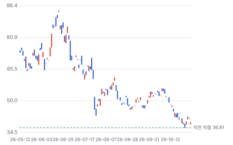

**주봉**

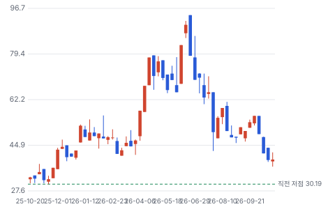

**월봉**

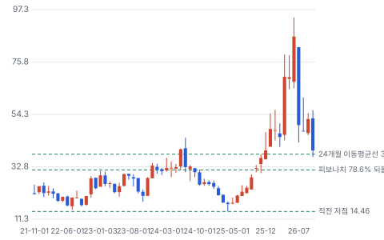

**분기 매출·EPS 실적과 컨센서스**

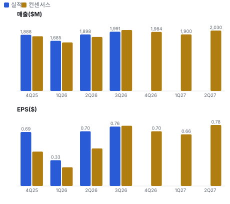

**최근 4개 분기 주가 변화 분석**

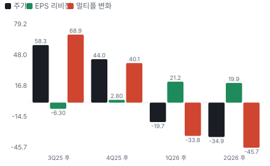

**EPS 리비전**

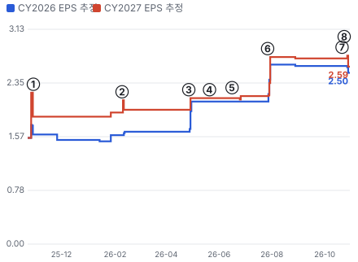

① 25-10-27 3Q25 실적 · EPS 리비전 +20%
② 26-02-09 4Q25 실적 · EPS 리비전 +2%
③ 26-04-27 1Q26 실적, 다음 날 −5.6% · EPS 리비전 +9%
④ 26-05-21 Investor Day 2028·2030 목표 · EPS 리비전 +0%
⑤ 26-06-16 TSMC 10년 계약 · EPS 리비전 +1%
⑥ 26-07-27 2Q26 실적, 다음 날 −24.7% · EPS 리비전 +26%
⑦ 26-10-21 NVIDIA 한국 \$1.3B · EPS 리비전 +0%
⑧ 26-10-26 3Q26 실적, 다음 날 +8.5% · EPS 리비전 -5%

**밸류에이션 주가 시나리오**

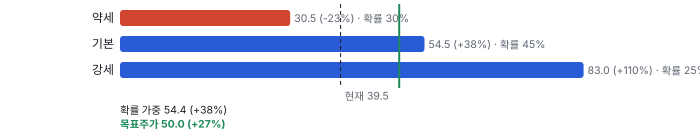

**주가별 업사이드**

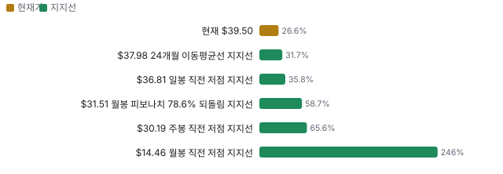

**제품·서비스 포트폴리오**

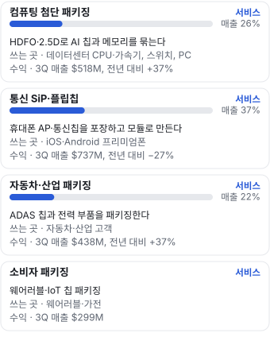

**공급 병목(10점, 낮을수록 병목)**

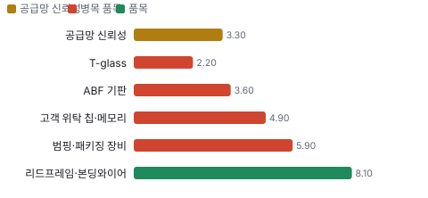

**어닝콜 변화별 주주가치 영향**

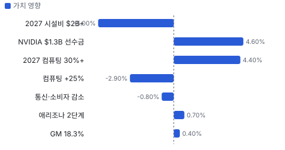

**멀티플 프리미엄**

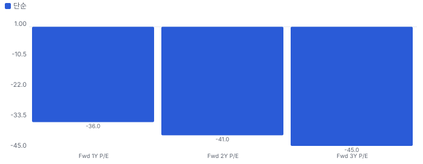

**합리적 멀티플**

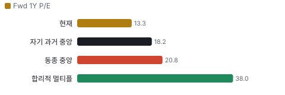

**일별 거래량 분해**

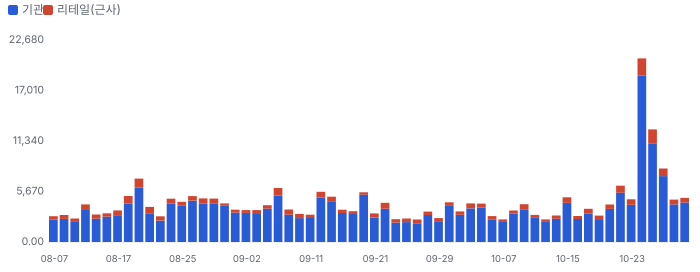

**기관 자금 흐름**

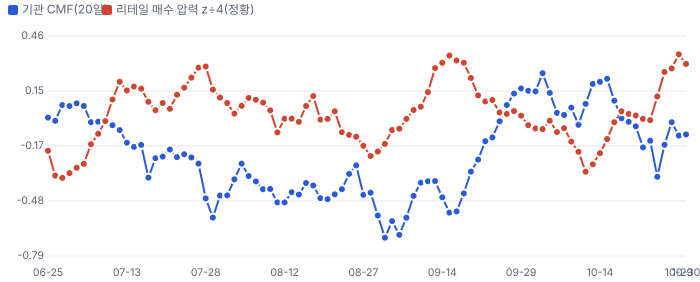

**몬테카를로**

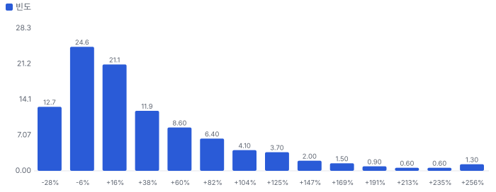

해석: 3,000번 중 2,046번(68%)에서 가치가 지금 주가 이상이었다. 가정을 흔들어도 지금 주가를 뒷받침하는 경우가 더 많다. 가운데 값은 1.18배이고, 열 번 중 여덟 번은 0.81~2.19배 사이에 든다.

## 내러티브

> **기업가치를 결정하는 이야기:** 값은 세 줄이 정한다. 컴퓨팅 믹스가 GM을 얼마나 올리나, 통신 37%가 어디서 멈추나, 애리조나 \$12B를 누구 돈으로 짓나다. 앞의 둘이 2027 EPS를, 마지막이 2029년까지의 FCF와 희석을 정한다.

> **멀티플·EPS 프리미엄**
> **멀티플:** Fwd 1Y P/E는 EPS 추정 \$2.48~\$3.03에 따라 13.0~15.9배다. 자기 36개월 범위는 10.2~38.8배이고 ASE는 34배다. 자기 과거 값은 \$2.48 쪽 추정 기준이라 15.9배와 비교해야 한다.
> **EPS:** FY2027 EPS 컨센서스 \$2.59~\$3.31로 폭이 크다. 회사의 2028 목표 \$2.50 ±\$0.25는 2026년 추정 \$2.50에 이미 닿았다. 다만 애리조나 초기 비용이 2027~28에 들어온다.

### 투자자들은 왜 열광했나

2026년 4월 \$45에서 6월 \$94까지 석 달에 두 배가 됐다. 1Q 호실적, 0% 전환사채, Investor Day의 2030 EPS \$5, TSMC(타이완 세미컨덕터 매뉴팩처링) 10년 계약이 이어졌다. 식은 계기는 7/28이다. 2Q는 EPS \$0.70로 기대 \$0.48을 크게 넘었지만 3Q 매출 가이던스가 기대 \$2.11B에 못 미쳐 하루 −24.7%였다. AI 후공정 전반도 같이 빠졌다. TTM Technologies −61%, FormFactor −42%, Teradyne −39%다.

### 무엇이 기업가치를 바꾸나

> **구조적 체질 변화**
> **변화:** 휴대폰 패키징 회사에서 컴퓨팅 회사로 바뀌는 중이다. 컴퓨팅 19% → 26%, 통신 51% → 37%(1년).
> **증거:** 컴퓨팅 매출 \$378M → \$518M(+37%), 통신 \$1,013M → \$737M(−27%), 합계 매출 +0.2%
> **반증:** 2027 컴퓨팅 성장이 30%를 밑돈다

> **고부가 믹스 확장**
> **변화:** 자재가 덜 드는 첨단 패키징이 늘며 GM이 올랐다.
> **증거:** 자재 57.5% → 50.7%, GM 14.3% → 18.3%. 회사 목표 2030 GM 22%+
> **반증:** 감가상각 증가가 믹스 효과를 넘어 GM이 내린다

> **기술 혁신**
> **변화:** HDFO(고밀도 팬아웃, 재배선층으로 칩을 묶는 첨단 패키징)·2.5D(칩과 HBM을 실리콘 인터포저 위에 나란히 얹는 패키징) 양산 시작, Bridge는 2027 말~2028, CPO(광 엔진을 칩 옆에 붙이는 패키징) 3건 개발.
> **증거:** Investor Day 고객 수 2.5D 11곳·HDFO RDL(재배선층) 5곳·Bridge 1곳·CPO 3곳, 진행 프로젝트 32건 중 8건이 2026 양산
> **반증:** Bridge 일정이 2028 뒤로 밀린다

> **실행 속도**
> **변화:** 주문별 납기는 공개되지 않는다. 그래서 고객이 산 캐파가 생산에 들어가기까지의 기간으로 잰다. 광주 신규 건물은 착공에서 2028 램프까지 약 15개월, 애리조나는 2025년 9월 착공에서 2028 생산까지 약 28개월이다. 3Q에는 HDFO 공정 300단계의 초기 재공 적재가 늦어 컴퓨팅이 +30% 전망에서 +25%로 낮아졌다. **납품 리드타임 15~28개월.** 피어 비교 미확인. 이전 대비 미확인.
> **증거:** 3Q 콜. 애리조나는 2025년 9월 착공, 2027 준공, 2028 생산 일정 유지
> **반증:** 애리조나 준공이 2028로 밀린다

> **M&A**
> **변화:** 해당 없음(소규모 인수만 언급). 2023~26 큰 거래가 없고 자금은 증설로 간다.
> **증거:** Investor Day 자본 배분 '소규모 인수'
> **반증:** 대형 인수 발표

> **정책·입법 연관성**
> **재정정책:** CHIPS(미국 반도체 지원법) 직접 지원 최대 \$407M 계약, 수령 없음. 첨단제조 투자세액공제 35% 대상. 회사는 1단계 기준 ITC(투자세액공제) 약 \$2B를 기대했다 3Q 10-Q, Investor Day. 세액공제 계상 \$163.5M 반증: CHIPS 마일스톤 미달로 지급 지연 의회 동의 10/10 — 하원 5/5(CHIPS법 2022 하원 통과, OBBBA(2025년 미국 세제·재정 법안)로 세액공제 35% 상향 본회의 통과) · 상원 5/5(같은 법 상원 통과).
> **행정명령:** 2026년 1월 포고령으로 특정 첨단 칩에 25% 관세 1단계. 패키징 공정까지 넓어질지는 미확인이다 무역확장법 232조 포고령 반증: 확대 없이 종료 의회 동의 2/10 — 하원 1/5(행정부 권한, 표결 없음) · 상원 1/5(표결 없음).
> **연관입법:** CHIPS법과 2025년 OBBBA가 시행 중이다. 패키징 전용 새 법안은 미확인 공법 117-167, 119-21 반증: 세액공제 조기 종료 입법

> **CAPEX 낙수효과**
> **변화:** AI 가속기 투자가 패키징으로 내려온다. 다만 고객 CAPEX는 공급 관계로 확인된 몫만 센다. 확인된 것은 NVIDIA \$2.8B 계약, 12곳 선수금, 1단계 물량 약정이다.
> **증거:** Investor Day GW(기가와트)당 OSAT(외주 반도체 패키징·테스트 회사) 첨단 패키징 약 \$0.5B, 서버 TAM(전체 시장 규모) 2025~30 약 3배
> **반증:** NVIDIA 물량이 다른 OSAT나 TSMC로 옮는다

### 내러티브 근거

> 상반기 'NVIDIA와 미국 패키징' 이야기가 P/E를 30배대로 올렸고, 7월 이후 '현금을 태우는 설비 회사' 이야기로 바뀌었다. EPS 추정은 오르는데 배수만 무너졌다. 동종 대비 멀티플 차이 -36% 중 회사 고유 몫은 -65%다. 단계는 소멸, 쏠림은 낮음이다.

> **미국 패키징 독점 위치** · 유지
> **논리:** TSMC 애리조나 칩을 미국에서 끝내려면 이 회사가 필요하다
> **숫자:** 애리조나 1단계 연 매출 약 \$1B·GM 30%+, 2029 손익분기
> **반증:** TSMC 자체 패키징이 2028 전으로 당겨진다

> **고객이 돈을 내는 증설** · 강화
> **논리:** 선수금으로 희석 없이 캐파를 키운다
> **숫자:** 수령 예정 약 \$3.2B vs 2027 CapEx 컨센서스 \$4.2B
> **반증:** 2028 차입·증자 발표

> **컴퓨팅 믹스의 이익률** · 강화
> **논리:** 매출이 같아도 믹스가 GM을 올린다
> **숫자:** 3Q25 → 3Q26 매출 +0.2%, GM +4.0%p, 영업이익 +41%
> **반증:** 4Q GM이 18% 아래로 내린다

> **AI 패키징이 병목이다** · 약화
> **논리:** 실리콘·메모리 다음 병목이 패키징이다
> **숫자:** CEO: 2027~28 캐파 확보 경쟁, 컴퓨팅 2027 +30%+
> **반증:** 컴퓨팅 4Q +50% YoY 미달

> **반대: 현금을 태우는 설비 회사** · 강화
> **논리:** CapEx가 매출의 30%를 넘고 ROIC는 자본비용 아래이며 2029에야 애리조나가 손익분기다
> **숫자:** TTM FCF −\$0.16B, 2026 CapEx/매출 33%, 2027 시설만 \$2B+
> **반증:** 2027 CapEx가 선수금과 영업현금으로 메워지고 FCF가 컨센서스보다 좋다

> **반대: 통신이 더 빠진다** · 강화
> **논리:** 매출 37%가 메모리 가격과 SiP(여러 칩과 부품을 한 패키지에 넣은 모듈) 이전에 눌린다
> **숫자:** 통신 3Q \$737M, 전년 대비 −27%. 4Q 또 고한 자릿수 감소
> **반증:** 1H27 iOS 일정 변화로 비수기가 얕아진다

## 포트폴리오

| 제품·서비스 | 구분 | 무엇 | 쓰는 곳 | 돈 버는 방식 |
|---|---|---|---|---|
| 컴퓨팅 첨단 패키징 | 서비스 | HDFO·2.5D로 AI 칩과 메모리를 묶는다 | 데이터센터 CPU(중앙 처리 장치)·가속기, 스위치, PC(개인용 컴퓨터) | 3Q 매출 \$518M, 전년 대비 +37% |
| 통신 SiP·플립칩 | 서비스 | 휴대폰 AP(휴대폰 응용 프로세서)·통신칩을 포장하고 모듈로 만든다 | iOS·Android 프리미엄폰 | 3Q 매출 \$737M, 전년 대비 −27% |
| 자동차·산업 패키징 | 서비스 | ADAS(운전자 보조 시스템) 칩과 전력 부품을 패키징한다 | 자동차·산업 고객 | 3Q 매출 \$438M, 전년 대비 +37% |
| 소비자 패키징 | 서비스 | 웨어러블·IoT(사물인터넷) 칩 패키징 | 웨어러블·가전 | 3Q 매출 \$299M |

## 수주·파이프라인

> **2026-10-27 기준 7건.** 확정 \$2.80B. 공시 계약부채(고객 선수금) \$0.55B. 서로 겹치는 항목은 합계에서 뺐다.

**실행 속도와 방해 요인**
| 항목 | 상태 | 실행 속도 | 방해 요인 |
|---|---|---|---|
| NVIDIA 애리조나 다년 계약 | 확정 | 애리조나 고객 램프는 2028 말, 회사 표현 | 애리조나 준공 2027 말 · 장비 반입·인증 · 금액은 계약 규모이고 연간 매출이 아니다 |
| NVIDIA 한국 증설 | 확정 | 광주 신규 2동 2027 말 준공, 2028 램프 | 광주 건물 공정 · SiP 이전으로 비는 공간 재배치 · 기판 수급 |
| 그 밖의 고객 선수금 | 확정 | 12개월 안 수령 예정, 그중 \$200M은 신용장 필요 | NVIDIA 애리조나 몫과 겹치는지 미공개 |
| TSMC 10년 패키징 계약 | 프레임워크 | 금액 미공개 | 개별 발주 전 매출 아님 · TSMC 자체 패키징 |
| 애리조나 1단계 | 파이프라인 | 2029 손익분기, 2030 완전 가동 목표 | 가동률 · 인력 3,500명 · 감가상각 시작 |
| 2단계 \$5B 증액분 | 파이프라인 | 회사 목표에 미포함 | 고객 약정 크기 미공개 · 2028~29 CapEx 정점 |
| 2.5D·HDFO 신규 프로그램 | 파이프라인 | 하이퍼스케일러 CPU 3Q 램프, 2.5D 2건 4Q, Bridge 2027 말~2028 | 주력 프로그램 외 규모는 작다고 회사 표현 |

## 마진 구조

> **GPM 18.3%, OPM 11.3%.** 2Q26 대비 GPM +1.5%p, OPM +0.7%p. 매출이 같은데 GM이 4%p 올랐다. 원인은 자재 비중 하락이고 감가상각·인건비는 오히려 늘었다.

**GPM에서 OPM까지(GAAP)**
| 기간 | GPM | 연구개발 | 판관비 | 기타 | OPM |
|---|---|---|---|---|---|
| 3Q25 | 14.3% | 2.1% | 4.2% | 0.0% | 8.0% |
| 2Q26 | 16.8% | 2.1% | 4.1% | 0.0% | 10.5% |
| 3Q26 | 18.3% | 2.0% | 5.0% | 0.0% | 11.3% |

**마진을 결정하는 비용 요인 — 비용 +10% 시 OPM**
| 비용 | 매출 대비 | 변화 | 고정비 | OPM |
|---|---|---|---|---|
| 자재 | 50.7% | -6.8%p | 0% | -5.07%p |
| 기타 제조비 | 12.3% | +0.8%p | 미확인 | -1.23%p |
| 인건비 | 10.1% | +0.9%p | 미확인 | -1.01%p |
| 감가상각 | 8.6% | +1.1%p | 100% | -0.86%p |
| 판관비 | 5.0% | +0.8%p | 미확인 | -0.50%p |
| 연구개발 | 2.0% | -0.1%p | 미확인 | -0.20%p |

**비용을 움직이는 요인**
| 비용 | 요인 |
|---|---|
| 자재(매출원가) | 기판 등 자재가 많이 드는 SiP 비중 하락과 컴퓨팅 믹스 · 근거 공시 |
| 기타 제조비(매출원가) | 전력·유지보수·구마모토 지진 · 근거 공시 |
| 인건비(매출원가) | 한국·베트남 인력, 원화 환율 · 근거 공시 |
| 감가상각(매출원가) | 2026 10%대 중반 증가, 2027 더 증가, 애리조나는 2027 말부터 · 근거 공시 |
| 판관비(판관비) | 인건비·성과급 · 근거 공시 |
| 연구개발(연구개발) | 2.5D·HDFO 공동 개발 · 근거 공시 |

**컴퓨팅 첨단 패키징 BOM — 매출의 26%, GPM 18%(제품별 GM 미공개, 회사 GPM을 쓴다), 항목 가격 +10% 시**
| 항목 | 원가 몫 | 전가 | 제품 GPM | OPM |
|---|---|---|---|---|
| 인건비·기타 | 30~40% | 0% | -2.9%p | -0.74%p |
| ABF(고성능 기판용 절연 필름) 기판 | 25~40% | 미확인 | -2.7%p | -0.69%p |
| 감가상각 | 15~25% | 0% | -1.6%p | -0.42%p |
| 미분해 | 12% | - | - | - |

**통신 SiP·플립칩 BOM — 매출의 37%, GPM 18%(제품별 GM 미공개, 회사 GPM을 쓴다), 항목 가격 +10% 시**
| 항목 | 원가 몫 | 전가 | 제품 GPM | OPM |
|---|---|---|---|---|
| 기판·IC(집적회로)·수동소자 | 60~75% | 미확인 | -5.5%p | -2.04%p |
| 인건비·기타 | 20~30% | 0% | -2.0%p | -0.76%p |
| 감가상각 | 5~10% | 0% | -0.6%p | -0.23%p |

**자동차·산업 패키징 BOM — 매출의 22%, GPM 18%(제품별 GM 미공개, 회사 GPM을 쓴다), 항목 가격 +10% 시**
| 항목 | 원가 몫 | 전가 | 제품 GPM | OPM |
|---|---|---|---|---|
| 인건비·기타 | 30~45% | 0% | -3.1%p | -0.67%p |
| 리드프레임·본딩와이어 | 20~35% | 미확인 | -2.2%p | -0.49%p |
| 기판 | 20~30% | 미확인 | -2.0%p | -0.45%p |
| 미분해 | 10% | - | - | - |

인건비·기타 가격이 +10% 오르면 영업이익은 -19.3% 움직인다. 판매가 전가를 모르는 항목은 전가 0%로 계산했다.

**BOM 항목 가격을 움직이는 것**
| 항목 | 요인 |
|---|---|
| ABF 기판 | ABF 부족, 대형 기판 가격 · 근거 추정 |
| 감가상각 | HDFO·2.5D 설비는 범핑 장비가 크다 · 근거 추정 |
| 인건비·기타 | 공정 300단계 · 근거 추정 |
| 기판·IC·수동소자 | 콜에서 비용 대체로 전가, 수치 미공개 · 근거 추정 |
| 감가상각 | 베트남 이전 뒤 재가동률 · 근거 추정 |
| 인건비·기타 | 베트남 전환 비용 · 근거 추정 |
| 리드프레임·본딩와이어 | 금·구리 가격 · 근거 추정 |
| 기판 | 첨단 차량 칩 증가 · 근거 추정 |
| 인건비·기타 | 무결함 품질 비용 · 근거 추정 |

## 공급망 병목

> **공급망 신뢰성 3.3/10, 병목 심각.** 가장 약한 고리는 T-glass 2.2점이고, 품목 평균은 4.8점이다. 가장 약한 고리는 ABF 기판과 T-glass다. 칩·메모리는 고객이 위탁하므로 재무 위험은 작지만 부족하면 출하가 준다. 3Q 컴퓨팅 미달의 원인은 공급 제약이 아니라 재공 적재였다고 회사가 답했다.

**병목과 마진 — 품목 가격 +10% 시 OPM**
| 품목 | 점수 | 판정 | 구분 | OPM |
|---|---|---|---|---|
| T-glass(필수) | 2.2 | 병목 심각 | 출하 차질 위험 | 미확인 |
| ABF 기판(필수) | 3.6 | 병목 심각 | 핵심 통제 품목 | -0.69%p |
| 고객 위탁 칩·메모리(필수) | 4.9 | 병목 주의 | 출하 차질 위험 | 미확인 |
| 범핑·패키징 장비(필수) | 5.9 | 병목 주의 | 출하 차질 위험 | 미확인 |
| 리드프레임·본딩와이어 | 8.1 | 병목 낮음 | 일반 | -0.49%p |

> **T-glass** · 2.2/10
> **왜:** 기판사를 거치는 2차 품목이다. 회사가 직접 사지 않아 물량을 묶을 수단이 없다
> **병목 요인:** 인증 공급사 미확인 · 캐파 부족 · 리드타임 미확인 · 재인증 미확인 · 1위 점유율 70% · 일본 집중 80% · 물량 확보 현물
> **풀리는 조건:** 미확인

> **ABF 기판** · 3.6/10
> **왜:** 10-K가 기판을 한정된 공급사에서 산다고 적었고 전 세계 가격 합의를 맺는다. 3Q 콜은 비용 압력을 인정했다
> **병목 요인:** 인증 공급사 미확인 · 캐파 부족 · 리드타임 미확인 · 재인증 12개월 · 1위 점유율 미확인 · 일본·대만 집중 85% · 물량 확보 장기계약
> **풀리는 조건:** Ibiden 약 ¥500B 투자는 2027 회계연도 양산 계획. 가동·수율 확인 전이다

> **고객 위탁 칩·메모리** · 4.9/10
> **왜:** 소유권은 고객에게 있다. 재무 부담은 없지만 칩이 없으면 패키징도 없다. 3Q 통신 약세의 원인이다
> **병목 요인:** 인증 공급사 3곳 · 캐파 부족 · 리드타임 미확인 · 재인증 12개월 · 1위 점유율 60% · 한국·대만 집중 85% · 물량 확보 복수구매
> **풀리는 조건:** 2027 물량을 고객이 더 잘 안다고 콜에서 답했다. 생산 증가는 미확인

> **범핑·패키징 장비** · 5.9/10
> **왜:** 약정이 9개월 만에 2.3배가 됐다. 물량을 미리 묶는 쪽으로 움직였다
> **병목 요인:** 인증 공급사 미확인 · 캐파 빠듯 · 리드타임 미확인 · 재인증 6개월 · 1위 점유율 미확인 · 일본·네덜란드·미국 집중 70% · 물량 확보 장기계약
> **풀리는 조건:** 미확인

> **리드프레임·본딩와이어** · 8.1/10
> **왜:** 범용 품목이고 원가는 금속 시세를 따른다
> **병목 요인:** 인증 공급사 미확인 · 캐파 균형 · 리드타임 미확인 · 재인증 3개월 · 1위 점유율 30% · 아시아 집중 60% · 물량 확보 장기계약
> **풀리는 조건:** 병목 아님

**공급사**
| 품목 | 공급사 | 몫 | 근거 |
|---|---|---|---|
| ABF 기판 | Ibiden(대형 ABF 기판) | 미확인 | 추정 |
| ABF 기판 | Unimicron(ABF 기판) | 미확인 | 추정 |
| ABF 기판 | 미공개(그 밖의 한정된 공급사) | 미확인 | 공시 |
| T-glass | Nittobo(T-glass) | 70% | 보도 |
| 고객 위탁 칩·메모리 | TSMC(로직 웨이퍼) | 미확인 | 공시 |
| 고객 위탁 칩·메모리 | SK하이닉스·삼성전자·Micron(HBM(고대역폭 메모리)·모바일 메모리) | 미확인 | 추정 |
| 범핑·패키징 장비 | 미공개(범핑·다이본더·테스터) | 미확인 | 공시 |
| 리드프레임·본딩와이어 | 미공개(리드프레임·와이어) | 미확인 | 공시 |

## 해자

> 해자는 기술 독점이 아니라 미국 입지와 고객이 돈을 먼저 낸 캐파다. 가격 결정력은 아직 숫자로 나오지 않았다.

> **미국 유일의 대형 첨단 패키징 OSAT** · 강함
> **해자:** 회사는 미국에 짓는 유일한 대형 첨단 패키징 OSAT라고 밝혔다. 미국 안에서 칩을 끝까지 만들려는 고객은 대안이 적다.
> **근거:** TSMC 10년 계약, Apple·NVIDIA 공개 지지, 1단계 물량 모두 약정.
> **숫자:** 애리조나 합계 \$12B, 1단계 연 매출 약 \$1B·GM 30%+
> **깨지는 조건:** TSMC 자체 미국 패키징(2029 전후 보도)이나 ASE 미국 공장이 같은 고객을 가져간다

> **고객 선불 캐파** · 보통
> **해자:** 고객이 설비비를 먼저 낸다. 사이클 위험을 나누고 경쟁사가 끼어들 틈을 줄인다.
> **근거:** 2025년 이후 고객 12곳과 선수금 계약. 3Q 10-Q 12개월 수령 예정 약 \$1.9B, 10월 계약 약 \$1.3B 별도. 일부는 신용장 \$200M을 담보로 건다.
> **숫자:** 계약부채 \$0.39B → \$0.55B, 수령 예정 약 \$3.2B
> **깨지는 조건:** 물량 미달 시 환급 조건이 불리하게 드러나거나 신규 선수금이 끊긴다. 환급·물량 조건은 미공개

> **턴키 공정과 인증** · 보통
> **해자:** 범핑부터 테스트까지 한 회사가 맡아 주기를 줄인다. HDFO는 공정이 300단계가 넘고 다세대 공동 개발이라 고객이 쉽게 옮기지 않는다.
> **근거:** Investor Day 고객 수 2.5D 11곳, HDFO RDL 5곳, Bridge 1곳, CPO 3곳. 거래의 80%가 30년 이상 관계. 3Q 상위 10곳 66%.
> **숫자:** 2Q 평균 가동률 70%대
> **깨지는 조건:** 2.5D·HDFO 2차 물량을 ASE나 TSMC가 가져간다

> **가격 결정력** · 약함
> **해자:** 좁은 첨단 시장에서 공급이 빠듯하지만 회사는 원가 전가까지만 말했다. GM은 ASE 수준에 미치지 못한다.
> **근거:** 3Q 콜에서 비용은 대체로 고객에게 넘긴다고 답했고 SiP 마진 가속은 부인했다. 3Q GM 18.3%.
> **숫자:** GM 18.3%, ROIC 약 10%
> **깨지는 조건:** 계약 가격 인상이 공시되고 GM이 2027에 20%를 넘으면 판정을 올린다

## 경영진·네트워크

> 창업 가문이 지분 49.4%로 통제하고, 경영은 20년 넘게 일한 공정 출신 CEO가 맡는다. 연결의 값은 사람보다 Apple·NVIDIA·정부 계약에 있다.

> **James J. Kim** · 창업자 · 1968
> **프로필:** 회사 창업자. 위임장에 지분 511,645주 개인 보유로 나온다
> **비즈니스:** 딸이 의장, 가문이 지배 주주
> **정계:** 미확인
> **동문:** 미확인
> **사모임:** 미확인

> **Susan Y. Kim** · 이사회 의장 · 2024-10
> **프로필:** 2015년 이사, 2020년 부의장을 거쳐 2024년 10월 의장. 해밀턴대 사회학 학사
> **비즈니스:** 개인 지분 25.6%, Kim 가문 합계 49.4%. 과거 게임 유통사 이사
> **정계:** 미확인
> **동문:** Hamilton College
> **사모임:** 필라델피아 가톨릭 재단 이사(위임장 공개 기재)

> **Kevin K. Engel** · 사장·CEO · 2026-01
> **프로필:** 54세. 2004년 입사, 범핑 사업과 플립칩·웨이퍼 레벨 사업을 이끌었고 COO를 거쳤다. 업력 약 30년
> **비즈니스:** 범핑 사업 출신이라 HDFO·2.5D 공정을 직접 운영했다
> **정계:** 미확인
> **동문:** Auburn University 화학공학 학사
> **사모임:** 미확인

**네트워크 정량화**
| 연결 | 강도 | 닿는 매출 | 가중 노출 | 매출 대비 | 근거 |
|---|---|---|---|---|---|
| 비즈니스: Apple 공개 지지와 최대 고객 관계 | 5/5 | \$2.00B | \$2.00B | 27% | 2025 Apple 직접 매출 29.8% × 매출 \$6.7B 10-K, Investor Day |
| 비즈니스: NVIDIA 다년 계약 | 5/5 | \$2.80B | \$2.80B | 38% | 계약 규모 \$1.5B + \$1.3B, 연 매출이 아니다 회사 발표, 10-Q |
| 정계: 미국 상무부 CHIPS 직접 지원 계약 | 4/5 | \$0.41B | \$0.33B | 4% | 최대 \$407M, 지금까지 수령 없음 3Q 10-Q |
| 정계: 한국 정부 외국인 투자 현금 지원 | 4/5 | \$0.11B | \$0.09B | 1% | 최대 약 \$110M, \$11M 수령 3Q 10-Q |
| 동문: 경영진 동문 연결 | 0/5 | 미확인 | 미확인 | 미확인 | 공개 자료에 사업 관련 연결 없음 미확인 |
| 사모임: 사모임 연결 | 0/5 | 미확인 | 미확인 | 미확인 | 공개 자료 없음 미확인 |

가중 노출은 연결이 닿는 매출의 크기다. 연결이 그 매출을 만들었다는 뜻이 아니며, 인과는 공개 자료로 입증하지 못한다.

## 약세 논리 및 셀온 조건

| 약세 논리 | 근거 | 반박 | 가를 자료 |
|---|---|---|---|
| 자본비용 아래에서 키운다 | TTM ROIC 약 10%, 애리조나 2029 손익분기, 합계 \$12B | 1단계 GM 30%+ 목표와 선수금이 위험을 나눈다. 목표는 검증 전이다 | 2028 애리조나 가동률, 2027 감가상각 |
| NVIDIA 한 고객에 다시 묶인다 | 주력 HDFO 프로그램이 컴퓨팅 성장을 끌고 회사도 다른 프로그램은 규모가 작다고 답했다. Apple도 2025 매출의 29.8%다 | 자산은 2.5D·범핑 사이에 전용 가능하다고 답했다. 다만 '규모를 대체하기 어렵다'고 함께 말했다 | 10% 초과 고객 공시, 2.5D 프로그램 규모 |
| ASE가 가격과 물량을 다 가진다 | ASE Fwd 1Y P/E 34배, 6/22 이후 −6%. TrendForce 2024 점유율 44.6% vs 15.2% | 회사 주장으로는 미국 대형 첨단 공장은 Amkor뿐이다. 배수 차이가 곧 품질 차이는 아니다 | ASE 미국 투자 발표, 분기 GM 비교 |
| 통신 하락은 일시적이지 않다 | 통신 매출 전년 대비 −27%. iOS도 4Q 감소. SiP는 전가만 가능하다고 회사가 말했다 | 베트남 이전의 공백과 메모리 부족이 겹친 시기다. 회사는 SiP 수주가 쌓였다고 답했다 | 1Q27 통신 증감, iOS 출시 일정 |
| TSMC가 고객이자 경쟁자다 | TSMC 자체 미국 패키징 2029 전후 보도. 10년 계약은 금액 미공개 프레임워크 | TSMC가 물량을 외주로 사겠다고 계약했다 | TSMC 애리조나 첨단 패키징 일정 |

> **셀온 조건**
> **조건 1:** 2027 CapEx 가이던스가 \$5B에 가깝고 선수금 수령 일정이 뒤로 밀린다
> **조건 2:** 4Q 컴퓨팅이 전년 대비 +50%에 못 미치거나 GM이 18% 아래로 내린다
> **조건 3:** 2028 자금을 위해 전환사채 외 차입이나 유상증자가 나온다
> **조건 4:** 애리조나 준공이 2027 말에서 2028로 밀린다
> **조건 5:** NVIDIA 또는 TSMC 물량이 ASE·자체 공장으로 옮는다는 1차 자료가 나온다

## 어닝콜 변화

**직전 콜 대비 새로 나오거나 바뀐 내용 → 가치 영향**
| 항목 | 내용 | 직전 콜 | 최신 콜 | 모델 동인 이동 | 확신도 | 가치 영향 |
|---|---|---|---|---|---|---|
| 신규 | NVIDIA 한국 선수금 | NVIDIA 애리조나 \$1.5B | 한국 증설 약 \$1.3B 추가, 12개월 수령 예정 선수금 약 \$1.9B와 별도 | 매출÷투하자본 +10.0% | 1.0 | +4.6% |
| 업데이트 | 2027 시설 CapEx | 2026 \$2.5~3.0B, 2027 언급 없음 | 애리조나 \$12B의 최대 15% + 한국 \$0.40~0.45B + 베트남 \$0.05B | 매출÷투하자본 -15.0% | 0.8 | -5.0% |
| 부정 | 통신·소비자 약세 연장 | 3Q 통신 고한 자릿수 감소 | 4Q 통신 고한 자릿수, 소비자 10%대 중반 감소, 부품 부족 추가 | 기준연도 매출 -\$0.06B | 1.0 | -0.8% |
| 부정 | 컴퓨팅 램프 속도 | 3Q 약 +30% 전망 | +25%, 공정 300단계 초기 재공 적재가 늦었다 | 1년차 성장률 -1.0% | 1.0 | -2.9% |
| 업데이트 | 2027 컴퓨팅 성장 | 2026 강한 성장 | 2027 2026의 30%대와 비슷하거나 더 높다 | 1년차 성장률 +1.5% | 0.5 | +4.4% |
| 업데이트 | 총이익률 | 2Q 16.8%, 3Q 가이던스 18.5~19.5% | 18.3%로 범위 아래, 환율·구마모토 지진 약 60bp | 출발 이익률 +0.80% | 1.0 | +0.4% |
| 신규 | 애리조나 2단계 | 1·2단계 합계 \$7B | 합계 \$12B, 클린룸 90,000m²+, 2단계 2027 말 착공 | 장기 성장 수렴값 +0.50% | 0.5 | +0.7% |
| **합계** | 단독 합 |  |  | 동시 적용 -0.1% |  | **+1.4%** |

**사건별 EPS 리비전**
| # | 날짜 | 구분 | 사건 | CY2026 EPS 전→후 | CY2027 EPS 전→후 | 리비전 | 주가 반응 |
|---|---|---|---|---|---|---|---|
| ① | 25-10-27 | 실적 | 3Q25 실적 | \$1.55 → \$1.60 | \$1.55 → \$1.86 | +19.6% | -3.1% |
| ② | 26-02-09 | 실적 | 4Q25 실적 | \$1.59 → \$1.64 | \$1.92 → \$1.96 | +1.8% | +1.8% |
| ③ | 26-04-27 | 실적 | 1Q26 실적, 다음 날 −5.6% | \$1.64 → \$2.08 | \$1.96 → \$2.13 | +9.0% | -5.6% |
| ④ | 26-05-21 | 내러티브 | Investor Day 2028·2030 목표 | \$2.08 → \$2.08 | \$2.13 → \$2.13 | +0.0% | -3.8% |
| ⑤ | 26-06-16 | 내러티브 | TSMC 10년 계약 | \$2.08 → \$2.08 | \$2.13 → \$2.16 | +1.4% | +1.3% |
| ⑥ | 26-07-27 | 실적 | 2Q26 실적, 다음 날 −24.7% | \$2.08 → \$2.62 | \$2.16 → \$2.73 | +26.2% | -24.7% |
| ⑦ | 26-10-21 | 내러티브 | NVIDIA 한국 \$1.3B | \$2.60 → \$2.60 | \$2.71 → \$2.71 | +0.0% | +4.9% |
| ⑧ | 26-10-26 | 실적 | 3Q26 실적, 다음 날 +8.5% | \$2.60 → \$2.50 | \$2.71 → \$2.59 | -4.7% | +8.5% |

**해석:** 4개 구간 누적 주가 +19% = EPS 리비전 +40% × 멀티플 -15%. 더 크게 움직인 쪽은 **EPS 리비전**이다.

## 밸류에이션

> **목표주가 \$50, 업사이드 +27%.** 자리는 약세와 기본 사이(약세 쪽 17%)이고 도달 확률은 약 55%다. 기본 \$55, 강세 \$83(+110%), 약세 \$30(-23%). DCF 기준 업사이드는 기본 +25%, 강세 +85%, 약세 -4%다(WACC 11.4%).

DCF가 시나리오와 다른 까닭은 기간이다. DCF는 2029년까지의 FCF 적자를 가치에서 빼지만 P/E 시나리오는 12개월 이익만 본다.

> **약세 \$30 (-23%)** · 확률 30%
> **가정:** 14.9배 × EPS \$2.05
> **근거:** 통신이 1H27에도 두 자릿수 감소하고 감가상각이 믹스 효과를 넘는다. EPS는 컨센서스 \$2.48보다 약 17% 낮다

> **기본 \$55 (+38%)** · 확률 45%
> **가정:** 19.8배 × EPS \$2.75
> **근거:** 컴퓨팅 +30%, 통신 하반기 회복, GM 19%대. 두 추정 \$2.48~\$3.03의 가운데다

> **강세 \$83 (+110%)** · 확률 25%
> **가정:** 24.8배 × EPS \$3.35
> **근거:** 컴퓨팅 +40%에 통신 재고 회복이 겹치고 GM 20%를 넘는다. 모델 집계 \$3.03보다 약 10% 높다

**멀티플 선정 — Fwd 1Y P/E**
| 단계 | 조정 | 근거 |
|---|---|---|
| 동종 중앙값 | 20.8배 | 범위 10.8~34.2배, 6곳 |
| 펀더멘털 | +20% | 성장·이익률·ROIC로 본 합리적 멀티플 38.0배와의 차이의 일부만 인정 |
| 해자 | +6% | 미국 유일의 대형 첨단 패키징 OSAT 강함 · 고객 선불 캐파 보통 · 턴키 공정과 인증 보통 · 가격 결정력 약함 |
| 내러티브 | -10% | 단계 소멸 |
| 사이클·실행 판단 | -20% | 동종 중앙값은 테스트·계측 장비 회사가 끌어올린 값이다. 이 회사는 ROIC 약 10%에 FCF 적자가 2028년까지 이어지므로 ASE·장비사 배수를 그대로 쓰지 않는다. |
| **선정** | **19.8배** | 지금 13.3배 |

**동종 레인지**
| 회사 | Fwd 1Y P/E | Fwd 2Y P/E | Fwd 3Y P/E | 성장 | 영업이익률 | ROIC |
|---|---|---|---|---|---|---|
| ASX | 34.2 | 28.5 | 24.4 | 36% | 10% | 19% |
| KLIC(쿨리케 앤 소파) | 13.0 | - | - | 59% | 23% | 19% |
| TER | 29.0 | 22.9 | 20.6 | 16% | 30% | 32% |
| ONTO | 19.8 | 17.7 | 15.9 | 52% | 33% | 15% |
| FORM | 21.7 | 17.1 | 14.5 | 28% | 31% | 21% |
| TTMI | 10.8 | 8.3 | 6.5 | 68% | 18% | 27% |
| **Amkor** | 13.3 | 10.4 | 8.8 |  |  |  |

지금 주가가 요구하는 5년 매출 CAGR 2%, 기본 시나리오 10%. 몬테카를로 중앙값 업사이드 +18%.

> 의사결정 보조(투자자문 아님): ① 매수 매력: 연 기대수익 +18.3% (자기자본비용 11.9% 대비 +6.4%p) · 자본비용 초과 확률 64% · 안전마진 0.81 → 정량 신호 강함 / ② 위험 예산 지표(이론): 1/4 켈리 10.0% (상한 10%) · 5년 하위10% +36% · 30%+ 손실 확률 0% / ③ 상방(5년): 기대 2.31배 · 2배 50% · 3배 20% · 10배 0% · 상위10% 3.73배

## 시장 평가

> **셀사이드(IB 애널리스트)**
> **한 줄:** 숫자는 안 내렸는데 질문이 자본으로 옮겼다
> **애널리스트 의견:** 강력 매수 4·매수 1·중립 6, 11명 — 중립이 가장 많다
> **목표가:** 평균 \$63.22, 범위 \$41~\$85 — 지금 가격보다 60% 높으나 범위가 넓다
> **B. Riley:** \$75 → \$65 → \$46 → \$41, 중립 — 석 달 사이 세 번 내렸다
> **3Q 콜 질문:** 자산 전용성, CapEx, 추가 차입, 가격 — 성장이 아니라 자본에 질문이 몰렸다

> **바이사이드(기관 투자자)**
> **한 줄:** 바이사이드는 고점에서 빠져나갔고 유입 신호는 아직 없다
> **13F 2Q26:** 605곳 중 증가 200·감소 181 — 상위 1,000 기관 순감 약 960만 주
> **늘린 곳:** T. Rowe Price +91만, Citadel +83만, TCW(미국 자산운용사) +97만 — 6월 말 기준 보유
> **줄인 곳:** Dimensional −293만, BlackRock −68만
> **내부자:** 8~10월 CFO·이사·법무 장내 매도, 매수 없음 — 금액은 건당 \$50K~\$1.36M
> **펀드 레터 4Q25:** Harbor Mid Cap Value 축소: 이익·현금이 주가를 못 따랐다 — 약세 논리가 일찍 나왔다
> **숏 비중:** 유통주식의 16.5% — 상승 때 되사기 재료이자 약세 베팅의 크기

> **언론·업계**
> **한 줄:** 언론은 AI 이야기를 유지하지만 가격은 다른 말을 한다
> **7/28 하락:** 가이던스 \$1.95~2.05B vs 기대 \$2.11B — 통신 42%의 메모리 위험
> **10/21 계약:** NVIDIA 한국 \$1.3B — \$3B 누적
> **ASE 대조:** 6/22 이후 ASE ADR −6%, AMKR −58% — 같은 패키징인데 벌어졌다

## 체크리스트

| 시점 | 무엇 | 의미 |
|---|---|---|
| 2026-11 중순 | NVIDIA 실적과 데이터센터 전망 | 패키징 수요 신호, 다만 Amkor 몫은 확인되지 않는다 |
| 2026-12 말 | 송도 신규 건물 완공 | 일정 준수 여부 |
| 2027-02 초(예상) | 4Q26 실적, 2027 CapEx 가이던스 | 컴퓨팅 +50%, GM 18~19%, CapEx \$4.2B 대비 |
| 2027-02 말(예상) | FY2026 10-K | 구매 약정, 선수금 잔액, 10% 초과 고객 변화 |
| 2027-04 말(예상) | 1Q27 실적 | 통신 바닥 여부, 감가상각 증가폭 |
| 2027 말 | 애리조나 1단계 준공, 2단계 착공 | 감가상각 시작, 2029 손익분기 경로 |

## 정정 기록 — Chiip Proviser 23:21

| 무엇을(전 → 후) | 왜 | 근거 |
|---|---|---|
| 제목 'EPS는 그대로인데' → 'EPS 추정은 올랐는데' | 본문의 FY2027 EPS 추정 +19%와 맞지 않았다 | 리포트 EPS 리비전 표(2Q +26%, 3Q −5%) |
| 9/30~10/30 동종 낙폭 FormFactor −40% → −41%, TTM −30% → −32% | 일봉 종가 재계산과 달랐다. Teradyne −30%는 원자료가 없어 대조하지 못했다 | FormFactor \$149.31 → \$87.53, TTM \$122.84 → \$82.94(저장소 ohlcv) |
| 컴퓨팅 '+30% 전망에서 +25%' → '전 분기 대비'를 명시 | 같은 요약의 연간 +30% 성장과 기간이 달라 섞여 읽힌다 | 3Q 콜 2026-10-26(분기 +25%, 연간 30% 초과) |
| 3Q 콜 항목에 CFO의 자금 답변 추가 | 돈의 출처가 이 리포트의 판단인데 가장 직접적인 회사 답변이 빠져 있었다 | 3Q 콜 KeyBanc 질의응답 |
| 대시보드 손익비에 '강세÷약세' 기준 표기 | 업사이드 +27%·다운사이드 −23% 옆에서 4.8이 맞지 않아 보인다 | report_layout.py 손익비 정의 |

## 출처
- Amkor 3Q26 10-Q https://www.sec.gov/Archives/edgar/data/1047127/000104712726000052/amkr-20260930.htm
- Amkor 3Q26 보도자료 https://www.sec.gov/Archives/edgar/data/1047127/000104712726000049/amkr9302026erex-991.htm
- Amkor FY2025 10-K https://www.sec.gov/Archives/edgar/data/1047127/000104712726000014/amkr-20251231.htm
- Amkor 2026 Investor Day https://www.sec.gov/Archives/edgar/data/1047127/000104712726000036/ex-991amkorinvestorprese.htm
- Amkor 2026 위임장 https://www.sec.gov/Archives/edgar/data/1047127/000119312526140275/d943236ddef14a.htm
- Amkor 3Q 콜 2026-10-26, 2Q 콜 2026-07-27(요지만)
- TSMC·Amkor 공동 발표 2026-06-16 https://www.businesswire.com/news/home/20260616574153/en/
- Motley Fool 2026-07-28 https://www.fool.com/investing/2026/07/28/why-amkor-plunged-today/
- TIKR https://www.tikr.com/blog/amkor-rises-4-7-on-new-1-3-billion-nvidia-deal-highlighting-the-critical-role-of-packaging
- Counterpoint T-glass 보고서 https://counterpointresearch.com/de/reports/From-T-Glass-Crisis-Capacity-Erosion-The-Multi-Year-Substrate-Shortage
- TrendForce OSAT 2024 순위 https://iconnect007.com/article/145314/top-10-osat-companies-of-2024-revealedchina-players-see-doubledigit-growth-reshaping-the-global-market-landscape/145311
- Section 232 해설 https://www.bakerdonelson.com/new-section-232-tariffs-on-semiconductors-and-a-new-plan-of-action-regarding-critical-minerals
- 2026 Investor Day
- 2026-06-16 공동 발표
- 2026-07-23 회사 발표, 3Q 콜
- 3Q 10-Q 유동성 절
- 3Q 콜
- 10-K 주요 자재 목록
- 10-K 주요 자재 목록. 몫은 자재 비중 변화에서 추정
- 3Q 보도자료
- 3Q 보도자료 Gross Margin Data
- 3Q 보도자료, 3Q 콜
- 3Q 손익계산서
- ADAS 플립칩 비중에서 추정
- 회사 자재 비중 62%보다 높다고 추정. SiP 하락 때 자재 비중이 내렸다
- 회사 전체 10.5%보다 낮게 추정
- 회사 전체 10.5%에 설비 집약 가산
- 회사 전체 27.6%에 비춘 추정
- 10-K
- 10-K Equipment
- 10-K Materials
- 10-K, 3Q 10-Q
- 10-K, 3Q 콜
- 10-K, Counterpoint, 3Q 콜
- 10-K: 웨이퍼는 고객 위탁
- 2026년 4월 업계 보도
- 업계 구조
- 업계 구조, 회사는 공급사 미공개
- 업계 보도

_구매 등급·목표주가 모두 규칙이 계산한 모델 값으로, 개인의 보유 종목·자금 사정을 반영하지 않는다 · 공개 자료 기반 분석이며 투자 권유가 아님 · 1차 판정, 미검증 · Chiip ten-bagger_