# 텐배거 리포트 2026-11-02 — CACI International — 서비스 회사의 옷을 벗는 중, 증명은 하반기다

> 2026-11-02 · CACI International(CACI) · 기업: 미국 국방·정보기관에 전자전·대드론·우주 광학·임무 소프트웨어를 공급하는 국방 기술·서비스 회사

## Chiip View

초안

## 대시보드
| 항목 | 값 | 설명 |
|---|---|---|
| 주가 | \$675.62 | 고점 대비 -1% · 1년 +20% |
| 시가총액 | \$15.08B | EV \$20.13B |
| 업사이드 | +18% | 목표주가 \$800 · 다운사이드 -18% · 손익비 3.7 |
| 구매등급 | Buy | 애널리스트 17명: Strong Buy 13 · Buy 0 · Neutral 3 · Sell 0 · Strong Sell 1 |
| 멀티플 | Fwd 1Y P/E 19.2배 | 동종 중앙값 13.9배 |
| 가이던스 FY27 | \$10,800M · \$33.63 | 컨센서스 \$10,810M · \$33.50 |
| 알파 | 3.3/10 | 텐배거 가능성 점수 |
| 이벤트 | 12월 분기 실적·새 회계연도 가이던스(2월 예정, 날짜 미정) | 2027-02-03 |

## 한 장 요약
- **기업가치를 결정하는 내러티브** CACI는 미국 국방·정보기관에 전자전 장비, 대드론, 우주 광학, 임무 소프트웨어를 공급한다. 시장은 오래 이 회사를 인력 파견형 정부 서비스로 봤다. 8월 FY27 가이던스 뒤 주가가 하루 +21% 뛰며 그 분류가 흔들렸다. 지금 쟁점은 하반기 성장이 말대로 나오느냐다.
- **밸류에이션 모델로 본 주가 상방은 어디까지인가?** **목표주가 \$800(+18%), 약세와 기본 사이(약세 쪽 6%)다.** 강세 \$1,119(+66%)는 Fwd 1Y P/E 25.4배를 강세 EPS에 적용한 값이다. 기본 \$814, 약세 \$557. 손익비 3.7, DCF 기준 업사이드 -21%.
- **수주는 어디까지 왔나?** 잔여 이행의무(RPO(잔여 이행의무, 확정 주문 잔액)) 미확인, 100% 매출 \$14.30B · 행사 전 옵션(잔고 − RPO) 미확인, 100% 매출 \$19.70B · SOFETOPS(미 육군 특수전사령부 임무 지원 계약) II(미 육군 특수전) 미확인, 100% 매출 \$1.60B. 총 잔고 \$34.0B 중 확정 RPO는 \$14.3B다. 나머지 약 \$19.7B는 행사되지 않은 옵션이라 금지표대로 확정이 아니다. 건별 계약은 잔고와 겹쳐 합계에서 뺐다.
- **지금 가격은 무엇을 가정하나?** P/E로는 다음 4개 분기 EPS \$35.27에 19.2배다. 이 EPS는 조정 값이고 FY27 GAAP EPS 가이던스 중간 \$26.41로는 25.6배다. 1Q 기준 조정 EPS가 GAAP보다 31% 높다.

현금흐름으로 풀면 5년 매출 CAGR 11%가 필요하다. 기본 시나리오 7%, FY27~29 컨센서스 약 8%보다 높다. 즉 지금 가격은 이미 동종보다 높은 성장과 이익률을 넣었다. 기본 시나리오의 DCF 값은 현재가보다 21% 낮다.
- **왜 움직였나?** 1월 종가 고점 \$662에서 7/21 \$441까지 −33%였다. 3월 ARKA(CACI가 2026년 3월 인수한 우주 광학·센서 회사) \$2.6B 차입 인수와 이자 부담, 목표가 하향, 아부그라이브 항소심 패소가 겹쳤다. 2/11 −8.5%의 원인은 확인하지 못했다.

8/6 하루 +21.4%로 뒤집혔다. FY27 EPS 가이던스 중간 \$33.41이 당시 컨센서스 \$30.49보다 9.6% 높았다. 8/5 뒤 주가는 +30%, FY27 EPS 컨센서스는 +9.9%다. 나머지는 멀티플이다. Fwd 1Y P/E는 6월 말 14.8배에서 19.2배가 됐다. 1Q 실적 날은 −0.7%였고 10/26에 Jefferies 상향과 해군 \$281M으로 +4.9%였다.
- **1Q 콜에서 무엇이 바뀌었나?** 좋아진 것: FY27 매출 \$10.7~10.9B, 조정 EPS \$33.18~34.08로 상향. 수주/매출 2배. 기존 프로그램 비중 83% → 94%. 레버리지 3배 초반 복귀를 2027년 3월로 앞당겼다.

새로 나온 것: 2027-01-01 달력 회계연도 전환, 2027년 초 Investor Day의 새 3년 목표, ARKA의 잔고 밖 약 \$2B, Vantor(상업 위성 정보 회사(옛 Maxar Intelligence)) 탑재체 수주.

아쉬운 것: 평가 중 입찰은 \$11B에서 \$4.7B로, 2분기 제출 예정은 \$22B에서 \$14.7B로 줄었다. 일부는 수주로 전환된 몫이다. CEO는 의사결정이 아직 더디다고 했다. 고정가 비중은 27%에서 33%로 올랐고 절반은 ARKA 몫이다.
- **무엇이 바뀌면 판단이 달라지나?** 위로는 12월 분기 유기적 성장이 약 7% 나오고 새 3년 목표가 기술 매출·이익률을 숫자로 내놓을 때다. 그러면 제품 동종 쪽 멀티플이 열리고 기본 \$814, 강세 \$1,119로 간다.

아래로는 12/11 임시 예산 뒤 하반기 램프가 밀리거나 EBITDA 이익률이 12% 아래로 갈 때다. 약세는 \$557(−18%)다. 등급은 재투자 가정과 업사이드 15% 문턱에 민감하다. 다음 확인은 2027년 2월 실적이다.

## 한눈에 보기

**일봉**

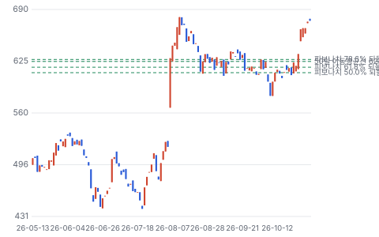

**주봉**

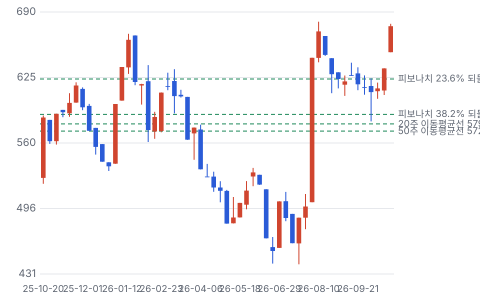

**월봉**

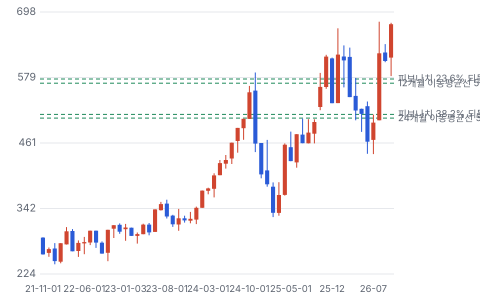

**분기 매출·EPS 실적과 컨센서스**

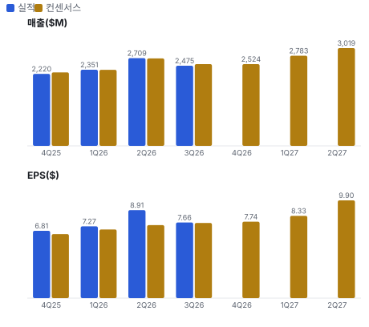

**EPS 리비전**

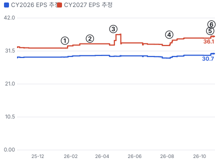

① 26-01-21 4Q25 실적 · EPS 리비전 +2%
② 26-03-09 ARKA 인수 완료, 차입 \$2.6B 부담 · EPS 리비전 +0%
③ 26-04-22 1Q26 실적, 인수 반영 FY26 EPS 가이던스 하향 · EPS 리비전 +1%
④ 26-08-05 2Q26 실적, FY27 가이던스 EPS \$33.41 · EPS 리비전 +5%
⑤ 26-10-21 3Q26 실적, 가이던스 상향 · EPS 리비전 +2%
⑥ 26-10-26 Jefferies Buy 상향 · 실적 창과 겹침

**밸류에이션 주가 시나리오**

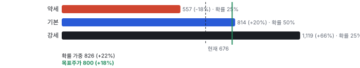

**주가별 업사이드**

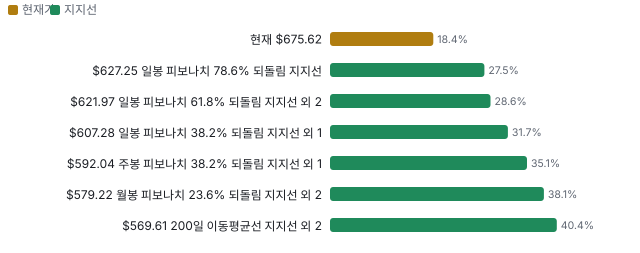

**어닝콜 변화별 주주가치 영향**

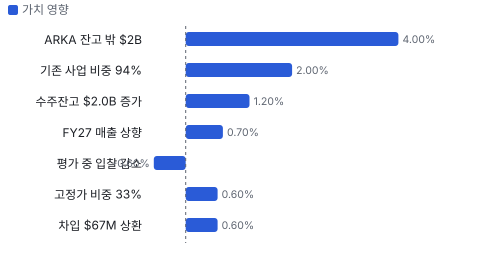

**최근 4개 분기 주가 변화 분석**

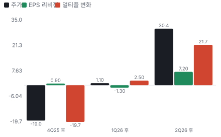

**멀티플 프리미엄**

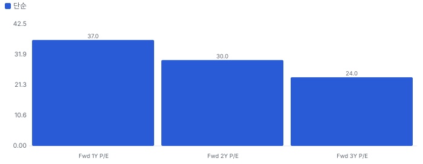

**합리적 멀티플**

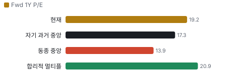

**일별 거래량 분해**

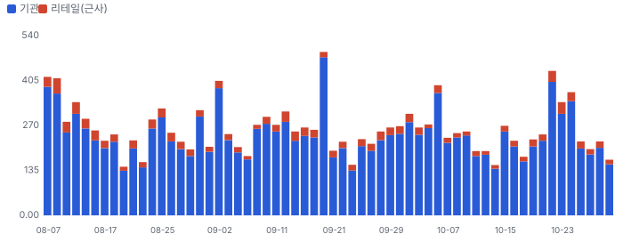

**기관 자금 흐름**

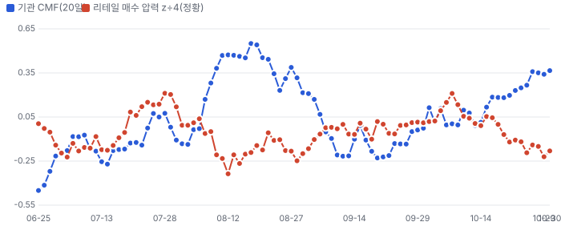

**몬테카를로**

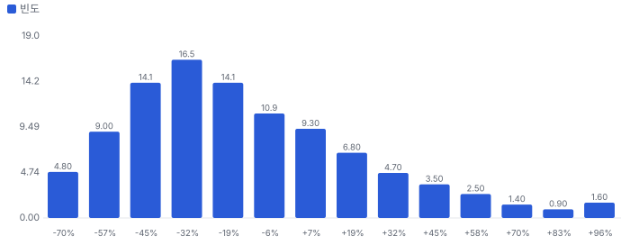

해석: 3,000번 중 920번(31%)에서 가치가 지금 주가 이상이었다. 가정을 흔들어도 지금 주가를 뒷받침하지 못하는 경우가 더 많다. 가운데 값은 0.79배이고, 열 번 중 여덟 번은 0.44~1.38배 사이에 든다.

## 내러티브

> **기업가치를 결정하는 이야기:** 주가는 EPS와 멀티플 둘로 움직인다. EPS는 기술 비중과 이익률이 올리고, 멀티플은 이 회사를 서비스로 보느냐 제품으로 보느냐가 정한다. 지금 Fwd 1Y P/E 19.2배는 서비스 동종 약 14배와 제품 동종 L3Harris 22.7배의 사이다.

> **멀티플·EPS 프리미엄**
> **멀티플:** Fwd 1Y P/E 19.2배는 동종 중앙값 약 13.9배보다 약 38% 높고 자기 36개월 범위 13~23배의 위쪽이다. 6월 말 14.8배에서 넉 달 만에 올랐다. Fwd 2Y는 16.1배다.
> **EPS:** 지난 네 분기 EPS가 모두 컨센서스를 넘었다. 8/5 이후 FY27 EPS 컨센서스는 \$30.49에서 \$33.50으로 9.9% 올랐다.

### 투자자들은 왜 열광했나

8월에 세 가지가 함께 나왔다. FY27 EPS 가이던스 중간 \$33.41이 당시 컨센서스 \$30.49를 9.6% 넘었고, FY26 FCF가 \$735M으로 나왔고, Domestic Shield(미국 내 시설 대드론 방어 사업) \$500M이 붙었다. 앞선 석 달간 시장은 ARKA 차입과 이자를 걱정했고 주가는 7/21 \$441까지 밀려 있었다. 낮은 기대에 큰 숫자가 나온 것이다. 10월에는 Jefferies가 Buy로 올렸고 아부그라이브 소송이 기각되며 또 하나의 부담이 사라졌다.

### 무엇이 기업가치를 바꾸나

> **구조적 체질 변화**
> **변화:** 기술 매출 비중이 FY24 53.6% → FY26 58.4% → 1Q FY27 58.6%다
> **증거:** 10-K, 10-Q Note 5
> **반증:** 기술 비중이 2개 분기 연속 내려간다

> **고부가 믹스 확장**
> **변화:** 프로그램 이익률이 한 자릿수에서 30%대 초반까지 벌어져 믹스가 곧 이익률이다. 1Q EBITDA 이익률 13.3%
> **증거:** 1Q 콜 CFO, 10-Q
> **반증:** EBITDA 이익률이 12% 아래로

> **기술 혁신**
> **변화:** 소프트웨어로 위협 변화에 맞추는 제품, ARKA의 소형 광학. 공급 제약은 메모리·희토류다
> **증거:** 1Q 콜
> **반증:** 공급 제약이 가이던스 하단을 건드린다

> **실행 속도**
> **변화:** SkyValor(CACI의 대드론 탐지·무력화 시스템)는 콘셉트에서 배치까지 12개월(회사 말). 다른 제품과 피어의 납기는 공개되지 않아 미확인 **납품 리드타임 12개월.** 피어 비교 미확인. 이전 대비 미확인.
> **증거:** 4Q 콜
> **반증:** Spectral(미 해군 함정용 전자전 체계)·Domestic Shield 납기 지연

> **M&A**
> **변화:** ARKA \$2.64B를 차입으로 샀다. 레버리지 3.5배, 3배 초반 복귀 목표를 2027년 3월로 앞당겼다. 회사는 다시 인수 여력을 말한다
> **증거:** 10-Q, 1Q 콜
> **반증:** 복귀 전 대형 인수로 레버리지가 다시 오른다

> **정책·입법 연관성**
> **재정정책:** OBBBA(2025년 7월 제정 재정조정법)가 국방 약 \$156B(Golden Dome(미국 본토 미사일 방어 구상) \$25B 포함)를 예산 절차와 별도로 풀었다. FY27 예산 요구는 재량 \$1.15T + 의무 \$350B이고 \$350B는 별도 재정조정법이 필요하다 10-Q 시장 환경 반증: FY27 재정조정법 무산 의회 동의 10/10 — 하원 5/5(OBBBA 본회의 통과. FY27 \$350B는 미통과) · 상원 5/5(OBBBA 본회의 통과. FY27 \$350B는 미통과).
> **행정명령:** 행정명령 14372(2026-01-07)는 저성과 방산업체의 자사주·배당을 막는다. CACI는 FY26 프로그램 자사주가 없었고 지정 대상 여부는 미확인이다 백악관 팩트시트, 10-K 반증: CACI가 저성과 업체로 지정된다 의회 동의 2/10 — 하원 1/5(이 명령을 입법한 법안 확인 안 됨) · 상원 1/5(이 명령을 입법한 법안 확인 안 됨).
> **연관입법:** FY27 NDAA(미국 국방수권법)는 7/22 하원 통과, 상원 본회의 미처리(9/1 CRS(미국 의회조사국) 기준). 임시 예산이 12/11까지다. 6월 재정조정법 2.0은 ICE(미 이민세관단속국)·CBP(미 세관국경보호청)에 \$70B를 2029년까지 준다 10-Q, 미국 의회조사국 보고서 반증: 12/11 뒤 셧다운이 길어진다

> **CAPEX 낙수효과**
> **변화:** AI 데이터센터와 직접 연결은 없다. 낙수는 정부의 드론·우주 예산에서 온다. 자체 CAPEX는 FY24 \$64M → FY26 \$107M으로 늘었다
> **증거:** 10-K
> **반증:** 제조 센터 투자에도 납기 개선이 없다

### 내러티브 근거

> 인력 서비스 회사에서 미리 만든 국방 기술 회사로 바뀐다는 이야기다. 8월 뒤 시장이 이를 가격에 넣기 시작했다. 동종 대비 멀티플 차이 +37% 중 회사 고유 몫은 -8%다. 단계는 확산, 쏠림은 낮음~보통 — 셀사이드는 강세가 많지만 리테일 관심은 거의 없다이다.

> **인력 회사에서 기술 회사로** · 강화
> **논리:** 매출 59%가 기술이고 프로그램별 EBIT 이익률이 한 자릿수에서 30%대 초반까지 벌어진다. 기술이 늘면 평균이 오른다
> **숫자:** EBITDA 이익률 1Q 13.3%, 전년 11.7%, 5년간 약 250bp 상승(회사)
> **반증:** 하반기 이익률이 12% 아래로 내려온다

> **대드론·전자전 수요** · 강화
> **논리:** 드론 위협이 미군 기지와 본토로 옮겨 오며 비살상 대응이 예산을 얻는다
> **숫자:** Domestic Shield \$500M 상한, 해군 \$281M, 육군 \$250M. 모두 상한이고 일부만 자금 배정
> **반증:** 개별 발주가 상한의 일부에 그치거나 경쟁사가 Domestic Shield 물량을 가져간다

> **우주 상인 공급자** · 유지
> **논리:** ARKA로 탑재체·광통신을 여러 원청에 파는 위치에 선다
> **숫자:** 인수가 \$2.64B, 잔고 밖 약 \$2B, FY27 인수 매출 약 \$450M
> **반증:** EST(우주군 차세대 광통신 단말 사업) 탈락, SDA(미 우주개발국) 2차분 지연

> **현금흐름 복리** · 유지
> **논리:** 회사는 주당 FCF를 최종 지표로 삼는다. 레버리지가 내려가면 인수·자사주 여력이 다시 열린다
> **숫자:** FY27 FCF 최소 \$900M, 시가총액 대비 약 6%. 일회성 약 \$155M 포함
> **반증:** FY28 FCF가 일회성 소멸분만큼 줄어든다

> **반대: 인력 회사 프리미엄은 오래 못 간다** · 유지
> **논리:** 1Q 유기적 성장은 2.1%, 총 잔고는 전년과 같고 RPO는 잔고의 42%다. AI가 인력 단가를 낮추면 서비스 몫이 줄 수 있다
> **숫자:** Fwd 1Y P/E 19.2배, 동종 중앙값 약 13.9배, 자기 36개월 13~23배
> **반증:** 하반기 유기적 성장이 두 자릿수로 나온다

> **반대: 차입 인수의 대가** · 약화
> **논리:** 영업권·무형자산이 자기자본의 1.8배이고 이자 비용이 분기 \$73M로 늘었다
> **숫자:** 차입 원금 \$4.86B, 레버리지 3.5배, 1Q 이자 등 \$73M vs 전년 \$46M
> **반증:** 2027년 3월까지 3배 초반에 못 닿는다

## 포트폴리오

| 제품·서비스 | 구분 | 무엇 | 쓰는 곳 | 돈 버는 방식 |
|---|---|---|---|---|
| 전자전·신호정보(TLS MANPACK(미 육군 휴대형 전자전·신호정보 장비), Spectral) | 제품 | 적 전파를 탐지·교란하는 소프트웨어 정의 장비 | 미 육군·해군 | 연 약 \$2B(2월 회사 언급 보도). Spectral은 초도 양산 단계 |
| 대드론(SkyValor, BEAM(CACI의 휴대형 대드론 시스템)) | 제품 | 최대 75km 탐지, 휴대형과 고정형으로 드론 신호를 찾아 무력화 | 미군 기지·본토·유럽·태평양 동맹 | Domestic Shield 상한 \$500M, 제품별 매출 미공개 |
| 우주 광학·광통신(ARKA, EST) | 제품 | 정찰 위성 탑재체와 위성 간 레이저 통신 단말 | 우주군·정보기관·Vantor | FY27 인수 매출 약 \$450M, 잔고 밖 약 \$2B |
| 임무 지원·네트워크 현대화 | 서비스 | 정보 분석, 임무 계획, AI 기반 시스템 현대화 | 전투사령부·정보기관·연방 민간 | Expertise 매출 1Q \$1.03B(41%) |

## 수주·파이프라인

> **2026-09-30 기준 10건.** 확정 \$14.30B, 미확정 \$19.70B. 공시 총 수주잔고 \$34.00B. 서로 겹치는 항목은 합계에서 뺐다.

**실행 속도와 방해 요인**
| 항목 | 상태 | 실행 속도 | 방해 요인 |
|---|---|---|---|
| 잔여 이행의무(RPO) | 확정 | 43%가 12개월 안, 62%가 24개월 안에 매출 | 임시 예산 · 자금 집행 지연 |
| 행사 전 옵션(잔고 − RPO) | 조건부 | 정부가 옵션을 행사할 때만 매출 | 옵션 미행사 · 예산 변화 |
| SOFETOPS II(미 육군 특수전) | 확정 | 5년, 1Q에 \$1.2B만 잔고 인식 | 요구량 변화 |
| Apollo(CENTCOM(미 중부사령부)) | 프레임워크 | 1년 + 옵션 4회, 잔고 예상 \$1.2B | 옵션 행사 · 수년 뒤 성장 정체(회사 언급) |
| Domestic Shield(대드론, JIATF-401(미 국방부 대드론 합동 태스크포스)) | 프레임워크 | 초기 과업 지시 포함, 나머지는 발주 시 | 개별 발주 규모 |
| 미 해군 NSWC(미 해군 수상전센터) Crane 전자전 | 프레임워크 | 5년 상한 | 개별 발주 |
| 미 육군 전자전 과업(CPE(미 육군 프로그램 관리 조직) IEW(정보·전자전)&S) | 프레임워크 | 5년 상한 | 개별 발주 |
| ARKA 우주 탑재체(잔고 밖) | 파이프라인 | 3~5년, 기본 예산 사업이나 잔고 미반영 | 수주 전환 · 양산성 |
| Spectral 함정 전자전 초도 양산 | 확정 | Milestone C 통과, 2H FY27 배치 시작 | 초도 양산이 곧 전력화 양산은 아니다 |
| EST 우주 광통신 단말 | 파이프라인 | 3단계 진출 3사 중 하나 | 경쟁 탈락 · SDN(우주군 우주 데이터망) 일정 |

## 해자

> 해자는 현장 임무 지식과 소프트웨어 정의 제품의 결합이다. 인력 회사와 다른 점이 숫자로 일부 확인되지만 우주 쪽은 아직 경영진 말이 많다.

> **현장에 들어간 임무 지식** · 강함
> **해자:** 1,400명이 전 세계 전투사령부에 들어가 있어 요구가 공고되기 전에 무엇이 필요한지 안다.
> **근거:** 1Q 수주 \$4.8B에 신규와 재경쟁 승리가 함께 있고, FY27 매출의 94%가 이미 기존 프로그램이다.
> **숫자:** 총 잔고 \$34.0B = TTM 매출의 3.5배
> **깨지는 조건:** 재경쟁에서 대형 프로그램을 잃거나 평가 중 입찰이 2분기 연속 줄어든다

> **미리 만든 소프트웨어 정의 제품** · 강함
> **해자:** 요구가 나오기 전에 자기 돈으로 만들어 두어 제품을 바로 판다. 소프트웨어로 위협 변화에 맞춘다.
> **근거:** SkyValor는 콘셉트에서 배치까지 12개월. FY26 OTA(시제품을 빠르게 사는 비정규 계약 방식)·CSO(상용 기술을 공모로 사는 조달 방식) 수주 약 \$500M, OTA 금액이 FY24·FY25 합의 2배 이상. 기술 매출 FY24 54% → 1Q FY27 59%.
> **숫자:** EBITDA 이익률 1Q 13.3%, 전년 11.7%
> **깨지는 조건:** OTA 사업이 양산 계약으로 이어지지 않거나 기술 비중이 내려간다

> **우주 대구경 광학 제조** · 보통
> **해자:** ARKA의 대구경 광학은 공급자가 적고 소형화로 상업 시장까지 넓힌다.
> **근거:** Vantor 경쟁 평가에서 선정, EST 3단계 진출 3사 중 하나. 다만 공급자 수는 CEO 말이고 SDA 1차분은 양산성에 고전했다.
> **숫자:** 인수가 \$2.64B, FY27 인수 매출 약 \$450M
> **깨지는 조건:** EST 3단계에서 탈락하거나 2차분 납기가 밀린다

> **보안 인가 인력과 프라임 지위** · 보통
> **해자:** 인가 인력과 원청 계약은 새 경쟁자의 진입을 늦춘다.
> **근거:** 매출의 89%가 원청, 상위 10개 계약 22.5%로 분산, 프로그램 약 1,900개. 다만 대형 동종도 같은 자산을 가졌다.
> **숫자:** 원청 매출 1Q \$2.21B
> **깨지는 조건:** 소프트웨어 신생사가 CACI 임무 영역에서 프라임을 딴다

## 경영진·네트워크

> 창업자 경영 체제가 아니다. CEO는 Lockheed 27년 출신이고 이사회에 전 해군참모총장·전 국가정보부국장·전 NSA(미 국가안보국) 간부가 있다. 연결이 매출을 만들었다는 증거는 없다.

> **John S. Mengucci** · 사장·CEO, 이사 · 2019-07
> **프로필:** 64세. Lockheed Martin 27년, 사장급까지. 2012년 CACI 합류, COO 거쳐 CEO
> **비즈니스:** AIA(미국 항공우주산업협회) 이사회, PSC(미국 정부 서비스 협회 Professional Services Council)·NVTC(북버지니아 기술 협회) 집행위원회
> **정계:** 공직 이력 없음. 선거자금·로비 기록은 확인하지 않아 미확인
> **동문:** Clarkson University 이사회 부의장
> **사모임:** 미확인

> **Lisa S. Disbrow** · 독립 이사회 의장 · 2021
> **프로필:** 63세. 공공·민간 합쳐 40년 이상 국가안보 경력
> **비즈니스:** 방산·기술 상장사 이사회 경험
> **정계:** 위임장 기준 정부 안보 경력. 세부 직책은 위임장 원문 참조
> **동문:** 미확인
> **사모임:** 미확인

**네트워크 정량화**
| 연결 | 강도 | 닿는 매출 | 가중 노출 | 매출 대비 | 근거 |
|---|---|---|---|---|---|
| 정계: 이사 Gilday 전 해군참모총장, 2026년 1월 합류. 해군 관련 수주와의 인과는 입증되지 않는다 | 2/5 | \$5.13B | \$2.05B | 21% | FY26 전쟁부 매출 \$5.13B 2026 위임장, 10-K |
| 정계: 이사 Gordon 전 국가정보국 수석 부국장, Plunkett 전 NSA 간부 | 2/5 | \$2.35B | \$0.94B | 10% | FY26 정보기관 매출 \$2.35B 2026 위임장, 10-K |
| 비즈니스: 이사 Keffer 전 Northrop Grumman CFO, CEO는 Lockheed 출신. 원청·하청 관계와 닿는다 | 2/5 | \$0.92B | \$0.37B | 4% | 하청 매출 연환산(1Q \$265M × 4 근사) 2026 위임장, 10-Q |
| 동문: CEO의 Clarkson University 이사회 부의장직 | 0/5 | \$0.00B | \$0.00B | 0% | 매출과 닿는 연결 미확인 2026 위임장 |
| 사모임: 공개 자료에서 확인되는 사모임 없음 | 0/5 | \$0.00B | \$0.00B | 0% | 미확인 2026 위임장 |

가중 노출은 연결이 닿는 매출의 크기다. 연결이 그 매출을 만들었다는 뜻이 아니며, 인과는 공개 자료로 입증하지 못한다.

## 약세 논리 및 셀온 조건

| 약세 논리 | 근거 | 반박 | 가를 자료 |
|---|---|---|---|
| 하반기 성장 쏠림 | 1Q 유기적 +2.1%. Jefferies 계산으로 2Q +7%, 하반기는 두 자릿수 초반이 필요하다. 그 시점은 12/11 임시 예산 종료와 겹친다 | FY27 매출 94%가 기존 프로그램이고 자금 배정 잔고가 +15%다. 지난해도 같은 질문을 넘겼다 | 2월 실적의 유기적 성장, 자금 배정 잔고 |
| 분류 재평가가 되돌려진다 | Fwd 1Y P/E 19.2배 vs 동종 약 13.9배. 6월 말 14.8배였다 | 기술 매출 59%, EBITDA 이익률 13.3%로 동종과 다르다 | 하반기 이익률, 기술 비중 |
| 잔고의 질 | 총 잔고는 전년과 같고(\$33.9B → \$34.0B) RPO는 \$14.3B로 42%다. 나머지는 미행사 옵션이다 | 자금 배정 잔고는 8분기 중 7번 두 자릿수 증가 | RPO 추이, 옵션 행사율 |
| 차입과 자본 배분 | 차입 원금 \$4.86B, 레버리지 3.5배, 영업권·무형 \$8.5B는 자기자본의 1.8배. Broyhill은 자사주 중단을 매도 이유로 들었다 | 3개월에 \$67M 상환, 3배 초반 복귀를 2027년 3월로 앞당겼다 | 레버리지, 다음 인수 규모 |
| 현금흐름의 일회성 | FY27 FCF \$900M에 세금 환급 \$40M, Section 174 \$115M이 포함된다. 합치면 17%다 | 회사는 순이익 이상의 현금 전환을 2년째 말한다 | 새 회계연도 FCF 가이던스 |
| 경쟁 증설과 공급 제약 | 높은 수익은 경쟁을 부른다. 대드론·전자전에는 대형 방산과 신생사가 함께 들어와 있다. 메모리·희토류 가격도 오른다 | 회사는 납품 건마다 재가격이 가능하다고 말한다. 대부분 1~1.5년 안 | 대드론 수주 점유, 총이익률 |
| 경영진 신호 | 공시 기간 장내 매도 14건, 매수 0건 | 사전 매매 계획 여부 미확인, 금액 비중 미확인 | Form 4 각주 |

> **셀온 조건**
> **조건 1:** 12월 분기 유기적 성장이 회사가 합당하다고 한 수준(약 7%)에 크게 못 미친다
> **조건 2:** 자금 배정 잔고 증가율이 두 자릿수 아래로 내려온다
> **조건 3:** EBITDA 이익률이 12% 아래로 내려온다
> **조건 4:** 2027년 3월 레버리지가 3배 초반에 못 닿거나 그 전에 대형 인수가 나온다
> **조건 5:** 경쟁사가 Domestic Shield 발주를 가져가거나 EST 3단계에서 탈락한다

## 어닝콜 변화

**직전 콜 대비 새로 나오거나 바뀐 내용 → 가치 영향**
| 항목 | 내용 | 직전 콜 | 최신 콜 | 모델 동인 이동 | 확신도 | 가치 영향 |
|---|---|---|---|---|---|---|
| 업데이트 | FY27 매출 가이던스 중간 +\$50M | \$10.65~10.85B | \$10.7~10.9B | 기준연도 매출 +\$0.05B | 0.8 | +0.7% |
| 업데이트 | 1Q 수주 \$4.8B, 수주/매출 2배 | \$32.0B | \$34.0B | 성장 지속(감속 계수) +2.0% | 1.0 | +1.2% |
| 업데이트 | FY27 매출 중 기존 프로그램 비중, 7년 내 이 시점 최고 | 83% | 94% | 1년차 성장률 +0.50% | 0.8 | +2.0% |
| 신규 | ARKA 우주 탑재체 약 \$2B(3~5년), 잔고 미반영 | 언급 없음 | 약 \$2B | 1년차 성장률 +1.0% | 0.5 | +4.0% |
| 업데이트 | 차입 원금 감소, 레버리지 3.7배 → 3.5배 | \$4.93B | \$4.86B | 순차입 -\$0.07B | 1.0 | +0.6% |
| 부정 | 평가 중 입찰 \$11B → \$4.7B, 향후 2분기 제출 \$22B → \$14.7B. 수주 전환분 포함 | \$11B·\$22B | \$4.7B·\$14.7B | 성장 지속(감속 계수) -1.0% | 0.3 | -0.6% |
| 업데이트 | 고정가 비중 상승, 절반은 ARKA 몫 | 1Q FY26 27% | 33% | 목표 이익률 +0.30% | 0.5 | +0.6% |
| 반복 | FY27 EBITDA 이익률 high 12%, 1Q 13.3%에도 유지 | high 12% | high 12% | 출발 이익률 — | 0.8 | +0.0% |
| **합계** | 단독 합 |  |  | 동시 적용 +8.7% |  | **+8.5%** |

**사건별 EPS 리비전**
| # | 날짜 | 구분 | 사건 | CY2026 EPS 전→후 | CY2027 EPS 전→후 | 리비전 | 주가 반응 |
|---|---|---|---|---|---|---|---|
| ① | 26-01-21 | 실적 | 4Q25 실적 | \$29.59 → \$29.90 | \$32.45 → \$33.17 | +2.2% | +3.6% |
| ② | 26-03-09 | 내러티브 | ARKA 인수 완료, 차입 \$2.6B 부담 | \$30.05 → \$30.11 | \$33.81 → \$33.81 | +0.0% | +2.8% |
| ③ | 26-04-22 | 실적 | 1Q26 실적, 인수 반영 FY26 EPS 가이던스 하향 | \$29.80 → \$29.93 | \$33.40 → \$33.84 | +1.3% | +2.8% |
| ④ | 26-08-05 | 실적 | 2Q26 실적, FY27 가이던스 EPS \$33.41 | \$29.26 → \$29.74 | \$33.28 → \$35.08 | +5.4% | +21.4% |
| ⑤ | 26-10-21 | 실적 | 3Q26 실적, 가이던스 상향 | \$30.14 → \$30.66 | \$35.61 → \$36.14 | +1.5% | -0.7% |
| ⑥ | 26-10-26 | 내러티브 | Jefferies Buy 상향 | \$30.73 → \$30.66 | \$36.27 → \$36.14 | 실적 창과 겹침 | +4.9% |

**해석:** 3개 구간 누적 주가 +7% = EPS 리비전 +7% × 멀티플 +0%. 더 크게 움직인 쪽은 **EPS 리비전**이다.

## 밸류에이션

> **목표주가 \$800, 업사이드 +18%.** 자리는 약세와 기본 사이(약세 쪽 6%)이고 도달 확률은 약 52%다. 기본 \$814, 강세 \$1,119(+66%), 약세 \$557(-18%). DCF 기준 업사이드는 기본 -21%, 강세 +12%, 약세 -40%다(WACC 8.5%).

2027년 말 시점에 FY2028(2028년 6월 끝) EPS를 적용했다. FY2028 컨센서스는 \$39.0~\$40.6이다. 조정 EPS는 인수 무형 상각을 더한 값이다.

시나리오는 시장 멀티플을 쓰고 DCF는 GAAP 이익과 현금을 쓴다. DCF 기본값이 현재가보다 21% 낮은 이유는 EBIT 이익률이 10%대에서 출발해 12.5%로만 오르고 영구 성장이 낮기 때문이다. 두 값의 차이가 지금 시장이 얹은 프리미엄이다. 5년 2배 확률 11%는 DCF 가치 분포 기준이고 주가 분포가 아니다.

재투자 효율 가정의 영향: 3.0이면 멀티플 20.4배·목표 \$800·Buy, 규칙값 1.0이면 18.8배·\$744·Neutral이다. 시가총액 \$15B에서 10배는 \$150B이고 어떤 시나리오도 닿지 않는다. 애널리스트 평균 목표가 \$738은 시장 기대의 증거로만 본다.

> **약세 \$557 (-18%)** · 확률 25%
> **가정:** 15.3배 × EPS \$36.50
> **근거:** 하반기 성장이 밀리고 이익률이 12%대 중반에 머문다. FY2028 EPS 컨센서스 하단

> **기본 \$814 (+20%)** · 확률 50%
> **가정:** 20.4배 × EPS \$40.00
> **근거:** 가이던스가 지켜지고 대드론·ARKA가 쌓인다. FY2028 컨센서스 \$39.0~\$40.6 사이

> **강세 \$1,119 (+66%)** · 확률 25%
> **가정:** 25.4배 × EPS \$44.00
> **근거:** Spectral 양산과 대드론 발주가 빨라지고 이익률이 14%에 닿는다. FY2028 추정 상단 \$44.5 부근

**멀티플 선정 — Fwd 1Y P/E**
| 단계 | 조정 | 근거 |
|---|---|---|
| 동종 중앙값 | 13.9배 | 범위 9.8~22.7배, 6곳 |
| 펀더멘털 | +20% | 성장·이익률·ROIC로 본 합리적 멀티플 20.9배와의 차이의 일부만 인정 |
| 해자 | +11% | 현장에 들어간 임무 지식 강함 · 미리 만든 소프트웨어 정의 제품 강함 · 우주 대구경 광학 제조 보통 · 보안 인가 인력과 프라임 지위 보통 |
| 내러티브 | +5% | 단계 확산 |
| 사이클·실행 판단 | +10% | 동종 중앙값은 인력형 서비스 회사가 끌어내린다. CACI는 매출 59%가 기술이고 TTM 매출 성장 +10%(인수 포함)로 여섯 곳을 모두 웃돈다. 순차입 3.5배가 조정을 +10%로 묶는다 |
| **선정** | **20.4배** | 지금 19.2배 |

**동종 레인지**
| 회사 | Fwd 1Y P/E | Fwd 2Y P/E | Fwd 3Y P/E | 성장 | 영업이익률 | ROIC |
|---|---|---|---|---|---|---|
| LDOS | 11.7 | 10.3 | 9.6 | 4% | 12% | 15% |
| BAH | 13.7 | 12.0 | 11.2 | 6% | 9% | 13% |
| SAIC | 15.2 | 12.7 | 11.9 | -5% | 10% | 14% |
| PSN | 14.2 | 12.9 | 11.2 | 4% | 7% | 9% |
| KBR | 9.8 | 9.2 | 8.4 | 7% | 8% | 12% |
| LHX | 22.7 | 18.9 | 17.0 | 7% | 16% | 10% |
| **CACI International** | 19.2 | 16.1 | 13.9 |  |  |  |

지금 주가가 요구하는 5년 매출 CAGR 11%, 기본 시나리오 7%. 몬테카를로 중앙값 업사이드 -21%.

> 의사결정 보조(투자자문 아님): ① 매수 매력: 연 기대수익 +5.1% (자기자본비용 9.7% 대비 -4.6%p) · 자본비용 초과 확률 25% · 안전마진 0.44 → 정량 신호 약함 / ② 위험 예산 지표(이론): 0% — 기대수익이 자기자본비용에 못 미침(무위험 대비 켈리 3%는 참고) · 5년 하위10% -34% · 30%+ 손실 확률 12% / ③ 상방(5년): 기대 1.28배 · 2배 11% · 3배 1% · 10배 0% · 상위10% 2.04배

## 시장 평가

> **셀사이드(IB 애널리스트)**
> **한 줄:** 방향은 합의됐고 질문은 하반기 실행으로 옮겨 갔다.
> **의견 분포:** Strong Buy 13 · Hold 3 · Strong Sell 1 — 강세 우위
> **목표가:** 평균 \$738, 범위 \$540~\$925 — 현재가 대비 평균 +9%
> **의견 변경:** 10/26 Jefferies Hold → Buy, 10/23 Stifel \$925 — 상향
> **EPS 리비전:** FY27 \$30.49 → \$33.50(8/5 → 10/27) — +9.9%
> **콜 질문:** 하반기 성장·OTA 해지·고정가 비중 — 실행 검증

> **바이사이드(기관 투자자)**
> **한 줄:** 저점에서 가치 투자자가 샀고 재평가 뒤 일부는 판다. Broyhill은 자사주 대신 부채 상환, 지표 비공개, 멀티플 상승을 매도 이유로 들었다.
> **13F(6/30, 562곳):** 증가 181 · 감소 232, 순증 약 114만 주 — 6월 저점 부근 대형 매수
> **최대 매수:** Barrow Hanley +69만 주, 지분 4.3% — 가치 운용사 유입
> **내부자:** 장내 매도 14건 · 매수 0건(공시 기간) — 매수 없음, 사전 계획 여부 미확인
> **펀드 레터:** 3Q Royal London 차익 실현, Broyhill 매도 / 2Q Touchstone Value 신규 — 재평가 뒤 일부 이탈
> **공매도:** 유동 주식의 5.2%, 커버 4.5일 — 낮지 않은 수준

> **언론·업계**
> **한 줄:** 새 소재보다 수주 뉴스 전달이 많다.
> **언론 제목:** Jefferies 상향·해군 \$281M 동반 상승, Booz Allen도 +7% — 업종 동반
> **Motley Fool·Seeking Alpha:** 1Q 요약 중심 — 중립

## 체크리스트

| 시점 | 무엇 | 의미 |
|---|---|---|
| 2026-11-16 전후 | 9월 말 13F 마감 | 재평가 구간에 누가 샀고 누가 팔았나 |
| 2026-12-11 | 임시 예산 종료 | 새 사업 착수 지연 여부 |
| 2026년 12월 | FY27 NDAA 협상 결과 | 대드론·우주 항목 |
| 2027년 2월 | 12월 분기 실적, 새 회계연도 가이던스 | 유기적 성장 약 7%와 새 기준 EPS |
| 2027년 초 | 플로리다 멜버른 Investor Day | 새 3년 목표, 제품 사업 공시 변경 |
| 2027년 상반기 | SDA 2차분·EST 진척, Spectral 배치 | 기술 매출이 일정대로 나오나 |
| 2027년 3월 말 | 레버리지 3배 초반 | 자본 배분 재개 |

## 출처
- CACI 1Q FY27 10-Q https://www.sec.gov/Archives/edgar/data/16058/000162828026066827/caci-20260930.htm
- CACI 1Q FY27 보도자료 https://www.sec.gov/Archives/edgar/data/0000016058/000162828026066740/fy27-q1caci20261021ex991.htm
- CACI FY2026 10-K https://www.sec.gov/Archives/edgar/data/16058/000162828026054195/caci-20260630.htm
- CACI 2026 위임장 https://www.sec.gov/Archives/edgar/data/16058/000162828026060738/caci-20260904.htm
- 행정명령 14372 팩트시트 https://www.whitehouse.gov/fact-sheets/2026/01/fact-sheet-president-donald-j-trump-prioritizes-the-warfighter-in-defense-contracting
- FY2027 NDAA 진행 상황(CRS) https://www.everycrsreport.com/reports/IN12704.html
- Apollo 수주 보도 https://www.govconwire.com/articles/caci-uscentcom-operations-support
- 10-Q
- 10-Q Note 5
- 1Q 8-K EX-99.1
- 1Q 콜 CEO
- 2026-01 회사 발표
- 2026-09-16 회사 발표
- 2026-10-26 회사 발표
- 4Q 콜
- 4Q·1Q 콜

_구매 등급·목표주가 모두 규칙이 계산한 모델 값으로, 개인의 보유 종목·자금 사정을 반영하지 않는다 · 공개 자료 기반 분석이며 투자 권유가 아님 · 1차 판정, 미검증 · Chiip ten-bagger_