# 텐배거 리포트 2026-11-02 — Dell Technologies — EPS는 35% 올랐는데 주가는 실적 전으로 돌아왔다

> 2026-11-02 · Dell Technologies(DELL) · 기업: 기업·AI 데이터센터용 서버·스토리지와 PC를 팔고 고객 금융까지 묶어 제공하는 미국 IT 인프라 회사

## Chiip View

좋은 숫자와 나쁜 질문이 동시에 있다. 9/1 실적 뒤 FY27 EPS 컨센서스는 \$19.29에서 \$26.09로 35% 올랐는데 주가는 실적 전 \$425에서 \$424로 돌아왔다. Fwd 1Y P/E는 9월 말 18.8배에서 14.3배로 내려왔다. AI 잔고 \$95B와 RPO(잔여 이행의무, 확정 주문 잔액) \$132B는 사실이다. 그러나 회사는 3Q EPS를 2Q보다 낮은 \$6.50으로 줬고, 가격과 물량을 나눠 공개하지 않는다. 엔진은 11.0배를 골라 목표주가 \$411, 업사이드 −3%, 약세 다운사이드 −49%, 손익비 0.7을 냈다.

**등급 Neutral은 멀티플 하나에 걸려 있다.** 기본 EPS \$35에 지금 14.3배를 유지하면 \$500(+18%)이고, 동종 중앙값 12.1배면 지금 주가와 같은 \$424다. 엔진의 11.0배는 메모리 전가 이익에 사이클 할인을 준 값이다. 시장은 답을 아직 정하지 못했다. 답은 11/24 실적의 ISG(Dell 인프라 사업부) 이익률과 전통 서버 물량 설명이 준다. 10배 경로는 없다. 시가총액 \$270B의 재평가 논쟁으로 본다.

## 대시보드
| 항목 | 값 | 설명 |
|---|---|---|
| 주가 | \$424.30 | 고점 대비 -28% · 1년 +164% |
| 시가총액 | \$272.75B | EV \$296.45B |
| 업사이드 | -3% | 목표주가 \$411 · 다운사이드 -49% · 손익비 0.7 |
| 구매등급 | Neutral | 애널리스트 28명: Strong Buy 17 · Buy 3 · Neutral 8 · Sell 0 · Strong Sell 0 |
| 멀티플 | Fwd 1Y P/E 14.3배 | 동종 중앙값 12.1배 |
| 가이던스 4Q26 | \$49,000M · \$6.50 | 컨센서스 \$50,626M · \$6.63 |
| 알파 | 3.4/10 | 텐배거 가능성 점수 |
| 이벤트 | FY27 3Q 실적(장 마감 후, 확정) | 2026-11-24 |

## 한 장 요약
- **기업가치를 결정하는 내러티브** Dell은 PC(개인용 컴퓨터)와 서버를 파는 회사에서 AI 인프라 공급자로 재평가됐다. FY27 EPS 가이던스는 \$12.90에서 \$17.90, 다시 \$25.50으로 올랐다. 그런데 주가는 9/1 실적 전 \$425에서 10/30 \$424로 돌아왔다. EPS가 올랐는데 주가는 제자리다. 시장은 그 EPS가 얼마나 오래갈지를 묻고 있다.
- **밸류에이션 모델로 본 주가 상방은 어디까지인가?** **목표주가 \$411(-3%), 기본과 강세 사이(강세 쪽 13%)다.** 강세 \$579(+37%)는 Fwd 1Y P/E 13.8배를 강세 EPS에 적용한 값이다. 기본 \$386, 약세 \$215. 손익비 0.7, DCF 기준 업사이드 -26%.
- **수주는 어디까지 왔나?** 잔여 이행의무(RPO) 미확인, 100% 매출 \$132B · AI 서버 수주잔고 미확인, 100% 매출 \$95.00B · 전쟁부 CETA(Microsoft 라이선스) 미확인, 100% 매출 \$9.69B. 회계상 잔여 이행의무는 \$132B이고 AI 잔고 \$95B는 그 안팎에 겹친다. AI 파이프라인은 잔고의 몇 배라고만 공개돼 확정이 아니다.
- **지금 가격은 무엇을 가정하나?** P/E로는 다음 4개 분기 EPS \$29.70에 14.3배다. FY28 EPS 컨센서스는 \$30.24~\$33.60으로 벌어져 있고 두 값 모두 9월 말 추정이라 10월 사건을 담지 않았다.

현금흐름으로 풀면 5년 매출 CAGR 17%가 필요하다. 기본 시나리오는 9%다. 지금 주가는 FY29 기본 EPS \$35에 동종 중앙값 12.1배를 곱한 값과 거의 같다. 즉 시장은 이미 Dell을 평균 하드웨어 회사로 값을 매기면서 EPS는 대부분 믿고 있다.
- **왜 움직였나?** 9/17 종가 고점 \$588에서 10/30 \$424까지 −28%다. 원인은 Dell 자체 숫자가 아니라 남의 말 두 번이다.

10/14 Barclays가 Overweight에서 Equal Weight로 내리고 목표주가를 \$603에서 \$574로 낮췄다. 강세의 상당 부분이 물량이 아니라 메모리 가격 전가라는 논리다. 이틀에 −17%였다.

10/30은 −10.8%다. Intel이 10/29 PC 시장을 2026년 −12%, 2027년 −10%로 계획한다고 말했다. 같은 날 보도가 이를 원인으로 들었고 다른 원인을 배제하지는 못했다. 7/15 −9.9%의 원인은 확인하지 못했다.
- **2Q 콜에서 무엇이 바뀌었나?** 좋아진 것: FY27 매출 \$167.0B → \$192.0B, AI 서버 \$60.0B → \$74.0B, 조정 EPS \$17.90 → \$25.50. AI 수주 \$60.9B, 잔고 \$51.3B → \$95B. ISG 영업이익률 10.5% → 15.0%.

새로 나온 것: 첫 Vera Rubin(NVIDIA 차세대 AI 플랫폼) 랙 출하, 14G(Dell 14세대 서버) 이전 서버 120만 대, 18G(Dell 18세대 서버) 통합 비율 12~14배.

아쉬운 것: 3Q ISG 이익률 약 13.5%, CSG(Dell PC 사업부) 7.6% → 약 6%. CFO는 이번 분기 호재가 다 이어지지는 않는다고 했다. AI 서버 mid-single-digit 이익률 문구는 사라졌다. AI 매출은 1Q \$16.1B에서 2Q \$16.4B로 거의 그대로였고, EPS 급증은 전통 서버·스토리지·영업 레버리지에서 나왔다. 금융채권은 \$20.4B로 늘었다.
- **무엇이 바뀌면 판단이 달라지나?** 위로는 11/24 ISG 이익률이 13.5%를 넘고 AI 수주가 잔고를 또 늘리고 회사가 물량 성장을 숫자로 보여줄 때다. 그러면 멀티플 14배대가 지켜져 \$500 이상이 열리고 강세는 \$579다.

아래로는 ISG 이익률이 가이던스를 밑돌거나 DRAM(주기억장치용 메모리) 계약 가격이 꺾일 때다. 약세는 \$215(−49%)다. 다음 확인은 11/24다.

## 한눈에 보기

**일봉**

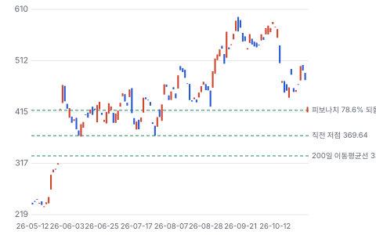

**주봉**

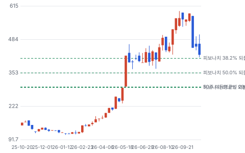

**월봉**

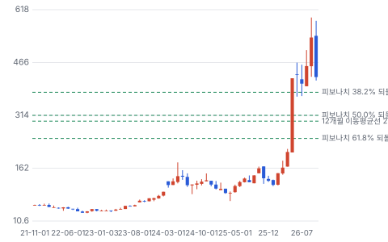

**분기 매출·EPS 실적과 컨센서스**

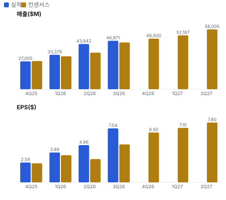

**EPS 리비전**

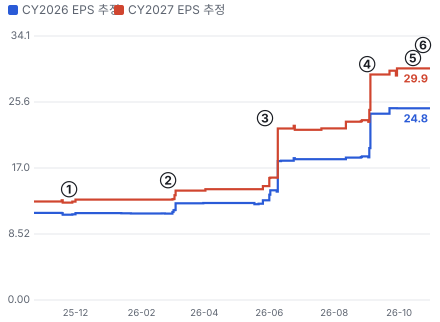

① 25-11-25 4Q25 실적 · EPS 리비전 +3%
② 26-02-26 1Q26 실적 · EPS 리비전 +9%
③ 26-05-28 2Q26 실적, FY27 EPS \$17.90 · EPS 리비전 +51%
④ 26-09-01 3Q26 실적, FY27 EPS \$25.50 · EPS 리비전 +25%
⑤ 26-10-14 Barclays 하향 · EPS 리비전 +0%
⑥ 26-10-30 Intel PC 경고 · EPS 리비전 +0%

**밸류에이션 주가 시나리오**

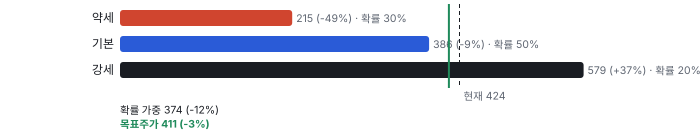

**주가별 업사이드**

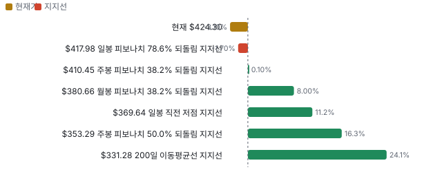

**어닝콜 변화별 주주가치 영향**

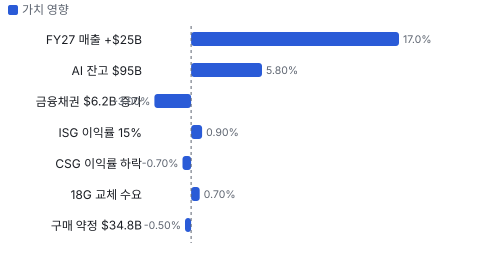

**최근 4개 분기 주가 변화 분석**

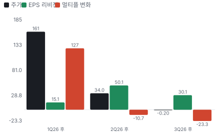

**멀티플 프리미엄**

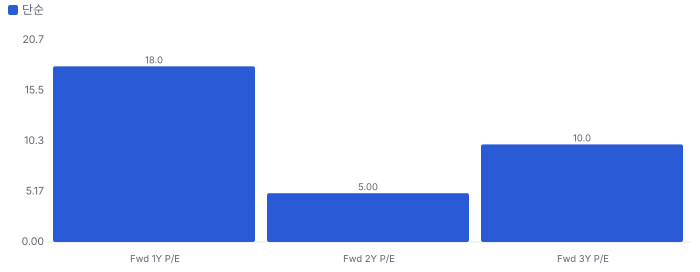

**합리적 멀티플**

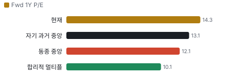

**일별 거래량 분해**

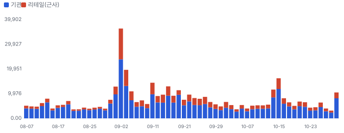

**기관 자금 흐름**

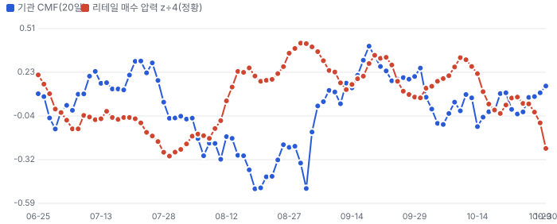

**몬테카를로**

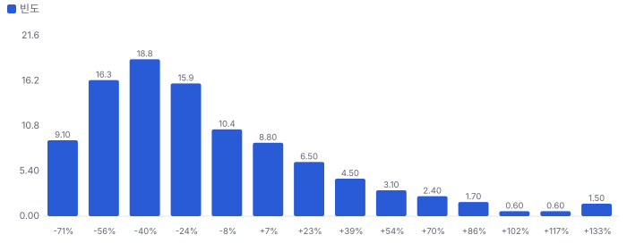

해석: 3,000번 중 879번(29%)에서 가치가 지금 주가 이상이었다. 가정을 흔들어도 지금 주가를 뒷받침하지 못하는 경우가 더 많다. 가운데 값은 0.73배이고, 열 번 중 여덟 번은 0.38~1.45배 사이에 든다.

## 내러티브

> **기업가치를 결정하는 이야기:** 주가는 EPS × 멀티플이다. EPS는 AI 잔고 \$95B의 전환과 메모리 가격 전가의 지속 기간이 정한다. 멀티플은 Dell을 사이클 하드웨어로 보느냐 인프라 플랫폼으로 보느냐가 정한다. 지금 Fwd 1Y P/E 14.3배는 HPE 12.1배와 NetApp 20.3배의 사이다.

> **멀티플·EPS 프리미엄**
> **멀티플:** Fwd 1Y P/E 14.3배는 동종 중앙값 12.1배보다 약 18% 높고 Fwd 2Y는 11.9배다. 9월 말 18.8배에서 한 달 만에 내려왔다. 5월 말 이후의 급등 구간을 벗어나 2024~25년 범위 약 10~17배 안으로 돌아왔다.
> **EPS:** 최근 네 분기 EPS가 모두 컨센서스를 넘었고 2Q는 \$7.04로 발표 직전 \$4.95보다 42% 높았다. FY27 컨센서스는 8/26 \$19.29에서 9/29 \$26.09로 35% 올랐다.

### 투자자들은 왜 열광했나

5월과 9월에 숫자가 두 번 튀었다. 1Q 뒤 하루 +32.8%, 2Q 뒤 하루 +15.8%다. AI 수주가 \$24.4B에서 \$60.9B로 뛰었고 전통 서버가 두 배가 넘었다. 10월에 식었다. Barclays가 10/14 이것이 수요가 아니라 메모리 가격일 수 있다고 물었고 이틀에 −17%였다. Intel이 10/29 PC 시장 2년 연속 감소를 말하자 10/30 −10.8%였다.

### 무엇이 기업가치를 바꾸나

> **구조적 체질 변화**
> **변화:** ISG가 2Q 매출의 68%로 올랐다. 전년 56%였다
> **증거:** 10-Q 부문 매출
> **반증:** AI 매출 비중이 하반기 가이던스 아래로 내려간다

> **고부가 믹스 확장**
> **변화:** 자체 스토리지가 파트너 제품을 대체한다. 회사는 영업 레버리지 다음 이익률 기여로 꼽았다
> **증거:** 2Q 콜
> **반증:** 스토리지 이익률 하락

> **기술 혁신**
> **변화:** 첫 Vera Rubin 랙 출하, 18G 서버 통합 비율 12~14배. 다만 핵심 기술은 NVIDIA(미국 AI 반도체 회사)·메모리사가 쥔다
> **증거:** 2Q 콜
> **반증:** 경쟁사 출하가 시차 없이 따라온다

> **실행 속도**
> **변화:** 주문에서 납품까지의 리드타임은 공개하지 않는다. 대신 AI 잔고를 다음 분기 매출 속도로 나눈 소화 기간을 썼다. 1Q 잔고 \$51.3B ÷ 남은 3개 분기 평균 \$14.6B는 약 10.5개월, 2Q 잔고 \$95B ÷ 하반기 분기 평균 \$20.8B는 약 13.7개월이다. 길어진 것은 공급 제약이고 납기 단축의 증거가 아니다 **납품 리드타임 13.7개월.** 피어 비교 미확인. 1Q FY27 10.5개월보다 30% 길다.
> **증거:** 1Q·2Q 콜
> **반증:** 잔고 전환이 하반기 가이던스 \$41.5B에 못 미친다

> **M&A**
> **변화:** 해당 없음(큰 인수가 없다. 현금은 자사주와 금융채권으로 간다)
> **증거:** 10-Q
> **반증:** 대형 인수 발표

> **정책·입법 연관성**
> **재정정책:** OBBBA(2025년 7월 제정 재정조정법)의 설비 즉시 상각이 고객의 서버 투자 세후 원가를 낮춘다. Dell 매출 기여는 공시되지 않아 미확인이다 2025년 7월 제정 법률 반증: 법 개정 의회 동의 10/10 — 하원 5/5(OBBBA 본회의 통과) · 상원 5/5(OBBBA 본회의 통과).
> **행정명령:** 2026-01-14 Section 232(미국 무역확장법 안보 관세 조항) 포고문은 특정 첨단 반도체에 25%를 물리되 100MW 초과 미국 데이터센터 용도를 면제한다. 7월 재검토 결과와 2단계 확대는 미확인이다 포고문 해설(White & Case, EY(글로벌 회계법인)) 반증: 면제 축소나 서버 완제품 확대 의회 동의 2/10 — 하원 1/5(이 포고문을 입법한 법안 확인 안 됨) · 상원 1/5(이 포고문을 입법한 법안 확인 안 됨).
> **연관입법:** 해당 없음(Dell 매출에 직접 닿는 입법을 확인하지 못했다. GAIN AI Act(미국 AI 칩 수출 제한 법안)·Chip Security Act(미국 칩 위치 확인 법안) 진행은 미확인)

> **CAPEX 낙수효과**
> **변화:** AI 데이터센터 투자가 직접 매출이 된다. 회사는 2030년까지 200GW의 절반이 자기 고객층이라고 주장한다. 추정이고 금지표대로 수주로 확인해야 한다
> **증거:** 2Q 콜, 10-K 고객 12%
> **반증:** 네오클라우드 자금 조달 경색

### 내러티브 근거

> Dell은 PC 회사에서 AI 인프라 승자로 다시 매겨졌다. 지금 시장의 질문은 EPS가 물량에서 나왔느냐, 메모리 가격 전가에서 나왔느냐다. 동종 대비 멀티플 차이 +18% 중 회사 고유 몫은 +41%다. 단계는 컨센서스, 쏠림은 보통 — 고점 대비 −28%로 과열은 빠졌지만 셀사이드 매수 의견 71%는 그대로다이다.

> **AI 서버 잔고** · 강화
> **논리:** 네오클라우드·소버린·기업 수요가 잔고 \$95B로 쌓였고 내년 매출 가시성을 준다
> **숫자:** TTM AI 수주 \$131.7B, FY27 AI 매출 \$74B
> **반증:** 3Q 수주/매출이 1을 밑돌거나 잔고가 줄어든다

> **전통 서버 교체 사이클** · 유지
> **논리:** 에이전트 AI가 CPU(중앙 처리 장치)를 다시 쓰고 낡은 서버가 통합된다
> **숫자:** 전통 서버 +122%, 14G 이전 120만 대
> **반증:** 가격 효과를 뺀 수량 성장이 마이너스로 드러난다

> **영업 레버리지** · 강화
> **논리:** AI로 내부 운영을 줄여 매출보다 비용이 천천히 는다
> **숫자:** 영업비용 8.5%, 전년 대비 −250bp, FY27 약 8%
> **반증:** 영업비용 비율이 다시 9%를 넘는다

> **자본 환원** · 유지
> **논리:** 현금이 자사주로 돌아가 주당 이익을 키운다
> **숫자:** 2Q \$4.3B 환원, 평균 \$401에 950만 주
> **반증:** 금융채권·재고가 현금을 묶어 자사주가 줄어든다

> **반대: 메모리 전가 매출** · 강화
> **논리:** 매출 일부는 수요가 아니라 메모리 가격이다. 가격이 내리면 매출과 이익이 함께 꺾인다
> **숫자:** 회사는 가격·물량 분해를 공개하지 않는다. ISG 이익률 10.5% → 15%
> **반증:** 가격을 뺀 물량 성장이 공개되거나 메모리 하락 뒤에도 이익률이 유지된다

> **반대: PC 침체와 금융채권** · 강화
> **논리:** PC 시장이 2년 연속 줄고 신생 AI 고객 금융이 회사 신용으로 옮겨 온다
> **숫자:** Intel 2026 −12%, 2027 −10% 계획. 금융채권 \$20.4B, 낮은 등급 21.5%
> **반증:** CSG 이익률이 6%를 지키고 상각률이 0.5% 아래로 돌아온다

## 포트폴리오

| 제품·서비스 | 구분 | 무엇 | 쓰는 곳 | 돈 버는 방식 |
|---|---|---|---|---|
| AI 서버 | 제품 | NVIDIA GPU(그래픽 처리 장치)를 넣은 랙 단위 서버와 수랭·네트워크 통합 | 네오클라우드·소버린·기업 | 2Q \$16.4B, FY27 가이던스 \$74B. 이익률 미공개 |
| 전통 서버·네트워크(PowerEdge(Dell 서버 제품군)) | 제품 | 범용 CPU 서버, 에이전트 AI의 CPU 수요 포함 | 기업 데이터센터 | 2Q \$10.5B, +122% |
| 스토리지(PowerStore(Dell 중급 스토리지)·PowerScale(Dell 비정형 파일 스토리지) 등) | 제품 | 자체 설계 블록·파일·오브젝트·백업 저장장치 | 기업·AI 데이터 | 2Q \$4.85B, +26% |
| PC(CSG) | 제품 | 기업·소비자용 노트북·데스크톱 | 기업 교체 수요 | 2Q \$15.0B, 영업이익률 7.6% |
| 고객 금융(DFS(Dell 고객 금융 사업)) | 서비스 | 리스·대출, AI 발주에서 가동까지의 단기 금융 | AI 고객 | 금융채권 \$20.4B |

## 수주·파이프라인

> **2026-07-31 기준 6건.** 확정 \$132B. 공시 AI 서버 수주잔고 \$95.00B. 서로 겹치는 항목은 합계에서 뺐다.

**실행 속도와 방해 요인**
| 항목 | 상태 | 실행 속도 | 방해 요인 |
|---|---|---|---|
| 잔여 이행의무(RPO) | 확정 | 77%가 12개월 안, 14%가 다음 12개월 | 메모리 공급 · 고객 데이터센터 준비 · 계약 범위·가격 변경 |
| AI 서버 수주잔고 | 확정 | 하반기 가이던스 매출 \$41.5B, 잔고의 44% | DRAM·NAND(저장장치용 메모리) · GPU·광부품·전력 부품 · 고객 자금 조달 |
| 전쟁부 CETA(Microsoft 라이선스) | 프레임워크 | 5년 일괄 구매 합의 | 개별 발주 · 예산 |
| AI 서버 파이프라인 | 파이프라인 | 5개 분기 파이프라인이 잔고의 몇 배, 전분기 대비 증가 | 수주 전환 · 경쟁 |
| 14G 이전 서버 교체 | 파이프라인 | 자산 120만 대, 18G 통합 비율 12~14배 | 메모리 가격으로 인한 예산 부족 · 교체 지연 |
| Project Lightning(Dell AI용 병렬 파일 시스템) 병렬 파일 시스템 | 파이프라인 | 여러 고객 베타, 경쟁 시험 중 | 경쟁 제품 |

## 해자

> 해자는 AI 서버 자체가 아니라 기업 고객 판매망, 부품 조달 규모, 금융, 자체 스토리지의 묶음이다. AI 서버 단품은 경쟁이 가장 치열한 층이다.

> **기업 고객 설치 기반과 직판 조직** · 강함
> **해자:** 이미 깔린 서버·스토리지·PC가 다음 구매의 출발점이다. 기업이 AI를 살 때 기존 공급사를 찾는다.
> **근거:** AI 고객 6,500곳, 최근 3개 분기에 3,300곳 증가. 14G 이전 자산 120만 대. 2개 분기 전통 서버 점유율 10포인트 이상 상승은 회사 주장이다.
> **숫자:** 전통 서버·네트워크 2Q 매출 \$10.5B, +122%
> **깨지는 조건:** 전통 서버가 가격 효과를 빼면 성장하지 않거나 점유율 상승이 되돌려진다

> **부품 조달 규모** · 강함
> **해자:** 공급 부족기에는 부품을 먼저 확보하는 쪽이 매출을 가져간다. PC로 갈 부품을 서버로 돌릴 수 있는 폭이 넓다.
> **근거:** 구매 약정 \$34.8B, 재고 \$21.3B, 매입채무 \$49.7B. 2Q 콜에서 PC 약세를 보고 부품을 인프라로 돌렸다고 설명했다.
> **숫자:** 구매 약정 1월 말 \$18.8B → 7월 말 \$34.8B
> **깨지는 조건:** 메모리 가격이 꺾이는데 약정이 남아 재고 평가손이 나온다

> **고객 금융(DFS)** · 보통
> **해자:** 신생 AI 고객은 데이터센터 가동 전 자금이 필요하다. Dell은 발주에서 첫 토큰까지 다리를 놓는다.
> **근거:** 금융채권 \$20.4B. HPE도 금융 부문이 있어 독점은 아니다. FY27 취급분의 30.9%가 낮은 신용 등급이다.
> **숫자:** 손상 충당금 \$314M, 2Q 상각률 0.5%(전년 0.1%)
> **깨지는 조건:** 단기 금융이 연장을 반복하거나 상각률이 1%를 넘는다

> **자체 스토리지(Dell IP(Dell 자체 설계 스토리지))** · 보통
> **해자:** 파트너 제품을 자체 제품으로 바꾸며 이익률이 오른다. 회사는 영업 레버리지 다음으로 큰 이익률 기여로 꼽았다.
> **근거:** Dell IP 수요가 6개 분기 연속 시장을 상회했다는 회사 설명. NAND 가격 상승분이 일부 섞여 있다.
> **숫자:** 스토리지 2Q 매출 \$4.85B, +26%
> **깨지는 조건:** NetApp·Pure 대비 수요 성장이 시장 아래로 내려간다

> **AI 서버 설계·배치 역량** · 약함
> **해자:** 대형 배치는 설계 50종이 필요할 만큼 복잡하고 첫 Vera Rubin 랙을 출하했다. 그러나 GPU는 NVIDIA가 정하고 SMCI·대만 ODM(위탁 설계·생산 회사)이 같은 플랫폼을 판다.
> **근거:** SMCI NTM EBIT 이익률 7.8%, Fwd 1Y P/E 6.8배. 1Q 콜의 AI 서버 이익률 목표는 mid-single-digit이었다.
> **숫자:** AI 서버 2Q 매출 \$16.4B, 이익률 미공개
> **깨지는 조건:** AI 서버 이익률이 공개돼 한 자릿수 후반 이상으로 확인된다

## 경영진·네트워크

> 창업자 지배 회사다. Michael Dell이 이사회 의장·CEO이고 다수 의결권을 쥔다. 사업 운영은 Clarke가 맡는다. 연결이 매출을 만들었다는 증거는 없다.

> **Michael S. Dell** · 창업자·회장·CEO · 1984(2007년 복귀)
> **프로필:** 61세. 1984년 텍사스대 기숙사에서 창업. 2013년 비상장 전환, 2018년 재상장. 지분 40.9%, 배우자 신탁 4.8% 별도. 회사는 NYSE(뉴욕증권거래소) 지배주주 회사다
> **비즈니스:** Technology CEO Council(미국 기술기업 CEO 단체), Business Roundtable(미국 대기업 CEO 단체), BDT & MSD(Dell 가문 자금과 연결된 투자은행) 자문위 의장, Silver Lake(미국 기술 사모펀드) 공동 투자
> **정계:** 2025-12-02 백악관에서 부부 개인 자금 \$6.25B를 Trump Accounts(미국 아동 투자 계좌 제도)에 기부 발표. 선거자금·로비 기록은 확인하지 않아 미확인
> **동문:** University of Texas(중퇴 창업). 칭화대 경제관리학원 자문위, 인도경영대학원 이사
> **사모임:** 미확인

> **Jeffrey W. Clarke** · 부회장·COO · 1987 합류
> **프로필:** 사업 운영과 전략 실행 책임자. 2025-09-30 시가총액·조정 FCF 조건부 옵션 250만 주, 2031-03 일괄 행사 가능
> **비즈니스:** 미확인
> **정계:** 미확인
> **동문:** 미확인
> **사모임:** 미확인

> **Egon Durban** · 이사, Silver Lake 공동 CEO · 2013-10
> **프로필:** 52세. Silver Lake 창립 멤버. Silver Lake 측 지분 7.4%, 2026-10까지 장내 매도 진행
> **비즈니스:** Business Council(미국 기업 경영자 단체), Business Roundtable
> **정계:** 미확인
> **동문:** 미확인
> **사모임:** 미확인

**네트워크 정량화**
| 연결 | 강도 | 닿는 매출 | 가중 노출 | 매출 대비 | 근거 |
|---|---|---|---|---|---|
| 비즈니스: NVIDIA와 Dell AI Factory(Dell·NVIDIA 공동 AI 인프라 묶음) 공동 브랜드. 경영진 관계가 AI 물량 배정을 정했다는 증거는 없다 | 3/5 | \$74.00B | \$44.40B | 29% | FY27 AI 서버 매출 가이던스 \$74B 2Q 콜, 1Q 콜 |
| 정계: 전쟁부 CETA \$9.69B 5년 계약과 창업자의 백악관 기부. 계약은 Microsoft 라이선스 재판매 통합이고 두 사건의 인과는 입증되지 않는다 | 1/5 | \$1.94B | \$0.39B | 0% | CETA \$9.69B ÷ 5년, 상한 기준 계약 보도, 기부 보도 |
| 비즈니스: Silver Lake는 2013년 비상장 전환부터 함께했다. 매출 연결은 없고 지배구조 연결이다 | 4/5 | \$0.00B | \$0.00B | 0% | 매출 연결 없음 2026 위임장 |
| 동문: University of Texas 연구실 협력은 소규모다 | 1/5 | \$0.00B | \$0.00B | 0% | 매출 미미 회사 발표 |
| 사모임: 공개 자료에서 확인되는 사모임 없음 | 0/5 | \$0.00B | \$0.00B | 0% | 미확인 2026 위임장 |

가중 노출은 연결이 닿는 매출의 크기다. 연결이 그 매출을 만들었다는 뜻이 아니며, 인과는 공개 자료로 입증하지 못한다.

## 약세 논리 및 셀온 조건

| 약세 논리 | 근거 | 반박 | 가를 자료 |
|---|---|---|---|
| 매출이 수요가 아니라 메모리 가격이다 | Barclays 지적. 전통 서버 +122%, 스토리지 +26%에 회사도 가격 효과가 있다고 말했다. 분해 수치는 공개하지 않는다 | 수요가 공급을 넘는다는 설명이 2개 분기 연속이고 PC 부품까지 서버로 돌렸다 | 3Q 콜의 수량 설명, DRAM 계약 가격 |
| 2Q 이익률이 고점이다 | ISG 이익률 15.0%. CFO가 모든 호재가 이어지지는 않는다고 말했고 3Q 약 13.5%, CSG 약 6%를 가이던스했다. 3Q EPS \$6.50 < 2Q \$7.04 | 가이던스를 네 분기 연속 넘겼다. 2Q 실적은 발표 직전 추정보다 42% 높았다 | 3Q ISG 이익률 |
| 구매 약정이 고점 원가를 잠근다 | 구매 약정 \$34.8B로 1월 말의 거의 2배, FY29 몫이 \$6.1B다. 재고 \$21.3B. 일부 장기 공급 계약은 가격을 추후 합의한다 | 약정은 공급 확보이기도 하다. 재고는 수주 뒤 소진된다 | 재고 회전, 평가손 |
| 금융채권이 신용 위험을 끌어온다 | 금융채권 \$20.4B로 6개월에 +43%. FY27 취급분의 30.9%가 낮은 등급. 2Q 상각률 0.5%(전년 0.1%) | 회사는 단기 금융이라 말하고 90일 초과 연체는 \$106M, 0.5%다. Bernstein도 관리 가능으로 본다 | 금융채권 만기, 연장 여부 |
| AI 서버 경쟁과 고객 집중 | SMCI Fwd 1Y P/E 6.8배. 고객 1곳이 FY26 매출의 12%. AI 서버 이익률은 공개되지 않았다 | 기업 고객 6,500곳으로 넓어지고 있다 | 10% 초과 고객 수, AI 이익률 |
| 경쟁사 증설 | 높은 수익은 공급을 부른다. HPE·SMCI·ODM이 같은 플랫폼을 판다. 부품이 풀리면 가격 규율이 약해진다 | 지금은 부품이 모자라 증설이 제약된다 | 서버 가격 추이, 경쟁사 잔고 |
| 대주주 매도 | 장내 매도 324건, 매수 0건. Silver Lake가 10월에도 팔았다 | 회사는 2Q에 평균 \$401로 950만 주를 샀다 | Form 4, 자사주 규모 |

> **셀온 조건**
> **조건 1:** 3Q ISG 영업이익률이 가이던스 약 13.5% 아래로 나온다
> **조건 2:** AI 수주가 2개 분기 연속 AI 매출보다 작아 잔고가 줄어든다
> **조건 3:** CSG 영업이익률이 5% 아래로 내려온다
> **조건 4:** 금융채권 상각률이 1%를 넘거나 만기 연장이 공시된다
> **조건 5:** DRAM 계약 가격이 하락으로 돌았는데 재고 평가손이 나온다
> **조건 6:** 경쟁사가 서버 가격을 낮춰 Dell이 전가를 멈춘다

## 어닝콜 변화

**직전 콜 대비 새로 나오거나 바뀐 내용 → 가치 영향**
| 항목 | 내용 | 직전 콜 | 최신 콜 | 모델 동인 이동 | 확신도 | 가치 영향 |
|---|---|---|---|---|---|---|
| 업데이트 | FY27 매출 가이던스 상향 | \$167.0B | \$192.0B | 기준연도 매출 +\$25.00B | 0.8 | +17.0% |
| 업데이트 | AI 수주 \$60.9B, 잔고 거의 2배 | \$51.3B | \$95.0B | 1년차 성장률 +5.0% | 0.8 | +5.8% |
| 업데이트 | ISG 영업이익률 상승, 3Q는 낮아진다고 가이던스 | 10.5% | 15.0%, 3Q 약 13.5% | 출발 이익률 +1.0% | 0.8 | +0.9% |
| 신규 | 14G 이전 120만 대, 18G 통합 비율 12~14배 | 언급 없음 | 120만 대 | 성장 지속(감속 계수) +2.0% | 0.5 | +0.7% |
| 부정 | 3Q·4Q CSG 영업이익률 약 6%, 하반기 PC 수량 감소 | 7.6% | 약 6% | 목표 이익률 -0.30% | 0.8 | -0.7% |
| 부정 | 금융채권 순액 1월 말 대비 증가, 자금을 묶는다 | \$14.3B | \$20.4B | 순차입 +\$6.15B | 1.0 | -3.0% |
| 부정 | 구매 약정 1월 말의 거의 2배, 재고 \$21.3B. 고점 원가 위험 | \$18.8B | \$34.8B | 목표 이익률 -0.20% | 0.3 | -0.5% |
| 반복 | DRAM·NAND가 첫 제약이라는 설명 반복 | 메모리 1차 제약 | DRAM 다음 NAND | 1년차 성장률 — | 0.8 | +0.0% |
| **합계** | 단독 합 |  |  | 동시 적용 +19.7% |  | **+20.3%** |

**사건별 EPS 리비전**
| # | 날짜 | 구분 | 사건 | CY2026 EPS 전→후 | CY2027 EPS 전→후 | 리비전 | 주가 반응 |
|---|---|---|---|---|---|---|---|
| ① | 25-11-25 | 실적 | 4Q25 실적 | \$11.01 → \$11.22 | \$12.58 → \$12.96 | +3.0% | +5.8% |
| ② | 26-02-26 | 실적 | 1Q26 실적 | \$11.15 → \$12.48 | \$12.96 → \$14.12 | +8.9% | +21.9% |
| ③ | 26-05-28 | 실적 | 2Q26 실적, FY27 EPS \$17.90 | \$12.87 → \$17.93 | \$14.71 → \$22.14 | +50.5% | +32.8% |
| ④ | 26-09-01 | 실적 | 3Q26 실적, FY27 EPS \$25.50 | \$18.54 → \$24.06 | \$23.22 → \$29.11 | +25.4% | +15.8% |
| ⑤ | 26-10-14 | 내러티브 | Barclays 하향 | \$24.75 → \$24.75 | \$29.90 → \$29.90 | +0.0% | -11.3% |
| ⑥ | 26-10-30 | 내러티브 | Intel PC 경고 | \$24.75 → \$24.75 | \$29.90 → \$29.90 | +0.0% | -10.8% |

**해석:** 3개 구간 누적 주가 +249% = EPS 리비전 +125% × 멀티플 +55%. 더 크게 움직인 쪽은 **EPS 리비전**이다.

## 밸류에이션

> **목표주가 \$411, 업사이드 -3%.** 자리는 기본과 강세 사이(강세 쪽 13%)이고 도달 확률은 약 41%다. 기본 \$386, 강세 \$579(+37%), 약세 \$215(-49%). DCF 기준 업사이드는 기본 -26%, 강세 +18%, 약세 -49%다(WACC 10.5%).

2027년 말 시점에 FY29(2029년 1월 끝) EPS를 적용했다. FY29 컨센서스는 \$33.8~\$36.5이고 최저·최고는 \$22~\$50으로 넓다. 표의 분기는 달력 기준이다. 4Q26이 회사 FY27 3Q다.

시나리오와 DCF가 다른 이유: 시나리오는 시장 멀티플을 쓰고 DCF는 장기 이익률 9.5%와 WACC 10.5%를 쓴다. 비GAAP 이익률이 FY27 11.45%에서 내려온다고 보기 때문에 DCF 기본값은 현재가보다 26% 낮다. 몬테카를로의 5년 2배 확률 16%는 DCF 가치 분포 기준이고 주가 분포가 아니다.

멀티플의 영향: 기본 EPS \$35에 11.0배면 \$386, 12.1배면 \$424, 14.3배면 \$500이다. 지금 주가를 11.0배로 설명하려면 EPS \$38.6이 필요하다. FY29 추정 상단 \$38.56과 비슷하다. 애널리스트 평균 목표가 \$600은 급락 전 값이 섞여 있어 시장 기대의 증거로만 본다. 시가총액 약 \$270B에서 10배는 \$2.7T이고 어떤 시나리오도 닿지 않는다.

> **약세 \$215 (-49%)** · 확률 30%
> **가정:** 8.3배 × EPS \$26.00
> **근거:** 메모리 가격이 내려 전가 매출이 줄고 ISG 이익률이 10%대 초반으로 돌아간다. PC가 2년째 줄어 FY29 EPS가 FY27 수준에 머문다

> **기본 \$386 (-9%)** · 확률 50%
> **가정:** 11.0배 × EPS \$35.00
> **근거:** AI 잔고가 매출로 바뀌고 이익률은 천천히 내린다. FY29 컨센서스 \$33.8~\$36.5 사이

> **강세 \$579 (+37%)** · 확률 20%
> **가정:** 13.8배 × EPS \$42.00
> **근거:** 공급 부족이 2028년까지 이어지고 기업 AI가 스토리지 동반 판매를 끌어올린다. FY29 추정 상단 \$38.6~\$50 사이

**멀티플 선정 — Fwd 1Y P/E**
| 단계 | 조정 | 근거 |
|---|---|---|
| 동종 중앙값 | 12.1배 | 범위 6.8~20.6배, 5곳 |
| 펀더멘털 | -8% | 성장·이익률·ROIC로 본 합리적 멀티플 10.1배와의 차이의 일부만 인정 |
| 해자 | +10% | 기업 고객 설치 기반과 직판 조직 강함 · 부품 조달 규모 강함 · 고객 금융(DFS) 보통 · 자체 스토리지(Dell IP) 보통 · AI 서버 설계·배치 역량 약함 |
| 내러티브 | +0% | 단계 컨센서스 |
| 사이클·실행 판단 | -10% | NTM 매출 성장 +46%는 동종 최고 수준이지만 지금 EPS에 메모리 가격 전가와 ISG 이익률 15%가 들어 있고 회사도 다 이어지지 않는다고 말했다. 사이클 고점 할인을 준다 |
| **선정** | **11.0배** | 지금 14.3배 |

**동종 레인지**
| 회사 | Fwd 1Y P/E | Fwd 2Y P/E | Fwd 3Y P/E | 성장 | 영업이익률 | ROIC |
|---|---|---|---|---|---|---|
| CSCO | 20.6 | 18.2 | 16.7 | 15% | 35% | 28% |
| HPE | 12.1 | 11.3 | 10.2 | 24% | 15% | 12% |
| NTAP | 20.3 | 18.0 | 16.9 | 10% | 31% | - |
| HPQ | 9.8 | 9.0 | 8.1 | 2% | 6% | 60% |
| SMCI | 6.8 | 5.3 | 4.6 | 75% | 8% | 16% |
| **Dell Technologies** | 14.3 | 11.9 | 11.2 |  |  |  |

지금 주가가 요구하는 5년 매출 CAGR 17%, 기본 시나리오 9%. 몬테카를로 중앙값 업사이드 -27%.

> 의사결정 보조(투자자문 아님): ① 매수 매력: 연 기대수익 +6.2% (자기자본비용 11.0% 대비 -4.7%p) · 자본비용 초과 확률 26% · 안전마진 0.38 → 정량 신호 약함 / ② 위험 예산 지표(이론): 0% — 기대수익이 자기자본비용에 못 미침(무위험 대비 켈리 21%는 참고) · 5년 하위10% -40% · 30%+ 손실 확률 16% / ③ 상방(5년): 기대 1.35배 · 2배 16% · 3배 3% · 10배 0% · 상위10% 2.32배

## 시장 평가

> **셀사이드(IB 애널리스트)**
> **한 줄:** 숫자는 위로 갔는데 질문은 '얼마나 오래'로 바뀌었다. 대부분의 목표가는 급락을 아직 반영하지 않았다.
> **의견 분포:** Strong Buy 17 · Buy 3 · Hold 8 — 매수 71%. 10/14 기준
> **목표가:** 평균 \$600, 범위 \$500~\$735 — 최저도 현재가보다 18% 높다. 급락 전 값 포함
> **의견 변경:** 10/14 Barclays Equal Weight, 목표 \$574 — 첫 큰 이탈
> **EPS 리비전:** FY27 \$19.29 → \$26.09(8/26 → 9/29) — +35%
> **IB 요지(마스터 노션, 라이선스):** Bernstein Outperform 유지, 목표 \$650, 금융채권은 관리 가능 — 10/13, 외부 공유 금지
> **콜 질문:** 가격 vs 물량, 금융채권, 고객 수용력 — 지속성 검증

> **바이사이드(기관 투자자)**
> **한 줄:** 장기 배당·가치 자금은 나가고 성장 자금이 들어왔다. 공매도는 많지 않아 하락은 숏이 아니라 차익 실현 쪽이다.
> **13F(6/30, 2,010곳):** 증가 539 · 감소 705, 순감 약 1,159만 주 — 상위 2,000곳 기준
> **최대 매수:** JPMorgan(미국 대형 은행) +736만 주, Wellington +147만 주 — 대형 유입
> **내부자:** 장내 매도 324건 · 매수 0건(공시 기간), Silver Lake 10/9 매도 진행 — 대주주 현금화
> **펀드 레터:** 3·4분기 Liontrust 축소, 2분기 Harbor 청산 / Touchstone 신규·확대 — 급등 뒤 일부 이탈
> **공매도:** 유동 주식의 4.2%, 커버 1.6일 — 낮다

> **언론·업계**
> **한 줄:** 두 번의 급락 모두 Dell 자체 숫자가 아니라 남의 말에서 나왔다.
> **언론 제목:** 10/14 Barclays, 10/30 Intel 경고 — 약세 소재
> **딘스티커:** 1Q FY27 실적 요약, FY27 EPS \$17.90 — 마스터 기록

## 체크리스트

| 시점 | 무엇 | 의미 |
|---|---|---|
| 2026-11-16 전후 | 9월 말 13F 마감 | 급등 구간에 누가 팔았나 |
| 2026-11-18 전후 | NVIDIA 분기 실적 | Vera Rubin 일정과 공급 |
| 2026-11-24 | Dell FY27 3Q 실적(장 마감 후) | ISG 이익률, AI 수주·잔고, 4Q 가이던스 |
| 2026년 12월 | 10-Q 제출 | 금융채권 신용 구성, 구매 약정 |
| 2027-02-25 전후 | FY27 4Q 실적·FY28 첫 가이던스(예상) | FY28 EPS 컨센서스 \$30~\$34의 답 |
| 상시 | DRAM·NAND 계약 가격 | 전가 지속 여부 |

## 출처
- Dell 2Q FY27 10-Q https://www.sec.gov/Archives/edgar/data/1571996/000157199626000046/dell-20260731.htm
- Dell 2Q FY27 보도자료 https://www.sec.gov/Archives/edgar/data/1571996/000157199626000039/exhibit991earnings8kq2fy27.htm
- Dell FY2026 10-K https://www.sec.gov/Archives/edgar/data/1571996/000157199626000008/dell-20260130.htm
- Dell 2026 위임장 https://www.sec.gov/Archives/edgar/data/1571996/000119312526226734/d132444ddef14a.htm
- Dell 9/15 선순위채 8-K https://www.sec.gov/Archives/edgar/data/1571996/000119312526391976/d172674d8k.htm
- Barclays 하향 보도 https://investinglive.com/stocks/icymi-dell-shares-slide-17-in-two-days-as-barclays-questions-enterprise-ai-demand/
- Intel 3Q26 실적 8-K https://www.sec.gov/Archives/edgar/data/0000050863/000005086326000188/q326earningsrelease.htm
- Intel 3Q26 콜 https://www.fool.com/earnings/call-transcripts/2026/10/30/intel-intc-q3-2026-earnings-call-transcript/
- Section 232 해설 https://www.whitecase.com/insight-alert/president-trump-orders-narrowly-targeted-25-section-232-tariff-certain-advanced
- Trump Accounts 기부 보도 https://finance.yahoo.com/news/michael-dell-unveils-6-billion-gift-to-trump-accounts-at-white-house-154201188.html
- 라이선스 자료 요지 포함 — 외부 공유 금지
- 10-Q Note 9
- 2026-05 계약 보도
- 2Q 콜

_구매 등급·목표주가 모두 규칙이 계산한 모델 값으로, 개인의 보유 종목·자금 사정을 반영하지 않는다 · 공개 자료 기반 분석이며 투자 권유가 아님 · 1차 판정, 미검증 · Chiip ten-bagger_