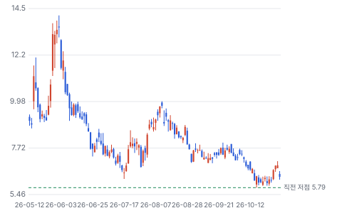
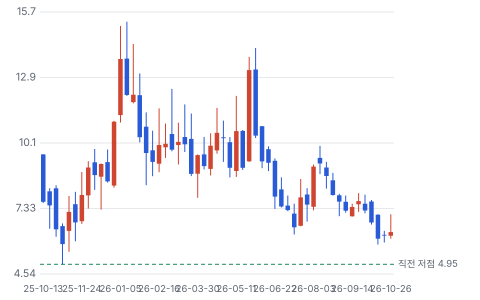
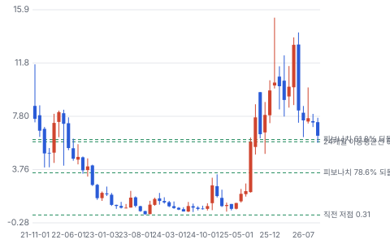
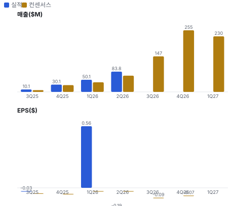
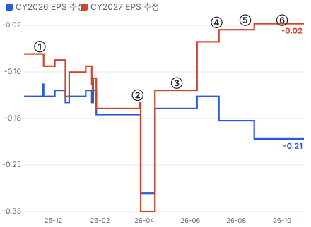
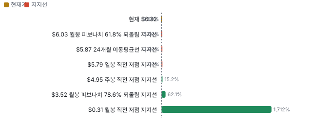
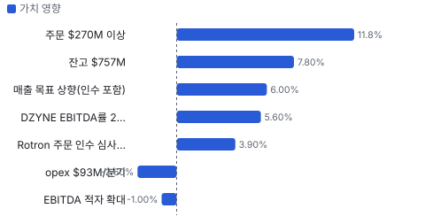
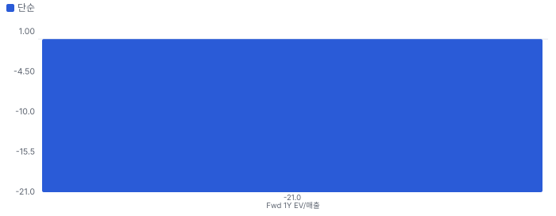
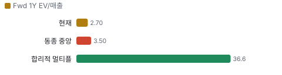
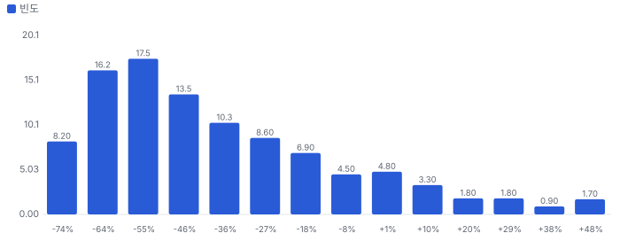

# 텐배거 리포트 2026-11-02 — 1년에 14곳을 샀다, 매출 시너지는 보였고 이익 시너지는 아직이다

> 2026-11-02 · Ondas(ONDS) · 기업: 드론·대드론·무인기·지상 로봇을 국방·국토안보·인프라 고객에 파는 방위 기술 회사(철도 무선 사업 일부)

## Chiip View

Neutral — 인수로 산 매출은 진짜로 크고 있다(프로포마 유기 성장 85%). 그러나 비용 시너지가 없고 EBITDA 적자가 커져, 인수 대가 \$1.8B가 자본비용을 벌 날은 빨라야 2029년이다. 지금 EV/매출 2.7배는 동종보다 싸 보이지만, 1년 동안 현금 소진과 미발행 주식이 그 할인을 설명한다. 11/12 3Q에서 적자 축소·증자 없음·DZYNE(미국 무인기·대드론 회사, 2026년 7월 인수) 흑자가 함께 나와야 할인이 풀린다.

## 대시보드
| 항목 | 값 | 설명 |
|---|---|---|
| 주가 | \$6.32 | 고점 대비 -55% · 1년 +0% |
| 시가총액 | \$4.00B | EV \$3.06B |
| 업사이드 | -10% | 목표주가 \$5.70 · 다운사이드 -34% · 손익비 0.9 |
| 구매등급 | Neutral | 애널리스트 11명: Strong Buy 9 · Buy 1 · Neutral 1 · Sell 0 · Strong Sell 0 |
| 멀티플 | Fwd 1Y EV/매출 2.7배 | 동종 중앙값 3.5배 |
| 가이던스 FY2026 | \$538M | 컨센서스 \$536M |
| 알파 | 6.0/10 | 텐배거 가능성 점수 |
| 이벤트 | 3Q26 실적(장 전, 8:30 ET) | 2026-11-12 |

## 한 장 요약
- **기업가치를 결정하는 내러티브** **시장이 산 이야기는 'Ondas가 드론 전쟁 시대의 방산 통합자가 된다'는 것이다.** 1년 동안 회사 14곳을 약 \$2.1B에 사 탐지·사이버 탈취·요격 드론·장기 체공 무인기·지상 로봇을 한 지붕에 모았다. 2027 매출 컨센서스는 2025년 8월 \$56M에서 \$1,046M가 됐다. 그런데 주가는 1월 \$13~15에서 10/30 \$6.32다. 같은 기간 주식은 2.8배로 늘었고 조정 EBITDA 적자는 커졌다. 값은 인수한 사업이 자본비용 이상을 벌어 오느냐로 갈린다.
- **밸류에이션 모델로 본 주가 상방은 어디까지인가?** **목표주가 \$5.70(-10%), 약세와 기본 사이(약세 쪽 13%)다.** 강세 \$8.18(+29%)는 Fwd 1Y EV/매출 3.5배를 강세 매출에 적용한 값이다. 기본 \$5.95, 약세 \$4.16. 손익비 0.9, DCF 기준 업사이드 -40%.
- **수주는 어디까지 왔나?** 프로포마 수주잔고(6월 말) 미확인, 100% 매출 \$0.76B · 6/30~10/1 새 주문 미확인, 100% 매출 \$0.27B · Mistral 미 육군 LUS-IDIQ(미 육군 무인 체계 포괄 조달 계약) 주문 미확인, 100% 매출 \$0.24B. 6월 말 프로포마 수주잔고 약 \$757M에 6/30~10/1 새 주문 \$270M 이상이 더해졌다. 회사가 말한 2년 파이프라인은 \$11B 이상이다. 2026 매출 목표 \$525~550M을 넘는 잔고다.
- **M&A 시너지는 비용 대비 얼마인가?** **매출로는 남는 장사, 이익으로는 아직 본전 아래다.** 공시된 인수 대가는 약 \$1.83B(현금 약 \$0.57B, 주식 약 1.65억 주)다. 현금 대가를 증자로 마련한 몫까지 치면 완전 희석 주식의 약 38%를 M&A(인수합병)에 썼다. 그 대가로 FY2027 주당 매출은 \$0.25에서 \$1.70가 됐다(×6.7). 그러나 인수 대가가 자본비용(WACC 10.4%)을 벌려면 연 EBITDA 약 \$320M이 필요하다. 2028 매출 컨센서스로는 전사 EBITDA률(EBITDA ÷ 매출) 약 23%, 2029년이면 약 17%다. 가장 큰 DZYNE도 회사 목표대로 2028 EBITDA률 25%를 내면 대가 대비 약 11%라 기준선 17.5%에 못 미친다.
- **지금 가격은 무엇을 가정하나?** EV 약 \$2.74B(기본 주식 기준, 미발행 인수 주식을 더하면 약 \$3.06B)는 다음 4개 분기 매출 약 \$1.0B의 2.7배다. 공시 인수 대가 \$1.83B를 빼면 시장이 기존 사업과 앞으로의 성장에 얹는 값은 약 \$0.9B다. 현금흐름으로 풀면 지금 가격은 5년 매출 CAGR 약 60%를 요구해 컨센서스(2026→2030 약 44%)보다 높다. DCF가 낮게 보는 이유는 GAAP 영업이익률(인수 무형자산 상각 뒤)을 5년차 15%로 두었기 때문이다.
- **왜 움직였나?** 2025년 7월 \$2.12에서 2026년 1월 \$14 부근까지 약 6배가 됐다. 대드론 수요와 인수 발표가 이끌었다(2025-11 Sentrycs(이스라엘 사이버 대드론 회사) 전후 +19~30% 거래일이 이어졌다). 이후 6/2 CEO(최고경영자)의 238만 주 매도 다음 날 −14.5%, 7/29 −13.5%(원인 미확인), 8/13 2Q 실적 −8.8%가 나왔다. 10월에도 주문 \$270M 이상 발표에 주가는 반응하지 않았다. 증자·주식 대가가 공급을 늘렸다.
- **2Q 콜에서 무엇이 바뀌었나?** 좋아진 것은 2026 매출 목표 '최소 \$390M' → \$525~550M(DZYNE·Omnisys 포함), 프로포마 잔고 \$757M, 2분기 주문 \$175M이다. 나빠진 것은 조정 EBITDA −\$50.6M(1Q −\$10.9M)과 SBC(주식 보상 비용) \$69.1M이다. 회사는 opex 중 성장 투자 \$29M을 따로 표시해 '투자'라고 설명했지만 비용 시너지 숫자는 내지 않았다.
- **무엇이 바뀌면 판단이 달라지나?** 3Q·4Q에 조정 EBITDA 적자가 줄고 DZYNE이 흑자를 내며 증자 없이 현금이 버티면 강세 쪽이다. 반대로 적자가 커지거나, 새 증자가 나오거나, 영업권 손상이 나오거나, 프로포마 유기 성장이 30% 아래로 꺾이면 약세 쪽이다. 다음 확인은 11/12 3Q 실적과 10-Q의 인수별 매출·영업권이다.

## 한눈에 보기

**일봉**

**주봉**

**월봉**

**분기 매출·EPS 실적과 컨센서스**

**EPS 리비전**

① 25-11-13 3Q25 실적, +19.1% · EPS 리비전 +17%
② 26-03-23 4Q25 실적·인수 다수 · EPS 리비전 +106%
③ 26-05-14 1Q26 실적, +26.5% · EPS 리비전 +0%
④ 26-07-06 DZYNE 인수 · EPS 리비전 -40%
⑤ 26-08-13 2Q26 실적, −8.8% · EPS 리비전 -33%
⑥ 26-10-01 주문 \$270M 이상 · EPS 리비전 +0%

**밸류에이션 주가 시나리오**

**주가별 업사이드**

**어닝콜 변화별 주주가치 영향**

**멀티플 프리미엄**

**합리적 멀티플**

**몬테카를로**

해석: 3,000번 중 392번(13%)에서 가치가 지금 주가 이상이었다. 가정을 흔들어도 지금 주가를 뒷받침하지 못하는 경우가 더 많다. 가운데 값은 0.55배이고, 열 번 중 여덟 번은 0.32~1.04배 사이에 든다.

## 내러티브

> **기업가치를 결정하는 이야기:** Ondas는 드론·대드론·지상 로봇을 국방·국토안보·인프라 고객에 판다. 매출의 대부분은 2025년 10월 이후 산 회사들에서 나온다. 그래서 기업가치는 세 숫자로 갈린다. 인수한 사업이 계속 빨리 크느냐(프로포마 유기 성장 85%), 그 매출이 이익이 되느냐(2028 EBITDA률), 그리고 그 과정에서 주식이 얼마나 더 늘어나느냐다. 인수 대가 약 \$1.8B(공시분)는 자본비용 약 11%로 보면 세후 영업이익 연 \$200M을 벌어야 본전이다.

> **멀티플·EPS 프리미엄**
> **멀티플:** Fwd 1Y EV/매출 약 2.7배로 동종 중앙값 약 3.5배보다 낮다. DZYNE을 살 때 Ondas의 EV/2027 매출은 약 3.9배였고 DZYNE은 2.9배에 샀다. 지금은 2.6배라 같은 거래를 주식으로 하면 주당 매출이 줄어든다.
> **EPS:** FY2027 매출 컨센서스는 7/8 \$1,026M에서 \$1,046M로 소폭 올랐지만, FY2026 EBITDA는 −\$85M에서 −\$125M로 나빠졌다. 주가는 2Q 실적 전(8/12) \$9.77에서 −35%다.

### 투자자들은 왜 열광했나

세 가지가 겹쳤다. 우크라이나·중동에서 드론이 전장을 바꿨고, 미국이 2025년 드론·대드론 행정명령과 예산을 냈으며, Ondas가 그 흐름에 맞춰 인수를 쏟아냈다. 주가는 2025년 7월 \$2.12에서 2026년 1월 \$14 부근까지 약 6배가 됐다. 식은 이유는 증자·주식 대가로 인한 희석, 커진 적자, CEO 지분 매도다.

### 무엇이 기업가치를 바꾸나

> **구조적 체질 변화**
> **변화:** 철도 무선 회사에서 드론·대드론 방산 회사로 바뀌었다. 2025년 매출 \$50.7M의 98%가 OAS(Ondas Autonomous Systems, 드론·대드론·지상 로봇 부문)였고, 2026년 목표 \$525~550M의 대부분은 인수한 회사에서 나온다.
> **증거:** 10-K·2Q 콜. 분기 매출 1Q25 \$4.2M → 2Q26 \$83.8M
> **반증:** 2027년 매출이 컨센서스 \$1,046M보다 20% 이상 낮다

> **고부가 믹스 확장**
> **변화:** 총이익률이 높은 소프트웨어·사이버 대드론과 흑자 방산 사업(DZYNE)을 더해 이익률을 끌어올리려 한다.
> **증거:** 2Q 조정 총이익률 50.4%. DZYNE EBITDA률 2027 10%대 중반·2028 20%대 중반 목표. Omnisys는 소프트웨어
> **반증:** 2027 조정 EBITDA률이 0% 아래에 머문다

> **기술 혁신**
> **변화:** 드론을 무선 신호를 탈취해 착륙시키는 사이버 대드론(Sentrycs)과 요격 드론이 기존 미사일·포보다 싸게 막는다.
> **증거:** Sentrycs \$99,000 시스템(10/29). IonStrike(DZYNE의 요격 드론)는 이란제 자폭 드론 요격용
> **반증:** 사이버 탈취가 안 되는 자율 비행·광섬유 유도 드론이 주류가 된다

> **실행 속도**
> **변화:** 주문이 매출이 되는 데 약 6~12개월이 걸린다(잔고 \$757M ÷ 하반기 연환산 매출 약 \$0.8B, 추정). 인수도 빠르다 — 발표에서 마감까지 0~3개월. **납품 리드타임 6~12개월.** 피어 중앙값 9개월과 같다(AeroVironment 8~10개월). 이전 대비 미확인.
> **증거:** 2Q 콜 잔고·가이던스. AeroVironment는 수주잔고(funded) \$1.5B ÷ 연 매출 약 \$2.1B로 약 8~10개월. World View(미국 성층권 기구 감시 회사) 3/23 계약 → 4/1 마감, Omnisys 5월 계약 → 5/21 마감
> **반증:** 3Q 콜에서 통합 지연·인도 지연이 나온다

> **M&A**
> **변화:** 1년간 인수 14건, 공시 대가 합 약 \$1.83B(현금 약 \$0.57B·주식 약 1.65억 주). 매출로는 주당 기준 크게 늘었지만(FY2027 주당 매출 약 6.7배) 이익으로는 아직 본전 전이다. 아래 '인수 시너지 정량화' 표 참조.
> **증거:** 보도자료·10-Q. 6월 말 영업권 \$661M·무형자산 \$583M(1년 전 합 \$53M). DZYNE 2027E 매출 2.9배, Cyberhawk(영국 인프라 드론 검사 회사) 2.8배, Mistral 잔고 0.66배에 샀다
> **반증:** 영업권 손상 처리, 또는 2029년 전사 EBITDA가 인수 본전선 연 \$320M에 못 미친다

> **정책·입법 연관성**
> **재정정책:** OBBBA(공법 119-21)가 국방 예산을 늘리며 무인 체계·대드론 항목을 넣었다. FEMA(미 연방재난관리청) 대드론 보조금 프로그램(\$250M, 주·지방 정부용)이 2026 월드컵을 계기로 커졌다(금액은 10/28 보도자료 기준, Ondas 몫 미확인). 공법 119-21, 10/28 보도자료 반증: 보조금이 경쟁사 제품 위주로 집행된다 의회 동의 10/10 — 하원 5/5(OBBBA 하원 본회의 통과) · 상원 5/5(OBBBA 상원 본회의 통과).
> **행정명령:** 2025년 6월 행정명령 2건('미국 드론 우위', '미국 영공 주권 회복')이 국산 드론 구매·대드론 배치를 지시했다. 2025-06-06 행정명령 반증: 후속 조달이 나오지 않는다 의회 동의 0/10 — 하원 0/5(행정명령 — 의회 절차 없음) · 상원 0/5(행정명령 — 의회 절차 없음).
> **연관입법:** American Security Drone Act(FY2024 국방수권법)가 연방 기관의 중국산 드론 구매를 막아 미국·동맹국산 드론 수요를 만든다. FY2024 NDAA(미 국방수권법) 반증: 규제 예외가 넓어진다

> **CAPEX 낙수효과**
> **변화:** 미국·NATO(북대서양조약기구)·이스라엘의 드론·대드론 예산 증가가 직접 주문이 된다. 데이터센터·발전소 보안 수요도 생겼다.
> **증거:** FEMA 대드론 보조금 \$250M, 미 육군 LUS-IDIQ, 유럽 배회형 탄약 주문. 데이터센터 보호 수요(Barron's 10/6 제목)
> **반증:** 미 국방 예산의 드론 항목이 삭감된다

### 내러티브 근거

> '드론 전쟁 시대의 방산 통합자'라는 이야기는 2025년 7월 \$2.12에서 2026년 1월 \$14 부근까지 주가를 약 6배로 올렸다. 2026년에는 인수 14건·약 \$2.1B로 실행됐지만, 주가는 1월 \$13~15에서 10/30 \$6.32로 반 넘게 빠졌다. 공매도가 유통 주식의 44%다. 동종 대비 멀티플 차이 -21% 중 회사 고유 몫은 -93%다. 단계는 과밀, 쏠림은 높음이다.

> **드론·대드론 수요 폭발** · 강화
> **논리:** 우크라이나·중동 전쟁 이후 드론과 대드론이 각국 국방 예산의 새 항목이 됐다
> **숫자:** 프로포마 잔고 \$757M, 6/30 이후 주문 \$270M 이상, 2년 파이프라인 \$11B
> **반증:** 3Q 주문·잔고가 줄어든다

> **인수로 만든 방산 통합자** · 유지
> **논리:** 작은 기술 회사들을 사서 미국·이스라엘·유럽 조달 통로에 얹는다
> **숫자:** 1년간 인수 14건·약 \$2.1B, 2027 매출 컨센서스 \$56M(2025-08) → \$1,046M
> **반증:** 프로포마 유기 성장이 꺾이거나 대형 인수가 손상 처리된다

> **이익 경로** · 약화
> **논리:** DZYNE 같은 흑자 사업이 붙으며 2028년 흑자 전환
> **숫자:** FY2027 EBITDA 컨센서스 −\$17.5M, FY2028 EPS \$0.21
> **반증:** 4Q26 조정 EBITDA가 흑자에 가까워진다

> **반대 내러티브: 희석 기계** · 강화
> **논리:** 증자·주식 대가·SBC로 주식이 계속 늘고 주당 가치는 늘지 않는다
> **숫자:** 주식 2.07억(2025-06) → 5.82억(10월), 2Q SBC \$69M, 공매도 44%
> **반증:** 증자 없이 현금 소진이 멈추고 주식 수가 안정된다

## 포트폴리오

| 제품·서비스 | 구분 | 무엇 | 쓰는 곳 | 돈 버는 방식 |
|---|---|---|---|---|
| 대드론(Sentrycs·Iron Drone(Airobotics의 요격 드론)·Dronebuster(DZYNE의 휴대형 드론 전파 방해기)·IonStrike) | 제품군 | 드론 탐지·사이버 탈취·전파 방해·요격 | 경기장·국경·기지·발전소 | Sentrycs 프로포마 +298% YoY, 금액 미공시 |
| 무인기(DZYNE ULTRA(DZYNE의 장기 체공 무인기)·LEAP(DZYNE의 장기 체공 통신 중계 플랫폼)·Blitz(DZYNE의 소형 공격 드론), World View Stratollite(World View의 성층권 기구)) | 제품군 | 장기 체공 감시·통신 중계·소형 공격 드론·성층권 기구 | 미군 정보·감시·정찰 | DZYNE 2026E \$191M, 2027E \$300M 이상 |
| 드론 기지·검사(Airobotics(이스라엘 드론 기지 회사, 2023년 인수) Optimus(Airobotics의 무인 드론 기지), Cyberhawk) | 제품군 | 무인 드론 기지와 인프라 드론 검사 서비스 | 도시 보안·전력·석유 설비 | Cyberhawk FY2027E(2027 회계연도 추정) \$45M(95% 장기 계약) |
| 지상·정밀타격(Roboteam(이스라엘 무인 지상 차량 회사)·4M·GATE(정밀타격 부품 회사 GATE Technologies)·Bron(정밀타격 부품 회사 Bron Technologies)) | 제품군 | 무인 지상 차량·지뢰 제거·유도무기 신관 | 보병·공병·탄약 | 유럽 ESAD(전자식 안전·장전 장치(유도무기 신관)) \$56M 주문(10월) |
| Ondas Networks(산업용 무선 부문) | 부문 | 철도·전력용 산업 무선(FullMAX(Ondas Networks의 산업용 무선 기술)) | 북미 철도 | 매출의 약 2% |

## 수주·파이프라인

> **2026-10-01 기준 7건.** 확정 \$1.03B. 공시 6월 말 프로포마 수주잔고(DZYNE·Cyberhawk 포함) \$0.76B. 서로 겹치는 항목은 합계에서 뺐다.

**실행 속도와 방해 요인**
| 항목 | 상태 | 실행 속도 | 방해 요인 |
|---|---|---|---|
| 프로포마 수주잔고(6월 말) | 확정 | 2026 하반기 매출 목표 약 \$390~415M(연간 목표 − 상반기 \$134M) — 잔고의 절반가량이 6개월 안 매출이 되는 속도(추정) | 생산 능력 확대 · 방산 납기·검수 |
| 6/30~10/1 새 주문 | 확정 | 3Q 초 \$105M + 8월 하순~10/1 \$165M 이상, 2027 매출 가시성 | 매출 인식 시점 |
| Mistral 미 육군 LUS-IDIQ 주문 | 확정 | 잔고에 포함 | 겹침 — 합계에서 뺀다 |
| 유럽 배회형 탄약 ESAD 주문 | 확정 | GATE·Bron 인수 뒤 첫 대형 주문 | 겹침 — 6/30 이후 주문에 포함 |
| FEMA 대드론 보조금 프로그램 | 프레임워크 | 주·지방 정부가 보조금으로 구매 — Ondas 몫 미확인 | 보조금 배분·입찰 경쟁 |
| 4M Defense 이스라엘 지뢰 제거 | 조건부 | 초기 \$15.8M 계약, 전국 사업 최대 \$60M | 후속 계약 |
| 2년 파이프라인 | 파이프라인 | 회사 추정 | 수주 전환율 미공시 |

## 해자

> 해자는 아직 '인수로 모은 제품 폭'이다. 탐지·사이버 탈취·요격 드론·무인기를 한 회사가 다 가진 곳은 드물다. 그러나 묶음이 따로 파는 것보다 더 팔린다는 증거(교차 판매 매출)는 아직 공시되지 않았다.

> **대드론 풀스택(탐지·사이버 탈취·요격)** · 보통
> **해자:** Sentrycs(사이버 탈취), Iron Drone(요격 드론), DZYNE Dronebuster·IonStrike(전파 방해·요격)를 한 회사가 가져 경기장·국경·기지 대드론을 일괄로 판다.
> **근거:** 2Q 콜·10월 보도자료. Sentrycs 프로포마 +298% YoY, 2026 FIFA(국제축구연맹) 월드컵 경기장 대부분 보호. Sentrycs \$99,000 시스템 출시(10/29)
> **숫자:** Sentrycs 인수가 \$225M(2025-11)
> **깨지는 조건:** FEMA 대드론 보조금(\$250M) 집행에서 Ondas 몫이 작거나, 경쟁사(Axon-Dedrone 등)가 큰 계약을 가져간다

> **미 국방 조달 통로(Mistral·DZYNE)** · 보통
> **해자:** Mistral의 미 육군 LUS-IDIQ 등 조달 계약과 DZYNE의 프로그램 후보(ULTRA)로 미국 정부에 직접 팔 통로를 샀다.
> **근거:** 2Q 콜. Mistral 경유 LUS-IDIQ 주문 약 \$240M, Mistral 인수 시 잔고 \$264M. ULTRA가 국방부 정식 사업 후보
> **숫자:** Mistral 대가 \$175M ÷ 잔고 \$264M = 0.66배
> **깨지는 조건:** ULTRA가 정식 사업에 채택되지 않거나 IDIQ(수량·시점을 정하지 않은 미 정부 포괄 계약) 주문이 상한 대비 낮게 머문다

> **인수 통합 플랫폼** · 약함
> **해자:** 인수한 회사가 Ondas 안에서 더 빨리 큰다는 주장(프로포마 유기 성장 85%)이 핵심이다.
> **근거:** 2Q 콜. 프로포마 유기 성장 85%, Rotron 2Q 주문 \$34.2M(심사 때 2026 매출 \$25M). 비용 시너지는 공시 없음, 조정 EBITDA 적자 확대
> **숫자:** 2Q 조정 현금 opex \$93M, SBC \$69.1M
> **깨지는 조건:** 3Q·4Q에 프로포마 유기 성장이 30% 아래로 떨어지거나 opex가 매출보다 빨리 는다

## 경영진·네트워크

> 의장·CEO Eric Brock이 2018년부터 인수 전략을 이끈다. 방산 자회사 Ondas Defense 의장으로 전 Mossad(이스라엘 대외 정보기관) 국장 David Barnea를 영입했다. CEO는 6월 옵션 행사 뒤 238만 주를 장내 매도했다.

> **Eric A. Brock** · 의장·CEO·사장 · 2018
> **프로필:** 2018년 Ondas 상장 이후 의장·CEO. 그 전 경력은 미확인
> **비즈니스:** 2026-06-01 옵션 450만 주 행사, 6/2 장내 매도 237.8만 주 약 \$31.9M(Form 4)
> **정계:** 미확인
> **동문:** 미확인
> **사모임:** 미확인

> **David Barnea** · Ondas Defense 사장·의장 · 2026
> **프로필:** 전 이스라엘 대외 정보기관(Mossad) 국장
> **비즈니스:** 다른 상장사 이사 겸직 미확인
> **정계:** 이스라엘 정부 고위직 출신
> **동문:** 미확인
> **사모임:** 미확인

> **Neil Laird** · CFO · 미확인
> **프로필:** 미확인
> **비즈니스:** 2026-09-24 장내 매도 4,952주
> **정계:** 미확인
> **동문:** 미확인
> **사모임:** 미확인

**네트워크 정량화**
| 연결 | 강도 | 닿는 매출 | 가중 노출 | 매출 대비 | 근거 |
|---|---|---|---|---|---|
| 정계: 전 Mossad 국장이 방산 자회사 의장 — 이스라엘·동맹국 정부 조달과 연결 가능 | 3/5 | 미확인 | 미확인 | 미확인 | 이스라엘 정부 매출이 공시되지 않아 금액을 잡지 않았다 2Q 콜 |
| 비즈니스: Palantir와 합작 Regna AI(10월) — 국방 AI 소프트웨어 판로 | 2/5 | 미확인 | 미확인 | 미확인 | 합작사 매출 계획 미공시 10/13 보도자료 |

가중 노출은 연결이 닿는 매출의 크기다. 연결이 그 매출을 만들었다는 뜻이 아니며, 인과는 공개 자료로 입증하지 못한다.

## 약세 논리 및 셀온 조건

| 약세 논리 | 근거 | 가를 자료 |
|---|---|---|
| 희석 기계 | 주식 2.07억(2025-06) → 5.82억(10월), 미발행 인수 주식·조건부 대가 남음, SBC 분기 \$69M | 3Q 10-Q 주식 수, 새 증자 여부 |
| 매출을 샀지 이익을 사지 않았다 | FY2027 EBITDA 컨센서스 −\$17.5M, 2Q 조정 EBITDA −\$50.6M | 3Q·4Q 조정 EBITDA, DZYNE 이익률 |
| 영업권 손상 위험 | 영업권+무형자산 약 \$2.1B(추정)가 시가총액의 약 57%, 주가는 대부분 거래 때보다 낮다 | 4Q 손상 검사, 10-K |
| 경쟁 심화 | AeroVironment·Red Cat·Axon(Dedrone) 등 대드론·드론 경쟁이 치열하다. 순위 4(매도), Oppenheimer 매도 아이디어 목록 | FEMA 보조금 배분, 미 육군 경쟁 입찰 |
| 거버넌스 | CEO가 6월 옵션 행사 뒤 238만 주(\$31.9M)를 장내 매도했다 | Form 4, 위임장 보상 |

> **셀온 조건**
> **조건 1:** 4Q26 조정 EBITDA가 3Q보다 나빠진다(이익 경로 붕괴).
> **조건 2:** 1년 안에 시가 증자를 다시 한다(현금 \$0.9B대인데도 증자하면 소진 속도가 문제다).
> **조건 3:** 영업권 손상 처리가 나온다.
> **조건 4:** 프로포마 유기 성장이 30% 아래로 꺾인다(매출 시너지 근거 소멸).

## 어닝콜 변화

**직전 콜 대비 새로 나오거나 바뀐 내용 → 가치 영향**
| 항목 | 내용 | 직전 콜 | 최신 콜 | 모델 동인 이동 | 확신도 | 가치 영향 |
|---|---|---|---|---|---|---|
| 업데이트 | 2026 매출 목표 | 최소 \$390M | \$525~550M | 기준연도 매출 +\$0.05B | 0.8 | +6.0% |
| 부정 | 2Q 조정 EBITDA | 1Q −\$10.9M | 2Q −\$50.6M(발표 전 추정 −\$8.3M) | 출발 이익률 -3.0% | 1.0 | -1.0% |
| 신규 | 6/30 이후 주문 | 2Q 주문 \$175M | 6/30~10/1 \$270M 이상(유럽 ESAD \$56M 포함) | 1년차 성장률 +3.0% | 0.8 | +11.8% |
| 업데이트 | 프로포마 수주잔고 | 미공시 | 6월 말 약 \$757M(DZYNE·Cyberhawk 포함) | 1년차 성장률 +2.0% | 0.8 | +7.8% |
| 부정 | 현금 opex | 미공시 | 조정 현금 opex \$93M, 그중 성장 투자 \$29M | 목표 이익률 -1.0% | 0.5 | -2.6% |
| 신규 | DZYNE 이익률 목표 | 없음 | 2027 10%대 중반 → 2028 20%대 중반 | 목표 이익률 +2.0% | 0.5 | +5.6% |
| 업데이트 | Rotron 실적 | 2026 매출 \$25M로 심사 | 2Q 주문만 \$34.2M | 1년차 성장률 +1.0% | 0.5 | +3.9% |
| **합계** | 단독 합 |  |  | 동시 적용 +31.3% |  | **+31.4%** |

**사건별 EPS 리비전**
| # | 날짜 | 구분 | 사건 | CY2026 EPS 전→후 | CY2027 EPS 전→후 | 리비전 | 주가 반응 |
|---|---|---|---|---|---|---|---|
| ① | 25-11-13 | 실적 | 3Q25 실적, +19.1% | \$-0.14 → \$-0.14 | \$-0.07 → \$-0.09 | +17.2% | +19.1% |
| ② | 26-03-23 | 실적 | 4Q25 실적·인수 다수 | \$-0.17 → \$-0.30 | \$-0.16 → \$-0.33 | +106.2% | -2.0% |
| ③ | 26-05-14 | 실적 | 1Q26 실적, +26.5% | \$-0.16 → \$-0.16 | \$-0.13 → \$-0.13 | +0.0% | +26.5% |
| ④ | 26-07-06 | 내러티브 | DZYNE 인수 | \$-0.14 → \$-0.18 | \$-0.05 → \$-0.03 | -40.0% | +5.5% |
| ⑤ | 26-08-13 | 실적 | 2Q26 실적, −8.8% | \$-0.18 → \$-0.21 | \$-0.03 → \$-0.02 | -33.3% | -8.8% |
| ⑥ | 26-10-01 | 내러티브 | 주문 \$270M 이상 | \$-0.21 → \$-0.21 | \$-0.02 → \$-0.02 | +0.0% | -2.9% |

## 밸류에이션

> **목표주가 \$5.70, 업사이드 -10%.** 자리는 약세와 기본 사이(약세 쪽 13%)이고 도달 확률은 약 53%다. 기본 \$5.95, 강세 \$8.18(+29%), 약세 \$4.16(-34%). DCF 기준 업사이드는 기본 -40%, 강세 +0%, 약세 -62%다(WACC 10.4%).

선행 EBITDA·EPS가 적자라 EV/매출로 값을 매겼다. 순현금은 3Q 말 추정 약 \$0.94B(6월 말 현금 \$1.39B에서 DZYNE·Cyberhawk 현금 대가와 3Q 현금 유출을 뺐다)를 그대로 더했고, 1년 동안의 추가 현금 소진(분기 약 \$60~90M)은 넣지 않았다. 주식 수는 미발행 인수 주식을 더한 완전 희석 약 6.3억 주다.

**인수 시너지 정량화 ① 거래별 대가와 가져온 것**
| 거래 | 마감 | 대가 | 지급 방식 | 인수 때 제시한 것 | 대가 배수 | 인수 뒤 확인된 것 |
|---|---|---|---|---|---|---|
| DZYNE(무인기·대드론) | 2026-07 | \$875.8M | 현금 \$200M + 약 8,500만 주(주당 약 \$7.94) | 2026E 매출 \$191M, 2027E \$300M 초과, EBITDA률 2027 10%대 중반·2028 20%대 중반 | 2027E 매출 2.9배 | ULTRA·IonStrike 주문 확보(10/1) |
| Sentrycs(사이버 대드론) | 2025-11 | \$225M | 현금 \$125M + 주식 \$29.4M + 추가 최대 \$70.6M | 미공시 | 미확인 | 프로포마 매출 +298% YoY(2Q) |
| Omnisys(전장 AI 소프트웨어) | 2026-05 | \$196.6M | 전액 주식 | 미공시 | 미확인 | 미확인 |
| Mistral(미 국방 조달) | 2026 2Q | \$175M | 전액 주식(일부 3년 에스크로) | 인수 시 잔고 \$264M | 잔고 0.66배 | 미 육군 LUS-IDIQ 주문 약 \$240M |
| World View(성층권 감시) | 2026-04 | \$140~150M | 현금 \$7~21M + 최대 1,278만 주 | 미공시 | 미확인 | 미확인 |
| Cyberhawk(인프라 드론 검사) | 2026 3Q | 약 \$125M | 95% 현금 | FY2027 매출 \$45M(95% 장기 계약·구독) | 2027E 매출 2.8배 | 영국 SSE(영국 전력 회사) 다년 계약 |
| Insignito·Ottopia·Caribou | 2026-09 | \$56M(+성과 보상 최대 \$32M) | 현금 또는 주식 | 미공시 | 미확인 | - |
| Aran Defense(이스라엘 생산) | 2026-08 계약 | 약 \$33M | 현금 또는 주식 | 생산 시설 4,400㎡ | - | - |
| Rotron(영국 무인기) | 2026-03 | 미공시 | 미공시 | 2026 매출 \$25M로 심사 | 미확인 | 2Q 주문만 \$34.2M(심사의 1.37배) |
| Roboteam·4M·Bird·Indo Earth(인도 토지 정리 회사)·GATE·Bron | 2025-10~2026-09 | 미공시 | 4M 잔여 30%는 35.3만 주 | 4M 이스라엘 지뢰 제거 \$15.8M → 최대 \$60M | - | 4M 프로포마 +258%, 유럽 ESAD \$56M(GATE·Bron) |
| **공시 합계** |  | **약 \$1.83B** | 현금 약 \$0.57B · 주식 약 1.65억 주(\$1.45B) | 확인된 2027E 매출 \$345M(DZYNE+Cyberhawk) |  |  |

**인수 시너지 정량화 ② 치른 값과 얻은 것**
| 항목 | 값 | 근거·계산 |
|---|---|---|
| 치른 값 ① 현금 | 약 \$0.57B | 현금흐름표 인수 지출 3Q25~2Q26 \$252M + 3Q26 DZYNE·Cyberhawk 약 \$319M(추정) |
| 치른 값 ② 주식 | 약 1.65억 주, 발행 당시 \$1.45B → 지금 가격 \$1.04B | 2026 상반기 7,577만 주 \$741.5M + Sentrycs 410만 주 + DZYNE 약 8,500만 주. 매도자는 주가 하락으로 약 28%를 잃었다 |
| 치른 값 ③ 주당 몫 | M&A 몫 약 2.4억 주 = 완전 희석 약 6.3억 주의 약 38% | 주식 대가 1.65억 주 + 현금 대가를 평균 증자가 약 \$7.3로 환산한 약 7,800만 주 |
| 치른 값 ④ 장부 | 영업권+무형자산 \$1.24B(6월 말, 1년 전 \$53M) → DZYNE·Cyberhawk 반영 후 약 \$2.1B 추정 | 조건부·미지급 인수 대가 \$134M, 2Q 공정가치 변동 비용 \$19M |
| 얻은 것 ① 매출 | FY2027 매출 컨센서스 \$56M(2025-08) → \$1,046M | 주당 \$0.25 → \$1.70(×6.7). M&A 없이 기존 사업이 연 70% 컸다고 가정하면 주당 약 \$0.40 — M&A가 주당 매출을 약 4.2배로 만들었다 |
| 얻은 것 ② 매출 시너지 | 프로포마 유기 성장 85%(2Q) | Sentrycs +298%, 4M +258%, Airobotics +112%, Rotron 주문 1.37배 — 인수 뒤 더 빨리 큰다는 증거는 있다 |
| 얻은 것 ③ 비용 시너지 | 공시 없음(음수) | 조정 EBITDA 1Q −\$10.9M → 2Q −\$50.6M, 현금 opex \$93M/분기, SBC \$69M/분기 |
| 얻은 것 ④ 이익 | FY2027 EBITDA 컨센서스 −\$17.5M(주당 −\$0.03) | 주당 이익으로는 아직 증명되지 않았다 |

**인수 시너지 정량화 ③ 본전선 — 인수 대가가 자본비용을 벌려면**
| 지표 | 값 | 계산 |
|---|---|---|
| 필요 세후 영업이익 | \$190M/년 | 공시 인수 대가 \$1.83B × WACC 10.4% |
| 필요 EBITDA | 약 \$320M/년 | 세전 환산 \$240M + 인수 무형자산 상각 약 \$80M(추정) |
| 필요 EBITDA 수익률 | 약 17.5% | 필요 EBITDA ÷ 인수 대가 |
| DZYNE 2028E EBITDA 수익률 | 약 11% | 매출 \$375M(추정) × 25% = \$94M ÷ \$876M — 회사 목표대로 가도 기준선 아래 |
| 전사 EBITDA률이 넘어야 할 선 | 2028 약 23% · 2029 약 17% | 필요 EBITDA \$320M ÷ 매출 컨센서스 \$1,393M·\$1,888M. 2027 컨센서스는 −1.7% |
| 주식 통화 차익 | DZYNE 때 +32% → 지금 −10% | 7/2 Ondas EV ÷ FY2027 매출 3.8배로 2.9배짜리를 샀다. 지금은 2.6배라 같은 거래를 주식으로 하면 주당 매출이 준다 |
| 시장이 매긴 값 | EV \$2.74B − 인수 대가 \$1.83B = \$0.91B | 기존 사업·시너지·앞으로의 성장에 시장이 얹는 몫. 인수 대가를 지금 가격으로 환산하면 \$1.61B라 \$1.13B |

**판정: 매출 시너지는 확인, 비용 시너지는 없음, 자본 효율은 본전 아래.** 인수 대가 대비 확인된 2027E 매출은 DZYNE·Cyberhawk 두 건뿐이라 \$345M(대가 \$1.0B, 약 2.9배)이다. 나머지 \$0.83B어치 거래의 매출은 공시되지 않아 미확인이다. 본전 판정의 기준은 전사 EBITDA률이다. 2029년 약 17%를 넘으면 인수 대가가 자본비용을 번다. 3Q 10-Q의 인수별 매출·영업권 배분이 이 표의 빈칸을 채울 첫 자료다. 무형자산 상각 \$80M/년, DZYNE 2028 매출 \$375M, 평균 증자가 \$7.3은 추정이다.

> **약세 \$4.16 (-34%)** · 확률 30%
> **가정:** 2.1배 × 매출 \$0.80B
> **근거:** DZYNE·ULTRA 인도가 밀리고 이스라엘 쪽 주문이 줄어 다음 4개 분기 매출 \$0.80B(컨센서스 −20%)

> **기본 \$5.95 (-6%)** · 확률 45%
> **가정:** 2.8배 × 매출 \$1.00B
> **근거:** 컨센서스대로 다음 4개 분기 매출 약 \$1.0B, 잔고 \$757M과 6/30 이후 주문 \$270M이 매출로 바뀐다

> **강세 \$8.18 (+29%)** · 확률 25%
> **가정:** 3.5배 × 매출 \$1.20B
> **근거:** FEMA 대드론 보조금·미 육군 주문이 더해져 \$1.20B, 3Q·4Q 주문이 분기 \$200M을 넘는다

**멀티플 선정 — Fwd 1Y EV/매출**
| 단계 | 조정 | 근거 |
|---|---|---|
| 동종 중앙값 | 3.5배 | 범위 1.7~8.6배, 6곳 |
| 펀더멘털 | +0% | 합리적 멀티플 36.6배가 동종 중앙의 1/3~3배 밖이라 인정하지 않음(동종 이익률이 0 근처라 심리 배율이 폭주) |
| 해자 | +2% | 대드론 풀스택(탐지·사이버 탈취·요격) 보통 · 미 국방 조달 통로(Mistral·DZYNE) 보통 · 인수 통합 플랫폼 약함 |
| 내러티브 | -5% | 단계 과밀 |
| 사이클·실행 판단 | -15% | 인수 대가의 상당 부분을 주식으로 치렀고 미발행 주식 대가·조건부 대가가 남아 있다. 조정 EBITDA 적자가 커지고 SBC가 분기 매출의 80%를 넘어 희석이 계속된다. 공매도 비중 44%로 수급도 무겁다 |
| **선정** | **2.8배** | 지금 2.7배 |

**동종 레인지**
| 회사 | Fwd 1Y EV/매출 | 성장 | 영업이익률 | ROIC |
|---|---|---|---|---|
| AVAV | 2.9 | 13% | -2% | -1% |
| KTOS | 3.2 | 31% | 7% | 4% |
| MRCY | 4.6 | 11% | 5% | 2% |
| ESLT | 3.7 | 15% | 11% | 17% |
| AXON | 8.6 | 30% | 1% | 1% |
| RCAT | 1.7 | 221% | -150% | -53% |
| **Ondas** | 2.7 |  |  |  |

지금 주가가 요구하는 5년 매출 CAGR 60%, 기본 시나리오 38%. 몬테카를로 중앙값 업사이드 -45%.

> 의사결정 보조(투자자문 아님): ① 매수 매력: 연 기대수익 -0.4% (자기자본비용 10.4% 대비 -10.7%p) · 자본비용 초과 확률 11% · 안전마진 0.32 → 정량 신호 약함 / ② 위험 예산 지표(이론): 0% — 기대수익이 자기자본비용에 못 미침(무위험 대비 켈리 0%는 참고) · 5년 하위10% -52% · 30%+ 손실 확률 34% / ③ 상방(5년): 기대 0.98배 · 2배 4% · 3배 0% · 10배 0% · 상위10% 1.66배

## 시장 평가

> **셀사이드(IB 애널리스트)**
> **한 줄:** 매출 추정은 인수 때마다 뛰었고 의견은 좋다. EBITDA 추정은 오히려 나빠졌다
> **애널리스트 의견:** 11명 — 강력 매수 9·매수 1·보유 1 — 매수 일색이다. 다만 Oppenheimer는 10월 중소형 매도 아이디어 목록에 넣었고 순위는 4(매도)다
> **목표가 평균·범위:** \$17.82 (\$7.25~\$25, 11명) — 10/30 종가 대비 +182%
> **FY2027 매출:** \$1,045.9M(5명) — 3월 \$336M → 3/27 \$703M → 7/8 \$1,026M. 인수가 추정을 끌어올렸다

> **바이사이드(기관 투자자)**
> **한 줄:** 패시브 자금은 늘었지만 내부자는 판다. 증자와 주식 대가로 주식 수가 1년 새 2.8배가 됐다
> **13F 2Q 변화:** 390곳 — 증가 157·감소 73, 순 +7,319만 주 — BlackRock +3,019만 주, Vanguard·State Street 증가 — 지수 편입 효과가 크다
> **내부자:** CEO 6/2 238만 주 \$31.9M 매도, 이사·CFO(최고재무책임자) 소량 매도 — 장내 매수 없음
> **증자:** 3Q25 \$394M · 4Q25 \$413M · 1Q26 \$969M — 1년간 약 \$1.78B

> **언론·업계**
> **한 줄:** 언론은 성장과 희석을 같은 무게로 다룬다
> **인수 보도:** 'M&A 블리츠', '쇼핑 스프리' — 인수 속도 자체가 기사가 됐다
> **주문 보도:** 6/30 이후 \$270M 이상 — 주문과 희석을 함께 다룬다

## 체크리스트

| 시점 | 무엇 | 의미 |
|---|---|---|
| 2026-11-12 | 3Q 실적·10-Q | DZYNE 첫 분기 매출·이익, 인수별 영업권 배분, 조정 EBITDA, 현금, 주식 수 |
| 2026년 11월 중순 | 13F 3Q 공시 | 공매도 44% 속 기관 보유 변화 |
| 2026년 4분기 | FEMA 대드론 보조금 집행 | Ondas 몫 |
| 2027년 3월(예상) | 4Q 실적·10-K·2027 가이던스 | 2027 매출·EBITDA 목표, 영업권 손상 검사 |
| 2027년 | ULTRA 국방부 정식 사업 결정 | DZYNE 2027E \$300M의 핵심 |

## 출처
- Ondas 7/6 DZYNE 인수 보도자료
- Ondas 10/1 주문·10/28 FEMA 보도자료
- Ondas 2026 2Q 10-Q https://www.sec.gov/Archives/edgar/data/0001646188/000119312526349288/onds-20260630.htm
- Sentrycs·Mistral·Omnisys 거래 조건(SEC 8-K 요약)
- World View·Cyberhawk 인수 보도
- Ondas 2Q26 어닝콜(요지만 자기 말로)
- 10/1 보도자료
- 10/28 보도자료
- 10월 보도자료
- 2026-03 보도
- 2Q 콜
- 2Q 콜 2026-08-13

_구매 등급·목표주가 모두 규칙이 계산한 모델 값으로, 개인의 보유 종목·자금 사정을 반영하지 않는다 · 공개 자료 기반 분석이며 투자 권유가 아님 · 1차 판정, 미검증 · Chiip ten-bagger_