# 텐배거 리포트 2026-11-02 — 돈은 해결했다고 했다, 이제 시장은 고객을 묻는다

> 2026-11-02 · Oracle(ORCL) · 기업: 기업용 데이터베이스·소프트웨어와 클라우드 인프라(OCI)를 파는 회사

## Chiip View

PLACEHOLDER

## 대시보드
| 항목 | 값 | 설명 |
|---|---|---|
| 주가 | \$130.67 | 고점 대비 -50% · 1년 -50% |
| 시가총액 | \$410.43B | EV \$542.49B |
| 업사이드 | +29% | 목표주가 \$168 · 다운사이드 -14% · 손익비 9.2 |
| 구매등급 | Buy | 애널리스트 44명: Strong Buy 33 · Buy 1 · Neutral 9 · Sell 0 · Strong Sell 1 |
| 멀티플 | Fwd 1Y P/E 15.1배 | 동종 중앙값 25.8배 |
| 가이던스 4Q26 | \$21,197M · \$1.89 | 컨센서스 \$21,401M · \$1.88 |
| 알파 | 5.0/10 | 텐배거 가능성 점수 |
| 이벤트 | FY27 2Q 실적(예상일, 전년 12/10) | 2026-12-10 |

## 한 장 요약
- **기업가치를 결정하는 내러티브** 오라클은 데이터베이스·앱 현금으로 AI 임대를 키우는 회사다. RPO(잔여 이행 의무, 계약했지만 아직 매출로 잡지 않은 금액) \$664B가 매출로 바뀌는 속도와 그동안 버틸 자금이 기업가치를 정한다.
- **밸류에이션 모델로 본 주가 상방은 어디까지인가?** **목표주가 \$168(+29%), 약세와 기본 사이(약세 쪽 42%)다.** 강세 \$302(+131%)는 Fwd 1Y P/E 23.9배를 강세 EPS에 적용한 값이다. 기본 \$209, 약세 \$112. 손익비 9.2, DCF 기준 업사이드 -43%.
- **수주는 어디까지 왔나?** 전체 RPO 미확인, 100% 매출 \$664B · Abilene(텍사스 애빌린 AI 데이터센터) 8동 75%, 100% 매출 미확인 · OCI(Oracle Cloud Infrastructure, 오라클 클라우드 인프라) 약 10GW 목표 38%, 100% 매출 미확인. RPO \$664B의 약 13%가 12개월, 약 50%가 36개월 안에 매출이 된다. 고객별 금액은 공시하지 않는다.
- **지금 가격은 무엇을 가정하나?** Fwd 1Y P/E 15.1배, Fwd 3Y 9.6배다. 동종 중앙값 25.8배보다 41% 낮다.

렌즈마다 답이 다르다. P/E 렌즈는 자기자본비용 12%, 출구 15배로 되돌리면 FY30 EPS를 약 \$13로 낮춰 본다(추정). 목표 \$21보다 38% 낮다. DCF 렌즈는 5년 매출 CAGR 45%를 요구한다. 기본 시나리오는 29%다. EPS는 감가상각만 보고 현금은 CAPEX를 보기 때문이다.
- **왜 움직였나?** 10/28 +10.7%는 FY29 FCF \$30B+와 조달 상한이다. 10/29~30 −9.6%로 대부분 되돌렸다. 10/30은 Microsoft 콜의 고객 집중 비판 보도와 Scotiabank 목표가 하향이 겹쳤다(단일 보도, 발언 원문 미대조).

12개월로는 −50%다. EPS 추정은 올랐고 Fwd 1Y P/E가 36.9배에서 15.1배로 내려간 몫이 전부다.
- **무엇이 바뀌었나?** 새 것은 숫자가 아니라 자금 경로다. FY30 매출 \$225B·EPS \$21은 2025년 10월 목표 그대로다. 새로 나온 것은 2H FY28 FCF 흑자, FY29 \$30B+, 순부채/EBITDA 3.5배 미만, 추가 조달 \$20B 상한이다.

9월 콜 대비 RPO 36개월 전환은 46%에서 약 50%로 올랐다. 총이익률은 65.2%에서 60.0%로 내렸다.
- **무엇이 바뀌면 판단이 바뀌나?** 강세로는 12월에 순현금 CAPEX \$70B 유지와 클라우드 +71% 상단, OpenAI 대형 조달 완료다. 약세로는 FY27 CAPEX \$95B 초과, 벤더 금융 조건 악화, 투자등급 강등 경고, 2H FY28 FCF 시점 후퇴다.

## 한눈에 보기

**일봉**

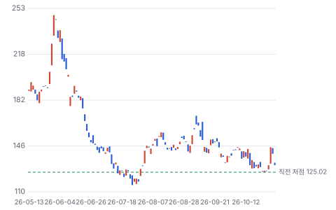

**주봉**

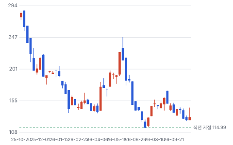

**월봉**

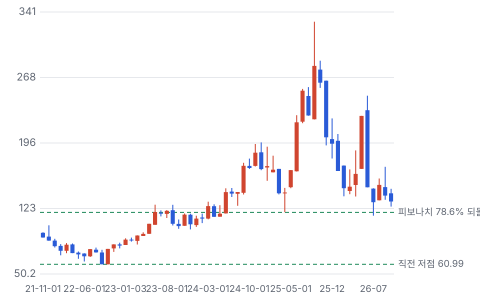

**분기 매출·EPS 실적과 컨센서스**

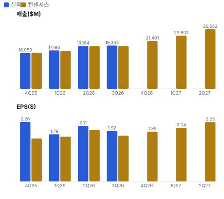

**EPS 리비전**

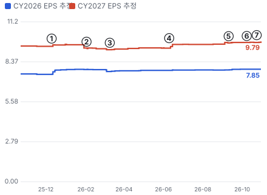

① 25-12-10 FY26 2Q 실적 · EPS 리비전 +1%
② 26-02-02 \$45~50B 조달 계획 · EPS 리비전 -0%
③ 26-03-10 FY26 3Q 실적 · EPS 리비전 +1%
④ 26-06-10 FY26 4Q 실적·FY27 CAPEX · EPS 리비전 +3%
⑤ 26-09-10 FY27 1Q 실적 · EPS 리비전 +0%
⑥ 26-10-08 OpenAI 매출 보도 · EPS 리비전 -0%
⑦ 26-10-28 Investor Day · EPS 리비전 +1%

**밸류에이션 주가 시나리오**

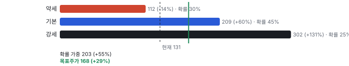

**주가별 업사이드**

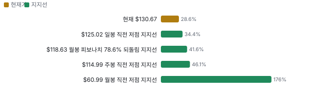

**어닝콜 변화별 주주가치 영향**

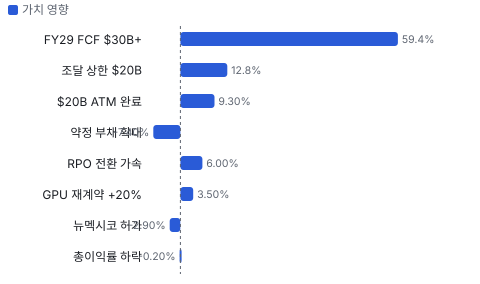

**최근 4개 분기 주가 변화 분석**

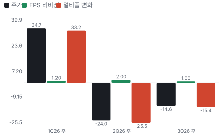

**멀티플 프리미엄**

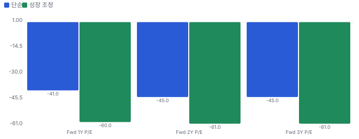

**합리적 멀티플**

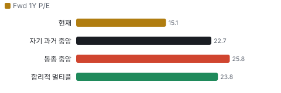

**일별 거래량 분해**

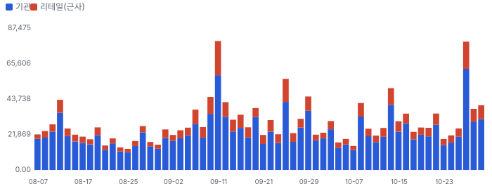

**기관 자금 흐름**

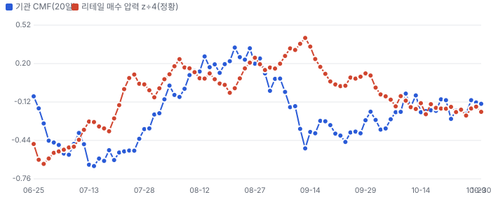

**몬테카를로**

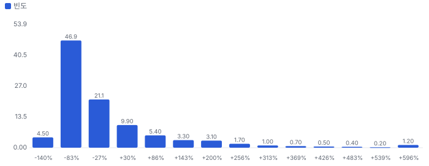

해석: 3,000번 중 836번(28%)에서 가치가 지금 주가 이상이었다. 가정을 흔들어도 지금 주가를 뒷받침하지 못하는 경우가 더 많다. 가운데 값은 0.43배이고, 열 번 중 여덟 번은 0.06~2.46배 사이에 든다.

## 내러티브

> **기업가치를 결정하는 이야기:** 값은 두 갈래다. FY30 EPS \$21이 되면 지금 값은 그 이익의 6.2배다. 대신 잔고의 큰 몫이 소수 AI 고객으로 보이고(회사 미공개), 짓는 돈의 상당 부분이 리스와 벤더 신용이다. 회사가 맞으면 재평가, 고객이 흔들리면 약정만 남는다.

> **멀티플·EPS 프리미엄**
> **멀티플:** Fwd 1Y P/E 15.1배로 동종 중앙값 25.8배보다 41% 낮다. 2025-09 고점 39.5배에서 내려왔다. 시장은 소프트웨어가 아니라 레버리지 인프라로 값을 매긴다.
> **EPS:** EPS 프리미엄은 FY26 \$7.63 → FY30 목표 \$21의 CAGR 29%에서 나온다. 다만 FY26에는 일회성 이익이 \$0.80 들어 있어 기저 \$6.83 기준으로는 32%다.

### 투자자들은 왜 열광했나

2025-09 RPO 급증으로 주가가 \$330까지 갔다. 식은 이유는 차입, FCF 적자, OpenAI 신용, 총이익률 하락이다. 10/28 FCF 시점을 내놓자 +10.7%였고, 이틀 만에 −9.6%로 대부분 되돌렸다.

### 무엇이 기업가치를 바꾸나

> **구조적 체질 변화**
> **변화:** 소프트웨어 회사에서 자본 집약 인프라 회사로 바뀐다. FCF가 FY25부터 음수다.
> **증거:** TTM CAPEX \$75.7B는 매출 \$71.8B보다 크다. 총이익률 60.0%
> **반증:** 2H FY28 FCF 흑자 실패

> **고부가 믹스 확장**
> **변화:** 믹스는 오히려 총이익률을 낮춘다. AI 임대 총이익률 목표는 30~40%로 앱·DB(데이터베이스)보다 낮다. 영업이익률로 방어한다.
> **증거:** 총이익률 65.2% → 60.0%, 비GAAP 영업이익률 약 42% 유지
> **반증:** 비GAAP 영업이익률이 40% 아래로 내려간다

> **기술 혁신**
> **변화:** 자체 칩이 없다. NVIDIA(AI 칩 회사)·AMD·Cerebras·SambaNova를 다 받는 중립 플랫폼이 전략이다. Vera Rubin(NVIDIA 차세대 AI 서버 플랫폼) 첫 납품은 2Q다.
> **증거:** 10/27 제휴 보도자료, 1Q 콜
> **반증:** 고객이 자체 칩 전용 캠퍼스로 옮긴다

> **실행 속도**
> **변화:** 계약에서 전력까지 평균 161일, 매출까지 약 21일 더(회사 설명, Citi 요지). 1Q 850MW 배치. **납품 리드타임 182일.** 피어 비교 미확인. 이전 대비 미확인.
> **증거:** Investor Day(투자자 설명회), 1Q 콜
> **반증:** 분기 배치 500MW 미만

> **M&A**
> **변화:** 해당 없음(대형 인수 없음). 오히려 Ampere·Bloom(연료전지 회사 Bloom Energy) 투자 차익이 FY26 EPS를 \$0.80 올렸다.
> **증거:** 4Q 콜
> **반증:** 대형 인수 발표

> **정책·입법 연관성**
> **재정정책:** 2025년 7월 OBBBA(2025년 세제·지출 법(One Big Beautiful Bill Act))의 100% 보너스 감가상각이 장비 세금을 뒤로 민다. 회사별 금액은 미확인이다. P.L. 119-21 반증: 조기 축소 입법 의회 동의 10/10 — 하원 5/5(본회의 통과) · 상원 5/5(본회의 통과).
> **행정명령:** EO(행정명령) 14318(2025-07)이 데이터센터 연방 인허가를 앞당긴다. 뉴멕시코의 대기 허가는 주·카운티 몫이라 효과는 제한적이다. EO 14318, 1Q 콜 반증: 법원 효력 정지 의회 동의 6/10 — 하원 5/5(SPEED Act(연방 인허가 절차를 줄이는 법안(H.R. 4776)) H.R. 4776 본회의 통과, 2025-12, 221-196) · 상원 1/5(2026-04 기준 상원 공동 발의가 빠져 진척 없음, 이후는 미확인).
> **연관입법:** SPEED Act가 상원에 묶여 있다. 지역 데이터센터 반발은 연방법 바깥이다. Utility Dive 2026-04 반증: 상원 통과

> **CAPEX 낙수효과**
> **변화:** 이 회사는 낙수의 수혜가 아니라 지출 쪽이다. 고객 CAPEX가 아니라 고객 계약이 동력이다.
> **증거:** FY27 CAPEX \$90~95B, 순현금 CAPEX \$70B 이하
> **반증:** 순현금 CAPEX \$70B 초과

### 내러티브 근거

> 'AI 인프라 4번째 하이퍼스케일러' 이야기는 주가 −60%로 식었다. Investor Day가 자금 쟁점을 줄였지만 시장의 질문은 '자금이 되나'에서 '고객이 갚나'로 옮겨 갔다. 동종 대비 멀티플 차이 -41% 중 회사 고유 몫은 -36%다. 단계는 소멸, 쏠림은 셀사이드 높음·바이사이드 낮음이다.

> **RPO가 매출로 바뀐다** · 강화
> **논리:** OCI +121%, 36개월 전환 약 50%
> **숫자:** FY27 \$91.2B → FY28 \$124B, +36%
> **반증:** 2Q 클라우드 성장률이 가이던스 하단 +65%를 밑돈다

> **FY29 자기 자금 조달** · 강화
> **논리:** CAPEX가 FY29에 줄고 FCF \$30B+
> **숫자:** FY29 FCF \$30B는 시가총액의 7.6%
> **반증:** FY28 CAPEX 가이던스가 FY27을 크게 넘는다

> **앱·DB가 AI로 다시 큰다** · 유지
> **논리:** 에이전트가 앱 사용을 늘리고 멀티클라우드 DB가 인상을 만든다
> **숫자:** 멀티클라우드 DB +353%, SaaS +10%
> **반증:** 클라우드 앱 성장률이 8% 아래

> **반대: 고객 신용** · 강화
> **논리:** 잔고 절반 이상이 OpenAI에 묶였고(TD(캐나다계 증권사 TD Cowen) Cowen 추정) OpenAI 매출은 기대에 못 미쳤다
> **숫자:** RPO \$664B의 절반 이상 추정 \$332B+ vs OpenAI 연환산 매출 약 \$50B
> **반증:** OpenAI 대형 조달 완료, 회사가 고객 집중을 공시로 낮춘다

> **반대: 약정 부채** · 강화
> **논리:** 조달 상한은 리스·벤더 금융을 포함하지 않는다
> **숫자:** 미반영 리스 \$288B + 구매 약정 \$34.2B
> **반증:** 신용등급 전망 상향, CDS(신용부도스와프, 채무 불이행 보험 가격) 축소

## 포트폴리오

| 제품·서비스 | 구분 | 무엇 | 쓰는 곳 | 돈 버는 방식 |
|---|---|---|---|---|
| OCI | 서비스 | GPU(그래픽 처리 장치)·CPU(중앙 처리 장치)·저장장치를 빌려주는 클라우드 | AI 학습·추론, 기업 업무 | TTM 약 \$22.1B, 1Q \$7.4B +121% |
| Oracle(오라클) AI Database(오라클 데이터베이스 제품)·멀티클라우드 | 제품 | 핵심 업무 데이터베이스를 Azure·AWS(아마존 클라우드 서비스)·Google 안에서도 판다 | 은행·공공·대기업 핵심 시스템 | 멀티클라우드 DB +353%, 지원 매출이 기반 |
| Fusion(오라클의 기업용 클라우드 업무 앱)·NetSuite(오라클의 중소·중견기업용 클라우드 ERP)·산업 앱 | 서비스 | 재무·인사·공급망 SaaS, 병원 등 산업 앱 | 대기업과 중견기업 운영 | 클라우드 앱 1Q \$4.2B +10%, Fusion +14% |
| Alloy(파트너가 자체 클라우드처럼 운영하는 OCI 제품) | 서비스 | 파트너가 자체 운영하는 주권 클라우드 | 각국 정부·통신사 | 매출 미공개 |

## 수주·파이프라인

> **2026-08-31 기준 6건.** 확정 \$664B. 공시 RPO(잔여 이행 의무) \$664B. 서로 겹치는 항목은 합계에서 뺐다.

**실행 속도와 방해 요인**
| 항목 | 상태 | 실행 속도 | 방해 요인 |
|---|---|---|---|
| 전체 RPO | 확정 | 12개월 13%, 36개월 약 50%, 37~60개월 약 34% | 고객 신용과 집중 · 전력·인허가 · 부품 가격 |
| Abilene 8동 | 확정 | 1Q GPU 131,000개, 고객 인수 24시간 | 나머지 2동 일정 |
| OCI 약 10GW 목표 | 파이프라인 | 계획대로(계획 40%, -2%p), 이대로면 2028-06 완료, 1개월 지연 | 네 개 대형 캠퍼스가 2027년에 몰림 · 벤더 금융 조건 |
| 뉴멕시코 약 1GW | 파이프라인 | 건설 진행, Bloom 연료전지 자가 발전 | 대기 허가 · 지역 반발 |
| 위스콘신 약 1GW | 파이프라인 | 건설 진행, 계통 전력 | 공공서비스위원회·ATC(미국 위스콘신 송전 회사)·We Energies(위스콘신 전력 회사) 전력 협의 |
| 1Q 신규 AI 계약 | 확정 | 대부분 선불·고객 장비 | 고객 자금 조달 |

## 해자

> 돈은 데이터베이스와 앱에서 벌고, AI 임대의 해자는 아직 전력과 속도뿐이다

> **데이터베이스 설치 기반** · 강함
> **해자:** 핵심 업무 데이터가 Oracle Database에 있어 옮기는 비용이 크다. 이제 경쟁사 클라우드 안에서도 판다.
> **근거:** 멀티클라우드 DB 매출 +353%, 고객 +180%, 리전 70곳·가용 영역 119곳(FY27 1Q 콜).
> **숫자:** 멀티클라우드 DB 매출 +353%
> **깨지는 조건:** 멀티클라우드 DB 성장률이 두 분기 연속 100% 아래로 내려가고 지원 매출이 감소한다

> **업무 규칙이 담긴 앱 묶음** · 보통
> **해자:** Fusion·산업 앱의 업무 규칙과 보안 모델을 에이전트가 그대로 쓴다. AI가 앱을 대체하기보다 사용을 늘린다는 회사 설명이다.
> **근거:** Fusion +14%, 산업 앱 +20% 초과, 운영 에이전트 5월 1,000개 미만 → 9월 3,500개 이상. 다만 SaaS 전체는 +10%이고 에이전트 매출은 공개되지 않았다.
> **숫자:** SaaS +10%
> **깨지는 조건:** 클라우드 앱 성장률이 8% 아래로 내려간다

> **전력·배치 속도** · 보통
> **해자:** AI 임대에서 먼저 전력을 켜는 쪽이 계약을 가져간다.
> **근거:** 1Q에 850MW를 배치했고 계약에서 전력 가용까지 평균 161일(회사 설명, 정의 미대조). 전력은 자산이 아니라 임대·협력 계약이 많아 경쟁사도 살 수 있다.
> **숫자:** 1Q 850MW, GPU 가동률 97.9%
> **깨지는 조건:** 분기 배치가 2분기 연속 500MW 아래로 내려간다

> **자본 없는 성장 구조** · 약함
> **해자:** 선불·고객 장비·벤더 금융으로 초기 현금을 약 절반 줄인다. 고객과 벤더의 신용을 빌린 구조라 해자보다 조달 기술에 가깝다.
> **근거:** 1Q 선수금 \$11.4B. 미반영 리스 약정 \$288B, 구매 약정 \$34.2B는 사라지지 않고 부채 밖으로 옮겨 갔다.
> **숫자:** 미반영 약정 합계 \$322B
> **깨지는 조건:** 고객 선불이 줄거나 벤더가 조건을 조인다

## 경영진·네트워크

> 창업자가 지분 38.2%를 쥐고 공동 CEO 체제다. 정계 연결은 공개 사업(Stargate(OpenAI·Oracle 등의 미국 AI 데이터센터 사업)·TikTok(숏폼 동영상 서비스))으로 드러나지만 매출로 잴 수 있는 공시는 없다.

> **Lawrence J. Ellison** · 창업자·이사회 의장·CTO · 1977
> **프로필:** 82세. 1977년 창업, 2014년까지 CEO. 지금도 제품 엔지니어링을 이끈다. 지분 38.2%(11억 5,838만 주), 그중 4억 1,300만 주는 개인 차입 담보다.
> **비즈니스:** 위임장 기준 전 Tesla 이사. 담보 지분이 시가 약 \$54B로 회사 지분 정책의 예외다.
> **정계:** 2025-01 백악관 Stargate 발표에 참석했다는 공개 보도. 그 밖의 직책은 위임장에 없다.
> **동문:** 위임장에 없음, 미확인
> **사모임:** 미확인

> **Clayton M. Magouyrk** · CEO(공동) · 2025-09
> **프로필:** 40세. 2014년 합류해 OCI를 키웠고 OCI 사장을 거쳤다. FY26 총보상 \$627M.
> **비즈니스:** OCI 조직을 이끈다. 다른 상장사 이사직은 위임장에서 찾지 못했다.
> **정계:** 미확인
> **동문:** 미확인
> **사모임:** 미확인

> **Michael D. Sicilia** · CEO(공동) · 2025-09
> **프로필:** 55세. 2009년 합류, 산업 앱 사장을 거쳤다. FY26 총보상 \$257M.
> **비즈니스:** 앱·산업 고객을 맡는다.
> **정계:** 미확인
> **동문:** 미확인
> **사모임:** 미확인

> **Safra A. Catz** · 부의장(전 CEO) · 2025-09
> **프로필:** 64세. 2014~2025년 CEO, CFO와 사장을 지냈다.
> **비즈니스:** 이사회 부의장으로 남았다.
> **정계:** 미확인
> **동문:** 미확인
> **사모임:** 미확인

**네트워크 정량화**
| 연결 | 강도 | 닿는 매출 | 가중 노출 | 매출 대비 | 근거 |
|---|---|---|---|---|---|
| 비즈니스: Ellison·Magouyrk — OpenAI·Stargate 대형 계약 | 3/5 | \$6.70B | \$4.02B | 6% | FY26 단일 고객 10% 미만이라 상한을 매출 \$67.4B × 10%로 잡았다. 실제 값은 미공개 10-K, FY27 1Q 콜 |
| 비즈니스: 이사 Boskin — Bloom Energy 이사 겸임, Oracle은 Bloom 연료전지를 쓴다 | 4/5 | \$0.00B | \$0.00B | 0% | 매출이 아니라 조달 쪽 연결이라 0 2026 위임장, FY27 1Q 콜 |
| 정계: 이사 Boskin 전 대통령 경제자문위원장, 법무 책임자 Levey 등 공직 경력, TikTok 미국 합작 지분 15% | 2/5 | 미확인 | 미확인 | 미확인 | 정부·TikTok 매출 미공개 2026 위임장, 10-Q |

가중 노출은 연결이 닿는 매출의 크기다. 연결이 그 매출을 만들었다는 뜻이 아니며, 인과는 공개 자료로 입증하지 못한다.

## 약세 논리 및 셀온 조건

| 약세 논리 | 근거 | 가를 자료 |
|---|---|---|
| 상한은 절반만 그었다 | \$20B는 자본시장 조달 상한이고 차환을 뺀다. 미반영 리스 \$288B(15~19년)와 구매 약정 \$34.2B는 밖이다. 5월 대비 리스 +\$28B, 구매 약정은 약 \$13B에서 2.6배가 됐다 | 10-Q 약정 주석, 12월 |
| 고객 집중 | 10-K는 FY26 10% 초과 고객이 없다고 적지만 이는 매출 기준이다. RPO의 고객별 값은 공시하지 않는다. TD Cowen은 절반 이상을 OpenAI로 본다(추정). OpenAI 연환산 매출 약 \$50B | OpenAI 조달, 10-K 주석 |
| CAPEX 숫자의 간극 | Morgan Stanley 요지는 2Q FY27~FY28 약 \$220B인데 컨센서스 CAPEX 합은 약 \$152B다. 차이 약 \$68B는 벤더 금융·고객 장비로 옮긴 몫으로 보인다(추정, 출처가 달라 비교 주의) | FY28 CAPEX 가이던스 |
| 자본 집약 전환 | TTM CAPEX \$75.7B, FCF −\$28.7B. 8-K의 순부채 3.5배 기준은 FY29 EBITDA 약 \$90B로 약 \$315B까지 허용한다. 리스 포함 여부는 미확인이다 | 순부채 정의 |
| 총이익률 | 분기 5.2%p 하락. AI 계약 목표 30~40%는 계약 전체 평균이다. 부품 가격 전가는 경영진 주장이다 | 2Q 총이익률 |
| 일정·허가 | 뉴멕시코 대기 허가, 위스콘신 전력 협의 진행 중이다. 네 개 대형 캠퍼스가 2027년에 몰린다 | 허가 결정, 2Q 콜 |
| 담보 지분 | 창업자 지분 중 4억 1,300만 주(시가 약 \$54B)가 개인 차입 담보다. 위임장은 회사 정책의 예외로 적는다 | 위임장, 주가 |
| 확인 못 한 자료 | 10% 초과 고객은 FY26 매출 기준 없음으로 확인했다. 정부 지원은 공시에서 찾지 못했다. 신용등급 수준과 CDS는 1차 자료로 대조하지 못했다. 10/30 Microsoft 발언 원문은 미대조다 | 다음 회차 |

> **셀온 조건**
> **조건 1:** FY27 CAPEX 가이던스가 \$95B를 넘거나 순현금 CAPEX가 \$70B를 넘는다.
> **조건 2:** 2H FY28 FCF 흑자 또는 FY29 \$30B+ 목표가 물러난다.
> **조건 3:** 주요 신용평가사가 투자등급 강등을 경고한다.
> **조건 4:** 2Q 클라우드 성장률이 +65% 아래로 내려간다.
> **조건 5:** 뉴멕시코 대기 허가가 거부되거나 대형 고객 계약이 축소된다.

## 어닝콜 변화

**직전 콜 대비 새로 나오거나 바뀐 내용 → 가치 영향**
| 항목 | 내용 | 직전 콜 | 최신 콜 | 모델 동인 이동 | 확신도 | 가치 영향 |
|---|---|---|---|---|---|---|
| 업데이트 | 36개월 안 RPO 전환 비중 | 46%(6월) | 약 50%(9월) | 1년차 성장률 +2.0% | 1.0 | +6.0% |
| 신규 | FCF 시점과 CAPEX 정점 | 시점 미제시(9월 콜) | 2H FY28 흑자, FY29 \$30B+, CAPEX FY29 감소 | 매출÷투하자본 +5.0% | 0.5 | +59.4% |
| 신규 | 추가 자본시장 조달 | FY27 약 \$40B 계획 | FY27~FY30 \$20B 상한(차환 제외) | 할인율(WACC) -0.30% | 0.5 | +12.8% |
| 신규 | 증자 | 계획 | 1Q에 순 \$19.9B, 주식 +5.0% | 순차입 -\$19.90B | 1.0 | +9.3% |
| 부정 | 회사 총이익률 | 65.2%(2026-05 분기) | 60.0%(2026-08 분기) | 출발 이익률 -0.50% | 1.0 | -0.2% |
| 업데이트 | GPU 잔존 가치 | 수치 없음 | 재계약·재판매 +20%, 대부분 4년 이상 장비 | 성장 지속(감속 계수) +1.0% | 0.5 | +3.5% |
| 부정 | 미반영 리스·구매 약정 | 리스 \$260B·구매 약 \$13B | 리스 \$288B·구매 \$34.2B | 할인율(WACC) +0.20% | 1.0 | -7.4% |
| 부정 | 대형 부지 일정 | 질문 없음 | 대기 허가 진행 중, 회사는 FY27 영향 없다고 설명 | 1년차 성장률 -1.0% | 0.3 | -2.9% |
| 반복 | FY30 목표 | \$225B·EPS \$21(2025-10) | \$225B+·EPS \$21+ | 목표 이익률 — | 0.5 | +0.0% |
| **합계** | 단독 합 |  |  | 동시 적용 +105.7% |  | **+80.4%** |

**사건별 EPS 리비전**
| # | 날짜 | 구분 | 사건 | CY2026 EPS 전→후 | CY2027 EPS 전→후 | 리비전 | 주가 반응 |
|---|---|---|---|---|---|---|---|
| ① | 25-12-10 | 실적 | FY26 2Q 실적 | \$7.49 → \$7.81 | \$9.45 → \$9.54 | +1.0% | -10.8% |
| ② | 26-02-02 | 내러티브 | \$45~50B 조달 계획 | \$7.83 → \$7.82 | \$9.33 → \$9.32 | -0.1% | -2.7% |
| ③ | 26-03-10 | 실적 | FY26 3Q 실적 | \$7.69 → \$7.73 | \$9.21 → \$9.26 | +0.5% | +9.2% |
| ④ | 26-06-10 | 실적 | FY26 4Q 실적·FY27 CAPEX | \$7.77 → \$7.79 | \$9.32 → \$9.58 | +2.8% | -8.5% |
| ⑤ | 26-09-10 | 실적 | FY27 1Q 실적 | \$7.80 → \$7.84 | \$9.68 → \$9.72 | +0.4% | -1.7% |
| ⑥ | 26-10-08 | 내러티브 | OpenAI 매출 보도 | \$7.85 → \$7.85 | \$9.72 → \$9.72 | -0.0% | -5.5% |
| ⑦ | 26-10-28 | 내러티브 | Investor Day | \$7.85 → \$7.85 | \$9.73 → \$9.79 | +0.7% | +10.7% |

**해석:** 3개 구간 누적 주가 -13% = EPS 리비전 +4% × 멀티플 -16%. 더 크게 움직인 쪽은 **멀티플**이다.

## 밸류에이션

> **목표주가 \$168, 업사이드 +29%.** 자리는 약세와 기본 사이(약세 쪽 42%)이고 도달 확률은 약 63%다. 기본 \$209, 강세 \$302(+131%), 약세 \$112(-14%). DCF 기준 업사이드는 기본 -43%, 강세 +105%, 약세 -79%다(WACC 11.4%).

EPS는 5월 결산 FY28 기준이다. 멀티플은 엔진이 고른다.

DCF는 FCF가 FY29까지 음수에 가깝고 투하자본이 커서 시나리오보다 보수적으로 나온다. 멀티플은 정점 CAPEX를 지나면 시장이 FCF를 사 준다는 가정이다. 2H FY28 FCF 흑자가 확인되면 멀티플 렌즈가, 약정이 더 늘면 DCF 렌즈가 맞다.

> **약세 \$112 (-14%)** · 확률 30%
> **가정:** 14.4배 × EPS \$7.80
> **근거:** 대형 고객 인도가 밀려 FY28 EPS가 FY27 가이던스 \$8.10에도 못 미친다. 매출 \$108B 하단, 지분 \$10B 추가 발행, 총이익률 저점 지속

> **기본 \$209 (+60%)** · 확률 45%
> **가정:** 19.1배 × EPS \$10.90
> **근거:** FY28 EPS 컨센서스 범위 안. 매출 \$124B, 비GAAP 영업이익률 39% 안팎

> **강세 \$302 (+131%)** · 확률 25%
> **가정:** 23.9배 × EPS \$12.60
> **근거:** 10GW 일정 유지, 1GW 예시 영업이익률 34% 달성, FY28 매출 \$138B 상단

**멀티플 선정 — Fwd 1Y P/E**
| 단계 | 조정 | 근거 |
|---|---|---|
| 동종 중앙값 | 25.8배 | 범위 19.1~26.7배, 5곳 |
| 펀더멘털 | -4% | 성장·이익률·ROIC로 본 합리적 멀티플 23.8배와의 차이의 일부만 인정 |
| 해자 | +6% | 데이터베이스 설치 기반 강함 · 업무 규칙이 담긴 앱 묶음 보통 · 전력·배치 속도 보통 · 자본 없는 성장 구조 약함 |
| 내러티브 | -10% | 단계 소멸 |
| 사이클·실행 판단 | -20% | 순부채가 조정 EBITDA의 3배를 넘고 FCF가 2H FY28까지 음수이며, 잔고의 큰 몫이 미공개 고객 집중이어서 동종 중앙값에서 할인을 유지한다 |
| **선정** | **19.1배** | 지금 15.1배 |

**동종 레인지**
| 회사 | Fwd 1Y P/E | Fwd 2Y P/E | Fwd 3Y P/E | 성장 | 영업이익률 | ROIC |
|---|---|---|---|---|---|---|
| MSFT | 25.8 | 22.8 | 20.1 | 11% | 48% | 30% |
| AMZN | 26.7 | 21.6 | 17.5 | 15% | 12% | 10% |
| GOOG | 21.9 | 18.1 | 15.3 | 23% | 32% | 22% |
| SAP | 26.3 | 22.3 | 19.2 | 12% | 30% | 19% |
| IBM | 19.1 | 17.4 | 16.1 | 5% | 20% | 13% |
| **Oracle** | 15.1 | 11.8 | 9.6 |  |  |  |

지금 주가가 요구하는 5년 매출 CAGR 45%, 기본 시나리오 29%. 몬테카를로 중앙값 업사이드 -57%.

> 의사결정 보조(투자자문 아님): ① 매수 매력: 연 기대수익 +10.2% (자기자본비용 13.5% 대비 -3.3%p) · 자본비용 초과 확률 26% · 안전마진 0.06 → 정량 신호 약함 / ② 위험 예산 지표(이론): 0% — 기대수익이 자기자본비용에 못 미침(무위험 대비 켈리 12%는 참고) · 5년 하위10% -87% · 30%+ 손실 확률 47% / ③ 상방(5년): 기대 1.62배 · 2배 25% · 3배 16% · 10배 2% · 상위10% 4.32배

## 시장 평가

> **셀사이드(IB 애널리스트)**
> **한 줄:** 의견은 강세 일색이고 쟁점은 전부 현금과 일정이다
> **애널리스트 의견:** 44명 — 강력 매수 33·매수 1·보유 9·강력 매도 1 — 매수 77%. 강세가 몰려 있다
> **목표가 평균·범위:** \$241 (\$110~\$400, 41명) — 종가 대비 평균 +84%. 기대의 증거이고 결론이 아니다
> **IB 요지(마스터 노션, 라이선스):** Citi Buy, TD Cowen 매수 유지, Morgan Stanley 중립 — Citi·TD는 FY29 FCF가 시장과 가장 크게 갈린다고 봤다. Morgan Stanley는 이제 실행이 시험대라고 봤다
> **FY29·FY30 EPS 추정 변화:** \$15.21 → \$15.47, \$19.78 → \$20.54 — Investor Day 뒤 먼 해만 올랐다
> **FY27 1Q 콜 질문:** Deutsche·Mizuho·Barclays·Bernstein·Guggenheim — FCF 시점·부지 지연·총이익률·현금 없는 RPO

> **바이사이드(기관 투자자)**
> **한 줄:** 바이사이드 글은 약세가 지배한다. 다만 13F는 순매수라 말과 포지션이 다르다
> **13F 기관(2Q26):** 3,324곳 · 상위 2,000곳 순 +48.76M주 · 증가 974·감소 824 — 고점 뒤 분기에도 순매수
> **펀드 레터(3Q26~Q4):** 최근 8건 모두 약세·부정 연구 — CDS 약 50bp → 약 280~290bp, 프런티어 AI 회사 신용 위험, '정유사' 같은 자본 집약 전환
> **내부자 장내 거래(누적):** 매수 5·매도 42 — 9/22 CEO Sicilia \$3.4M 매도, 9/29 이사 Rusckowski \$3.5M 매수

> **언론·업계**
> **한 줄:** 언론은 Oracle을 AI 신용의 체온계로 쓴다
> **10/28 전후 제목:** Barron's 'FCF 흑자 전망에 급등', CNBC(미국 경제 방송) '신용 스트레스 시험대' — 같은 날 두 이야기가 공존한다
> **10/8 OpenAI 보도:** 연환산 매출 약 \$50B, 시장 기대 \$68B 하회 — Oracle 당일 −5.5%

## 체크리스트

| 시점 | 무엇 | 의미 |
|---|---|---|
| 2026-12-10(예상) | FY27 2Q 실적 | 매출 +30~34%, EPS \$1.85~1.93, 순현금 CAPEX, 총이익률, Vera Rubin 첫 납품 |
| 2026-12 전후 | OpenAI 자금 조달 | 잔고 신용의 가장 큰 변수 |
| 2027-01 전후 | 뉴멕시코·위스콘신 허가 | 2027년 캠퍼스 일정 |
| 2027-03 | FY27 3Q 실적 | RPO 36개월 전환, 약정 변화 |
| 2027-06 | FY27 실적·FY28 가이던스 | CAPEX 정점과 2H FY28 FCF 약속 |

## 출처
- Investor Day 8-K 2026-10-28(https://www.sec.gov/Archives/edgar/data/0001341439/000119312526435853/d75538dex991.htm)
- 10-Q 2026-08-31(https://www.sec.gov/Archives/edgar/data/0001341439/000119312526389274/orcl-20260831.htm)
- 10-K 2026-05-31(https://www.sec.gov/Archives/edgar/data/0001341439/000119312526277521/orcl-20260531.htm)
- 2026 위임장(https://www.sec.gov/Archives/edgar/data/1341439/000119312526402816/orcl-20260925.htm)
- CNBC 10/8 OpenAI 매출 보도(https://www.cnbc.com/2026/10/08/open-ai-revenue-nvidia-oracle-coreweave.html)
- Morgan Stanley 10/29 노트 2차 요약(https://www.techflowpost.com/en-US/article/34999)
- 라이선스 자료 요지 포함(Citi 10/28, TD Cowen 10/9, 마스터 노션) — 외부 공유 금지
- NYSE ORCL 종가 2026-10-30
- 마스터 노션 자료: 미확인 Oracle_Corporation_ORCLK_Greater_Clarity_on_AI_Growth_and_Funding.pdf (요지만, 외부 공유 금지)
- 10-Q
- Citi·Morgan Stanley 요지
- FY27 1Q 콜
- FY27 1Q 콜(최소 금액)

_구매 등급·목표주가 모두 규칙이 계산한 모델 값으로, 개인의 보유 종목·자금 사정을 반영하지 않는다 · 공개 자료 기반 분석이며 투자 권유가 아님 · 1차 판정, 미검증 · Chiip ten-bagger_