# 텐배거 리포트 2026-11-02 — Quanta Services — 잔고는 답했다, 29배 프리미엄이 남은 질문이다

> 2026-11-02 · Quanta Services(PWR) · 기업: 전력망 송배전·변전·데이터센터 전기 인프라 시공(미국 최대 전력 인프라 시공사)

## Chiip View

수요는 확인됐다. 3Q 잔고가 \$53.4B에서 \$63.7B로 늘었는데 대형 765kV(미국에서 가장 높은 등급의 교류 송전 전압)는 아직 들어오지 않았고, FY26 EPS 가이던스 중간은 \$16.70에서 \$18.10으로 올랐다. **문제는 가격의 기준이다.** Fwd 1Y P/E 29.4배는 동종 중앙값 17.4배보다 69% 높고, 현금흐름으로 풀면 5년 매출 CAGR 29%가 필요해 기본 시나리오 15%의 두 배다. 엔진은 멀티플을 동종 상단 +15%인 22.2배로 묶어 목표주가 \$558, 업사이드 −10%, 약세 다운사이드 −41%, 손익비 0.8을 냈다. **등급 Sell은 Neutral 경계에 0.1%p 걸친 값이다.** 같은 FY2028 EPS \$26에 25배면 \$650, 지금 29.4배면 \$764다. 즉 판단은 EPS가 아니라 프리미엄 유지에 달렸다. 가르는 것은 1H27 765kV 수주와 고정가 공사의 마진이다.

## 대시보드
| 항목 | 값 | 설명 |
|---|---|---|
| 주가 | \$620.73 | 고점 대비 -21% · 1년 +37% |
| 시가총액 | \$94.78B | EV \$99.98B |
| 업사이드 | -10% | 목표주가 \$558 · 다운사이드 -41% · 손익비 0.8 |
| 구매등급 | Sell | 애널리스트 28명: Strong Buy 24 · Buy 0 · Neutral 4 · Sell 0 · Strong Sell 0 |
| 멀티플 | Fwd 1Y P/E 29.4배 | 동종 중앙값 17.4배 |
| 가이던스 4Q26 | \$12,003M · \$5.12 | 컨센서스 \$11,112M · \$4.78 |
| 알파 | 4.8/10 | 텐배거 가능성 점수 |
| 이벤트 | 4Q26 실적(예상, 지난해 2/19 기준 추정) | 2027-02-18 |

## 한 장 요약
- **기업가치를 결정하는 내러티브** **시장이 산 이야기는 '전력망 연결의 관문을 쥔 숙련공 회사'다.** 3Q는 대형 765kV 없이 수주잔고를 \$53.4B에서 \$63.7B로 늘렸고 FY26 EPS 가이던스 중간을 \$16.70에서 \$18.10으로 올렸다. 그런데도 주가는 5월 종가 고점 \$785의 −21%이고 Fwd 1Y P/E는 29.4배로 내려왔다. 쟁점은 성장이 아니라 동종 17배 대비 프리미엄이 얼마나 버티느냐다.
- **밸류에이션 모델로 본 주가 상방은 어디까지인가?** **목표주가 \$558(-10%), 약세와 기본 사이(약세 쪽 10%)다.** 강세 \$834(+34%)는 Fwd 1Y P/E 27.8배를 강세 EPS에 적용한 값이다. 기본 \$578, 약세 \$367. 손익비 0.8, DCF 기준 업사이드 -44%.
- **수주는 어디까지 왔나?** 잔여 이행의무(RPO(잔여 이행의무, 확정 주문 잔액)) 미확인, 100% 매출 \$41.75B · MSA(반복 공사를 단가로 묶은 기본 계약. 물량 약정은 없다)·단기 계약 추정 주문 미확인, 100% 매출 \$21.98B · NiSource(미국 인디애나 중심 유틸리티) 대형 부하(발전·송배전) 미확인, 100% 매출 미확인. 총 잔고 \$63.7B 중 확정 RPO는 \$41.8B이고 나머지 \$22.0B는 물량 약정 없는 MSA·단기 계약 추정이다. 대형 765kV와 발전은 대부분 아직 잔고 밖이다.
- **지금 가격은 무엇을 가정하나?** 현금흐름으로 풀면 5년 매출 CAGR **29%**다. 기본 시나리오 15%의 두 배이고, 회사가 3월에 낸 유기적 매출 CAGR 7~10%(보도 기준)보다 훨씬 높다. P/E로 보면 다르다. 22.2배로 지금 주가를 설명하려면 EPS \$28이 필요하고 이는 FY2028 컨센서스 상단 \$26.4보다 높다. 29.4배를 유지하면 다음 4개 분기 EPS \$21.12로 충분하다. 값의 대부분이 멀티플 유지에 걸려 있다.
- **왜 움직였나?** 5/6 종가 고점 \$785에서 10/23 \$546까지 −30%였다. 실적이 아니라 업종 매도였다. 9/14 GE(미국 가스터빈·전력 장비 회사 GE Vernova) Vernova 매도 개시, 10월 AI 전력주 매도, 10/22 Goldman Sachs 목표가 하향이 겹쳤다. 3Q 실적 날 +4.7%로 1Q +15.8%, 2Q +17.3%보다 반응이 작았고 10/30에 −2.3% 되돌렸다. 7/29 이후 구간은 EPS 리비전이 올리고 멀티플이 내렸다. 월말 기준 Fwd 1Y P/E는 4월 53.6배에서 지금 29.4배다.
- **3Q 콜에서 무엇이 바뀌었나?** 좋아진 것은 FY26 매출 \$41.3~41.6B, EPS \$17.90~18.30, FCF \$2.5~3.0B다. 3Q 매출은 \$12.0B로 +57%이고 인수분 약 \$1.56B를 빼면 약 +37%(추정)다.

새로 나온 것은 2027 강한 두 자릿수 EPS, 2028~29 15~20%, 데이터센터 MW(메가와트)당 포획액 \$5~7M(CEO 어림), 765kV 1H27 수주 기대다.

아쉬운 것은 CFO가 장기 FCF 전환율을 55~60%로 유지한 점이다. 올해 60% 초과가 그대로 이어진다는 뜻이 아니다. Roth는 데이터센터 지연을 물었고 CEO는 걱정하지 않는다고 답했다. 고객별 수치는 없었다.
- **무엇이 바뀌면 판단이 달라지나?** 위로는 1H27에 765kV 큰 건이 잔고에 들어오고 FY27 EPS 가이던스가 \$22 위에서 시작하며 고정가 비중이 올라도 전력 이익률이 12% 부근을 지킬 때다. 그러면 프리미엄이 버티고 \$650~764 구간이 열린다.

아래로는 잔고가 2분기 연속 줄거나 프로젝트 지연이 잔고 감소로 나타날 때다. 약세 \$367이고 Neutral과 Sell을 가르는 것은 멀티플 1배가 안 된다. 다음 확인은 2027년 2월 4Q 실적이다.

## 한눈에 보기

**일봉**

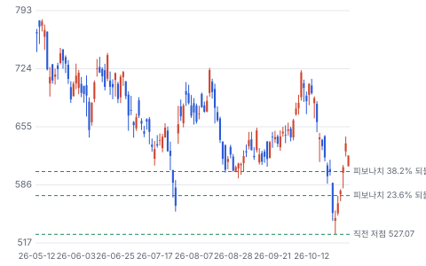

**주봉**

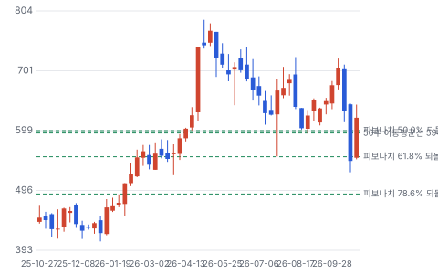

**월봉**

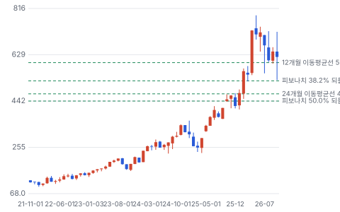

**분기 매출·EPS 실적과 컨센서스**

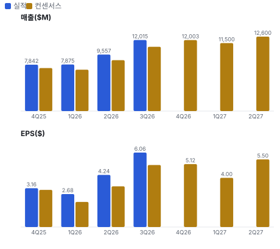

**EPS 리비전**

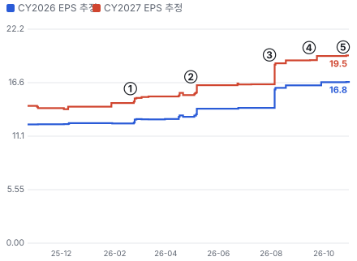

① 26-02-19 4Q25 실적 · EPS 리비전 +4%
② 26-04-30 1Q26 실적, 주가 +15.8% · EPS 리비전 +7%
③ 26-07-30 2Q26 실적, 주가 +17.3% · EPS 리비전 +0%
④ 26-09-14 GE Vernova 매도 개시로 AI 전력주 동반 하락 · EPS 리비전 +2%
⑤ 26-10-29 3Q26 실적, 주가 +4.7% · EPS 리비전 +0%

**밸류에이션 주가 시나리오**

**주가별 업사이드**

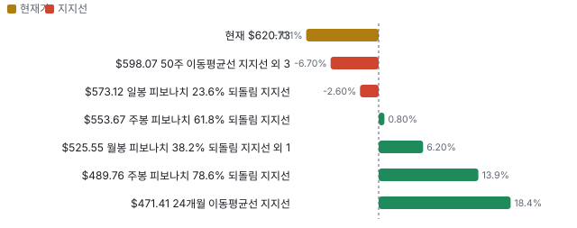

**어닝콜 변화별 주주가치 영향**

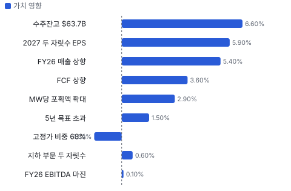

**최근 4개 분기 주가 변화 분석**

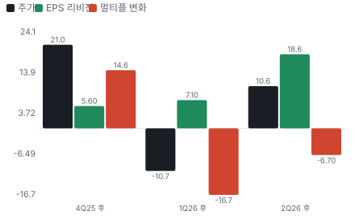

**멀티플 프리미엄**

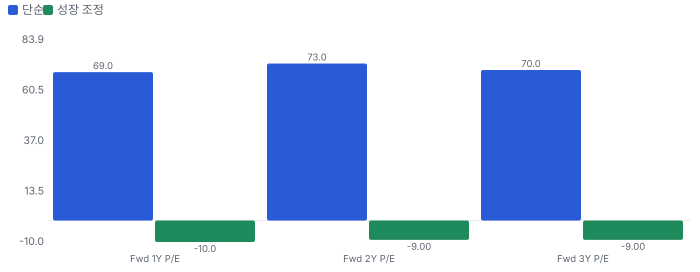

**합리적 멀티플**

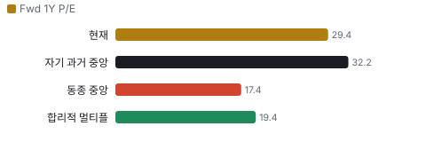

**일별 거래량 분해**

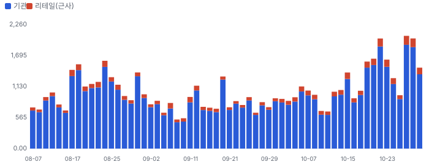

**기관 자금 흐름**

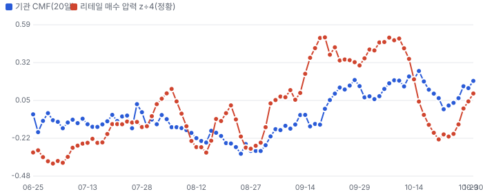

**몬테카를로**

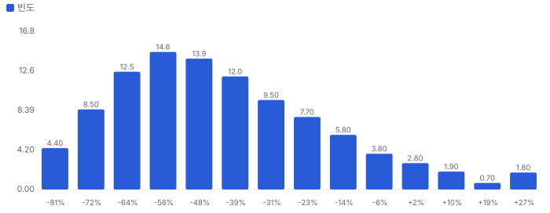

해석: 3,000번 중 192번(6%)에서 가치가 지금 주가 이상이었다. 가정을 흔들어도 지금 주가를 뒷받침하지 못하는 경우가 더 많다. 가운데 값은 0.54배이고, 열 번 중 여덟 번은 0.30~0.92배 사이에 든다.

## 내러티브

> **기업가치를 결정하는 이야기:** 값은 세 겹이다. 약 \$20B 유틸리티 기반이 10~12% 이익률로 복리로 자라고, 그 위에 발전과 데이터센터 공사가 쌓이며, 대형 765kV가 아직 잔고 밖에 있다. 회사는 이 쌓임을 'stacking'이라 부른다.

> **멀티플·EPS 프리미엄**
> **멀티플:** Fwd 1Y P/E 29.4배는 동종 중앙값 17.4배보다 69% 높고 자기 36개월 범위 21~54배의 중간이다. Fwd 2Y는 24.1배다. 프리미엄의 근거는 12년 연평균 20% 이상 EPS 성장(CEO 발언)과 잔고 길이다.
> **EPS:** 지난 네 분기 EPS가 모두 컨센서스를 넘었고 초과 폭은 5~31%다. 3Q 뒤 FY2027 EPS 컨센서스는 \$19.47~\$22.40으로 벌어져 있고 낮은 값은 발표 전 수치다.

### 투자자들은 왜 열광했나

2026년 4월 1Q 실적 날 +15.8%, 7월 2Q 실적 날 +17.3%로 뛰었다. 3월 Investor Day의 2030 EPS 목표 \$21.60~26.75(보도 기준)를 FY27 컨센서스가 이미 넘보면서 열기가 커졌다. 9월 GE Vernova 매도 의견과 10월 AI 전력주 매도에 식었고, 3Q 실적 날 +4.7%로 반응이 줄었다.

### 무엇이 기업가치를 바꾸나

> **구조적 체질 변화**
> **변화:** 회사 말로 거래형에서 장기 프로그램형으로 바뀌었다. 잔고 \$63.7B는 TTM 매출의 1.71배다
> **증거:** 3Q 10-Q, 3Q 콜
> **반증:** 2분기 연속 잔고 감소

> **고부가 믹스 확장**
> **변화:** MEP(건물 안 기계·전기·배관 공사)·기계 공사가 늘며 전력 부문 이익률이 11.4%에서 12.6%, 지하 부문이 8.4%에서 9.4%로 올랐다
> **증거:** 3Q 10-Q. 다만 3Q 고정가 추정 변경이 매출의 1.1%를 움직였고 전년과 같다
> **반증:** 전력 부문 이익률 11% 아래

> **기술 혁신**
> **변화:** 해당 없음(공법보다 인력·조달이 경쟁력이다). 공장 조립으로 현장 인력을 줄이는 것이 가장 가깝다
> **증거:** 3Q 콜 제조 확장 발언
> **반증:** 공장 조립 공사의 마진 희석

> **실행 속도**
> **변화:** 해당 없음(공사업이라 납품 리드타임이 없고 착공까지 기간도 공시가 없다). RPO의 67%가 12개월 안에 매출이 된다
> **증거:** 3Q 10-Q, 12월 말 66%
> **반증:** 12개월 비중 60% 아래

> **M&A**
> **변화:** 2026년 5건 + 9~10월 2건. 3Q 매출 중 인수분 약 \$1.56B로 전체의 13%다. CEO는 데이터센터 전문 회사를 사지 않는다고 했다
> **증거:** 3Q 10-Q, 3Q 콜
> **반증:** 영업권 손상 또는 인수 마진 희석

> **정책·입법 연관성**
> **재정정책:** 에너지부가 \$1.9B SPARK(미국 에너지부 재도체화·전력망 증강 지원 공모) 공모(2026-03)로 재도체화와 전력망 증강을 지원한다. 선정 결과와 PWR 수주 연결은 미확인이다 에너지부 발표, 재원은 2021 인프라법 GRIP(미국 에너지부 전력망 복원력 지원 사업) 반증: 선정 취소·재원 회수 의회 동의 10/10 — 하원 5/5(인프라법 본회의 통과) · 상원 5/5(인프라법 본회의 통과).
> **행정명령:** 에너지부가 2025-10-23 FERC(미국 연방에너지규제위원회)에 20MW 초과 대형 부하 연결 규칙을 지시했다. 행정명령이 아니라 장관 지시이고, 2026-04-30 기한 뒤 최종 상태는 미확인이다 로펌 해설(2025-10~11). 대형 부하가 망 증설비를 전액 부담하는 안 반증: FERC가 관할을 거부하거나 법원이 막는다 의회 동의 2/10 — 하원 1/5(의결 기록 미확인) · 상원 1/5(의결 기록 미확인).
> **연관입법:** SPEED Act(H.R.4776)가 2025-12 하원을 221~196으로 통과했다. 상원은 2026년 5월 기준 정체이고 송전 조항이 없다는 비판이 있다 Utility Dive·Washington Examiner 보도 반증: 상원 부결 또는 회기 내 폐기

> **CAPEX 낙수효과**
> **변화:** CEO는 5대 기술 기업 CAPEX가 유틸리티의 3배라고 했고, 유틸리티는 규모를 두 배로 키우라는 요구를 받는다. 금지표대로 PWR 몫은 계약으로만 센다
> **증거:** 3Q 콜. 10% 넘는 고객 없음. 고객별 매출 미공개
> **반증:** 대형 고객 CAPEX 감액, 프로젝트 지연이 잔고로 번짐

### 내러티브 근거

> 프리미엄은 전력망 연결의 관문, 희소한 숙련공, 긴 잔고에서 나온다. 3Q는 대형 765kV 없이 잔고를 \$10B 늘려 이야기를 숫자로 바꿨다. 셀사이드는 이미 강세이고 리테일 관심은 거의 없다. 동종 대비 멀티플 차이 +69% 중 회사 고유 몫은 +52%다. 단계는 컨센서스, 쏠림은 중간이다.

> **전력망 연결의 관문(송전·변전 슈퍼사이클)** · 강화
> **논리:** 데이터센터·제조 리쇼어링 부하가 전력망 연결 대기열을 만들고, 765·500·345kV 대형 송전과 변전소가 그 병목 — PWR은 북미 최대 숙련 송전 인력
> **숫자:** 총 잔고 \$63.7B = TTM 매출의 1.71배, 12개월분 \$38.4B는 TTM의 103%
> **반증:** 2분기 연속 잔고 정체 또는 765kV 수주가 2028년 이후로 밀림

> **AI 데이터센터 전력·플랜트 보조시설** · 유지
> **논리:** 칩을 뺀 공사를 넓혀 MW당 포획액을 키운다
> **숫자:** MW당 \$3~4M → \$5~7M(CEO 어림), 기술 매출 비중 15~20%
> **반증:** 하이퍼스케일러 설비투자 감액, 주별 데이터센터 모라토리엄 확산

> **숙련 인력 희소성 = 해자** · 강화
> **논리:** 숙련공은 길러야 한다. 직원 약 95,000명, 2026년 약 26,000명 증가
> **숫자:** 3Q 전력 부문 이익률 12.6% — 경영진이 말한 유틸리티 10~12% 범위 상단 이미 도달
> **반증:** 교육·신입 비중 증가로 전력 마진이 11% 아래로 복귀

> **현금 전환 개선(선수금 구조)** · 강화
> **논리:** MEP·EPC(설계·조달·시공 일괄 수행)·재생에너지 계약에서 유리한 현금 조건 — 성장이 운전자본을 덜 먹는다
> **숫자:** 계약부채 3.26 → \$5.54B(9개월 +\$2.28B), FY26 FCF 가이던스 +\$0.5B
> **반증:** 계약부채 감소·FCF 전환율 55% 아래

> **연쇄 인수 플랫폼(수직 통합)** · 유지
> **논리:** 변압기·차단기·전주·모노폴 제조와 경로 설계까지 인수 — 공급망 병목을 직접 쥔다
> **숫자:** 2026년 5건 인수 + 9~10월 2건 \$245M · 영업권·무형 \$11.3B
> **반증:** 인수 기업 마진 희석, 영업권 손상

> **반대 내러티브: AI 전력 거품·업종 디레이팅** · 강화
> **논리:** 동종이 15~19배로 내려온 동안 PWR은 29배다. 테마가 꺾이면 프리미엄이 먼저 깎인다
> **숫자:** Fwd 1Y P/E 29.39배 vs 동종 중앙값 17.37배
> **반증:** 동종사 반등 동반 + PWR 이익 리비전 지속(프리미엄을 이익이 따라잡음)

## 포트폴리오

| 제품·서비스 | 구분 | 무엇 | 쓰는 곳 | 돈 버는 방식 |
|---|---|---|---|---|
| 유틸리티 송배전·변전 공사 | 서비스 | 송전선·배전망·변전소 시공과 유지보수 | 미국 유틸리티, 대부분 MSA | 약 \$20B, 이익률 10~12%(CEO 발언) |
| 데이터센터 전기·기계 공사(MEP) | 서비스 | 칩을 뺀 건물 안 전기·기계·배관과 부지 공사 | 하이퍼스케일러와 개발사 | 기술 매출 15~20%, MW당 \$5~7M 포획(CEO 어림) |
| 발전·재생에너지 EPC | 서비스 | 태양광·배터리·가스 발전소 설계·조달·시공 | 유틸리티, 대형 부하 고객 | 재생에너지 \$5~10B(CEO 발언) |
| 지하 인프라·산업 | 서비스 | 가스 배관, 산업 설비, 기계 공사 | 가스 유틸리티, 파이프라인, 산업체 | 3Q 매출 \$2.2B, 이익률 9.4% |
| 변압기·차단기·전주 제조 | 제품 | 병목 장비를 자체 생산해 공사에 묶는다 | 자사 EPC와 고객 공급 | 별도 공시 없음(미확인) |

## 수주·파이프라인

> **2026-09-30 기준 5건.** 확정 \$41.75B, 미확정 \$21.98B. 공시 총 수주잔고 \$63.73B. 서로 겹치는 항목은 합계에서 뺐다.

**실행 속도와 방해 요인**
| 항목 | 상태 | 실행 속도 | 방해 요인 |
|---|---|---|---|
| 잔여 이행의무(RPO) | 확정 | 67%가 12개월 안, 대부분 그다음 24개월 안에 매출 | OEM(변압기·차단기 같은 장비 제조사) 납기 · 고정가 원가 위험 |
| MSA·단기 계약 추정 주문 | 프레임워크 | 12개월분 \$10.5B | 고객 물량 약정 없음 · 단기 해지 가능 |
| NiSource 대형 부하(발전·송배전) | 확정 | 3Q에 일부 잔고 반영, 추가 예약 기대 | 금액 미공개 · 복합화력 EPC 위험 |
| 765kV 대형 송전(텍사스·오하이오·MISO(미국 중부 전력망 운영 기구)) | 파이프라인 | 2027년 착수, 1H27 수주 기대 | 인허가 · 고객의 자기 고객 협상 · 장비 납기 |
| 대형 발전 EPC | 파이프라인 | 2Q 콜 기준 95%가 잔고 밖 | 가스터빈 납기 · 계약 위험 통제 |

## 해자

> 해자는 사람이다. 숙련공 95,000명 규모와 85% 자체 시공이 경쟁을 막고, 공급망 통합이 그 위에 쌓인다.

> **자체 숙련공 규모** · 강함
> **해자:** 고전압 숙련공은 살 수 없고 길러야 해서 경쟁사가 단기에 따라오지 못한다.
> **근거:** 직원 약 95,000명, 2026년 약 26,000명 증가 중 유기적 약 12,000명. 자체 시공 85%. 전력 부문 3Q 이익률 12.6%
> **숫자:** 직원 2Q 85,000 → 3Q 95,000
> **깨지는 조건:** 전력 부문 이익률이 11% 아래로 내려오거나 숙련공 임금이 계약 반영보다 빨리 오른다

> **유틸리티 장기 계획 안의 자리** · 보통
> **해자:** 고객 설비 계획에 수년 앞서 들어가 반복 공사를 받는다. 다만 물량 약정은 없다.
> **근거:** MSA는 총 잔고의 37%(약 \$23.6B). 10% 넘는 고객이 없다. 10-Q는 MSA가 물량을 약정하지 않고 단기 해지가 가능하다고 적는다
> **숫자:** MSA 비중 44% → 37%
> **깨지는 조건:** 유틸리티가 대형 공사를 복수 업체로 나누거나 MSA 잔고가 줄어든다

> **장비 공급망 수직 통합** · 보통
> **해자:** 변압기·차단기·전주까지 직접 만들거나 길게 사 두어 공기 확실성을 판다.
> **근거:** 10개 주 전후 제조 확장, 고전압 장비 상위 5대 구매자(CEO 발언), 3Q 전주 제조사 인수. 10-K 장비 구매 약정 \$349M
> **숫자:** 제조 CAPEX \$500~700M 언급(콜 질문 기준)
> **깨지는 조건:** OEM 증설로 납기가 풀려 공급 프리미엄이 사라지거나 공장이 놀게 된다

> **이행보증을 받는 규모** · 보통
> **해자:** 대형 공사는 보증 용량과 실행 기록이 입찰 자격이다.
> **근거:** 이행보증 \$23.1B, 유동성 \$5.2B, 은행 기준 레버리지 약 1.3배
> **숫자:** 이행보증 ÷ 총 잔고 36%
> **깨지는 조건:** 대형 고정가 공사 손실로 보증 조건이 나빠진다

## 경영진·네트워크

> 창업자 체제가 아니다. CEO는 현장 시공사 출신이고 이사회에 유틸리티 경영자가 많다. 연결이 매출을 만들었다는 증거는 없다.

> **Earl C. (Duke) Austin, Jr.** · 사장·CEO · 2016-03
> **프로필:** 56세. 2001~2009 자회사 North Houston Pole Line 사장, 전력·가스 사업 대표, 2013~2022 COO를 거쳤다
> **비즈니스:** 미국 전기공사업체 협회 NECA(미국 전기공사업체 협회) 남서부 지회 이사
> **정계:** Texas State University System 이사회(Board of Regents) 위원. 로비·기부 기록은 미확인
> **동문:** 경영학 학사, 학교명은 위임장에 없다(미확인)
> **사모임:** 미확인

> **Doyle N. Beneby** · 이사회 의장 · 2016-03
> **프로필:** 66세. Midland Cogeneration Venture CEO(2018~2022), 시영 CPS Energy(미국 샌안토니오 시영 전력회사) CEO(2010~2015)
> **비즈니스:** Korn Ferry·West Fraser·Northland Power 이사
> **정계:** 시영 전력회사 CEO 이력
> **동문:** 공학 학사·MBA(경영학 석사), 학교명은 위임장에 없다(미확인)
> **사모임:** 미확인

**네트워크 정량화**
| 연결 | 강도 | 닿는 매출 | 가중 노출 | 매출 대비 | 근거 |
|---|---|---|---|---|---|
| 비즈니스: 이사 Warner Baxter는 Ameren(미국 미주리·일리노이 유틸리티) 전 집행 의장이자 EEI(미국 민영 전력회사 협회) 전 의장으로 유틸리티 경영진과 닿는다 | 2/5 | \$20.00B | \$8.00B | 21% | CEO가 말한 유틸리티 매출 약 \$20B. 회사별 매출은 미공개 2026 위임장, 3Q 콜 |
| 비즈니스: CEO의 NECA 지회 이사직과 IBEW/NECA 견습 체계 — 숙련공 공급 쪽 연결 | 4/5 | 미확인 | 미확인 | 미확인 | 인력 연결이라 매출로 환산하지 못한다. 직원의 36%가 단체협약 대상 2026 위임장, FY2025 10-K |
| 정계: CEO의 텍사스 주립대 시스템 이사직 | 3/5 | 미확인 | 미확인 | 미확인 | 텍사스 매출 미공개 2026 위임장 |

가중 노출은 연결이 닿는 매출의 크기다. 연결이 그 매출을 만들었다는 뜻이 아니며, 인과는 공개 자료로 입증하지 못한다.

## 약세 논리 및 셀온 조건

| 약세 논리 | 근거 | 반박 | 가를 자료 |
|---|---|---|---|
| 프리미엄이 동종으로 수렴한다 | Fwd 1Y P/E 29.4배 vs 동종 17.4배. 3Q 뒤 동종은 15~19배까지 내려왔다 | FIX·EME보다 잔고가 길고 12년 20% 이상 EPS 성장 기록이 있다(CEO 발언) | 동종 대비 프리미엄이 50% 아래로 가는지 |
| 고정가 위험이 커진다 | 3Q 고정가 비중 63.1% → 68.1%, 이행보증 \$23.1B. 추정 변경이 3Q 매출을 1.1% 움직였다 | CEO는 위험 구조가 어느 때보다 좋다고 했다. 다만 \$300M 초과 고정가 비중은 다시 밝히지 않았다 | 고정가 손실 공시, 미승인 변경 주문 \$488M 추이 |
| 데이터센터가 밀린다 | Roth가 지연·중단 사례를 물었다. 기술 매출 15~20% | 최대 고객 신용이 높고 인력을 산업 현장으로 돌릴 수 있다. 근거는 경영진 말뿐이다 | 잔고 12개월분, MSA 외 신규 주문 |
| 성장의 질 | 3Q 인수 매출 약 \$1.56B, 영업권·무형 \$11.3B가 자기자본 \$10.5B보다 크다 | 2026년 유기적 인력 증가 약 12,000명, 인수 뺀 3Q 성장 약 +37%(추정) | 인수 효과가 빠지는 3Q27 유기적 성장 |
| 경영진이 팔았다 | CEO가 5/5 약 \$777에 15.6만 주, 약 \$121M 장내 매도 | 사전 매매 계획 여부 미확인. 지분 대비 비중도 미확인 | Form 4 각주, 2027 위임장 보유 주식 |
| 경쟁 증설 | 높은 수익은 공급을 부른다. MTZ·MYRG·PRIM도 전력 인력을 늘린다 | 숙련공은 약 4년 걸려 단기 추격이 어렵다 | 동종 송전 수주와 숙련공 임금 |

> **셀온 조건**
> **조건 1:** 총 잔고가 2분기 연속 줄어든다
> **조건 2:** 전력 부문 이익률이 3분기 기준 11% 아래로 내려온다
> **조건 3:** 고정가 대형 공사에서 손실을 공시한다
> **조건 4:** 동종이 전력 숙련공을 빠르게 늘려 765kV 입찰 경쟁이 시작된다
> **조건 5:** 주요 고객이 데이터센터 공사를 잔고에서 취소한다

## 어닝콜 변화

**직전 콜 대비 새로 나오거나 바뀐 내용 → 가치 영향**
| 항목 | 내용 | 직전 콜 | 최신 콜 | 모델 동인 이동 | 확신도 | 가치 영향 |
|---|---|---|---|---|---|---|
| 업데이트 | FY26 매출 가이던스 중간 +\$1.95B | \$39.3~39.7B | \$41.3~41.6B | 기준연도 매출 +\$1.95B | 0.8 | +5.4% |
| 업데이트 | FY26 조정 EBITDA 마진(가이던스 중간) | 10.51% | 10.72% | 출발 이익률 +0.21% | 0.8 | +0.1% |
| 업데이트 | 총 수주잔고 \$53.4B → \$63.7B, 대형 765kV 없이 넓게 늘었다 | \$53.4B | \$63.7B | 성장 지속(감속 계수) +5.0% | 1.0 | +6.6% |
| 신규 | 2027 강한 두 자릿수 조정 EPS 성장 기회 | 언급 없음 | 강한 두 자릿수, 2028~29 15~20% | 1년차 성장률 +2.0% | 0.5 | +5.9% |
| 업데이트 | FY26 FCF +\$0.5B, 다만 장기 전환율은 55~60% 유지 | \$2.0~2.5B | \$2.5~3.0B | 매출÷투하자본 +30.0% | 0.8 | +3.6% |
| 신규 | Investor Day 다년 목표보다 앞서가는 중 | 언급 없음 | pacing ahead | 장기 성장 수렴값 +0.50% | 0.5 | +1.5% |
| 신규 | 지하 부문 내년 분기 두 자릿수 이익률 가능, 3Q 9.4% | 개선 여지 | 내년 두 자릿수 분기 | 목표 이익률 +0.20% | 0.5 | +0.6% |
| 신규 | 데이터센터 MW당 포획액 \$3~4M → \$5~7M | 80~90% 범위 언급 | \$5~7M, 다음 \$7~10M | 1년차 성장률 +1.0% | 0.5 | +2.9% |
| 부정 | 3Q 고정가 매출 비중 63.1% → 68.1%, 위험 보상 요구 상승 | 63.1% | 68.1% | 할인율(WACC) +0.10% | 0.5 | -1.5% |
| **합계** | 단독 합 |  |  | 동시 적용 +25.9% |  | **+25.3%** |

**사건별 EPS 리비전**
| # | 날짜 | 구분 | 사건 | CY2026 EPS 전→후 | CY2027 EPS 전→후 | 리비전 | 주가 반응 |
|---|---|---|---|---|---|---|---|
| ① | 26-02-19 | 실적 | 4Q25 실적 | \$12.42 → \$12.87 | \$14.54 → \$15.07 | +3.6% | +6.7% |
| ② | 26-04-30 | 실적 | 1Q26 실적, 주가 +15.8% | \$13.11 → \$13.95 | \$15.36 → \$16.39 | +6.7% | +15.8% |
| ③ | 26-07-30 | 실적 | 2Q26 실적, 주가 +17.3% | \$14.03 → \$14.03 | \$16.48 → \$16.48 | +0.0% | +17.3% |
| ④ | 26-09-14 | 내러티브 | GE Vernova 매도 개시로 AI 전력주 동반 하락 | \$16.37 → \$16.70 | \$18.96 → \$19.41 | +2.4% | -4.4% |
| ⑤ | 26-10-29 | 실적 | 3Q26 실적, 주가 +4.7% | \$16.72 → \$16.76 | \$19.47 → \$19.47 | +0.0% | +4.7% |

**해석:** 3개 구간 누적 주가 +20% = EPS 리비전 +34% × 멀티플 -11%. 더 크게 움직인 쪽은 **EPS 리비전**이다.

## 밸류에이션

> **목표주가 \$558, 업사이드 -10%.** 자리는 약세와 기본 사이(약세 쪽 10%)이고 도달 확률은 약 54%다. 기본 \$578, 강세 \$834(+34%), 약세 \$367(-41%). DCF 기준 업사이드는 기본 -44%, 강세 -26%, 약세 -64%다(WACC 9.9%).

2027년 말 시점에 FY2028 EPS를 적용했다. FY2028 컨센서스는 \$21.96~\$26.40이고 낮은 값은 3Q 발표 전 수치다.

시나리오의 22.2배는 판단이 아니라 엔진 상한이다. 동종 최고 19.3배 +15%까지만 허용해서 판단 조정 +20%는 상한에 잘렸다. PWR의 지난 36개월 월말 Fwd 1Y P/E 저점은 약 21배다. 기본 EPS \$26에 25배면 \$650(+5%), 29.4배면 \$764(+23%)다. 애널리스트 평균 목표가 \$803은 시장 기대의 증거로만 본다.

DCF 기본값이 현재가보다 44% 낮은 이유는 장기 이익률 10%와 WACC 9.9%로 현금흐름을 깎기 때문이다. 시나리오는 시장 멀티플을 쓴다. 두 값의 차이가 곧 프리미엄의 크기다.

> **약세 \$367 (-41%)** · 확률 25%
> **가정:** 16.7배 × EPS \$22.00
> **근거:** 데이터센터 지연이 잔고로 번지고 고정가 공사에서 원가가 샌다. FY2028 EPS 컨센서스 하단

> **기본 \$578 (-7%)** · 확률 50%
> **가정:** 22.2배 × EPS \$26.00
> **근거:** CEO가 말한 성장이 이어진다. FY2026 \$18.10에서 연 20%면 FY2028 약 \$26, 컨센서스 상단 \$26.4 부근

> **강세 \$834 (+34%)** · 확률 25%
> **가정:** 27.8배 × EPS \$30.00
> **근거:** 765kV와 발전이 1H27부터 쌓이고 지하 부문이 두 자릿수 이익률에 간다. FY2028 EPS 추정 최고 \$31 부근

**멀티플 선정 — Fwd 1Y P/E**
| 단계 | 조정 | 근거 |
|---|---|---|
| 동종 중앙값 | 17.4배 | 범위 15.3~19.3배, 5곳 |
| 펀더멘털 | +6% | 성장·이익률·ROIC로 본 합리적 멀티플 19.4배와의 차이의 일부만 인정 |
| 해자 | +8% | 자체 숙련공 규모 강함 · 유틸리티 장기 계획 안의 자리 보통 · 장비 공급망 수직 통합 보통 · 이행보증을 받는 규모 보통 |
| 내러티브 | +0% | 단계 컨센서스 |
| 사이클·실행 판단 | +20% | 동종이 10월 업종 매도로 15~19배까지 내려왔고 PWR은 자기 36개월 범위 21~54배의 중간에 있다. 잔고 \$63.7B와 12년 20% 이상 EPS 성장 기록을 인정해 위로 조정한다. 엔진 상한이 동종 최고 +15%라 그 위 프리미엄은 반영되지 않는다 |
| **선정** | **22.2배** | 지금 29.4배 |

**동종 레인지**
| 회사 | Fwd 1Y P/E | Fwd 2Y P/E | Fwd 3Y P/E | 성장 | 영업이익률 | ROIC |
|---|---|---|---|---|---|---|
| MTZ | 17.4 | 13.8 | 11.5 | 21% | 5% | 10% |
| EME | 16.7 | 14.0 | 12.2 | 21% | 10% | 38% |
| FIX | 19.3 | 17.0 | 15.2 | 37% | 17% | 105% |
| MYRG | 18.2 | 15.5 | 13.6 | 22% | 6% | 32% |
| PRIM | 15.3 | 13.8 | 12.2 | 2% | 4% | 9% |
| **Quanta Services** | 29.4 | 24.1 | 20.8 |  |  |  |

지금 주가가 요구하는 5년 매출 CAGR 29%, 기본 시나리오 15%. 몬테카를로 중앙값 업사이드 -46%.

> 의사결정 보조(투자자문 아님): ① 매수 매력: 연 기대수익 -1.6% (자기자본비용 10.2% 대비 -11.8%p) · 자본비용 초과 확률 6% · 안전마진 0.30 → 정량 신호 약함 / ② 위험 예산 지표(이론): 0% — 기대수익이 자기자본비용에 못 미침(무위험 대비 켈리 0%는 참고) · 5년 하위10% -53% · 30%+ 손실 확률 33% / ③ 상방(5년): 기대 0.92배 · 2배 1% · 3배 0% · 10배 0% · 상위10% 1.46배

## 시장 평가

> **셀사이드(IB 애널리스트)**
> **한 줄:** 셀사이드는 성장을 의심하지 않는다. 물음은 동종보다 낮은 마진과 데이터센터 지연이다.
> **등급:** 강력 매수 24 · 보유 4(28명, 10/6) — 매수 쏠림
> **목표가:** 평균 \$803 · 중앙 \$800 · 범위 \$684~967 — 평균까지 +29%
> **최근 변경:** Goldman Sachs \$902 → \$781(10/22) · Truist \$960 → \$967 · Citi·TD(미국 증권사 TD Cowen) Cowen 상향 — 실적 뒤 상향, 직전엔 하향도 있었다
> **3Q 콜 질문:** 마진 구조성·765kV 시점·데이터센터 지연·고정가 비중 — 성장 여부에서 품질로 이동

> **바이사이드(기관 투자자)**
> **한 줄:** 기관이 대부분 가졌고 강세가 합의다. 남은 매수 여력보다 프리미엄 유지가 쟁점이다.
> **기관 보유:** 약 92% — 기관 주도
> **13F(9/30, 조기 제출분 703곳):** 증가 254 · 감소 235 — 중립, 아직 일부만 제출
> **내부자:** CEO 5/5 15.6만 주 장내 매도(약 \$777, 약 \$121M) · 매수 없음 — 고점 부근 매도, 사전 계획 여부 미확인
> **펀드 레터:** 2Q 강세 다수(Sands·NZS(미국 성장주 운용사 NZS Capital)·Fidelity) · Platinum은 과대평가 지적 — 합의된 강세, 반대는 밸류에이션
> **공매도:** 유동 주식의 2.6% · 커버 3.8일 — 낮음

> **언론·업계**
> **한 줄:** 언론은 AI 전력 테마로 묶는다. 주가도 업종과 함께 흔들린다.
> **Barron's:** 퀀트 종목 선정(10/7) — 정량 호평
> **업종 기사:** 'AI 전력주 1주 7~13% 하락'(10/28), 'GE Vernova 수주 급증'(10/28) — 변동성 큼

## 체크리스트

| 시점 | 무엇 | 의미 |
|---|---|---|
| 2026년 11월 | MTZ·MYRG·PRIM·EME·FIX 실적과 콜 | 동종 멀티플과 전력 수주 경쟁 |
| 2026-11-16 전후 | 9월 말 13F 마감 | 조기 제출 703곳 밖 대형 기관의 움직임 |
| 2026년 4분기 | AEP(미국 대형 유틸리티 American Electric Power)·NiSource 설비 계획 | 대형 프로그램 시점 |
| 2027년 2월(예상) | 4Q 실적과 FY27 가이던스 | EPS \$22 위에서 시작하는가 |
| 2027년 상반기 | 765kV 텍사스·오하이오 수주 | 잔고 다음 단계 |
| 2027년 3Q 실적 | 인수 효과가 빠진 유기적 성장 | 성장의 질 |

## 출처
- Quanta 3Q26 10-Q https://www.sec.gov/Archives/edgar/data/1050915/000105091526000041/pwr-20260930.htm
- Quanta 3Q26 보도자료 https://www.sec.gov/Archives/edgar/data/0001050915/000119312526436949/d77812dex991.htm
- Quanta FY2025 10-K https://www.sec.gov/Archives/edgar/data/1050915/000105091526000006/pwr-20251231.htm
- Quanta 2026 위임장 https://www.sec.gov/Archives/edgar/data/1050915/000119312526150293/d118470ddef14a.htm
- Quanta 1Q26 보도자료 https://www.sec.gov/Archives/edgar/data/0001050915/000119312526193918/d107542dex991.htm
- Investor Day 요약 보도(2030 목표는 보도 기준) https://www.marketbeat.com/instant-alerts/quanta-services-investor-day-ceo-pegs-24t-tam-targets-2160-2675-eps-by-2030-2026-04-01/
- 에너지부 SPARK 공모 보도 https://www.power-technology.com/newsletters/us-doe-announces-1-9bn-in-funding-for-grid-upgrades
- 에너지부의 FERC 지시 해설 https://www.foley.com/insights/publications/2025/10/doe-proposes-new-federal-standards-for-interconnecting-large-loads-to-the-grid/
- SPEED Act 하원 통과 https://worldoil.com/news/2025/12/18/u-s-house-passes-bipartisan-speed-act-advancing-federal-permitting-reform/
- 상원 인허가 논의 https://www.washingtonexaminer.com/?p=4571078
- 2Q·3Q 콜
- 3Q 10-Q
- 3Q 콜

_구매 등급·목표주가 모두 규칙이 계산한 모델 값으로, 개인의 보유 종목·자금 사정을 반영하지 않는다 · 공개 자료 기반 분석이며 투자 권유가 아님 · 1차 판정, 미검증 · Chiip ten-bagger_