# 텐배거 리포트 2026-11-02 — Seadrill — 재계약은 끝났다, 남은 1/4의 일당과 Petrobras가 값을 가른다

> 2026-11-02 · Seadrill(SDRL) · 기업: 드릴십과 반잠수식 시추선을 일당으로 빌려주는 심해 시추 회사

## Chiip View

재가격은 끝났다. West Carina(Seadrill의 2015년식 7세대 드릴십)가 880일 \$420M, 이동비 포함 일 약 \$477K로 2Q 평균 일당(시추선 하루 임대 요금) \$360K보다 32% 높다. 10월 계약을 더하면 2027 컨센서스 매출의 약 3/4이 찼다고 추정한다. **문제는 가격이다.** Fwd 1Y EV/EBITDA 8.31배는 자기 36개월 범위의 꼭대기이고, 현금흐름으로 풀면 5년 매출 CAGR 14%가 필요해 기본 시나리오 6%의 두 배가 넘는다. 목표주가는 \$56으로 업사이드 +7%, 약세 다운사이드 −29%, 손익비 2.3이다. DCF 기본값은 현재가보다 31% 낮다. DCF는 장기 이익률을 사이클 평균 15%로 되돌리고 시나리오는 지금 시장 멀티플을 쓰기 때문이다. 3Q 실적이 내일(11/3) 장 마감 후 나온다. 가르는 것은 2H26 FCF, West Gemini(Sonadrill에 빌려준 드릴십, 연말 계약 만료) 후속 계약, Petrobras 조정이다.

## 대시보드
| 항목 | 값 | 설명 |
|---|---|---|
| 주가 | \$52.57 | 고점 대비 -4% · 1년 +67% |
| 시가총액 | \$3.42B | EV \$3.81B |
| 업사이드 | +7% | 목표주가 \$56 · 다운사이드 -29% · 손익비 2.3 |
| 구매등급 | Neutral | 애널리스트 12명: Strong Buy 9 · Buy 1 · Neutral 2 · Sell 0 · Strong Sell 0 |
| 멀티플 | Fwd 1Y EV/EBITDA 8.3배 | 동종 중앙값 10.7배 |
| 가이던스 FY2026 | \$1,575M | 컨센서스 \$1,600M |
| 알파 | 5.6/10 | 텐배거 가능성 점수 |
| 이벤트 | 3Q26 실적(장 마감 후), 11/4 콜 | 2026-11-03 |

## 한 장 요약
- **기업가치를 결정하는 내러티브** **시장이 산 이야기는 '새 드릴십(자체 항해로 움직이는 심해 시추선)이 없어 2027년에 일당이 오른다'이다.** Seadrill은 여기에 저가 계약 재가격이 끝났다는 숫자를 더했다. West Carina는 880일 \$420M으로 이동비 포함 일 약 \$477K이고, 2Q 평균 일당 \$360K보다 32% 높다. 주가는 6월 저점 종가 \$37.70에서 \$52.57로 +39%다. 지금 쟁점은 재계약 이후 남은 리그의 일당과 Petrobras 분쟁이다.
- **밸류에이션 모델로 본 주가 상방은 어디까지인가?** **목표주가 \$56(+7%), 약세와 기본 사이(약세 쪽 14%)다.** 강세 \$87(+65%)는 Fwd 1Y EV/EBITDA 12.1배를 강세 EBITDA에 적용한 값이다. 기본 \$59, 약세 \$37. 손익비 2.3, DCF 기준 업사이드 -31%.
- **수주는 어디까지 왔나?** 6월 말 계약 잔고 미확인, 100% 매출 \$2.93B · West Carina 인도네시아 0%, 100% 매출 \$0.42B · West Capella(Seadrill의 6세대 드릴십, 말레이시아 작업) 말레이시아 연장 0%, 100% 매출 \$0.04B. 6월 말 잔고 \$2.93B에 10월 West Carina \$420M과 West Capella \$41M이 더해졌다. West Gemini 후속과 냉각 정지 2척은 미확정이다.
- **지금 가격은 무엇을 가정하나?** 현금흐름으로 풀면 5년 매출 CAGR **14%**다. 기본 시나리오 6%와 컨센서스 FY2027 +5%, FY2028 +6%보다 높다. 시추선이 15척으로 고정이고 신조 계획이 없으니 이 성장은 일당과 가동 척수에서 나와야 한다. 5년 뒤 매출 약 \$3.0B에서 관리 수익 \$0.3B를 빼고 정지 3척을 뺀 12척이 가동률 96%로 일한다고 잡으면 평균 일당이 약 \$640K여야 한다(추정). 2Q 평균은 \$360K다.
- **왜 움직였나?** 6/24 종가 저점 \$37.70에서 +39%다. 8/10 +8.1%는 2Q 상향, 10/13 +4.3%는 West Carina 계약이다. 10/14 −4.1%는 SFL(West Hercules를 소유한 선박 임대 회사) 항소심 패소 보도 뒤다. 10/23 +6.4%는 회사 사건을 찾지 못해 원인 미확인이다. 브렌트는 2분기 평균 \$103에서 8월 초 \$82로 내렸는데 주가는 올랐다. 멀티플은 9월 말 5.73배에서 8.31배로 올랐다.
- **2Q 콜에서 무엇이 바뀌었나?** 좋아진 것은 영업수익 \$1.43~1.48B → \$1.5~1.55B, EBITDA \$370~420M → \$420~450M이다. 채권 금리도 8.375%에서 6.75%로 내렸다. 새로 나온 것은 드릴십 가동률 90% 중반 전망과 2027 대형 정기 검사가 없다는 답이다. 아쉬운 것은 상향 이유가 주로 가동 일수와 비용 시기라는 점이다. 회사도 하반기 정비비가 늘고 고객의 장기 선계약은 아직 전면 변화가 아니라고 했다.
- **무엇이 바뀌면 판단이 달라지나?** 2H26 FCF가 크게 나고 West Gemini가 \$450K 이상에 계약하며 Petrobras 조정이 소액으로 끝나면 위쪽으로 간다. 반대로 FCF가 또 음수이거나 Petrobras가 상계를 실행하면 약세 \$37 쪽이다. 상계 \$213M은 시가총액의 6%다. 다음 확인은 11/3 실적과 11/4 콜이다.

## 한눈에 보기

**일봉**

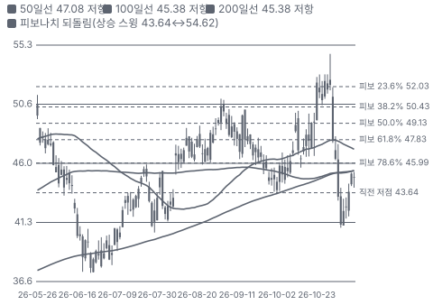

**주봉**

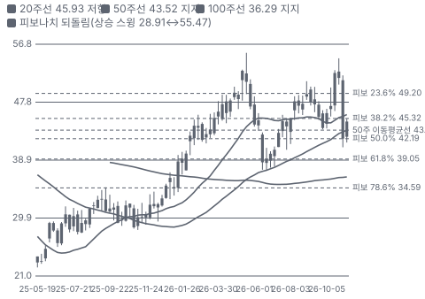

**월봉**

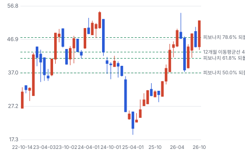

**분기 매출·EPS 실적과 컨센서스**

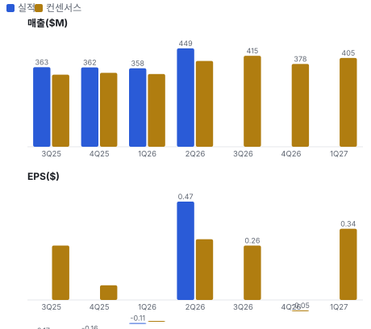

**밸류에이션 주가 시나리오**

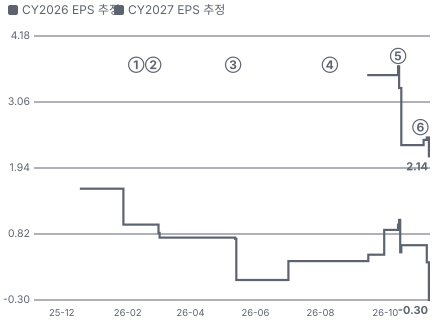

**주가별 업사이드**

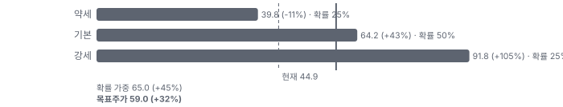

**어닝콜 변화별 주주가치 영향**

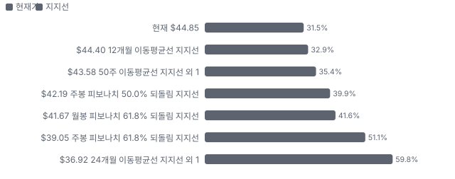

**멀티플 프리미엄**

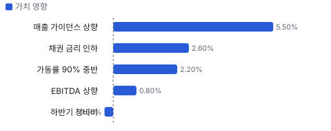

**합리적 멀티플**

**일별 거래량 분해**

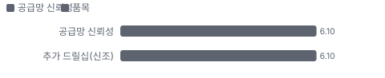

**기관 자금 흐름**

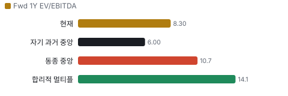

**몬테카를로**

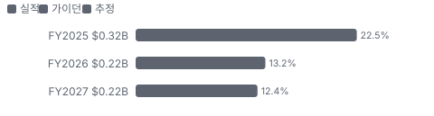

해석: 3,000번 중 807번(27%)에서 가치가 지금 주가 이상이었다. 가정을 흔들어도 지금 주가를 뒷받침하지 못하는 경우가 더 많다. 가운데 값은 0.69배이고, 열 번 중 여덟 번은 0.38~1.51배 사이에 든다.

## 내러티브

> **기업가치를 결정하는 이야기:** 값은 세 줄이다. 시장가로 바뀐 계약의 일당, 앞으로 재계약할 리그의 일당, Sonadrill(Seadrill과 앙골라 국영사 Sonangol의 합작사) 관리 수익이다. 2027 잔고는 10월 계약을 합쳐 컨센서스 매출의 약 3/4으로 추정한다. 나머지 1/4의 일당이 이익을 가른다.

> **멀티플·EPS 프리미엄**
> **멀티플:** Fwd 1Y EV/EBITDA 8.31배는 자기 36개월 범위(3.74~8.47배)의 꼭대기다. 동종 중앙값 10.7배보다는 22% 낮다. 2027~2028 이익이 커지는 분모 효과가 있어 Fwd 2Y는 5.83배다.
> **EPS:** FY2027 EPS 컨센서스는 \$1.92~\$2.33이고 추정 범위는 \$0.46~\$3.30이다. 애널리스트 2명 값이라 EPS 리비전은 근거가 약하다.

### 투자자들은 왜 열광했나

2025년 4월 \$18대에서 시작했다. 2026년 2월 Transocean의 Valaris 인수, 2월 말 이란 충돌과 호르무즈 봉쇄, 브렌트 2분기 평균 \$103이 겹쳤다. 6월에 긴장이 풀리며 −31% 밀렸다가 2Q 상향과 10월 계약으로 회복했다. 브렌트가 8월 초 \$82로 내려왔는데도 주가가 올라 지금은 유가보다 계약이 주가를 움직인다.

### 무엇이 기업가치를 바꾸나

> **구조적 체질 변화**
> **변화:** 파산 뒤 차입을 줄였고 고금리 채권을 6.75%로 바꿨다
> **증거:** 순차입 \$394M, 2Q 연환산 EBITDA의 약 0.7배. 회사 목표는 1.0배 미만
> **반증:** 순차입이 EBITDA의 2배를 넘는다

> **고부가 믹스 확장**
> **변화:** 해당 없음(제품 믹스보다 계약 재가격이 이익을 바꾼다). 평균 일당 \$331K → \$360K
> **증거:** 2Q 10-Q
> **반증:** 평균 일당이 \$380K를 넘지 못한다

> **기술 혁신**
> **변화:** 해당 없음(신기술보다 리그 세대가 일당을 정한다). 6세대에 관리 압력 시추를 얹어 7세대에 가까운 일을 맡는다
> **증거:** 2Q 콜, West Capella·West Polaris(Seadrill의 6세대 드릴십, 브라질 작업)
> **반증:** 6세대 일당 격차가 \$100K 이상 벌어진다

> **실행 속도**
> **변화:** 수주에서 시작까지 약 3~8개월이고 재가동 3건을 일정 안에 끝냈다 **납품 리드타임 3~8개월.** 피어 중앙값 6.5개월보다 15% 짧다(Noble 5~8개월). 이전 대비 미확인.
> **증거:** West Carina 10월 공개 → 2027 상반기 시작. Noble Globetrotter I 10월 → 2027년 2분기
> **반증:** 재가동이 지연된다

> **M&A**
> **변화:** Transocean·Valaris 합병이 4분기 종결 예정이다. Seadrill은 1Q 콜에서 인수·피인수를 모두 본다고 했다
> **증거:** 브라질 승인 10/13, Valaris 주총 11/24
> **반증:** 남은 회사 사이 거래가 없다

> **정책·입법 연관성**
> **재정정책:** 해당 없음(재정 보조 대상이 아니다)
> **행정명령:** 2025년 행정명령 14154가 미국 연방 해역 임대를 늘리는 방향이다. 2Q 미국 매출 비중은 26% 행정명령 14154 반증: 임대 판매가 소송으로 멈춘다 의회 동의 10/10 — 하원 5/5(OBBBA(2025년 미국 세제·지출 법률) 본회의 통과) · 상원 5/5(OBBBA 본회의 통과).
> **연관입법:** OBBBA가 멕시코만 해상 임대 판매 30회를 법으로 정했다. 시행 단계다 공법 119-21 반증: 임대 판매 일정 지연

> **CAPEX 낙수효과**
> **변화:** 석유사 심해 투자가 늘 때 시추 수요로 내려온다. 공급 관계는 입찰로 나뉜다
> **증거:** Wood Mackenzie 2027 해양 FID(유전 개발 최종 투자 결정) \$165B, 2025 대비 +132%(2Q 콜 인용)
> **반증:** FID가 2027로 밀린다

### 내러티브 근거

> '신조 없는 심해 사이클'은 업계 공통 이야기다. Seadrill만의 이야기는 저가 계약 3건의 재계약이 끝났다는 것과 인수 대상이 될 수 있다는 것이다. 동종 대비 멀티플 차이 -22% 중 회사 고유 몫은 -41%다. 단계는 컨센서스, 쏠림은 보통이다.

> **저가 계약 재가격 완료** · 강화
> **논리:** 3건의 옛 계약이 모두 시장가로 바뀐다
> **숫자:** West Jupiter(Seadrill의 7세대 드릴십, 브라질 작업)·Tellus 합산 일 \$400K 증가 = 연 약 \$146M, West Carina 일 약 \$477K
> **반증:** West Carina 시작이 2027 하반기로 밀린다

> **2027 공급 부족** · 유지
> **논리:** 드릴십 가동률이 90% 중반으로 간다
> **숫자:** 가정: 일당 \$50K 상승 × 재계약 5척 × 가동률 96% = 연 약 \$88M
> **반증:** 2027 상반기 입찰이 지연되고 일당이 \$400K 초반에 머문다

> **업계 재편·인수 대상** · 유지
> **논리:** Transocean·Valaris 합병 뒤 남은 회사가 묶인다
> **숫자:** 금액 없음. 가설이다
> **반증:** 2027까지 제안이 없고 Elliott이 더 줄인다

> **주주환원 전환** · 유지
> **논리:** FCF가 나오면 50% 이상을 돌려준다
> **숫자:** 2027 FCF 컨센서스 \$200M = 시가총액의 6%
> **반증:** 2H26 FCF가 음수로 끝난다

> **반대: Petrobras 분쟁과 소송** · 강화
> **논리:** 최대 고객과의 분쟁이 현금을 막는다
> **숫자:** 지연 위약금 주장 \$213M, 보상 주장 \$825M(회사에 청구 안 함), SFL 약 \$55M
> **반증:** 조정이 소액으로 끝난다

## 포트폴리오

| 제품·서비스 | 구분 | 무엇 | 쓰는 곳 | 돈 버는 방식 |
|---|---|---|---|---|
| 드릴십 시추 | 서비스 | 12,000피트 수심의 심해 유정을 뚫는 선박과 인력을 일당으로 빌려준다 | Petrobras, 미국 멕시코만 독립사, 동남아 운영사 | 2Q 시추 수익 \$355M, 평균 일당 \$360K, 경제적 가동률(계약 일당 대비 실제로 받은 일당 비율) 96% |
| Sonadrill 관리·리스 | 서비스 | 앙골라 합작사 리그 3척의 운영 대행과 West Gemini 임대 | 앙골라 심해 | 2Q 관리 수익 \$67M·리스 수익 \$8M |
| 시추 선단 | 제품 | 소유 15척. 드릴십 10척, 반잠수식 4척, 잭업(다리를 해저에 내려 고정하는 얕은 바다 시추선) 1척. 전부 2007년 이후 인도 | 소유 15척 중 3척 정지. West Aquarius(냉각 정지 중인 극한 해역용 반잠수식 시추선)·Phoenix 재가동비는 척당 \$100M 이상 | 장부가 \$2.93B, 척당 약 \$195M |

## 수주·파이프라인

> **2026-10-13 기준 6건.** 확정 \$3.40B. 공시 계약 잔고(6월 말) \$2.93B. 서로 겹치는 항목은 합계에서 뺐다.

**실행 속도와 방해 요인**
| 항목 | 상태 | 실행 속도 | 방해 요인 |
|---|---|---|---|
| 6월 말 계약 잔고 | 확정 | 2H26 \$763M, 2027 \$1.18B, 2028 \$555M, 이후 \$436M | Petrobras 상계 가능성 · 고객 해지권 |
| West Carina 인도네시아 | 확정 | 880일, 이동비 포함 일 약 \$477K | 이동 일정 · 고객명 미공개 |
| West Capella 말레이시아 연장 | 확정 | 120일, 일 약 \$342K, 2028년 2월까지 | 추가 120일은 미확정 |
| West Vela(Seadrill의 7세대 드릴십, 미국 멕시코만 작업) Talos | 확정 | 365일, 일 약 \$441K | 미국 멕시코만 공급 과잉 |
| West Gemini 후속 | 파이프라인 | 연말 만료, 앙골라·서아프리카 입찰 | 계약 공백 |
| West Aquarius·Phoenix 재가동 | 파이프라인 | 척당 \$100M 이상 재가동 비용 | 재가동 비용을 대는 계약 필요 |

## 해자

> 해자는 강하지 않다. 있는 것은 공급 비탄력과 실행 기록이고 둘 다 사이클에 기대며, 고객 Petrobras가 34%다.

> **신조 없는 시추선 공급** · 보통
> **해자:** 새 드릴십이 거의 없어 수요가 늘면 일당이 움직인다. 다만 이는 업계 공통이고 Seadrill만의 장벽은 아니다.
> **근거:** 2Q 콜에서 CEO가 공급 비탄력을 지난 사이클과의 차이로 꼽았다. RigLogix 기준 온화 해역 부유식 계약 107척, 가동률 87%
> **숫자:** 가동률 87% → 회사 전망 90% 중반
> **깨지는 조건:** Noble·Transocean이 냉각 정지 선박을 재가동하거나 신조 발주가 나온다

> **연속 계약과 무공백 운영** · 보통
> **해자:** 작업 공백 없이 이어 받아 유휴 비용을 줄인다.
> **근거:** 경제적 가동률 96%, 2026 3개 프로젝트 일정·예산 내 완료, West Vela는 현 작업에 바로 이어지는 12개월 계약
> **숫자:** 경제적 가동률 2Q25 93% → 2Q26 96%
> **깨지는 조건:** 가동률이 93% 아래로 내려오거나 재가동 프로젝트가 예산을 넘는다

> **앙골라 합작사 Sonadrill** · 보통
> **해자:** 국영사와 묶인 관리 계약이 사이클 하단의 현금을 받친다.
> **근거:** 2Q 관리 수익 \$67M·리스 수익 \$8M, 고객 비중 18%. 리그 3척 기술 가동률 99% 초과. Libongos 2030년 1월까지 연장
> **숫자:** 연 관리 수익 약 \$260M
> **깨지는 조건:** West Gemini가 계약을 못 받거나 Sonangol이 관리 수수료를 재협상한다

## 경영진·네트워크

> 창업자 체제가 아니다. CEO는 2026년 3월 취임한 40세 상업 담당 출신이고, 의장은 Noble 전 CEO다.

> **Samir Ali** · 사장·CEO · 2026-03
> **프로필:** 40세. 2022년부터 Seadrill 최고상업책임자, 앞서 Diamond Offshore 8년, Bain Capital 포트폴리오 매니저, Simmons & Company 투자은행가
> **비즈니스:** 시추 계약과 투자자 관계 경력이다
> **정계:** 미확인
> **동문:** 미확인
> **사모임:** 미확인

> **Julie J. Robertson** · 이사회 의장 · 2022-02
> **프로필:** 70세. Noble에서 40년 넘게 일했고 2018~2020 CEO, 2020~2021 집행 의장
> **비즈니스:** EOG(미국 석유·가스 생산 회사) Resources·Patterson-UTI·Superior Energy 이사
> **정계:** 미확인
> **동문:** University of Texas at Austin 학사
> **사모임:** 미확인

**네트워크 정량화**
| 연결 | 강도 | 닿는 매출 | 가중 노출 | 매출 대비 | 근거 |
|---|---|---|---|---|---|
| 비즈니스: 의장의 Noble 경력과 업계 이사회 — M&A 상대가 될 수 있는 회사의 전 CEO다 | 3/5 | 미확인 | 미확인 | 미확인 | 거래가 없어 금액을 잡을 수 없다 2026 위임장 |
| 정계: 공개 자료에서 찾지 못했다 | 0/5 | 미확인 | 미확인 | 미확인 | 미확인 2026 위임장에 해당 이력 없음 |

가중 노출은 연결이 닿는 매출의 크기다. 연결이 그 매출을 만들었다는 뜻이 아니며, 인과는 공개 자료로 입증하지 못한다.

## 약세 논리 및 셀온 조건

| 약세 논리 | 근거 | 반박 | 가를 자료 |
|---|---|---|---|
| 가격이 2027을 이미 담았다 | Fwd 1Y EV/EBITDA 8.31배는 36개월 범위 3.74~8.47배의 꼭대기다 | 분모가 재가격 이전 EBITDA라 높아 보인다. Fwd 2Y는 5.83배다 | FY2027 EBITDA 추정 \$530M 유지 여부 |
| Petrobras 분쟁이 현금을 막는다 | 지연 위약금 주장 \$213M, 상계 가능성 언급. 2Q 매출의 34%가 Petrobras다 | 상계는 조정 중 유보됐고 위약금 상한이 계약가의 10%다. 회사는 충당하지 않았다 | 조정 개시와 상계 공시 |
| FCF 전환이 또 밀린다 | 1H26 FCF −\$78M, FY2025 영업현금 −\$28M. 약속은 2025년에도 있었다 | Tellus 이동비 \$40M이 3Q에 들어오고 대형 프로젝트가 끝났다 | 3Q 영업현금, 매출채권 \$311M 감소 |
| 미국 멕시코만과 공백 | 연내 여러 드릴십이 비고 West Gemini 만료가 다가온다 | West Vela·Neptune은 이미 잡았다 | West Gemini 계약, 2027 상반기 입찰 |
| 주요 주주가 줄인다 | Elliott 보유 주식 364만 → 311만 주, 임원 6월 매도 약 \$5.4M | 스와프는 늘려 실질 노출이 11.7%다. 임원 매도 이유는 미확인 | 다음 13D/A, 3Q 자사주 금액 |

> **셀온 조건**
> **조건 1:** 2H26 FCF가 음수로 끝난다
> **조건 2:** West Gemini가 2027 1분기까지 계약을 못 받는다
> **조건 3:** Petrobras가 상계를 실행하거나 위약금 소송을 낸다
> **조건 4:** 최상위 드릴십 신규 일당이 \$430K 아래로 내려간다
> **조건 5:** Noble·Transocean이 냉각 정지 선박을 재가동하거나 신조 발주가 나온다

## 어닝콜 변화

**직전 콜 대비 새로 나오거나 바뀐 내용 → 가치 영향**
| 항목 | 내용 | 직전 콜 | 최신 콜 | 모델 동인 이동 | 확신도 | 가치 영향 |
|---|---|---|---|---|---|---|
| 업데이트 | 2026 매출 가이던스 | \$1.43~1.48B | \$1.5~1.55B | 기준연도 매출 +\$0.07B | 0.8 | +5.5% |
| 업데이트 | 2026 EBITDA 가이던스 | \$370~420M | \$420~450M | 출발 이익률 +1.4% | 0.8 | +0.8% |
| 신규 | 채권 차환 | 8.375% 2030년 | 6.75% 2034년 | 할인율(WACC) -0.20% | 1.0 | +2.6% |
| 신규 | 2027 드릴십 가동률 | 2027 개선 전망 | 입찰이 전환되면 90% 중반 | 목표 이익률 +1.5% | 0.5 | +2.2% |
| 부정 | 하반기 수리·정비비 | 1Q 말 일부 이연 언급 | 하반기 비중 높음 | 출발 이익률 -0.50% | 0.8 | -0.3% |
| **합계** | 단독 합 |  |  | 동시 적용 +11.2% |  | **+10.8%** |

## 밸류에이션

> **목표주가 \$56, 업사이드 +7%.** 자리는 약세와 기본 사이(약세 쪽 14%)이고 도달 확률은 약 56%다. 기본 \$59, 강세 \$87(+65%), 약세 \$37(-29%). DCF 기준 업사이드는 기본 -31%, 강세 +31%, 약세 -55%다(WACC 10.1%).

기준 멀티플이 Fwd 1Y(다음 4개 분기)라서 EBITDA도 같은 기간을 쓴다. FY2028 EBITDA \$600M에 동종 Fwd 2Y 중앙값 8.1배를 곱해도 주당 약 \$69이고 7.5배면 약 \$63이다. Petrobras 위약금과 SFL 판결금은 시나리오에 넣지 않았다. 지연 위약금 \$213M은 주당 약 \$3.3, SFL 약 \$55M은 주당 약 \$0.8다.

> **약세 \$37 (-29%)** · 확률 25%
> **가정:** 7.3배 × EBITDA \$0.39B
> **근거:** 일당이 \$400K 초반에 머물고 West Gemini 공백이 길어진다. 다음 4개 분기 EBITDA 추정 범위 \$340~572M의 하단 쪽

> **기본 \$59 (+13%)** · 확률 50%
> **가정:** 9.7배 × EBITDA \$0.44B
> **근거:** 가이던스 범위대로 간다. 다음 4개 분기 EBITDA 컨센서스 \$439M

> **강세 \$87 (+65%)** · 확률 25%
> **가정:** 12.1배 × EBITDA \$0.50B
> **근거:** West Carina 조기 시작과 \$450K 이상 재계약, 동종이 일당을 \$500K로 끌어올린다

**멀티플 선정 — Fwd 1Y EV/EBITDA**
| 단계 | 조정 | 근거 |
|---|---|---|
| 동종 중앙값 | 10.7배 | 범위 8.2~13.1배, 4곳 |
| 펀더멘털 | +16% | 성장·이익률·ROIC로 본 합리적 멀티플 14.1배와의 차이의 일부만 인정 |
| 해자 | +4% | 신조 없는 시추선 공급 보통 · 연속 계약과 무공백 운영 보통 · 앙골라 합작사 Sonadrill 보통 |
| 내러티브 | +0% | 단계 컨센서스 |
| 사이클·실행 판단 | -30% | 동종 Fwd 1Y가 이익 저점이라 높다. Fwd 2Y 중앙값은 8.1배로 낮아지고 자기 36개월 범위 상단도 8.5배다. Petrobras 분쟁 \$213M과 고객 집중까지 있어 상한까지 할인한다 |
| **선정** | **9.7배** | 지금 8.3배 |

**동종 레인지**
| 회사 | Fwd 1Y EV/EBITDA | Fwd 2Y EV/EBITDA | Fwd 3Y EV/EBITDA | 성장 | 영업이익률 | ROIC |
|---|---|---|---|---|---|---|
| RIG | 9.4 | 7.7 | 6.7 | -5% | 19% | 5% |
| VAL | 13.1 | 14.2 | 12.1 | 6% | 18% | 8% |
| NE | 12.0 | 8.5 | 6.8 | -21% | 9% | 4% |
| BORR | 8.2 | 7.5 | 6.8 | 1% | 24% | 6% |
| **Seadrill** | 8.3 | 5.8 | 5.7 |  |  |  |

지금 주가가 요구하는 5년 매출 CAGR 14%, 기본 시나리오 6%. 몬테카를로 중앙값 업사이드 -31%.

> 의사결정 보조(투자자문 아님): ① 매수 매력: 연 기대수익 +6.0% (자기자본비용 10.6% 대비 -4.6%p) · 자본비용 초과 확률 25% · 안전마진 0.38 → 정량 신호 약함 / ② 위험 예산 지표(이론): 0% — 기대수익이 자기자본비용에 못 미침(무위험 대비 켈리 13%는 참고) · 5년 하위10% -41% · 30%+ 손실 확률 19% / ③ 상방(5년): 기대 1.34배 · 2배 16% · 3배 5% · 10배 0% · 상위10% 2.42배

## 시장 평가

> **셀사이드(IB 애널리스트)**
> **한 줄:** 의견은 좋지만 숫자 표본이 2명이고 범위가 넓다
> **애널리스트 의견:** 12명 — 강력 매수 9·매수 1·보유 2 — 긍정적이다
> **목표가 평균·범위:** \$56.33 (\$43~\$80, 9명) — 평균 대비 현재가 업사이드 +7%. 기대의 증거다
> **FY2027 EBITDA:** \$430~620M — 추정이 넓다

> **바이사이드(기관 투자자)**
> **한 줄:** 지분 주체가 있으나 최대 보유자는 줄이는 쪽이고 회사 매입가도 지금보다 낮다
> **Elliott:** 실질 노출 12.3% → 11.7%, 보유 주식 364만 → 311만 주 — 주가가 오르자 줄였고 스와프는 늘렸다
> **주요 주주:** Canyon 7.8%, BlackRock 7.3%, Vanguard 6.0% — 4월 기준
> **펀드 서한:** City Different 3Q 신규 2.93%, Patient Capital 1Q 높은 확신 — 인수 대상 가능성을 거론
> **내부자:** 6월 임원 4명 장내 매도 약 \$5.4M — 매수 없음
> **자사주:** 6월 \$20M, 평균 \$38.66 — 한도 \$188M, 연말 만료

> **언론·업계**
> **한 줄:** 업계지는 일당 상승을 확인하고 있다
> **West Carina 계약:** \$420M 880일 — 4건 묶음 보도
> **SFL 패소:** 약 \$55M — 항소심 만장일치
> **Noble 3Q:** 최상위 드릴십 일당 \$400K 중반~\$500K — 동종 확인
> **Transocean 10월 수주:** Proteus 일 약 \$464K·Conqueror 일 약 \$500K — 수주액 ÷ 일수, 고객 비공개. West Carina \$477K와 같은 구간

## 체크리스트

| 시점 | 무엇 | 의미 |
|---|---|---|
| 2026-11-02 장 마감 후 | Transocean·Valaris 3Q | 일당과 2027 수주 잔고 |
| 2026-11-03 장 마감 후 | Seadrill 3Q 실적 | 3Q FCF, Tellus 이동비 \$40M, FY2026 가이던스 |
| 2026-11-04 | Seadrill 콜 | West Gemini, 자사주 \$188M 사용, Petrobras 조정 |
| 2026년 11월 | SFL 대법원 상고 기한 | 판결 후 1개월, 현금 약 \$55M 지급 시점 |
| 2026-11-24 | Valaris 주주총회 | 합병 종결과 업계 재편 |
| 2026-12-31 | 자사주 계획 만료 | 연장 여부가 환원 신호다 |
| 2027년 상반기 | West Carina 시작 | \$420M 계약 인식 시작 |

## 출처
- Seadrill 2Q26 10-Q https://www.sec.gov/Archives/edgar/data/1737706/000173770626000026/sdrl-20260630.htm
- Seadrill FY2025 10-K https://www.sec.gov/Archives/edgar/data/1737706/000173770626000010/sdrl-20251231.htm
- Seadrill 2026 위임장 https://www.sec.gov/Archives/edgar/data/1737706/000114036126015486/ny20062826x1_def14a.htm
- CEO 교체 8-K https://www.sec.gov/Archives/edgar/data/1737706/000119312526113974/d28707d8k.htm
- Elliott 13D/A No.9 https://www.sec.gov/Archives/edgar/data/1737706/000091957426006770/xslSCHEDULE_13D_X02/primary_doc.xml
- Offshore Magazine 계약 보도 https://www.offshore-mag.com/rigs/news/55411692/seadrill-seadrill-secures-drilling-contracts-and-extensions-across-us-gulf-southeast-asia-and-angola
- Seatrade SFL 판결 보도 https://www.seatrade-maritime.com/offshore/seadrill-loses-55m-appeal-over-hercules-rig-redelivery
- Noble 3Q26 보도자료 https://www.sec.gov/Archives/edgar/data/0001895262/000189526226000147/exhibit991-q32026pressrele.htm
- Transocean 합병 진행 공시 https://www.sec.gov/Archives/edgar/data/0001451505/000110465926115872/tm269762d12_defa14a.htm
- 공법 119-21 https://www.congress.gov/bill/119th-congress/house-bill/1
- 2Q 10-Q
- 2Q 콜
- 2Q 콜, 6월 말 잔고에 포함 여부 미확인
- Offshore Magazine 2026-10-13

_구매 등급·목표주가 모두 규칙이 계산한 모델 값으로, 개인의 보유 종목·자금 사정을 반영하지 않는다 · 공개 자료 기반 분석이며 투자 권유가 아님 · 1차 판정, 미검증 · Chiip ten-bagger_