# 텐배거 리포트 2026-11-13 — Seadrill — FCF는 돌아왔고 2027은 찼다, 이제 값은 2028 일당이 정한다

> 2026-11-13 · Seadrill(SDRL) · 기업: 드릴십과 반잠수식 시추선을 일당으로 빌려주는 심해 시추 회사

## Chiip View

**FCF가 돌아왔다.** 3Q FCF \$179M, 현금 \$506M(제한 현금 포함), 순레버리지 0.6배이고 가이던스는 3분기 연속 올랐다. 그런데 주가는 10/30 \$52.57에서 11/12 \$44.85로 −15%다 — 시장은 3Q EPS 적자(−\$0.49)를 봤다. Fwd 1Y EV/EBITDA 6.23배는 동종 중앙값 10.0배보다 38% 낮다. 선정 배수 9.0배를 적용한 목표주가는 \$59, 업사이드 +32%, 약세 \$40(−11%), 손익비 9.2이고 구매 등급은 Buy다. DCF 기준 업사이드는 +11%로 작다. DCF는 장기 이익률을 사이클 평균 15%로 되돌리고 목표주가는 지금 동종 배수를 쓰기 때문이다. 2027은 미계약 드릴십(자체 항해로 움직이는 심해 시추선) 일수가 15% 미만이라 숫자가 거의 정해졌고, 위쪽은 2028 다년 계약 일당(시추선 하루 임대 요금)이 정한다. 다음 확인은 4Q FCF와 West Gemini(Sonadrill에 빌려준 드릴십, 연말 계약 만료) 후속 계약이다.

## 대시보드
| 항목 | 값 | 설명 |
|---|---|---|
| 주가 | \$44.85 | 고점 대비 -18% · 1년 +48% |
| 시가총액 | \$2.89B | 완전 희석 기준 · EV \$3.17B |
| 업사이드 | +32% | 목표주가 \$59 · 다운사이드 -11% · 손익비(강세÷약세) 9.2 |
| 구매등급 | Buy | 애널리스트 12명: Strong Buy 9 · Buy 1 · Neutral 2 · Sell 0 · Strong Sell 0 |
| 멀티플 | Fwd 1Y EV/EBITDA 6.2배 | 동종 중앙값 10.0배 |
| 가이던스 FY2026 | \$1,660M | 컨센서스 \$1,663M |
| 알파 | 5.4/10 | 텐배거 가능성 점수 |
| 이벤트 | 4Q26 실적(예상, 회사 미확정 — 작년 2/25 발표 기준 추정) | 2027-02-24 |

## 한 장 요약
- **기업가치를 결정하는 내러티브** **3Q는 '가동 일수가 현금으로 돌아오느냐'에 답했다.** FCF가 \$179M 나왔고 현금은 \$506M, 순레버리지 0.6배다. 가이던스는 3분기 연속 올랐다. 그런데 주가는 10/30 \$52.57에서 \$44.85로 −15%다. 3Q EPS가 −\$0.49로 적자였고 4Q EPS 컨센서스도 적자로 내려갔다. 지금 쟁점은 2027이 아니라 2028 일당이다 — 2027 미계약 드릴십 일수는 이미 15% 미만이다.
- **밸류에이션 모델로 본 주가 상방은 어디까지인가?** **목표주가 \$59(+32%), 약세와 기본 사이(약세 쪽 22%)다.** 강세 \$92(+105%)는 Fwd 1Y EV/EBITDA 11.3배를 강세 EBITDA에 적용한 값이다. 기본 \$64, 약세 \$40. 손익비 9.2, DCF 기준 업사이드 +11%.
- **수주는 어디까지 왔나?** 6월 말 계약 잔고 미확인, 100% 매출 \$2.93B · West Carina(Seadrill의 2015년식 7세대 드릴십) 인도네시아 0%, 100% 매출 \$0.42B · West Capella(Seadrill의 6세대 드릴십, 말레이시아 작업) 말레이시아 연장 0%, 100% 매출 \$0.04B. 6월 말 잔고 \$2.93B에 8월 이후 신규 약 \$800M(West Carina \$420M 포함)이 더해졌다. 2027 미계약 드릴십 일수는 15% 미만이다. West Gemini 후속과 정지 2척 재가동은 미확정이다
- **누가 사 주나?** 최대 고객 Petrobras(Petrobras) 34%, 상위 3곳 62%. 공시·회사 발표로 확인한 몫은 62%다.
- **마진과 공급망은 어디가 약한가?** GPM 34.8%, OPM 8.6%. OPM을 가장 흔드는 BOM(제품 원가를 이루는 부품·재료 명세) 항목은 시추 인력(선원·육상 지원)이고 가격 +10%에 -2.26%p다. 공급망 신뢰성은 6.1/10(관리 가능)이고 가장 약한 고리는 추가 드릴십(신조)이다.
- **생산능력은 얼마나 늘어나나?** 현재 명목 캐파 15 척, 착공 이상 증설 0 척. FY2027 CAPEX는 매출의 12.4%다.
- **지금 가격은 무엇을 가정하나?** 현금흐름으로 풀면 5년 매출 CAGR **5%**다. 기본 시나리오 7%, 컨센서스 FY2027·FY2028 각 +6%보다 낮다. 11/2 리포트의 14%에서 크게 내려왔다 — 주가가 내렸고 FCF로 순차입이 줄었다. 신조 없이 15척으로 가는 성장이라 일당이 조금만 올라도 맞출 수 있는 가정이다.
- **왜 움직였나?** 10/30 종가 \$52.57에서 11/12 \$44.85로 −15%다. 11/2 −9.2%는 회사 사건이 없어 원인 미확인이고, 11/4 −6.5%는 3Q EPS 적자(−\$0.49) 뒤다. 그사이 FY2026 EBITDA 가이던스는 올랐다. 시장은 EBITDA·FCF보다 EPS와 4Q 적자 컨센서스를 봤다.
- **3Q 콜에서 무엇이 바뀌었나?** 좋아진 것은 FCF \$179M, 현금 \$506M, 순레버리지 0.6배, 2027 미계약 드릴십 일수 30% → 15% 미만, West Carina 이동비(시추선을 새 작업지로 옮기는 비용을 고객이 일시금으로 내는 돈) \$85M(계약 시작 때 청구)이다. 가이던스는 영업수익 \$1.56~1.58B, EBITDA \$440~460M으로 올렸다. 아쉬운 것은 4분기 정비비 집중, 멕시코만 공급 과잉, IOC(국제 석유 메이저)가 여전히 프로그램 단위로만 장기 계약한다는 답이다. Petrobras 분쟁은 콜에서 나오지 않았다.
- **무엇이 바뀌면 판단이 달라지나?** 2028 시작 다년 계약이 일 \$500K 안팎으로 나오고 West Gemini가 2027 상반기 안에 이어지면 위쪽이다. 4Q FCF가 다시 음수이거나 West Gemini 공백이 길어지고 Petrobras가 상계를 실행하면 아래쪽이다. 다음 확인은 2027년 2월 말 4Q 실적과 2027 가이던스다.

## 한눈에 보기

**일봉**

**주봉**

**월봉**

**분기 매출·EPS 실적과 컨센서스**

**EPS 리비전**

① 26-02-09 Transocean의 Valaris 인수 발표 · EPS 리비전 -
② 26-02-25 4Q25 실적 · EPS 리비전 -
③ 26-05-11 1Q26 실적, 가이던스 상향 · EPS 리비전 -
④ 26-08-10 2Q26 실적, 가이던스 상향 · EPS 리비전 -
⑤ 26-10-13 West Carina \$420M 계약 공개(10/15~16 추정 표본 1→2명 변경과 겹침) · EPS 리비전 -34%
⑥ 26-11-03 3Q26 실적, 다음 날 −6.5% · EPS 리비전 -8%

**밸류에이션 주가 시나리오**

**주가별 업사이드**

- 제품·서비스 포트폴리오

**고객 믹스(2Q26, 매출 대비)**

**공급 병목(10점, 낮을수록 병목)**

**생산능력 현재와 확충 계획(척)**

**CAPEX의 매출 대비 비중**

**어닝콜 변화별 주주가치 영향**

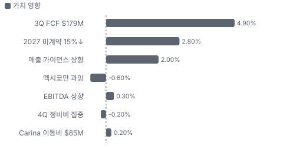

**멀티플 프리미엄(Fwd 1Y EV/EBITDA, 최근 4개 분기말)**

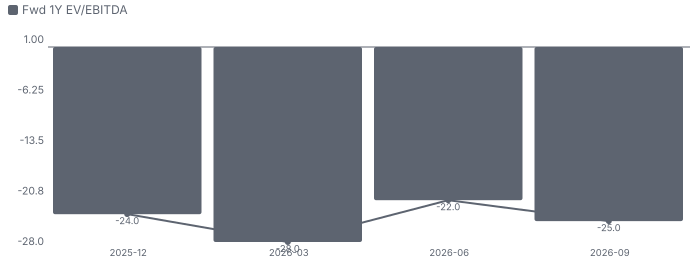

**합리적 멀티플**

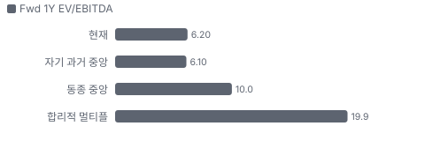

**수주·파이프라인 확실성 사다리**

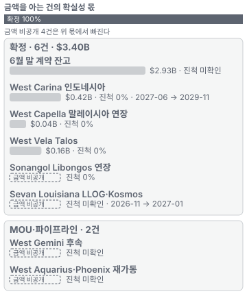

**매출 → 매출총이익 → 영업이익(매출 = 100, 최근 4분기)**

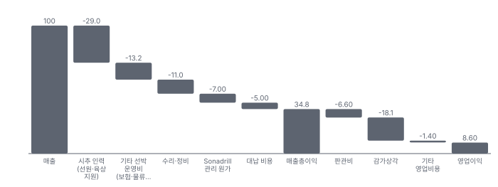

**1년 전 대비 마진 기여(비용 비중 변화의 반대)**

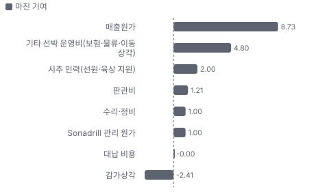

**분기 비용 비중 추이(매출 대비, 공시)**

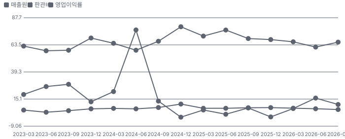

**비용 요인별 매출 대비 비중과 1년 변화**

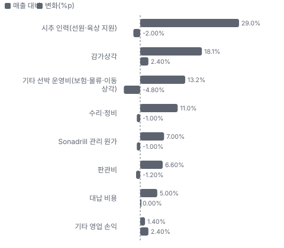

**BOM 항목 가격 +10% 시 OPM 변화**

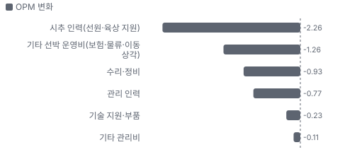

**드릴십 시추 BOM 원가 몫과 가격 +10% 시 OPM**

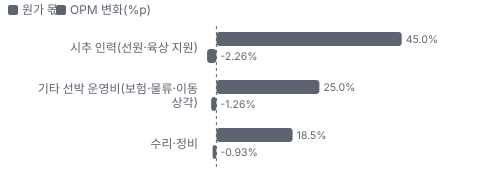

**Sonadrill 관리·리스 BOM 원가 몫과 가격 +10% 시 OPM**

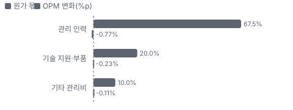

**매출 증가율의 가격·물량 분해와 8분기 전망(전년 대비)**

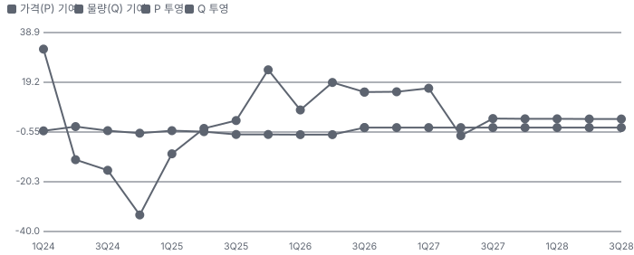

**분기별 매출 증가율 분해**

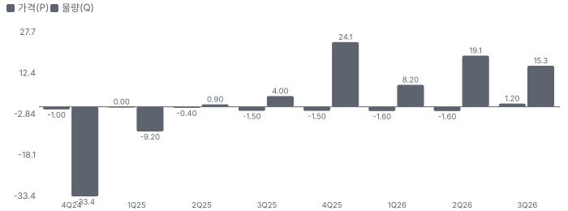

**목표주가 산정 — 약세와 기본 사이(약세 쪽 22%), 도달 확률 약 58%**

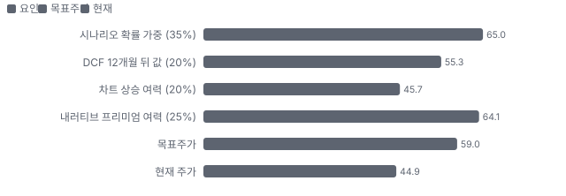

**PEG — 성장 대비 멀티플(낮을수록 성장 대비 쌈)**

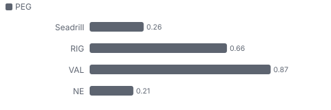

**일봉 지지·저항과 목표주가**

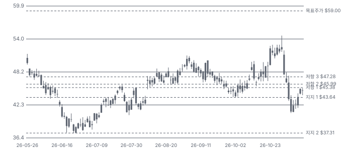

**일별 거래량 분해**

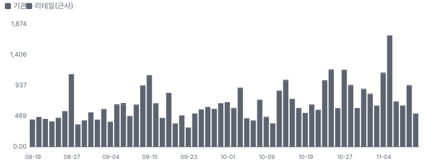

**기관 자금 흐름**

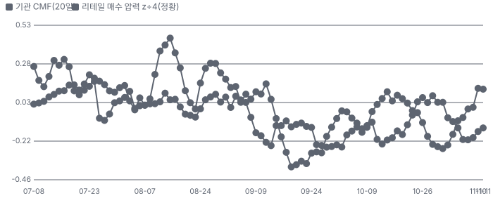

**몬테카를로**

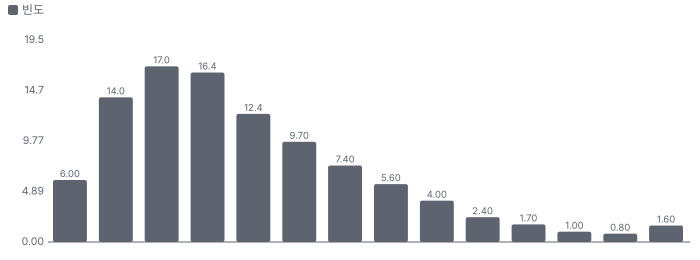

해석: 3,000번 중 1,849번(62%)에서 가치가 지금 주가 이상이었다. 가정을 흔들어도 지금 주가를 뒷받침하는 경우가 더 많다. 가운데 값은 1.12배이고, 열 번 중 여덟 번은 0.71~1.89배 사이에 든다.

## 내러티브

> **기업가치를 결정하는 이야기:** 값은 세 줄이다. 시장가로 바뀐 계약의 일당, 2027 말~2028에 재계약할 리그(West Auriga(Seadrill의 7세대 드릴십, 브라질 작업)·Neptune·Gemini)의 일당, Sonadrill 관리 수익이다. 2027은 계약으로 대부분 찼으므로 놀랄 여지는 2028 입찰에 있다.

> **멀티플·EPS 프리미엄**
> **멀티플:** Fwd 1Y EV/EBITDA 6.23배는 자기 36개월 범위(3.74~8.47배)의 중간 위이고 동종 중앙값보다 낮다. Fwd 2Y는 4.77배로 2027 이익 증가가 분모를 키운다.
> **EPS:** EPS는 감가상각·영업외 비용 때문에 기준으로 쓰기 어렵다. Fwd 1Y P/E 57배는 이익이 거의 0이라는 뜻이고, 4Q EPS 컨센서스는 3Q 전 \$0.11에서 −\$0.19~−\$0.22로 내렸다. 그래서 기준 지표는 EBITDA다.

### 투자자들은 왜 열광했나

2025년 4월 \$18대에서 시작해 2026년 5월 종가 고점 \$54.80까지 갔다. 호르무즈 긴장과 Transocean·Valaris 합병, 재가격 계약이 겹쳤다. 10월 West Carina 계약으로 \$52대를 회복했지만 11/2 −9.2%(원인 미확인), 11/4 3Q EPS 적자에 −6.5%가 나며 식었다. 기대는 FCF가 아니라 EPS를 보고 꺾였다.

### 무엇이 기업가치를 바꾸나

> **구조적 체질 변화**
> **변화:** 파산 뒤 차입을 줄였고 고금리 채권을 6.75%로 바꿨다
> **증거:** 3Q 말 차입 원금 \$750M, 현금 \$506M(제한 현금 포함), 순레버리지 0.6배(회사 발표). 만기는 2034년까지
> **반증:** 순차입이 EBITDA의 2배를 넘는다

> **고부가 믹스 확장**
> **변화:** 해당 없음(제품 믹스보다 계약 재가격이 이익을 바꾼다). 평균 일당 \$331K → \$360K
> **증거:** 2Q 10-Q
> **반증:** 평균 일당이 \$380K를 넘지 못한다

> **기술 혁신**
> **변화:** 해당 없음(신기술보다 리그 세대가 일당을 정한다). 6세대에 관리 압력 시추를 얹어 7세대에 가까운 일을 맡는다
> **증거:** 2Q 콜, West Capella·West Polaris(Seadrill의 6세대 드릴십, 브라질 작업)
> **반증:** 6세대 일당 격차가 \$100K 이상 벌어진다

> **실행 속도**
> **변화:** 수주에서 시작까지 약 3~8개월이고 재가동 3건을 일정 안에 끝냈다 **납품 리드타임 3~8개월.** 피어 중앙값 6.5개월보다 15% 짧다(Noble 5~8개월). 이전 대비 미확인.
> **증거:** West Carina 10월 공개 → 2027 상반기 시작. Noble Globetrotter I 10월 → 2027년 2분기
> **반증:** 재가동이 지연된다

> **M&A**
> **변화:** Transocean·Valaris 합병이 4분기 종결 예정이다. Seadrill은 1Q 콜에서 인수·피인수를 모두 본다고 했다
> **증거:** 브라질 승인 10/13, Valaris 주총 11/24
> **반증:** 남은 회사 사이 거래가 없다

> **정책·입법 연관성**
> **재정정책:** 해당 없음(재정 보조 대상이 아니다)
> **행정명령:** 2025년 행정명령 14154가 미국 연방 해역 임대를 늘리는 방향이다. 2Q 미국 매출 비중은 26% 행정명령 14154 반증: 임대 판매가 소송으로 멈춘다 의회 동의 10/10 — 하원 5/5(OBBBA(2025년 미국 세제·지출 법률) 본회의 통과) · 상원 5/5(OBBBA 본회의 통과).
> **연관입법:** OBBBA가 멕시코만 해상 임대 판매 30회를 법으로 정했다. 시행 단계다 공법 119-21 반증: 임대 판매 일정 지연

> **CAPEX 낙수효과**
> **변화:** 석유사 심해 투자가 늘 때 시추 수요로 내려온다. 공급 관계는 입찰로 나뉜다
> **증거:** Wood Mackenzie 2027 해양 FID(유전 개발 최종 투자 결정) \$165B, 2025 대비 +132%(2Q 콜 인용)
> **반증:** FID가 2027로 밀린다

### 내러티브 근거

> '신조 없는 심해 사이클'은 업계 공통 이야기다. Seadrill만의 이야기는 저가 계약 3건의 재계약이 끝났다는 것과 인수 대상이 될 수 있다는 것이다. 동종 대비 멀티플 차이 -38% 중 회사 고유 몫은 -69%다. 단계는 컨센서스, 쏠림은 보통이다.

> **저가 계약 재가격 완료** · 강화
> **논리:** 3건의 옛 계약이 모두 시장가로 바뀐다
> **숫자:** West Jupiter(Seadrill의 7세대 드릴십, 브라질 작업)·Tellus 합산 일 \$400K 증가 = 연 약 \$146M, West Carina 일 약 \$477K
> **반증:** West Carina 시작이 2027 하반기로 밀린다

> **2027 공급 부족** · 강화
> **논리:** 드릴십 가동률이 90% 중반으로 간다
> **숫자:** 2027 미계약 드릴십 일수 30% → 15% 미만(3Q 콜)
> **반증:** 2027 상반기 입찰이 지연되고 일당이 \$400K 초반에 머문다

> **업계 재편·인수 대상** · 유지
> **논리:** Transocean·Valaris 합병 뒤 남은 회사가 묶인다
> **숫자:** 금액 없음. 가설이다
> **반증:** 2027까지 제안이 없고 Elliott이 더 줄인다

> **주주환원 전환** · 강화
> **논리:** FCF가 나오면 50% 이상을 돌려준다
> **숫자:** 3Q FCF \$179M, 3Q 자사주 \$22M(연간 \$42M = 시가총액의 1.5%)
> **반증:** 12월 말 자사주 계획이 연장되지 않는다

> **반대: Petrobras 분쟁과 소송** · 유지
> **논리:** 최대 고객과의 분쟁이 현금을 막는다
> **숫자:** 지연 위약금 주장 \$213M(2Q 10-Q), 3Q 콜에서는 언급 없음 — 3Q 주석 미대조
> **반증:** 조정이 소액으로 끝난다

이미지 없음(아직 생성 전) — 시추 선단·드릴십 시추

## 포트폴리오

| 제품·서비스 | 구분 | 무엇 | 쓰는 곳 | 돈 버는 방식 | Mix | Mix 변화(전 분기 대비) |
|---|---|---|---|---|---|---|
| 드릴십 시추 | 서비스 | 12,000피트 수심의 심해 유정을 뚫는 선박과 인력을 일당으로 빌려준다 | Petrobras, 미국 멕시코만 독립사, 동남아 운영사 | 3Q 시추 수익 약 \$329M, 경제적 가동률(계약 일당 대비 실제로 받은 일당 비율) 95%, 평균 일당은 또 올랐다(수치 미공개) | 미확인 | 미확인 |
| Sonadrill 관리·리스 | 서비스 | 앙골라 합작사 리그 3척의 운영 대행과 West Gemini 임대 | 앙골라 심해 | 3Q 관리 수익 \$66M·리스 약 \$9M, Libongos 2030년까지 연장 | 미확인 | 미확인 |
| 시추 선단 | 제품 | 소유 15척. 드릴십 10척, 반잠수식 4척, 잭업(다리를 해저에 내려 고정하는 얕은 바다 시추선) 1척. 전부 2007년 이후 인도 | 소유 15척 중 3척 정지. West Aquarius(냉각 정지 중인 극한 해역용 반잠수식 시추선)·Phoenix 재가동비는 척당 \$100M 이상 | 장부가 \$2.93B, 척당 약 \$195M | 미확인 | 미확인 |

## 고객

> **2Q26 최대 고객 Petrobras(Petrobras) 34%, 상위 3곳 62%, 집중도 보통.** 공시·회사 발표로 확인한 몫은 매출의 62%이고, 나머지 고객 몫은 추정이거나 미분해다. 10% 이상 고객은 2Q 10-Q 기준 Petrobras 34%·Sonadrill 18%·Walter Oil & Gas 10%다. 3Q 10-Q 고객 주석은 이번 회차 열지 못했다. 3Q에는 West Tellus(Seadrill의 7세대 드릴십, 브라질 작업)가 Petrobras에서 한 분기 내내 일했고 West Carina가 브라질을 떠났다

**고객별 매출 몫(2Q26)**
| 고객 | 몫 | 변화 | 근거 |
|---|---|---|---|
| Petrobras(Petrobras) | 34% | 미확인 | 공시 |
| Sonadrill(Sonadrill) | 18% | 미확인 | 공시 |
| Walter Oil & Gas(Walter Oil & Gas) | 10% | 미확인 | 공시 |
| Eni(Eni) | 0% | +0%p | 회사 발표 |
| LLOG(LLOG) | 미확인 | 미확인 | 회사 발표 |
| 기타·미분해 | 38% | - | - |

> **Petrobras(Petrobras)** · 공시
> **사는 것:** 브라질 드릴십 시추
> **추정 근거:** 브라질 5척 안팎, Sete Brazil(Petrobras가 추진하다 파산한 브라질 시추선 건조 사업) 관련 분쟁 중

> **Sonadrill(Sonadrill)** · 공시
> **사는 것:** 관리 계약·West Gemini 임대
> **추정 근거:** Libongos 약 3년 연장(3Q 콜)

> **Walter Oil & Gas(Walter Oil & Gas)** · 공시
> **사는 것:** 멕시코만 시추
> **추정 근거:** 멕시코만 계약

> **Eni(Eni)** · 회사 발표
> **사는 것:** West Carina 인도네시아(2027 시작)
> **추정 근거:** 880일 약 \$420M, 이동비 \$85M

> **LLOG(LLOG)** · 회사 발표
> **사는 것:** 멕시코만 3척
> **추정 근거:** Sevan Louisiana(원통형 반잠수식 시추선, 미국 멕시코만 단기 작업) 60일 계약으로 멕시코만 3척 모두 LLOG

## 수주·파이프라인

> **2026-11-04 기준 8건.** 확정 \$3.40B. 공시 계약 잔고(6월 말) \$2.93B. 서로 겹치는 항목은 합계에서 뺐다.

**실행 속도와 방해 요인**
| 항목 | 상태 | 실행 속도 | 방해 요인 |
|---|---|---|---|
| 6월 말 계약 잔고 | 확정 | 2H26 \$763M, 2027 \$1.18B, 2028 \$555M, 이후 \$436M | Petrobras 상계 가능성 · 고객 해지권 |
| West Carina 인도네시아 | 확정 | 880일, 이동비 \$85M 포함 총 약 \$420M — 이동비는 계약 시작 때 청구(3Q 콜) | 이동 일정 · 고객명 미공개 |
| West Capella 말레이시아 연장 | 확정 | 약 8개월 추가, 절반은 무가격 옵션을 일 \$400K 중반에 행사, 2028년 2월까지 | 추가 120일은 미확정 |
| West Vela(Seadrill의 7세대 드릴십, 미국 멕시코만 작업) Talos | 확정 | 365일, 일 약 \$441K | 미국 멕시코만 공급 과잉 |
| West Gemini 후속 | 파이프라인 | 현 계약 2027년 1월까지, 앙골라·서아프리카·아시아 영업 중 | 계약 공백 |
| West Aquarius·Phoenix 재가동 | 파이프라인 | 척당 \$100M 이상 재가동 비용 | 재가동 비용을 대는 계약 필요 |
| Sonangol Libongos(Sonadrill이 운영하는 Sonangol 소유 드릴십) 연장 | 확정 | 약 3년, Sonadrill 관리 수익 | 관리 수수료 조건 미공개 |
| Sevan Louisiana LLOG·Kosmos | 확정 | LLOG 60일, 11월~2027년 1월 연속 | 멕시코만 과잉 |

## 마진 구조

> **GPM 34.8%, OPM 8.6%.** TTM 3Q25 대비 GPM +8.7%p, OPM +5.1%p. TTM 영업이익률이 3.4%에서 8.6%로 올랐다. 매출원가 비중이 74%에서 65%로 내려간 덕이고, 재가격된 드릴십 일당이 같은 인력·정비비 위에 얹혔다. 원가 분해는 회사가 공시하지 않아 추정이다

> **매출 100 중 매출원가 65.2, 매출총이익 34.8(최근 4분기, 공시).** 매출원가 요인 중 시추 인력(선원·육상 지원)이 매출의 29.0%로 가장 무겁고, 단가가 +10% 오르면 GPM이 -2.90%p 움직인다. 분기 회귀로 매출 1이 늘 때 매출원가는 0.46 늘고, 매출원가의 고정비 몫은 30%다.

**비용 요인 강도 — 비중·추세·충격(+10%)·탄력**
| 비용 | 구분 | 매출 대비 | 1년 변화 | 마진 기여 | 충격 시 마진 | 매출 탄력 | 고정비 몫 |
|---|---|---|---|---|---|---|---|
| 시추 인력(선원·육상 지원) | 매출원가 요인 | 29.0% | -2.0%p | +2.0%p | -2.90%p | 미확인 | 80% |
| 기타 선박 운영비(보험·물류·이동 상각) | 매출원가 요인 | 13.2% | -4.8%p | +4.8%p | -1.32%p | 미확인 | 50% |
| 수리·정비 | 매출원가 요인 | 11.0% | -1.0%p | +1.0%p | -1.10%p | 미확인 | 30% |
| Sonadrill 관리 원가 | 매출원가 요인 | 7.0% | -1.0%p | +1.0%p | -0.70%p | 미확인 | 60% |
| 대납 비용 | 매출원가 요인 | 5.0% | +0.0%p | -0.0%p | -0.50%p | 미확인 | 0% |
| 매출원가 | 공시 항목 | 65.2% | -8.7%p | +8.7%p | -6.52%p | 0.46 | 30% |
| 감가상각 | 공시 항목 | 18.1% | +2.4%p | -2.4%p | 미확인 | 0.10 | 30% |
| 판관비 | 공시 항목 | 6.6% | -1.2%p | +1.2%p | 미확인 | 0.01 | 85% |
| 기타 영업비용 | 공시 항목 | 1.4% | 미확인 | 미확인 | 미확인 | 0.03 | 100% |

매출 탄력 = 분기 비용을 매출에 회귀한 기울기(매출 1당 변동비), 고정비 몫 = 절편 ÷ 평균 비용. 표본이 8분기 미만이면 미확인. 매출원가 요인 비중은 margin 재료의 추정이 섞여 있고, 공시 매출원가와의 차이는 '기타 매출원가'로 둔다.

**GPM에서 OPM까지(GAAP)**
| 기간 | GPM | 연구개발 | 판관비 | 기타 | OPM |
|---|---|---|---|---|---|
| TTM 3Q25 | 26.0% | 0.0% | 7.8% | 14.7% | 3.4% |
| TTM 3Q26 | 34.8% | 0.0% | 6.6% | 19.5% | 8.6% |

**GPM·OPM 최근 4개 분기**
| 분기 | GPM | OPM |
|---|---|---|
| 2025-12 | 31.8% | -0.8% |
| 2026-03 | 33.8% | 6.7% |
| 2026-06 | 38.5% | 16.0% |
| 2026-09 | 34.1% | 10.3% |

**마진을 결정하는 비용 요인 — 비용 +10% 시 OPM**
| 비용 | 매출 대비 | 변화 | 고정비 | OPM |
|---|---|---|---|---|
| 시추 인력(선원·육상 지원) | 29.0% | -2.0%p | 80% | -2.90%p |
| 감가상각 | 18.1% | +2.4%p | 100% | -1.81%p |
| 기타 선박 운영비(보험·물류·이동 상각) | 13.2% | -4.8%p | 50% | -1.32%p |
| 수리·정비 | 11.0% | -1.0%p | 30% | -1.10%p |
| Sonadrill 관리 원가 | 7.0% | -1.0%p | 60% | -0.70%p |
| 판관비 | 6.6% | -1.2%p | 90% | -0.66%p |
| 대납 비용 | 5.0% | +0.0%p | 0% | -0.50%p |
| 기타 영업 손익 | 1.4% | +2.4%p | 미확인 | -0.14%p |

**비용을 움직이는 요인**
| 비용 | 요인 |
|---|---|
| 시추 인력(선원·육상 지원, 매출원가) | 척당 약 100~150명 선원, 정지 선박에도 일부 남는다 · 근거 추정 |
| 감가상각(기타) | 장기 정비 자본화와 재가동 선박 상각 · 근거 공시 |
| 기타 선박 운영비(보험·물류·이동 상각, 매출원가) | 이동비 상각 순비용 FY2026 \$33M 포함 · 근거 추정 |
| 수리·정비(매출원가) | 4분기 집중(3Q 콜), Carina 이동 전 정비 · 근거 추정 |
| Sonadrill 관리 원가(매출원가) | 앙골라 합작사 3척 운영 대행 인력 · 근거 추정 |
| 판관비(판관비) | 본사 비용, 분기 \$25~29M · 근거 공시 |
| 대납 비용(매출원가) | 고객 대신 쓰고 같은 금액을 대납 비용 수익(고객 대신 쓴 비용을 돌려받아 잡는 수익)으로 받는다(FY2026 약 \$90M) · 근거 공시 |
| 기타 영업 손익(기타) | 자산 처분·기타 · 근거 공시 |

**드릴십 시추 BOM — 매출의 77%, GPM 35%(회사 TTM 총이익률 대용(사업별 원가 미공시)), 항목 가격 +10% 시**
| 항목 | 원가 몫 | 전가 | 제품 GPM | OPM |
|---|---|---|---|---|
| 시추 인력(선원·육상 지원) | 40~50% | 미확인 | -2.9%p | -2.26%p |
| 기타 선박 운영비(보험·물류·이동 상각) | 20~30% | 미확인 | -1.6%p | -1.26%p |
| 수리·정비 | 15~22% | 0% | -1.2%p | -0.93%p |
| 미분해 | 12% | - | - | - |

**Sonadrill 관리·리스 BOM — 매출의 18%, GPM 35%(회사 총이익률 대용), 항목 가격 +10% 시**
| 항목 | 원가 몫 | 전가 | 제품 GPM | OPM |
|---|---|---|---|---|
| 관리 인력 | 60~75% | 미확인 | -4.4%p | -0.77%p |
| 기술 지원·부품 | 15~25% | 미확인 | -1.3%p | -0.23%p |
| 기타 관리비 | 5~15% | 미확인 | -0.7%p | -0.11%p |
| 미분해 | 2% | - | - | - |

시추 인력(선원·육상 지원) 가격이 +10% 오르면 영업이익은 -26.3% 움직인다. 판매가 전가를 모르는 항목은 전가 0%로 계산했다.

**BOM 항목 가격을 움직이는 것**
| 항목 | 요인 |
|---|---|
| 시추 인력(선원·육상 지원) | 숙련 해상 인력 임금 · 근거 추정 |
| 수리·정비 | BOP(유정 폭발을 막는 해저 차단 장치)·시추 장비 부품, 일당에 넘기지 못한다 · 근거 추정 |
| 기타 선박 운영비(보험·물류·이동 상각) | 보험료·보급선·이동비 · 근거 추정 |
| 관리 인력 | 운영 대행 인력 · 근거 추정 |
| 기술 지원·부품 | 본사 기술 지원 · 근거 추정 |
| 기타 관리비 | 현지 비용 · 근거 추정 |

**BOM 투입 물가 — PPI 전년비, 2026-11-13 수집**
| 항목 | 미국 | 일본 | 한국 | 대만 |
|---|---|---|---|---|
| 수리·정비 | +1.2%* | 미확인 | 미확인 | 미확인 |

별표는 품목보다 넓은 업종 지수다. 지난 1년 투입 물가를 판매가 전가 뒤 원가에 그대로 넣으면 OPM은 -0.11%p 움직인다(매출원가의 14% 기준).

## 공급망 병목

> **공급망 신뢰성 6.1/10, 관리 가능.** 가장 약한 고리는 추가 드릴십(신조) 6.1점이고, 품목 평균은 6.1점이다. 근거가 부족한 3건(시추 인력(선원·육상 지원) · 수리·정비 · 재가동 작업(정지 선박))은 점수에서 뺐다. 투입물의 병목은 사람과 정비다. 새 드릴십 공급이 막힌 것은 회사에 유리한 업계 병목이다. 부품 공급사·몫은 공시되지 않는다

**병목과 마진 — 품목 가격 +10% 시 OPM**
| 품목 | 점수 | 판정 | 구분 | OPM |
|---|---|---|---|---|
| 추가 드릴십(신조) | 6.1 | 관리 가능 | 일반 | 미확인 |

> **추가 드릴십(신조)** · 6.1/10
> **왜:** 수요가 늘어도 3년 안에 새 드릴십이 나오지 않아 일당이 오른다
> **병목 요인:** 인증 공급사 3곳 · 캐파 부족 · 리드타임 156주(평시 156주) · 재인증 미확인 · 1위 점유율 미확인 · 한국 집중 90% · 물량 확보 내재화
> **풀리는 조건:** 미확인(신조 발주 없음)

**공급사**
| 품목 | 공급사 | 몫 | 근거 |
|---|---|---|---|
| 추가 드릴십(신조) | 한국 대형 조선소(삼성중공업·한화오션·HD현대중공업 등, 드릴십 건조) | 미확인 | 추정 |
| 시추 인력(선원·육상 지원) | 자체 고용(전 세계 약 3,000명, 선원·운영) | 미확인 | 회사 발표 |
| 수리·정비 | 시추 장비·BOP 제조사(이름 미공시, 부품·정비) | 미확인 | 추정 |
| 재가동 작업(정지 선박) | 노르웨이 조선소(이름 미공시, West Aquarius·Phoenix 재가동) | 미확인 | 추정 |

**무역 통계로 본 공급 지역**
| 품목 | EU 수입처 | 일본 수입처 | EU 1위 전년비 |
|---|---|---|---|
| 수리·정비 | US 54% · JP 40% · KR(한국) 6% | 中華人民共和国 98% · アメリカ合衆国 2% | +28.3% |

## 생산능력

> **현재 명목 캐파 15 척, 가동률 80%.** 착공 이상 증설은 0 척, 발표까지 합치면 2 척이다. 다 가동하면 지금보다 +13%, 착공 이상만이면 +0%다. FY2025 CAPEX는 \$0.32B로 매출의 22.5%다. 소유 시추선 15척 중 정지 3척, 나머지는 계약 중이고 경제적 가동률 95%다. 신조 계획은 없고 늘릴 수 있는 캐파는 정지한 반잠수식 2척의 재가동뿐이다(고객이 비용을 대야 시작)

**생산시설 15곳**(소유 시추선 15척(FY2025 10-K Item 2 — 드릴십 10·반잠수식 4·잭업 1). 고정 공장은 없다. 이름을 확인한 선박만 아래에 적는다) — 이름·위치를 밝힌 곳 14곳, 소유 14곳. 시설별 생산능력은 공개되지 않았다 — 회사 전체 캐파만 위에 적었다.

**생산시설 15곳 — 명칭·위치·생산능력**
| 시설 | 위치 | 용도 | 생산능력 | 소유·상태 |
|---|---|---|---|---|
| West Tellus | 브라질 해상 | 드릴십(Petrobras) | 미확인 — 선박별 시추 능력 수치 미대조 | 소유 · 가동 |
| West Jupiter | 브라질 해상 | 드릴십(Petrobras) | 미확인 — 미대조 | 소유 · 가동 |
| West Polaris | 브라질 해상 | 드릴십 | 미확인 — 미대조 | 소유 · 가동 |
| West Auriga | 브라질 해상 | 드릴십, 2027년 말 계약 종료 | 미확인 — 미대조 | 소유 · 가동 |
| West Saturn(Seadrill의 7세대 드릴십, 브라질 작업) | 브라질 해상 | 드릴십 | 미확인 — 미대조 | 소유 · 가동 |
| West Carina | 브라질 → 인도네시아 이동 중 | 드릴십, 2027년 Eni 인도네시아 | 미확인 — 미대조 | 소유 · 가동 중단 |
| West Capella | 말레이시아 해상 | 드릴십, 2028년 2월까지 | 미확인 — 미대조 | 소유 · 가동 |
| West Neptune(Seadrill의 7세대 드릴십, 미국 멕시코만 작업) | 미국 멕시코만 | 드릴십(LLOG), 2027년 말까지 | 미확인 — 미대조 | 소유 · 가동 |
| West Vela | 미국 멕시코만 | 드릴십, 2028년 중반까지 | 미확인 — 미대조 | 소유 · 가동 |
| West Gemini | 앙골라 해상 | 드릴십(Sonadrill 임대), 2027년 1월까지 | 미확인 — 미대조 | 소유 · 가동 |
| Sevan Louisiana | 미국 멕시코만 | 원통형 반잠수식(Kosmos·LLOG) | 미확인 — 미대조 | 소유 · 가동 |
| West Elara(Seadrill의 극한 해역용 잭업, 노르웨이 작업) | 노르웨이 해상 | 극한 해역 잭업 | 미확인 — 미대조 | 소유 · 가동 |
| West Aquarius | 노르웨이(정지) | 극한 해역 반잠수식 | 미확인 — 미대조 | 소유 · 가동 중단 |
| West Phoenix(냉각 정지 중인 극한 해역용 반잠수식 시추선) | 노르웨이(정지) | 극한 해역 반잠수식 | 미확인 — 미대조 | 소유 · 가동 중단 |

**생산능력 확충 계획**
| 계획 | 단계 | 증설 | 가동 시점 | CAPEX |
|---|---|---|---|---|
| West Aquarius·Phoenix 재가동 | 발표 | 2 척 | 미확인 | 미확인 |

남은 계획의 CAPEX 합계는 \$0.00B(금액 미확인 1건 제외)다. 합계는 FY2027 매출의 0%다.

**증설 방해 요인**
| 계획 | 방해 요인 |
|---|---|
| West Aquarius·Phoenix 재가동 | 고객이 재가동비를 대는 다년 계약이 필요(3Q 콜) |

**CAPEX와 매출 대비**
| 기간 | CAPEX | 매출 | 매출 대비 | 구분 |
|---|---|---|---|---|
| FY2025 | \$0.32B | \$1.44B | 22.5% | 실적 |
| FY2026 | \$0.22B | \$1.66B | 13.2% | 가이던스 |
| FY2027 | \$0.22B | \$1.77B | 12.4% | 추정 |

## 해자

> 해자는 강하지 않다. 있는 것은 공급 비탄력과 실행 기록이고 둘 다 사이클에 기대며, 고객 Petrobras가 34%다.

> **신조 없는 시추선 공급** · 보통
> **해자:** 새 드릴십이 거의 없어 수요가 늘면 일당이 움직인다. 다만 이는 업계 공통이고 Seadrill만의 장벽은 아니다.
> **근거:** 2Q 콜에서 CEO가 공급 비탄력을 지난 사이클과의 차이로 꼽았다. RigLogix 기준 온화 해역 부유식 계약 107척, 가동률 87%
> **숫자:** 가동률 87% → 회사 전망 90% 중반
> **깨지는 조건:** Noble·Transocean이 냉각 정지 선박을 재가동하거나 신조 발주가 나온다

> **연속 계약과 무공백 운영** · 보통
> **해자:** 작업 공백 없이 이어 받아 유휴 비용을 줄인다.
> **근거:** 경제적 가동률 96%, 2026 3개 프로젝트 일정·예산 내 완료, West Vela는 현 작업에 바로 이어지는 12개월 계약
> **숫자:** 경제적 가동률 2Q25 93% → 2Q26 96%
> **깨지는 조건:** 가동률이 93% 아래로 내려오거나 재가동 프로젝트가 예산을 넘는다

> **앙골라 합작사 Sonadrill** · 보통
> **해자:** 국영사와 묶인 관리 계약이 사이클 하단의 현금을 받친다.
> **근거:** 2Q 관리 수익 \$67M·리스 수익 \$8M, 고객 비중 18%. 리그 3척 기술 가동률 99% 초과. Libongos 2030년 1월까지 연장
> **숫자:** 연 관리 수익 약 \$260M
> **깨지는 조건:** West Gemini가 계약을 못 받거나 Sonangol이 관리 수수료를 재협상한다

## 경영진·네트워크

> 창업자 체제가 아니다. CEO는 2026년 3월 취임한 40세 상업 담당 출신이고, 의장은 Noble 전 CEO다.

> **Samir Ali** · 사장·CEO · 2026-03
> **프로필:** 40세. 2022년부터 Seadrill 최고상업책임자, 앞서 Diamond Offshore 8년, Bain Capital 포트폴리오 매니저, Simmons & Company 투자은행가
> **비즈니스:** 시추 계약과 투자자 관계 경력이다
> **정계:** 미확인
> **동문:** 미확인
> **사모임:** 미확인

> **Julie J. Robertson** · 이사회 의장 · 2022-02
> **프로필:** 70세. Noble에서 40년 넘게 일했고 2018~2020 CEO, 2020~2021 집행 의장
> **비즈니스:** EOG Resources·Patterson-UTI·Superior Energy 이사
> **정계:** 미확인
> **동문:** University of Texas at Austin 학사
> **사모임:** 미확인

**네트워크 정량화**
| 연결 | 강도 | 닿는 매출 | 가중 노출 | 매출 대비 | 근거 |
|---|---|---|---|---|---|
| 비즈니스: 의장의 Noble 경력과 업계 이사회 — M&A 상대가 될 수 있는 회사의 전 CEO다 | 3/5 | 미확인 | 미확인 | 미확인 | 거래가 없어 금액을 잡을 수 없다 2026 위임장 |
| 정계: 공개 자료에서 찾지 못했다 | 0/5 | 미확인 | 미확인 | 미확인 | 미확인 2026 위임장에 해당 이력 없음 |

가중 노출은 연결이 닿는 매출의 크기다. 연결이 그 매출을 만들었다는 뜻이 아니며, 인과는 공개 자료로 입증하지 못한다.

## 약세 논리 및 셀온 조건

| 약세 논리 | 근거 | 반박 | 가를 자료 |
|---|---|---|---|
| 주주 이익은 아직 적자다 | 3Q EPS −\$0.49, 4Q EPS 컨센서스 −\$0.19~−\$0.22, Fwd 1Y P/E 57배 | 감가상각이 EBITDA의 약 60%이고 영업외 −\$55M이 컸다. EBITDA·FCF는 늘었다 | 4Q 영업외 손익, 2027 EPS 흑자 폭 |
| 2027은 이미 가격에 있다 | 2027 미계약 15% 미만이라 놀랄 여지가 작다 | Fwd 2Y EV/EBITDA 4.77배는 자기 범위 하단 쪽이다 | 2028 시작 계약 일당 |
| 멕시코만 과잉 | 회사도 몇 척 과잉, 1~2척 더 빠질 수 있다고 했다 | West Neptune·Vela는 2027 말·2028 중반까지 잡혔다 | Sevan Louisiana 1월 이후 계약 |
| Petrobras 분쟁 | 지연 위약금 주장 \$213M(2Q 10-Q), 최대 고객 34% | 3Q 콜에서 언급이 없었고 2Q까지 충당하지 않았다 | 3Q 10-Q 분쟁 주석, 상계 공시 |
| IOC 장기 계약이 늦다 | IOC는 프로그램 단위로만 다년 계약 | 2028~2029 그린필드 FID는 10년 만의 최대라고 회사가 밝혔다 | 2027 상반기 다년 입찰 결과 |

> **셀온 조건**
> **조건 1:** 4Q FCF가 다시 음수로 끝난다
> **조건 2:** West Gemini가 2027년 상반기까지 후속 계약을 못 받는다
> **조건 3:** Petrobras가 상계를 실행하거나 위약금 소송을 낸다
> **조건 4:** 최상위 드릴십 신규 일당이 \$430K 아래로 내려간다
> **조건 5:** 12월 말 만료되는 자사주 계획이 연장되지 않는다

## 어닝콜 변화

**직전 콜 대비 새로 나오거나 바뀐 내용 → 가치 영향**
| 항목 | 내용 | 직전 콜 | 최신 콜 | 모델 동인 이동 | 확신도 | 가치 영향 |
|---|---|---|---|---|---|---|
| 업데이트 | 2026 영업수익 가이던스 | \$1.5~1.55B | \$1.56~1.58B(대납 제외) | 기준연도 매출 +\$0.03B | 0.8 | +2.0% |
| 업데이트 | 2026 EBITDA 가이던스 | \$420~450M | \$440~460M | 출발 이익률 +0.80% | 0.8 | +0.3% |
| 신규 | 3Q FCF | 1H26 FCF −\$78M | 3Q FCF \$179M, 현금 \$506M | 순차입 -\$0.15B | 1.0 | +4.9% |
| 신규 | 2027 미계약 드릴십 일수 | 30% | 15% 미만 | 1년차 성장률 +1.0% | 0.8 | +2.8% |
| 신규 | West Carina 이동비 | 총액 \$420M만 공개 | 이동비 \$85M, 계약 시작 때 청구 | 출발 이익률 +0.40% | 1.0 | +0.2% |
| 부정 | 4분기 정비비·3Q 순손실 | 하반기 정비비 증가 | 4분기 집중, 3Q 순손실 −\$30M | 출발 이익률 -0.50% | 0.8 | -0.2% |
| 반복 | 멕시코만 공급 과잉 | 하반기 약세 예상 | 몇 척 과잉, 1~2척 더 이탈 가능 | 목표 이익률 -0.50% | 0.5 | -0.6% |
| **합계** | 단독 합 |  |  | 동시 적용 +9.8% |  | **+9.3%** |

**사건별 EPS 리비전**
| # | 날짜 | 구분 | 사건 | CY2026 EPS 전→후 | CY2027 EPS 전→후 | 리비전 | 주가 반응 |
|---|---|---|---|---|---|---|---|
| ① | 26-02-09 | 내러티브 | Transocean의 Valaris 인수 발표 | \$0.98 → \$0.98 | - → - | - | +3.2% |
| ② | 26-02-25 | 실적 | 4Q25 실적 | \$0.98 → \$0.76 | - → - | - | -4.3% |
| ③ | 26-05-11 | 실적 | 1Q26 실적, 가이던스 상향 | \$0.76 → \$0.04 | - → - | - | +3.4% |
| ④ | 26-08-10 | 실적 | 2Q26 실적, 가이던스 상향 | \$0.36 → \$0.36 | - → - | - | +8.1% |
| ⑤ | 26-10-13 | 내러티브 | West Carina \$420M 계약 공개(10/15~16 추정 표본 1→2명 변경과 겹침) | \$0.89 → \$0.63 | \$3.52 → \$2.33 | -33.9% | +4.3% |
| ⑥ | 26-11-03 | 실적 | 3Q26 실적, 다음 날 −6.5% | \$0.63 → \$-0.30 | \$2.33 → \$2.14 | -8.0% | -6.5% |

## P·Q 사이클

> **Q 사이클 — 최근 4분기 평균 가격 기여 -0.9%, 물량 기여 +16.7%(전년 대비 로그 증가율).** P 강도 4.2/10, Q 강도 6.4/10, 최근 8분기 중 75%가 같은 요인 우세(구조적). 전망으로는 3분기 뒤(2Q27) P 사이클로 전환(물량은 컨센서스를 섞었다).

**P·Q 사이클 정량**
| 항목 | 가격(P) | 물량(Q) |
|---|---|---|
| 최근 4분기 평균 기여 | -0.9% | +16.7% |
| 강도(0~10, 자기 이력 z) | 4.2 | 6.4 |
| 고유 주기(자기회귀모델 과거 2개 시점일 때) | 미확인 | 미확인 |
| 다음 4분기 투영 평균 | +1.2% | +8.8% |
| 4분기 뒤 투영(80% 범위) | +1.2% (-0.4%~+2.9%) | +4.8% (-1.7%~+11.3%) |
| 장기 평균(표본 → 기저율 수축) | -0.4% → +1.2% | -0.9% → +2.4% |
| 투영 모형 | 자기회귀모델(과거 1개 시점) | 자기회귀모델(과거 1개 시점) + 컨센서스(분기 컨센서스 4개 + 연간 컨센서스 성장률 FY2027→FY2028 +6%) |

가격 근거: 미국 PPI(생산자물가지수) 석유·가스정 시추 대용 — 회사 판매가가 아니라 업종 가격. PPI를 쓰면 회사 판매가가 아니라 업종 가격 대용이다. 로그 증가율이라 가격·물량 기여의 합이 매출 증가율이다. 전망: 가격은 BIC(모형 차수를 고르는 정보 기준)로 차수를 고른 자기회귀모델에 이미 발표된 월간 가격을 먼저 넣고(나우캐스트), 물량은 자기회귀모델과 '컨센서스 매출 증가율 − 가격 전망'을 분산 역수로 섞는다. 장기 평균은 표본 평균을 장기 기저율(가격 연 2%·물량 연 4%) 쪽으로 줄인다 — 고성장 구간만 담긴 표본이 그 성장을 끝없이 잇지 않게. 범위는 4분기 겹친 표본의 자기상관을 반영한다. 모형 산출이며 가이던스가 아니다. 회사 판매가로 잴 수 없는 이유: 평균 일당·가동 일수 분기 시계열을 이번 회차에 4개 분기 이상 확보하지 못했다(2Q 평균 \$360K, 3Q 추가 상승만 확인)

10년 위치·프리미엄: TTM 표본 12개로 20개에 못 미친다 — quarters.js로 분기 44개를 다시 받으면 나온다.

## 밸류에이션

> **목표주가 \$59, 업사이드 +32%.** 자리는 약세와 기본 사이(약세 쪽 22%)이고 도달 확률은 약 58%다. 기본 \$64, 강세 \$92(+105%), 약세 \$40(-11%). DCF 기준 업사이드는 기본 +11%, 강세 +69%, 약세 -18%다(WACC 10.2%).

기준 멀티플이 Fwd 1Y(다음 4개 분기)라서 EBITDA도 같은 기간이다. Petrobras 위약금 주장 \$213M은 시나리오에 넣지 않았다 — 주당 약 \$3.4다. 3Q 영업외 기타 −\$48M의 내역은 확인하지 못했다(SFL 판결금 인식 여부는 가설).

> **약세 \$40 (-11%)** · 확률 25%
> **가정:** 6.8배 × EBITDA \$0.42B
> **근거:** West Gemini 공백이 2027 중반까지 가고 멕시코만 재계약 일당이 \$400K 초반에 머문다. 다음 4개 분기 EBITDA 컨센서스 범위 하단 쪽

> **기본 \$64 (+43%)** · 확률 50%
> **가정:** 9.0배 × EBITDA \$0.49B
> **근거:** 다음 4개 분기 EBITDA 컨센서스 \$488M. West Carina가 2027 중반에 시작하고 이동비가 들어온다

> **강세 \$92 (+105%)** · 확률 25%
> **가정:** 11.3배 × EBITDA \$0.55B
> **근거:** Gemini 조기 재계약과 2028 다년 계약이 \$500K 안팎, Aquarius·Phoenix 중 1척이 고객 비용으로 재가동 계약

**멀티플 선정 — Fwd 1Y EV/EBITDA**
| 단계 | 조정 | 근거 |
|---|---|---|
| 동종 중앙값 | 10.0배 | 범위 8.1~11.2배, 4곳 |
| 펀더멘털 | +20% | 성장·이익률·ROIC로 본 합리적 멀티플 19.9배와의 차이의 일부만 인정 |
| 해자 | +4% | 신조 없는 시추선 공급 보통 · 연속 계약과 무공백 운영 보통 · 앙골라 합작사 Sonadrill 보통 |
| 반복 매출 | +0% | 재료 없음 |
| 수주 전환·가시성 | -4% | 잔고 커버리지 0.64 → 가시성 0.55(감점 0.09) · 전환 24개월(동종 12) |
| 내러티브 | +0% | 단계 컨센서스 |
| 사이클·실행 판단 | -30% | 동종 Fwd 1Y가 이익 저점이라 높다. Fwd 2Y 중앙값은 8.1배로 낮아지고 자기 36개월 범위 상단도 8.5배다. Petrobras 분쟁 \$213M과 고객 집중까지 있어 상한까지 할인한다 |
| **선정** | **9.0배** | 지금 6.2배 |

**동종 레인지**
| 회사 | Fwd 1Y EV/EBITDA | Fwd 2Y EV/EBITDA | Fwd 3Y EV/EBITDA | 성장 | 영업이익률 | ROIC |
|---|---|---|---|---|---|---|
| RIG | 8.1 | 6.9 | 6.3 | -4% | 19% | 5% |
| VAL | 11.2 | 10.6 | 9.3 | 8% | 16% | 7% |
| NE | 10.7 | 7.5 | 6.1 | -5% | 9% | 4% |
| BORR | 9.3 | 7.6 | 6.8 | -2% | 18% | 5% |
| **Seadrill** | 6.2 | 4.8 | 4.4 |  |  |  |

> **PEG 0.26** — Fwd 1Y P/E 57.2배를 다음 해 EPS 성장 216%로 나눈 값, 동종 중앙 0.66(성장 대비 싸다). 성장률은 Fwd 1Y·2Y P/E에서 역산한 컨센서스라 다음 해 한 해 성장만 반영하고, 성장 지속 기간은 담지 않는다.

**PEG — Fwd 1Y P/E ÷ 다음 해 EPS 성장률**
| 회사 | Fwd 1Y P/E | 다음 해 EPS 성장 | PEG |
|---|---|---|---|
| **Seadrill** | 57.2 | +216% | 0.26 |
| RIG | 15.2 | +23% | 0.66 |
| VAL | 24.8 | +29% | 0.87 |
| NE | 473.2 | +2283% | 0.21 |
| BORR | 55.5 | - | - |

지금 주가가 요구하는 5년 매출 CAGR 5%, 기본 시나리오 7%. 몬테카를로 중앙값 업사이드 +12%.

> 의사결정 보조(투자자문 아님): ① 매수 매력: 5년 보유 가정 연 기대수익 +14.4% — 주주가 요구하는 수익률(자기자본비용) 10.7%보다 +3.7%p · 요구수익률을 넘을 확률 57% · 안전마진 0.71(비관적 경우의 기업가치가 지금 시가총액의 71%) → 정량 신호 중립 / ② 위험 예산 지표(이론): 켈리 기준(수익·손실 확률로 계산한 이론상 최대 노출)의 1/4만 반영 10.0% (상한 10%) · 5년 뒤 나쁜 경우(하위 10%) +13% · 30% 넘게 잃을 확률 1% / ③ 상방(5년): 평균 1.96배 · 2배 이상 확률 38% · 3배 이상 10% · 10배 이상 0% · 잘 풀린 경우(상위 10%) 3.02배 이상

투입 물가 점검: 지난 1년 PPI를 BOM에 넣으면 OPM -0.11%p다(매출원가의 14% 기준).

## 매수 위치(일봉)

> **현재가 \$44.85는 '지지 근접'(가장 가까운 일봉 지지 \$43.64에서 ATR 0.5배 위).** 이 자리에서 목표주가까지 +31.5%, 첫 일봉 저항까지 +1.2%, 다음 지지까지 하방 -2.7%, 손익비 11.7배.

**가격대별 업사이드(일봉 기준)**
| 가격대 | 가격 | 목표주가까지 | 첫 저항까지 | 다음 지지까지 | 손익비 | 근거 기법(강도) |
|---|---|---|---|---|---|---|
| 현재가 | \$44.85 | +31.5% | +1.2% | -2.7% | 11.7 | - |
| 지지 1 | \$43.64 | +35.2% | +4.0% | -14.5% | 2.4 | 120일 지그재그 저점 · 스윙 저점(1.8) |
| 지지 2 | \$37.31 | +58.1% | +17.0% | 미확인 | 미확인 | 120일 지그재그 저점(0.8) |

**일봉 저항**
| 저항 | 가격 | 현재가 대비 | 근거 기법(강도) |
|---|---|---|---|
| 저항 1 | \$45.38 | +1.2% | 200일선(1.0) |
| 저항 2 | \$45.99 | +2.5% | 피보 78.6%(1.0) |
| 저항 3 | \$47.28 | +5.4% | 20일선 · 50일선(1.5) |

일봉만 쓴다(주봉·월봉 제외). 손익비 = 목표주가까지 업사이드 ÷ 다음 지지까지 하방. 가격대별 기대값 참고표이며 매수·매도 시점 지시가 아니다.

## 애널리스트 토론

> **토론 결론 Buy(규칙 등급 Buy).** FCF 전환이 숫자로 확인됐고 Fwd 1Y EV/EBITDA가 동종 중앙값보다 크게 낮다. 2028 일당과 EPS 적자는 남은 위험이라 Strong Buy까지는 가지 않는다

**패널 — 등급별 자리**
| 자리 | 핵심 논리 | 틀리는 조건 | 최종 투표 |
|---|---|---|---|
| Strong Buy | FCF 전환이 확인됐다 — 3Q \$179M, Carina 이동비 \$85M이 2027 상반기에 들어온다 | 4Q FCF가 다시 음수 | Buy |
| Buy | 가이던스 3연속 상향인데 주가는 10/30 종가 대비 −15%다 | 2027 EBITDA 컨센서스가 \$500M 아래로 | Buy |
| Neutral | 2027은 이미 계약으로 찼고 위쪽은 2028 일당에 달렸다 | 2028 시작 다년 계약이 \$500K 이상 | Buy |
| Sell | EPS는 적자 — 4Q EPS 컨센서스 −\$0.22, 3Q 순손실 −\$30M | 4Q 흑자 전환 | Neutral |
| Strong Sell | 멕시코만 과잉과 Petrobras 분쟁이 2027 하반기 재계약을 누른다 | West Gemini가 \$450K 이상에 계약 | Sell |

**투표**
| Strong Buy | Buy | Neutral | Sell | Strong Sell |
|---|---|---|---|---|
| 0 | 3 | 1 | 1 | 0 |

> **개회 · Strong Buy**
> **발언:** 약속한 하반기 FCF가 한 분기에 \$179M 나왔다

> **개회 · Buy**
> **발언:** 가이던스는 올랐는데 주가는 내렸다

> **개회 · Neutral**
> **발언:** 2027은 숫자가 거의 정해졌다. 놀랄 여지가 작다

> **개회 · Sell**
> **발언:** 주주에게 남는 이익은 아직 적자다

> **개회 · Strong Sell**
> **발언:** 멕시코만이 과잉이고 최대 고객과 분쟁 중이다

> **반박1 · Strong Buy → Sell**
> **발언:** 적자는 감가상각과 영업외 일회성이다. EBITDA \$121M을 봐야 한다

> **반박1 · Sell → Strong Buy**
> **발언:** 영업외 −\$48M의 내역을 회사가 콜에서 설명하지 않았다

> **반박1 · Neutral → Buy**
> **발언:** −15%는 업종 동반 하락이 섞였다. 회사 숫자만의 신호가 아니다

> **반박1 · Buy → Neutral**
> **발언:** 같은 업종 안에서 순레버리지가 가장 낮다

> **반박1 · Strong Sell → Buy**
> **발언:** Fwd 1Y P/E 57배는 이익이 없다는 뜻이다

> **반박2 · Strong Buy → Strong Sell**
> **발언:** 멕시코만 2척은 2027 말·2028 중반까지 잡혀 있다

> **반박2 · Strong Sell → Strong Buy**
> **발언:** Gemini는 2027년 1월 뒤 비어 있다

> **반박2 · Neutral → Sell**
> **발언:** EV/EBITDA 6.2배는 동종 중앙 10.0배보다 낮다. 싸 보이지만 이익 저점 분모다

> **반박2 · Buy → Sell**
> **발언:** 자사주 연 \$42M은 시가총액의 1.5%다

> **반박2 · Sell → Buy**
> **발언:** 자사주 계획은 12월 말 만료다

> **최종 · Strong Buy** · Buy
> **발언:** 4Q FCF 확인 전이라 Buy로 물러선다

> **최종 · Buy**
> **발언:** Buy 유지

> **최종 · Neutral** · Buy
> **발언:** 동종보다 38% 싼 배수는 2027이 다 반영됐다는 내 논리를 약하게 한다 — Buy로 옮긴다

> **최종 · Sell** · Neutral
> **발언:** EBITDA 상향은 인정한다

> **최종 · Strong Sell** · Sell
> **발언:** 분쟁 위험을 남겨 Sell

패널은 등급별 논리를 대표하는 자리이고 실존 IB의 의견이 아니다.

## 커뮤니티 내러티브

커뮤니티 집계 없음 — Quantral 수록, 최근 24시간·7일 언급 없음, 월간 요약 없음(2026-11-13 조회)

## 시장 평가

> **셀사이드(IB 애널리스트)**
> **한 줄:** 의견은 좋지만 숫자 표본이 2명이고 3Q 뒤 4Q EPS 추정을 적자로 내렸다
> **애널리스트 의견:** 12명 — 강력 매수 9·매수 1·보유 2 — 긍정적이다
> **목표가 평균·범위:** \$56.56 (\$43~\$80, 9명) — 평균 대비 현재가 업사이드 +26%. 기대의 증거다
> **FY2027 EBITDA:** \$455~625M — 추정이 넓다

> **바이사이드(기관 투자자)**
> **한 줄:** 지분 주체가 있으나 최대 보유자는 줄이는 쪽이고, 회사는 3Q에도 지금보다 낮은 값에 샀다
> **Elliott:** 실질 노출 12.3% → 11.7%, 보유 주식 364만 → 311만 주 — 주가가 오르자 줄였고 스와프는 늘렸다
> **주요 주주:** Canyon 7.8%, BlackRock 7.3%, Vanguard 6.0% — 4월 기준
> **펀드 서한:** City Different 3Q 신규 2.93%, Patient Capital 1Q 높은 확신 — 인수 대상 가능성을 거론
> **내부자:** 6월 임원 4명 장내 매도 약 \$5.4M — 매수 없음
> **자사주:** 6월 \$20M(평균 \$38.66), 3Q \$22M(평균 \$40.34) — 연 누적 \$42M, 계획 12월 말 만료

> **언론·업계**
> **한 줄:** 업계지는 일당 상승을 확인하고 있다
> **West Carina 계약:** \$420M 880일 — 4건 묶음 보도
> **SFL 패소:** 약 \$55M — 항소심 만장일치
> **Noble 3Q:** 최상위 드릴십 일당 \$400K 중반~\$500K — 동종 확인
> **Transocean 10월 수주:** Proteus 일 약 \$464K·Conqueror 일 약 \$500K — 수주액 ÷ 일수, 고객 비공개. West Carina \$477K와 같은 구간

## 체크리스트

| 시점 | 무엇 | 의미 |
|---|---|---|
| 2026-11-24 | Valaris 주주총회 | Transocean 합병 종결과 업계 재편 |
| 2026-12-31 | 자사주 계획 만료 | 연장 여부가 환원 신호 |
| 2027년 1월 | West Gemini·Sevan Louisiana 현 계약 종료 | 공백 여부와 후속 일당 |
| 2027년 2월 말(예상) | 4Q26 실적·2027 가이던스 | 4Q FCF, 2027 EBITDA·CAPEX |
| 2027년 상반기 | West Carina 인도네시아 시작 | \$85M 이동비 청구와 \$420M 인식 시작 |

## 재발행 기록 — 3Q26 실적 업데이트

| 항목 | 전(11/2) | 후(11/13) |
|---|---|---|
| TTM 매출·영업이익 | \$1.532B · \$119M(3Q25~2Q26) | \$1.597B · \$137M(4Q25~3Q26) |
| 3Q26 실적 | 발표 전 | 매출 \$428M, 조정 EBITDA \$121M, EPS −\$0.49, FCF \$179M |
| FY2026 가이던스 | 영업수익 \$1.5~1.55B, EBITDA \$420~450M | \$1.56~1.58B(대납 제외), \$440~460M |
| 2027 미계약 드릴십 일수 | 30% | 15% 미만 |
| 주가 · Fwd 1Y EV/EBITDA | \$52.57 · 8.31배 | \$44.85 · 6.23배 |
| 목표주가 · 등급 | \$56 · Neutral | \$59 · Buy(규칙 Buy, 토론 Buy) |
| 업사이드 · 손익비 | +7% · 2.3 | +32% · 9.2 |
| 데이터 한계 | — | 3Q 10-Q 본문(고객·분쟁·약정 주석)은 원문 서버 접속 제한으로 열지 못해 XBRL(공시 재무제표의 기계 판독용 숫자 표기) 수치만 대조했다. 고객 몫·Petrobras 분쟁은 2Q 10-Q 값이다. 제품 그림은 월 이미지 예산 초과로 없음 |

## 출처
- Seadrill 3Q26 10-Q https://www.sec.gov/Archives/edgar/data/1737706/000173770626000033/sdrl-20260930.htm
- Seadrill 3Q26 실적 8-K(Item 2.02) https://www.sec.gov/Archives/edgar/data/1737706/000173770626000029/sdrl-20261103.htm
- Seadrill 2Q26 10-Q https://www.sec.gov/Archives/edgar/data/1737706/000173770626000026/sdrl-20260630.htm
- Seadrill FY2025 10-K https://www.sec.gov/Archives/edgar/data/1737706/000173770626000010/sdrl-20251231.htm
- Seadrill 2026 위임장 https://www.sec.gov/Archives/edgar/data/1737706/000114036126015486/ny20062826x1_def14a.htm
- Elliott 13D/A https://www.sec.gov/Archives/edgar/data/1737706/000091957426006770/xslSCHEDULE_13D_X02/primary_doc.xml
- Offshore Magazine 계약 보도 https://www.offshore-mag.com/rigs/news/55411692/seadrill-seadrill-secures-drilling-contracts-and-extensions-across-us-gulf-southeast-asia-and-angola
- Seatrade SFL 판결 보도 https://www.seatrade-maritime.com/offshore/seadrill-loses-55m-appeal-over-hercules-rig-redelivery
- Transocean 합병 진행 공시 https://www.sec.gov/Archives/edgar/data/1451505/000110465926115872/tm269762d12_defa14a.htm
- 2Q26 10-Q
- 3Q26 어닝콜(2026-11-04, 요지만 자기 말로)
- 2Q 10-Q
- 2Q 콜
- 2Q 콜, 6월 말 잔고에 포함 여부 미확인
- Offshore Magazine 2026-10-13·3Q26 어닝콜(2026-11-04, 요지만 자기 말로)
- SEC XBRL companyfacts 3Q26 10-Q(0001737706-26-000033)
- Easyconomics company_profile(직원 수)
- FY2025 10-K(공급사 미공시)
- 업계 통념 — 2010년대 드릴십 대부분이 한국 조선소 건조(이번 회차 1차 대조 안 됨)
- https://www.sec.gov/Archives/edgar/data/1737706/000173770626000010/sdrl-20251231.htm

_구매 등급·목표주가 모두 규칙이 계산한 모델 값으로, 개인의 보유 종목·자금 사정을 반영하지 않는다 · 공개 자료 기반 분석이며 투자 권유가 아님 · 1차 판정, 미검증 · Chiip ten-bagger_