# 텐배거 리포트 2026-11-13 — ACM Research — 4분기 공백은 가이던스 상향으로 메웠다, 이제 값은 이익률과 현금 전환이 가른다

> 2026-11-13 · ACM Research(ACMR) · 기업: 웨이퍼 세정·도금·열처리 공정 장비를 만드는 중국 사업 중심 반도체 장비사(미국 상장 지주사, 상하이 자회사 ACMS 72.8% 보유)

## Chiip View

11/3 리포트가 가를 것으로 본 4분기 공백은 메워졌다. 회사는 FY2026 매출을 \$1.24~1.28B로 올렸고, 4Q 내포 매출은 \$348~388M으로 컨센서스 중간 \$354M보다 높다. 9개월 수주는 +147%다. **우리가 다르게 보는 곳은 이익의 질이다.** 매출이 +37% 늘 때 GM은 41.6%로 장기 범위 하단 아래로 내려갔고, 3Q 영업현금은 −\$70.4M, 재고는 \$851M으로 늘었다. Fwd 1Y P/E 18.9배는 동종 중앙 20.7배보다 낮다. 그 할인은 매출이 아니라 GM 회복과 현금 전환을 확인하기 전까지의 몫이다.

## 대시보드
| 항목 | 값 | 설명 |
|---|---|---|
| 주가 | \$49.88 | 고점 대비 -61% · 1년 +48% |
| 시가총액 | \$3.68B | 완전 희석 기준 · EV \$2.69B |
| 업사이드 | +26% | 목표주가 \$63 · 다운사이드 -32% · 손익비(강세÷약세) 2.9 |
| 구매등급 | Buy | 애널리스트 9명: Strong Buy 7 · Buy 0 · Neutral 2 · Sell 0 · Strong Sell 0 |
| 멀티플 | Fwd 1Y P/E 18.9배 | 동종 중앙값 20.7배 |
| 가이던스 4Q26 | \$368M | 컨센서스 \$354M |
| 알파 | 6.0/10 | 텐배거 가능성 점수 |
| 이벤트 | 4Q26 실적·콜(예상, 전년 2/26), 2027 가이던스는 1월에 먼저 | 2027-02-26 |

## 한 장 요약
- **기업가치를 결정하는 내러티브** ACM Research는 미국 상장 지주사이고 사업은 거의 전부 72.8%를 가진 상하이 자회사 ACMS에서 나온다. 웨이퍼 세정으로 시작해 도금·퍼니스·패키징 장비로 넓히는 중국 장비사다.
- **밸류에이션 모델로 본 주가 상방은 어디까지인가?** **목표주가 \$63(+26%), 기본과 강세 사이(강세 쪽 7%)다.** 강세 \$96(+92%)는 Fwd 1Y P/E 28.2배를 강세 EPS에 적용한 값이다. 기본 \$61, 약세 \$34. 손익비 2.9, DCF 기준 업사이드 +17%.
- **수주는 어디까지 왔나?** ACM 상하이 수주잔고 미확인, 100% 매출 \$2.50B · 고객 사이트 평가 장비 미확인, 100% 매출 \$0.08B · 패널 수평 도금 장비 미확인, 100% 매출 미확인. 확정 잔고는 9/29 공시 \$2.5B(+88%)로 새 FY2026 가이던스 중간값의 약 2.0배다. 9개월 수주는 +147%다. 건별 금액은 공개되지 않는다.
- **누가 사 주나?** 최대 고객 나머지 중국 고객 61%, 상위 3곳 99%. 공시·회사 발표로 확인한 몫은 37%다.
- **마진과 공급망은 어디가 약한가?** GPM 43.8%, OPM 13.3%. OPM을 가장 흔드는 BOM(제품 원가를 이루는 부품·재료 명세) 항목은 챔버·프레임·배관 가공품이고 가격 +10%에 -0.79%p다. 공급망 신뢰성은 6.8/10(관리 가능)이고 가장 약한 고리는 챔버·프레임 가공품이다.
- **생산능력은 얼마나 늘어나나?** 현재 명목 캐파 3 연 생산액 \$B, 착공 이상 증설 0 연 생산액 \$B. FY27 CAPEX는 매출의 8.1%다.
- **지금 가격은 무엇을 가정하나?** Fwd 1Y P/E 18.9배로 동종 5곳 중앙 20.7배보다 낮다. 다음 4개 분기 EPS 컨센서스는 \$2.64다. 순현금은 약 \$0.9B지만 그중 미국 현금은 \$338M이고, ACMS 소수지분 27.2%는 주주 몫에서 빠진다.
- **왜 움직였나?** 6월 말 종가 고점 \$126.89에서 11/4 \$44.43까지 65% 빠졌다. 11/5 가이던스를 올렸는데도 GM과 영업현금 적자에 당일 11.5% 내렸고, 이후 닷새 동안 27% 되돌려 11/12 \$49.88이다. 2Q 실적 뒤 하락은 이익 추정 하향이 아니라 배수 축소다.
- **3Q 콜에서 무엇이 바뀌었나?** FY2026 매출 가이던스가 \$1.125~1.175B에서 \$1.24~1.28B로 올랐다. 세정 매출이 +16%로 성장에 복귀했고, 9개월 수주가 +147%, 린강 둘째 동이 4분기에 가동을 시작했다. 나쁜 숫자는 GM 41.6%, 3Q 영업현금 −\$70.4M, 단기투자 미실현 손실로 GAAP EPS \$0.02다.
- **회사는 쟁점에 뭐라고 답했나?** Daiwa가 GM 하락을 물었다. CFO는 재고 충당금이 정상 범위였고 믹스·환율 탓이라며 4분기 GM은 소폭 개선된다고 답했다. CEO는 장기 GM 42~48%를 지킨다고 했다. 영업현금 적자에 대한 질문과 회사 답변은 없다.
- **무엇이 바뀌면 판단이 달라지나?** 4Q GM 43% 이상과 영업현금 흑자, 1월 2027 가이던스가 매출 \$1.7B 이상이면 위쪽이다. ACMS 수주잔고 증가율 유지도 근거가 된다. 반대로 GM이 41% 아래에 머물거나 재고가 \$900M을 넘으면, 또는 엔티티 리스트가 모회사로 넓어지면 약세 쪽이다.

## 한눈에 보기

**일봉**

**주봉**

**월봉**

**분기 매출·EPS 실적과 컨센서스**

**4Q26 매출 — 지표 추세 vs 가이던스·컨센서스**

**최근 4개 분기 주가 변화 분석**

**EPS 리비전**

① 25-11-05 3Q25 실적, EPS 미달 · EPS 리비전 +0%
② 26-02-26 4Q25 실적, 2026 전망 첫 제시 · EPS 리비전 +0%
③ 26-05-07 1Q26 실적, EPS 상회 · EPS 리비전 +0%
④ 26-08-07 2Q26 실적, 가이던스 하단 상향 · EPS 리비전 +39%
⑤ 26-09-30 수주잔고 \$2.5B 공시 · EPS 리비전 +0%
⑥ 26-10-28 3Q 잠정 매출 \$360~365M · EPS 리비전 +0%
⑦ 26-11-05 3Q26 실적, 연간 가이던스 상향 · EPS 리비전 +0%

**밸류에이션 주가 시나리오**

**주가별 업사이드**

- 제품·서비스 포트폴리오

**고객 믹스(3Q26, 매출 대비)**

**공급 병목(10점, 낮을수록 병목)**

**생산능력 현재와 확충 계획(연 생산액 \$B)**

**CAPEX의 매출 대비 비중**

**어닝콜 변화별 주주가치 영향**

**멀티플 프리미엄(Fwd 1Y P/E, 최근 4개 분기말)**

**합리적 멀티플**

**수주·파이프라인 확실성 사다리**

**매출 → 매출총이익 → 영업이익(매출 = 100, 최근 4분기)**

**1년 전 대비 마진 기여(비용 비중 변화의 반대)**

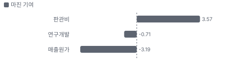

**분기 비용 비중 추이(매출 대비, 공시)**

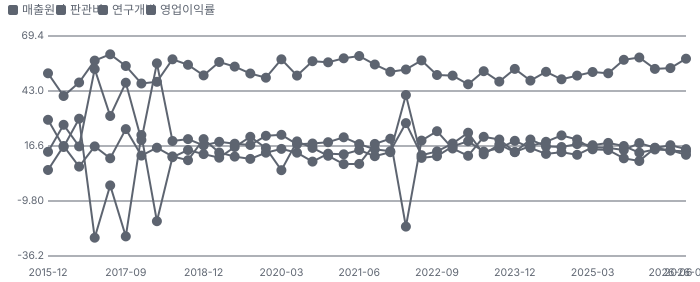

**비용 요인별 매출 대비 비중과 1년 변화**

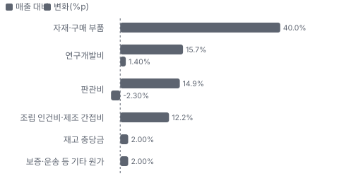

**BOM 항목 가격 +10% 시 OPM 변화**

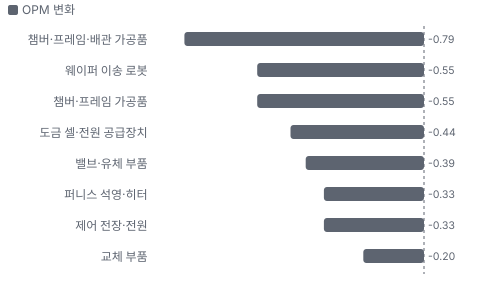

**단일 웨이퍼·Tahoe·준임계 세정 BOM 원가 몫과 가격 +10% 시 OPM**

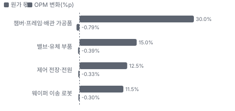

**ECP·퍼니스·기타 BOM 원가 몫과 가격 +10% 시 OPM**

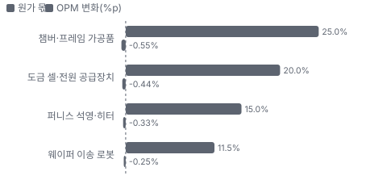

**첨단 패키징(ECP 제외)·서비스·부품 BOM 원가 몫과 가격 +10% 시 OPM**

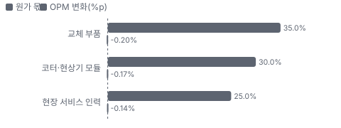

**매출·PPI·수출입 — 최근 16개 분기 같은 축(4Q22 = 100) + 다음 분기 추정**

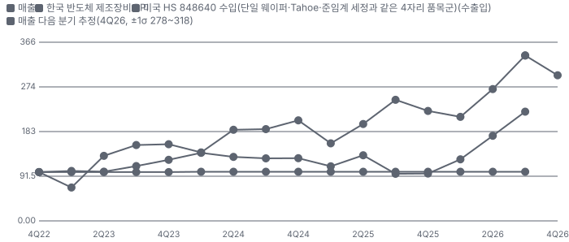

**매출 증가율의 가격·물량 분해와 8분기 전망(전년 대비)**

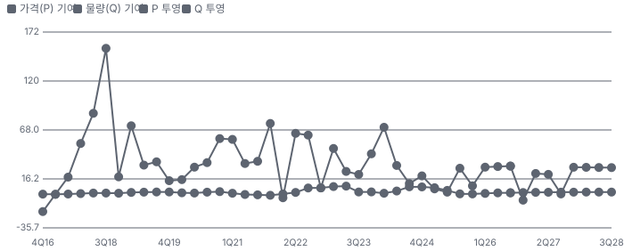

**분기별 매출 증가율 분해**

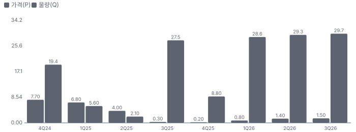

**목표주가 산정 — 기본과 강세 사이(강세 쪽 7%), 도달 확률 약 48%**

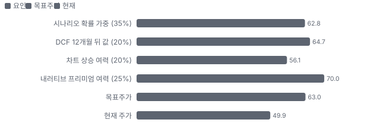

**PEG — 성장 대비 멀티플(낮을수록 성장 대비 쌈)**

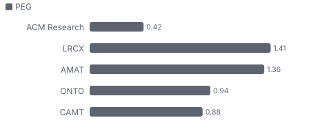

**일봉 지지·저항과 목표주가**

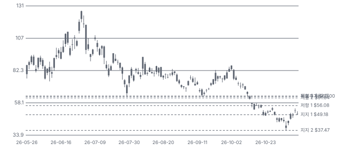

**일별 거래량 분해**

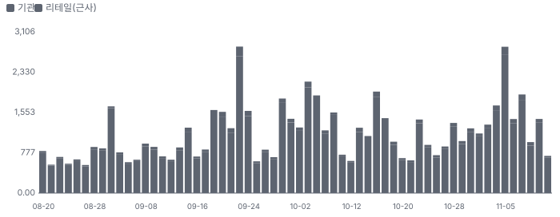

**기관 자금 흐름**

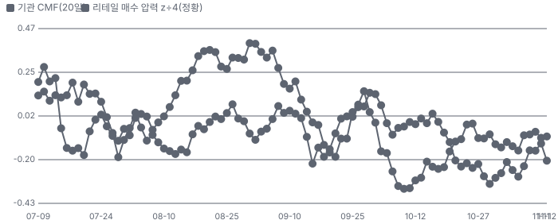

**몬테카를로**

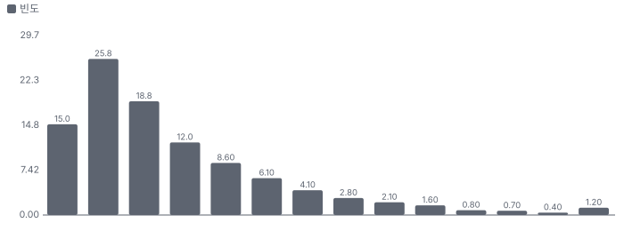

해석: 3,000번 중 1,881번(63%)에서 가치가 지금 주가 이상이었다. 가정을 흔들어도 지금 주가를 뒷받침하는 경우가 더 많다. 가운데 값은 1.13배이고, 열 번 중 여덟 번은 0.75~2.16배 사이에 든다.

## 내러티브

> **기업가치를 결정하는 이야기:** 기업가치는 수주잔고 \$2.5B가 매출과 현금으로 얼마나 빨리 바뀌느냐로 정해진다. 그 위에 ACMS 대비 지주 할인과 미국 규제라는 두 개의 할인이 얹혀 있다.

> **멀티플·EPS 프리미엄**
> **멀티플:** Fwd 1Y P/E 19.4배로 동종 5곳 중앙값 약 22배보다 낮다. 성장은 비슷하거나 빠른데 중국 집중과 엔티티 리스트가 프리미엄을 막는다.
> **EPS:** FY2027 EPS 추정은 1Q 뒤 \$1.90에서 2Q 뒤 \$2.65로 올랐다. 애널리스트 1명이라 표본이 작다.

### 투자자들은 왜 열광했나

4월 \$40대에서 6월 말 종가 \$126.89까지 세 배가 됐다. 도금 매출 급증, 패널 장비, ACMS 홍콩 상장 계획이 겹쳤다. 7월 이후 회사 고유 악재 없이 11/4 \$44.43까지 −65%가 빠졌다. 11/5 가이던스를 올렸는데도 GM 41.6%와 영업현금 −\$70M에 당일 −11.5%였고, 이후 사흘 만에 \$52까지 되돌렸다.

### 무엇이 기업가치를 바꾸나

> **구조적 체질 변화**
> **변화:** 세정 회사에서 다품목 장비사로 바뀌고 있다. 세정 비중은 FY2025 69.5%에서 1H26 48.7%로 낮아졌다
> **증거:** 2025 10-K, 2Q 10-Q
> **반증:** ECP(전기화학 도금) 매출이 두 분기 연속 줄어든다

> **고부가 믹스 확장**
> **변화:** 첨단 패키징과 패널 도금이 커진다. 다만 GM은 46.0%로 전년 48.5%보다 낮다
> **증거:** 2Q 콜
> **반증:** GM이 장기 범위 하단 42%에 가까워진다

> **기술 혁신**
> **변화:** SPM(황산·과산화수소 고온 세정) 고온 세정, 패널 수평 도금, 단일 챔버 3척 PECVD(플라스마 화학 기상 증착)를 내놨다. 독립 성능 비교 자료는 없다
> **증거:** 1Q·2Q 콜, 10/22 보도자료
> **반증:** SPM 첫 장비 인증 실패

> **실행 속도**
> **변화:** 납품 리드타임은 공개되지 않아 수주잔고 ÷ TTM 매출로 주문에서 매출 인식까지를 근사한다. 약 17개월(1년 전)에서 약 29개월로 길어졌다. 잔고가 빨리 쌓였거나 인수가 늦어진 것이고 둘을 가를 자료는 아직 없다 **납품 리드타임 29개월.** 피어 비교 미확인. 2025-09 17개월보다 71% 길다.
> **증거:** ACMS 잔고 RMB 17.1B(\$2.5B, 9/29) ÷ TTM 매출 \$1.04B. 1년 전 잔고는 +88% 역산 약 \$1.27B ÷ TTM \$0.88B. 10-K: 첫 장비 대금은 24개월 이상 걸릴 수 있다
> **반증:** 평가 장비 재고가 다시 늘어난다

> **M&A**
> **변화:** 인수 대신 자회사 지분 매각과 증자로 자금을 모은다. ACMS 지분 74.6% → 73.2%
> **증거:** 2Q 10-Q Note 1
> **반증:** 추가 지분 희석

> **정책·입법 연관성**
> **재정정책:** 중국 정부 보조금은 받지만 작다. FY2025 비용 차감 \$8.0M, 기타수익 \$1.4M 2025 10-K 보조금 주석 반증: 린강 토지 약정의 최소 매출·세금 조건 미달 의회 동의 2/10 — 하원 1/5(미국 재정정책과 무관, 미국 의회 논의 없음) · 상원 1/5(같음).
> **행정명령:** BIS(미국 상무부 산업안보국)가 2024-12 ACM 상하이·ACM 코리아를 엔티티 리스트에 올렸다. 미국산 품목 공급에 허가가 필요하다 2025 10-K Item 1·7 반증: 지정 해제 또는 추가 지정(모회사 포함) 의회 동의 5/10 — 하원 3/5(대중 장비 수출 통제 강화는 하원 중국특위가 초당적으로 요구한다. 이 회사 특정 법안은 확인 못 했다) · 상원 2/5(상원 개별 법안 단계 확인 못 함).
> **연관입법:** 해당 없음(이 회사를 직접 겨냥한 법안을 찾지 못했다. 로비 공시는 키가 없어 미확인) 로비 조회 미확인 반증: 중국 장비 자회사를 둔 미국 상장사 규제 법안 발의

> **CAPEX 낙수효과**
> **변화:** 중국 팹 증설과 AI 패키징 증설이 장비 주문으로 온다. 1H26 수주 +105%
> **증거:** 2Q 콜. 특정 고객 투자에서 ACM 매출로 잇는 공개 숫자는 없다
> **반증:** 수주잔고 증가율이 한 자릿수로 떨어진다

### 내러티브 근거

> 중국 장비 국산화 수혜주에서 다품목 장비사로 다시 평가받다가 6월 고점 뒤 −65% 꺾였다. 숫자는 계속 좋아졌고 떨어진 것은 배수다. 동종 대비 멀티플 차이 -9% 중 회사 고유 몫은 -35%다. 단계는 확산, 쏠림은 보통이다.

> **중국 장비 국산화** · 강화
> **논리:** 미국·일본 장비 조달이 막힌 중국 팹이 국내 장비를 늘린다
> **숫자:** ACM 상하이 수주잔고 RMB 17.1B, 전년 대비 +88%
> **반증:** 다음 수주잔고 공시가 전년 대비 감소

> **다품목 장비사 전환** · 강화
> **논리:** 세정 단일 회사에서 도금·퍼니스·Track(포토레지스트 도포·현상 장비)·PECVD로 넓혀 고객당 몫을 키운다
> **숫자:** ECP·퍼니스 등 매출 비중 FY2025 22% → 1H26 41%
> **반증:** Track·PECVD 연말 양산 인증 실패

> **첨단 패키징·패널 도금** · 강화
> **논리:** AI 칩 대형 패키지가 도금 수요를 늘리고 패널 장비 선점이 프리미엄이 된다
> **숫자:** 첨단 패키징(ECP 제외) 2Q 매출 +153%, 패널 장비 2곳 수주
> **반증:** 패널 평가 장비가 양산 주문으로 안 바뀐다

> **지주 할인 해소** · 유지
> **논리:** ACMR 주가가 보유 ACMS 지분 가치보다 낮아 홍콩 상장이 격차를 줄인다
> **숫자:** Kerrisdale 추정 할인 56%. ACMS H주(홍콩 상장 중국 기업 주식)는 상장 후 주식의 7% 이하
> **반증:** H주 상장이 철회되거나 CSRC·HKEX 승인이 늦어진다

> **반대: 중국 WFE 둔화와 국내 경쟁** · 유지
> **논리:** 중국 장비 투자가 줄고 Naura 같은 국내 대형사가 같은 공정을 노린다
> **숫자:** Gartner 중국 WFE 2026 \$35.4B(−9.9%), 10-K 인용
> **반증:** 2026 중국 WFE가 증가로 끝나고 ACM 세정 매출이 반등

> **반대: 규제·이익의 질** · 유지
> **논리:** 엔티티 리스트 확대와 운전자본 부담이 이익을 현금으로 못 바꾸게 한다
> **숫자:** 1H26 영업현금 −\$35.9M, 재고 \$783M, TTM FCF 약 −\$119M
> **반증:** 2H26 영업현금이 \$100M을 넘는다

이미지 없음(아직 생성 전) — 단일 웨이퍼·Tahoe(배치·단일 웨이퍼를 합친 ACM 황산 세정 장비)·준임계 세정·ECP·퍼니스·기타

## 포트폴리오

| 제품·서비스 | 구분 | 무엇 | 쓰는 곳 | 돈 버는 방식 | Mix | Mix 변화(전년 대비) |
|---|---|---|---|---|---|---|
| 단일 웨이퍼·Tahoe·준임계 세정 | 제품 | 웨이퍼 습식 세정 | 로직·메모리 전공정 | 대당 판매 | 57% | -10.1%p |
| ECP·퍼니스·기타 | 제품 | 구리 도금·고온 공정 | 배선·첨단 패키징 | 대당 판매 | 30% | +7.5%p |
| 첨단 패키징(ECP 제외)·서비스·부품 | 제품 | 코터·현상·식각 장비와 부품 | 패키징 공장 | 판매 + 반복 부품 | 13% | +2.6%p |
| Track·PECVD | 제품 | 도포·현상, 박막 증착 | 노광 전후·절연막 | 인증 뒤 판매 | 미확인 | 미확인 |
| SAPS(ACM의 메가소닉 위상 교대 세정 기술)·TEBO(ACM의 기포 진동 제어 세정 기술) | 기술 | 메가소닉 세정 특허 | 미세 패턴 세정 | 세정 장비 차별화 | 미확인 | 미확인 |

**Mix 변화가 가장 큰 쪽은 단일 웨이퍼·Tahoe·준임계 세정(-10.1%p, 전년 대비).** 계절성 판정: 분기 매출 계절 지수 기준 있음 → 전년 같은 분기와 비교.

## 고객

> **3Q26 최대 고객 나머지 중국 고객 61%, 상위 3곳 99%, 집중도 집중.** 공시·회사 발표로 확인한 몫은 매출의 37%이고, 나머지 고객 몫은 추정이거나 미분해다. 10% 초과 고객은 3Q 2곳 합계 37.3%, 9M 2곳 28.0%다(10-Q). 이름과 고객별 몫은 공시되지 않는다. 매출채권은 5곳이 60.8%다.

**고객별 매출 몫(3Q26)**
| 고객 | 몫 | 변화 | 근거 |
|---|---|---|---|
| 나머지 중국 고객 | 60~62% | 미확인 | 추정 |
| 10% 초과 고객 2곳 합(10-Q 10% 초과 고객(3Q)) | 37% | -2%p | 공시 |
| 중국 밖 고객 | 0~2% | +1%p | 추정 |

> **나머지 중국 고객** · 추정
> **사는 것:** 세정·도금·퍼니스·패키징 장비
> **추정 근거:** 10% 초과 2곳을 뺀 몫에서 중국 밖 매출을 뺐다

> **10% 초과 고객 2곳 합(10-Q 10% 초과 고객(3Q))** · 공시
> **사는 것:** 세정·도금 장비
> **추정 근거:** 3Q26 2곳 37.3%(3Q25 2곳 38.9%). 9M은 2곳 28.0%

> **중국 밖 고객** · 추정
> **사는 것:** 평가 장비 중심
> **추정 근거:** FY2025 중국 외 매출 \$3.3M. 연말 20대 이상 설치는 대부분 평가 장비

## 수주·파이프라인

> **2026-09-29 기준 5건.** 확정 \$2.50B, 미확정 \$0.08B. 공시 ACM 상하이 수주잔고 RMB 17.1B(9/29, 전년 대비 +88%) \$2.50B.

**실행 속도와 방해 요인**
| 항목 | 상태 | 실행 속도 | 방해 요인 |
|---|---|---|---|
| ACM 상하이 수주잔고 | 확정 | 9M26 수주 전년 대비 +147%(3Q 콜) | 고객 인수 검사 · 평가 장비 인수 지연 |
| 고객 사이트 평가 장비 | 조건부 | 고객 인수 대기 완제품 12월 말 \$145.5M → 9월 말 \$83.1M | 인수 검사 통과 |
| 패널 수평 도금 장비 | 조건부 | 중국 양산 주문 1건, 515×510mm·310×310mm 패널 장비 출하(10월 아시아 고객) | 평가 결과 · 양산 전환 |
| 단일 웨이퍼 SPM | 조건부 | 2026년 여러 고객에 20대 이상 출하 궤도(3Q 콜) | 고객 첫 장비 인증 |
| Track·PECVD 신제품 | 파이프라인 | 연말 양산 인증 목표 | 고객 인증 · 미국산 부품 대체 |

## 마진 구조

> **GPM 43.8%, OPM 13.3%.** TTM 2Q25 대비 GPM -5.6%p, OPM -4.6%p. 변동비는 매출의 56%이고, 매출이 10% 늘면 OPM은 +2.8%p 움직인다. 회사 기준(비GAAP) 분기 GM은 2Q 46.0%로 장기 범위 42~48%의 중간이고, 표의 TTM GAAP GPM은 43.8%다(3Q25 GAAP 42.0% 포함). 단기 변수는 신제품 첫 장비 원가와 재고 충당금, 그리고 미국산 부품 대체 비용이다.

> **매출 100 중 매출원가 56.5, 매출총이익 43.5(최근 4분기, 공시).** 매출원가 요인 중 자재·구매 부품이 매출의 40.0%로 가장 무겁고, 단가가 +10% 오르면 GPM이 -4.00%p 움직인다. 분기 회귀로 매출 1이 늘 때 매출원가는 0.55 늘고, 매출원가의 고정비 몫은 -3%다.

**비용 요인 강도 — 비중·추세·충격(+10%)·탄력**
| 비용 | 구분 | 매출 대비 | 1년 변화 | 마진 기여 | 충격 시 마진 | 매출 탄력 | 고정비 몫 |
|---|---|---|---|---|---|---|---|
| 자재·구매 부품 | 매출원가 요인 | 40.0% | 미확인 | 미확인 | -4.00%p | 미확인 | 0% |
| 조립 인건비·제조 간접비 | 매출원가 요인 | 12.2% | 미확인 | 미확인 | -1.22%p | 미확인 | 60% |
| 재고 충당금 | 매출원가 요인 | 2.0% | 미확인 | 미확인 | -0.20%p | 미확인 | 0% |
| 보증·운송 등 기타 원가 | 매출원가 요인 | 2.0% | 미확인 | 미확인 | -0.20%p | 미확인 | 30% |
| 매출원가 | 공시 항목 | 56.5% | +3.2%p | -3.2%p | -5.65%p | 0.55 | -3% |
| 연구개발 | 공시 항목 | 15.3% | +0.7%p | -0.7%p | 미확인 | 0.15 | 0% |
| 판관비 | 공시 항목 | 13.7% | -3.6%p | +3.6%p | 미확인 | 0.14 | 12% |

매출 탄력 = 분기 비용을 매출에 회귀한 기울기(매출 1당 변동비), 고정비 몫 = 절편 ÷ 평균 비용. 표본이 8분기 미만이면 미확인. 매출원가 요인 비중은 margin 재료의 추정이 섞여 있고, 공시 매출원가와의 차이는 '기타 매출원가'로 둔다.

**GPM에서 OPM까지(GAAP)**
| 기간 | GPM | 연구개발 | 판관비 | 기타 | OPM |
|---|---|---|---|---|---|
| TTM 2Q25 | 49.4% | 14.3% | 17.2% | 0.0% | 17.9% |
| TTM 2Q26 | 43.8% | 15.7% | 14.9% | 0.0% | 13.3% |

**GPM·OPM 최근 4개 분기**
| 분기 | GPM | OPM |
|---|---|---|
| 2025-12 | 40.9% | 9.4% |
| 2026-03 | 46.4% | 15.6% |
| 2026-06 | 46.0% | 17.0% |
| 2026-09 | 41.5% | 15.1% |

**마진을 결정하는 비용 요인 — 비용 +10% 시 OPM**
| 비용 | 매출 대비 | 변화 | 고정비 | OPM |
|---|---|---|---|---|
| 자재·구매 부품 | 40.0% | 미확인 | 0% | -4.00%p |
| 연구개발비 | 15.7% | +1.4%p | 80% | -1.57%p |
| 판관비 | 14.9% | -2.3%p | 70% | -1.49%p |
| 조립 인건비·제조 간접비 | 12.2% | 미확인 | 60% | -1.22%p |
| 재고 충당금 | 2.0% | 미확인 | 0% | -0.20%p |
| 보증·운송 등 기타 원가 | 2.0% | 미확인 | 30% | -0.20%p |

**비용을 움직이는 요인**
| 비용 | 요인 |
|---|---|
| 자재·구매 부품(매출원가) | 부품 가격, 국산 대체 부품 단가, 제품 믹스 · 근거 추정 |
| 연구개발비(연구개발) | Track·PECVD·패널 장비 개발 · 근거 공시 |
| 판관비(판관비) | 해외 영업망, 오리건 데모 센터 · 근거 공시 |
| 조립 인건비·제조 간접비(매출원가) | 린강 가동률, 첫 장비 현장 지원 · 근거 추정 |
| 재고 충당금(매출원가) | 평가 장비 인수 실패, 구형 재고 · 근거 공시 |
| 보증·운송 등 기타 원가(매출원가) | 출하량 · 근거 추정 |

**단일 웨이퍼·Tahoe·준임계 세정 BOM — 매출의 49%, GPM 46%(회사 GM, 제품 GM 미공개), 항목 가격 +10% 시**
| 항목 | 원가 몫 | 전가 | 제품 GPM | OPM |
|---|---|---|---|---|
| 챔버·프레임·배관 가공품 | 25~35% | 미확인 | -1.6%p | -0.79%p |
| 밸브·유체 부품 | 10~20% | 미확인 | -0.8%p | -0.39%p |
| 제어 전장·전원 | 10~15% | 미확인 | -0.7%p | -0.33%p |
| 웨이퍼 이송 로봇 | 8~15% | 미확인 | -0.6%p | -0.30%p |
| 미분해 | 31% | - | - | - |

**ECP·퍼니스·기타 BOM — 매출의 41%, GPM 46%(회사 GM, 제품 GM 미공개), 항목 가격 +10% 시**
| 항목 | 원가 몫 | 전가 | 제품 GPM | OPM |
|---|---|---|---|---|
| 챔버·프레임 가공품 | 20~30% | 미확인 | -1.4%p | -0.55%p |
| 도금 셀·전원 공급장치 | 15~25% | 미확인 | -1.1%p | -0.44%p |
| 퍼니스 석영·히터 | 10~20% | 미확인 | -0.8%p | -0.33%p |
| 웨이퍼 이송 로봇 | 8~15% | 미확인 | -0.6%p | -0.25%p |
| 미분해 | 28% | - | - | - |

**첨단 패키징(ECP 제외)·서비스·부품 BOM — 매출의 11%, GPM 46%(회사 GM, 제품 GM 미공개), 항목 가격 +10% 시**
| 항목 | 원가 몫 | 전가 | 제품 GPM | OPM |
|---|---|---|---|---|
| 교체 부품 | 30~40% | 미확인 | -1.9%p | -0.20%p |
| 코터·현상기 모듈 | 25~35% | 미확인 | -1.6%p | -0.17%p |
| 현장 서비스 인력 | 20~30% | 0% | -1.4%p | -0.14%p |
| 미분해 | 10% | - | - | - |

챔버·프레임·배관 가공품 가격이 +10% 오르면 영업이익은 -5.9% 움직인다. 판매가 전가를 모르는 항목은 전가 0%로 계산했다.

**BOM 항목 가격을 움직이는 것**
| 항목 | 요인 |
|---|---|
| 웨이퍼 이송 로봇 | 단일 공급사이자 지분 투자사 · 근거 추정 |
| 밸브·유체 부품 | 미국산 부품 수입 제한으로 대체 필요 · 근거 추정 |
| 챔버·프레임·배관 가공품 | 국내 협력사 가공, 스테인리스·불소수지 · 근거 추정 |
| 제어 전장·전원 | 미국산 대체 · 근거 추정 |
| 도금 셀·전원 공급장치 | 정밀 정류기 · 근거 추정 |
| 웨이퍼 이송 로봇 | 단일 공급사 · 근거 추정 |
| 퍼니스 석영·히터 | 고온 부품 · 근거 추정 |
| 챔버·프레임 가공품 | 국내 가공 · 근거 추정 |
| 코터·현상기 모듈 | 펌프·노즐 · 근거 추정 |
| 교체 부품 | 설치 기반 소모 · 근거 추정 |
| 현장 서비스 인력 | 인건비 · 근거 추정 |

**BOM 투입 물가 — PPI 전년비, 2026-11-13 수집**
| 항목 | 미국 | 일본 | 한국 | 대만 |
|---|---|---|---|---|
| 웨이퍼 이송 로봇 | +1.5% | +2.2% | +0.0% | +3.0%* |
| 챔버·프레임 가공품 | +30.0% | +42.6% | +25.8% | +40.1% |
| 제어 전장·전원 | -2.2% | +1.6% | +2.3% | +22.9%* |

별표는 품목보다 넓은 업종 지수다. 지난 1년 투입 물가를 판매가 전가 뒤 원가에 그대로 넣으면 OPM은 -4.87%p 움직인다(매출원가의 54% 기준).

## 공급망 병목

> **공급망 신뢰성 6.8/10, 관리 가능.** 가장 약한 고리는 챔버·프레임 가공품 6.8점이고, 품목 평균은 6.8점이다. 근거가 부족한 3건(웨이퍼 이송 로봇 · 밸브·유체 부품 · 미국산 부품(전장·계측))은 점수에서 뺐다. 약한 고리는 엔티티 리스트로 막힌 미국산 부품과 한국 Ninebell 단일 로봇 공급이다. 필수 품목 세 개는 공개 자료로 요인을 4개 이상 채우지 못해 점수에서 빠지고, 점수는 범용 가공품 하나(추정)로만 나온다 — 점수를 신뢰도로 읽지 않는다

**병목과 마진 — 품목 가격 +10% 시 OPM**
| 품목 | 점수 | 판정 | 구분 | OPM |
|---|---|---|---|---|
| 챔버·프레임 가공품 | 6.8 | 관리 가능 | 가격 위험 | -0.55%p |

> **챔버·프레임 가공품** · 6.8/10
> **왜:** 범용 가공품이라 복수 구매로 본다(추정). 인증 공급사 수는 공시되지 않아 최소 2곳으로 잡았다
> **병목 요인:** 인증 공급사 2곳 · 캐파 여유 · 리드타임 미확인 · 재인증 미확인 · 1위 점유율 미확인 · 중국 집중 100% · 물량 확보 복수구매
> **풀리는 조건:** 해당 없음

**공급사**
| 품목 | 공급사 | 몫 | 근거 |
|---|---|---|---|
| 웨이퍼 이송 로봇 | Ninebell(로봇 서브어셈블리 주력 공급, ACM 지분 투자사) | 미확인 | 공시 |
| 밸브·유체 부품 | Advanced Electric(핵심 밸브) | 미확인 | 공시 |
| 미국산 부품(전장·계측) | 미공개(일부 미국 공급사는 ACM 상하이에 공급 불가) | 미확인 | 공시 |
| 챔버·프레임 가공품 | 미공개(중국 국내 가공 협력사) | 미확인 | 추정 |

**무역 통계로 본 공급 지역**
| 품목 | EU 수입처 | 일본 수입처 | EU 1위 전년비 |
|---|---|---|---|
| 웨이퍼 이송 로봇 | JP(일본) 45% · US 35% · TW(대만) 7% | 大韓民国 36% · シンガポール 25% | +1090.7% |
| 밸브·유체 부품 | JP 45% · US 35% · TW 7% | 大韓民国 36% · シンガポール 25% | +1090.7% |
| 미국산 부품(전장·계측) | TW 32% · MY(말레이시아) 19% · CN(중국) 15% | 台湾 60% · 中華人民共和国 8% | +136.5% |
| 챔버·프레임 가공품 | MY 69% · KR(한국) 10% · US 7% | マレーシア 58% · タイ 36% | 미확인 |

## 생산능력

> **현재 명목 캐파 3 연 생산액 \$B, 가동률 미확인.** 착공 이상 증설은 0 연 생산액 \$B, 발표까지 합치면 0 연 생산액 \$B이다. 다 가동하면 지금보다 +0%, 착공 이상만이면 +0%다. 9M26 CAPEX는 \$0.11B로 매출의 12.6%다. 린강 두 동으로 연 \$3B 생산이 가능하다고 회사가 말했다. 둘째 동은 4Q 가동을 시작했고 생산 면적이 2배가 된다. FY2026 매출 가이던스는 그 약 42%다.

**생산시설 2곳**(3Q 콜·보도자료가 밝힌 생산·준비 시설(10-K Item 2 원문은 이번 회차 SEC 접속 차단으로 미대조 — 상하이 촨사·한국 시설은 셈에서 뺐다)), 소유 2곳. 시설별 생산능력은 1곳만 공개됐다.

**생산시설 2곳 — 명칭·위치·생산능력**
| 시설 | 위치 | 용도 | 생산능력 | 소유·상태 |
|---|---|---|---|---|
| 린강 생산·연구 단지 | 중국 상하이 린강 | 제조·연구 | 3 연 생산액 \$B(두 동) | 소유 · 증설 중 |
| 오리건 시설 | 미국 오리건 | 데모·평가·조립 | 미확인 — 생산능력 미공시 — 고객 평가·조립 용도 | 소유 · 건설 중 |

**생산능력 확충 계획**
| 계획 | 단계 | 증설 | 가동 시점 | CAPEX |
|---|---|---|---|---|
| 오리건 데모 센터 | 장비 반입 | 미확인 | 2026-12 | \$0.01B |

남은 계획의 CAPEX 합계는 \$0.01B다. 합계는 FY27 매출의 0%다.

**증설 방해 요인**
| 계획 | 방해 요인 |
|---|---|
| 오리건 데모 센터 | 미확인 |

**CAPEX와 매출 대비**
| 기간 | CAPEX | 매출 | 매출 대비 | 구분 |
|---|---|---|---|---|
| 1H25 | \$0.03B | \$0.39B | 8.1% | 실적 |
| 2H25 | \$0.02B | \$0.51B | 4.8% | 실적 |
| 9M26 | \$0.11B | \$0.89B | 12.6% | 실적 |
| FY26 | \$0.17B | \$1.26B | 13.9% | 가이던스 |
| FY27 | \$0.14B | \$1.72B | 8.1% | 컨센서스 |

## 해자

> 해자는 특허 세정 기술과 빠르게 쌓인 도금 설치 기반, 그리고 중국 국산화가 만든 고객 잠금이다. 다만 마지막은 정책이 만든 것이라 깨질 수 있다.

> **메가소닉 세정 특허(SAPS·TEBO)** · 보통
> **해자:** 미세 패턴을 손상하지 않고 입자를 지우는 방식이 경쟁사와 다르다
> **근거:** 10-K는 SAPS·TEBO를 독자 기술로 적는다. 그러나 2Q 세정 매출은 전년 대비 −14%였다
> **숫자:** 1H26 세정 매출 \$255.5M, 1H25 \$284.5M
> **깨지는 조건:** SPM 신제품 반복 주문이 2027년에도 숫자로 안 나온다

> **도금 설치 기반** · 강함
> **해자:** 도금 챔버가 빠르게 깔려 반복 주문·부품 매출이 따라온다
> **근거:** 누적 500개(2022) → 1,500개(2025) → 2,000개(2026-2Q)
> **숫자:** ECP·퍼니스 등 2Q 매출 \$128.5M, 전년 대비 +168%
> **깨지는 조건:** Naura 등 국내 경쟁사가 첨단 패키징 도금에서 같은 속도로 설치

> **중국 국산화 고객 잠금** · 보통
> **해자:** 엔티티 리스트로 미국·일본 장비 조달이 어려운 중국 팹이 국내 공급사를 먼저 쓴다
> **근거:** FY2025 매출의 약 99.6%가 중국. 수주잔고 RMB 17.1B(+88%)
> **숫자:** 수주잔고 \$2.5B = FY2026 매출 가이던스의 약 2.2배
> **깨지는 조건:** 중국 팹이 Naura 등 순수 국내 업체를 우선해 ACM 점유율이 떨어진다

> **다품목 플랫폼** · 약함
> **해자:** 세정·도금·퍼니스·Track·PECVD를 한 회사가 팔아 고객당 매출을 키운다
> **근거:** Track·PECVD는 연말 양산 인증 목표이고 매출 기여는 아직 작다
> **숫자:** 미확인
> **깨지는 조건:** Track·PECVD 인증이 2027년으로 밀린다

## 경영진·네트워크

> 창업자 David Wang이 ACMR과 ACM 상하이를 함께 이끈다. B주(의결권 우위)를 가진 창업자 경영이고 9월에 장내 매도가 있었다.

> **David H. Wang** · 창업자·CEO·사장, ACM 상하이 회장 · 1998
> **프로필:** 1998년 회사를 세웠다. 2026-09-08~09 장내 매도 14만 주 약 \$10.6M(옵션 행사 직후)
> **비즈니스:** ACM 상하이 회장 겸직(10-K)
> **정계:** 미확인
> **동문:** 미확인
> **사모임:** 미확인

> **Mark McKechnie** · CFO · 미확인
> **프로필:** 2026-08-20 장내 매도 55,199주 약 \$4.3M(옵션 행사 직후)
> **비즈니스:** 미확인
> **정계:** 미확인
> **동문:** 미확인
> **사모임:** 미확인

**네트워크 정량화**
| 연결 | 강도 | 닿는 매출 | 가중 노출 | 매출 대비 | 근거 |
|---|---|---|---|---|---|
| 비즈니스: CEO의 ACM 상하이 회장 겸직 | 4/5 | \$1.00B | \$0.80B | 70% | 매출 거의 전부가 ACM 상하이를 통해 나온다. 연결이 매출을 만든 것이 아니라 지배 구조다 2025 10-K |

가중 노출은 연결이 닿는 매출의 크기다. 연결이 그 매출을 만들었다는 뜻이 아니며, 인과는 공개 자료로 입증하지 못한다.

## 약세 논리 및 셀온 조건

| 약세 논리 | 근거 | 반박 | 가를 자료 |
|---|---|---|---|
| 이익이 현금이 안 된다 | 3Q 영업현금 −\$70.4M, 9M −\$106.3M. 매출채권 3분기에만 \$196M 증가, 재고 \$851M | 출하가 매출보다 빨리 늘어 인수 전 재고가 쌓이는 구조다. 고객 인수 대기 완제품은 12월 말 \$145.5M에서 \$83.1M으로 줄었다 | 4Q 영업현금, 2027-02 10-K 재고·매출채권 |
| GM이 구조적으로 내려간다 | GM 2Q 46.0% → 3Q 41.6%, 장기 범위 하단 아래 | 회사는 믹스·환율·충당금 탓이라 하고 4Q 소폭 개선을 말했다. 도금 비중 30%가 믹스를 흔든다 | 4Q GM(2027-02) |
| 중국 WFE가 줄어든다 | 10-K가 인용한 Gartner 전망으로 중국 WFE 2026 −9.9% | 같은 기간 9M 수주 +147%, 매출 +37%다. 점유율 상승이 시장 둔화를 넘고 있다 | 다음 ACMS 수주잔고 공시, 1월 2027 가이던스 |
| 규제가 넓어진다 | ACM 상하이·ACM 코리아는 2024-12부터 엔티티 리스트다 | 3Q까지 매출 영향은 숫자로 나오지 않았다. 대체 부품 비용은 미공개 | BIS 추가 지정, 10-Q 위험 요인 |
| 지주 할인은 이유가 있다 | 주주 몫은 72.8%이고 계속 줄었다(12월 말 74.6%). 현금의 대부분은 중국·홍콩에 있다 | 미국 현금은 12월 말 \$107M에서 \$338M으로 늘었다 | ACMS 지분율, H주 상장 진행 |
| GAAP 이익이 흔들린다 | 3Q 단기투자 미실현 손실 \$39.1M으로 GAAP EPS \$0.02 | 영업과 무관한 평가 손익이고 9M은 평가 이익 \$29.1M이다 | 보유 주식 시가, 4Q 손익 |

> **셀온 조건**
> **조건 1:** 4Q GM이 41% 아래에 머물고 회사가 장기 범위 42~48%를 낮춘다
> **조건 2:** 4Q 영업현금이 다시 적자이고 재고가 \$900M을 넘는다
> **조건 3:** 1월 2027 매출 가이던스가 \$1.5B 아래로 나온다(컨센서스 \$1.72B)
> **조건 4:** 엔티티 리스트가 ACM Research 모회사나 다른 자회사로 넓어진다
> **조건 5:** ACMS 지분이 70% 아래로 희석된다

## 어닝콜 변화

**직전 콜 대비 새로 나오거나 바뀐 내용 → 가치 영향**
| 항목 | 내용 | 직전 콜 | 최신 콜 | 모델 동인 이동 | 확신도 | 가치 영향 |
|---|---|---|---|---|---|---|
| 업데이트 | FY2026 매출 가이던스 | \$1.125~1.175B | \$1.24~1.28B | 기준연도 매출 +\$0.10B | 0.8 | +6.2% |
| 업데이트 | 수주 증가율 | 1H 수주 +105% | 9M +147% | 1년차 성장률 +3.0% | 0.8 | +2.8% |
| 업데이트 | 세정 매출 | 2Q 세정 −14% | 3Q \$211M, +16% | 1년차 성장률 +1.0% | 1.0 | +0.9% |
| 부정 | 매출총이익률 | 2Q 46.0% | 3Q 41.6%(믹스·환율·재고 충당금) | 출발 이익률 -2.0% | 1.0 | -0.7% |
| 부정 | 현금 전환 | 2Q −\$6.4M | 3Q −\$70.4M, 재고 \$851M | 매출÷투하자본 -10.0% | 1.0 | -4.5% |
| 신규 | 생산 캐파 | 연내 개소 예정 | 4Q 가동 시작, 면적 2배 | 성장 지속(감속 계수) +1.0% | 0.5 | +0.5% |
| **합계** | 단독 합 |  |  | 동시 적용 +5.4% |  | **+5.3%** |

**사건별 EPS 리비전**
| # | 날짜 | 구분 | 사건 | CY2026 EPS 전→후 | CY2027 EPS 전→후 | 리비전 | 주가 반응 |
|---|---|---|---|---|---|---|---|
| ① | 25-11-05 | 실적 | 3Q25 실적, EPS 미달 | \$2.00 → \$1.50 | \$2.40 → \$2.40 | +0.0% | -19.9% |
| ② | 26-02-26 | 실적 | 4Q25 실적, 2026 전망 첫 제시 | \$1.50 → \$1.74 | \$2.40 → \$2.40 | +0.0% | -16.7% |
| ③ | 26-05-07 | 실적 | 1Q26 실적, EPS 상회 | \$1.74 → \$1.74 | \$2.40 → \$2.40 | +0.0% | +6.9% |
| ④ | 26-08-07 | 실적 | 2Q26 실적, 가이던스 하단 상향 | \$1.37 → \$2.05 | \$1.90 → \$2.65 | +39.5% | +6.1% |
| ⑤ | 26-09-30 | 내러티브 | 수주잔고 \$2.5B 공시 | \$2.05 → \$2.05 | \$2.65 → \$2.65 | +0.0% | +7.0% |
| ⑥ | 26-10-28 | 내러티브 | 3Q 잠정 매출 \$360~365M | \$2.05 → \$2.05 | \$2.65 → \$2.65 | +0.0% | +2.0% |
| ⑦ | 26-11-05 | 실적 | 3Q26 실적, 연간 가이던스 상향 | \$2.05 → \$2.05 | \$2.65 → \$2.65 | +0.0% | -11.5% |

**해석:** 4개 구간 누적 주가 +28% = EPS 리비전 -2% × 멀티플 +30%. 더 크게 움직인 쪽은 **멀티플**이다.

## 거시 지표 싱크로율

> **한국 반도체 제조장비 PPI(생산자물가지수)와 단일 웨이퍼·Tahoe·준임계 세정 싱크로율 79%(1분기 = 약 3개월 선행, 전년 대비, 표본 10개·t 3.6·유의·신뢰 낮음).** 이 지표가 내포하는 4Q26 단일 웨이퍼·Tahoe·준임계 세정은 172M(±1σ 150M~194M, 확정)다. 표본 밖 검증(최근 5개 분기)에서 지표 모델 오차는 12.1%p, 기준선(직전 증가율 지속)은 13.8%p다 — 지표가 기준선을 이겨 지표 61%·기준선 39%로 결합했다. 세그먼트 추정에 나머지 사업(직전 증가율 지속)을 더한 전사 매출은 324M(302M~346M)다. 가이던스는 이보다 +13.7%(범위 위), 컨센서스는 +9.3%(범위 위)다. 회사 제품은 반도체 전공정·패키징 장비(HS(국제 통일 상품 분류 코드) 848620)다 — 장비 PPI가 가격 대용이다. 중국 장비 수입 통계는 저장소에 없어 수요 거울은 쓰지 못했다

**지표별 싱크로율(상관계수 × 100) — 위 두 줄이 제품 연관성 × 싱크로율로 고른 PPI·수출입 세부 지표**
| 지표 | 비교 대상 | 증가율 기준 | 지표 선행 | 매출(t값) | 영업이익 | 방향 일치 | 표본·신뢰 | 표본 밖 오차(지표/기준선) | 4Q26 추정 매출 |
|---|---|---|---|---|---|---|---|---|---|
| 한국 반도체 제조장비 PPI | 단일 웨이퍼·Tahoe·준임계 세정 | 전년 대비 | 1분기(3개월) | 79%(t 3.6) | -23%(4분기) | 80% | 10·낮음 | 12.1/13.8%p ✔ | +7.7% → 172M(확정) |
| 미국 HS 848640 수입(단일 웨이퍼·Tahoe·준임계 세정과 같은 4자리 품목군) | 단일 웨이퍼·Tahoe·준임계 세정 | 전년 대비 | 2분기(6개월) | 82%(t 4.1) | 25%(0분기) | 90% | 10·낮음 | 10.6/13.8%p ✔ | +21.9% → 195M(확정) |
| 미국 반도체 장비 PPI | 단일 웨이퍼·Tahoe·준임계 세정 | 전년 대비 | 0분기(0개월) | 55%(t 1.9) | 17%(3분기) | 80% | 10·낮음 | 13.5/13.8%p ✔ | +11.0% → 177M(지표 자기회귀 추정) |
| 일본 반도체 장비 PPI | ECP·퍼니스·기타 | 전년 대비 | 3분기(9개월) | -38%(t -1.2) | 27%(1분기) | 80% | 10·낮음 | 55.7/80.4%p ✔ | +88.0% → 120M(확정) |

**지표 후보 26개 — 연관성(제품 품목 일치 × 대용 감점 × 매출 비중) × 싱크로율로 고른다. 후보가 많을수록 최대 상관은 우연히 부풀 수 있다**
| 후보 | 종류 | 연관성 | 매출 분기 일치 | 싱크로율(선행) | 점수 | 출처 |
|---|---|---|---|---|---|---|
| 한국 반도체 제조장비 PPI ✔ | PPI | 0.66 | 100% | 79%(1분기) | 0.52 | 자동 |
| EU(유럽연합) 반도체 제조장비 수출(HS 848620) | 수출입 | 0.66 | 94% | 70%(0분기) | 0.46 | 자동 |
| 미국 반도체 장비 PPI | PPI | 1.00 | 100% | 55%(0분기) | 0.44 | 모델 지정 |
| 미국 HS 848640 수입(단일 웨이퍼·Tahoe·준임계 세정과 같은 4자리 품목군) ✔ | 수출입 | 0.46 | 100% | 82%(2분기) | 0.38 | 자동 |
| EU 반도체 제조장비 PPI(업종 대용) | PPI | 0.39 | 100% | 86%(1분기) | 0.34 | 자동 |
| EU HS 848640 수출(단일 웨이퍼·Tahoe·준임계 세정과 같은 4자리 품목군) | 수출입 | 0.46 | 94% | 73%(0분기) | 0.33 | 자동 |
| 일본 HS 8486 수출(단일 웨이퍼·Tahoe·준임계 세정과 같은 4자리 품목군) | 수출입 | 0.46 | 44% | 72%(0분기) | 0.33 | 자동 |
| EU HS 848610 수출(단일 웨이퍼·Tahoe·준임계 세정과 같은 4자리 품목군) | 수출입 | 0.46 | 94% | 71%(3분기) | 0.33 | 자동 |
| EU HS 848610 수입(단일 웨이퍼·Tahoe·준임계 세정과 같은 4자리 품목군) | 수출입 | 0.46 | 94% | 62%(3분기) | 0.29 | 자동 |
| EU HS 848630 수입(단일 웨이퍼·Tahoe·준임계 세정과 같은 4자리 품목군) | 수출입 | 0.46 | 94% | 61%(2분기) | 0.28 | 자동 |
| 미국 반도체 제조장비 수입(HS 848620) | 수출입 | 0.66 | 100% | 49%(1분기) | 0.26 | 자동 |
| 미국 HS 848630 수출(단일 웨이퍼·Tahoe·준임계 세정과 같은 4자리 품목군) | 수출입 | 0.46 | 94% | 56%(2분기) | 0.21 | 자동 |

**선행 지표로 본 향후 분기 매출 전망(이미 나온 지표 값 기준, ±1σ)**
| 지표 | 대상 | 분기 | 지표 증가율 | 내포 매출 증가율 | 내포 매출 |
|---|---|---|---|---|---|
| 일본 반도체 장비 PPI | ECP·퍼니스·기타 | 4Q26 | +2.1% | +91.8% | 123M(82M~164M) |
| 일본 반도체 장비 PPI | ECP·퍼니스·기타 | 1Q27 | +0.6% | +101.7% | 170M(116M~223M) |
| 일본 반도체 장비 PPI | ECP·퍼니스·기타 | 2Q27 | +4.5% | +75.1% | 225M(143M~307M) |
| 미국 반도체 제조장비 수출(HS 848620) | 단일 웨이퍼·Tahoe·준임계 세정 | 4Q26 | -2.6% | +7.0% | 171M(151M~191M) |
| 미국 반도체 제조장비 수출(HS 848620) | 단일 웨이퍼·Tahoe·준임계 세정 | 1Q27 | +3.7% | +2.4% | 125M(110M~141M) |
| 미국 반도체 제조장비 수출(HS 848620) | 단일 웨이퍼·Tahoe·준임계 세정 | 2Q27 | +11.1% | -2.9% | 129M(112M~146M) |
| 미국 반도체 제조장비 수입(HS 848620) | 단일 웨이퍼·Tahoe·준임계 세정 | 4Q26 | +121.9% | +32.3% | 212M(189M~234M) |
| 한국 반도체 제조장비 PPI | 단일 웨이퍼·Tahoe·준임계 세정 | 4Q26 | +0.0% | +2.2% | 163M(147M~180M) |
| EU HS 848610 수출(단일 웨이퍼·Tahoe·준임계 세정과 같은 4자리 품목군) | 단일 웨이퍼·Tahoe·준임계 세정 | 4Q26 | -47.5% | -12.4% | 140M(122M~158M) |
| EU HS 848610 수출(단일 웨이퍼·Tahoe·준임계 세정과 같은 4자리 품목군) | 단일 웨이퍼·Tahoe·준임계 세정 | 1Q27 | -29.7% | -4.7% | 117M(103M~131M) |
| EU HS 848630 수출(단일 웨이퍼·Tahoe·준임계 세정과 같은 4자리 품목군) | 단일 웨이퍼·Tahoe·준임계 세정 | 4Q26 | -34.3% | +15.5% | 185M(161M~209M) |
| EU HS 848630 수출(단일 웨이퍼·Tahoe·준임계 세정과 같은 4자리 품목군) | 단일 웨이퍼·Tahoe·준임계 세정 | 1Q27 | +71.1% | -2.3% | 120M(101M~138M) |
| EU HS 848610 수입(단일 웨이퍼·Tahoe·준임계 세정과 같은 4자리 품목군) | 단일 웨이퍼·Tahoe·준임계 세정 | 4Q26 | -52.3% | +3.9% | 166M(146M~187M) |
| EU HS 848610 수입(단일 웨이퍼·Tahoe·준임계 세정과 같은 4자리 품목군) | 단일 웨이퍼·Tahoe·준임계 세정 | 1Q27 | -37.2% | +5.7% | 130M(114M~145M) |
| EU HS 848630 수입(단일 웨이퍼·Tahoe·준임계 세정과 같은 4자리 품목군) | 단일 웨이퍼·Tahoe·준임계 세정 | 4Q26 | +40.3% | +8.9% | 174M(153M~195M) |
| 미국 HS 848610 수출(단일 웨이퍼·Tahoe·준임계 세정과 같은 4자리 품목군) | 단일 웨이퍼·Tahoe·준임계 세정 | 4Q26 | +58.3% | -2.7% | 156M(134M~177M) |
| 미국 HS 848610 수출(단일 웨이퍼·Tahoe·준임계 세정과 같은 4자리 품목군) | 단일 웨이퍼·Tahoe·준임계 세정 | 1Q27 | -9.3% | +18.6% | 145M(128M~162M) |
| 미국 HS 848610 수출(단일 웨이퍼·Tahoe·준임계 세정과 같은 4자리 품목군) | 단일 웨이퍼·Tahoe·준임계 세정 | 2Q27 | -49.1% | +31.2% | 174M(156M~193M) |
| 미국 HS 848610 수출(단일 웨이퍼·Tahoe·준임계 세정과 같은 4자리 품목군) | 단일 웨이퍼·Tahoe·준임계 세정 | 3Q27 | -23.1% | +23.0% | 259M(230M~288M) |
| 미국 HS 848630 수출(단일 웨이퍼·Tahoe·준임계 세정과 같은 4자리 품목군) | 단일 웨이퍼·Tahoe·준임계 세정 | 4Q26 | -8.1% | +11.4% | 178M(154M~202M) |
| 미국 HS 848630 수출(단일 웨이퍼·Tahoe·준임계 세정과 같은 4자리 품목군) | 단일 웨이퍼·Tahoe·준임계 세정 | 1Q27 | +0.5% | +12.5% | 138M(119M~156M) |
| 미국 HS 848640 수출(단일 웨이퍼·Tahoe·준임계 세정과 같은 4자리 품목군) | 단일 웨이퍼·Tahoe·준임계 세정 | 4Q26 | +27.0% | +5.7% | 169M(144M~194M) |
| 미국 HS 848640 수출(단일 웨이퍼·Tahoe·준임계 세정과 같은 4자리 품목군) | 단일 웨이퍼·Tahoe·준임계 세정 | 1Q27 | -7.1% | +12.2% | 137M(118M~157M) |
| 미국 HS 848640 수출(단일 웨이퍼·Tahoe·준임계 세정과 같은 4자리 품목군) | 단일 웨이퍼·Tahoe·준임계 세정 | 2Q27 | +8.8% | +9.2% | 145M(125M~166M) |
| 미국 HS 848690 수출(단일 웨이퍼·Tahoe·준임계 세정과 같은 4자리 품목군) | 단일 웨이퍼·Tahoe·준임계 세정 | 4Q26 | -7.5% | +13.3% | 181M(157M~205M) |
| 미국 HS 848690 수출(단일 웨이퍼·Tahoe·준임계 세정과 같은 4자리 품목군) | 단일 웨이퍼·Tahoe·준임계 세정 | 1Q27 | +11.2% | +6.1% | 130M(112M~148M) |
| 미국 HS 848690 수출(단일 웨이퍼·Tahoe·준임계 세정과 같은 4자리 품목군) | 단일 웨이퍼·Tahoe·준임계 세정 | 2Q27 | +21.4% | +2.2% | 136M(116M~156M) |
| 미국 HS 848690 수출(단일 웨이퍼·Tahoe·준임계 세정과 같은 4자리 품목군) | 단일 웨이퍼·Tahoe·준임계 세정 | 3Q27 | +24.3% | +1.1% | 213M(181M~245M) |
| 미국 HS 848640 수입(단일 웨이퍼·Tahoe·준임계 세정과 같은 4자리 품목군) | 단일 웨이퍼·Tahoe·준임계 세정 | 4Q26 | +29.8% | +25.5% | 201M(186M~215M) |
| 미국 HS 848640 수입(단일 웨이퍼·Tahoe·준임계 세정과 같은 4자리 품목군) | 단일 웨이퍼·Tahoe·준임계 세정 | 1Q27 | +131.7% | +83.3% | 224M(213M~236M) |
| 미국 HS 848690 수입(단일 웨이퍼·Tahoe·준임계 세정과 같은 4자리 품목군) | 단일 웨이퍼·Tahoe·준임계 세정 | 4Q26 | +47.3% | +22.6% | 196M(171M~221M) |
| EU 반도체 제조장비 PPI(업종 대용) | 단일 웨이퍼·Tahoe·준임계 세정 | 4Q26 | +2.2% | +26.8% | 203M(189M~216M) |

지표가 k분기 앞서면 이미 발표된 지표로 k분기 뒤까지의 매출 증가율을 회귀식으로 읽는다. 표본이 작거나 t값이 2 미만이면 전망은 참고용이다.

**지표를 고른 이유**
| 지표 | 이유 |
|---|---|
| 한국 반도체 제조장비 PPI | 단일 웨이퍼·Tahoe·준임계 세정 ↔ 반도체 제조장비 생산자물가 |
| 미국 HS 848640 수입(단일 웨이퍼·Tahoe·준임계 세정과 같은 4자리 품목군) | 단일 웨이퍼·Tahoe·준임계 세정 품목 같은 4자리 |
| 미국 반도체 장비 PPI | 장비 가격 대용 |
| 일본 반도체 장비 PPI | 아시아 장비 가격 대용 |

다음 분기 추정 = 지표 회귀와 기준선(직전 증가율 지속)을 표본 밖 오차의 역제곱으로 가중 결합한 값이다(예측 결합). 지표가 회귀에 쓴 범위를 벗어나면 범위 끝으로 자르고(외삽 제한), 세그먼트 추정은 나머지 사업을 기준선으로 더해 전사로 바꾼다. 싱크로율은 증가율의 상관계수이며 인과가 아니다. 지표 단위·통화는 원자료 그대로이고 나라끼리 더하지 않는다(EU 수입만 상대국 합계). ±1σ는 회귀 잔차 표준편차이고, 지표를 예측한 분기는 지표 예측 오차까지 더해 넓혔다.

## P·Q 사이클

> **Q 사이클 — 최근 4분기 평균 가격 기여 +1.0%, 물량 기여 +24.1%(전년 대비 로그 증가율).** P 강도 4.0/10, Q 강도 4.3/10, 최근 8분기 중 75%가 같은 요인 우세(구조적). 전망으로는 1분기 뒤(4Q26) P 사이클로 전환(물량은 컨센서스를 섞었다).

**P·Q 사이클 정량**
| 항목 | 가격(P) | 물량(Q) |
|---|---|---|
| 최근 4분기 평균 기여 | +1.0% | +24.1% |
| 강도(0~10, 자기 이력 z) | 4.0 | 4.3 |
| 고유 주기(자기회귀모델 과거 2개 시점일 때) | 미확인 | 미확인 |
| 다음 4분기 투영 평균 | +1.9% | +9.2% |
| 4분기 뒤 투영(80% 범위) | +2.1% (-1.8%~+5.9%) | +0.2% (-11.6%~+12.1%) |
| 장기 평균(표본 → 기저율 수축) | +2.6% → +2.4% | +44.4% → +27.2% |
| 투영 모형 | 자기회귀모델(과거 1개 시점) | 자기회귀모델(과거 1개 시점) + 컨센서스(분기 컨센서스 4개 + 연간 컨센서스 성장률 FY2026→FY2027 +37%) |

가격 근거: 미국 PPI 반도체 제조 장비 대용 — 회사 판매가가 아니라 업종 가격. PPI를 쓰면 회사 판매가가 아니라 업종 가격 대용이다. 로그 증가율이라 가격·물량 기여의 합이 매출 증가율이다. 전망: 가격은 BIC(모형 차수를 고르는 정보 기준)로 차수를 고른 자기회귀모델에 이미 발표된 월간 가격을 먼저 넣고(나우캐스트), 물량은 자기회귀모델과 '컨센서스 매출 증가율 − 가격 전망'을 분산 역수로 섞는다. 장기 평균은 표본 평균을 장기 기저율(가격 연 2%·물량 연 4%) 쪽으로 줄인다 — 고성장 구간만 담긴 표본이 그 성장을 끝없이 잇지 않게. 범위는 4분기 겹친 표본의 자기상관을 반영한다. 모형 산출이며 가이던스가 아니다. 회사 판매가로 잴 수 없는 이유: 장비 대수·ASP를 공시하지 않는다(출하액만) — 업종 PPI 대용으로 잰다

10년 위치·프리미엄: 구조 단절(2Q22 전후 분기 매출 급변·되돌림(재작성·분리 자료가 섞인 것으로 보임) — 그 뒤만 쓴다) 뒤 TTM 표본이 14개로 20개에 못 미쳐 10년 비교를 하지 않는다 — 단절 전후 매출은 같은 회사 범위가 아니다.

## 밸류에이션

> **목표주가 \$63, 업사이드 +26%.** 자리는 기본과 강세 사이(강세 쪽 7%)이고 도달 확률은 약 48%다. 기본 \$61, 강세 \$96(+92%), 약세 \$34(-32%). DCF 기준 업사이드는 기본 +17%, 강세 +89%, 약세 -13%다(WACC 11.0%).

DCF가 시나리오와 다른 까닭은 세 가지다. DCF는 SBC 2.7%를 비용으로 빼고, 연결 가치에서 ACMS 소수지분 27.2%의 가치를 뺀다. P/E 시나리오는 이미 소수지분을 뺀 조정 EPS를 쓴다. 또 DCF는 재고와 매출채권이 무거운 점을 반영해 한계 자본 효율을 1.1로 낮췄다. 그래서 두 값의 차이가 곧 이익의 질 쟁점이다. EPS 리비전 표본은 애널리스트 1명이다.

> **약세 \$34 (-32%)** · 확률 25%
> **가정:** 16.9배 × EPS \$2.00
> **근거:** GM이 40~41%에 머물고 2027 매출 +15%(약 \$1.45B). 영업현금 적자가 이어져 운전자본이 이익을 먹는다. 중국 장비 수요가 2027 상반기에 꺾인다

> **기본 \$61 (+22%)** · 확률 50%
> **가정:** 22.5배 × EPS \$2.70
> **근거:** 2027 매출 약 \$1.7B(+35%), GM 43%. 지금 다음 4개 분기 EPS 컨센서스 \$2.64와 비슷하다. 영업현금은 2027 하반기에 흑자로 돈다

> **강세 \$96 (+92%)** · 확률 25%
> **가정:** 28.2배 × EPS \$3.40
> **근거:** 수주 +147%가 2027 매출 약 \$2.0B로 바뀌고 SPM·패널 도금·퍼니스가 믹스를 올려 GM 45%. 컨센서스 상단 \$2.05B에 가깝다

**멀티플 선정 — Fwd 1Y P/E**
| 단계 | 조정 | 근거 |
|---|---|---|
| 동종 중앙값 | 20.7배 | 범위 11.8~23.0배, 5곳 |
| 펀더멘털 | +20% | 성장·이익률·ROIC로 본 합리적 멀티플 28.9배와의 차이의 일부만 인정 |
| 해자 | +6% | 메가소닉 세정 특허(SAPS·TEBO) 보통 · 도금 설치 기반 강함 · 중국 국산화 고객 잠금 보통 · 다품목 플랫폼 약함 |
| 반복 매출 | +0% | 재료 없음 |
| 수주 전환·가시성 | -2% | 잔고 커버리지 0.71 → 가시성 0.71 · 전환 21개월(동종 12) |
| 내러티브 | +5% | 단계 확산 |
| 사이클·실행 판단 | -20% | 매출의 거의 전부가 중국이고 자회사가 엔티티 리스트에 있다. 소수지분 26.8%와 영업현금 적자도 있다. 동종보다 성장은 빠르지만 지정학·이익의 질 할인을 둔다. |
| **선정** | **22.5배** | 지금 18.9배 |

**동종 레인지**
| 회사 | Fwd 1Y P/E | Fwd 2Y P/E | Fwd 3Y P/E | 성장 | 영업이익률 | ROIC |
|---|---|---|---|---|---|---|
| LRCX | 23.0 | 19.8 | 19.2 | 42% | 40% | 91% |
| AMAT | 20.7 | 18.0 | 16.4 | 34% | 36% | 43% |
| ONTO | 16.8 | 14.3 | 12.0 | 52% | 35% | 23% |
| CAMT | 22.1 | 17.6 | 14.5 | 44% | 31% | 25% |
| KLIC | 11.8 | - | - | 61% | 24% | 52% |
| **ACM Research** | 18.9 | 13.1 | 10.4 |  |  |  |

> **PEG 0.42** — Fwd 1Y P/E 18.9배를 다음 해 EPS 성장 45%로 나눈 값, 동종 중앙 1.15(성장 대비 싸다). 성장률은 Fwd 1Y·2Y P/E에서 역산한 컨센서스라 다음 해 한 해 성장만 반영하고, 성장 지속 기간은 담지 않는다.

**PEG — Fwd 1Y P/E ÷ 다음 해 EPS 성장률**
| 회사 | Fwd 1Y P/E | 다음 해 EPS 성장 | PEG |
|---|---|---|---|
| **ACM Research** | 18.9 | +45% | 0.42 |
| LRCX | 23.0 | +16% | 1.41 |
| AMAT | 20.7 | +15% | 1.36 |
| ONTO | 16.8 | +18% | 0.94 |
| CAMT | 22.1 | +25% | 0.88 |
| KLIC | 11.8 | - | - |

지금 주가가 요구하는 5년 매출 CAGR 12%, 기본 시나리오 20%. 몬테카를로 중앙값 업사이드 +13%.

> 의사결정 보조(투자자문 아님): ① 매수 매력: 5년 보유 가정 연 기대수익 +16.4% — 주주가 요구하는 수익률(자기자본비용) 11.0%보다 +5.4%p · 요구수익률을 넘을 확률 57% · 안전마진 0.75(비관적 경우의 기업가치가 지금 시가총액의 75%) → 정량 신호 중립 / ② 위험 예산 지표(이론): 켈리 기준(수익·손실 확률로 계산한 이론상 최대 노출)의 1/4만 반영 10.0% (상한 10%) · 5년 뒤 나쁜 경우(하위 10%) +14% · 30% 넘게 잃을 확률 0% / ③ 상방(5년): 평균 2.13배 · 2배 이상 확률 42% · 3배 이상 17% · 10배 이상 0% · 잘 풀린 경우(상위 10%) 3.55배 이상

투입 물가 점검: 지난 1년 PPI를 BOM에 넣으면 OPM -4.87%p다(매출원가의 54% 기준).

## 매수 위치(일봉)

> **현재가 \$49.88는 '지지 근접'(가장 가까운 일봉 지지 \$49.18에서 ATR 0.2배 위).** 이 자리에서 목표주가까지 +26.3%, 첫 일봉 저항까지 +12.4%, 다음 지지까지 하방 -1.4%, 손익비 18.7배.

**가격대별 업사이드(일봉 기준)**
| 가격대 | 가격 | 목표주가까지 | 첫 저항까지 | 다음 지지까지 | 손익비 | 근거 기법(강도) |
|---|---|---|---|---|---|---|
| 현재가 | \$49.88 | +26.3% | +12.4% | -1.4% | 18.7 | - |
| 지지 1 | \$49.18 | +28.1% | +14.0% | -23.8% | 1.2 | 20일선 · 피보 23.6%(1.5) |
| 지지 2 | \$37.47 | +68.1% | +31.3% | 미확인 | 미확인 | 120일 지그재그 저점 · 스윙 저점(1.8) |

**일봉 저항**
| 저항 | 가격 | 현재가 대비 | 근거 기법(강도) |
|---|---|---|---|
| 저항 1 | \$56.08 | +12.4% | 피보 38.2%(1.0) |
| 저항 2 | \$61.84 | +24.0% | 피보 50.0%(1.0) |
| 저항 3 | \$63.17 | +26.6% | 120일 지그재그 저점 · 50일선(1.8) |

일봉만 쓴다(주봉·월봉 제외). 손익비 = 목표주가까지 업사이드 ÷ 다음 지지까지 하방. 가격대별 기대값 참고표이며 매수·매도 시점 지시가 아니다.

## 애널리스트 토론

> **토론 결론 Buy(규칙 등급 Buy).** 매출과 수주는 1차 자료로 확인됐다. 살아남은 반박은 'GM 41.6%와 영업현금 적자'다 — 4Q GM과 영업현금이 가를 자료다

**패널 — 등급별 자리**
| 자리 | 핵심 논리 | 틀리는 조건 | 최종 투표 |
|---|---|---|---|
| Strong Buy | 수주 +147%와 가이던스 +10% 상향 — 2027 매출 \$2B 경로가 열렸는데 Fwd P/E는 동종보다 싸다 | 1월 2027 가이던스가 \$1.6B 미만 | Buy |
| Buy | 이익 추정은 오르는데 배수만 줄었다 — 다음 4개 분기 EPS \$2.64 | 4Q GM 41% 미만 | Buy |
| Neutral | 매출은 확인됐지만 GM·현금이 확인 전이다 — 4Q를 보고 판단한다 | 4Q GM 43% 이상과 영업현금 흑자 | Neutral |
| Sell | 이익이 현금이 되지 않는다 — 매출채권·재고가 매출보다 빨리 는다 | 2H26 영업현금 합계 흑자 | Neutral |
| Strong Sell | 중국 단일 시장·엔티티 리스트·지주 할인 — 정책 하나로 배수가 반 토막 난다 | 중국 밖 매출 10%(약 \$120M) 달성 | Sell |

**투표**
| Strong Buy | Buy | Neutral | Sell | Strong Sell |
|---|---|---|---|---|
| 0 | 2 | 2 | 1 | 0 |

> **개회 · Strong Buy**
> **발언:** 수주가 9개월 +147%다. 매출 +37%는 시작이다

> **개회 · Buy**
> **발언:** 이익 추정은 올랐는데 주가는 6월 고점의 40% 수준이다

> **개회 · Neutral**
> **발언:** 매출은 맞췄지만 GM이 41.6%로 내려갔다

> **개회 · Sell**
> **발언:** 3Q 영업현금 −\$70M이다. 매출채권이 \$196M 늘었다

> **개회 · Strong Sell**
> **발언:** 고객 두 곳이 37%이고 전부 중국이다

> **반박1 · Strong Buy → Sell**
> **발언:** 출하가 매출보다 빨라 인수 전 재고가 쌓인다. 인수 대기 완제품은 \$145M에서 \$83M으로 줄었다

> **반박1 · Sell → Strong Buy**
> **발언:** 그런데도 총재고는 \$703M에서 \$851M으로 늘었다. 원재료만 \$465M이다

> **반박1 · Buy → Strong Sell**
> **발언:** 미국 현금이 \$107M에서 \$338M으로 늘어 지주 쪽 여력이 커졌다

> **반박1 · Strong Sell → Buy**
> **발언:** 미국 현금은 공모와 ACMS 지분 매각에서 왔다. 지분율은 계속 줄었다

> **반박1 · Neutral → Strong Buy**
> **발언:** 수주 +147%는 금액이 아니라 증가율이다. 잔고 금액은 9/29 이후 새로 밝히지 않았다

> **반박2 · Strong Buy → Neutral**
> **발언:** 회사는 4Q 출하가 3Q보다 많고 GM이 오른다고 했다

> **반박2 · Neutral → Strong Buy**
> **발언:** GM 개선은 '소폭'이다. 장기 범위 안으로 들어오는지가 숫자로 나와야 한다

> **반박2 · Sell → Buy**
> **발언:** Fwd P/E 18.9배는 조정 EPS 기준이다. GAAP EPS는 \$0.02였다

> **반박2 · Buy → Sell**
> **발언:** 그 차이는 단기투자 평가 손실 \$39M이다. 9M은 평가 이익이다

> **반박2 · Strong Sell → Neutral**
> **발언:** 중국 WFE가 꺾이면 수주 증가율이 먼저 무너진다

> **최종 · Strong Buy** · Buy
> **발언:** 현금 전환을 인정해 Buy로 물러선다

> **최종 · Buy**
> **발언:** 배수 할인이 이익 상향을 덜 반영한다 — Buy

> **최종 · Neutral**
> **발언:** 4Q GM·영업현금을 본다 — Neutral

> **최종 · Sell** · Neutral
> **발언:** 가이던스 상향은 인정한다

> **최종 · Strong Sell** · Sell
> **발언:** 정책 위험을 두고 Sell을 지킨다

남은 반대 의견: Strong Sell 자리는 중국 단일 시장·엔티티 리스트 위험을 끝까지 남겼다

패널은 등급별 논리를 대표하는 자리이고 실존 IB의 의견이 아니다.

## 커뮤니티 내러티브

커뮤니티 집계 없음 — Quantral 7일 점수 50(Weak), 24시간 언급 없음, 월간 요약 없음(2026-11-13 조회) — 글이 적어 채널별 이야기를 나누지 않았다

## 시장 평가

> **셀사이드(IB 애널리스트)**
> **한 줄:** 셀사이드는 강세지만 표본이 작고 목표가가 주가를 따라 내려오지 않았다
> **의견 분포:** Strong Buy 8·Hold 2 — 10명 중 8명 긍정
> **목표가:** 평균 \$112, 범위 \$75~\$159 — 현재가의 2.5배, 갱신이 늦다
> **FY2027 EPS 추정:** \$1.90 → \$2.65 — 1Q 뒤 → 2Q 뒤, 1명

> **바이사이드(기관 투자자)**
> **한 줄:** 행동주의 성격의 롱 논리(지주 할인 해소)가 있지만 내부자는 판다
> **13F 기관:** 344곳, 2Q 순 +1.15M주 — 증가 116·감소 80
> **내부자 장내:** 매수 0·매도 75건 — CEO 9월 약 \$10.6M, CFO 8월 \$4.3M
> **펀드 레터:** Kerrisdale 롱(고확신) — ACMS 대비 지주 할인 56%, 홍콩 상장이 촉매라는 논리

> **언론·업계**
> **한 줄:** 회사 사건보다 업종·중국 수급이 주가를 움직였다
> **보도 초점:** 가이던스 상향 뒤 하락 — 10월 하락의 회사 고유 원인은 찾지 못했다

## 체크리스트

| 시점 | 무엇 | 의미 |
|---|---|---|
| 2026-11-18·19 | Roth·Daiwa 투자자 행사 | 4Q 출하·GM 발언 |
| 2026-12-02·03 | UBS 기술 콘퍼런스 | 2027 수요 첫 언급 |
| 2026-12 | SPM 20대 이상 출하, 린강 둘째 동 램프, 오리건 개소 | 신제품 매출 전환과 해외 기반 |
| 2027-01(예상) | ACMS 12월 말 수주잔고·2027 가이던스 | 잔고 증가율과 2027 매출 \$1.7B 여부 |
| 2027-02 말(예상) | 4Q26 실적·10-K | GM 회복, 영업현금, 10% 고객, 구매 약정 |

## 재발행 기록 — 3Q26 실적 업데이트

| 항목 | 전(11/3) | 후(11/13) |
|---|---|---|
| TTM 매출·영업이익(GAAP) | \$1.038B · \$138M(3Q25~2Q26) | \$1.136B · \$164M(4Q25~3Q26) |
| 3Q26 실적 | 잠정 매출 \$360~365M | 매출 \$367.7M(+37%), 조정 EPS \$0.55, GM 41.6%, 영업현금 −\$70.4M |
| FY2026 가이던스 | \$1.125~1.175B(4Q 내포 \$263~291M) | \$1.24~1.28B(4Q 내포 \$348~388M) |
| 주가 · Fwd 1Y P/E | \$44.15 · 19.4배 | \$49.88 · 18.9배 |
| 목표주가 · 등급 | \$53 · Buy | \$63 · Buy(규칙 Buy, 토론 Buy), 업사이드 +26% |
| 데이터 한계 | — | 3Q 10-Q 원문은 SEC 직접 접속 제한으로 웹 열람했고 Note 11 이후(약정·위험 요인·경영진 분석)는 읽지 못했다. 구매 약정은 2Q 값이다. 제품 그림은 월 이미지 예산 초과로 없음 |

## 출처
- ACM Research 3Q26 10-Q https://www.sec.gov/Archives/edgar/data/1680062/000162828026071670/acmr-20260930.htm
- 3Q26 실적 보도자료(8-K EX-99.1, Item 2.02) https://www.sec.gov/Archives/edgar/data/1680062/000162828026070600/acmr-q32026xearningsreleas.htm
- ACM Research FY2025 10-K https://www.sec.gov/Archives/edgar/data/1680062/000162828026013231/acmr-20251231.htm
- ACM 상하이 수주잔고(8-K 첨부) https://www.sec.gov/Archives/edgar/data/1680062/000162828026063896/acmr-acmshbacklogdata_9302.htm
- ACM Research 3Q 콜 2026-11-05(요지만)
- 마스터 노션 자료: 미확인 Japan_Machinery__Automation__Trade_statistics__September_2026_robot_Robodrill_volume_trends.pdf (요지만, 외부 공유 금지)
- 마스터 노션 자료: 미확인 Japan_Machinery__Construction__September_2026_trade_statistics.pdf (요지만, 외부 공유 금지)
- 마스터 노션 자료: 미확인 Americas_Technology__Semiconductors__SIA_data_shows_mostly_below-seasonal_trends_in_September_following_a_strong_August.pdf (요지만, 외부 공유 금지)
- 마스터 노션 자료: UBS UBS_Memory_Semis_Monthly：October_'26_Edition：_Is_the_Wall_of_Worry.pdf (요지만, 외부 공유 금지)
- 마스터 노션 자료: 미확인 JP Morgan SemiconductorsSemi Cap Equipment 3Q26 Sector Preview.pdf (요지만, 외부 공유 금지)
- 마스터 노션 자료: 미확인 Bernstein - Global Memory & Storage - HBF Deep Dive - Could HBF be the solution to the Memory bottleneck - 27 Oct 2026.pdf (요지만, 외부 공유 금지)
- 마스터 노션 자료: 미확인 South Korea Tech_ Memory Pricing Tracker_ Oct. 2026_ 4Q26 DRAM ASP forecast for PC higher, server_mobile in-line, NAND lower ....pdf (요지만, 외부 공유 금지)
- 마스터 노션 자료: 미확인 South Korea Tech_ October 2026 export tracker_ Another record-high DRAM exports at US\$34bn (+595_ yoy).pdf (요지만, 외부 공유 금지)
- 마스터 노션 자료: JPM 2026-11-03 JPM_Memory_Market_Update_2026-11-03_5522344.pdf (요지만, 외부 공유 금지)
- 마스터 노션 자료: 미확인 Global_Semiconductors_2027E_Global_Memory_Supply_Demand_Projection.pdf (요지만, 외부 공유 금지)
- 마스터 노션 자료: JPM 2026-11-09 JPM_Semiconductors_Septe_2026-11-09_5521351.pdf (요지만, 외부 공유 금지)
- 마스터 노션 자료: MS 2026-11-09 MS_SKOREA_20261109_1658.pdf (요지만, 외부 공유 금지)
- 마스터 노션 자료: 미확인 2026-11-10 SK hynix Inc. (SKHY) - Morgan Stanley - 2026-11-10.pdf (요지만, 외부 공유 금지)
- 마스터 노션 자료: BofA 2026-11-11 BofA_Taiwan Semiconductor Manufacturing Co. Capital budget toward advanced nodes_ investing into frontier labs and semis chain_20261111.pdf (요지만, 외부 공유 금지)
- 3Q 콜: 중국 밖 고객이 10%가 되려면 약 \$120M
- https://www.sec.gov/Archives/edgar/data/1680062/000162828026071670/acmr-20260930.htm
- 1Q·2Q 콜
- 2Q 콜
- 2Q·3Q 콜
- 3Q 10-Q Note 5(https://www.sec.gov/Archives/edgar/data/1680062/000162828026071670/acmr-20260930.htm)
- https://www.sec.gov/Archives/edgar/data/1680062/000162828026063896/acmr-acmshbacklogdata_9302.htm
- 10-K
- 10-K Ninebell
- 10-K 생산 설명
- 10-K 위험 요인: 미국산 부품 제한
- 10-K: Advanced Electric이 핵심 밸브 공급사
- 10-K: Ninebell이 주력 로봇 공급사, 1H26 관계사 원가 \$32.1M
- 10-K: 영업·고객 서비스 724명
- 10-Q 매출원가 설명
- 10-Q 손익계산서
- 10-Q 손익계산서, 회사 2026 범위 16~18%
- 10-Q는 항목별 금액을 공개하지 않는다. 범위 추정
- 2Q 10-Q: 1H26 \$12.0M
- 매출원가 합에서 위 항목을 뺀 몫
- 회사 제품 설명
- 2025 10-K
- 2025 10-K Item 1·7
- 2025 10-K, 2Q 10-Q
- 추정
- 3Q 보도자료: 둘째 동 4Q 가동 시작, 생산 면적 2배. 3Q 콜: 내부 공사 끝, 인력 이동 시작
- 3Q 콜 2026-11-05: 첫 동 양산, 둘째 동 램프업, 두 동 합계 연 \$3B
- 3Q 콜: 오리건 시설 곧 공식 개소(Class 100 클린룸·데모·조립). 10-K: 2024-10 \$7.75M 매입
- https://www.sec.gov/Archives/edgar/data/1680062/000162828026070600/acmr-q32026xearningsreleas.htm

_구매 등급·목표주가 모두 규칙이 계산한 모델 값으로, 개인의 보유 종목·자금 사정을 반영하지 않는다 · 공개 자료 기반 분석이며 투자 권유가 아님 · 1차 판정, 미검증 · Chiip ten-bagger_