# 텐배거 리포트 2026-11-03 — ACM Research — 수주잔고는 +88%인데 주가는 6월 고점 대비 −65%, 11/5 콜이 4분기 공백을 메우느냐가 값을 가른다

> 2026-11-03 · ACM Research(ACMR) · 기업: 웨이퍼 세정·도금·열처리 공정 장비를 만드는 중국 사업 중심 반도체 장비사(미국 상장 지주사, 상하이 자회사 ACMS 73.2% 보유)

## Chiip View

6/30 종가 \$126.89에서 11/2 \$44.15로 −65%다. 그사이 ACMS(ACM 상하이(상하이 STAR 상장 자회사)) 수주잔고는 \$2.5B(+88%)로 늘었고, 3Q 잠정 매출 \$360~365M은 컨센서스 약 \$315M을 넘었다. 떨어진 것은 이익 추정이 아니라 배수다(Fwd 1Y P/E 86배 → 19.4배). **우리가 다르게 보는 곳은 4분기다.** 3Q 잠정치를 넣으면 FY2026 가이던스는 4Q \$263~291M을 뜻하고, 이는 컨센서스 \$311M보다 낮다. 11/5 콜에서 가이던스가 오르는지가 갈림길이다.

## 대시보드
| 항목 | 값 | 설명 |
|---|---|---|
| 주가 | \$44.15 | 고점 대비 -65% · 1년 +6% |
| 시가총액 | \$3.25B | EV \$2.14B |
| 업사이드 | +20% | 목표주가 \$53 · 다운사이드 -34% · 손익비(강세÷약세) 2.9 |
| 구매등급 | Buy | 애널리스트 10명: Strong Buy 8 · Buy 0 · Neutral 2 · Sell 0 · Strong Sell 0 |
| 멀티플 | Fwd 1Y P/E 19.4배 | 동종 중앙값 21.7배 |
| 가이던스 3Q26 | \$362M | 컨센서스 \$315M |
| 알파 | 5.8/10 | 텐배거 가능성 점수 |
| 이벤트 | 3Q26 실적·콜(미 동부 08:00), 연간 전망 갱신 | 2026-11-05 |

## 한 장 요약
- **기업가치를 결정하는 내러티브** ACM(ACM Research 약칭) Research는 미국 상장 지주사이고 사업은 거의 전부 73.2%를 가진 상하이 자회사 ACMS에서 나온다. 웨이퍼 세정으로 시작해 도금·퍼니스·패키징 장비로 넓히는 중국 장비사다.
- **밸류에이션 모델로 본 주가 상방은 어디까지인가?** **목표주가 \$53(+20%), 약세와 기본 사이(약세 쪽 5%)다.** 강세 \$88(+99%)는 Fwd 1Y P/E 28.4배를 강세 EPS에 적용한 값이다. 기본 \$55, 약세 \$29. 손익비 2.9, DCF 기준 업사이드 -12%.
- **수주는 어디까지 왔나?** ACM 상하이 수주잔고 미확인, 100% 매출 \$2.50B · 고객 사이트 평가 장비 미확인, 100% 매출 \$0.11B · 패널 수평 도금 장비 미확인, 100% 매출 미확인. 확정 잔고는 \$2.5B로 FY2026 매출 가이던스의 약 2.2배다. 건별 금액은 공개되지 않는다.
- **누가 사 주나?** 최대 고객 중국 2~4위 고객 합(3곳)(FY2025 Customer Two~Four) 30%, 상위 3곳 44%. 공시·회사 발표로 확인한 몫은 13%다.
- **마진과 공급망은 어디가 약한가?** GPM 43.8%, OPM 13.3%. OPM을 가장 흔드는 BOM(제품 원가를 이루는 부품·재료 명세) 항목은 챔버·프레임·배관 가공품이고 가격 +10%에 -0.79%p다. 공급망 신뢰성은 6.8/10(관리 가능)이고 가장 약한 고리는 챔버·프레임 가공품다.
- **생산능력은 얼마나 늘어나나?** 현재 명목 캐파 3 연 생산액 \$B, 착공 이상 증설 0 연 생산액 \$B. FY27 CAPEX는 매출의 9.9%다.
- **지금 가격은 무엇을 가정하나?** Fwd 1Y P/E 19.4배로 동종 5곳 중앙값 약 22배보다 낮다. 다음 4개 분기 EPS는 \$2.33이다. 시가총액 \$3.08B에서 순현금 약 \$1.11B를 빼면 사업 가치는 약 \$2.0B다. 다만 순현금의 대부분은 중국·홍콩에 있고 미국 현금은 \$314M이다. 소수지분 26.8%도 주주 몫에서 빠진다.
- **왜 움직였나?** 세 구간이다. 4~6월 \$40대에서 \$126.89까지는 도금 매출 급증, 패널 장비, ACMS 홍콩 상장 계획이 겹친 재평가다. 7월 초 하루 −16.6%를 지나 8/7 2Q 실적 뒤에도 하락이 이어졌다. 10월에는 장비 업종 하락과 함께 −45%가 빠졌다. 회사 고유 원인은 찾지 못했다. 10/28 3Q 잠정 매출이 컨센서스를 넘었는데 10/29·10/30에 −7%, −7.8%였다.
- **2Q 콜에서 무엇이 바뀌었나?** FY2026 매출 가이던스 하단이 \$1.08B에서 \$1.125B로 올랐다. 패널 수평 도금 장비를 두 곳에서 수주했고, SPM(황산·과산화수소 고온 세정) 세정 장비 목표가 연말 15~20대에서 20대 이상으로 늘었다. 나쁜 숫자는 세정 매출 −14%, GM(매출총이익률) 46.0%(전년 48.5%), 영업현금 −\$6.4M이다.
- **회사는 쟁점에 뭐라고 답했나?** 4분기 쟁점은 2Q 콜에서 Needham이 3Q·4Q 모양을 물었다. CEO는 분기 가이던스를 주지 않는다며, 상반기 주문이 100% 넘게 늘어 잔고가 크고 일부는 3Q·4Q에, 일부는 더 늦게 납품된다고 답했다. 출하가 매출보다 빨리 늘 것이라고도 했다. 4Q 매출 숫자에 대한 회사 답변은 없다.
- **무엇이 바뀌면 판단이 달라지나?** 11/5 가이던스가 \$1.2B 이상으로 오르고 4Q가 \$300M 이상으로 읽히면 위쪽이다. ACMS H주(홍콩 상장 중국 기업 주식) 상장 승인도 지주 할인을 줄일 수 있다. 반대로 가이던스를 유지하거나 내리면, 또는 엔티티 리스트가 모회사까지 넓어지거나 2H 영업현금이 다시 적자면 약세 쪽이다.

## 한눈에 보기

**일봉**

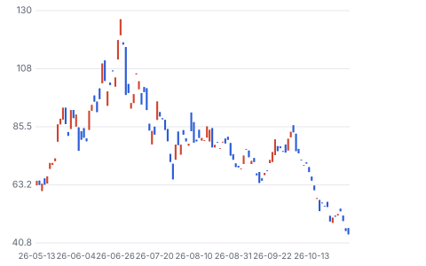

**주봉**

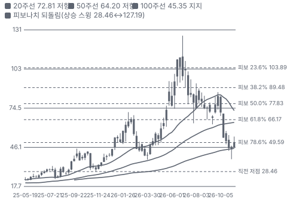

**월봉**

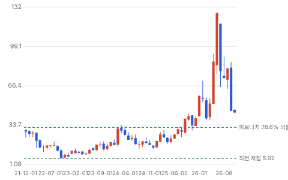

**분기 매출·EPS 실적과 컨센서스**

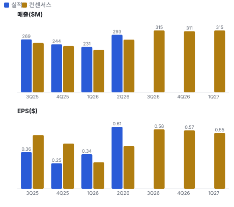

**최근 4개 분기 주가 변화 분석**

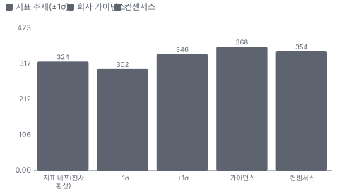

**EPS 리비전**

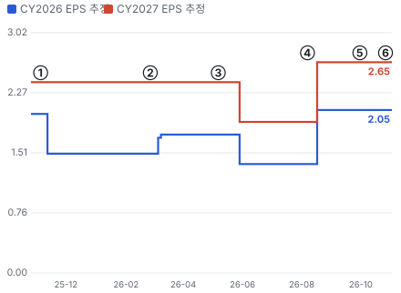

① 25-11-05 3Q25 실적, EPS 미달 · EPS 리비전 +0%
② 26-02-26 4Q25 실적, 2026 전망 첫 제시 · EPS 리비전 +0%
③ 26-05-07 1Q26 실적, EPS 상회 · EPS 리비전 +0%
④ 26-08-07 2Q26 실적, 가이던스 하단 상향 · EPS 리비전 +39%
⑤ 26-09-30 수주잔고 \$2.5B 공시 · EPS 리비전 +0%
⑥ 26-10-28 3Q 잠정 매출 \$360~365M · EPS 리비전 +0%

**밸류에이션 주가 시나리오**

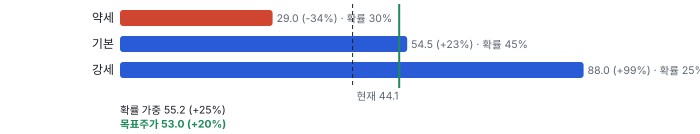

**주가별 업사이드**

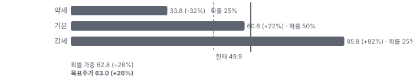

**제품·서비스 포트폴리오**

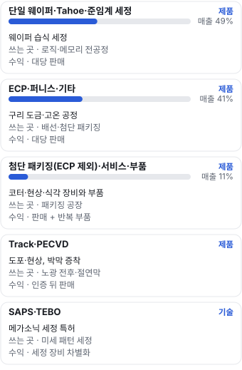

**고객 믹스(1H26, 매출 대비)**

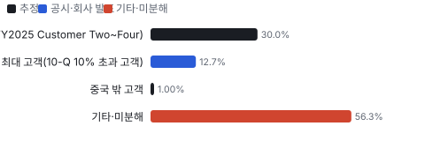

**공급 병목(10점, 낮을수록 병목)**

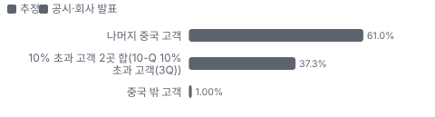

**생산능력 현재와 확충 계획(연 생산액 \$B)**

**CAPEX의 매출 대비 비중**

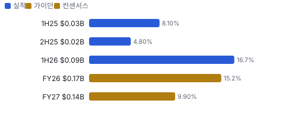

**어닝콜 변화별 주주가치 영향**

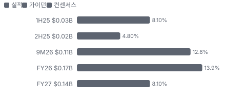

**멀티플 프리미엄**

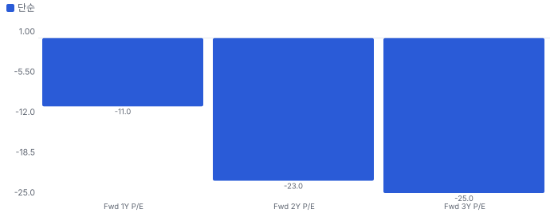

**합리적 멀티플**

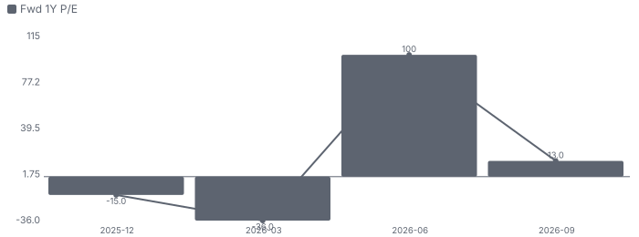

**일별 거래량 분해**

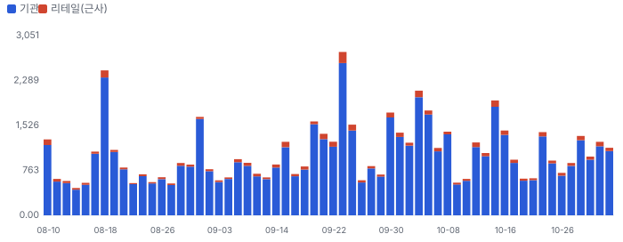

**기관 자금 흐름**

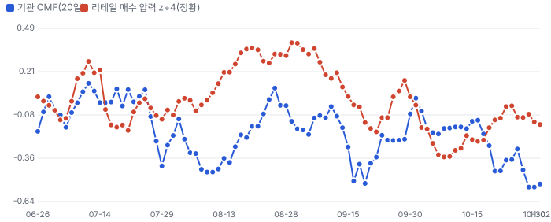

**몬테카를로**

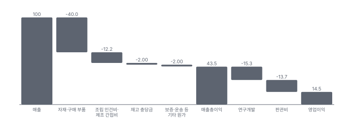

해석: 3,000번 중 1,150번(38%)에서 가치가 지금 주가 이상이었다. 가정을 흔들어도 지금 주가를 뒷받침하지 못하는 경우가 더 많다. 가운데 값은 0.81배이고, 열 번 중 여덟 번은 0.49~2.45배 사이에 든다.

## 내러티브

> **기업가치를 결정하는 이야기:** 기업가치는 수주잔고 \$2.5B가 매출과 현금으로 얼마나 빨리 바뀌느냐로 정해진다. 그 위에 ACMS 대비 지주 할인과 미국 규제라는 두 개의 할인이 얹혀 있다.

> **멀티플·EPS 프리미엄**
> **멀티플:** Fwd 1Y P/E 19.4배로 동종 5곳 중앙값 약 22배보다 낮다. 성장은 비슷하거나 빠른데 중국 집중과 엔티티 리스트가 프리미엄을 막는다.
> **EPS:** FY2027 EPS 추정은 1Q 뒤 \$1.90에서 2Q 뒤 \$2.65로 올랐다. 애널리스트 1명이라 표본이 작다.

### 투자자들은 왜 열광했나

4월 \$40대에서 6월 말 \$126.89까지 세 배가 됐다. 도금 매출 급증, 패널 장비, ACMS 홍콩 상장 계획이 겹쳤다. 7월 이후 회사 고유 악재 없이 −65%가 빠졌고 10월에는 3Q 잠정 매출이 컨센서스를 넘었는데도 떨어졌다.

### 무엇이 기업가치를 바꾸나

> **구조적 체질 변화**
> **변화:** 세정 회사에서 다품목 장비사로 바뀌고 있다. 세정 비중은 FY2025 69.5%에서 1H26 48.7%로 낮아졌다
> **증거:** 2025 10-K, 2Q 10-Q
> **반증:** ECP(전기화학 도금) 매출이 두 분기 연속 줄어든다

> **고부가 믹스 확장**
> **변화:** 첨단 패키징과 패널 도금이 커진다. 다만 GM은 46.0%로 전년 48.5%보다 낮다
> **증거:** 2Q 콜
> **반증:** GM이 장기 범위 하단 42%에 가까워진다

> **기술 혁신**
> **변화:** SPM 고온 세정, 패널 수평 도금, 단일 챔버 3척 PECVD(플라스마 화학 기상 증착)를 내놨다. 독립 성능 비교 자료는 없다
> **증거:** 1Q·2Q 콜, 10/22 보도자료
> **반증:** SPM 첫 장비 인증 실패

> **실행 속도**
> **변화:** 납품 리드타임은 공개되지 않아 수주잔고 ÷ TTM 매출로 주문에서 매출 인식까지를 근사한다. 약 17개월(1년 전)에서 약 29개월로 길어졌다. 잔고가 빨리 쌓였거나 인수가 늦어진 것이고 둘을 가를 자료는 아직 없다 **납품 리드타임 29개월.** 피어 비교 미확인. 2025-09 17개월보다 71% 길다.
> **증거:** ACMS 잔고 RMB(중국 위안화) 17.1B(\$2.5B, 9/29) ÷ TTM 매출 \$1.04B. 1년 전 잔고는 +88% 역산 약 \$1.27B ÷ TTM \$0.88B. 10-K: 첫 장비 대금은 24개월 이상 걸릴 수 있다
> **반증:** 평가 장비 재고가 다시 늘어난다

> **M&A**
> **변화:** 인수 대신 자회사 지분 매각과 증자로 자금을 모은다. ACMS 지분 74.6% → 73.2%
> **증거:** 2Q 10-Q Note 1
> **반증:** 추가 지분 희석

> **정책·입법 연관성**
> **재정정책:** 중국 정부 보조금은 받지만 작다. FY2025 비용 차감 \$8.0M, 기타수익 \$1.4M 2025 10-K 보조금 주석 반증: 린강 토지 약정의 최소 매출·세금 조건 미달 의회 동의 2/10 — 하원 1/5(미국 재정정책과 무관, 미국 의회 논의 없음) · 상원 1/5(같음).
> **행정명령:** BIS(미국 상무부 산업안보국)가 2024-12 ACM 상하이·ACM 코리아를 엔티티 리스트에 올렸다. 미국산 품목 공급에 허가가 필요하다 2025 10-K Item 1·7 반증: 지정 해제 또는 추가 지정(모회사 포함) 의회 동의 5/10 — 하원 3/5(대중 장비 수출 통제 강화는 하원 중국특위가 초당적으로 요구한다. 이 회사 특정 법안은 확인 못 했다) · 상원 2/5(상원 개별 법안 단계 확인 못 함).
> **연관입법:** 해당 없음(이 회사를 직접 겨냥한 법안을 찾지 못했다. 로비 공시는 키가 없어 미확인) 로비 조회 미확인 반증: 중국 장비 자회사를 둔 미국 상장사 규제 법안 발의

> **CAPEX 낙수효과**
> **변화:** 중국 팹 증설과 AI(인공지능) 패키징 증설이 장비 주문으로 온다. 1H26 수주 +105%
> **증거:** 2Q 콜. 특정 고객 투자에서 ACM 매출로 잇는 공개 숫자는 없다
> **반증:** 수주잔고 증가율이 한 자릿수로 떨어진다

### 내러티브 근거

> 중국 장비 국산화 수혜주에서 다품목 장비사로 다시 평가받다가 6월 고점 뒤 −65% 꺾였다. 숫자는 계속 좋아졌고 떨어진 것은 배수다. 동종 대비 멀티플 차이 -11% 중 회사 고유 몫은 -30%다. 단계는 확산, 쏠림은 보통이다.

> **중국 장비 국산화** · 강화
> **논리:** 미국·일본 장비 조달이 막힌 중국 팹이 국내 장비를 늘린다
> **숫자:** ACM 상하이 수주잔고 RMB 17.1B, 전년 대비 +88%
> **반증:** 다음 수주잔고 공시가 전년 대비 감소

> **다품목 장비사 전환** · 강화
> **논리:** 세정 단일 회사에서 도금·퍼니스·Track(포토레지스트 도포·현상 장비)·PECVD로 넓혀 고객당 몫을 키운다
> **숫자:** ECP·퍼니스 등 매출 비중 FY2025 22% → 1H26 41%
> **반증:** Track·PECVD 연말 양산 인증 실패

> **첨단 패키징·패널 도금** · 강화
> **논리:** AI 칩 대형 패키지가 도금 수요를 늘리고 패널 장비 선점이 프리미엄이 된다
> **숫자:** 첨단 패키징(ECP 제외) 2Q 매출 +153%, 패널 장비 2곳 수주
> **반증:** 패널 평가 장비가 양산 주문으로 안 바뀐다

> **지주 할인 해소** · 유지
> **논리:** ACMR 주가가 보유 ACMS 지분 가치보다 낮아 홍콩 상장이 격차를 줄인다
> **숫자:** Kerrisdale 추정 할인 56%. ACMS H주는 상장 후 주식의 7% 이하
> **반증:** H주 상장이 철회되거나 CSRC(중국 증권감독관리위원회)·HKEX(홍콩거래소) 승인이 늦어진다

> **반대: 중국 WFE(웨이퍼 전공정 장비) 둔화와 국내 경쟁** · 유지
> **논리:** 중국 장비 투자가 줄고 Naura(중국 최대 반도체 장비사) 같은 국내 대형사가 같은 공정을 노린다
> **숫자:** Gartner 중국 WFE 2026 \$35.4B(−9.9%), 10-K 인용
> **반증:** 2026 중국 WFE가 증가로 끝나고 ACM 세정 매출이 반등

> **반대: 규제·이익의 질** · 유지
> **논리:** 엔티티 리스트 확대와 운전자본 부담이 이익을 현금으로 못 바꾸게 한다
> **숫자:** 1H26 영업현금 −\$35.9M, 재고 \$783M, TTM FCF 약 −\$119M
> **반증:** 2H26 영업현금이 \$100M을 넘는다

## 포트폴리오

| 제품·서비스 | 구분 | 무엇 | 쓰는 곳 | 돈 버는 방식 |
|---|---|---|---|---|
| 단일 웨이퍼·Tahoe(배치·단일 웨이퍼를 합친 ACM 황산 세정 장비)·준임계 세정 | 제품 | 웨이퍼 습식 세정 | 로직·메모리 전공정 | 대당 판매 |
| ECP·퍼니스·기타 | 제품 | 구리 도금·고온 공정 | 배선·첨단 패키징 | 대당 판매 |
| 첨단 패키징(ECP 제외)·서비스·부품 | 제품 | 코터·현상·식각 장비와 부품 | 패키징 공장 | 판매 + 반복 부품 |
| Track·PECVD | 제품 | 도포·현상, 박막 증착 | 노광 전후·절연막 | 인증 뒤 판매 |
| SAPS(ACM의 메가소닉 위상 교대 세정 기술)·TEBO(ACM의 기포 진동 제어 세정 기술) | 기술 | 메가소닉 세정 특허 | 미세 패턴 세정 | 세정 장비 차별화 |

## 고객

> **1H26 최대 고객 중국 2~4위 고객 합(3곳)(FY2025 Customer Two~Four) 30%, 상위 3곳 44%, 집중도 분산.** 공시·회사 발표로 확인한 몫은 매출의 13%이고, 나머지 고객 몫은 추정이거나 미분해다. 10% 초과 고객이 1H25 3곳 49.9%에서 1H26 1곳 12.7%로 줄었다. 이름은 공시되지 않는다. 매출의 거의 전부가 중국이다.

**고객별 매출 몫(1H26)**
| 고객 | 몫 | 변화 | 근거 |
|---|---|---|---|
| 중국 2~4위 고객 합(3곳)(FY2025 Customer Two~Four) | 25~35% | -6%p | 추정 |
| 최대 고객(10-Q 10% 초과 고객) | 13% | -4%p | 공시 |
| 중국 밖 고객 | 0~2% | +1%p | 추정 |
| 기타·미분해 | 56% | - | - |

> **중국 2~4위 고객 합(3곳)(FY2025 Customer Two~Four)** · 추정
> **사는 것:** 세정·도금 장비
> **추정 근거:** FY2025 2~4위 몫(14·12·10%)에서 1H26 10% 미만으로 낮아졌다고 보고 범위로 잡았다

> **최대 고객(10-Q 10% 초과 고객)** · 공시
> **사는 것:** 세정·도금 장비
> **추정 근거:** 이름 미공개. 전기는 FY2025 최대 고객 17%(같은 회사인지 미확인)

> **중국 밖 고객** · 추정
> **사는 것:** 평가 장비 중심
> **추정 근거:** FY2025 중국 외 매출 \$3.3M. 20대 이상 설치 목표는 대부분 평가 장비다

## 수주·파이프라인

> **2026-09-29 기준 5건.** 확정 \$2.50B, 미확정 \$0.11B. 공시 ACM 상하이 수주잔고 RMB 17.1B(9/29, 전년 대비 +88%) \$2.50B.

**실행 속도와 방해 요인**
| 항목 | 상태 | 실행 속도 | 방해 요인 |
|---|---|---|---|
| ACM 상하이 수주잔고 | 확정 | 1H26 수주 전년 대비 +105% | 고객 인수 검사 · 평가 장비 인수 지연 |
| 고객 사이트 평가 장비 | 조건부 | 12월 말 \$145.5M → 6월 말 \$105.8M | 인수 검사 통과 |
| 패널 수평 도금 장비 | 조건부 | 중국 양산 주문 1건, 아시아 평가 1건, 10/28 310mm 패널 장비 첫 출하 | 평가 결과 · 양산 전환 |
| 단일 웨이퍼 SPM | 조건부 | 상반기 소수 출하, 연말 20대 이상 목표 | 고객 첫 장비 인증 |
| Track·PECVD 신제품 | 파이프라인 | 연말 양산 인증 목표 | 고객 인증 · 미국산 부품 대체 |

## 마진 구조

> **GPM 43.8%, OPM 13.3%.** TTM 2Q25 대비 GPM -5.6%p, OPM -4.6%p. 변동비는 매출의 56%이고, 매출이 10% 늘면 OPM은 +2.8%p 움직인다. 회사 기준(비GAAP) 분기 GM은 2Q 46.0%로 장기 범위 42~48%의 중간이고, 표의 TTM GAAP GPM은 43.8%다(3Q25 GAAP 42.0% 포함). 단기 변수는 신제품 첫 장비 원가와 재고 충당금, 그리고 미국산 부품 대체 비용이다.

**GPM에서 OPM까지(GAAP)**
| 기간 | GPM | 연구개발 | 판관비 | 기타 | OPM |
|---|---|---|---|---|---|
| TTM 2Q25 | 49.4% | 14.3% | 17.2% | 0.0% | 17.9% |
| TTM 2Q26 | 43.8% | 15.7% | 14.9% | 0.0% | 13.3% |

**마진을 결정하는 비용 요인 — 비용 +10% 시 OPM**
| 비용 | 매출 대비 | 변화 | 고정비 | OPM |
|---|---|---|---|---|
| 자재·구매 부품 | 40.0% | 미확인 | 0% | -4.00%p |
| 연구개발비 | 15.7% | +1.4%p | 80% | -1.57%p |
| 판관비 | 14.9% | -2.3%p | 70% | -1.49%p |
| 조립 인건비·제조 간접비 | 12.2% | 미확인 | 60% | -1.22%p |
| 재고 충당금 | 2.0% | 미확인 | 0% | -0.20%p |
| 보증·운송 등 기타 원가 | 2.0% | 미확인 | 30% | -0.20%p |

**비용을 움직이는 요인**
| 비용 | 요인 |
|---|---|
| 자재·구매 부품(매출원가) | 부품 가격, 국산 대체 부품 단가, 제품 믹스 · 근거 추정 |
| 연구개발비(연구개발) | Track·PECVD·패널 장비 개발 · 근거 공시 |
| 판관비(판관비) | 해외 영업망, 오리건 데모 센터 · 근거 공시 |
| 조립 인건비·제조 간접비(매출원가) | 린강 가동률, 첫 장비 현장 지원 · 근거 추정 |
| 재고 충당금(매출원가) | 평가 장비 인수 실패, 구형 재고 · 근거 공시 |
| 보증·운송 등 기타 원가(매출원가) | 출하량 · 근거 추정 |

**단일 웨이퍼·Tahoe·준임계 세정 BOM — 매출의 49%, GPM 46%(회사 GM, 제품 GM 미공개), 항목 가격 +10% 시**
| 항목 | 원가 몫 | 전가 | 제품 GPM | OPM |
|---|---|---|---|---|
| 챔버·프레임·배관 가공품 | 25~35% | 미확인 | -1.6%p | -0.79%p |
| 밸브·유체 부품 | 10~20% | 미확인 | -0.8%p | -0.39%p |
| 제어 전장·전원 | 10~15% | 미확인 | -0.7%p | -0.33%p |
| 웨이퍼 이송 로봇 | 8~15% | 미확인 | -0.6%p | -0.30%p |
| 미분해 | 31% | - | - | - |

**ECP·퍼니스·기타 BOM — 매출의 41%, GPM 46%(회사 GM, 제품 GM 미공개), 항목 가격 +10% 시**
| 항목 | 원가 몫 | 전가 | 제품 GPM | OPM |
|---|---|---|---|---|
| 챔버·프레임 가공품 | 20~30% | 미확인 | -1.4%p | -0.55%p |
| 도금 셀·전원 공급장치 | 15~25% | 미확인 | -1.1%p | -0.44%p |
| 퍼니스 석영·히터 | 10~20% | 미확인 | -0.8%p | -0.33%p |
| 웨이퍼 이송 로봇 | 8~15% | 미확인 | -0.6%p | -0.25%p |
| 미분해 | 28% | - | - | - |

**첨단 패키징(ECP 제외)·서비스·부품 BOM — 매출의 11%, GPM 46%(회사 GM, 제품 GM 미공개), 항목 가격 +10% 시**
| 항목 | 원가 몫 | 전가 | 제품 GPM | OPM |
|---|---|---|---|---|
| 교체 부품 | 30~40% | 미확인 | -1.9%p | -0.20%p |
| 코터·현상기 모듈 | 25~35% | 미확인 | -1.6%p | -0.17%p |
| 현장 서비스 인력 | 20~30% | 0% | -1.4%p | -0.14%p |
| 미분해 | 10% | - | - | - |

챔버·프레임·배관 가공품 가격이 +10% 오르면 영업이익은 -5.9% 움직인다. 판매가 전가를 모르는 항목은 전가 0%로 계산했다.

**BOM 항목 가격을 움직이는 것**
| 항목 | 요인 |
|---|---|
| 웨이퍼 이송 로봇 | 단일 공급사이자 지분 투자사 · 근거 추정 |
| 밸브·유체 부품 | 미국산 부품 수입 제한으로 대체 필요 · 근거 추정 |
| 챔버·프레임·배관 가공품 | 국내 협력사 가공, 스테인리스·불소수지 · 근거 추정 |
| 제어 전장·전원 | 미국산 대체 · 근거 추정 |
| 도금 셀·전원 공급장치 | 정밀 정류기 · 근거 추정 |
| 웨이퍼 이송 로봇 | 단일 공급사 · 근거 추정 |
| 퍼니스 석영·히터 | 고온 부품 · 근거 추정 |
| 챔버·프레임 가공품 | 국내 가공 · 근거 추정 |
| 코터·현상기 모듈 | 펌프·노즐 · 근거 추정 |
| 교체 부품 | 설치 기반 소모 · 근거 추정 |
| 현장 서비스 인력 | 인건비 · 근거 추정 |

**BOM 투입 물가 — PPI 전년비, 2026-11-03 수집**
| 항목 | 미국 | 일본 | 한국 | 대만 |
|---|---|---|---|---|
| 웨이퍼 이송 로봇 | +1.5% | +5.9% | +0.0% | 미확인 |
| 챔버·프레임 가공품 | +30.0% | +54.2% | +25.8% | +41.2% |
| 제어 전장·전원 | -2.2% | +3.9% | +134.0%* | +21.9%* |

별표는 품목보다 넓은 업종 지수다. 지난 1년 투입 물가를 판매가 전가 뒤 원가에 그대로 넣으면 OPM은 -5.39%p 움직인다(매출원가의 54% 기준).

## 공급망 병목

> **공급망 신뢰성 6.8/10, 관리 가능.** 가장 약한 고리는 챔버·프레임 가공품 6.8점이고, 품목 평균은 6.8점이다. 근거가 부족한 3건(웨이퍼 이송 로봇 · 밸브·유체 부품 · 미국산 부품(전장·계측))은 점수에서 뺐다. 약한 고리는 엔티티 리스트로 막힌 미국산 부품과 한국 Ninebell(한국 웨이퍼 이송 로봇 회사) 단일 로봇 공급이다. 필수 품목 세 개는 공개 자료로 요인을 4개 이상 채우지 못해 점수에서 빠지고, 점수는 범용 가공품 하나(추정)로만 나온다 — 점수를 신뢰도로 읽지 않는다

**병목과 마진 — 품목 가격 +10% 시 OPM**
| 품목 | 점수 | 판정 | 구분 | OPM |
|---|---|---|---|---|
| 챔버·프레임 가공품 | 6.8 | 관리 가능 | 가격 위험 | -0.55%p |

> **챔버·프레임 가공품** · 6.8/10
> **왜:** 범용 가공품이라 복수 구매로 본다(추정). 인증 공급사 수는 공시되지 않아 최소 2곳으로 잡았다
> **병목 요인:** 인증 공급사 2곳 · 캐파 여유 · 리드타임 미확인 · 재인증 미확인 · 1위 점유율 미확인 · 중국 집중 100% · 물량 확보 복수구매
> **풀리는 조건:** 해당 없음

**공급사**
| 품목 | 공급사 | 몫 | 근거 |
|---|---|---|---|
| 웨이퍼 이송 로봇 | Ninebell(로봇 서브어셈블리 주력 공급, ACM 지분 투자사) | 미확인 | 공시 |
| 밸브·유체 부품 | Advanced Electric(핵심 밸브) | 미확인 | 공시 |
| 미국산 부품(전장·계측) | 미공개(일부 미국 공급사는 ACM 상하이에 공급 불가) | 미확인 | 공시 |
| 챔버·프레임 가공품 | 미공개(중국 국내 가공 협력사) | 미확인 | 추정 |

**무역 통계로 본 공급 지역**
| 품목 | EU 수입처 | 일본 수입처 | EU 1위 전년비 |
|---|---|---|---|
| 웨이퍼 이송 로봇 | JP(일본) 45% · US(미국) 35% · TW(대만) 7% | 大韓民国 36% · シンガポール 25% | +1090.7% |
| 밸브·유체 부품 | JP 45% · US 35% · TW 7% | 大韓民国 36% · シンガポール 25% | +1090.7% |
| 미국산 부품(전장·계측) | TW 32% · MY(말레이시아) 19% · CN(중국) 15% | 台湾 60% · 中華人民共和国 8% | +136.5% |
| 챔버·프레임 가공품 | MY 69% · KR(한국) 10% · US 7% | マレーシア 58% · タイ 36% | 미확인 |

## 생산능력

> **현재 명목 캐파 3 연 생산액 \$B, 가동률 미확인.** 착공 이상 증설은 0 연 생산액 \$B, 발표까지 합치면 0 연 생산액 \$B이다. 다 가동하면 지금보다 +0%, 착공 이상만이면 +0%다. 1H26 CAPEX는 \$0.09B로 매출의 16.7%다. 린강 두 동으로 연 \$3B 생산이 가능하다고 회사가 말했다. 2026 매출 가이던스는 그 약 38%다.

**생산능력 확충 계획**
| 계획 | 단계 | 증설 | 가동 시점 | CAPEX |
|---|---|---|---|---|
| 린강 둘째 생산동 | 착공 | 미확인 | 2026-12 | 미확인 |
| 오리건 데모 센터 | 착공 | 미확인 | 2026-12 | \$0.01B |

남은 계획의 CAPEX 합계는 \$0.01B(금액 미확인 1건 제외)다. 합계는 FY27 매출의 1%다.

**증설 방해 요인**
| 계획 | 방해 요인 |
|---|---|
| 린강 둘째 생산동 | 미확인 |
| 오리건 데모 센터 | 미확인 |

**CAPEX와 매출 대비**
| 기간 | CAPEX | 매출 | 매출 대비 | 구분 |
|---|---|---|---|---|
| 1H25 | \$0.03B | \$0.39B | 8.1% | 실적 |
| 2H25 | \$0.02B | \$0.51B | 4.8% | 실적 |
| 1H26 | \$0.09B | \$0.52B | 16.7% | 실적 |
| FY26 | \$0.17B | \$1.15B | 15.2% | 가이던스 |
| FY27 | \$0.14B | \$1.42B | 9.9% | 컨센서스 |

## 해자

> 해자는 특허 세정 기술과 빠르게 쌓인 도금 설치 기반, 그리고 중국 국산화가 만든 고객 잠금이다. 다만 마지막은 정책이 만든 것이라 깨질 수 있다.

> **메가소닉 세정 특허(SAPS·TEBO)** · 보통
> **해자:** 미세 패턴을 손상하지 않고 입자를 지우는 방식이 경쟁사와 다르다
> **근거:** 10-K는 SAPS·TEBO를 독자 기술로 적는다. 그러나 2Q 세정 매출은 전년 대비 −14%였다
> **숫자:** 1H26 세정 매출 \$255.5M, 1H25 \$284.5M
> **깨지는 조건:** SPM 신제품 반복 주문이 2027년에도 숫자로 안 나온다

> **도금 설치 기반** · 강함
> **해자:** 도금 챔버가 빠르게 깔려 반복 주문·부품 매출이 따라온다
> **근거:** 누적 500개(2022) → 1,500개(2025) → 2,000개(2026-2Q)
> **숫자:** ECP·퍼니스 등 2Q 매출 \$128.5M, 전년 대비 +168%
> **깨지는 조건:** Naura 등 국내 경쟁사가 첨단 패키징 도금에서 같은 속도로 설치

> **중국 국산화 고객 잠금** · 보통
> **해자:** 엔티티 리스트로 미국·일본 장비 조달이 어려운 중국 팹이 국내 공급사를 먼저 쓴다
> **근거:** FY2025 매출의 약 99.6%가 중국. 수주잔고 RMB 17.1B(+88%)
> **숫자:** 수주잔고 \$2.5B = FY2026 매출 가이던스의 약 2.2배
> **깨지는 조건:** 중국 팹이 Naura 등 순수 국내 업체를 우선해 ACM 점유율이 떨어진다

> **다품목 플랫폼** · 약함
> **해자:** 세정·도금·퍼니스·Track·PECVD를 한 회사가 팔아 고객당 매출을 키운다
> **근거:** Track·PECVD는 연말 양산 인증 목표이고 매출 기여는 아직 작다
> **숫자:** 미확인
> **깨지는 조건:** Track·PECVD 인증이 2027년으로 밀린다

## 경영진·네트워크

> 창업자 David Wang이 ACMR과 ACM 상하이를 함께 이끈다. B주(의결권 우위)를 가진 창업자 경영이고 9월에 장내 매도가 있었다.

> **David H. Wang** · 창업자·CEO·사장, ACM 상하이 회장 · 1998
> **프로필:** 1998년 회사를 세웠다. 2026-09-08~09 장내 매도 14만 주 약 \$10.6M(옵션 행사 직후)
> **비즈니스:** ACM 상하이 회장 겸직(10-K)
> **정계:** 미확인
> **동문:** 미확인
> **사모임:** 미확인

> **Mark McKechnie(ACM Research CFO Mark McKechnie)** · CFO · 미확인
> **프로필:** 2026-08-20 장내 매도 55,199주 약 \$4.3M(옵션 행사 직후)
> **비즈니스:** 미확인
> **정계:** 미확인
> **동문:** 미확인
> **사모임:** 미확인

**네트워크 정량화**
| 연결 | 강도 | 닿는 매출 | 가중 노출 | 매출 대비 | 근거 |
|---|---|---|---|---|---|
| 비즈니스: CEO의 ACM 상하이 회장 겸직 | 4/5 | \$1.00B | \$0.80B | 77% | 매출 거의 전부가 ACM 상하이를 통해 나온다. 연결이 매출을 만든 것이 아니라 지배 구조다 2025 10-K |

가중 노출은 연결이 닿는 매출의 크기다. 연결이 그 매출을 만들었다는 뜻이 아니며, 인과는 공개 자료로 입증하지 못한다.

## 약세 논리 및 셀온 조건

| 약세 논리 | 근거 | 반박 | 가를 자료 |
|---|---|---|---|
| 4분기가 꺾인다 | 3Q 잠정 \$360~365M을 넣으면 가이던스 상단에서도 4Q \$291M 이하, 중간값이면 \$263M | 회사는 장비 인수 시점에 매출을 잡는다. 잔고가 크면 가이던스 상향 여지도 있다 | 11/5 FY2026 가이던스 |
| 중국 WFE가 줄어든다 | 10-K가 인용한 Gartner 전망으로 중국 WFE 2026 \$35.4B(−9.9%) | 같은 기간 ACMS 잔고는 +88%다. 점유율 상승이 시장 둔화를 넘고 있다 | 다음 ACMS 잔고 공시, 중국 장비 수입 통계 |
| 이익이 현금이 안 된다 | 1H26 영업현금 −\$35.9M, 재고 \$783M, 고객 사이트 평가 장비 \$105.8M | 평가 장비 재고는 12월 말 \$145.5M에서 줄었다 | 3Q 10-Q 영업현금·재고 |
| 규제가 넓어진다 | ACMS·ACM 코리아는 2024-12부터 엔티티 리스트다. 일부 미국 공급사는 공급할 수 없다 | 매출 영향은 아직 숫자로 나오지 않았다. 대체 부품 비용은 미공개 | BIS 추가 지정, 10-Q 위험 요인 |
| 지주 할인은 이유가 있다 | 주주 몫은 73.2%뿐이고 현금은 대부분 중국·홍콩에 있다. ACMS 지분은 매각·희석으로 74.6%에서 줄었다 | Kerrisdale는 할인 56%를 촉매로 본다. H주 상장은 승인 전이라 결과가 불확실하다 | CSRC·HKEX 승인, ACMS 주가 |
| 내부자가 판다 | 최근 장내 거래 매수 0·매도 75건. CEO 9월 약 \$10.6M, CFO 8월 \$4.3M | 옵션 행사 직후 매도다. 사전 매도 계획 여부는 확인하지 못했다 | Form 4 각주 |

> **셀온 조건**
> **조건 1:** 11/5 FY2026 매출 가이던스가 유지되거나 낮아져 4Q가 \$290M 아래로 읽힌다
> **조건 2:** 다음 ACMS 수주잔고 공시가 전년 대비 감소한다
> **조건 3:** 엔티티 리스트가 ACM Research 모회사나 다른 자회사로 넓어진다
> **조건 4:** 2H26 영업현금이 다시 적자이고 재고가 \$800M을 넘는다
> **조건 5:** ACMS H주 상장이 철회되거나 ACMR 지분이 70% 아래로 희석된다

## 어닝콜 변화

**직전 콜 대비 새로 나오거나 바뀐 내용 → 가치 영향**
| 항목 | 내용 | 직전 콜 | 최신 콜 | 모델 동인 이동 | 확신도 | 가치 영향 |
|---|---|---|---|---|---|---|
| 업데이트 | FY2026 매출 가이던스 | \$1.08~1.175B | \$1.125~1.175B | 기준연도 매출 +\$0.02B | 0.8 | +1.9% |
| 신규 | 패널 수평 도금 수주 | 평가 중 | 중국 양산 주문 + 아시아 평가 장비, 금액 미공개 | 1년차 성장률 +1.0% | 0.5 | +2.2% |
| 업데이트 | SPM 출하 목표 | 연말 15~20대 | 연말 20대 이상 | 1년차 성장률 +1.0% | 0.5 | +2.2% |
| 부정 | 세정 매출·GM | 1Q 세정 −6%, GM 46.5% | 2Q 세정 −14%, GM 46.0%(전년 48.5%) | 출발 이익률 -1.0% | 1.0 | -0.4% |
| 부정 | 현금 전환 | 1Q 영업현금 −\$29.5M | 2Q −\$6.4M, 재고 \$738M → \$783M | 매출÷투하자본 -10.0% | 1.0 | -3.6% |
| 신규 | 해외 확장 자금 | 미국 현금 \$107M(12월 말) | \$314M, 오리건 데모 센터 | 성장 지속(감속 계수) +2.0% | 0.3 | +2.6% |
| **합계** | 단독 합 |  |  | 동시 적용 +4.9% |  | **+4.9%** |

**사건별 EPS 리비전**
| # | 날짜 | 구분 | 사건 | CY2026 EPS 전→후 | CY2027 EPS 전→후 | 리비전 | 주가 반응 |
|---|---|---|---|---|---|---|---|
| ① | 25-11-05 | 실적 | 3Q25 실적, EPS 미달 | \$2.00 → \$1.50 | \$2.40 → \$2.40 | +0.0% | -19.9% |
| ② | 26-02-26 | 실적 | 4Q25 실적, 2026 전망 첫 제시 | \$1.50 → \$1.74 | \$2.40 → \$2.40 | +0.0% | -16.7% |
| ③ | 26-05-07 | 실적 | 1Q26 실적, EPS 상회 | \$1.74 → \$1.74 | \$2.40 → \$2.40 | +0.0% | +6.9% |
| ④ | 26-08-07 | 실적 | 2Q26 실적, 가이던스 하단 상향 | \$1.37 → \$2.05 | \$1.90 → \$2.65 | +39.5% | +6.1% |
| ⑤ | 26-09-30 | 내러티브 | 수주잔고 \$2.5B 공시 | \$2.05 → \$2.05 | \$2.65 → \$2.65 | +0.0% | +7.0% |
| ⑥ | 26-10-28 | 내러티브 | 3Q 잠정 매출 \$360~365M | \$2.05 → \$2.05 | \$2.65 → \$2.65 | +0.0% | +2.0% |

**해석:** 4개 구간 누적 주가 +13% = EPS 리비전 -2% × 멀티플 +15%. 더 크게 움직인 쪽은 **멀티플**이다.

## 밸류에이션

> **목표주가 \$53, 업사이드 +20%.** 자리는 약세와 기본 사이(약세 쪽 5%)이고 도달 확률은 약 50%다. 기본 \$55, 강세 \$88(+99%), 약세 \$29(-34%). DCF 기준 업사이드는 기본 -12%, 강세 +104%, 약세 -43%다(WACC 10.8%).

DCF가 시나리오와 다른 까닭은 두 가지다. DCF는 SBC 2.5%를 비용으로 빼고, 연결 가치에서 ACMS 소수지분 26.8%의 가치 약 \$1.0B를 뺀다. P/E 시나리오는 이미 소수지분을 뺀 조정 EPS를 쓴다. 또 DCF는 재고와 매출채권이 무거운 점을 반영해 한계 자본 효율을 1.2로 낮췄다. 그래서 두 값의 차이가 곧 이익의 질 쟁점이다. EPS 리비전 표본은 애널리스트 1명이다.

> **약세 \$29 (-34%)** · 확률 30%
> **가정:** 17.0배 × EPS \$1.70
> **근거:** 4Q가 가이던스대로 \$263~291M로 꺾이고 2027 매출 +10%대. 세정 감소가 이어지고 GM 44%. 중국 WFE 2026 −9.9% 전망이 2027에도 이어진다

> **기본 \$55 (+23%)** · 확률 45%
> **가정:** 22.7배 × EPS \$2.40
> **근거:** 11/5 가이던스 소폭 상향, 2027 매출 약 \$1.42B(+23%), GM 46%. 지금 다음 4개 분기 EPS \$2.33과 비슷하다

> **강세 \$88 (+99%)** · 확률 25%
> **가정:** 28.4배 × EPS \$3.10
> **근거:** 잔고 \$2.5B가 빠르게 인수돼 2027 매출 약 \$1.6B, SPM·패널 도금 반복 주문, GM 47%. 컨센서스 상단 \$1.65B에 가깝다

**멀티플 선정 — Fwd 1Y P/E**
| 단계 | 조정 | 근거 |
|---|---|---|
| 동종 중앙값 | 21.7배 | 범위 12.4~23.5배, 5곳 |
| 펀더멘털 | +14% | 성장·이익률·ROIC로 본 합리적 멀티플 27.8배와의 차이의 일부만 인정 |
| 해자 | +6% | 메가소닉 세정 특허(SAPS·TEBO) 보통 · 도금 설치 기반 강함 · 중국 국산화 고객 잠금 보통 · 다품목 플랫폼 약함 |
| 내러티브 | +5% | 단계 확산 |
| 사이클·실행 판단 | -20% | 매출의 거의 전부가 중국이고 자회사가 엔티티 리스트에 있다. 소수지분 26.8%와 영업현금 적자도 있다. 동종보다 성장은 빠르지만 지정학·이익의 질 할인을 둔다. |
| **선정** | **22.7배** | 지금 19.4배 |

**동종 레인지**
| 회사 | Fwd 1Y P/E | Fwd 2Y P/E | Fwd 3Y P/E | 성장 | 영업이익률 | ROIC |
|---|---|---|---|---|---|---|
| LRCX(램리서치) | 23.0 | 19.8 | 19.2 | 42% | 40% | 91% |
| AMAT(어플라이드 머티어리얼즈) | 21.7 | 19.2 | 16.6 | 45% | 36% | 43% |
| ONTO | 18.8 | 16.8 | 15.0 | 52% | 33% | 22% |
| CAMT | 23.5 | 17.6 | 15.8 | 44% | 33% | 26% |
| KLIC(쿨리케 앤 소파) | 12.4 | - | - | 59% | 23% | 49% |
| **ACM Research** | 19.4 | 14.1 | 12.2 |  |  |  |

지금 주가가 요구하는 5년 매출 CAGR 21%, 기본 시나리오 17%. 몬테카를로 중앙값 업사이드 -19%.

> 의사결정 보조(투자자문 아님): ① 매수 매력: 연 기대수익 +16.3% (자기자본비용 10.8% 대비 +5.4%p) · 자본비용 초과 확률 40% · 안전마진 0.49 → 정량 신호 약함 / ② 위험 예산 지표(이론): 1/4 켈리 10.0% (상한 10%) · 5년 하위10% -16% · 30%+ 손실 확률 2% / ③ 상방(5년): 기대 2.13배 · 2배 33% · 3배 18% · 10배 1% · 상위10% 4.16배

투입 물가 점검: 지난 1년 PPI(생산자물가지수)를 BOM에 넣으면 OPM -5.39%p다(매출원가의 54% 기준).

## 시장 평가

> **셀사이드(IB 애널리스트)**
> **한 줄:** 셀사이드는 강세지만 표본이 작고 목표가가 주가를 따라 내려오지 않았다
> **의견 분포:** Strong Buy 8·Hold 2 — 10명 중 8명 긍정
> **목표가:** 평균 \$112, 범위 \$75~\$159 — 현재가의 2.5배, 갱신이 늦다
> **FY2027 EPS 추정:** \$1.90 → \$2.65 — 1Q 뒤 → 2Q 뒤, 1명

> **바이사이드(기관 투자자)**
> **한 줄:** 행동주의 성격의 롱 논리(지주 할인 해소)가 있지만 내부자는 판다
> **13F 기관:** 344곳, 2Q 순 +1.15M주 — 증가 116·감소 80
> **내부자 장내:** 매수 0·매도 75건 — CEO 9월 약 \$10.6M, CFO 8월 \$4.3M
> **펀드 레터:** Kerrisdale 롱(고확신) — ACMS 대비 지주 할인 56%, 홍콩 상장이 촉매라는 논리

> **언론·업계**
> **한 줄:** 회사 사건보다 업종·중국 수급이 주가를 움직였다
> **보도 초점:** 가이던스 상향 뒤 하락 — 10월 하락의 회사 고유 원인은 찾지 못했다

## 체크리스트

| 시점 | 무엇 | 의미 |
|---|---|---|
| 2026-11-05 | 3Q26 실적·콜, FY2026 가이던스 | 4Q 공백을 메우는지, GM·영업현금 |
| 2026-11 중순(예상) | 3Q26 10-Q | 10% 초과 고객, 재고, 평가 장비, 위험 요인 |
| 2026-12 | SPM 20대 이상 출하, Track·PECVD 양산 인증 | 신제품 매출 전환 |
| 2026-12 | 린강 둘째 생산동 개소, 오리건 데모 센터 | 캐파와 해외 수주 기반 |
| 미정 | ACMS H주 CSRC·HKEX 승인 | 지주 할인 축소 촉매 |
| 2027-01 초(예상) | ACMS 12월 말 수주잔고 | 잔고 증가율 유지 여부 |
| 2027-02 말(예상) | 4Q26 실적·FY2026 10-K | 2027 전망, 구매 약정, 보조금 |

## 출처
- ACM Research 2Q26 10-Q https://www.sec.gov/Archives/edgar/data/1680062/000162828026054832/acmr-20260630.htm
- ACM Research FY2025 10-K https://www.sec.gov/Archives/edgar/data/1680062/000162828026013231/acmr-20251231.htm
- 3Q26 잠정 매출 보도자료(8-K 첨부) https://www.sec.gov/Archives/edgar/data/1680062/000162828026067734/a1028_acmrq32026prelimreva.htm
- ACM 상하이 수주잔고(8-K 첨부) https://www.sec.gov/Archives/edgar/data/1680062/000162828026063896/acmr-acmshbacklogdata_9302.htm
- ACM Research 2Q 콜 2026-08-07, 1Q 콜 2026-05-07(요지만)
- ACMS H주 상장 계획 공고 2026-04-17 https://pdf.dfcfw.com/pdf/H2_AN202604171821291265_1.pdf
- ACMS H주 이사회 승인 보도 https://m.sohu.com/a/1028019085_115377
- GuruFocus 10/5 하락 https://www.gurufocus.com/news/9110379/acm-research-acmr-shares-drop-nearly-9-after-recent-rally-on-october-5-2026
- https://www.sec.gov/Archives/edgar/data/1680062/000162828026013231/acmr-20251231.htm
- https://www.sec.gov/Archives/edgar/data/1680062/000162828026054832/acmr-20260630.htm
- 1Q·2Q 콜
- 2Q 10-Q 재고 주석(First Tools)
- 2Q 콜
- 2Q 콜, 10/28 보도자료
- https://www.sec.gov/Archives/edgar/data/1680062/000162828026063896/acmr-acmshbacklogdata_9302.htm
- 10-K
- 10-K Ninebell
- 10-K 생산 설명
- 10-K 위험 요인: 미국산 부품 제한
- 10-K: Advanced Electric이 핵심 밸브 공급사
- 10-K: Ninebell이 주력 로봇 공급사, 1H26 관계사 원가 \$32.1M
- 10-K: 영업·고객 서비스 724명
- 10-Q 매출원가 설명
- 10-Q 손익계산서
- 10-Q 손익계산서, 회사 2026 범위 16~18%
- 10-Q는 항목별 금액을 공개하지 않는다. 범위 추정
- 2Q 10-Q: 1H26 \$12.0M
- 매출원가 합에서 위 항목을 뺀 몫
- 회사 제품 설명
- 2025 10-K
- 2025 10-K Item 1·7
- 2025 10-K, 2Q 10-Q
- 추정
- 1Q 콜 2026-05-07: 첫 동 양산, 둘째 동 연내 개소, 두 동 합계 연 \$3B
- 1Q 콜: 연내 개소 예정. 건물은 10-K 린강 5개 동에 포함, 장비 반입·가동은 미확인이라 착공으로 둔다
- 2Q 콜, 10-K: 2024-10 \$7.75M 매입

_구매 등급·목표주가 모두 규칙이 계산한 모델 값으로, 개인의 보유 종목·자금 사정을 반영하지 않는다 · 공개 자료 기반 분석이며 투자 권유가 아님 · 1차 판정, 미검증 · Chiip ten-bagger_