# 텐배거 리포트 2026-11-03 — 이익은 두 배가 됐는데 배수는 3분의 1이 됐다

> 2026-11-03 · Advanced Energy(AEIS) · 기업: 반도체 장비용 정밀 전원과 AI 데이터센터 서버 전원장치(PSU·파워셸프)를 설계·제조하는 전력 변환 회사

## Chiip View

Buy

## 대시보드
| 항목 | 값 | 설명 |
|---|---|---|
| 주가 | \$217.19 | 고점 대비 -44% · 1년 +7% |
| 시가총액 | \$9.00B | EV \$8.97B |
| 업사이드 | +33% | 목표주가 \$289 · 다운사이드 -9% · 손익비 13.7 |
| 구매등급 | Buy | 애널리스트 13명: Strong Buy 9 · Buy 2 · Neutral 2 · Sell 0 · Strong Sell 0 |
| 멀티플 | Fwd 1Y P/E 13.8배 | 동종 중앙값 24.3배 |
| 가이던스 4Q26 | \$735M · \$3.90 | 컨센서스 \$692M · \$3.33 |
| 알파 | 6.5/10 | 텐배거 가능성 점수 |
| 이벤트 | 4Q26 실적·2027 전망 | 2027-02 초(예상) |

## 한 장 요약
- **기업가치를 결정하는 내러티브** **시장이 산 이야기는 'AEIS(어드밴스드 에너지 인더스트리스)가 반도체 장비 전원 회사에서 AI(인공지능) 데이터센터 전원 회사가 된다'는 것이다.** 이 이야기는 실적으로 확인됐다. 3Q 매출 \$696M(YoY(전년 대비) +50%), 비GAAP(미국 회계 기준) EPS(주당순이익) \$3.65(YoY +110%), 4Q 가이던스 \$735M다. 그런데 주가는 5월 고점 \$389에서 \$217로 내려왔고, Fwd(다음 4개 분기 추정 기준) P/E(주가 ÷ 주당순이익)는 46배에서 14배가 됐다. 이익이 오른 만큼 배수가 깎였다. 값은 2027년 EPS가 사이클 정점이냐 계속 오르느냐로 갈린다.
- **밸류에이션 모델로 본 주가 상방은 어디까지인가?** **목표주가 \$289(+33%), 약세와 기본 사이(약세 쪽 35%)다.** 강세 \$481(+121%)는 Fwd 1Y P/E 27.5배를 강세 EPS에 적용한 값이다. 기본 \$339, 약세 \$198. 손익비 13.7, DCF 기준 업사이드 -24%.
- **수주는 어디까지 왔나?** 4Q26 매출 가이던스 미확인, 100% 매출 \$0.73B · 데이터센터 2차 고객 램프 미확인, 100% 매출 미확인 · 800V 직류 전원 미확인, 100% 매출 미확인. 회사는 수주잔고를 따로 공시하지 않는다. 대신 4Q 가이던스 \$735M, 데이터센터 2차 고객의 2027 가속, 태국 공장(완공 시 매출 능력 약 \$5B)이 다음 2년 매출의 근거다.
- **서버향 전력 종목 중 왜 AEIS인가?** **알파를 '이익 전망이 오른 만큼 주가에 반영되지 않은 정도'로 보면 AEIS가 가장 크다.** 서버 전력 8종목의 Fwd P/E를 다음 4개 분기 매출 성장과 나란히 놓으면, AEIS는 성장 +33%에 약 14배로 가장 싸다. 같은 성장대의 Vicor(+46%)는 33배, MPS(+62%)는 29배다. 게다가 AEIS만 EPS 추정이 크게 오르는 동안 주가가 반대로 갔다(FY2027 EPS +53%, 주가 고점 대비 −44%). 기술 해자와 사업 확실성은 Infineon(독일 전력반도체 회사)·MPS(Monolithic Power Systems)가 위지만, 그 우위는 이미 배수에 들어 있다.
- **지금 가격은 무엇을 가정하나?** \$217은 다음 4개 분기 EPS 약 \$15.4(4Q 가이던스 \$3.90 포함)의 약 14배다. 반도체 장비 전원 경쟁사 MKS(12배)처럼 '사이클 종목'으로 값을 매긴 것이다. 현금흐름으로 풀면 시장은 5년 매출 CAGR 약 21%를 요구하고, 우리 기본 시나리오(13%)보다 높다. DCF가 낮게 나오는 이유는 반도체 장비 베타(1.35)와 GAAP 이익률(SBC(주식 보상 비용)·상각 뒤 장기 19%)을 썼기 때문이다.
- **왜 움직였나?** 2025년 10월 \$190대에서 2026년 5월 \$389로 두 배가 됐다. 실적 발표일마다 +11~16%였다. 5/5 2Q 가이던스 실망 −10.7% 뒤로는 7/2 −12.7%, 9/14 −11.5%, 10/22 −12.5% 급락이 이어졌는데 회사 뉴스가 없어 원인은 미확인이다. 8/18 COO(최고운영책임자) 매도 공시일에도 −9.8%였다. 3Q 실적 뒤 시간외 +9%다.
- **3Q에서 무엇이 바뀌었나?** 좋아진 것은 2026 매출 성장 30%대 초중반 → 약 40%, 4Q 매출 가이던스 \$735M(컨센서스 \$692M), EPS \$3.90(컨센서스 \$3.33), 태국 공장 첫 데이터센터 고객 인증이다. 나빠진 것은 현금 전환이다. 재고가 \$646M로 늘었고 회사가 부품 공급 제약을 위험으로 들었다.
- **무엇이 바뀌면 판단이 달라지나?** 4Q에 재고가 줄며 영업현금흐름이 비GAAP 순이익에 가까워지고, 2027 데이터센터 성장 전망이 20% 이상이면 강세 쪽이다. 반대로 반도체 장비 회사들이 2027 투자 감소를 말하거나, 주요 데이터센터 프로그램을 델타·Lite-On(대만 전원장치 회사)에 내주거나, 총이익률이 41% 아래로 내려가면 약세 쪽이다.

## 한눈에 보기

**일봉**

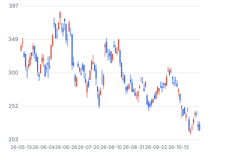

**주봉**

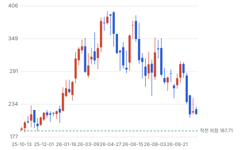

**월봉**

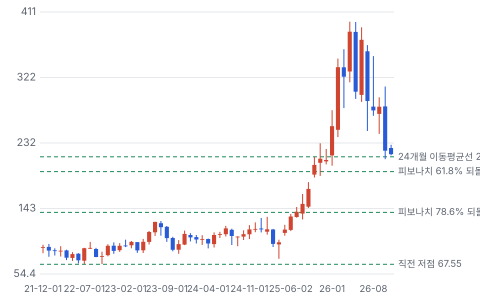

**분기 매출·EPS 실적과 컨센서스**

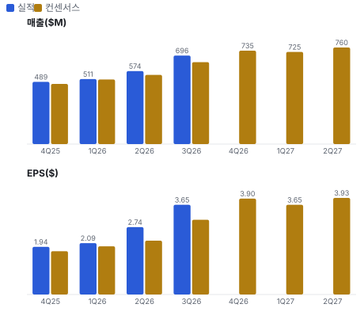

**EPS 리비전**

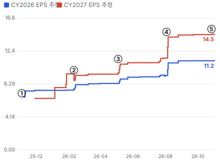

① 25-11-04 3Q25 실적, +15.8% · EPS 리비전 -
② 26-02-10 4Q25 실적, +10.7% · EPS 리비전 -2%
③ 26-05-04 1Q26 실적, −10.7% · EPS 리비전 +13%
④ 26-08-03 2Q26 실적, +15.2% · EPS 리비전 +23%
⑤ 26-11-02 3Q26 실적, 시간외 +9% · EPS 리비전 +0%

**밸류에이션 주가 시나리오**

**주가별 업사이드**

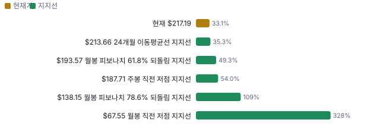

**어닝콜 변화별 주주가치 영향**

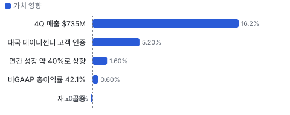

**최근 4개 분기 주가 변화 분석**

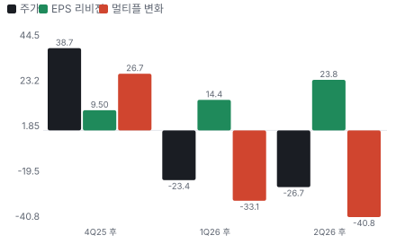

**멀티플 프리미엄**

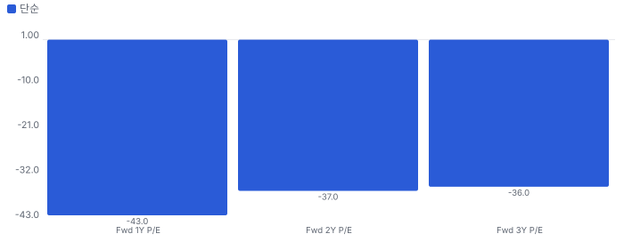

**합리적 멀티플**

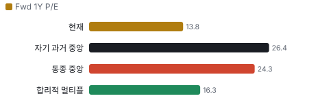

**몬테카를로**

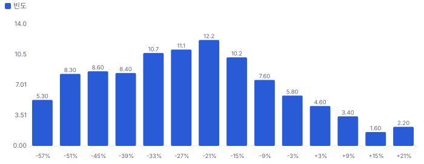

해석: 3,000번 중 351번(12%)에서 가치가 지금 주가 이상이었다. 가정을 흔들어도 지금 주가를 뒷받침하지 못하는 경우가 더 많다. 가운데 값은 0.75배이고, 열 번 중 여덟 번은 0.50~1.02배 사이에 든다.

## 내러티브

> **기업가치를 결정하는 이야기:** AEIS는 반도체 장비용 정밀 전원(46%), AI 데이터센터 서버 전원(37%), 산업·의료(13%), 통신(4%)을 판다. 반도체 매출은 장비 투자 사이클을, 데이터센터 매출은 하이퍼스케일러 AI 투자를 따른다. 둘 다 지금 상승기다. 기업가치는 2027~2028 EPS가 컨센서스(\$15.7·\$18.9)를 지키느냐와 그 EPS에 시장이 몇 배를 주느냐로 갈린다.

> **멀티플·EPS 프리미엄**
> **멀티플:** Fwd P/E 약 14배로 동종 중앙값 약 24배보다 낮다. 반도체 장비 전원 경쟁사 MKS(12배)에 가깝게 매겨지고, 데이터센터 전력 종목(Vertiv(데이터센터 전력·냉각 회사) 24배, Vicor(서버 전원 모듈 회사) 33배, MPS 29배)과는 거리가 멀다.
> **EPS:** FY2027 EPS 컨센서스는 3/9 \$9.52에서 10/28 \$14.54로 +53% 올랐다. 같은 기간 주가는 \$310대에서 \$217로 내렸다.

### 투자자들은 왜 열광했나

2025년 말 데이터센터 매출이 다시 커지고 반도체 장비 투자가 회복되며 두 엔진이 동시에 돌았다. 주가는 2025년 10월 \$190대에서 2026년 5월 \$389로 두 배가 됐다. 식은 이유는 확정되지 않았다. 1Q 실적 뒤 2Q 가이던스 실망(−10.7%), 7·9·10월의 −11~13% 급락일은 회사 뉴스가 없어 원인 미확인이다.

### 무엇이 기업가치를 바꾸나

> **구조적 체질 변화**
> **변화:** 반도체 장비 전원 회사에서 반도체·데이터센터 두 축 회사로 바뀌었다. 데이터센터 매출은 3Q25 \$191.5M에서 3Q26 \$256.2M다.
> **증거:** 3Q 보도자료
> **반증:** 데이터센터 매출 비중이 30% 아래로 내려간다

> **고부가 믹스 확장**
> **변화:** 고전력 PSU(서버 전원 공급 장치)·파워셸프와 새 플라스마 플랫폼으로 총이익률을 41~42%에서 43% 이상으로 올리려 한다.
> **증거:** 비GAAP 총이익률 2Q 41.9% → 3Q 42.1%
> **반증:** 총이익률이 41% 아래

> **기술 혁신**
> **변화:** 랙 전력이 커지며 PSU당 전력이 3kW대에서 수십kW 파워셸프로 커지고, 2028년 800V 직류 구조가 온다.
> **증거:** 3.2~3.6kW M-CRPS(공통 규격 교체형 서버 전원 장치)·33kW 파워셸프 출시(10월), 800V 2028 양산 목표
> **반증:** 800V 전환에서 전원 변환이 랙 밖 전력실 장비로 넘어간다

> **실행 속도**
> **변화:** 증설이 매출로 바뀌는 속도가 빠르다. 2Q에 말한 태국 공장이 3Q에 데이터센터 고객 인증을 받았다. 공장 인증에서 매출까지 약 3~6개월로 본다(4Q 첫 생산 매출 예정, 추정). **납품 리드타임 3~6개월.** 피어 비교 미확인. 이전 대비 미확인.
> **증거:** 2Q 콜·IR(투자자 관계) 자료
> **반증:** 부품 제약으로 4Q 가이던스를 못 맞춘다

> **M&A**
> **변화:** 해당 없음(최근 1년 큰 인수 공시를 찾지 못했다. 영업권+무형자산 \$401M로 자기자본의 25%)
> **증거:** 3Q 재무상태표
> **반증:** 전환사채로 마련한 현금으로 대형 인수를 한다

> **정책·입법 연관성**
> **재정정책:** 직접 관련 재정 지출은 없다. 반도체 장비 수요는 미국 CHIPS(미국 반도체지원법) 법 보조금 공장 투자와 연결된다. CHIPS 법(2022) 반증: 보조금 공장 투자가 미뤄진다 의회 동의 10/10 — 하원 5/5(CHIPS 법 하원 통과(2022)) · 상원 5/5(CHIPS 법 상원 통과(2022)).
> **행정명령:** 미국 관세 정책이 아시아 공장 원가에 영향을 준다. 회사는 멕시코·동남아로 생산을 나눴다. 회사 IR 반증: 동남아 생산품에 높은 관세가 붙는다 의회 동의 0/10 — 하원 0/5(행정 조치 — 의회 절차 없음) · 상원 0/5(행정 조치 — 의회 절차 없음).
> **연관입법:** 중국 반도체 장비 수출 통제가 장비 회사 매출을 통해 간접 영향을 준다. 미 상무부 수출 통제 반증: 통제가 식각·증착 장비로 넓어진다

> **CAPEX(설비 투자) 낙수효과**
> **변화:** 하이퍼스케일러 AI 투자와 반도체 장비 투자가 동시에 매출이 된다.
> **증거:** 반도체 +64%, 데이터센터 +49% YoY
> **반증:** 2027 하이퍼스케일러 CAPEX 증가율이 한 자릿수로 꺾인다

### 내러티브 근거

> '반도체 장비 전원 회사가 AI 데이터센터 전원 회사가 된다'는 이야기는 2025년 10월 \$190대에서 2026년 5월 \$389까지 주가를 두 배로 올렸다. 그 뒤 EPS 추정은 계속 올랐는데 주가는 11/2 \$217로 고점 대비 −44%다. Fwd P/E는 4월 약 46배에서 10월 약 14배가 됐다. 동종 대비 멀티플 차이 -43% 중 회사 고유 몫은 -15%다. 단계는 컨센서스, 쏠림은 중이다.

> **AI 데이터센터 전원** · 강화
> **논리:** GPU(그래픽 처리 장치(AI 가속기)) 랙 전력이 수십kW에서 수백kW로 커지며 고전력 PSU·파워셸프 수요가 늘어난다
> **숫자:** 데이터센터 매출 3Q \$256M(QoQ(전 분기 대비) +49%), 2026 성장 50%대 후반
> **반증:** 2027 데이터센터 성장이 20% 아래

> **반도체 장비 사이클 회복** · 강화
> **논리:** 식각·증착 장비 투자가 늘며 RF(고주파(플라스마 발생용 전원)) 전원 매출이 는다
> **숫자:** 반도체 매출 3Q \$322M(YoY +64%)
> **반증:** 장비 회사들이 2027 투자 감소를 말한다

> **이익률 확장** · 유지
> **논리:** 믹스·가동률로 비GAAP 총이익률 43% 이상
> **숫자:** 총이익률 3Q 42.1%, OPM(영업이익률) 24.4%
> **반증:** 태국 가동 비용으로 총이익률이 41% 아래

> **반대 내러티브: 사이클 상단 이익** · 강화
> **논리:** 반도체 장비와 AI 투자가 동시에 정점이라 지금 EPS가 최고치다
> **숫자:** Fwd P/E 46배 → 14배, 재고 +57%
> **반증:** 2027 상반기 EPS 추정이 계속 오른다

## 포트폴리오

| 제품·서비스 | 구분 | 무엇 | 쓰는 곳 | 돈 버는 방식 |
|---|---|---|---|---|
| 반도체 장비 전원 | 부문 | 식각·증착 장비용 RF·DC(직류) 플라스마 전원 | 반도체 전공정 장비 회사 | 3Q \$322.2M |
| 데이터센터 컴퓨팅 | 부문 | AI 서버용 고전력 PSU·파워셸프 | 하이퍼스케일러·서버 회사 | 3Q \$256.2M |
| 산업·의료 | 부문 | 계측·의료 장비용 전원 | 산업 장비·의료기기 | 3Q \$90.5M |
| 통신·네트워크 | 부문 | 통신 장비 전원 | 네트워크 장비 | 3Q \$27.5M |

## 수주·파이프라인

> **2026-11-02 기준 4건.** 건별 확정 금액은 공개되지 않았다. 서로 겹치는 항목은 합계에서 뺐다.

**실행 속도와 방해 요인**
| 항목 | 상태 | 실행 속도 | 방해 요인 |
|---|---|---|---|
| 4Q26 매출 가이던스 | 조건부 | 분기 매출 | 부품 공급 제약 |
| 데이터센터 2차 고객 램프 | 조건부 | 2027 가속(회사 설명) | 고객 인증 · GPU 세대 교체 시점 |
| 800V 직류 전원 | 파이프라인 | 2028 대량 생산 목표(회사 설명) | 표준·고객 구조 결정 |
| 태국 공장 | 파이프라인 | 완공 시 매출 능력 약 \$5B(전사 능력) | 가동 초기 비용 |

## 해자

> 해자는 '양쪽 고객 인증'이다. 반도체 장비 쪽에서는 식각·증착 장비 안의 RF 전원을 장비 회사와 함께 설계해 바꾸기 어렵고, 데이터센터 쪽에서는 하이퍼스케일러 전원 인증과 여러 나라 공장으로 납기를 지킨 이력이 있다. 다만 서버 전원은 델타·Lite-On과 가격 경쟁이 붙는 시장이다.

> **반도체 장비 플라스마 전원** · 강함
> **해자:** 식각·증착 장비의 RF 전원은 공정 결과를 좌우해 장비 회사가 한번 정하면 그 장비 세대 내내 쓴다. AEIS는 MKS(반도체 장비 전원·계측 회사 MKS Instruments)와 함께 이 시장을 나눠 갖는다.
> **근거:** 3Q 반도체 매출 \$322.2M(YoY +64%). 새 플랫폼 eVerest(AEIS의 플라스마 식각용 RF 전원 플랫폼)·eVoS(AEIS의 플라스마 전원 플랫폼)가 차세대 식각 공정에 채택(2Q 콜)
> **숫자:** 반도체 매출 비중 46%
> **깨지는 조건:** 장비 회사가 전원을 내재화하거나 MKS가 차세대 식각 플랫폼을 가져간다

> **데이터센터 고전력 전원 인증·양산** · 보통
> **해자:** AI 서버용 고전력 PSU·파워셸프를 하이퍼스케일러·서버 회사에 인증받고 여러 나라 공장에서 대량 생산한다.
> **근거:** 3Q 데이터센터 매출 \$256.2M(YoY +49%, QoQ +49%). 2026 성장 50%대 후반, 2차 고객이 2027 가속. 3.2~3.6kW M-CRPS·33kW 파워셸프 출시
> **숫자:** 데이터센터 매출 비중 37%
> **깨지는 조건:** 델타·Lite-On이 가격으로 주요 프로그램을 가져가거나, 800V 직류 전환에서 전원이 랙 밖(전력실)으로 빠진다

> **다국가 공장망** · 보통
> **해자:** 필리핀·말레이시아·멕시코·태국에 공장을 두어 관세·지정학 위험을 나누고 수요 급증 때 생산을 늘린다.
> **근거:** 태국 공장 3Q 데이터센터 고객 인증, 완공 시 매출 능력 약 \$5B(2Q 콜)
> **숫자:** TTM(최근 4개 분기) CAPEX \$155M(매출의 6.8%)
> **깨지는 조건:** 증설이 수요보다 앞서 가동률이 떨어지고 총이익률이 41% 아래로 내려간다

## 경영진·네트워크

> CEO(최고경영자) Steve Kelley는 반도체 패키징 회사 Amkor CEO를 지낸 뒤 2021년 합류해 데이터센터·반도체 쪽으로 포트폴리오를 옮겼다. CFO(최고재무책임자) Paul Oldham이 오래 재무를 맡아 왔다. 2026년 내부자 거래는 매도뿐이다.

> **Stephen D. Kelley** · 사장·CEO · 2021
> **프로필:** 전 Amkor Technology CEO. 반도체 공급망 경력
> **비즈니스:** 다른 상장사 이사 겸직 미확인
> **정계:** 미확인
> **동문:** 미확인
> **사모임:** 미확인

> **Paul Oldham** · CFO · 미확인
> **프로필:** AEIS 재무 장기 재직
> **비즈니스:** 미확인
> **정계:** 미확인
> **동문:** 미확인
> **사모임:** 미확인

> **COO** · COO · 미확인
> **프로필:** 미확인
> **비즈니스:** 2026-08-18 2만 4,771주 약 \$7.8M 매도(Form 4)
> **정계:** 미확인
> **동문:** 미확인
> **사모임:** 미확인

**네트워크 정량화**
| 연결 | 강도 | 닿는 매출 | 가중 노출 | 매출 대비 | 근거 |
|---|---|---|---|---|---|
| 비즈니스: 반도체 공급망(Amkor) 경력 — 아시아 공장 증설·고객 인증 실행 | 3/5 | 미확인 | 미확인 | 미확인 | 공장별 매출 미공시 회사 IR |

가중 노출은 연결이 닿는 매출의 크기다. 연결이 그 매출을 만들었다는 뜻이 아니며, 인과는 공개 자료로 입증하지 못한다.

## 약세 논리 및 셀온 조건

| 약세 논리 | 근거 | 가를 자료 |
|---|---|---|
| 사이클 정점 이익 | 반도체 장비(+64%)와 AI 투자(+49%)가 동시에 정점이면 2027~2028 EPS가 꺾인다. 2023년 반도체 하강기에 AEIS 이익률은 크게 낮아졌다 | 장비 회사 2027 투자 전망 |
| 서버 전원 가격 경쟁 | 델타·Lite-On은 규모가 훨씬 크고 PSU는 규격품이다 | 데이터센터 총이익률, 2차 고객 점유 |
| 800V 구조 전환 | 800V 직류로 가면 전원 변환 일부가 랙 밖 전력실로 옮겨 Vertiv 같은 회사 몫이 될 수 있다 | 2028 800V 프로그램 수주 |
| 현금 전환 약화 | 재고 +57%, 3Q 영업현금흐름 \$65M | 4Q 재고·현금흐름 |
| 내부자 매도 | 2026년 매도만, COO \$7.8M | Form 4 |

> **셀온 조건**
> **조건 1:** 4Q 재고가 \$646M에서 더 늘고 영업현금흐름이 비GAAP 순이익의 절반 아래에 머문다.
> **조건 2:** 비GAAP 총이익률이 41% 아래로 내려간다(믹스·가동률 논리 붕괴).
> **조건 3:** 2027 전망에서 데이터센터 성장이 20% 아래로 제시된다.
> **조건 4:** 주요 반도체 장비 고객이 2027 투자 감소를 공식화한다.

## 어닝콜 변화

**직전 콜 대비 새로 나오거나 바뀐 내용 → 가치 영향**
| 항목 | 내용 | 직전 콜 | 최신 콜 | 모델 동인 이동 | 확신도 | 가치 영향 |
|---|---|---|---|---|---|---|
| 업데이트 | 2026 매출 성장 | 30%대 초중반(8/3) | 약 40%(11/2) | 기준연도 매출 +\$0.04B | 1.0 | +1.6% |
| 업데이트 | 4Q 가이던스 | 컨센서스 \$692M | \$735M ± \$25M, EPS \$3.90 | 1년차 성장률 +3.0% | 1.0 | +16.2% |
| 신규 | 태국 공장 | 4Q 첫 생산 매출 예정 | 3Q에 데이터센터 고객 인증 완료 | 1년차 성장률 +1.0% | 0.8 | +5.2% |
| 부정 | 현금 전환 | 연초 재고 \$411M | 9월 말 \$646M, 3Q 영업현금흐름 \$65M | 출발 이익률 -0.50% | 0.8 | -0.2% |
| 업데이트 | 총이익률 | 2Q 41.9% | 3Q 42.1%, 43% 이상 가시권 | 목표 이익률 +0.50% | 0.8 | +0.6% |
| **합계** | 단독 합 |  |  | 동시 적용 +24.3% |  | **+23.4%** |

**사건별 EPS 리비전**
| # | 날짜 | 구분 | 사건 | CY2026 EPS 전→후 | CY2027 EPS 전→후 | 리비전 | 주가 반응 |
|---|---|---|---|---|---|---|---|
| ① | 25-11-04 | 실적 | 3Q25 실적, +15.8% | - → \$7.41 | - → - | - | +15.8% |
| ② | 26-02-10 | 실적 | 4Q25 실적, +10.7% | \$7.52 → \$8.20 | \$9.56 → \$9.37 | -2.1% | +10.7% |
| ③ | 26-05-04 | 실적 | 1Q26 실적, −10.7% | \$8.36 → \$8.91 | \$9.52 → \$10.78 | +13.3% | -10.7% |
| ④ | 26-08-03 | 실적 | 2Q26 실적, +15.2% | \$9.35 → \$10.94 | \$11.54 → \$14.18 | +22.8% | +15.2% |
| ⑤ | 26-11-02 | 실적 | 3Q26 실적, 시간외 +9% | \$11.21 → \$11.21 | \$14.54 → \$14.54 | +0.0% | - |

**해석:** 3개 구간 누적 주가 -22% = EPS 리비전 +55% × 멀티플 -50%. 더 크게 움직인 쪽은 **EPS 리비전**이다.

## 밸류에이션

> **목표주가 \$289, 업사이드 +33%.** 자리는 약세와 기본 사이(약세 쪽 35%)이고 도달 확률은 약 63%다. 기본 \$339, 강세 \$481(+121%), 약세 \$198(-9%). DCF 기준 업사이드는 기본 -24%, 강세 -3%, 약세 -48%다(WACC 10.8%).

EPS는 3Q 실적 전 추정이라 4Q 가이던스 상회분이 아직 들어 있지 않다. 순현금은 거의 0(현금 \$1.42B, 전환사채 \$1.39B)이라 주가 = 배수 × EPS다.

**서버향 전력 종목 알파 비교 — 무엇이 가격에 안 들어 있나**
| 종목 | Fwd P/E | 다음 4개 분기 매출 성장 | 기대와 가격 | 서버 전력에서 하는 일 | 알파 판단 |
|---|---|---|---|---|---|
| AEIS | 약 14배 | +33% | EPS 추정 +53%(3~10월), 주가 고점 −44% | PSU·파워셸프 완제품 + 반도체 장비 전원 | **가장 높음** — 이익 상향과 배수 하락이 가장 크게 벌어졌다 |
| onsemi(ON) | 약 17배 | +15% | 성장 회복 초기 | SiC(탄화규소 전력반도체)·전력 MOSFET(전력 스위칭 트랜지스터) | 중간 — 싸지만 성장이 낮다 |
| Infineon(IFX(Infineon 종목 코드)) | 약 19배 | +24% | 자동차 비중이 AI 효과를 희석 | PSU용 Si·SiC·GaN(질화갈륨 전력반도체) 전 소재 | 중간 — 기술 1위, 전사 민감도는 낮다 |
| TI(TXN(TI 종목 코드)) | 약 26배 | +24% | AI 매출 가시성 낮음 | 아날로그·전력관리 | 낮음 |
| MPS(MPWR(모놀리식 파워 시스템즈)) | 약 29배 | +62% | AI 성장이 이미 배수에 반영 | GPU 근처 전원 | 중간 — 실적은 최고, 가격도 최고 |
| Lattice(LSCC(Lattice 종목 코드)) | 약 30배 | +68% | 간접 수혜 | 전원 제어 FPGA(설계를 바꿀 수 있는 반도체) | 낮음 |
| Vicor(VICR) | 약 33배 | +46% | 특허 수익 기대 포함 | 고밀도 전원 모듈 | 중간 — 기대가 앞서 있다 |
| Navitas(NVTS(Navitas 종목 코드)) | 적자 | - | 양산 검증 전 | GaN | 판단 보류 |

Fwd P/E와 성장은 다음 4개 분기 추정(2026-11-02) 기준이다. Infineon·TI·Lattice 배수는 같은 날 값이다. 기술·포트폴리오 점수는 마스터 첨부 분석(Infineon 9.3, MPS 8.9, TI 8.9, AEIS 8.7)을 따르고, 여기서는 '그 점수가 가격에 얼마나 들어 있나'만 비교했다.

**현금 전환 점검 — 이익은 늘었는데 현금은 왜 덜 들어오나**
| 항목 | 값 | 근거 |
|---|---|---|
| 비GAAP 순이익(3Q) | 약 \$150M | EPS \$3.65 × 4,100만 주 |
| 영업현금흐름(3Q) | \$65.1M | 1Q −\$6.0M, 2Q \$85.0M |
| 재고 | \$411M(2025년 말) → \$646M(9월 말) | 9개월 +\$235M, 매출 증가율(+36%)보다 빠르다(+57%) |
| CAPEX(3Q) | \$31.1M | TTM \$155M, 태국·멕시코 증설 |
| 자사주(10월) | \$30M, 주당 \$240.77 | 회사가 하락 중 샀다 |

**판정: 이익은 진짜, 현금은 확인 대기.** 재고 증가는 태국 가동 준비와 부품 확보 때문일 수 있으나 회사 설명은 확인하지 못했다. 4Q에 재고가 줄지 않으면 '사이클 정점에서 재고를 쌓는다'는 약세 논리가 힘을 얻는다.

> **약세 \$198 (-9%)** · 확률 25%
> **가정:** 16.5배 × EPS \$12.00
> **근거:** 반도체 장비 투자가 2027년에 꺾이고 데이터센터 프로그램 일부를 잃어 다음 4개 분기 EPS \$12.0(가이던스 기준 −22%, 2023년형 조정)

> **기본 \$339 (+56%)** · 확률 50%
> **가정:** 22.0배 × EPS \$15.40
> **근거:** 4Q 가이던스 \$3.90와 2027 상반기 추정대로 다음 4개 분기 EPS 약 \$15.4

> **강세 \$481 (+121%)** · 확률 25%
> **가정:** 27.5배 × EPS \$17.50
> **근거:** 3Q 상회분이 2027 추정에 반영되고 데이터센터 2차 고객이 램프해 \$17.5

**멀티플 선정 — Fwd 1Y P/E**
| 단계 | 조정 | 근거 |
|---|---|---|
| 동종 중앙값 | 24.3배 | 범위 12.2~33.4배, 5곳 |
| 펀더멘털 | -17% | 성장·이익률·ROIC로 본 합리적 멀티플 16.3배와의 차이의 일부만 인정 |
| 해자 | +7% | 반도체 장비 플라스마 전원 강함 · 데이터센터 고전력 전원 인증·양산 보통 · 다국가 공장망 보통 |
| 내러티브 | +0% | 단계 컨센서스 |
| 사이클·실행 판단 | +0% | EPS 상향이 이어지는데 배수만 46배에서 14배로 눌렸다. 사이클 상단 이익이라는 할인은 동종 선택(MKS 12배)에 이미 들어 있어 따로 깎지 않는다 |
| **선정** | **22.0배** | 지금 13.8배 |

**동종 레인지**
| 회사 | Fwd 1Y P/E | Fwd 2Y P/E | Fwd 3Y P/E | 성장 | 영업이익률 | ROIC |
|---|---|---|---|---|---|---|
| MKSI(MKS 인스트루먼트) | 12.2 | 10.6 | 9.6 | 35% | 27% | 15% |
| VRT(버티브) | 24.3 | 19.7 | 15.6 | 42% | 25% | 54% |
| VICR | 33.4 | 25.1 | 19.9 | 46% | 33% | 38% |
| MPWR | 28.6 | 22.1 | 17.1 | 62% | 41% | 48% |
| ON | 16.6 | 14.4 | 12.0 | 15% | 26% | 17% |
| **Advanced Energy** | 13.8 | 12.4 | 10.1 |  |  |  |

지금 주가가 요구하는 5년 매출 CAGR 21%, 기본 시나리오 13%. 몬테카를로 중앙값 업사이드 -25%.

> 의사결정 보조(투자자문 아님): ① 매수 매력: 연 기대수익 +3.9% (자기자본비용 10.8% 대비 -6.9%p) · 자본비용 초과 확률 9% · 안전마진 0.50 → 정량 신호 약함 / ② 위험 예산 지표(이론): 0% — 기대수익이 자기자본비용에 못 미침(무위험 대비 켈리 0%는 참고) · 5년 하위10% -21% · 30%+ 손실 확률 3% / ③ 상방(5년): 기대 1.21배 · 2배 1% · 3배 0% · 10배 0% · 상위10% 1.65배

## 시장 평가

> **셀사이드(IB 애널리스트)**
> **한 줄:** 추정과 의견은 계속 좋아졌고, 주가만 반대로 갔다
> **애널리스트 의견:** 13명 — 강력 매수 9·매수 2·보유 2 — 매도 의견 없음
> **목표가 평균·범위:** \$410 (\$245~\$535) — 11/2 종가 대비 +89%
> **FY2027 EPS:** \$9.52(3/9) → \$14.535(10/28) — 7개월 새 +53%

> **바이사이드(기관 투자자)**
> **한 줄:** 기관은 2분기에 일부 줄였고, 회사는 10월에 샀다
> **13F 2Q 변화:** 639곳, 순 −154만 주 — BlackRock −184만 주
> **내부자:** 2026년 매도만, COO 8/18 \$7.8M — 장내 매수 없음
> **자사주:** 10월 \$30M(주당 \$240.77) — 회사는 하락 중 샀다

> **언론·업계**
> **한 줄:** 언론은 반도체 장비 종목으로 분류한다
> **보도:** '반도체·데이터센터 양쪽 수혜' 비교 기사 — KLA(반도체 검사 장비 회사)·MKS와 비교가 많다

## 체크리스트

| 시점 | 무엇 | 의미 |
|---|---|---|
| 2026년 11월 | 3Q 10-Q | 재고 구성(원자재·완제품), 고객 집중도 |
| 2026년 11월 중순 | 13F 3Q 공시 | 급락 구간 기관 매매 |
| 2027년 1월 | 반도체 장비 회사 4Q 실적·2027 투자 전망 | 반도체 매출 46%의 방향 |
| 2027년 2월(예상) | 4Q 실적·2027 전망 | 데이터센터 2027 성장, 재고·현금 전환, 총이익률 43% |
| 2027년 | 데이터센터 2차 고객 램프·태국 가동률 | 강세 시나리오의 핵심 |

## 출처
- Advanced Energy 3Q26 실적 보도자료(2026-11-02)
- Advanced Energy 2Q26 실적·콜(2026-08-03, 요지만 자기 말로)
- Advanced Energy 11월 IR 자료
- 2Q 콜
- 2Q 콜·IR 자료
- 3Q 보도자료

_구매 등급·목표주가 모두 규칙이 계산한 모델 값으로, 개인의 보유 종목·자금 사정을 반영하지 않는다 · 공개 자료 기반 분석이며 투자 권유가 아님 · 1차 판정, 미검증 · Chiip ten-bagger_