# 텐배거 리포트 2026-11-03 — Cohu — 내년 이익 추정이 40% 올랐는데 주가는 고점 대비 −34%, 값을 가르는 것은 인증 전환율이다

> 2026-11-03 · Cohu(COHU) · 기업: 칩을 옮기고 온도를 맞춰 시험하는 테스트 핸들러와 테스터·소켓을 파는 반도체 후공정 장비사

## Chiip View

10/5 종가 \$73.73에서 11/2 \$48.37로 −34%다. 같은 기간 FY2027 매출 추정은 \$745M에서 \$847M로, EBIT 추정은 \$121M에서 \$169M로 올랐다(같은 애널리스트 2명, 2분기 뒤와 3분기 콜 뒤 비교). 떨어진 것은 이익이 아니라 배수이고, 10/6~10/30 Teradyne −36%, FormFactor −38%로 업종이 함께 빠졌다. **우리가 다르게 보는 곳은 전환율이다.** 시장은 약 \$1B를 숫자로 믿지 않지만 2027 HPC(고성능 컴퓨팅) 약 \$250M은 이미 자격 완료 \$230M으로 대부분 덮인다. 대신 Hon Precision(대만 테스트 핸들러 회사)이 선두인 시장의 후발자이고 GAAP 영업이익은 TTM 적자다.

## 대시보드
| 항목 | 값 | 설명 |
|---|---|---|
| 주가 | \$48.37 | 고점 대비 -35% · 1년 +103% |
| 시가총액 | \$2.44B | EV \$2.27B |
| 업사이드 | +24% | 목표주가 \$60 · 다운사이드 -35% · 손익비(강세÷약세) 2.8 |
| 구매등급 | Buy | 애널리스트 9명: Strong Buy 7 · Buy 1 · Neutral 1 · Sell 0 · Strong Sell 0 |
| 멀티플 | Fwd 1Y P/E 20.7배 | 동종 중앙값 22.1배 |
| 가이던스 4Q26 | \$178M | 컨센서스 \$168M |
| 알파 | 5.9/10 | 텐배거 가능성 점수 |
| 이벤트 | Investor Day(뉴욕), 새 중기 재무 모델 | 2026-11-10 |

## 한 장 요약
- **기업가치를 결정하는 내러티브** Cohu는 칩을 출하 전에 옮기고 온도를 맞춰 시험하는 핸들러가 주력인 후공정 장비사다. 이야기는 사이클 회복주에서 AI(인공지능) 열 관리주로 옮겨 가는 중이고, 2027 매출 +30~40% 틀이 그 근거다.
- **밸류에이션 모델로 본 주가 상방은 어디까지인가?** **목표주가 \$60(+24%), 기본 시나리오다.** 강세 \$95(+97%)는 Fwd 1Y P/E 30.8배를 강세 EPS에 적용한 값이다. 기본 \$59, 약세 \$31. 손익비 2.8, DCF 기준 업사이드 -7%.
- **수주는 어디까지 왔나?** FY2026 HPC 매출 미확인, 100% 매출 \$0.12B · Eclipse(Cohu의 AI 칩용 열 제어 테스트 핸들러) 자격 완료 단계 미확인, 100% 매출 \$0.23B · Eclipse 인증 진행 단계 미확인, 100% 매출 \$0.44B. 약 \$1B는 연간 기회이지 수주가 아니다. 확정 수주 금액은 공개되지 않았다.
- **누가 사 주나?** 최대 고객 나머지 고객 45%, 상위 3곳 100%. 공시·회사 발표로 확인한 몫은 15%다.
- **마진과 공급망은 어디가 약한가?** GPM 44.5%, OPM -2.4%. OPM을 가장 흔드는 BOM(제품 원가를 이루는 부품·재료 명세) 항목은 정밀 가공·조립 노무이고 가격 +10%에 -1.03%p다. 공급망 신뢰성은 3.5/10(병목 심각)이고 가장 약한 고리는 Eclipse 조립·열 헤드다.
- **생산능력은 얼마나 늘어나나?** 현재 명목 캐파 2,000 핸들러 대/년, 착공 이상 증설 0 핸들러 대/년. FY27 CAPEX는 매출의 2.1%다.
- **지금 가격은 무엇을 가정하나?** Fwd 1Y P/E는 20.7배이고 동종 4곳 중앙값은 약 22배다. EPS 기준은 콜 뒤 집계 \$2.33이다. 2027 회사 틀(매출 +35%, GM(매출총이익률) 47%, 분기 영업비용 \$55M, 세율 약 15%, 희석 주식 55M)을 그대로 넣으면 EPS는 약 \$2.8이고 지금 주가는 그 17배다. 시장은 틀의 중간값을 다 믿지 않는다.
- **왜 움직였나?** 세 구간이다. 4~6월 \$30대에서 \$73.91까지는 AI 발열 이야기와 HPC 파이프라인 공개가 겹친 재평가다. 7월 초 급락과 2Q 실적 뒤 반등을 지나 10/5에 다시 \$73.73까지 갔다. 10월 하락은 회사 고유 원인을 찾지 못했다. 10/22 하루 Cohu −16.3%, FormFactor −15.3%, Teradyne −10.6%였다. 3Q 호실적 뒤에도 10/30 −4.9%, 11/2 −4.8%였다.
- **3Q 콜에서 무엇이 바뀌었나?** 2027 틀이 새로 나왔다. HPC 매출 전망은 \$100~110M에서 약 \$120M으로, 인증 진행 단계는 \$215M에서 \$440M으로 커졌다. 아쉬운 숫자는 4Q GM 약 44%와 영업비용 약 \$57M이다. 7월에는 \$50M대 초반이라고 했고 부품 리드타임과 원가 상승도 다시 나왔다.
- **회사는 쟁점에 뭐라고 답했나?** 전환율 쟁점에 CFO는 2027 HPC가 \$200~250M 범위 상단이라고 답했다. 복수 벤더 질문에 CEO는 지금까지 디바이스 패밀리를 통째로 가져갔다고 했지만, 경험이 짧으니 1년 뒤 다시 물어보라고 덧붙였다. 부품 부족은 지금 제약은 아니라고 답했다. 공급사가 3배 물량을 따라와야 한다는 단서가 붙었다.
- **무엇이 바뀌면 판단이 달라지나?** 1Q까지 예정된 인증 5개 중 3개 이상이 끝나고 2027 틀 상단이 유지되면 위쪽이다. Investor Day 중기 조정 영업이익률이 25%를 넘으면 배수도 달라질 수 있다. 반대로 2027 HPC가 \$200M 아래로 낮아지거나, 고객이 같은 패밀리를 나눠 사거나, 4Q GM이 44% 아래면 약세 쪽이다.

## 한눈에 보기

**일봉**

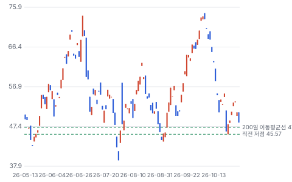

**주봉**

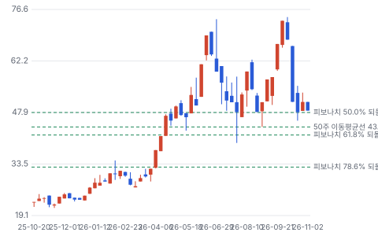

**월봉**

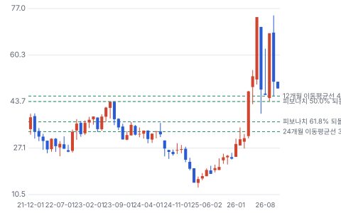

**분기 매출·EPS 실적과 컨센서스**

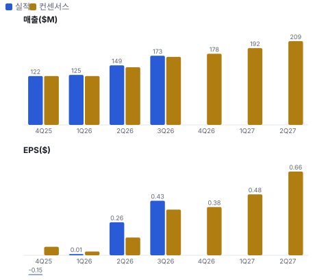

**최근 4개 분기 주가 변화 분석**

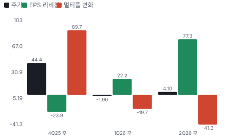

**EPS 리비전**

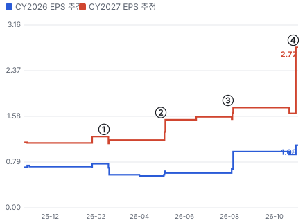

① 26-02-12 4Q25 실적, EPS 적자 · EPS 리비전 -5%
② 26-04-30 1Q26 실적 · EPS 리비전 +29%
③ 26-07-30 2Q26 실적, HPC \$100~110M · EPS 리비전 +11%
④ 26-10-28 3Q26 실적, 2027 틀 제시 · EPS 리비전 +70%

**밸류에이션 주가 시나리오**

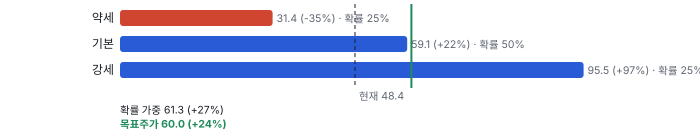

**주가별 업사이드**

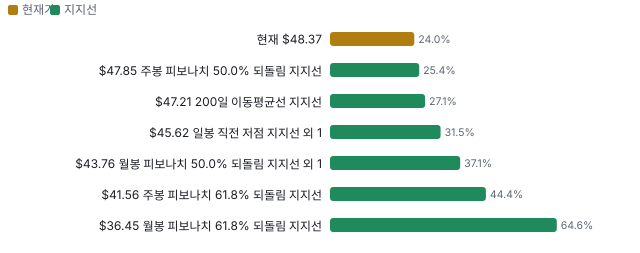

**제품·서비스 포트폴리오**

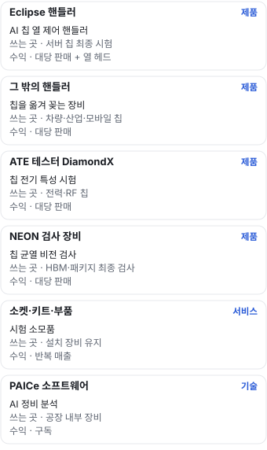

**고객 믹스(3Q26, 매출 대비)**

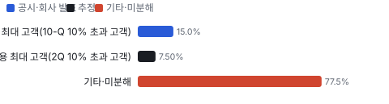

**공급 병목(10점, 낮을수록 병목)**

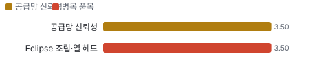

**생산능력 현재와 확충 계획(핸들러 대/년)**

**CAPEX의 매출 대비 비중**

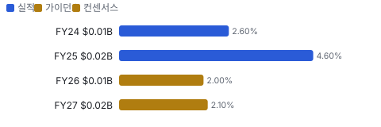

**어닝콜 변화별 주주가치 영향**

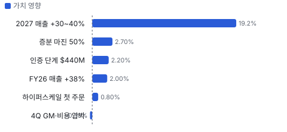

**멀티플 프리미엄**

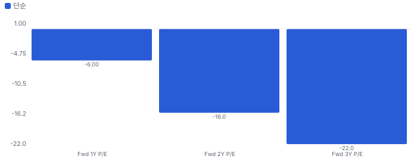

**합리적 멀티플**

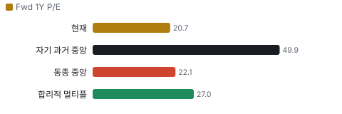

**일별 거래량 분해**

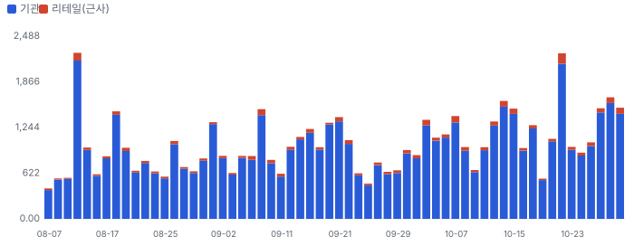

**기관 자금 흐름**

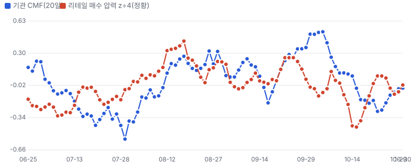

**몬테카를로**

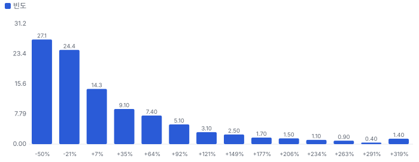

해석: 3,000번 중 1,335번(44%)에서 가치가 지금 주가 이상이었다. 지금 주가를 뒷받침하는 경우와 그렇지 않은 경우가 반반에 가깝다. 가운데 값은 0.90배이고, 열 번 중 여덟 번은 0.48~2.28배 사이에 든다.

## 내러티브

> **기업가치를 결정하는 이야기:** 기업가치는 Eclipse 파이프라인이 실제 매출로 얼마나 바뀌느냐로 정해진다. 약 \$1B 중 자격 완료는 \$230M뿐이다. 회사가 말한 2027 HPC 약 \$250M은 이 몫의 대부분을 쓴다.

> **멀티플·EPS 프리미엄**
> **멀티플:** Fwd 1Y P/E 20.7배로 동종 중앙값 약 22배보다 낮다. 성장은 더 빠른데 GAAP 적자와 후발자 위치가 프리미엄을 막는다.
> **EPS:** FY2027 EBIT 추정은 콜 전후 +40%다. EPS 프리미엄은 숫자로 나오는 중이다.

### 투자자들은 왜 열광했나

4월부터 6월까지 주가가 \$30대에서 \$70대로 올랐다. AI 칩 발열이 테스트 병목이라는 이야기와 HPC 파이프라인 공개가 겹쳤다. 10월에는 같은 업종이 함께 30~40% 빠져 열기가 식었다.

### 무엇이 기업가치를 바꾸나

> **구조적 체질 변화**
> **변화:** 시스템 주문 중 컴퓨팅이 최대가 됐다. 2Q 시스템 주문의 46%이고 3Q 10% 초과 고객도 컴퓨팅이다
> **증거:** 2Q·3Q 콜, 3Q 10-Q
> **반증:** 컴퓨팅 주문이 두 분기 연속 줄어든다

> **고부가 믹스 확장**
> **변화:** 2027 GM 46~48%, 2026 약 45%
> **증거:** 3Q 콜
> **반증:** 4Q GM이 44% 아래

> **기술 혁신**
> **변화:** 능동 열 제어, CPO(광 엔진을 칩 옆에 붙이는 패키징) 전기·광 동시 시험, NEON(Cohu의 칩 외관·내부 균열 검사 장비) 내부 균열 검사
> **증거:** 2Q·3Q 콜. 경쟁 비교 자료는 없다
> **반증:** 고전력 칩 인증 실패

> **실행 속도**
> **변화:** 납품 리드타임은 공개되지 않아 인증부터 양산까지의 주기로 잰다 **납품 리드타임 9~12개월.** 피어 비교 미확인. 이전 대비 미확인.
> **증거:** 3Q 콜: 9~12개월
> **반증:** 인증이 1Q27을 넘어간다

> **M&A**
> **변화:** 2025년 Tignis(Cohu가 2025년 인수한 AI 공정 분석 회사) 인수가 소프트웨어 사업의 바탕이 됐다. 3Q 말 현금 \$508M이나 새 인수 발표는 없다
> **증거:** 2025 10-K
> **반증:** 대형 인수로 희석

> **정책·입법 연관성**
> **재정정책:** 해당 없음(회사 공시에 지원금·세액공제 사업이 없다) 3Q 10-Q, 2025 10-K 반증: 미국 내 생산 보조금 수령
> **행정명령:** 해당 없음(이 회사를 겨냥한 행정명령을 찾지 못했다. 생산이 동남아라 관세 변화는 위험 요인이다) 2025 10-K 위험 요인 반증: 반도체 장비 품목 관세가 말레이시아 생산품에 붙는다
> **연관입법:** 해당 없음(수출 통제는 2025년 소켓 부품 공급 지연과 중국 매출 13%로 간접 연결된다) 2025 10-K, 2025 중국 매출 \$60.7M ÷ \$453.0M 반증: 대중 장비 수출 규제가 후공정으로 확대

> **CAPEX 낙수효과**
> **변화:** 고객 AI 투자가 테스트 강도를 올린다. 회사는 칩 수량보다 전력·시험 강도 덕이라고 말했다
> **증거:** 3Q 콜. 특정 고객 투자에서 Cohu 매출로 잇는 공개 숫자는 없다
> **반증:** AI 칩 시험을 고객이 줄이거나 내재화

### 내러티브 근거

> 사이클 회복주가 AI 열 관리 주식으로 다시 평가받는 중이다. 4월 이후 숫자가 따라왔지만 10월 업종 급락이 배수를 되돌렸다. 동종 대비 멀티플 차이 -6% 중 회사 고유 몫은 -23%다. 단계는 확산, 쏠림은 보통이다.

> **AI 칩 발열이 핸들러 단가를 올린다** · 강화
> **논리:** 칩 전력이 커지면 능동 열 제어가 필수가 되고 대당 가격과 열 헤드 반복 매출이 늘어난다
> **숫자:** HPC 매출 2026 약 \$120M → 2027 약 \$250M(회사 범위 상단)
> **반증:** 2027 HPC가 \$200M 아래로 내려간다

> **코어 사이클 회복** · 강화
> **논리:** 시험 가동률 82%면 코어 고객 CAPEX가 돌아온다
> **숫자:** 가동률 3Q 82%, 전년 대비 +7.5%p. 산업용 시스템 주문 전분기 대비 +52%
> **반증:** 가동률이 80% 아래로 내려간다

> **영업 레버리지** · 강화
> **논리:** 매출이 늘어도 영업비용을 묶어 이익이 빠르게 오른다
> **숫자:** 증분 약 50%, FY2027 EBIT 추정 +40%
> **반증:** 2027 분기 영업비용이 \$56M를 넘는다

> **반복 매출 하방 방어** · 유지
> **논리:** 소모품이 사이클 바닥을 받친다
> **숫자:** 3Q 반복 매출 비중 48%, 반복 주문 +36%
> **반증:** Eclipse 열 헤드 반복 매출이 2027년에도 숫자로 안 나온다

> **반대: 후발자가 2위에 머문다** · 유지
> **논리:** AI 핸들러 선두는 Hon Precision이고 Cohu는 다른 패밀리를 차지해도 규모 차가 크다
> **숫자:** 한 증권사 추정 Hon Precision AI 핸들러 점유율 70% 초과
> **반증:** NVIDIA(미국 AI 가속기 회사)급 대형 고객 인증이 공시·콜로 확인된다

> **반대: 이익의 질** · 유지
> **논리:** 조정 이익과 GAAP 이익의 차이가 크고 현금 전환이 약하다
> **숫자:** 3Q 조정 EPS \$0.43 vs GAAP \$0.22, 3Q 영업현금 \$5.6M
> **반증:** 2027 FCF가 \$100M에 근접한다

## 포트폴리오

| 제품·서비스 | 구분 | 무엇 | 쓰는 곳 | 돈 버는 방식 |
|---|---|---|---|---|
| Eclipse 핸들러 | 제품 | AI 칩 열 제어 핸들러 | 서버 칩 최종 시험 | 대당 판매 + 열 헤드 |
| 그 밖의 핸들러 | 제품 | 칩을 옮겨 꽂는 장비 | 차량·산업·모바일 칩 | 대당 판매 |
| ATE(자동 테스트 장비) 테스터 DiamondX(Cohu의 아날로그·전력 칩 테스터) | 제품 | 칩 전기 특성 시험 | 전력·RF(무선 주파수) 칩 | 대당 판매 |
| NEON 검사 장비 | 제품 | 칩 균열 비전 검사 | HBM(고대역폭 메모리)·패키지 최종 검사 | 대당 판매 |
| 소켓·키트·부품 | 서비스 | 시험 소모품 | 설치 장비 유지 | 반복 매출 |
| PAICe(Cohu의 처방형 정비 분석 소프트웨어) 소프트웨어 | 기술 | AI 정비 분석 | 공장 내부 장비 | 구독 |

## 고객

> **3Q26 최대 고객 나머지 고객 45%, 상위 3곳 100%, 집중도 집중.** 공시·회사 발표로 확인한 몫은 매출의 15%이고, 나머지 고객 몫은 추정이거나 미분해다. 분기 10% 초과 고객이 산업용에서 컴퓨팅으로 바뀌었다. 이름은 공시되지 않는다.

**고객별 매출 몫(3Q26)**
| 고객 | 몫 | 변화 | 근거 |
|---|---|---|---|
| 나머지 고객 | 40~50% | 미확인 | 추정 |
| 그 밖 상위 고객 | 35~45% | 미확인 | 추정 |
| 컴퓨팅 최대 고객(10-Q 10% 초과 고객) | 15% | 미확인 | 공시 |
| 미국 HBM 제조사 | 미확인 | 미확인 | 추정 |

> **나머지 고객** · 추정
> **사는 것:** 소모품·서비스
> **추정 근거:** 상위 10곳 밖 몫 약 40%

> **그 밖 상위 고객** · 추정
> **사는 것:** 핸들러·테스터·소켓
> **추정 근거:** 2025 상위 10곳 60%에서 빼서 잡은 범위

> **컴퓨팅 최대 고객(10-Q 10% 초과 고객)** · 공시
> **사는 것:** Eclipse 핸들러 추정
> **추정 근거:** 콜이 컴퓨팅 고객이라 밝혔다. 이름 미공개

> **미국 HBM 제조사** · 추정
> **사는 것:** HBM 최종 검사
> **추정 근거:** 콜은 미국 기반 고객이라고만 말했다. 미국 HBM 제조사는 Micron뿐이라 Micron으로 추정한다. 가설이다

## 수주·파이프라인

> **2026-09-26 기준 7건.** 건별 확정 금액은 공개되지 않았다. 공시 2025 말 수주잔고, 3Q 잔고는 미공개 \$0.17B. 서로 겹치는 항목은 합계에서 뺐다.

**실행 속도와 방해 요인**
| 항목 | 상태 | 실행 속도 | 방해 요인 |
|---|---|---|---|
| FY2026 HPC 매출 | 조건부 | 미확인 | 4분기 출하 |
| Eclipse 자격 완료 단계 | 조건부 | 2Q \$190M → 3Q \$230M | 공급사 증설 · 고객 일정 |
| Eclipse 인증 진행 단계 | 파이프라인 | 2Q \$215M → 3Q \$440M | 인증 일정 · 열 헤드 2차 인증 6~8주 · 복수 벤더 |
| Eclipse 초기 접촉 단계 | 파이프라인 | 총 약 \$1B에서 앞 두 단계를 뺀 값 | 평가 장비 확보 · 전환 주기 9~12개월 |
| AI 전력 칩 테스터 시장 | 파이프라인 | 미확인 | 12월 고전류 기능 출시 |
| HBM·첨단 패키징 검사 시장 | 파이프라인 | NEON 수주 1Q27 깊숙이 차 있다 | 1Q27 데모 장비 |
| 컴퓨팅 인터페이스 시장 | 파이프라인 | 하이퍼스케일러 2곳 첫 주문 | 양산 전환 |

## 마진 구조

> **GPM 44.5%, OPM -2.4%.** TTM 3Q25 대비 GPM +1.2%p, OPM +15.6%p. 변동비는 매출의 56%이고, 매출이 10% 늘면 OPM은 +4.3%p 움직인다. GM은 이미 45%대다. 영업이익은 원가보다 영업비용 레버리지에 달렸고, 단기 변수는 특수 부품 가격이다.

**GPM에서 OPM까지(GAAP)**
| 기간 | GPM | 연구개발 | 판관비 | 기타 | OPM |
|---|---|---|---|---|---|
| TTM 3Q25 | 43.3% | 21.1% | 28.8% | 11.4% | -17.9% |
| TTM 3Q26 | 44.5% | 17.6% | 23.5% | 5.7% | -2.4% |

**마진을 결정하는 비용 요인 — 비용 +10% 시 OPM**
| 비용 | 매출 대비 | 변화 | 고정비 | OPM |
|---|---|---|---|---|
| 자재·구매 부품 | 36.0% | 미확인 | 0% | -3.60%p |
| 판관비 | 23.5% | -5.3%p | 70% | -2.35%p |
| 연구개발비 | 17.6% | -3.5%p | 80% | -1.76%p |
| 조립·시험 인건비와 제조 간접비 | 17.5% | 미확인 | 60% | -1.75%p |
| 인수 무형자산 상각과 구조조정 | 5.7% | -5.7%p | 100% | -0.57%p |
| 재고 평가 손실 | 2.0% | 미확인 | 0% | -0.20%p |

**비용을 움직이는 요인**
| 비용 | 요인 |
|---|---|
| 자재·구매 부품(매출원가) | 특수 반도체·소켓 부품 가격과 제품 믹스 · 근거 추정 |
| 판관비(판관비) | 판매 수수료, 인력 · 근거 공시 |
| 연구개발비(연구개발) | Eclipse 열 헤드 개발 재료비 · 근거 공시 |
| 조립·시험 인건비와 제조 간접비(매출원가) | 가동률, 직접 인건비 증감 · 근거 추정 |
| 인수 무형자산 상각과 구조조정(기타) | Xcerra(Cohu가 2018년 인수한 테스트 회사) 인수 무형자산 상각 종료 · 근거 공시 |
| 재고 평가 손실(매출원가) | 수요 전망 변경 · 근거 공시 |

**시스템(핸들러·테스터·검사) BOM — 매출의 52%, GPM 46%(회사 GM, 제품 GM 미공개), 항목 가격 +10% 시**
| 항목 | 원가 몫 | 전가 | 제품 GPM | OPM |
|---|---|---|---|---|
| 기계·열 헤드 부품 | 30~40% | 미확인 | -1.9%p | -1.00%p |
| 조립·시험 노무와 간접비 | 25~35% | 0% | -1.6%p | -0.85%p |
| 특수 반도체·특수 부품 | 15~25% | 미확인 | -1.1%p | -0.57%p |
| 미분해 | 15% | - | - | - |

**반복 매출(소켓·키트·부품·서비스·소프트웨어) BOM — 매출의 48%, GPM 46%(회사 GM, 제품 GM 미공개), 항목 가격 +10% 시**
| 항목 | 원가 몫 | 전가 | 제품 GPM | OPM |
|---|---|---|---|---|
| 정밀 가공·조립 노무 | 35~45% | 0% | -2.2%p | -1.03%p |
| 소켓 핵심 소재·스프링 핀 | 25~35% | 미확인 | -1.6%p | -0.78%p |
| 서비스 인력·소프트웨어 호스팅 | 20~30% | 미확인 | -1.4%p | -0.65%p |
| 미분해 | 5% | - | - | - |

판매가 전가를 모르는 항목은 전가 0%로 계산했다.

**BOM 항목 가격을 움직이는 것**
| 항목 | 요인 |
|---|---|
| 특수 반도체·특수 부품 | AI 수요가 같은 부품을 끌어간다 · 근거 추정 |
| 기계·열 헤드 부품 | 전력 밀도가 커질수록 열 헤드가 비싸진다 · 근거 추정 |
| 조립·시험 노무와 간접비 | 말레이시아 인건비, 가동률 · 근거 추정 |
| 소켓 핵심 소재·스프링 핀 | 규제와 소수 공급사 · 근거 추정 |
| 정밀 가공·조립 노무 | 가동률이 3Q GM 개선을 이끌었다 · 근거 추정 |
| 서비스 인력·소프트웨어 호스팅 | 현장 인력, 고객 내부 장비 · 근거 추정 |

**BOM 투입 물가 — PPI 전년비, 2026-11-02 수집**
| 항목 | 미국 | 일본 | 한국 | 대만 |
|---|---|---|---|---|
| 특수 반도체·특수 부품 | -2.2% | +3.9% | +134.0%* | +21.9%* |

별표는 품목보다 넓은 업종 지수다. 지난 1년 투입 물가를 판매가 전가 뒤 원가에 그대로 넣으면 OPM은 -0.05%p 움직인다(매출원가의 10% 기준).

## 공급망 병목

> **공급망 신뢰성 3.5/10, 병목 심각.** 가장 약한 고리는 Eclipse 조립·열 헤드 3.5점이고, 품목 평균은 3.5점이다. 근거가 부족한 3건(특수 반도체·특수 부품 · ATE 위탁 생산 · 소켓 핵심 소재·스프링 핀)은 점수에서 뺐다. 회사는 아직 제약은 아니라고 답했다. 3배 증설의 약한 고리는 특수 부품과 Jabil(미국 전자제품 위탁 생산사) 단일 위탁 생산이다.

**병목과 마진 — 품목 가격 +10% 시 OPM**
| 품목 | 점수 | 판정 | 구분 | OPM |
|---|---|---|---|---|
| Eclipse 조립·열 헤드(필수) | 3.5 | 병목 심각 | 출하 차질 위험 | 미확인 |

> **Eclipse 조립·열 헤드** · 3.5/10
> **왜:** 말레이시아 한 곳에 몰려 있다
> **병목 요인:** 인증 공급사 1곳 · 캐파 빠듯 · 리드타임 미확인 · 재인증 미확인 · 1위 점유율 미확인 · 말레이시아 집중 100% · 물량 확보 내재화
> **풀리는 조건:** 2027년 중반 증설 완료 예정, 출하로 확인 전에는 풀렸다고 쓰지 않는다

**공급사**
| 품목 | 공급사 | 몫 | 근거 |
|---|---|---|---|
| 특수 반도체·특수 부품 | 미공개(핸들러용 반도체·특수 부품) | 미확인 | 회사 발표 |
| ATE 위탁 생산 | Jabil(페낭 전용 라인, 테스터 대부분 생산) | 100% | 공시 |
| Eclipse 조립·열 헤드 | Cohu 믈라카 공장(자체 조립) | 100% | 공시 |
| 소켓 핵심 소재·스프링 핀 | 미공개(소켓 핵심 부품) | 미확인 | 공시 |

**무역 통계로 본 공급 지역**
| 품목 | EU 수입처 | 일본 수입처 | EU 1위 전년비 |
|---|---|---|---|
| 특수 반도체·특수 부품 | TW(대만) 32% · MY(말레이시아) 19% · CN(중국) 15% | 台湾 60% · 中華人民共和国 8% | +136.5% |

## 생산능력

> **현재 명목 캐파 2,000 핸들러 대/년, 가동률 미확인.** 착공 이상 증설은 0 핸들러 대/년, 발표까지 합치면 0 핸들러 대/년이다. 다 가동하면 지금보다 +0%, 착공 이상만이면 +0%다. FY25 CAPEX는 \$0.02B로 매출의 4.6%다. 핸들러 전체로 2027년 2,000대 넘게 낼 수 있다고 회사가 말했다. 가동률은 공개하지 않았다.

**생산능력 확충 계획**
| 계획 | 단계 | 증설 | 가동 시점 | CAPEX |
|---|---|---|---|---|
| 믈라카 Eclipse 증설 | 착공 | 미확인 | 2027-06 | 미확인 |
| 필리핀 공장 증설 | 발표 | 미확인 | 미확인 | 미확인 |

남은 계획의 CAPEX 합계는 \$0.00B(금액 미확인 2건 제외)다. 합계는 FY27 매출의 0%다.

**증설 방해 요인**
| 계획 | 방해 요인 |
|---|---|
| 믈라카 Eclipse 증설 | 공급사 동반 증설, 특수 부품 |
| 필리핀 공장 증설 | 미확인 |

**CAPEX와 매출 대비**
| 기간 | CAPEX | 매출 | 매출 대비 | 구분 |
|---|---|---|---|---|
| FY24 | \$0.01B | \$0.40B | 2.6% | 실적 |
| FY25 | \$0.02B | \$0.45B | 4.6% | 실적 |
| FY26 | \$0.01B | \$0.62B | 2.0% | 가이던스 |
| FY27 | \$0.02B | \$0.82B | 2.1% | 컨센서스 |

## 해자

> 해자는 설치 기반과 열 제어 기술에 있지만 AI 핸들러에서는 후발자다. 도전자의 해자이지 지키는 쪽의 해자가 아니다.

> **디바이스 패밀리 단위 잠금** · 보통
> **해자:** 한 디바이스 패밀리를 인증받으면 그 패밀리 물량을 통째로 가져간다. 재인증에 9~12개월이 걸려 바꾸기 어렵다
> **근거:** CEO가 3Q 콜에서 지금까지 패밀리 분할이 거의 없었다고 답했다. 다만 경험이 짧다고 스스로 밝혔다
> **숫자:** 인증부터 양산까지 9~12개월
> **깨지는 조건:** 같은 패밀리에서 고객이 Hon Precision과 물량을 나눈다

> **능동 열 제어 기술** · 보통
> **해자:** 칩 온도를 시험 중에 빠르게 맞춰 수율과 품질을 높인다. 칩 발열이 커질수록 값이 커진다
> **근거:** 회사 자료 기준 T-Core(Cohu의 능동 열 제어 기술)는 최대 3kW를 다룬다. 독립 측정치는 미확인이고 경쟁사 사양과 맞댄 공개 비교도 없다
> **숫자:** 최대 3kW(회사 발표)
> **깨지는 조건:** 경쟁사가 같은 전력 밀도를 먼저 양산 인증받는다

> **설치 기반과 소모품** · 강함
> **해자:** 수천 대 설치 기반에서 키트·소켓·부품·열 헤드를 반복해 판다
> **근거:** 3Q 매출의 48%, 2Q 53%가 반복 매출이다. 2025 상위 10개 고객 60%
> **숫자:** 3Q 반복 매출 \$82.3M
> **깨지는 조건:** 시스템 없이 소모품만 다른 회사로 넘어간다

> **제품 폭** · 약함
> **해자:** 핸들러·테스터·소켓·검사·소프트웨어를 한 회사가 판다
> **근거:** 경쟁사 Advantest·Teradyne이 규모에서 훨씬 크다. 희석 시가총액 \$2.44B vs Teradyne \$40.7B
> **숫자:** 매출 \$0.57B vs Teradyne \$5.0B
> **깨지는 조건:** 교차 판매 숫자가 공개되지 않으면 해자로 볼 근거가 약하다

## 경영진·네트워크

> 창업 가문이 없는 전문경영인 회사다. CEO는 15년 넘게 반도체 장비 사업을 맡았고, 최근 장내 매도가 눈에 띈다.

> **Luis Müller** · 사장·CEO · 2014-12
> **프로필:** 56세. 2011~2014년 반도체 장비 그룹 사장을 지낸 뒤 CEO. 2026년 9~10월 공시 장내 매도 약 \$6.7M
> **비즈니스:** 제3자 요약 기준 2021년부터 Celestica(캐나다 전자제품 위탁 생산사) 이사. 최신 위임장 대조는 미완료
> **정계:** 미확인
> **동문:** 미확인
> **사모임:** 미확인

> **James A. Donahue** · 비상임 이사회 의장 · 미확인
> **프로필:** 제3자 요약 기준 비상임 의장. 2024년 자료라 최신 위임장 대조가 필요하다
> **비즈니스:** 미확인
> **정계:** 미확인
> **동문:** 미확인
> **사모임:** 미확인

**네트워크 정량화**
| 연결 | 강도 | 닿는 매출 | 가중 노출 | 매출 대비 | 근거 |
|---|---|---|---|---|---|
| 비즈니스: CEO의 Celestica 이사 겸직 | 2/5 | \$0.00B | \$0.00B | 0% | Cohu와 Celestica 간 매출 관계는 공개 자료에서 찾지 못했다 공개 프로필, 최신 위임장 미대조 |

가중 노출은 연결이 닿는 매출의 크기다. 연결이 그 매출을 만들었다는 뜻이 아니며, 인과는 공개 자료로 입증하지 못한다.

## 약세 논리 및 셀온 조건

| 약세 논리 | 근거 | 반박 | 가를 자료 |
|---|---|---|---|
| 후발자는 선두를 못 넘는다 | 한 증권사 추정으로 Hon Precision이 AI 핸들러 점유율 70% 초과. 재인용 자료라 검증 필요 | 회사는 다른 디바이스 패밀리를 통째로 가져왔고, 대형 칩 고객은 복수 공급을 원한다. 이것도 회사 말이다 | Hon Precision 월매출, 2027 고객 수 |
| 약 \$1B는 수주가 아니다 | 연간 기회 추정이고 확정 수주 금액은 공개되지 않았다. 자격 완료는 \$230M | 2Q \$190M → 3Q \$230M, 인증 진행 \$215M → \$440M로 단계가 움직인다 | 3Q 대비 4Q 단계별 금액, 수주잔고 |
| 이익의 질이 낮다 | 3Q 조정 EPS \$0.43 vs GAAP \$0.22. TTM GAAP 영업이익 −\$13.6M. 3Q 영업현금 \$5.6M | 차이의 큰 몫은 SBC와 인수 무형자산 상각이고, Xcerra 관련 상각은 줄고 있다 | FY2027 FCF 컨센서스 \$103M 달성 경로 |
| 사이클 고점 배수일 수 있다 | 동종이 한 달 만에 30~40% 빠졌다. 원인 미확인이라 재발을 막을 근거도 없다 | FY2027 EPS 기준 약 17배이고 3Q 가동률 82%는 회복 초기다 | 가동률, 고객 CapEx 코멘트 |
| 내부자가 판다 | 최근 공시 장내 거래가 매수 0, 매도 41건이고 CEO 9~10월 약 \$6.7M | 사전 매도 계획 여부를 확인하지 못했다. 주가 급등 뒤 매도라 정보 신호라고 단정할 수 없다 | Form 4 각주 |

> **셀온 조건**
> **조건 1:** 2027 HPC 매출 전망이 \$200M 아래로 낮아진다
> **조건 2:** 11월 말~1Q 예정 인증 5개 중 3개 이상이 2Q 이후로 밀린다
> **조건 3:** 같은 디바이스 패밀리에서 물량을 나눠 준다는 회사 발언이나 1차 자료가 나온다
> **조건 4:** 4Q GM이 44% 아래이고 2027 GM 46~48%가 낮아진다
> **조건 5:** 새 중기 모델에 대규모 주식 발행이나 희석성 인수가 들어간다

## 어닝콜 변화

**직전 콜 대비 새로 나오거나 바뀐 내용 → 가치 영향**
| 항목 | 내용 | 직전 콜 | 최신 콜 | 모델 동인 이동 | 확신도 | 가치 영향 |
|---|---|---|---|---|---|---|
| 업데이트 | FY2026 매출 전망 | 약 +35%, HPC \$100~110M | 약 +38%, HPC 약 \$120M | 기준연도 매출 +\$0.01B | 0.8 | +2.0% |
| 신규 | 2027 매출 틀 | 회사 전망 없음, 콜 전 추정 +22% | +30~40%, 상단은 인증 시점에 달렸다 | 1년차 성장률 +13.0% | 0.8 | +19.2% |
| 신규 | 2027 이익 틀 | 순차 증분 약 40% | GM 46~48%, 증분 매출의 약 50%가 영업이익 | 목표 이익률 +3.0% | 0.8 | +2.7% |
| 업데이트 | Eclipse 인증 단계 | 총 \$850M, 자격 완료 \$190M, 인증 중 \$215M | 총 약 \$1B, 자격 완료 \$230M, 인증 중 \$440M | 성장 지속(감속 계수) +3.0% | 0.5 | +2.2% |
| 부정 | 단기 원가·비용 | 3Q GM 45.7%, 분기 영업비용 \$50M대 초반 | 4Q GM 약 44%, 영업비용 약 \$57M | 출발 이익률 -1.0% | 0.8 | -0.3% |
| 신규 | 신규 고객 확장 | 언급 없음 | 하이퍼스케일러 2곳 인터페이스 첫 주문, 시장 약 \$200M | 장기 성장 수렴값 +0.20% | 0.3 | +0.8% |
| **합계** | 단독 합 |  |  | 동시 적용 +26.7% |  | **+26.7%** |

**사건별 EPS 리비전**
| # | 날짜 | 구분 | 사건 | CY2026 EPS 전→후 | CY2027 EPS 전→후 | 리비전 | 주가 반응 |
|---|---|---|---|---|---|---|---|
| ① | 26-02-12 | 실적 | 4Q25 실적, EPS 적자 | \$0.76 → \$0.57 | \$1.23 → \$1.17 | -4.6% | -6.7% |
| ② | 26-04-30 | 실적 | 1Q26 실적 | \$0.55 → \$0.60 | \$1.17 → \$1.52 | +29.3% | -3.7% |
| ③ | 26-07-30 | 실적 | 2Q26 실적, HPC \$100~110M | \$0.60 → \$0.97 | \$1.57 → \$1.73 | +10.6% | +3.3% |
| ④ | 26-10-28 | 실적 | 3Q26 실적, 2027 틀 제시 | \$0.92 → \$1.08 | \$1.63 → \$2.77 | +69.6% | +0.5% |

**해석:** 3개 구간 누적 주가 +47% = EPS 리비전 +65% × 멀티플 -11%. 더 크게 움직인 쪽은 **EPS 리비전**이다.

## 밸류에이션

> **목표주가 \$60, 업사이드 +24%.** 자리는 기본 시나리오이고 도달 확률은 약 49%다. 기본 \$59, 강세 \$95(+97%), 약세 \$31(-35%). DCF 기준 업사이드는 기본 -7%, 강세 +106%, 약세 -46%다(WACC 10.9%).

DCF가 시나리오와 다른 까닭은 이익률 기준이다. DCF는 SBC 4%를 비용으로 빼고 장기 이익률을 19%로 묶지만, P/E 시나리오는 조정 EPS를 쓴다. 그래서 DCF 업사이드는 −7%이고 목표주가 업사이드는 +24%다. 이 차이가 곧 이익의 질 쟁점이다.

> **약세 \$31 (-35%)** · 확률 25%
> **가정:** 18.5배 × EPS \$1.70
> **근거:** 2027 매출 약 +20%, GM 45%, 분기 영업비용 \$58M. 인증이 2H로 밀리고 코어 회복이 멈춘다. 콜 전 EPS 추정 \$1.63과 비슷하다

> **기본 \$59 (+22%)** · 확률 50%
> **가정:** 24.6배 × EPS \$2.40
> **근거:** 매출 약 +30%로 틀의 하단에 가깝고 GM 46.5%. 지금 집계 \$2.33과 비슷하며 회사 틀 중간값보다 보수적이다

> **강세 \$95 (+97%)** · 확률 25%
> **가정:** 30.8배 × EPS \$3.10
> **근거:** 매출 +40%, GM 48%, 분기 영업비용 \$56M. 회사 틀 상단이고 7개 프로그램이 일정대로 간다

**멀티플 선정 — Fwd 1Y P/E**
| 단계 | 조정 | 근거 |
|---|---|---|
| 동종 중앙값 | 22.1배 | 범위 18.4~27.0배, 4곳 |
| 펀더멘털 | +11% | 성장·이익률·ROIC로 본 합리적 멀티플 27.0배와의 차이의 일부만 인정 |
| 해자 | +6% | 디바이스 패밀리 단위 잠금 보통 · 능동 열 제어 기술 보통 · 설치 기반과 소모품 강함 · 제품 폭 약함 |
| 내러티브 | +5% | 단계 확산 |
| 사이클·실행 판단 | -10% | 동종보다 성장은 빠르지만 TTM GAAP 영업이익이 적자이고 AI 핸들러 매출의 절반 이상이 아직 인증 단계다. 사이클·실행 할인을 조금 둔다. |
| **선정** | **24.6배** | 지금 20.7배 |

**동종 레인지**
| 회사 | Fwd 1Y P/E | Fwd 2Y P/E | Fwd 3Y P/E | 성장 | 영업이익률 | ROIC |
|---|---|---|---|---|---|---|
| TER | 27.0 | 21.4 | 19.2 | 16% | 30% | 39% |
| FORM | 21.0 | 16.5 | 14.0 | 28% | 31% | 32% |
| CAMT | 23.2 | 17.4 | 15.7 | 44% | 33% | 24% |
| ONTO | 18.4 | 16.4 | - | 52% | 33% | 20% |
| **Cohu** | 20.7 | 14.2 | 12.2 |  |  |  |

지금 주가가 요구하는 5년 매출 CAGR 17%, 기본 시나리오 15%. 몬테카를로 중앙값 업사이드 -10%.

> 의사결정 보조(투자자문 아님): ① 매수 매력: 연 기대수익 +14.1% (자기자본비용 10.9% 대비 +3.2%p) · 자본비용 초과 확률 43% · 안전마진 0.48 → 정량 신호 약함 / ② 위험 예산 지표(이론): 1/4 켈리 10.0% (상한 10%) · 5년 하위10% -26% · 30%+ 손실 확률 8% / ③ 상방(5년): 기대 1.93배 · 2배 33% · 3배 17% · 10배 0% · 상위10% 3.74배

투입 물가 점검: 지난 1년 PPI(생산자물가지수)를 BOM에 넣으면 OPM -0.05%p다(매출원가의 10% 기준).

## 시장 평가

> **셀사이드(IB 애널리스트)**
> **한 줄:** 셀사이드는 이미 강세로 기울어 있다. 새 정보는 Investor Day 숫자다
> **의견 분포:** Strong Buy 7·Buy 1·Hold 1 — 9명 중 8명 긍정
> **목표가:** 평균 \$76, 범위 \$65~\$90 — 콜 뒤 Jefferies \$74→\$90, B. Riley \$69→\$75, Baird \$83
> **FY2027 EBIT 추정:** \$121M → \$169M — 같은 2명, 콜 전후 +40%

> **바이사이드(기관 투자자)**
> **한 줄:** 새로 들어온 돈도 있지만 내부자는 파는 쪽이다. 매도 계획 공시 여부는 미확인
> **13F 기관:** 321곳, 2Q 순 −4.7M주 — 증가 80·감소 102
> **내부자 장내:** 매수 0·매도 41건 — CEO 9~10월 약 \$6.7M
> **펀드 레터:** abrdn 2개 펀드 신규, Sycamore 일부 축소 — 핵심 논리는 코어 회복 + HPC

> **언론·업계**
> **한 줄:** 회사 사건보다 업종 수급이 주가를 움직였다
> **보도 초점:** 실적·목표가 상향 — 10월 급락의 회사 고유 원인은 찾지 못했다

## 체크리스트

| 시점 | 무엇 | 의미 |
|---|---|---|
| 2026-11-10 | Investor Day, 새 중기 재무 모델 | 중기 영업이익률과 Eclipse 시장 점유 목표 |
| 2026-11-12 | Baird 산업 콘퍼런스 | Investor Day 뒤 첫 질의 |
| 2026-11 말~2027-1Q | 5개 프로그램 인증, 2개 시작 | 약 \$340M 연 시스템 매출의 전환 여부 |
| 2026-12 | DiamondX 고전류 기능 출시 | AI 전력 시장 약 \$290M 진입 |
| 2027-01-14 | Needham 성장 콘퍼런스 | 인증 진행 상황 |
| 2027-02 중순(예상) | 4Q26 실적 | 4Q GM 44%, HPC \$120M 달성, 2027 틀 유지 |
| 2027-02 말(예상) | FY2026 10-K | 10% 초과 고객, 수주잔고, 구매 약정 문구 |

## 출처
- 2025 10-K
- 3Q 10-Q, 콜
- 3Q 콜
- 3Q 콜, 시장 규모
- 3Q 콜, 시장 규모이지 수주가 아니다
- 10-K
- 10-K 원가 구성 설명
- 10-K 필리핀·일본·싱가포르 공장
- 10-K: 2025년 규제로 소켓 핵심 부품 공급 제약
- 10-Q 매출원가 구성 설명
- 10-Q: 9M26 \$7.8M, 9M25 \$4.1M
- 10-Q는 항목별 금액을 공개하지 않는다
- 10-Q는 항목별 금액을 공개하지 않는다. 범위 추정
- 3Q 콜은 이 항목의 리드타임과 원가 상승만 말했다
- Income statement
- 3Q 콜, 2027 증설 반영 전체 핸들러 기준
- 3Q 콜: 연말 주간 출하 2배, 2027 출하 3배 목표

_구매 등급·목표주가 모두 규칙이 계산한 모델 값으로, 개인의 보유 종목·자금 사정을 반영하지 않는다 · 공개 자료 기반 분석이며 투자 권유가 아님 · 1차 판정, 미검증 · Chiip ten-bagger_