# 텐배거 리포트 2026-11-03 — Monolithic Power Systems — 이익 추정은 1년 새 두 배가 됐는데 배수는 72배에서 30배로, 지금 가격은 +40%대 성장이 2028년 이후까지 가는지를 묻는다

> 2026-11-03 · Monolithic Power Systems(MPWR) · 기업: 데이터센터·차량·산업용 전력 관리 반도체(전압 조정기·전원 모듈) 팹리스 설계사

## Chiip View

3Q 매출이 처음 \$1B를 넘은 \$1.2B(+63%)였고, 엔터프라이즈 데이터는 \$506.7M(+164.6%)였다. 회사는 이 시장 성장 바닥을 +130%에서 +150%로 올렸다. 주가는 5월 고점 근처 \$1,700에서 11/2 \$1,243.95로 내려왔고 Fwd 1Y P/E는 72배(4월 말)에서 30배가 됐다. 떨어진 것은 이익이 아니라 배수다. **우리가 다르게 보는 곳은 '이익의 높이'가 아니라 '고성장의 길이'다.** 다음 4개 분기 EPS \$43.42를 그대로 받아도 엔진이 고른 합리적 배수는 24.7배라 목표주가는 \$1,017(−18%)이고, DCF는 지금 가격이 5년 매출 CAGR 48%를 요구한다고 계산한다(기본 시나리오 19%). 회사 캐파 로드맵(\$6B → 2H27 \$8B → \$10B)이 그 길이를 받치는 유일한 1차 근거다. 위쪽 지렛대는 애널리스트 2027 EPS 평균(\$37.15)이 3Q 전 값에 묶여 있어 올라올 여지가 있다는 점이고, 아래쪽은 현금 전환(3Q 영업현금은 비GAAP 순이익의 72%)이다.

## 대시보드
| 항목 | 값 | 설명 |
|---|---|---|
| 주가 | \$1,243.95 | 고점 대비 -26% · 1년 +24% |
| 시가총액 | \$61.20B | EV \$60.11B |
| 업사이드 | -18% | 목표주가 \$1,017 · 다운사이드 -49% · 손익비(강세÷약세) 0.6 |
| 구매등급 | Neutral | 애널리스트 14명: Strong Buy 11 · Buy 2 · Neutral 1 · Sell 0 · Strong Sell 0 |
| 멀티플 | Fwd 1Y P/E 30.1배 | 동종 중앙값 25.6배 |
| 가이던스 4Q26 | \$1,350M | 컨센서스 \$1,354M |
| 알파 | 5.8/10 | 텐배거 가능성 점수 |
| 이벤트 | 4Q26 실적(예상일, 회사 미발표) — 2027 엔터프라이즈 데이터 성장률·캐파 램프 | 2027-02-05 |

## 한 장 요약
- **기업가치를 결정하는 내러티브** Monolithic Power Systems(MPS(Monolithic Power Systems 약칭))는 서버·AI(인공지능) 가속기·차량·통신 장비에 들어가는 전원 칩과 전원 모듈을 설계하는 팹리스 회사다. 자체 공정을 파운드리에 심어 만든다.
- **밸류에이션 모델로 본 주가 상방은 어디까지인가?** **목표주가 \$1,017(-18%), 약세와 기본 사이(약세 쪽 11%)다.** 강세 \$1,607(+29%)는 Fwd 1Y P/E 30.9배를 강세 EPS에 적용한 값이다. 기본 \$1,063, 약세 \$630. 손익비 0.6, DCF 기준 업사이드 -61%.
- **누가 사 주나?** 최대 고객 유통사 A(10-Q Distributor A) 27%, 상위 3곳 51%. 공시·회사 발표로 확인한 몫은 42%다.
- **마진과 공급망은 어디가 약한가?** GPM 55.3%, OPM 29.5%. OPM을 가장 흔드는 BOM(제품 원가를 이루는 부품·재료 명세) 항목은 전력단·컨트롤러 다이(BCD(아날로그·전력 소자를 한 칩에 만드는 공정) 웨이퍼)이고 가격 +10%에 -1.73%p다. 공급망 신뢰성은 7.4/10(관리 가능)이고 가장 약한 고리는 전력단·컨트롤러 다이(BCD 웨이퍼)다.
- **생산능력은 얼마나 늘어나나?** 현재 명목 캐파 6 연 매출 지원 \$B, 착공 이상 증설 0 연 매출 지원 \$B. FY28 CAPEX는 매출의 5.6%다.
- **지금 가격은 무엇을 가정하나?** Fwd 1Y P/E 30.1배로 동종 5곳 중앙값 약 25.6배보다 약 17% 높다. 엔진의 합리적 배수는 24.7배다(펀더멘털 −15%, 해자 +11%). 다음 4개 분기 EPS는 \$43.42(컨센서스)이고, 애널리스트 평균 분기 추정을 더하면 약 \$34.1이지만 3Q 발표 전(10/16) 값이다. DCF로 보면 지금 가격은 5년 매출 CAGR 48%를 요구한다. 시가총액은 약 \$60.7B(11/2 종가 × 9/30 발행주식 48.792M, 대시보드 \$61.20B는 완전 희석 49.2M 기준), 순현금 \$1.09B다.
- **왜 움직였나?** 세 구간이다. 4월 \$1,100에서 5월 말 \$1,700 근처까지는 AI 서버 전원 모듈과 1Q 실적이 이끈 재평가다. 6월 하순 하루 −8.5%(6/26, 거래량 3.4M)를 지나 하락이 시작됐고 원인은 확인하지 못했다. 7/30 2Q 실적 다음 날 +8.3%가 있었지만 9월 중순 \$1,142까지 밀렸다. 10/29 3Q 실적 뒤에는 \$1,199에서 11/2 \$1,244로 소폭 올랐다. 이익 추정은 계속 올랐고 떨어진 것은 배수다.
- **3Q 콜에서 무엇이 바뀌었나?** 엔터프라이즈 데이터 성장 바닥이 +130%에서 +150%로 올랐다. 캐파는 연 매출 \$6B를 넘었고 2H27 \$8B, 장기 \$10B를 처음 숫자로 냈다. 자동차 48V(차량·서버 48볼트 전원 구조) 첫 주문, 로봇 램프, 첫 대형 데이터 컨버터 디자인윈이 새로 나왔다. 나빠진 것은 스토리지·컴퓨팅 전분기 대비 −3.8%(노트북 메모리 제약)와 웨이퍼 원가 일부 흡수다. CFO가 Tony Balow(MPS CFO Tony Balow)로 바뀌었다.
- **회사는 쟁점에 뭐라고 답했나?** 현금 전환 쟁점은 Baird가 재고를 물었다. 신임 CFO는 유통 재고가 정상 범위(5~8주)의 낮은 쪽이고, 내부 재고는 금액이 늘었지만 매출이 빨리 늘어 재고일수는 낮아졌으며 재고가 사업을 제한하지 않는다고 답했다. 매출채권 증가(DSO(매출채권 회수 일수) 32일 → 35일)에 대한 회사 답변은 없다. 2027 성장률은 '아직 이르다'며 제시하지 않았다.
- **무엇이 바뀌면 판단이 달라지나?** 4Q 실적에서 2027 엔터프라이즈 데이터 성장 가이드가 +60% 이상이고, 애널리스트 2027 EPS 평균이 \$45 위로 올라오며, 영업현금이 비GAAP 순이익의 90%를 넘으면 목표주가 산정의 시나리오·DCF 요인이 함께 오른다. 반대로 2027 성장 가이드가 +50% 아래이거나, 큰 GPU(그래픽 처리 장치(AI 가속기))·ASIC(특정 고객용 맞춤형 칩) 플랫폼에서 다른 전원 방식으로 소켓을 잃었다는 확인, 중국향 전력 IC(집적회로) 규제가 나오면 약세 쪽이다.

## 한눈에 보기

**일봉**

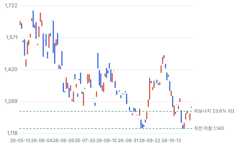

**주봉**

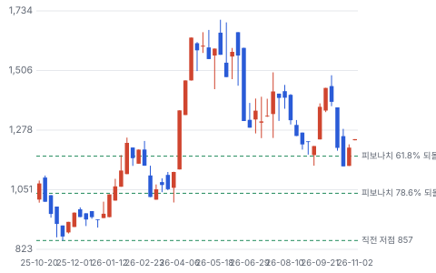

**월봉**

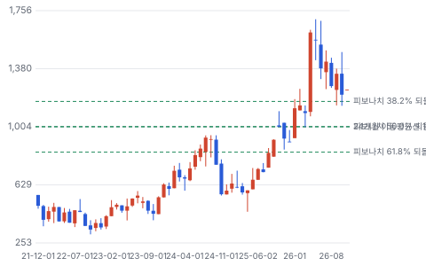

**분기 매출·EPS 실적과 컨센서스**

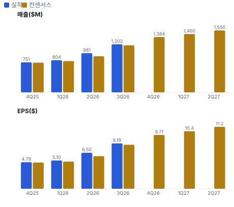

**최근 4개 분기 주가 변화 분석**

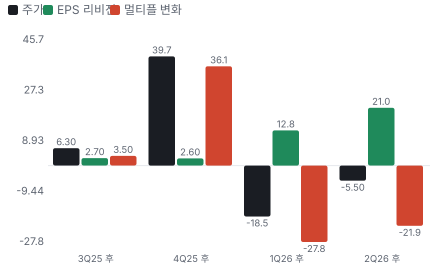

**EPS 리비전**

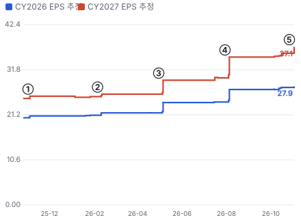

① 25-10-30 3Q25 실적 · EPS 리비전 +2%
② 26-02-05 4Q25 실적, 1Q 가이던스 · EPS 리비전 +2%
③ 26-04-30 1Q26 실적, EPS 상회 · EPS 리비전 +13%
④ 26-07-30 2Q26 실적, ED 바닥 +130% · EPS 리비전 +16%
⑤ 26-10-29 3Q26 실적, 캐파 \$8B 제시 · EPS 리비전 +4%

**밸류에이션 주가 시나리오**

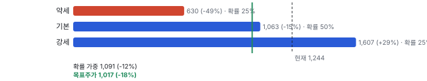

**주가별 업사이드**

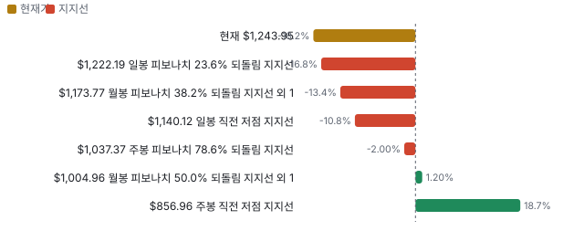

**제품·서비스 포트폴리오**

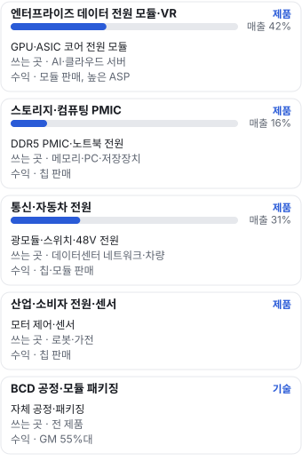

**고객 믹스(1H26, 매출 대비)**

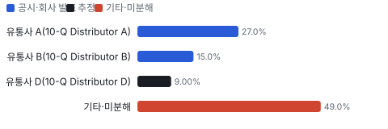

**공급 병목(10점, 낮을수록 병목)**

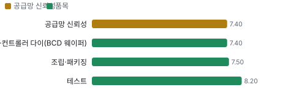

**생산능력 현재와 확충 계획(연 매출 지원 \$B)**

**CAPEX의 매출 대비 비중**

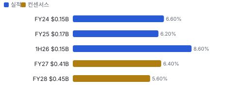

**어닝콜 변화별 주주가치 영향**

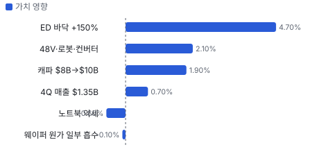

**멀티플 프리미엄**

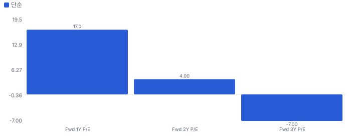

**합리적 멀티플**

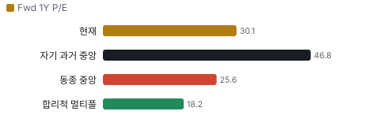

**일별 거래량 분해**

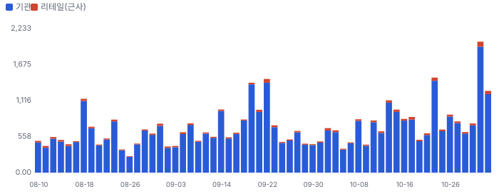

**기관 자금 흐름**

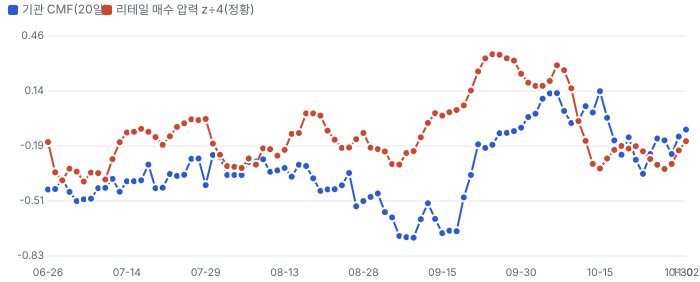

**몬테카를로**

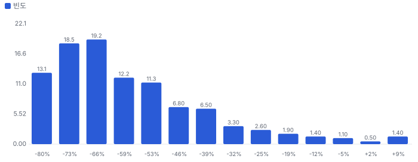

해석: 3,000번 중 52번(2%)에서 가치가 지금 주가 이상이었다. 가정을 흔들어도 지금 주가를 뒷받침하지 못하는 경우가 더 많다. 가운데 값은 0.37배이고, 열 번 중 여덟 번은 0.23~0.69배 사이에 든다.

## 내러티브

> **기업가치를 결정하는 이야기:** 기업가치는 엔터프라이즈 데이터 고성장(+150% 바닥)이 2027년에도 이어지고, 그 위에 통신·자동차·로봇이 얹히느냐로 정해진다. 2027 EPS 추정이 \$37~47로 넓게 퍼져 있어 배수보다 이익의 높이가 먼저다.

> **멀티플·EPS 프리미엄**
> **멀티플:** Fwd 1Y P/E 30.1배로 동종 5곳 중앙값 약 25.6배보다 약 17% 높다. 다음 4개 분기 매출 성장은 +62%로 동종(ADI(Analog Devices) +33%, TXN(Texas Instruments) +24%)보다 훨씬 빠르다.
> **EPS:** FY2027 EPS 추정은 2Q 뒤 8/4 \$30.57에서 11/2 \$37.15로 +21.5% 올랐고, 컨센서스은 \$46.9다.

### 투자자들은 왜 열광했나

2026년 4월 \$1,100에서 5월 말 \$1,700까지 +55% 올랐다. AI 서버 전력 모듈과 ED(엔터프라이즈 데이터(서버·AI) 최종시장) 성장 바닥(+130%)이 이끌었다. 6월 이후 실적이 계속 컨센서스를 넘었는데도 주가는 −27%다. 이익 추정은 올랐고 배수가 72배에서 30배로 줄었다. 매수자는 '얼마나 오래 이어지나'를 묻고 있다.

### 무엇이 기업가치를 바꾸나

> **구조적 체질 변화**
> **변화:** 소비자·PC(개인용 컴퓨터) 전원 회사에서 AI 서버 전원 회사로 바뀌었다. 엔터프라이즈 데이터 비중이 3Q25 26.0%에서 3Q26 42.1%가 됐다
> **증거:** 3Q 실적 자료 최종시장별 매출
> **반증:** ED 비중이 두 분기 연속 줄어든다

> **고부가 믹스 확장**
> **변화:** 칩보다 비싼 모듈 비중이 커진다. ASIC 고객이 주로 모듈을 쓴다. 다만 GM(매출총이익률)은 55%대에서 거의 그대로다
> **증거:** 3Q 콜
> **반증:** GM이 55% 아래로 내려간다

> **기술 혁신**
> **변화:** 800V(데이터센터 800볼트 직류 배전)용 GaN(질화갈륨 전력 반도체) 샘플링, 고속 메모리(RCD(메모리 모듈 클록 버퍼)·클록), 데이터 컨버터를 내놨다. 매출은 2027~2028년부터다
> **증거:** 3Q 실적 자료
> **반증:** GaN 신뢰성 검증 지연

> **실행 속도**
> **변화:** 납품 리드타임은 공개되지 않는다. 대신 내부 재고일수(다음 분기 매출 기준)로 공급 여력을 근사한다: 3Q25 137일 → 3Q26 117일. 매출이 빨리 늘어 재고 쿠션이 얇아졌지만 회사는 재고가 사업을 제한하지 않는다고 했다 **납품 리드타임 117일.** 피어 비교 미확인. 2025-09 137일보다 15% 짧다.
> **증거:** 3Q 실적 자료 재고 표
> **반증:** 공급 부족으로 출하가 늦었다는 회사 발언

> **M&A**
> **변화:** 해당 없음(소규모 기술 인수뿐, 영업권 \$25.9M)
> **증거:** 3Q 재무상태표
> **반증:** 대형 인수 발표

> **정책·입법 연관성**
> **재정정책:** 해당 없음(보조금·재정 지원 공시 없음) 10-K·10-Q 반증: 미국 반도체 보조금 수령 공시
> **행정명령:** 미·중 무역 조치가 핵심 위험이다. FY2025 매출의 55%가 중국으로 출하됐다(최종 사용처와 다를 수 있다). 이 회사를 겨냥한 행정명령은 확인하지 못했다 FY2025 10-K 지역별 매출 반증: 중국향 전력 IC 수출 제한·관세 발표 의회 동의 2/10 — 하원 1/5(MPS 관련 하원 의결 기록을 찾지 못했다) · 상원 1/5(같음).
> **연관입법:** 해당 없음(이 회사를 직접 겨냥한 법안을 찾지 못했다. 로비 공시는 키가 없어 미확인) 로비 조회 미확인 반증: 아날로그 반도체 대중 수출 제한 법안 발의

> **CAPEX 낙수효과**
> **변화:** 하이퍼스케일러 AI CAPEX가 서버 전원 모듈 주문으로 온다. 특정 고객 투자에서 MPS 매출로 잇는 공개 숫자는 없다
> **증거:** 3Q 콜
> **반증:** 하이퍼스케일러 2027 CAPEX 가이던스 감소

### 내러티브 근거

> AI 서버 전력 모듈 대표주로 이미 널리 알려졌다. 분기 매출이 처음 \$1B를 넘고 이익 추정이 1년 새 두 배 가까이 올랐는데, 주가는 5월 고점 \$1,700 근처에서 −27%이고 Fwd 1Y P/E는 72배(4월 말)에서 30배로 내려왔다. 동종 대비 멀티플 차이 +17% 중 회사 고유 몫은 +65%다. 단계는 컨센서스, 쏠림은 높음이다.

> **AI 서버 전력 모듈** · 강화
> **논리:** GPU·ASIC 전력이 커질수록 모듈·수직 공급 콘텐츠가 늘어난다
> **숫자:** 엔터프라이즈 데이터 3Q \$506.7M(+164.6%), 성장 바닥 +150%
> **반증:** ED 성장률이 +150% 아래로 내려간다

> **ASIC 고객 다변화** · 강화
> **논리:** 한 GPU 고객 의존에서 여러 ASIC 고객으로 넓어진다
> **숫자:** 2025년 중반 이후 ASIC 고객 급증(3Q 콜, 숫자 미공개)
> **반증:** 최대 고객 플랫폼에서 소켓을 잃었다는 확인

> **통신·자동차·로봇 2차 성장** · 강화
> **논리:** 1.6T 광모듈·스위치, 48V·존 아키텍처, 로봇이 2027년 성장을 받친다
> **숫자:** 통신 3Q +42.5% 전분기 대비, 자동차 +19.2% 전년 대비
> **반증:** 통신 성장이 두 분기 연속 한 자릿수

> **800V·GaN 옵션** · 유지
> **논리:** 800V 직류 배전으로 데이터센터 전원 구조가 바뀌면 새 매출원이 열린다
> **숫자:** 샘플링 단계, 매출은 2027년 말~2028
> **반증:** 2028년에도 800V 매출 언급이 없다

> **반대: 경쟁 구조 변화** · 유지
> **논리:** ADI의 Empower(ADI가 인수한 통합 전압 조정기 회사) 인수 등 통합 전압 조정기·새 전력 전달 방식이 모듈 소켓을 잠식한다
> **숫자:** 숫자 미확인, 3Q 콜에서 회사는 언급을 피했다
> **반증:** MPS ED 성장 바닥이 유지되고 GM이 오른다

> **반대: 중국·이익의 질** · 유지
> **논리:** 매출 55%가 중국이고 SBC·현금 전환이 이익 추정을 깎는다
> **숫자:** FY2025 중국 매출 \$1.54B(55%), 3Q SBC \$106.3M(매출의 8.8%), 3Q 영업현금 \$289.9M vs 비GAAP 순이익 \$402.7M
> **반증:** 4Q 영업현금이 비GAAP 순이익의 90%를 넘는다

## 포트폴리오

| 제품·서비스 | 구분 | 무엇 | 쓰는 곳 | 돈 버는 방식 |
|---|---|---|---|---|
| 엔터프라이즈 데이터 전원 모듈·VR(전압 조정기) | 제품 | GPU·ASIC 코어 전원 모듈 | AI·클라우드 서버 | 모듈 판매, 높은 ASP |
| 스토리지·컴퓨팅 PMIC(전력 관리 집적회로) | 제품 | DDR5(5세대 서버·PC용 D램 규격) PMIC·노트북 전원 | 메모리·PC·저장장치 | 칩 판매 |
| 통신·자동차 전원 | 제품 | 광모듈·스위치·48V 전원 | 데이터센터 네트워크·차량 | 칩·모듈 판매 |
| 산업·소비자 전원·센서 | 제품 | 모터 제어·센서 | 로봇·가전 | 칩 판매 |
| BCD 공정·모듈 패키징 | 기술 | 자체 공정·패키징 | 전 제품 | GM 55%대 |

## 고객

> **1H26 최대 고객 유통사 A(10-Q Distributor A) 27%, 상위 3곳 51%, 집중도 분산.** 공시·회사 발표로 확인한 몫은 매출의 42%이고, 나머지 고객 몫은 추정이거나 미분해다. 직접 고객은 유통사다. 10% 이상 유통사 2곳이 1H26 매출의 42%(2Q엔 3곳 53%)다. 최종 고객 이름은 공시되지 않는다. 최종시장으로는 엔터프라이즈 데이터가 3Q 매출의 42.1%다. 나머지 약 48~50%는 그 밖의 유통·재판매·직판으로 고객별 몫이 공시되지 않는다.

**고객별 매출 몫(1H26)**
| 고객 | 몫 | 변화 | 근거 |
|---|---|---|---|
| 유통사 A(10-Q Distributor A) | 27% | +2%p | 공시 |
| 유통사 B(10-Q Distributor B) | 15% | -3%p | 공시 |
| 유통사 D(10-Q Distributor D) | 8~10% | 미확인 | 추정 |
| 기타·미분해 | 49% | - | - |

> **유통사 A(10-Q Distributor A)** · 공시
> **사는 것:** 전 제품 유통
> **추정 근거:** 1H26 27%(2Q 28%)

> **유통사 B(10-Q Distributor B)** · 공시
> **사는 것:** 전 제품 유통
> **추정 근거:** 1H26 15%

> **유통사 D(10-Q Distributor D)** · 추정
> **사는 것:** 전 제품 유통
> **추정 근거:** 2Q 10%, 1H26은 10% 미만

## 마진 구조

> **GPM 55.3%, OPM 29.5%.** TTM 3Q25 대비 GPM +0.0%p, OPM +3.5%p. 변동비는 매출의 46%이고, 매출이 10% 늘면 OPM은 +2.2%p 움직인다. TTM GAAP GPM은 55.3%로 1년 전 55.2%와 거의 같다. 회사는 GM 55~60%에서 분기 10~20bp씩 올리는 모델을 지킨다. 매출 +40%에 연구개발·판관비가 덜 늘어 OPM이 오른다. 원가 쪽 변수는 파운드리 웨이퍼 가격이고 회사는 일부만 고객과 나눈다.

> **매출 100 중 매출원가 44.7, 매출총이익 55.3(최근 4분기, 공시).** 매출원가 요인 중 웨이퍼(외주 파운드리)이 매출의 22.0%로 가장 무겁고, 단가가 +10% 오르면 GPM이 -2.20%p 움직인다. 분기 회귀로 매출 1이 늘 때 매출원가는 0.46 늘고, 매출원가의 고정비 몫은 -5%다.

**비용 요인 강도 — 비중·추세·충격(+10%)·탄력**
| 비용 | 구분 | 매출 대비 | 1년 변화 | 마진 기여 | 충격 시 마진 | 매출 탄력 | 고정비 몫 |
|---|---|---|---|---|---|---|---|
| 웨이퍼(외주 파운드리) | 매출원가 요인 | 22.0% | 미확인 | 미확인 | -2.20%p | 미확인 | 0% |
| 조립·패키징 외주 | 매출원가 요인 | 12.0% | 미확인 | 미확인 | -1.20%p | 미확인 | 0% |
| 자가 테스트·제조 간접비 | 매출원가 요인 | 6.0% | 미확인 | 미확인 | -0.60%p | 미확인 | 60% |
| 재고·보증·운송 등 기타 원가 | 매출원가 요인 | 4.7% | 미확인 | 미확인 | -0.47%p | 미확인 | 30% |
| 매출원가 | 공시 항목 | 44.7% | -0.0%p | +0.0%p | -4.47%p | 0.46 | -5% |
| 판관비 | 공시 항목 | 13.6% | -1.7%p | +1.7%p | 미확인 | 0.11 | 24% |
| 연구개발 | 공시 항목 | 12.2% | -1.8%p | +1.8%p | 미확인 | 0.10 | 24% |

매출 탄력 = 분기 비용을 매출에 회귀한 기울기(매출 1당 변동비), 고정비 몫 = 절편 ÷ 평균 비용. 표본이 8분기 미만이면 미확인. 매출원가 요인 비중은 margin 재료의 추정이 섞여 있고, 공시 매출원가와의 차이는 '기타 매출원가'로 둔다.

**GPM에서 OPM까지(GAAP)**
| 기간 | GPM | 연구개발 | 판관비 | 기타 | OPM |
|---|---|---|---|---|---|
| TTM 3Q25 | 55.2% | 14.0% | 15.2% | 0.0% | 26.0% |
| TTM 3Q26 | 55.3% | 12.2% | 13.6% | 0.0% | 29.5% |

**마진을 결정하는 비용 요인 — 비용 +10% 시 OPM**
| 비용 | 매출 대비 | 변화 | 고정비 | OPM |
|---|---|---|---|---|
| 웨이퍼(외주 파운드리) | 22.0% | 미확인 | 0% | -2.20%p |
| 판관비 | 13.6% | -1.6%p | 70% | -1.36%p |
| 연구개발비 | 12.2% | -1.8%p | 80% | -1.22%p |
| 조립·패키징 외주 | 12.0% | 미확인 | 0% | -1.20%p |
| 자가 테스트·제조 간접비 | 6.0% | 미확인 | 60% | -0.60%p |
| 재고·보증·운송 등 기타 원가 | 4.7% | 미확인 | 30% | -0.47%p |

**비용을 움직이는 요인**
| 비용 | 요인 |
|---|---|
| 웨이퍼(외주 파운드리)(매출원가) | 파운드리 웨이퍼 가격, 공정 세대, 수율 · 근거 추정 |
| 판관비(판관비) | SBC(3Q 급증), 영업망 · 근거 공시 |
| 연구개발비(연구개발) | 엔지니어 인력, SBC · 근거 공시 |
| 조립·패키징 외주(매출원가) | 모듈 비중(인덕터·기판 포함), OSAT(외주 반도체 패키징·테스트 회사) 단가 · 근거 추정 |
| 자가 테스트·제조 간접비(매출원가) | 청두 등 테스트 시설 가동률, 감가상각 · 근거 추정 |
| 재고·보증·운송 등 기타 원가(매출원가) | 재고 평가, 출하량 · 근거 추정 |

**엔터프라이즈 데이터 전원 모듈·VR BOM — 매출의 42%, GPM 55%(회사 GM, 시장별로 회사 평균과 비슷하다는 3Q 콜 발언), 항목 가격 +10% 시**
| 항목 | 원가 몫 | 전가 | 제품 GPM | OPM |
|---|---|---|---|---|
| 전력단·컨트롤러 다이(BCD 웨이퍼) | 30~45% | 미확인 | -1.7%p | -0.71%p |
| 인덕터·자성 부품 | 15~30% | 미확인 | -1.0%p | -0.42%p |
| 조립·패키징 | 15~25% | 미확인 | -0.9%p | -0.38%p |
| 모듈 기판 | 8~15% | 미확인 | -0.5%p | -0.22%p |
| 미분해 | 8% | - | - | - |

**스토리지·컴퓨팅 PMIC BOM — 매출의 16%, GPM 55%(회사 GM), 항목 가격 +10% 시**
| 항목 | 원가 몫 | 전가 | 제품 GPM | OPM |
|---|---|---|---|---|
| 전력단·컨트롤러 다이(BCD 웨이퍼) | 45~60% | 미확인 | -2.3%p | -0.38%p |
| 조립·패키징 | 20~30% | 미확인 | -1.1%p | -0.18%p |
| 테스트 | 10~20% | 0% | -0.7%p | -0.11%p |
| 미분해 | 7% | - | - | - |

**통신·자동차 전원 BOM — 매출의 31%, GPM 55%(회사 GM), 항목 가격 +10% 시**
| 항목 | 원가 몫 | 전가 | 제품 GPM | OPM |
|---|---|---|---|---|
| 전력단·컨트롤러 다이(BCD 웨이퍼) | 40~55% | 미확인 | -2.1%p | -0.65%p |
| 조립·패키징 | 20~30% | 미확인 | -1.1%p | -0.34%p |
| 테스트 | 10~20% | 0% | -0.7%p | -0.21%p |
| 미분해 | 12% | - | - | - |

전력단·컨트롤러 다이(BCD 웨이퍼) 가격이 +10% 오르면 영업이익은 -5.9% 움직인다. 판매가 전가를 모르는 항목은 전가 0%로 계산했다.

**BOM 항목 가격을 움직이는 것**
| 항목 | 요인 |
|---|---|
| 전력단·컨트롤러 다이(BCD 웨이퍼) | 외주 파운드리 웨이퍼 · 근거 추정 |
| 인덕터·자성 부품 | 구리 권선·페라이트 · 근거 추정 |
| 모듈 기판 | 고전류 다층 기판 · 근거 추정 |
| 조립·패키징 | OSAT 단가 · 근거 추정 |
| 전력단·컨트롤러 다이(BCD 웨이퍼) | 외주 파운드리 · 근거 추정 |
| 조립·패키징 | 칩 패키지 · 근거 추정 |
| 테스트 | 자가·외주 테스트 · 근거 추정 |
| 조립·패키징 | 차량용은 인증 패키지 · 근거 추정 |
| 테스트 | 차량용 추가 검사 · 근거 추정 |

**BOM 투입 물가 — PPI 전년비, 2026-11-03 수집**
| 항목 | 미국 | 일본 | 한국 | 대만 |
|---|---|---|---|---|
| 전력단·컨트롤러 다이(BCD 웨이퍼) | -2.2% | +3.9% | +134.0%* | +21.9%* |
| 인덕터·자성 부품 | +30.0% | +54.2% | +25.8% | +41.2% |
| 모듈 기판 | +45.8% | +11.3% | +4.5% | +11.2% |

별표는 품목보다 넓은 업종 지수다. 지난 1년 투입 물가를 판매가 전가 뒤 원가에 그대로 넣으면 OPM은 -2.13%p 움직인다(매출원가의 53% 기준).

## 공급망 병목

> **공급망 신뢰성 7.4/10, 관리 가능.** 가장 약한 고리는 전력단·컨트롤러 다이(BCD 웨이퍼) 7.4점이고, 품목 평균은 7.5점이다. 근거가 부족한 1건(인덕터·자성 부품)은 점수에서 뺐다. 약한 고리는 회사 고유 공정을 심은 파운드리 웨이퍼다. 다른 파운드리로 옮기려면 장비 설치·재인증이 필요하다. 회사는 캐파가 사업을 제한하지 않는다고 말했고 구매 약정을 \$442M(12월 말)에서 \$571M(6월 말)으로 늘렸다. 재인증 기간은 공개 자료에 없어 추정으로 채웠다 — 점수는 추정 입력에 기대므로 신뢰도로 읽지 않는다.

**병목과 마진 — 품목 가격 +10% 시 OPM**
| 품목 | 점수 | 판정 | 구분 | OPM |
|---|---|---|---|---|
| 전력단·컨트롤러 다이(BCD 웨이퍼)(필수) | 7.4 | 관리 가능 | 가격 위험 | -1.73%p |
| 조립·패키징(필수) | 7.5 | 관리 가능 | 가격 위험 | -0.90%p |
| 테스트 | 8.2 | 병목 낮음 | 일반 | -0.31%p |

> **전력단·컨트롤러 다이(BCD 웨이퍼)** · 7.4/10
> **왜:** 10-K는 여러 파운드리라고만 적어 최소 2곳으로 잡았다. 구매 약정(웨이퍼 중심) \$571M(6/30). 재인증 12개월은 추정 — 회사 고유 공정 장비를 새 파운드리에 설치·검증해야 한다(10-K 설명), 개월 수는 미공개
> **병목 요인:** 인증 공급사 2곳 · 캐파 여유 · 리드타임 미확인 · 재인증 12개월 · 1위 점유율 미확인 · 지역 집중 미확인 · 물량 확보 장기계약
> **풀리는 조건:** 해당 없음

> **조립·패키징** · 7.5/10
> **왜:** 4개국 외주 조립사를 쓴다고 10-K가 적는다. 재인증 6개월은 추정(차량용은 더 길다)
> **병목 요인:** 인증 공급사 2곳 · 캐파 여유 · 리드타임 미확인 · 재인증 6개월 · 1위 점유율 미확인 · 지역 집중 미확인 · 물량 확보 복수구매
> **풀리는 조건:** 해당 없음

> **테스트** · 8.2/10
> **왜:** 10-K: 중국·대만·싱가포르·말레이시아·한국 시설. 자가 시설은 내재화로 본다. 재인증 3개월은 추정
> **병목 요인:** 인증 공급사 2곳 · 캐파 여유 · 리드타임 미확인 · 재인증 3개월 · 1위 점유율 미확인 · 지역 집중 미확인 · 물량 확보 내재화
> **풀리는 조건:** 해당 없음

**공급사**
| 품목 | 공급사 | 몫 | 근거 |
|---|---|---|---|
| 전력단·컨트롤러 다이(BCD 웨이퍼) | 미공개 파운드리 복수(중국·대만·한국·싱가포르 소재, MPS 공정 장비 설치) | 미확인 | 공시 |
| 조립·패키징 | 미공개 외주 조립사(중국·대만·말레이시아·한국) | 미확인 | 공시 |
| 인덕터·자성 부품 | 미공개(모듈용 인덕터) | 미확인 | 추정 |
| 테스트 | MPS 청두 시설 + 파트너(웨이퍼 정렬 검사·최종 테스트) | 미확인 | 공시 |

**무역 통계로 본 공급 지역**
| 품목 | EU 수입처 | 일본 수입처 | EU 1위 전년비 |
|---|---|---|---|
| 전력단·컨트롤러 다이(BCD 웨이퍼) | TW(대만) 32% · MY(말레이시아) 19% · CN(중국) 15% | 台湾 60% · 中華人民共和国 8% | +136.5% |
| 인덕터·자성 부품 | MY 69% · KR(한국) 10% · US(미국) 7% | マレーシア 58% · タイ 36% | 미확인 |

## 생산능력

> **현재 명목 캐파 6 연 매출 지원 \$B, 가동률 80%.** 착공 이상 증설은 0 연 매출 지원 \$B, 발표까지 합치면 4 연 매출 지원 \$B이다. 다 가동하면 지금보다 +67%, 착공 이상만이면 +0%다. 1H26 CAPEX는 \$0.15B로 매출의 8.6%다. 회사가 말하는 캐파는 파운드리·조립 물량을 매출로 환산한 값이다. 3Q 연환산 매출은 캐파의 약 80%다(자체 계산).

**생산능력 확충 계획**
| 계획 | 단계 | 증설 | 가동 시점 | CAPEX |
|---|---|---|---|---|
| 캐파 \$8B | 발표 | 2 연 매출 지원 \$B | 2027-12 | 미확인 |
| 캐파 \$10B | 발표 | 2 연 매출 지원 \$B | 미확인 | 미확인 |

남은 계획의 CAPEX 합계는 \$0.00B(금액 미확인 2건 제외)다. 합계는 FY28 매출의 0%다.

**증설 방해 요인**
| 계획 | 방해 요인 |
|---|---|
| 캐파 \$8B | 파운드리 웨이퍼 배정·장비 설치 |
| 캐파 \$10B | 미확인 |

**CAPEX와 매출 대비**
| 기간 | CAPEX | 매출 | 매출 대비 | 구분 |
|---|---|---|---|---|
| FY24 | \$0.15B | \$2.21B | 6.6% | 실적 |
| FY25 | \$0.17B | \$2.79B | 6.2% | 실적 |
| 1H26 | \$0.15B | \$1.78B | 8.6% | 실적 |
| FY27 | \$0.41B | \$6.44B | 6.4% | 컨센서스 |
| FY28 | \$0.45B | \$8.00B | 5.6% | 컨센서스 |

## 해자

> 해자는 파운드리에 직접 심은 자체 BCD 공정과 모듈 패키징, 그리고 6,000개가 넘는 제품으로 넓힌 고객 기반이다. 숫자로 확인되는 것은 GM 55%대와 엔터프라이즈 데이터 +164.6%이고, 경쟁 대응(ADI의 통합 전압 조정기 등)은 아직 숫자로 나오지 않았다.

> **자체 BCD 공정·패키징** · 강함
> **해자:** 표준 파운드리 공정을 쓰는 다른 팹리스와 달리 자체 공정 장비를 파운드리에 설치해 효율·크기에서 앞선다
> **근거:** FY2025 10-K 사업 절: 자체 공정·패키징 기술을 파운드리 설비에 설치해 수율·성능이 좋았다
> **숫자:** TTM GAAP GPM 55.3%, 동종 중 TXN·ADI와 같은 대(대형사 대비 규모는 4분의 1)
> **깨지는 조건:** GM이 55% 아래로 두 분기 연속 내려간다

> **고전력 모듈·수직 전력 공급 선점** · 강함
> **해자:** GPU·ASIC 전력이 600~700W를 넘자 모듈·수직 공급으로 옮겨 갔고 MPS가 먼저 준비했다
> **근거:** 3Q 콜: 업계 대부분이 이미 모듈로 이동, ASIC 고객이 2025년 중반 이후 빠르게 늘었다
> **숫자:** 엔터프라이즈 데이터 3Q \$506.7M, 전년 대비 +164.6%, 매출 비중 42.1%
> **깨지는 조건:** 통합 전압 조정기(IVR(칩 안에 넣는 전압 조정기))나 경쟁 모듈이 대형 플랫폼에서 MPS 소켓을 대체

> **다품목·다고객 설계 역량** · 보통
> **해자:** 6,000개 이상 제품과 사내 AI 설계 도구로 작은 고객까지 넓혀 한 시장 의존을 줄인다
> **근거:** 3Q 실적 자료: AI 설계 도구로 고객 기반을 넓혔다. 다만 매출 집중도는 엔터프라이즈 데이터로 오히려 높아지는 중
> **숫자:** 6개 최종시장 중 3곳이 전년 대비 +29% 이상
> **깨지는 조건:** 엔터프라이즈 데이터 비중이 50%를 넘고 다른 시장이 역성장

> **캐파 선확보** · 보통
> **해자:** 공급 부족 국면에서 캐파를 수요보다 먼저 잡아 고객 신뢰를 얻는다
> **근거:** 3Q 실적 자료: 캐파 연 매출 \$6B 지원, 2H27 \$8B
> **숫자:** 3Q 연환산 매출 \$4.8B ÷ 캐파 \$6B = 약 80%(자체 계산)
> **깨지는 조건:** 공급 부족으로 출하가 막혔다는 회사 발언

## 경영진·네트워크

> 창업자 Michael Hsing(MPS 창업자·CEO Michael Hsing)이 1997년부터 CEO다. 10/27 재무 책임자가 바뀌었고, CEO는 9월 말 장내에서 약 \$40.3M을 팔았다.

> **Michael Hsing** · 창업자·CEO·사장·이사 · 1997
> **프로필:** 회사 설립자. 2026-09-28 장내 매도 3만 주 약 \$40.3M(Form 4)
> **비즈니스:** 미확인
> **정계:** 미확인
> **동문:** 미확인
> **사모임:** 미확인

> **Tony Balow** · CFO · 2026-10
> **프로필:** 2023-09 재무 부사장 입사, 그전 Intel 23년
> **비즈니스:** 미확인
> **정계:** 미확인
> **동문:** 미확인
> **사모임:** 미확인

> **Deming Xiao** · 글로벌 운영 EVP · 미확인
> **프로필:** 파운드리 쪽 경력(Chartered Semiconductor)
> **비즈니스:** 미확인
> **정계:** 미확인
> **동문:** 미확인
> **사모임:** 미확인

**네트워크 정량화**
| 연결 | 강도 | 닿는 매출 | 가중 노출 | 매출 대비 | 근거 |
|---|---|---|---|---|---|
| 비즈니스: 운영 EVP(수석 부사장)의 파운드리 경력 | 2/5 | \$0.00B | \$0.00B | 0% | 공정을 파운드리에 심는 구조와 맞지만 매출에 닿는 연결은 확인하지 못했다 FY2025 10-K |

가중 노출은 연결이 닿는 매출의 크기다. 연결이 그 매출을 만들었다는 뜻이 아니며, 인과는 공개 자료로 입증하지 못한다.

## 약세 논리 및 셀온 조건

| 약세 논리 | 근거 | 반박 | 가를 자료 |
|---|---|---|---|
| 이익이 현금이 안 된다 | 3Q 영업현금 \$289.9M vs 비GAAP 순이익 \$402.7M(72%), 매출채권 \$343.6M → \$461.6M, DSO 32 → 35일 | 재고일수(다음 분기 매출 기준)는 117일로 거의 그대로다. 차입 0, 현금 \$1.09B | 4Q 영업현금, 3Q 10-Q 현금흐름표 |
| 2027 EPS 평균이 낮은 데는 이유가 있다 | 애널리스트 평균 \$37.15(8명), 컨센서스 \$46.9 | 두 추정의 2027 매출·EBIT가 거의 같다. 세율 15%로 EBIT에서 내리면 약 \$46이다(자체 계산) | 4Q 실적 뒤 2027 EPS 평균 |
| 모듈 소켓이 다른 방식으로 바뀐다 | 3Q 콜에서 ADI의 Empower 인수·통합 전압 조정기 질문, 회사는 언급을 피했다 | ED +164.6%가 아직 반대 증거다. 회사는 여러 기술 선택지를 갖고 있다고 했다 | 대형 GPU·ASIC 플랫폼 전원 설계 공개 자료 |
| 중국 비중이 높다 | FY2025 매출 \$2.79B 중 중국 출하 \$1.54B(55%) | 출하지 기준이라 최종 사용처와 다를 수 있다. 서버 조립지가 아시아다 | 미·중 전력 IC 규제, 10-K 지역별 매출 |
| 내부자가 판다 | 최근 장내 거래 매수 0·매도 160건, CEO 9/28 3만 주 약 \$40.3M | 회사는 같은 분기에 자사주 \$453M을 샀다. 사전 매도 계획 여부는 확인하지 못했다 | Form 4 각주 |
| 엔터프라이즈 데이터를 모두 AI GPU 전원으로 읽으면 안 된다 | 마스터 노션 Insights(11/3) 지적. 회사도 CPU(중앙 처리 장치) 서버·데스크톱 AI 설계를 함께 말한다 | 고객·제품별 몫은 미공개라 AI GPU 몫을 숫자로 가를 수 없다 | 회사 최종시장 세부 공개 |

> **셀온 조건**
> **조건 1:** 4Q 실적에서 2027 엔터프라이즈 데이터 성장이 +50% 아래로 제시된다
> **조건 2:** 4Q 영업현금이 비GAAP 순이익의 70% 아래이고 매출채권이 다시 크게 는다
> **조건 3:** 대형 GPU·ASIC 플랫폼에서 MPS 모듈 소켓을 잃었다는 고객·경쟁사 공개 자료
> **조건 4:** GM이 55% 아래로 두 분기 연속 내려간다
> **조건 5:** 중국향 전력 IC 수출 제한이나 관세가 시행 단계로 간다

## 어닝콜 변화

**직전 콜 대비 새로 나오거나 바뀐 내용 → 가치 영향**
| 항목 | 내용 | 직전 콜 | 최신 콜 | 모델 동인 이동 | 확신도 | 가치 영향 |
|---|---|---|---|---|---|---|
| 업데이트 | 엔터프라이즈 데이터 성장 바닥 | 전년 대비 +130% | 전년 대비 +150%(3Q 실적 +164.6%) | 1년차 성장률 +4.0% | 0.8 | +4.7% |
| 업데이트 | 4Q 매출 가이던스 | 4Q 컨센서스 \$1.22B(10/16) | 가이던스 \$1,315~1,385M | 기준연도 매출 +\$0.03B | 0.8 | +0.7% |
| 신규 | 캐파 로드맵 | 숫자 없음 | \$6B 돌파, 2H27 \$8B, 장기 \$10B | 성장 지속(감속 계수) +2.0% | 0.5 | +1.9% |
| 신규 | 새 성장 축 | 디자인윈 단계 | 48V 첫 주문, 로봇 램프 시작, 데이터 컨버터 첫 대형 디자인윈 | 장기 성장 수렴값 +0.50% | 0.5 | +2.1% |
| 반복 | 800V GaN 시점 | 2027년 말 램프 | 2027년 말 램프, 2028 본격(변화 없음) | 장기 성장 수렴값 — | 0.5 | +0.0% |
| 부정 | 웨이퍼 원가 | 언급 없음 | 원가 상승분 일부를 흡수, 가격은 성장 기여 작음 | 출발 이익률 -0.30% | 0.5 | -0.1% |
| 부정 | 스토리지·컴퓨팅 | 보합~한 자릿수 초반 성장 | 3Q 전분기 대비 −3.8%, 노트북 메모리 제약 | 1년차 성장률 -0.50% | 1.0 | -0.6% |
| **합계** | 단독 합 |  |  | 동시 적용 +8.7% |  | **+8.7%** |

**사건별 EPS 리비전**
| # | 날짜 | 구분 | 사건 | CY2026 EPS 전→후 | CY2027 EPS 전→후 | 리비전 | 주가 반응 |
|---|---|---|---|---|---|---|---|
| ① | 25-10-30 | 실적 | 3Q25 실적 | \$20.47 → \$20.91 | \$25.01 → \$25.54 | +2.1% | -7.6% |
| ② | 26-02-05 | 실적 | 4Q25 실적, 1Q 가이던스 | \$21.07 → \$21.63 | \$25.45 → \$26.02 | +2.2% | +6.4% |
| ③ | 26-04-30 | 실적 | 1Q26 실적, EPS 상회 | \$21.63 → \$24.05 | \$26.02 → \$29.30 | +12.6% | -1.9% |
| ④ | 26-07-30 | 실적 | 2Q26 실적, ED 바닥 +130% | \$24.18 → \$27.11 | \$29.84 → \$34.73 | +16.4% | +8.3% |
| ⑤ | 26-10-29 | 실적 | 3Q26 실적, 캐파 \$8B 제시 | \$27.60 → \$27.85 | \$35.63 → \$37.15 | +4.3% | +1.1% |

**해석:** 4개 구간 누적 주가 +14% = EPS 리비전 +44% × 멀티플 -21%. 더 크게 움직인 쪽은 **EPS 리비전**이다.

## 거시 지표 싱크로율

> **일본 IC 수입과 매출 싱크로율 -46%(1분기 선행, 전 분기 대비, 표본 5개·신뢰 참고용).** 이 지표가 내포하는 4Q26 매출은 1.33B(±1σ 1.22B~1.44B)다. 가이던스는 이보다 +1.6%(범위 안), 컨센서스는 +1.9%(범위 안)다. MPS 칩은 아시아에서 만들어 유통사를 거쳐 서버·차량 공장으로 간다. 다른 IC(HS(국제 통일 상품 분류 코드) 854239)의 주요 수입국 통관 금액이 매출을 따라가는지 본다

**지표별 싱크로율(상관계수 × 100)**
| 지표 | 증가율 기준 | 지표 선행 | 매출 | 영업이익 | 방향 일치 | 표본·신뢰 | 4Q26 내포 매출 |
|---|---|---|---|---|---|---|---|
| EU(유럽연합) 기타 IC 수입 | 전 분기 대비 | 2분기 | 44% | 69%(0분기) | 50% | 6·참고용 | +12.2% → 1.35B(확정) |
| 미국 기타 IC 수입 | 표본 부족 | 미확인 | 미확인 | 미확인 | 미확인 | 미확인 | 미확인 |
| 일본 IC 수입 | 전 분기 대비 | 1분기 | -46% | -51%(1분기) | 80% | 5·참고용 | +10.6% → 1.33B(확정) |

**지표를 고른 이유**
| 지표 | 이유 |
|---|---|
| EU 기타 IC 수입 | 전력 관리 IC가 속하는 품목, 유럽 차량·산업 고객 쪽 |
| 미국 기타 IC 수입 | 미국 서버 조립 쪽, 12개월만 있어 전 분기 대비로 잰다 |
| 일본 IC 수입 | 아시아 고객 쪽 대용 |

싱크로율은 증가율의 상관계수이며 인과가 아니다. 지표 단위·통화는 원자료 그대로이고 나라끼리 더하지 않는다(EU 수입만 상대국 합계). ±1σ는 회귀 잔차 표준편차다.

## 밸류에이션

> **목표주가 \$1,017, 업사이드 -18%.** 자리는 약세와 기본 사이(약세 쪽 11%)이고 도달 확률은 약 54%다. 기본 \$1,063, 강세 \$1,607(+29%), 약세 \$630(-49%). DCF 기준 업사이드는 기본 -61%, 강세 -41%, 약세 -74%다(WACC 11.4%).

DCF가 P/E 시나리오보다 훨씬 낮은 까닭은 세 가지다. DCF는 SBC(매출의 7.4%)를 비용으로 빼고, 2년차 이후 성장을 컨센서스 +24%에서 줄여 가며, 장기 이익률을 29%로 수렴시킨다. P/E 시나리오는 SBC를 뺀 비GAAP EPS를 쓴다. 회사의 캐파 \$8B~10B 경로가 맞다면 성장 기간은 DCF 가정보다 길다. 그래서 두 값의 차이는 '고성장이 몇 년 가느냐'의 차이이고, 이 리포트가 Neutral 위로 올리지 않는 이유도 그 기간을 아직 숫자로 확인할 수 없어서다. 중국 출하 55%는 국가위험 표에 중국 칸이 없어 WACC에 들어가지 않았다 — WACC 11.4%는 그만큼 낮게 잡힌 값이다.

> **약세 \$630 (-49%)** · 확률 25%
> **가정:** 18.5배 × EPS \$34.00
> **근거:** 2027 ED 성장이 +40~50%로 꺾이고 통신·자동차가 메우지 못한다. GM 55% 정체, SBC 증가. 애널리스트 평균(약 \$34, 3Q 전)과 같은 높이

> **기본 \$1,063 (-15%)** · 확률 50%
> **가정:** 24.7배 × EPS \$43.00
> **근거:** 4Q 가이던스 중간값 달성, 2027 매출 약 \$6.4B(+47%), 비GAAP OPM 41%. 컨센서스 다음 4개 분기 EPS \$43.42와 비슷하다

> **강세 \$1,607 (+29%)** · 확률 25%
> **가정:** 30.9배 × EPS \$52.00
> **근거:** ED가 2027에도 +100% 가까이 늘고 캐파 \$8B가 2H27에 채워진다. 2027 매출 \$7.5B(컨센서스 상단), OPM 43%

**멀티플 선정 — Fwd 1Y P/E**
| 단계 | 조정 | 근거 |
|---|---|---|
| 동종 중앙값 | 25.6배 | 범위 15.2~34.9배, 5곳 |
| 펀더멘털 | -15% | 성장·이익률·ROIC로 본 합리적 멀티플 18.2배와의 차이의 일부만 인정 |
| 해자 | +11% | 자체 BCD 공정·패키징 강함 · 고전력 모듈·수직 전력 공급 선점 강함 · 다품목·다고객 설계 역량 보통 · 캐파 선확보 보통 |
| 내러티브 | +0% | 단계 컨센서스 |
| 사이클·실행 판단 | +0% | 성장(다음 4개 분기 매출 +62%)과 해자는 동종 레인지 안에서 엔진이 반영한다. 매출의 55%가 중국이고 EPS 추정 분산(FY2027 \$37~47)이 커서 판단 가산은 두지 않는다 |
| **선정** | **24.7배** | 지금 30.1배 |

**동종 레인지**
| 회사 | Fwd 1Y P/E | Fwd 2Y P/E | Fwd 3Y P/E | 성장 | 영업이익률 | ROIC |
|---|---|---|---|---|---|---|
| ADI | 25.6 | 22.2 | 19.2 | 33% | 52% | 15% |
| TXN | 27.2 | 23.9 | 21.3 | 24% | 48% | 34% |
| VICR(Vicor) | 34.9 | 26.2 | 20.8 | 46% | 33% | 39% |
| NXPI(NXP Semiconductors) | 15.2 | 12.6 | 10.7 | 13% | 37% | 23% |
| ON(onsemi) | 16.3 | 13.4 | 10.4 | 16% | 26% | 19% |
| **Monolithic Power Systems** | 30.1 | 23.1 | 18.0 |  |  |  |

지금 주가가 요구하는 5년 매출 CAGR 48%, 기본 시나리오 19%. 몬테카를로 중앙값 업사이드 -63%.

> 의사결정 보조(투자자문 아님): ① 매수 매력: 연 기대수익 -7.1% (자기자본비용 11.4% 대비 -18.5%p) · 자본비용 초과 확률 2% · 안전마진 0.23 → 정량 신호 약함 / ② 위험 예산 지표(이론): 0% — 기대수익이 자기자본비용에 못 미침(무위험 대비 켈리 0%는 참고) · 5년 하위10% -65% · 30%+ 손실 확률 61% / ③ 상방(5년): 기대 0.69배 · 2배 1% · 3배 0% · 10배 0% · 상위10% 1.13배

투입 물가 점검: 지난 1년 PPI(생산자물가지수)를 BOM에 넣으면 OPM -2.13%p다(매출원가의 53% 기준).

## 매수 위치(일봉)

> **현재가 \$1,244는 '지지 근접'(가장 가까운 일봉 지지 \$1,222에서 ATR 0.5배 위).** 이 자리에서 목표주가까지 -18.2%, 첫 일봉 저항까지 +2.1%, 다음 지지까지 하방 -1.7%, 손익비 -10.4배. 손익비는 지지 1 \$1,222에서 -2.5배로 가장 높다(목표주가까지 -16.8%).

**가격대별 업사이드(일봉 기준)**
| 가격대 | 가격 | 목표주가까지 | 첫 저항까지 | 다음 지지까지 | 손익비 | 근거 기법(강도) |
|---|---|---|---|---|---|---|
| 현재가 | \$1,244 | -18.2% | +2.1% | -1.7% | -10.4 | - |
| 지지 1 | \$1,222 | -16.8% | +2.1% | -6.7% | -2.5 | 피보 23.6%(1.0) |
| 지지 2 | \$1,141 | -10.9% | +7.1% | 미확인 | 미확인 | 120일 지그재그 저점 · 스윙 저점(1.8) |

**일봉 저항**
| 저항 | 가격 | 현재가 대비 | 근거 기법(강도) |
|---|---|---|---|
| 저항 1 | \$1,248 | +0.4% | 120일 지그재그 저점(0.8) |
| 저항 2 | \$1,270 | +2.1% | 120일 지그재그 저점 · 20일선 · 50일선 · 피보 38.2%(3.3) |
| 저항 3 | \$1,315 | +5.7% | 120일 지그재그 저점 · 200일선 · 피보 50.0%(2.8) |

일봉만 쓴다(주봉·월봉 제외). 손익비 = 목표주가까지 업사이드 ÷ 다음 지지까지 하방. 가격대별 기대값 참고표이며 매수·매도 시점 지시가 아니다.

## 애널리스트 토론

> **토론 결론 Neutral(규칙 등급 Sell).** 규칙 등급 Sell의 근거(합리적 배수 24.7배, DCF −61%)는 살아남았다. 다만 FY2027 EPS 평균이 3Q 전 값에 묶여 있고(90일 리비전 +21.5%) 회사 캐파 로드맵이 DCF보다 긴 성장 기간을 말해, 4Q 실적 전까지는 Neutral로 한 단계만 올린다

**패널(가상 애널리스트)**
| 자리 | 애널리스트 | 핵심 논리 | 틀리는 조건 | 최종 투표 |
|---|---|---|---|---|
| Strong Buy | 한서윤(가상 리서치 하우스 북극성증권) | ED 성장 바닥 +150%와 캐파 \$8B가 2027 EPS \$47을 받친다. 그 기준 P/E는 26배다 | 4Q 실적 뒤 FY2027 EPS 추정 평균이 \$40 아래에 머문다 | Buy |
| Buy | 오민재(가상 리서치 하우스 은하캐피털) | 추정 하단(\$37)을 써도 성장 조정 배수는 동종보다 싸다. 다만 확인은 4Q 실적이다 | 2027 ED 성장률이 +60% 아래로 제시된다 | Neutral |
| Neutral | 박지후(가상 리서치 하우스 동방리서치) | 좋은 회사지만 가격이 이미 FY2027 추정 중간을 반영한다. 추정 분산이 크다 | 평균 EPS가 컨센서스 수준으로 올라온다 | Neutral |
| Sell | 최하린(가상 리서치 하우스 청람자산) | 이익의 질이 성장만큼 좋지 않다. 현금 전환·SBC·내부자 매도가 걸린다 | 4Q 영업현금이 비GAAP 순이익의 90%를 넘는다 | Neutral |
| Strong Sell | 정우성(가상 리서치 하우스 북해증권) | AI 서버 전원은 경쟁 구조가 바뀌는 중이고 매출 55%가 중국이다. 정점 성장률에 배수를 주면 안 된다 | 2027년에도 ED가 +100% 이상 성장하고 GM이 오른다 | Sell |

**투표**
| Strong Buy | Buy | Neutral | Sell | Strong Sell |
|---|---|---|---|---|
| 0 | 1 | 3 | 1 | 0 |

> **개회 · Strong Buy**
> **발언:** ED 바닥을 130%에서 150%로 올린 것은 회사가 스스로 숫자를 걸었다는 뜻이다. 4Q 가이던스 중간값 \$1.35B는 3Q보다 12% 많다.

> **개회 · Buy**
> **발언:** 추정 하단 \$37을 써도 2027 P/E는 33배이고, 성장이 동종의 두 배다. 성장 조정으로 보면 비싸지 않다.

> **개회 · Neutral**
> **발언:** 문제는 2027 EPS가 \$37인지 \$47인지다. 그 차이가 27%이고 주가가 그 사이 어디를 가정하는지 아직 모른다.

> **개회 · Sell**
> **발언:** 3Q 영업현금은 비GAAP 순이익의 72%다. 매출채권이 한 분기에 \$118M 늘었고 SBC가 매출의 8.8%다.

> **개회 · Strong Sell**
> **발언:** 매출 55%가 중국 출하다. 그리고 통합 전압 조정기가 모듈 소켓을 넘보는데 회사는 답을 피했다.

> **반박1 · Sell → Strong Buy**
> **발언:** \$46.9는 컨센서스 하나다. 애널리스트 평균은 \$37.15이고, 그 값으로는 P/E가 33배다.

> **반박1 · Strong Buy → Sell**
> **발언:** 두 추정의 FY2027 매출과 EBIT는 거의 같다(\$6.44B·\$2.67B vs \$6.43B·\$2.62B). EBIT에서 세율 15%로 내리면 EPS는 \$46에 가깝다. 평균이 늦은 것이다.

> **반박1 · Neutral → Buy**
> **발언:** 성장 조정 배수는 성장이 이어진다는 가정에 기댄다. 회사는 2027 성장률을 주지 않았다.

> **반박1 · Buy → Strong Sell**
> **발언:** 중국 비중은 출하지 기준이다. 서버 조립지가 아시아라 최종 사용처와 같지 않다. 경쟁 위험은 맞지만 3Q ED +164.6%가 아직 반대 증거다.

> **반박2 · Strong Sell → Buy**
> **발언:** 출하지라 해도 미·중 조치가 나오면 물류가 막힌다. 10-K 위험 요인에 그대로 적혀 있다.

> **반박2 · Neutral → Strong Buy**
> **발언:** EBIT 기준 계산은 맞다. 그래도 평균 추정이 따라오기 전까지는 주가가 그 높이를 인정하지 않을 수 있다. 5월 이후 −27%가 그 증거다.

> **반박2 · Sell → Neutral**
> **발언:** 현금 전환이 개선되지 않으면 EBIT도 의심받는다. 회사 답은 '재고일수는 내려갔다'였지 매출채권 설명은 없었다.

> **반박2 · Strong Buy → Strong Sell**
> **발언:** 회사는 3Q에 자사주 \$453M을 샀다. 현금 \$1.09B, 차입 0이다. 중국 위험은 할인 요인이지 붕괴 논리가 아니다.

> **최종 · Strong Buy** · Buy
> **발언:** EPS 높이 논리는 엔진이 이미 \$43을 쓰고 있어 배수 문제를 풀지 못한다. 확인은 4Q 실적의 2027 성장 가이드다.

> **최종 · Buy** · Neutral
> **발언:** 합리적 배수 24.7배로 목표주가가 \$1,017이면 지금은 Buy 근거가 약하다. 2027 성장 가이드가 나오기 전까지 한 단계 내린다.

> **최종 · Neutral**
> **발언:** Neutral을 유지한다. DCF −61%는 성장 기간을 짧게 잡은 결과이고, 회사 캐파 로드맵은 더 긴 기간을 말한다. 어느 쪽인지 아직 숫자가 없다.

> **최종 · Sell** · Neutral
> **발언:** 규칙은 Sell이다. 그러나 차입 0, 자사주 매입, 90일 EPS 리비전 +21.5%를 보면 지금 Sell은 리비전 흐름을 거스른다.

> **최종 · Strong Sell** · Sell
> **발언:** DCF와 몬테카를로가 모두 지금 가격 아래다. Sell을 지킨다.

남은 반대 의견: Strong Sell 자리: DCF·몬테카를로가 모두 현재가 아래이고 현금 전환이 성장을 따라오지 못한다

패널은 가상 인물이고 실존 IB의 의견이 아니다.

## 시장 평가

> **셀사이드(IB 애널리스트)**
> **한 줄:** 셀사이드는 거의 만장일치 강세인데 3Q 뒤 목표가 하향이 섞였다. 다툼은 방향이 아니라 배수다
> **의견 분포:** Strong Buy 11·Buy 2·Hold 1 — 14명 중 13명 긍정
> **목표가:** 평균 \$1,792, 범위 \$1,500~\$2,100 — 현재가보다 높다, 일부는 3Q 뒤 하향(Oppenheimer \$1,700 → \$1,500, Wells Fargo \$1,550)
> **FY2027 EPS 추정:** \$30.57 → \$37.15, 컨센서스 \$46.9 — 2Q 전 → 지금, 출처 간 차이가 크다

> **바이사이드(기관 투자자)**
> **한 줄:** 기관 수는 순증이지만 감소한 곳이 더 많다. 회사는 3Q에 자사주를 크게 샀다
> **13F 기관:** 1,164곳, 2Q 순 +43만 주 — 증가 387·감소 441
> **내부자 장내:** 매수 0·매도 160건 — CEO 9/28 약 \$40.3M
> **자사주:** 3Q \$453.4M — 2Q \$4.0M에서 급증

> **언론·업계**
> **한 줄:** 성장보다 현금 전환과 배수를 묻는 기사가 늘었다
> **보도 초점:** 목표가 조정·현금 전환 지적 — Seeking Alpha 하향 글 '현금 전환이 평범하다'

## 체크리스트

| 시점 | 무엇 | 의미 |
|---|---|---|
| 2026-11 초(예상) | 3Q26 10-Q | 현금흐름표·매출채권·10% 고객·구매 약정 |
| 2026-11~12 | 애널리스트 2027 EPS 갱신 | 평균 \$37이 \$45 쪽으로 오는지 |
| 2026-12 | 분기 배당·자사주 집행 | 자본 배분 기조 |
| 2027-02 초(예상) | 4Q26 실적·콜 | 2027 ED 성장률, 영업현금, 캐파 램프 |
| 2027 하반기 | 캐파 \$8B 도달 | 회사 로드맵 실행 |
| 2027 말~2028 | 800V GaN 매출 | 새 매출원 개시 |

## 정정 기록 — Chiip Proviser 23:40

당일 리포트 점검에서 고친 것만 적는다. 원래 판단·숫자·목표주가·등급은 바꾸지 않았다. 핵심 숫자는 SEC(미국 증권거래위원회) 8-K 첨부 원문과 다시 대조해 일치했다.

| 무엇을(전 → 후) | 왜 | 근거 |
|---|---|---|
| 한 장 요약 시가총액 문장: '시가총액은 약 \$60.7B(11/2 종가 × 9/30 주식 48.792M)' → 기준 병기 | 본문 시가총액 \$60.7B와 대시보드 \$61.20B가 기준 표시 없이 함께 나왔다 | 3Q 실적 자료(8-K EX-99.1): 발행주식 48,792K, 완전 희석 49.2M |
| 'IC 수입와 매출' → 조사 수정(1곳) | 맞춤법(엔진 문구의 조사 선택 오류) | 받침 규칙. 엔진 `supply_view`·`sync_view`도 고쳤다 |

## 출처
- MPS 3Q26 실적 자료(8-K 첨부) https://www.sec.gov/Archives/edgar/data/1280452/000162828026068202/mpwr-20260930xexx991.htm
- MPS CFO 선임 8-K https://www.sec.gov/Archives/edgar/data/1280452/000162828026068202/mpwr-20261027.htm
- MPS 2Q26 10-Q https://www.sec.gov/Archives/edgar/data/1280452/000162828026053275/mpwr-20260630.htm
- MPS FY2025 10-K https://www.sec.gov/Archives/edgar/data/1280452/000143774926006113/mpwr20251231_10k.htm
- MPS 3Q 콜 2026-10-29, 2Q 콜 2026-07-30(요지만)
- https://www.sec.gov/Archives/edgar/data/1280452/000162828026053275/mpwr-20260630.htm
- 10-K
- 10-K 생산 설명
- 10-K 테스트 설명
- 10-K: 외주 조립
- 10-K: 청두 최대 테스트 시설
- 10-K는 항목별 금액을 공개하지 않는다. 팹리스 전력 IC 원가 구조로 범위 추정
- 3Q 실적 자료 손익계산서
- 단일 칩 PMIC
- 매출원가 합(44.7%)에서 위 항목을 뺀 몫
- 모듈 구조
- 모듈 구조(전력단+인덕터 일체형)
- 회사 제품 설명
- 회사 제품 설명, 10-K 생산 절
- https://www.sec.gov/Archives/edgar/data/1280452/000143774926006113/mpwr20251231_10k.htm
- 추정
- 3Q 실적 자료: 2H27까지 \$8B
- 3Q 실적 자료: 장기 \$10B
- 3Q 실적 자료: 캐파가 연 매출 \$6B 지원을 넘었다

_구매 등급·목표주가 모두 규칙이 계산한 모델 값으로, 개인의 보유 종목·자금 사정을 반영하지 않는다 · 공개 자료 기반 분석이며 투자 권유가 아님 · 1차 판정, 미검증 · Chiip ten-bagger_