# 텐배거 리포트 2026-11-03 — Sterling — 이익은 두 배가 됐는데 주가는 고점 대비 −66%, 값을 가르는 것은 다음 단계 수주의 서명이다

> 2026-11-03 · Sterling Infrastructure(STRL) · 기업: 데이터센터·반도체 공장 부지를 다지고 전기 공사까지 하는 미국 인프라 시공 회사

## Chiip View

6/4 종가 \$993.74에서 11/2 \$335.45로 −66%다. 그사이 FY2026 조정 EPS 가이던스는 \$19.70~20.30에서 \$21.70~21.96으로 올랐다. 떨어진 것은 이익이 아니라 배수다. Fwd 1Y P/E는 5월 46배에서 12.5배로 내려와 동종 6곳 중앙값 약 16배보다 낮다. **우리가 다르게 보는 곳은 4Q 숫자다.** 가이던스가 내재한 4Q 매출 \$1.12B는 3Q보다 −28%인데, 3Q도 내재 값 \$1.12B를 \$1.56B로 넘었다. 시장은 잔고 감소를 수요 정점으로 읽지만 아직은 서명 시점 문제와 구별할 증거가 없다. 약점은 book-to-burn 0.9x, 매출채권 급증, 높은 업종 베타다.

## 대시보드
| 항목 | 값 | 설명 |
|---|---|---|
| 주가 | \$335.45 | 고점 대비 -66% · 1년 -11% |
| 시가총액 | \$10.39B | EV \$10.34B |
| 업사이드 | +50% | 목표주가 \$504 · 다운사이드 -8% · 손익비(강세÷약세) 14.9 |
| 구매등급 | Strong Buy | 애널리스트 10명: Strong Buy 9 · Buy 0 · Neutral 1 · Sell 0 · Strong Sell 0 |
| 멀티플 | Fwd 1Y P/E 12.5배 | 동종 중앙값 16.1배 |
| 가이던스 4Q26 | \$1,122M | 컨센서스 \$962M |
| 알파 | 5.9/10 | 텐배거 가능성 점수 |
| 이벤트 | 4Q26 실적(날짜 추정, 회사 미발표) | 2027-02-24 |

## 한 장 요약
- **기업가치를 결정하는 내러티브** Sterling은 데이터센터·반도체 공장이 들어설 땅을 다지고 전기를 까는 미국 시공 회사다. AI(인공지능) 데이터센터 첫 삽 이야기로 1년 새 3배가 됐다가 6월 고점 대비 3분의 1로 내려왔다. 이익은 그사이 계속 올랐다.
- **밸류에이션 모델로 본 주가 상방은 어디까지인가?** **목표주가 \$504(+50%), 기본 시나리오다.** 강세 \$741(+121%)는 Fwd 1Y P/E 23.9배를 강세 EPS에 적용한 값이다. 기본 \$507, 약세 \$308. 손익비 14.9, DCF 기준 업사이드 +70%.
- **수주는 어디까지 왔나?** E-Infra(Sterling의 데이터센터·반도체 공장 부지 조성·전기 공사 부문) 계약 잔고 미확인, 100% 매출 \$3.05B · 교통 부문 계약 잔고 미확인, 100% 매출 \$0.96B · 미서명 수주 미확인, 100% 매출 \$2.00B. 서명 잔고 \$4.14B와 미서명 수주 \$2.0B가 확정에 가까운 몫이다. 스코프 \$8B 중 나머지 약 \$1.9B는 설계 중인 다음 단계라 계약이 아니다.
- **누가 사 주나?** 최대 고객 하이퍼스케일 데이터센터 고객 35%, 상위 3곳 56%. 공시·회사 발표로 확인한 몫은 15%다.
- **마진과 공급망은 어디가 약한가?** GPM 24.2%, OPM(영업이익률) 18.7%. OPM을 가장 흔드는 BOM(제품 원가를 이루는 부품·재료 명세) 항목은 현장 인력이고 가격 +10%에 -1.51%p다. 공급망 신뢰성은 7.3/10(관리 가능)이고 가장 약한 고리는 중장비다.
- **생산능력은 얼마나 늘어나나?** 현재 명목 캐파 3,300 현장 인력(명), 착공 이상 증설 0 현장 인력(명). FY27 CAPEX는 매출의 3.6%다.
- **지금 가격은 무엇을 가정하나?** Fwd 1Y P/E 12.5배, 다음 4개 분기 컨센서스 EPS는 \$26.78이다. 동종 중앙값 약 16.1배를 그대로 쓰면 지금 주가가 정당화하는 EPS는 약 \$20.8이다. FY2026 가이던스 중간값 \$21.83보다 낮다. 시장은 2027년 이익 성장을 거의 믿지 않는다.
- **왜 움직였나?** 세 번 꺾였다. 7/24~7/29에 −25%였고 같은 기간 Vertiv −23%, Comfort Systems −12%로 업종 동반 급락이었다. 8/4 2Q 실적 다음 날 −11%는 회사 고유다. 피어는 −1~+3%였고 회사가 3Q 수주 약세를 예고했다. 10/13~10/23 −29%는 다시 업종 동반 하락이다(Comfort Systems −29%, Primoris −21%). 3Q 실적 뒤 10/27~11/2에도 −8.7%였다. 같은 기간 Quanta +7%, Granite +17%였다.
- **3Q 콜에서 무엇이 바뀌었나?** FY2026 매출 가이던스는 \$4.0~4.15B에서 \$4.63~4.73B로 올랐다. 스코프 작업은 '\$7B 초과'에서 약 \$8B가 됐다. 반대로 서명 잔고는 \$4.3B에서 \$4.14B로 줄었다. 가이던스의 조정 EBITDA 이익률 중간값은 22.2%에서 20.8%로 낮아졌다. 3Q 영업현금은 \$99M에 그쳤다.
- **회사는 쟁점에 뭐라고 답했나?** 잔고 쟁점에 CEO는 잔고가 자기들에게 의미 없는 숫자라고 답했다. 4Q·1Q에 나온다던 프로젝트는 그대로 진행 중이고, 전에 본 것보다 크다고 했다. 전력과 인허가를 갖춘 수천 에이커가 5년 넘는 일거리라고도 했다. 4Q 이익률은 날씨·휴일 계절성과 CEC(Sterling이 2025년 인수한 텍사스 전기·기계 설비 공사 회사) 비중 때문이라고 답했다. 매출채권은 10월 초에 상당 부분 회수했다고 CFO가 답했다. 금액은 밝히지 않았다.
- **무엇이 바뀌면 판단이 달라지나?** 4Q·1Q에 서명 수주가 들어와 book-to-burn이 1.3x를 넘고 미서명 \$2.0B가 줄면 위쪽이다. 4Q 실적이 내재 값 \$1.12B를 크게 넘으면 보수적 가이던스 패턴이 확인된다. 반대로 1Q27까지 서명 잔고가 \$4B 아래로 내려가거나 4Q 영업현금이 다시 순이익을 밑돌면 약세 쪽이다.

## 한눈에 보기

**일봉**

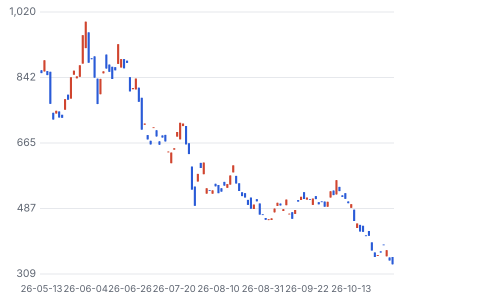

**주봉**

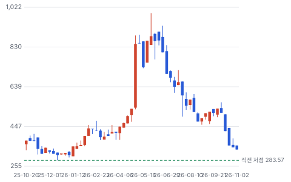

**월봉**

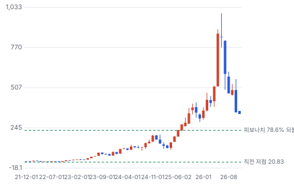

**분기 매출·EPS 실적과 컨센서스**

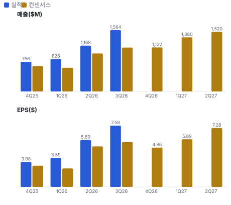

**최근 4개 분기 주가 변화 분석**

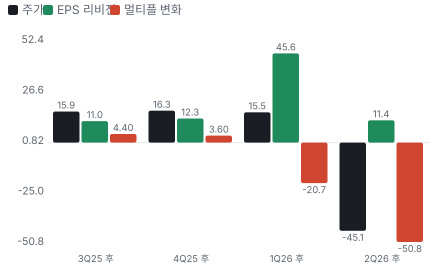

**EPS 리비전**

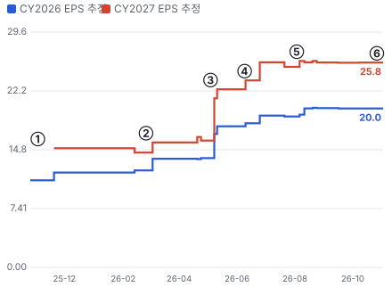

① 25-11-03 3Q25 실적, CEC 첫 반영 · EPS 리비전 -
② 26-02-25 4Q25 실적, 2026 가이던스 첫 제시 · EPS 리비전 +9%
③ 26-05-04 1Q26 실적, 가이던스 대폭 상향 · EPS 리비전 +40%
④ 26-06-09 Stone Ridge 인수, 태평양 북서부 진출 · EPS 리비전 +5%
⑤ 26-08-03 2Q26 실적, 3Q 수주 약세 경고 · EPS 리비전 +2%
⑥ 26-10-28 3Q26 실적, 가이던스 상향·잔고 감소 · EPS 리비전 +7%

**밸류에이션 주가 시나리오**

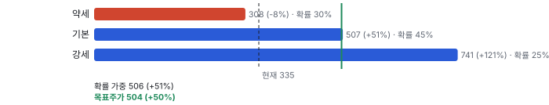

**주가별 업사이드**

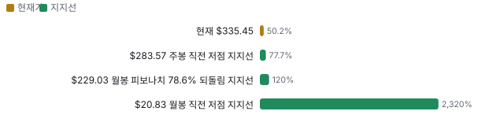

**제품·서비스 포트폴리오**

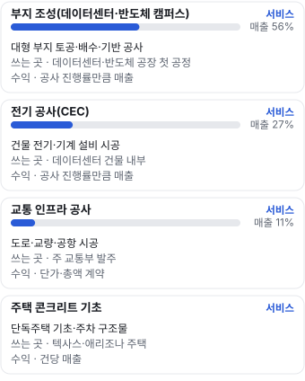

**고객 믹스(FY2025, 매출 대비)**

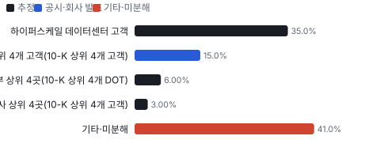

**공급 병목(10점, 낮을수록 병목)**

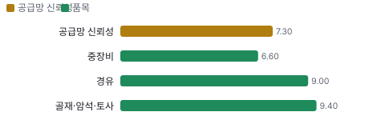

**생산능력 현재와 확충 계획(현장 인력(명))**

**CAPEX의 매출 대비 비중**

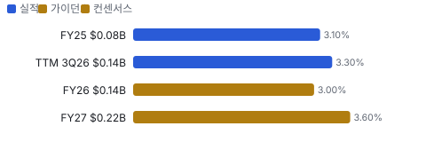

**어닝콜 변화별 주주가치 영향**

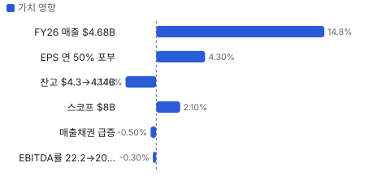

**멀티플 프리미엄**

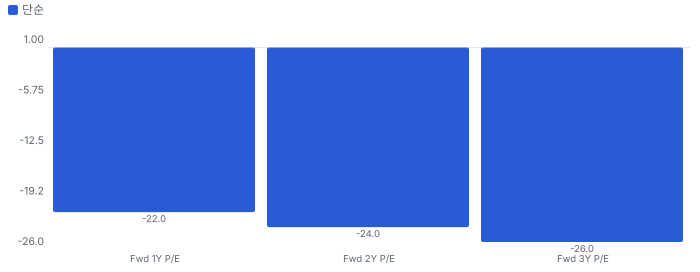

**합리적 멀티플**

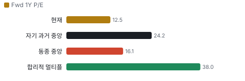

**일별 거래량 분해**

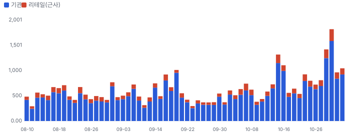

**기관 자금 흐름**

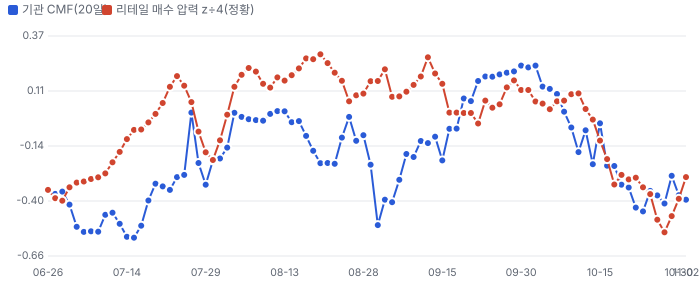

**몬테카를로**

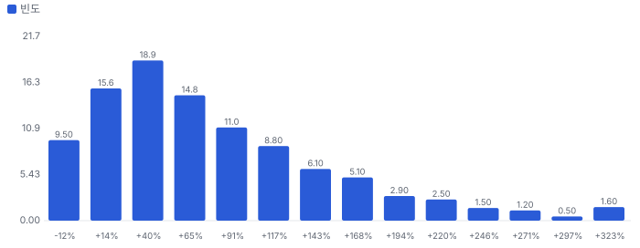

해석: 3,000번 중 2,732번(91%)에서 가치가 지금 주가 이상이었다. 가정을 흔들어도 지금 주가를 뒷받침하는 경우가 더 많다. 가운데 값은 1.61배이고, 열 번 중 여덟 번은 1.02~2.83배 사이에 든다.

## 내러티브

> **기업가치를 결정하는 이야기:** 기업가치는 대형 캠퍼스의 다음 단계가 실제 서명 수주로 넘어오느냐로 정해진다. 서명 잔고 \$4.14B와 미서명 \$2.0B는 2027 매출 컨센서스 \$6.1B를 대부분 덮지만, 3Q에 잔고가 처음 줄었다.

> **멀티플·EPS 프리미엄**
> **멀티플:** Fwd 1Y P/E 12.5배로 동종 6곳 중앙값 약 16배보다 낮다. 다음 4개 분기 매출 성장 약 35%는 피어 중 가장 빠른데도 할인이다. 2026년 5월에는 46배였다.
> **EPS:** FY2026 조정 EPS 가이던스는 연초 콜 전 추정 \$12.2에서 \$21.8로 올랐다. 이익 프리미엄은 이미 숫자로 나왔고 배수가 그것을 지웠다.

### 투자자들은 왜 열광했나

2025년 4월 \$100에서 2026년 6월 \$994까지 올랐다. 1Q26 실적 다음 날 하루 +52%였다. 하이퍼스케일러 CAPEX와 반도체 공장 투자의 '첫 삽' 수혜주로 묶였기 때문이다. 7월과 10월 업종 동반 급락, 2Q·3Q 실적 뒤 수주 공백 우려로 열기가 식었다.

### 무엇이 기업가치를 바꾸나

> **구조적 체질 변화**
> **변화:** E-Infra가 3Q 매출의 83%다. 1년 전 60%에서 올랐고 교통은 25%에서 11%로 줄었다
> **증거:** 3Q 보도자료 부문 표
> **반증:** E-Infra 비중이 두 분기 연속 줄어든다

> **고부가 믹스 확장**
> **변화:** 부지 조성은 이익률을 지켰지만 이익률이 낮은 전기 공사가 커져 전체 이익률은 희석된다
> **증거:** 3Q E-Infra 영업이익률 22.6%, 전년 25.6%
> **반증:** CEC 이익률이 비핵심 정리 뒤 300~500bp 오른다

> **기술 혁신**
> **변화:** 해당 없음(제품 기술보다 시공 실행 회사다. 프리패브로 현장 인력을 줄이는 정도다)
> **증거:** 2Q 콜
> **반증:** 해당 없음

> **실행 속도**
> **변화:** 납품 리드타임 대신 계약에서 완공까지의 기간으로 잰다. 회사 잔고는 6~36개월 안에 끝나는 공사이고 RPO(남은 계약 이행 의무(계약 잔고))의 72%를 12개월 안에 인식한다 **납품 리드타임 6~36개월.** 피어 비교 미확인. 이전 대비 미확인.
> **증거:** 3Q 10-Q
> **반증:** 12개월 내 인식 비중이 60% 아래로 내려간다

> **M&A**
> **변화:** CEC(\$562M, 2025-09)와 Stone Ridge(\$178M, 2026-06)를 샀고 리볼버를 \$1.5B로 늘렸다. EPS 연 50% 포부의 절반이 M&A다
> **증거:** 3Q 10-Q, 3Q 콜
> **반증:** 대형 인수로 순차입이 EBITDA의 2배를 넘는다

> **정책·입법 연관성**
> **재정정책:** IIJA(2021년 미국 인프라 투자·일자리법) 도로·교량 예산이 교통 부문 매출의 바탕이다. 주 교통부 투자비의 평균 50%가 연방 자금이다 3Q 10-Q 교통 부문 설명. IIJA는 2021년 제정 반증: 후속 지상교통 재승인 법안이 예산을 줄인다 의회 동의 10/10 — 하원 5/5(IIJA(H.R.3684) 2021년 하원 통과·세출 반영) · 상원 5/5(IIJA 2021년 상원 통과).
> **행정명령:** 해당 없음(이 회사를 겨냥한 행정명령을 찾지 못했다) 3Q 10-Q, 2025 10-K 반증: 데이터센터 인허가·전력 연결 관련 행정명령이 착공 일정을 바꾼다
> **연관입법:** IIJA 지상교통 예산은 2026 회계연도(9월 말)에 끝난다. 후속 재승인 법안의 단계는 확인하지 못했다(미확인). 교통 부문은 매출의 11%다 3Q 10-Q 교통 부문 비중 반증: 재승인이 늦어져 주 교통부 발주가 줄어든다

> **CAPEX 낙수효과**
> **변화:** 하이퍼스케일러·반도체 회사 투자가 부지 조성 수요로 이어진다. 특정 고객 투자에서 Sterling 매출로 잇는 공개 숫자는 없다
> **증거:** 3Q 보도자료: E-Infra 스코프의 약 95%가 미션 크리티컬
> **반증:** 고객 CAPEX 가이던스가 꺾인다

### 내러티브 근거

> AI 데이터센터 '땅 파는 회사'로 2026년 중반 Fwd 1Y P/E 46배까지 갔다가 12.5배로 내려왔다. 이익은 계속 올랐고 배수만 무너졌다. 동종 대비 멀티플 차이 -22% 중 회사 고유 몫은 -67%다. 단계는 과밀, 쏠림은 높음이다.

> **AI 데이터센터 부지 수요** · 강화
> **논리:** 하이퍼스케일러가 전력 확보된 대형 캠퍼스를 여러 단계로 짓고, 부지 조성이 첫 공정이다
> **숫자:** E-Infra 3Q 매출 +212%, 스코프 약 \$7B(+130%)
> **반증:** 1H27 E-Infra book-to-burn이 1.0x 미만으로 이어진다

> **전기 공사 확장(CEC)** · 강화
> **논리:** 부지 다음 공정인 전기까지 맡아 고객당 매출을 키운다
> **숫자:** CEC 2026 매출 \$1B 초과 전망, 3Q \$425.6M
> **반증:** CEC 분기 매출이 \$350M 아래로 내려간다

> **M&A로 EPS 연 50%** · 태동
> **논리:** 유기 20~30%에 인수를 더해 이익을 복리로 키운다
> **숫자:** 리볼버 가용 약 \$1.4B
> **반증:** 1년 안에 의미 있는 인수가 없거나 인수 뒤 이익률이 떨어진다

> **교통 인력의 재배치** · 유지
> **논리:** 이익률 낮은 공공 공사 인력을 데이터센터로 옮겨 믹스를 높인다
> **숫자:** 로키산맥 지역 E-Infra 매출이 2분기 연속 교통보다 크다
> **반증:** 교통 잔고가 \$0.8B 아래로 줄고 E-Infra도 둔화

> **반대: 수주 공백과 이익률 희석** · 강화
> **논리:** 잔고가 매출을 못 따라오고 전기 공사가 이익률을 낮춘다
> **숫자:** 3Q book-to-burn 0.9x, 서명 잔고 \$4.3B→\$4.14B, 가이던스 EBITDA률 22.2%→20.8%
> **반증:** 4Q·1Q 서명 수주로 book-to-burn이 1.3x 이상

> **반대: AI CAPEX 정점 공포** · 강화
> **논리:** 하이퍼스케일러 CAPEX 증가율이 꺾이면 첫 공정인 부지 조성이 먼저 멈춘다
> **숫자:** 7/24~7/29·10/13~10/23 업종 동반 급락 때 STRL −25%·−29%, 6/4 고점 대비 −66%
> **반증:** 업종이 반등할 때 STRL이 따라 오른다

## 포트폴리오

| 제품·서비스 | 구분 | 무엇 | 쓰는 곳 | 돈 버는 방식 |
|---|---|---|---|---|
| 부지 조성(데이터센터·반도체 캠퍼스) | 서비스 | 대형 부지 토공·배수·기반 공사 | 데이터센터·반도체 공장 첫 공정 | 공사 진행률만큼 매출 |
| 전기 공사(CEC) | 서비스 | 건물 전기·기계 설비 시공 | 데이터센터 건물 내부 | 공사 진행률만큼 매출 |
| 교통 인프라 공사 | 서비스 | 도로·교량·공항 시공 | 주 교통부 발주 | 단가·총액 계약 |
| 주택 콘크리트 기초 | 서비스 | 단독주택 기초·주차 구조물 | 텍사스·애리조나 주택 | 건당 매출 |

## 고객

> **FY2025 최대 고객 하이퍼스케일 데이터센터 고객 35%, 상위 3곳 56%, 집중도 분산.** 공시·회사 발표로 확인한 몫은 매출의 15%이고, 나머지 고객 몫은 추정이거나 미분해다. 10%를 넘는 단일 고객은 없다(2025). E-Infra 상위 4곳이 부문 매출의 27%다. 고객 이름은 공시되지 않고 콜에서 Micron(미국 메모리 반도체 회사)만 이름이 나왔다.

**고객별 매출 몫(FY2025)**
| 고객 | 몫 | 변화 | 근거 |
|---|---|---|---|
| 하이퍼스케일 데이터센터 고객 | 25~45% | 미확인 | 추정 |
| E-Infra 상위 4개 고객(10-K 상위 4개 고객) | 15% | -1%p | 공시 |
| 주 교통부 상위 4곳(10-K 상위 4개 DOT(주 교통부)) | 6% | -10%p | 추정 |
| 주택 건설사 상위 4곳(10-K 상위 4개 고객) | 3% | 미확인 | 추정 |
| Micron | 미확인 | 미확인 | 회사 발표 |
| 기타·미분해 | 41% | - | - |

> **하이퍼스케일 데이터센터 고객** · 추정
> **사는 것:** 부지 조성·전기 공사
> **추정 근거:** E-Infra가 3Q 매출의 83%이고 대부분이 데이터센터로 보인다. 개별 회사는 가설이라 이름을 쓰지 않는다

> **E-Infra 상위 4개 고객(10-K 상위 4개 고객)** · 공시
> **사는 것:** 데이터센터·반도체 부지 조성
> **추정 근거:** 부문 몫 × 2025 부문 비중 약 57%

> **주 교통부 상위 4곳(10-K 상위 4개 DOT)** · 추정
> **사는 것:** 도로·교량·공항 공사
> **추정 근거:** 3Q 교통 비중 10.6% × 58%

> **주택 건설사 상위 4곳(10-K 상위 4개 고객)** · 추정
> **사는 것:** 주택 콘크리트 기초
> **추정 근거:** 3Q 건축 비중 6.1% × 45%

> **Micron** · 회사 발표
> **사는 것:** 뉴욕·아이다호 반도체 공장 부지
> **추정 근거:** CEO가 Micron 프로젝트를 이름으로 말했다. 매출 몫은 공개되지 않았다

## 수주·파이프라인

> **2026-09-30 기준 5건.** 확정 \$4.01B, 미확정 \$3.86B. 공시 3Q 말 서명 수주잔고(RPO \$4.05B + MSA(물량을 정하지 않은 기본 서비스 계약) 추정 \$0.09B) \$4.14B. 서로 겹치는 항목은 합계에서 뺐다.

**실행 속도와 방해 요인**
| 항목 | 상태 | 실행 속도 | 방해 요인 |
|---|---|---|---|
| E-Infra 계약 잔고 | 확정 | 회사 전체 RPO의 72%를 12개월 안에 인식 | 날씨 · 전기 인력 · 고객 전력 연결 일정 |
| 교통 부문 계약 잔고 | 확정 | 미확인 | 인력 재배치 · 주 교통 예산 |
| 미서명 수주 | 협상 | 연초 \$0.30B → 3Q \$2.0B | 최종 가격·조건 협상 · 설계 일정 |
| 설계 중인 다음 단계 | 파이프라인 | 미확인 | 고객 설계·전력 확보 · 계약 미체결 |
| Micron 뉴욕 반도체 캠퍼스 부지 | 확정 | 1단계 약 \$600M 중 암석 자재 비중이 커 이익률이 낮다(3Q 콜) | 자재 비중 · 겨울 날씨 |

## 마진 구조

> **GPM 24.2%, OPM 18.7%.** 9M25 대비 GPM +0.7%p, OPM +2.2%p. 변동비는 매출의 68%이고, 매출이 10% 늘면 OPM은 +1.2%p 움직인다. 매출총이익률 24%대의 시공 회사다. 이익률은 자재·인력 단가보다 어떤 공사를 얼마나 빨리 끝내느냐(믹스·생산성)에 달렸다.

**GPM에서 OPM까지(GAAP)**
| 기간 | GPM | 연구개발 | 판관비 | 기타 | OPM |
|---|---|---|---|---|---|
| 9M25 | 23.5% | 0.0% | 6.1% | 0.9% | 16.5% |
| 9M26 | 24.2% | 0.0% | 4.6% | 1.0% | 18.7% |

**마진을 결정하는 비용 요인 — 비용 +10% 시 OPM**
| 비용 | 매출 대비 | 변화 | 고정비 | OPM |
|---|---|---|---|---|
| 자재(골재·암석·콘크리트·철근·전선) | 25.0% | 미확인 | 0% | -2.50%p |
| 직접 노무(현장 인력·전기공) | 22.0% | 미확인 | 20% | -2.20%p |
| 하도급 | 15.0% | 미확인 | 0% | -1.50%p |
| 장비 운영(연료·정비·감가상각) | 9.0% | 미확인 | 40% | -0.90%p |
| 기타 현장 원가 | 4.8% | 미확인 | 30% | -0.48%p |
| 일반관리비 | 4.6% | -1.6%p | 70% | -0.46%p |
| 인수 무형자산 상각·인수비·earn-out(기타 수익 차감) | 1.0% | +0.1%p | 100% | -0.10%p |

**비용을 움직이는 요인**
| 비용 | 요인 |
|---|---|
| 자재(골재·암석·콘크리트·철근·전선)(매출원가) | 부지별 자재 조달, Micron처럼 자재 비중 큰 공사 · 근거 추정 |
| 직접 노무(현장 인력·전기공)(매출원가) | 전기공 임금, 인력 재배치 · 근거 추정 |
| 하도급(매출원가) | 자체 시공 비중 · 근거 추정 |
| 장비 운영(연료·정비·감가상각)(매출원가) | 경유 가격, 장비 가동률 · 근거 추정 |
| 기타 현장 원가(매출원가) | 보험·보증·현장 간접비 · 근거 추정 |
| 일반관리비(판관비) | 인력·인수 통합 · 근거 공시 |
| 인수 무형자산 상각·인수비·earn-out(기타 수익 차감)(기타) | CEC·Stone Ridge(Sterling이 2026년 인수한 아이다호 부지 조성 회사) 인수 · 근거 공시 |

**부지 조성(데이터센터·반도체 캠퍼스) BOM — 매출의 56%, GPM 24%(회사 GM, 부문 GM 미공개), 항목 가격 +10% 시**
| 항목 | 원가 몫 | 전가 | 제품 GPM | OPM |
|---|---|---|---|---|
| 현장 인력 | 25~35% | 0% | -2.3%p | -1.27%p |
| 골재·암석·토사 | 20~35% | 미확인 | -2.1%p | -1.17%p |
| 중장비 정비·감가상각·운전 | 10~18% | 미확인 | -1.1%p | -0.59%p |
| 경유 | 3~6% | 미확인 | -0.3%p | -0.19%p |
| 미분해 | 24% | - | - | - |

**전기 공사(CEC) BOM — 매출의 27%, GPM 24%(회사 GM 24.2%(9M26), 부문 GM 미공개. 부문 GM 미공개. CEO 2Q 콜: 업계 EBITDA 이익률 10~12%), 항목 가격 +10% 시**
| 항목 | 원가 몫 | 전가 | 제품 GPM | OPM |
|---|---|---|---|---|
| 전기공 인력 | 35~50% | 0% | -3.2%p | -0.87%p |
| 전선·배관·배선 자재 | 20~35% | 미확인 | -2.1%p | -0.56%p |
| 프리패브 제작 | 5~15% | 미확인 | -0.8%p | -0.20%p |
| 미분해 | 20% | - | - | - |

**교통 인프라 공사 BOM — 매출의 11%, GPM 24%(회사 GM 24.2%(9M26), 부문 GM 미공개. 부문 GM 미공개, 3Q 조정 영업이익률 19.7%), 항목 가격 +10% 시**
| 항목 | 원가 몫 | 전가 | 제품 GPM | OPM |
|---|---|---|---|---|
| 아스팔트·콘크리트·골재 | 30~45% | 미확인 | -2.8%p | -0.30%p |
| 현장 인력 | 25~35% | 0% | -2.3%p | -0.24%p |
| 경유 | 4~8% | 미확인 | -0.5%p | -0.05%p |
| 미분해 | 26% | - | - | - |

현장 인력 가격이 +10% 오르면 영업이익은 -8.1% 움직인다. 판매가 전가를 모르는 항목은 전가 0%로 계산했다.

**BOM 항목 가격을 움직이는 것**
| 항목 | 요인 |
|---|---|
| 골재·암석·토사 | 현장 인근 조달, 운송 거리 · 근거 추정 |
| 현장 인력 | 인력 재배치·신규 지역 생산성 · 근거 추정 |
| 중장비 정비·감가상각·운전 | 장비 가동률·신규 지역 생산성 · 근거 추정 |
| 경유 | 총액 계약이 3Q 매출의 62%라 단기 전가가 어렵다 · 근거 추정 |
| 전기공 인력 | 전기공이 가장 빠듯하다 · 근거 추정 |
| 전선·배관·배선 자재 | 구리 가격 · 근거 추정 |
| 프리패브 제작 | 현장 인력을 줄이는 수단 · 근거 추정 |
| 아스팔트·콘크리트·골재 | 단가 계약이 많아 자재 가격 변동을 흡수한다 · 근거 추정 |
| 현장 인력 | E-Infra로 인력 재배치 · 근거 추정 |
| 경유 | 일부 주 교통부 계약에는 연료 가격 조정 조항이 흔하다. 이 회사 계약 조항은 미확인 · 근거 추정 |

**BOM 투입 물가 — PPI 전년비, 2026-11-03 수집**
| 항목 | 미국 | 일본 | 한국 | 대만 |
|---|---|---|---|---|
| 아스팔트·콘크리트·골재 | +6.3% | 미확인 | 미확인 | 미확인 |
| 경유 | +115.2% | 미확인 | 미확인 | 미확인 |
| 전선·배관·배선 자재 | +30.0% | +54.2% | +25.8% | +41.2% |

별표는 품목보다 넓은 업종 지수다. 지난 1년 투입 물가를 판매가 전가 뒤 원가에 그대로 넣으면 OPM은 -5.80%p 움직인다(매출원가의 30% 기준).

## 공급망 병목

> **공급망 신뢰성 7.3/10, 관리 가능.** 가장 약한 고리는 중장비 6.6점이고, 품목 평균은 8.4점이다. 근거가 부족한 2건(전기공 인력 · 보증보험(교통 공사))은 점수에서 뺐다. 부품 병목이 아니라 사람 병목이다. 가장 빠듯한 고리는 전기공인데 재는 요인을 채우지 못해 점수에서 빠졌다. 점수가 잡힌 가장 약한 고리는 중장비다.

**병목과 마진 — 품목 가격 +10% 시 OPM**
| 품목 | 점수 | 판정 | 구분 | OPM |
|---|---|---|---|---|
| 중장비(필수) | 6.6 | 관리 가능 | 일반 | 미확인 |
| 경유 | 9.0 | 병목 낮음 | 일반 | -0.24%p |
| 골재·암석·토사 | 9.4 | 병목 낮음 | 가격 위험 | -1.17%p |

> **중장비** · 6.6/10
> **왜:** 새 지역 진출과 캐파 확대에 장비가 먼저 필요하다
> **병목 요인:** 인증 공급사 3곳 · 캐파 빠듯 · 리드타임 미확인 · 재인증 0개월 · 1위 점유율 미확인 · 지역 집중 미확인 · 물량 확보 복수구매
> **풀리는 조건:** 미확인

> **경유** · 9.0/10
> **왜:** 가격 변동이 이익률에 바로 닿는다
> **병목 요인:** 인증 공급사 4곳 · 캐파 여유 · 리드타임 미확인 · 재인증 0개월 · 1위 점유율 미확인 · 지역 집중 미확인 · 물량 확보 현물
> **풀리는 조건:** 해당 없음

> **골재·암석·토사** · 9.4/10
> **왜:** 외진 현장은 품질·수량 추정이 틀릴 위험이 있다(10-K)
> **병목 요인:** 인증 공급사 4곳 · 캐파 여유 · 리드타임 미확인 · 재인증 0개월 · 1위 점유율 미확인 · 지역 집중 미확인 · 물량 확보 복수구매
> **풀리는 조건:** 해당 없음

**공급사**
| 품목 | 공급사 | 몫 | 근거 |
|---|---|---|---|
| 전기공 인력 | 자체 채용(CEC 현장 전기공) | 미확인 | 회사 발표 |
| 중장비 | 미공개(토공 중장비 제조사·임대사) | 미확인 | 회사 발표 |
| 골재·암석·토사 | 현장 인근 다수(골재·암석 공급) | 미확인 | 공시 |
| 경유 | 미공개(연료 공급) | 미확인 | 공시 |
| 보증보험(교통 공사) | Travelers(공사 이행 보증) | 미확인 | 공시 |

**무역 통계로 본 공급 지역**
| 품목 | EU 수입처 | 일본 수입처 | EU 1위 전년비 |
|---|---|---|---|
| 골재·암석·토사 | CN(중국) 76% · US(미국) 20% · JP(일본) 2% | 中華人民共和国 47% · ベトナム 27% | -32.5% |
| 경유 | US 75% · CN 12% · KR(한국) 6% | 大韓民国 74% · シンガポール 7% | +133.6% |

## 생산능력

> **현재 명목 캐파 3,300 현장 인력(명), 가동률 미확인.** 착공 이상 증설은 0 현장 인력(명), 발표까지 합치면 0 현장 인력(명)이다. 다 가동하면 지금보다 +0%, 착공 이상만이면 +0%다. TTM 3Q26 CAPEX는 \$0.14B로 매출의 3.3%다. 시공 회사의 캐파는 사람과 장비다. 2025 말 현장 인력은 약 3,300명이고 이후 CEC 채용으로 늘었지만 최신 숫자는 공개되지 않았다.

**생산능력 확충 계획**
| 계획 | 단계 | 증설 | 가동 시점 | CAPEX |
|---|---|---|---|---|
| 장비 확충(리스 포함) | 발표 | 미확인 | 2027 | 미확인 |

남은 계획의 CAPEX 합계는 \$0.00B(금액 미확인 1건 제외)다. 합계는 FY27 매출의 0%다.

**증설 방해 요인**
| 계획 | 방해 요인 |
|---|---|
| 장비 확충(리스 포함) | 중장비 공급 |

**CAPEX와 매출 대비**
| 기간 | CAPEX | 매출 | 매출 대비 | 구분 |
|---|---|---|---|---|
| FY25 | \$0.08B | \$2.49B | 3.1% | 실적 |
| TTM 3Q26 | \$0.14B | \$4.31B | 3.3% | 실적 |
| FY26 | \$0.14B | \$4.68B | 3.0% | 가이던스 |
| FY27 | \$0.22B | \$6.10B | 3.6% | 컨센서스 |

## 해자

> 기술 해자가 아니라 실행 해자다. 대형 부지를 자기 장비와 인력으로 빨리 끝내는 능력이 다음 단계 수주로 이어진다. 다만 진입 장벽은 사람과 장비라 경쟁사도 시간이 지나면 따라온다.

> **대형 부지 자체 시공** · 강함
> **해자:** 수백~수천 에이커 부지를 하청 없이 자기 장비·인력으로 다듬어 일정이 급한 고객에게 빨리 넘긴다
> **근거:** 3Q 부지 조성 매출 +133%, 이익률은 상반기 수준을 지켰다(3Q 보도자료)
> **숫자:** E-Infra 영업이익률 22.6%, 피어 다음 4개 분기 EBIT 이익률 중앙값 약 10%
> **깨지는 조건:** 부지 조성 이익률이 20% 아래로 두 분기 연속 내려간다

> **다단계 캠퍼스 후속 수주** · 보통
> **해자:** 같은 캠퍼스의 다음 단계를 경쟁 입찰 없이 이어 받는다
> **근거:** CEO가 3Q 콜에서 현장 고객이 다음 단계를 설계 중이고 5년 넘는 일거리라고 말했다. 계약 문서는 공개되지 않았다
> **숫자:** 다음 단계 설계분 약 \$1.9B(스코프 \$8B − 결합 잔고 \$6.14B, 추정)
> **깨지는 조건:** 다음 단계가 서명 잔고로 넘어오지 않고 1H27에도 book-to-burn이 1.0x 미만

> **부지+전기 통합** · 보통
> **해자:** 부지 조성과 전기 공사를 한 번에 맡아 고객 조정 비용을 줄인다
> **근거:** 2Q 콜: 전기 인력보다 공동 수주 기회가 많다. 3Q 콜: CEC가 같은 데이터센터의 두 번째 건물을 받았다
> **숫자:** CEC 3Q 매출 \$425.6M, 동기간 기준 +305%
> **깨지는 조건:** 통합 수주 건수가 공개되지 않거나 전기 인력 확보가 멈춘다

> **보증·재무 여력** · 보통
> **해자:** 보증보험과 \$1.5B 리볼버로 큰 공사를 받을 수 있다
> **근거:** 10-Q: 리볼버 가용 약 \$1.4B, Travelers 보증
> **숫자:** 순현금 \$122M(JV(공동도급) 현금 포함), JV 제외 시 순차입 약 \$78M
> **깨지는 조건:** 대형 인수로 순차입이 EBITDA의 2배를 넘는다

## 경영진·네트워크

> 창업 가문이 없는 전문경영인 회사다. 2017년부터 CEO가 교통 시공사를 데이터센터 부지 회사로 바꿨다. CEO는 2026년 10b5-1 매도 계획을 운영했다.

> **Joseph A. Cutillo** · CEO·이사 · 2017
> **프로필:** 2017년 CEO 겸 이사. 2025-12-08 10b5-1 계획(20만 주, 2026-03-09 ~ 10-01)을 맺었다. 2026-09-21 4만 주 증여
> **비즈니스:** 미확인
> **정계:** 미확인
> **동문:** 미확인
> **사모임:** 미확인

> **Daniel P. Govin** · COO · 2024
> **프로필:** 2024년 7월 입사 제안서(10-K 첨부)
> **비즈니스:** 미확인
> **정계:** 미확인
> **동문:** 미확인
> **사모임:** 미확인

> **David S. Schulz** · 이사 · 2025
> **프로필:** Wesco(미국 전기 자재 유통사) 부회장급 임원, 전 CFO
> **비즈니스:** Wesco 현직 임원
> **정계:** 미확인
> **동문:** 미확인
> **사모임:** 미확인

**네트워크 정량화**
| 연결 | 강도 | 닿는 매출 | 가중 노출 | 매출 대비 | 근거 |
|---|---|---|---|---|---|
| 비즈니스: 이사 David Schulz가 전기 자재 유통사 Wesco 현직 임원 | 2/5 | \$0.00B | \$0.00B | 0% | Sterling·CEC의 Wesco 구매 관계는 공개 자료에서 찾지 못했다 2025 10-K 이사 표 |

가중 노출은 연결이 닿는 매출의 크기다. 연결이 그 매출을 만들었다는 뜻이 아니며, 인과는 공개 자료로 입증하지 못한다.

## 약세 논리 및 셀온 조건

| 약세 논리 | 근거 | 반박 | 가를 자료 |
|---|---|---|---|
| 수주가 정점을 지났다 | 3Q book-to-burn 0.9x, 서명 잔고 \$4.3B → \$4.14B. 2Q 콜이 이미 예고했다 | 미서명 수주가 연초 \$0.30B에서 \$2.0B로 늘었다. 결합 잔고 \$6.14B는 전년 대비 +78%다 | 4Q 서명 잔고와 미서명 잔액 변화 |
| AI CAPEX가 꺾이면 첫 공정이 먼저 멈춘다 | 7월·10월 업종 급락 때 STRL이 피어보다 더 빠졌다(−25%, −29%) | CEO는 착수한 캠퍼스는 모두 전력과 인허가를 갖췄다고 답했다. 고객 이름·계약 기간은 공개되지 않아 검증 한계가 있다 | 하이퍼스케일러 4Q 콜의 2027 CAPEX 가이던스 |
| 이익률이 희석된다 | 가이던스 조정 EBITDA 이익률 중간값 22.2% → 20.8%, E-Infra 영업이익률 25.6% → 22.6% | 희석은 이익률 낮은 CEC가 4배로 커진 탓이고 부지 조성 이익률은 상반기 수준을 지켰다 | 4Q 부문 이익률, CEC 비핵심 정리 속도 |
| 현금 전환이 약해졌다 | 매출채권 \$0.50B → \$1.23B, 3Q 영업현금 \$99M vs 순이익 \$230M(비지배 포함). 일반 가용 현금은 \$16.8M뿐이다 | CFO가 10월 초 상당액을 회수했다고 답했다. 계약부채 \$917M이 선수금 역할을 한다 | 4Q 영업현금, 매출채권 잔액 |
| 내부자·기관이 팔았다 | CEO 10b5-1 계획 20만 주(3~10월), 2Q 13F 순 −3.28M주 | 10b5-1은 2025년 12월에 미리 정한 계획이다. 2Q 매도는 주가 고점 구간이다 | 3Q 13F(11월 중순), Form 4 |

> **셀온 조건**
> **조건 1:** 1Q27 실적까지 서명 잔고가 \$4.0B 아래로 내려가고 미서명 수주도 줄어든다
> **조건 2:** 4Q 영업현금이 다시 순이익의 절반을 밑돌거나 매출채권이 \$1.2B 위에 머문다
> **조건 3:** 2027 첫 가이던스가 유기 이익 성장 20% 틀 아래로 나온다
> **조건 4:** 하이퍼스케일러가 2027 CAPEX 증가율을 한 자릿수로 낮춘다
> **조건 5:** 순차입이 EBITDA의 2배를 넘는 대형 인수를 발표한다

## 어닝콜 변화

**직전 콜 대비 새로 나오거나 바뀐 내용 → 가치 영향**
| 항목 | 내용 | 직전 콜 | 최신 콜 | 모델 동인 이동 | 확신도 | 가치 영향 |
|---|---|---|---|---|---|---|
| 업데이트 | FY2026 매출 가이던스 | \$4.0~4.15B | \$4.63~4.73B | 기준연도 매출 +\$0.60B | 0.8 | +14.8% |
| 부정 | 가이던스 이익률 | 조정 EBITDA 이익률 중간값 22.2% | 20.8%, CEC 비중 확대와 4Q 계절성 | 출발 이익률 -1.4% | 0.8 | -0.3% |
| 업데이트 | 스코프 작업 | \$7B 초과 | 약 \$8B, 전년 대비 +90% | 성장 지속(감속 계수) +3.0% | 0.5 | +2.1% |
| 부정 | 서명 수주잔고 | 2Q 서명 잔고 \$4.3B, book-to-burn 1.4x | \$4.14B, book-to-burn 0.9x. 미서명 \$2.0B로 증가 | 1년차 성장률 -2.0% | 1.0 | -2.7% |
| 신규 | 이익 성장 틀 | 유기 성장 20~30% | 유기 이익 20~30% + M&A로 EPS 연 약 50% 포부 | 1년차 성장률 +3.0% | 0.5 | +4.3% |
| 부정 | 현금 전환 | 1H 영업현금 \$328M | 3Q 영업현금 \$99M, 매출채권 \$1.23B(연초 \$0.50B). 10월 상당액 회수했다고 CFO 답변 | 매출÷투하자본 -20.0% | 1.0 | -0.5% |
| **합계** | 단독 합 |  |  | 동시 적용 +17.8% |  | **+17.6%** |

**사건별 EPS 리비전**
| # | 날짜 | 구분 | 사건 | CY2026 EPS 전→후 | CY2027 EPS 전→후 | 리비전 | 주가 반응 |
|---|---|---|---|---|---|---|---|
| ① | 25-11-03 | 실적 | 3Q25 실적, CEC 첫 반영 | \$10.97 → \$10.97 | - → - | - | -2.6% |
| ② | 26-02-25 | 실적 | 4Q25 실적, 2026 가이던스 첫 제시 | \$12.21 → \$13.69 | \$14.46 → \$15.74 | +8.9% | -4.8% |
| ③ | 26-05-04 | 실적 | 1Q26 실적, 가이던스 대폭 상향 | \$13.76 → \$17.77 | \$15.98 → \$22.43 | +40.4% | +52.2% |
| ④ | 26-06-09 | 내러티브 | Stone Ridge 인수, 태평양 북서부 진출 | \$17.77 → \$18.15 | \$22.43 → \$23.55 | +5.0% | -5.6% |
| ⑤ | 26-08-03 | 실적 | 2Q26 실적, 3Q 수주 약세 경고 | \$19.01 → \$20.03 | \$25.26 → \$25.83 | +2.2% | -11.4% |
| ⑥ | 26-10-28 | 실적 | 3Q26 실적, 가이던스 상향·잔고 감소 | \$20.02 → \$21.83 | \$25.80 → \$27.70 | +7.4% | -3.9% |

**해석:** 4개 구간 누적 주가 -15% = EPS 리비전 +102% × 멀티플 -58%. 더 크게 움직인 쪽은 **EPS 리비전**이다.

## 밸류에이션

> **목표주가 \$504, 업사이드 +50%.** 자리는 기본 시나리오이고 도달 확률은 약 48%다. 기본 \$507, 강세 \$741(+121%), 약세 \$308(-8%). DCF 기준 업사이드는 기본 +70%, 강세 +138%, 약세 +28%다(WACC 10.0%).

DCF가 시나리오와 다른 까닭은 장기 이익률이다. DCF는 장기 EBIT 이익률을 16%로 묶고 SBC·상각 1.7%를 빼지만, P/E 시나리오는 조정 EPS를 쓴다. 시공 회사는 수주 사이클에 따라 이익률이 내려온 역사가 있어 DCF를 보수적으로 둔 것이다. 컨센서스 FY2027 EPS는 콜 전 애널리스트 평균 \$25.80과 콜 뒤 모델 집계 \$27.70이 표본이 달라 범위로 쓴다. 투입 물가 점검의 OPM −5.8%p는 판매가 전가 0%를 가정한 값이다. 9M26 실제 OPM은 오히려 +2.2%p였다. 새 입찰가에 원가가 들어가는 구조라 기본 시나리오 이익률은 그대로 두고, 경유 PPI(생산자물가지수) +115%가 총액 계약 잔고를 깎는 경우를 약세 시나리오에 넣었다.

> **약세 \$308 (-8%)** · 확률 30%
> **가정:** 14.3배 × EPS \$21.50
> **근거:** 서명 수주 공백이 1H27까지 이어져 2027 매출 약 +15%. CEC 비중 확대로 조정 EBIT 이익률 18%. FY2026 가이던스 수준에서 이익이 멈춘다

> **기본 \$507 (+51%)** · 확률 45%
> **가정:** 19.1배 × EPS \$26.50
> **근거:** 미서명 수주가 4Q·1Q에 대부분 서명으로 넘어오고 2027 매출 약 \$5.8~6.1B. 지금 컨센서스 \$26.78과 비슷하다

> **강세 \$741 (+121%)** · 확률 25%
> **가정:** 23.9배 × EPS \$31.00
> **근거:** 텍사스·태평양 북서부 신규 캠퍼스와 CEC 성장이 겹쳐 매출 +35% 이상, 부지 조성 이익률 유지. 4Q가 3Q처럼 내재 값을 크게 넘는다

**멀티플 선정 — Fwd 1Y P/E**
| 단계 | 조정 | 근거 |
|---|---|---|
| 동종 중앙값 | 16.1배 | 범위 12.5~26.3배, 6곳 |
| 펀더멘털 | +20% | 성장·이익률·ROIC로 본 합리적 멀티플 38.0배와의 차이의 일부만 인정 |
| 해자 | +8% | 대형 부지 자체 시공 강함 · 다단계 캠퍼스 후속 수주 보통 · 부지+전기 통합 보통 · 보증·재무 여력 보통 |
| 내러티브 | -5% | 단계 과밀 |
| 사이클·실행 판단 | -5% | 성장은 피어 중 가장 빠르지만 시공 사이클과 수주 공백, 고객 집중 위험, 높은 주가 변동성이 있다. 약간 할인한다. |
| **선정** | **19.1배** | 지금 12.5배 |

**동종 레인지**
| 회사 | Fwd 1Y P/E | Fwd 2Y P/E | Fwd 3Y P/E | 성장 | 영업이익률 | ROIC |
|---|---|---|---|---|---|---|
| EME(EMCOR, 전기·기계 설비 시공사) | 16.8 | 14.1 | 12.2 | 21% | 10% | 37% |
| FIX(Comfort Systems USA, 기계·전기 설비 시공사) | 18.8 | 16.5 | 14.8 | 37% | 17% | 103% |
| GVA(Granite Construction, 토목 시공사) | 13.3 | 11.1 | 9.6 | 0% | 10% | 19% |
| PRIM(Primoris, 인프라 시공사) | 15.5 | 14.0 | 12.4 | 2% | 4% | 9% |
| ROAD(Construction Partners, 도로 포장 시공사) | 26.3 | 18.8 | 17.5 | 15% | 10% | 9% |
| DY(Dycom, 통신·전력망 시공사) | 12.5 | 10.6 | 9.0 | 16% | 8% | 9% |
| **Sterling Infrastructure** | 12.5 | 10.7 | 9.1 |  |  |  |

지금 주가가 요구하는 5년 매출 CAGR 0%, 기본 시나리오 13%. 몬테카를로 중앙값 업사이드 +61%.

> 의사결정 보조(투자자문 아님): ① 매수 매력: 연 기대수익 +23.3% (자기자본비용 10.0% 대비 +13.3%p) · 자본비용 초과 확률 89% · 안전마진 1.02 → 정량 신호 강함 / ② 위험 예산 지표(이론): 1/4 켈리 10.0% (상한 10%) · 5년 하위10% +59% · 30%+ 손실 확률 0% / ③ 상방(5년): 기대 2.86배 · 2배 74% · 3배 36% · 10배 0% · 상위10% 4.47배

투입 물가 점검: 지난 1년 PPI를 BOM에 넣으면 OPM -5.80%p다(매출원가의 30% 기준).

## 시장 평가

> **셀사이드(IB 애널리스트)**
> **한 줄:** 셀사이드는 여전히 강세지만 목표가를 내리기 시작했다. 목표가 평균은 콜 전 값이 섞여 있다
> **의견 분포:** Strong Buy 9·Hold 1 — 10명 중 9명 긍정
> **목표가:** 평균 \$793, 범위 \$592~\$1,000 — 콜 뒤 Cantor(미국 증권사 Cantor Fitzgerald) \$742→\$565, D.A. Davidson \$700→\$680
> **FY2027 EPS:** \$25.80 → \$27.70 — 콜 전 9명 평균 → 콜 뒤 모델 집계, 표본 다름

> **바이사이드(기관 투자자)**
> **한 줄:** 2Q에 기관이 순매도로 돌았고 매수 상위는 Jane Street·Two Sigma 같은 계량·마켓메이커였다. 3Q 13F는 11월 중순에 나온다
> **13F 기관:** 824곳, 2Q 순 −3.28M주 — 증가 189·감소 352
> **큰 매도:** BlackRock −0.75M, American Century −0.35M, Dimensional −0.31M, Fidelity −0.30M — 패시브·액티브 모두
> **내부자:** 장내 매수 1·매도 27건 — CEO 10b5-1 계획 20만 주(3~10월)

> **언론·업계**
> **한 줄:** 회사 사건보다 AI 데이터센터 업종 수급이 7월·10월 하락을 이끌었다
> **보도 초점:** 목표가 하향, '고점 대비 반토막' — Seeking Alpha 약세 작성자도 '적정가 근접'으로 상향

## 체크리스트

| 시점 | 무엇 | 의미 |
|---|---|---|
| 2026-11 중순 | 3Q 13F 공개 | 2Q 기관 순매도가 이어졌는지 |
| 2026-11~2027-01 | 하이퍼스케일러·반도체 고객 CAPEX 발언 | 부지 수요의 바탕 |
| 2026-12~2027-02 | 미서명 \$2.0B의 서명 공시·보도 | 잔고 감소가 시점 문제였는지 |
| 2027-02 말(예상) | 4Q26 실적과 첫 2027 가이던스 | 4Q가 내재 값 \$1.12B를 넘는지, 2027 이익 성장 20~30% 틀 |
| 2027-02 말(예상) | FY2026 10-K | 10% 초과 고객 여부, 상위 4개 고객 몫, 인력 수 |
| 2027 상반기 | 지상교통 재승인 법안 단계 | 교통 부문(매출 11%) 예산 |

## 출처
- Sterling 3Q26 실적 보도자료(SEC 8-K Ex.99.1) https://www.sec.gov/Archives/edgar/data/874238/000087423826000122/a20261028ex991earningsrele.htm
- Sterling 3Q26 10-Q https://www.sec.gov/Archives/edgar/data/874238/000087423826000125/strl-20260930.htm
- Sterling FY2025 10-K https://www.sec.gov/Archives/edgar/data/874238/000087423826000024/strl-20251231.htm
- Sterling 3Q 콜 2026-10-29, 2Q 콜 2026-08-04(요지만)
- Sterling 리볼버 확대 2026-07-08 https://www.prnewswire.com/news-releases/sterling-announces-extension-and-expansion-of-credit-facility-to-1-5-billion-302820177.html
- Cantor 목표가 하향 2026-11-02 https://www.tradingview.com/news/tradingview:23df0379e0c86:0-cantor-fitzgerald-maintains-sterling-infrastructure-at-overweight-lowers-price-target-to-565-from-742/
- 2025 10-K: 건축 부문 매출의 45%
- 2025 10-K: 교통 부문 매출의 58%
- 2025 10-K: 부문 매출의 27%(2024 31%), 회사 매출 대비는 부문 비중으로 환산
- 3Q 보도자료: E-Infra 스코프의 약 95%가 미션 크리티컬
- 3Q 콜
- 3Q 10-Q
- 3Q 10-Q, 협상 중이라 계약이 아니다
- 3Q 콜 스코프 약 \$8B − 결합 잔고 \$6.14B, 추정
- 3Q 콜, 잔고 안에 포함돼 합계에서 뺀다
- 10-K
- 10-K 원자재 설명
- 10-K 원자재 설명(연료). 토공 장비 연료비 범위 추정
- 10-K 원자재 설명(연료·아스팔트)
- 10-K 위험 요인: 하도급 의존
- 10-K 인력 설명
- 10-K 인력 설명, 콜
- 10-Q 감가상각 9M \$75.8M(매출의 2.1%)
- 10-Q 감가상각 9M \$75.8M(매출의 2.1%), 2Q 콜 장비 투자
- 10-Q는 항목별 금액을 공개하지 않는다. 3Q 콜 Micron 자재 발언으로 범위 추정
- 2Q 콜: 프리패브 공장 증산
- 3Q 10-Q 손익계산서 9M
- 3Q 콜: Micron 1단계 약 \$600M 중 암석 약 4M 입방야드 구매
- 3Q 콜: 텍사스에서 주 약 80명 채용
- 매출원가 75.8%에서 위 항목을 뺀 값
- 2025 10-K
- 2Q·3Q 콜
- 2025 10-K: 직원 약 4,400명 중 현장 약 3,300명
- 2Q 콜
- 3Q 10-Q: 매입가 \$178.1M
- 3Q 콜: 2027 CAPEX 증가 예고
- 3Q 콜: 텍사스 주 약 80명

_구매 등급·목표주가 모두 규칙이 계산한 모델 값으로, 개인의 보유 종목·자금 사정을 반영하지 않는다 · 공개 자료 기반 분석이며 투자 권유가 아님 · 1차 판정, 미검증 · Chiip ten-bagger_