# 텐배거 리포트 2026-11-04 — Atlas Energy Solutions — 발전 장비와 브리지 대출은 확보했는데 장기 전력 계약은 120MW 한 건, 주가는 5월 고점 대비 −58%

> 2026-11-04 · Atlas Energy Solutions(AESI) · 기업: 퍼미안 분지 프랙 샌드 생산·물류(42마일 컨베이어)와 가스 발전기 기반 현장 전력(유전·데이터센터) 회사

## Chiip View

주가는 5월 고점 근처에서 11/2 \$8.23로 −58%다. 시가총액은 \$1.03B이고(완전 희석 기준 — 전환사채는 전환가 \$14.51이라 주식이 아니라 차입으로 셌다), 순차입 약 \$963M을 더한 EV는 \$1.99B다. 전력 이야기는 맞다. Socorro(Atlas 첫 데이터센터 전력 사업 부지(텍사스 엘패소 인근)) 120MW 한 건이 사업비 약 \$190M에 연 조정 FCF 약 \$55M이다. 그런데 확정된 장기 계약은 아직 이 한 건이다. 9월 프런티어 AI(인공지능) 연구소와 맺은 것은 비용보전 계약(CRA(비용보전 계약(고객이 장비 대금을 갚아 주는 계약)))이지 장기 전력 계약(PPA(장기 전력 구매 계약))이 아니다. **우리가 다르게 보는 곳은 '장비 확보 = 계약 임박'이라는 읽기다.** 장비 약정은 \$1B를 넘는데 PPA는 0건이고, 그 사이를 줄어드는 모래 이익과 180일 브리지 대출이 메운다. 3Q 콜은 비용보전 계약이 ESA(전력 공급 계약) 무산 때 대출을 전액 보전한다고 밝혀 금융 위험은 줄였지만, 서명 날짜는 여전히 없고 텍사스 대기 허가 중단이라는 새 지연 요인이 생겼다. 엔진 목표주가는 \$9.3(+13%), 규칙 등급은 Neutral이다. 다만 이 값은 장기 EBIT 이익률 가정에 크게 기댄다 — 12%로 두면 \$4다.

## 대시보드
| 항목 | 값 | 설명 |
|---|---|---|
| 주가 | \$8.23 | 고점 대비 -58% · 1년 -35% |
| 시가총액 | \$1.03B | 완전 희석 기준 · EV \$1.99B |
| 업사이드 | +13% | 목표주가 \$9 · 다운사이드 -73% · 손익비(강세÷약세) 2.3 |
| 구매등급 | Neutral | 애널리스트 16명: Strong Buy 6 · Buy 2 · Neutral 6 · Sell 0 · Strong Sell 2 |
| 멀티플 | Fwd 1Y EV/EBITDA 9.4배 | 동종 중앙값 6.9배 |
| 가이던스 4Q26 | EBITDA \$45M | 컨센서스 EBITDA \$49M |
| 알파 | 5.8/10 | 텐배거 가능성 점수 |
| 이벤트 | 3Q26 10-Q 제출 예상(브리지 대출 계약서·구매 약정 갱신), 텍사스 재설립 임시 주총 일정 공고 | 2026-11-05 |

## 한 장 요약
- **기업가치를 결정하는 내러티브** Atlas는 퍼미안 분지 한가운데서 셰일 시추용 모래를 캐고 42마일 컨베이어와 트럭으로 유정까지 나르는 회사다. 2025년 발전기 회사 Moser(Atlas가 2025년 인수한 발전기 회사 Moser Energy Systems)를 사들인 뒤 데이터센터에 가스 발전소를 지어 전기를 파는 사업으로 옮겨 가고 있다. 주가를 정하는 것은 모래가 아니라 '장기 전력 계약이 몇 MW(메가와트) 붙느냐'다.
- **밸류에이션 모델로 본 주가 상방은 어디까지인가?** **목표주가 \$9(+13%), 약세와 기본 사이(약세 쪽 15%)다.** 강세 \$22(+167%)는 Fwd 1Y EV/EBITDA 10.9배를 강세 EBITDA에 적용한 값이다. 기본 \$10, 약세 \$2. 손익비 2.3, DCF 기준 업사이드 -74%.
- **수주는 어디까지 왔나?** Socorro 데이터센터 120MW 미확인, 100% 매출 미확인 · Shackelford(AI 연구소 전력 사업을 맡은 Atlas 자회사) 사업(AI 연구소) 미확인, 100% 매출 미확인 · 두 번째 AI 연구소 사업(추가 283MW) 미확인, 100% 매출 미확인. 확정 장기 계약은 Socorro 120MW 1건이다. 프런티어 AI 연구소의 두 사업은 장비 비용을 고객이 보전하지만 PPA 전이다. 금지표대로 비용보전 계약을 매출 확정으로 읽지 않는다
- **누가 사 주나?** 최대 고객 상위 10개 고객 합계(10-K top 10 customers) 82%, 상위 3곳 82%. 공시·회사 발표로 확인한 몫은 82%다.
- **마진과 공급망은 어디가 약한가?** GPM 19.5%, OPM -14.9%. OPM을 가장 흔드는 BOM(제품 원가를 이루는 부품·재료 명세) 항목은 외부 운송·기사 인건비이고 가격 +10%에 -2.70%p다. 공급망 신뢰성은 2.1/10(병목 심각)이고 가장 약한 고리는 가스 왕복동 발전기다.
- **생산능력은 얼마나 늘어나나?** 현재 명목 캐파 미확인, 착공 이상 증설 120 모래 연 판매량 백만 톤 / 전력 MW. FY27 CAPEX는 매출의 52.4%다.
- **지금 가격은 무엇을 가정하나?** Fwd 1Y EV/EBITDA 9.4배로 동종 5곳 중앙값 6.9배보다 약 36% 높다. 순수 유전 서비스(PUMP(ProPetro) 4.2배, SND(Smart Sand) 4.6배)보다 비싸고 BTM(전력망을 거치지 않는 현장 자가 발전(behind-the-meter)) 전력 대표 SEI(13.9배)보다 싸다. 다음 4개 분기 조정 EBITDA는 \$260M이다. 엔진이 고른 합리적 배수는 8.7배다. DCF는 기본 −74%로 훨씬 낮다. 2026~2027년 CAPEX 컨센서스(\$488M, \$700M)를 그대로 빼기 때문이다.
- **왜 움직였나?** 네 구간이다. 4/6 전환사채 발표일 −8.1% 뒤, 5월 첫 데이터센터 120MW 계약과 캐터필러 1.4GW 예약으로 \$20 근처까지 올랐다. 7/23~7/29에 −30%가 빠졌고 원인은 확인하지 못했다. 9/25 비용보전 계약 날 +13.5%가 있었지만 10/13 \$11.85에서 10/22 \$8.60까지 다시 −27%였다. 브리지 대출 발표일(10/22)에도 −8.4%였다. 11/2 −10.7%는 실적 발표(장 마감 후) 전이고, 실적 다음 날은 약 −1%로 반응이 작았다.
- **3Q 실적에서 무엇이 바뀌었나?** 나빠진 것은 모래다. 3Q ASP는 \$16.93/t로 2Q \$17.70보다 4.4% 낮고, 물량 5.4Mt는 2Q 콜 범위(5.3~6.0Mt) 하단이다. 조정 EBITDA \$30.3M은 발표 전 추정 약 \$37M에 못 미쳤다. 4Q 가이던스 \$40~50M의 중간값 \$45M은 발표 전 애널리스트 평균 \$49.4M보다 낮다. 새로 나온 것은 2027년 배정 물량 2,300만 톤 이상, 비용보전 계약 2건, \$424M 브리지 대출이다. 3Q 콜에서는 비용보전 계약이 ESA 무산 시 대출기관 현금 유출을 고객이 전액 보전하는 구조라는 점, 4Q 물류 이익률 14~15% 전망이 추가됐다.
- **회사는 쟁점에 뭐라고 답했나?** PPA 시점 쟁점에 CEO는 3Q 콜(11/3)에서 장비·브리지·시공사는 끝났고 '기술 부속서와 최종 조건만 남았다', 두 계약을 함께 협상해 하나를 서명하면 다른 하나도 곧 따른다고 답했다. 서명 날짜는 주지 않았다(회사 답변: 날짜 없음). 자금 쟁점에 CFO는 장기 금융을 사업 자회사 차입 80~90%와 지분 10~20%로 짜고, 지분·전환 증권은 ESA 서명 뒤에만 낸다고 했다. 새 위험은 텍사스 대기 허가 중단이다 — 1건이 보류 중이고 회사도 해제 시점을 예측하지 않았다.
- **무엇이 바뀌면 판단이 달라지나?** AI 연구소 사업 하나라도 15년 안팎 PPA로 서명되고, 브리지가 증자 없이 장기 사업 금융으로 바뀌면 시나리오의 강세 쪽(다음 4개 분기 EBITDA \$340M 근처)이 열린다. 반대로 4Q 조정 EBITDA가 \$40M 아래이거나, 모래 ASP가 \$16 아래로 내려가거나, 브리지 연장 조건으로 지분 발행이 나오면 약세 쪽이다. 장기 이익률을 12%로 두면 목표주가가 \$4라는 점도 판단의 폭이다. 텍사스 대기 허가 중단이 길어져 사업을 다른 주로 옮기면 2027년 말 첫 전력 일정이 밀린다.

## 한눈에 보기

**일봉**

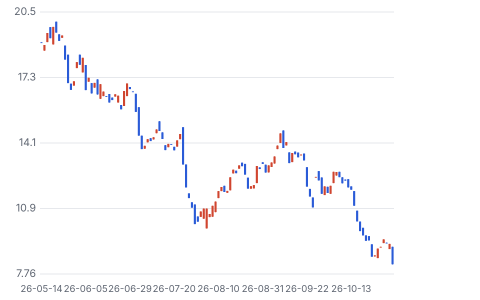

**주봉**

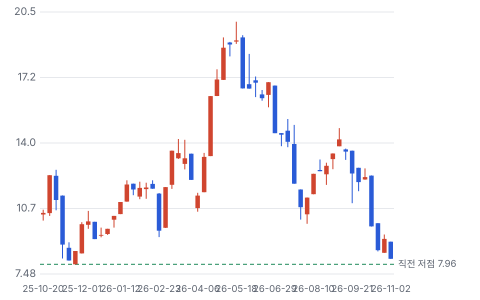

**월봉**

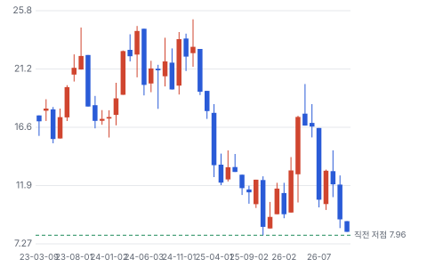

**분기 매출·EPS 실적과 컨센서스**

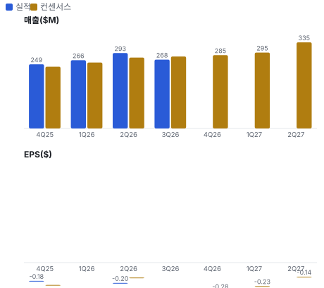

**EPS 리비전**

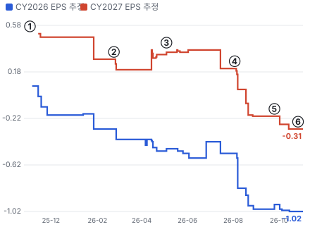

① 25-11-03 3Q25 실적 · EPS 리비전 -
② 26-02-23 4Q25 실적 · EPS 리비전 -31%
③ 26-05-04 1Q26 실적·120MW 계약 · EPS 리비전 +10%
④ 26-08-03 2Q26 실적·모래 가격 고수 · EPS 리비전 -88%
⑤ 26-09-25 AI 연구소 비용보전 계약 · EPS 리비전 +33%
⑥ 26-11-02 3Q26 실적·4Q 가이던스 · EPS 리비전 +0%

**밸류에이션 주가 시나리오**

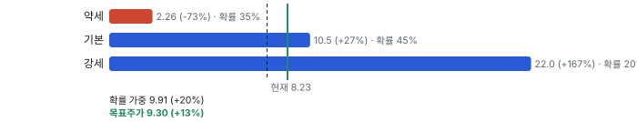

**주가별 업사이드**

**제품·서비스 포트폴리오**

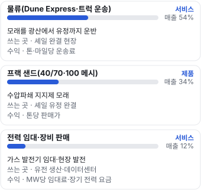

**고객 믹스(FY2025, 매출 대비)**

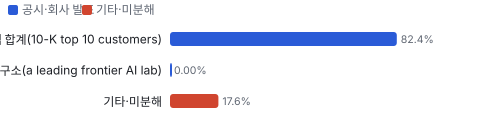

**공급 병목(10점, 낮을수록 병목)**

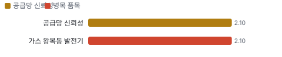

**CAPEX의 매출 대비 비중**

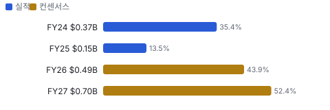

**어닝콜 변화별 주주가치 영향**

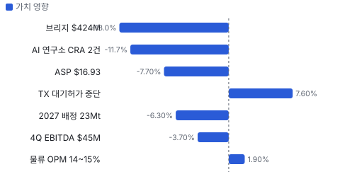

**멀티플 프리미엄**

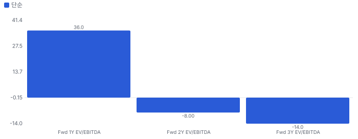

**합리적 멀티플**

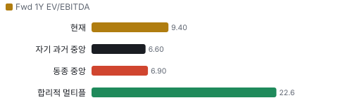

**일별 거래량 분해**

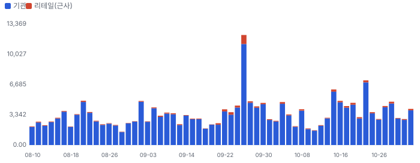

**기관 자금 흐름**

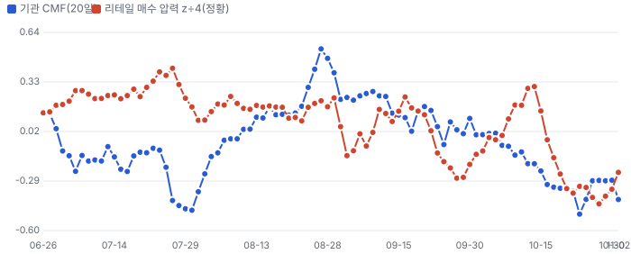

**몬테카를로**

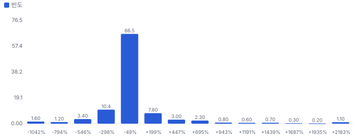

해석: 3,000번 중 731번(24%)에서 가치가 지금 주가 이상이었다. 가정을 흔들어도 지금 주가를 뒷받침하지 못하는 경우가 더 많다. 가운데 값은 0.46배이고, 열 번 중 여덟 번은 -1.80~3.75배 사이에 든다.

## 내러티브

> **기업가치를 결정하는 이야기:** 모래·물류는 TTM 조정 EBITDA \$149M을 내지만 줄고 있다. 기업가치의 위쪽은 전력이다. Socorro 120MW 한 건이 연 FCF 약 \$55M이라 회사가 확보한 장비(2027년까지 약 590MW, 장기 1.4GW)가 비슷한 조건으로 계약되면 이익 구조가 바뀐다. 그 전까지는 부채가 시가총액만큼 크다.

> **멀티플·EPS 프리미엄**
> **멀티플:** Fwd 1Y EV/EBITDA 9.4배로 동종 5곳 중앙값 6.9배보다 약 36% 높다. 순수 유전 서비스(PUMP 4.2배, SND 4.6배)보다 비싸고 BTM 전력 대표 SEI(13.9배)보다 싸다.
> **EPS:** 2026 EPS 추정은 8/7 −\$0.82에서 10/21 −\$1.02로 더 나빠졌다. 2027 EPS 평균도 +\$0.03(8/7)에서 −\$0.31(10/15)로 적자 전환했다.

### 투자자들은 왜 열광했나

4월 \$11에서 5월 \$20까지 올랐다. 첫 데이터센터 120MW 계약과 캐터필러 1.4GW 예약이 '모래 회사가 AI 전력 회사가 된다'는 이야기를 만들었다. 식은 이유는 세 가지다. 7월 하순 −30%(원인 미확인), 2027 이익 추정 하향, 그리고 계약 대신 브리지 대출이 먼저 나온 점이다.

### 무엇이 기업가치를 바꾸나

> **구조적 체질 변화**
> **변화:** 전력 매출이 3Q 매출의 12.2%(\$32.6M)로 1년 전 6.3%에서 두 배가 됐다. 그래도 매출의 88%는 모래·물류다
> **증거:** 3Q 보도자료 매출 구성, 2Q 10-Q 부문 표
> **반증:** 2027년에도 전력 비중이 20% 아래

> **고부가 믹스 확장**
> **변화:** 전력 부문 매출총이익률(감가상각 전) 약 65%로 모래·물류(약 20%)보다 높다. 비중이 오르면 이익률이 오른다
> **증거:** 2Q 10-Q 부문 표(자체 계산)
> **반증:** 데이터센터 PPA 마진이 유전 임대보다 크게 낮게 공개된다

> **기술 혁신**
> **변화:** 기술보다 실행이다. 자율주행 트럭(2Q 4,600회)·하이브리드 배터리 마이크로그리드를 말하지만 발전기는 캐터필러 표준품이다
> **증거:** 2Q 콜
> **반증:** 경쟁사가 같은 발전 패키지를 더 싸게 낸다

> **실행 속도**
> **변화:** Socorro는 계약(2Q26)에서 임시 26MW 가동까지 몇 달, 영구 120MW 전력까지 약 11개월이다. 피어 비교는 같은 기준 자료가 없다 **납품 리드타임 11개월.** 피어 비교 미확인. 이전 대비 미확인.
> **증거:** 2Q 콜
> **반증:** Socorro 전력 개시가 2Q27 이후로 밀린다

> **M&A**
> **변화:** 2025-02 Moser(현금 \$180M + 주식 1.7M주)로 발전 사업에 들어왔고 2025-07 PropFlow(Atlas가 2025년 인수한 모래 현장 장비 회사)를 샀다. 시너지 금액은 공시되지 않았다
> **증거:** FY2025 10-K
> **반증:** 전력 부문 영업권 손상

> **정책·입법 연관성**
> **재정정책:** 해당 없음(보조금·세액공제 수령 공시 없음). 법인세는 비율 감모 공제(percentage depletion)를 쓴다(2Q 10-Q) 2Q 10-Q 세금 설명 반증: 감모 공제 축소 세법 의회 동의 2/10 — 하원 1/5(Atlas 관련 하원 의결 기록을 찾지 못했다) · 상원 1/5(같음).
> **행정명령:** 연방 데이터센터 인허가 가속 행정명령이 현장 가스 발전 수요의 배경이다. Atlas를 직접 겨냥한 명령은 없다. 2Q 콜에서 텍사스 주지사의 데이터센터 관련 일시 중단 발표가 질문으로 나왔다(주 정책, 내용 미확인) 2Q 콜 Q&A 반증: 텍사스가 대형 부하·현장 발전 규제를 시행한다 의회 동의 2/10 — 하원 1/5(관련 의결 기록 미확인) · 상원 1/5(같음).
> **연관입법:** 해당 없음(회사를 직접 겨냥한 연방 법안을 찾지 못했다. 로비 공시는 키가 없어 미확인) 로비 조회 미확인 반증: 현장 가스 발전 배출 규제 강화 법안

> **CAPEX 낙수효과**
> **변화:** AI 연구소·하이퍼스케일러의 데이터센터 투자가 현장 발전 수요로 온다. 고객 투자 발표를 Atlas 매출로 바로 옮기지 않는다 — 확인된 것은 비용보전 계약까지다
> **증거:** 9/25 보도자료
> **반증:** 고객이 전력망 연결을 확보해 현장 발전을 줄인다

### 내러티브 근거

> 퍼미안 프랙 샌드 회사가 데이터센터 현장 발전(BTM) 회사로 바뀌는 중이라는 이야기다. 5월 \$20 가까이 갔던 주가는 11/2 \$8.23(−58%)로 돌아왔다. 장비와 브리지 대출은 확보했지만 두 AI 연구소 사업의 장기 전력 계약이 아직 없고, 모래 사업 이익이 줄었다. 동종 대비 멀티플 차이 +36% 중 회사 고유 몫은 -58%다. 단계는 확산, 쏠림은 중간이다.

> **데이터센터 현장 발전(BTM)** · 유지
> **논리:** 전력망 연결이 늦어져 데이터센터가 자체 가스 발전을 산다. Atlas는 장비·건설·운영을 한 번에 판다
> **숫자:** 확정 120MW(연 FCF 약 \$55M), 장비 예약 1.4GW, 2027 배치 가능 470MW
> **반증:** 2027-06까지 Socorro 외 장기 PPA가 0건

> **AI 연구소 비용보전 계약** · 강화
> **논리:** 고객이 장비 대금을 보전하니 PPA가 거의 온 것이다
> **숫자:** BoP(발전기 외 주변 설비(배출 저감·배전·배터리)) \$340.5M + 발전기 \$273.0M + 추가 283MW
> **반증:** 비용보전 계약이 PPA 없이 종료되거나 장비가 다른 용도로 돌아간다

> **모래 가격 반등(용량 검증)** · 약화
> **논리:** 경쟁 광산이 정비를 줄여 실제 캐파가 작다. 가격을 버티면 2027 계약에서 올려 받는다
> **숫자:** 3Q ASP \$16.93(2Q \$17.70), 물량 5.4Mt, 2027 배정 23Mt 이상
> **반증:** 4Q·1Q27 ASP가 \$17 아래에 머문다

> **물류 해자(Dune Express(Atlas의 42마일 모래 컨베이어)·자율 트럭)** · 유지
> **논리:** 기사 부족과 경유 상승에서 Atlas만 덜 다친다
> **숫자:** 2Q 자율 운행 4,600회(+70%), 라스트 마일 분기 기록 6Mt
> **반증:** 물류 서비스 원가 비중이 50%를 넘는다

> **반대: 자금·부채** · 강화
> **논리:** 현금 \$22M, 순차입 약 \$963M에 장비 약정이 \$1B를 넘는다. 계약 전 증자·고금리 차입 위험
> **숫자:** 3Q 이자 \$16.9M, 브리지 만기 180일, 조정 EBITDA TTM \$149M
> **반증:** 장기 사업 금융(무소구 프로젝트 금융)이 브리지를 대체한다

> **반대: 셰일 경기** · 유지
> **논리:** 퍼미안 완결 작업이 늘지 않으면 모래·물류 이익이 계속 준다
> **숫자:** 3Q 순손실 \$45.1M, 조정 EBITDA 이익률 11%(1년 전 16%)
> **반증:** 4Q 조정 EBITDA가 \$50M 위

## 포트폴리오

| 제품·서비스 | 구분 | 무엇 | 쓰는 곳 | 돈 버는 방식 |
|---|---|---|---|---|
| 물류(Dune Express·트럭 운송) | 서비스 | 모래를 광산에서 유정까지 운반 | 셰일 완결 현장 | 톤·마일당 운송료 |
| 프랙 샌드(40/70(모래 입도 규격)·100 메시) | 제품 | 수압파쇄 지지제 모래 | 셰일 유정 완결 | 톤당 판매가 |
| 전력 임대·장비 판매 | 서비스 | 가스 발전기 임대·현장 발전 | 유전 생산·데이터센터 | MW당 임대료·장기 전력 요금 |

## 고객

> **FY2025 최대 고객 상위 10개 고객 합계(10-K top 10 customers) 82%, 상위 3곳 82%, 집중도 집중.** 공시·회사 발표로 확인한 몫은 매출의 82%이고, 나머지 고객 몫은 추정이거나 미분해다. 상위 10개 고객이 FY2025 매출의 82.4%다. 이름은 공개하지 않는다. 데이터센터 쪽 고객은 '투자등급 기술 인프라 회사 자회사'(Socorro)와 '선도 프런티어 AI 연구소'(두 사업)로만 나온다

**고객별 매출 몫(FY2025)**
| 고객 | 몫 | 변화 | 근거 |
|---|---|---|---|
| 상위 10개 고객 합계(10-K top 10 customers) | 82% | +0%p | 공시 |
| 프런티어 AI 연구소(a leading frontier AI lab) | 0% | 미확인 | 공시 |
| Socorro 전력 구매자(투자등급 기술 인프라 회사 자회사) | 미확인 | 미확인 | 공시 |
| 기타·미분해 | 18% | - | - |

> **상위 10개 고객 합계(10-K top 10 customers)** · 공시
> **사는 것:** 모래·물류
> **추정 근거:** FY2024 82.0%

> **프런티어 AI 연구소(a leading frontier AI lab)** · 공시
> **사는 것:** 장비 비용 보전(PPA 전)
> **추정 근거:** 회사 이름은 가설로도 적지 않는다

> **Socorro 전력 구매자(투자등급 기술 인프라 회사 자회사)** · 공시
> **사는 것:** 120MW 전력
> **추정 근거:** 매출은 2Q27부터

## 수주·파이프라인

> **2026-11-02 기준 5건.** 확정 \$0.00B.

**실행 속도와 방해 요인**
| 항목 | 상태 | 실행 속도 | 방해 요인 |
|---|---|---|---|
| Socorro 데이터센터 120MW | 확정 | 계약→전력 약 11개월 | 설비 시운전 · 가스 공급 |
| Shackelford 사업(AI 연구소) | 협상 | 장비 출하 2027-04~2028-02 | 장기 PPA 체결 · 장기 사업 금융 |
| 두 번째 AI 연구소 사업(추가 283MW) | 협상 | 미확인 | PPA 체결 |
| 유전 전력(Oilfield Power) | 확정 | 미확인 | 배치 지역 밀도 |
| 2027 모래 배정 물량 | 확정 | 미확인 | 완결 일정 변경 · 가격 재협상 |

## 마진 구조

> **GPM 19.5%, OPM -14.9%.** 3Q25 대비 GPM -5.3%p, OPM -7.7%p. 변동비는 매출의 56%이고, 매출이 10% 늘면 OPM은 +5.4%p 움직인다. 3Q 매출원가(감가상각 제외)는 매출의 80.5%로 1년 전 75.2%보다 5.3%p 높다. 가장 큰 덩어리는 물류 서비스 원가(48.1%)이고, 모래 가격이 내려 공장 원가 비중이 올라갔다. 감가상각 \$47.1M까지 넣으면 매출총이익은 \$5.2M(1.9%)뿐이다

> **매출 100 중 매출원가 77.9, 매출총이익 22.1(최근 4분기, 공시).** 매출원가 요인 중 물류 서비스 원가(기사·외부 운송·연료)이 매출의 48.1%로 가장 무겁고, 단가가 +10% 오르면 GPM이 -4.81%p 움직인다. 분기 회귀로 매출 1이 늘 때 매출원가는 1.07 늘고, 매출원가의 고정비 몫은 -63%다.

**비용 요인 강도 — 비중·추세·충격(+10%)·탄력**
| 비용 | 구분 | 매출 대비 | 1년 변화 | 마진 기여 | 충격 시 마진 | 매출 탄력 | 고정비 몫 |
|---|---|---|---|---|---|---|---|
| 물류 서비스 원가(기사·외부 운송·연료) | 매출원가 요인 | 48.1% | 미확인 | 미확인 | -4.81%p | 미확인 | 20% |
| 모래 공장·물류 장비 운영비 | 매출원가 요인 | 26.9% | 미확인 | 미확인 | -2.69%p | 미확인 | 60% |
| 전력 임대 원가 | 매출원가 요인 | 3.3% | 미확인 | 미확인 | -0.33%p | 미확인 | 50% |
| 로열티 | 매출원가 요인 | 1.4% | 미확인 | 미확인 | -0.14%p | 미확인 | 0% |
| 전력 장비 판매 원가 | 매출원가 요인 | 0.8% | 미확인 | 미확인 | -0.08%p | 미확인 | 0% |
| 매출원가 | 공시 항목 | 77.9% | +7.3%p | -7.3%p | -7.79%p | 1.07 | -63% |
| 감가상각 | 공시 항목 | 19.1% | +4.0%p | -4.0%p | 미확인 | 0.25 | -88% |
| 판관비 | 공시 항목 | 13.7% | +2.0%p | -2.0%p | 미확인 | 0.16 | -48% |
| 기타 영업비용 | 공시 항목 | 0.8% | 미확인 | 미확인 | 미확인 | 0.05 | -100% |

매출 탄력 = 분기 비용을 매출에 회귀한 기울기(매출 1당 변동비), 고정비 몫 = 절편 ÷ 평균 비용. 표본이 8분기 미만이면 미확인. 매출원가 요인 비중은 margin 재료의 추정이 섞여 있고, 공시 매출원가와의 차이는 '기타 매출원가'로 둔다.

**GPM에서 OPM까지(GAAP)**
| 기간 | GPM | 연구개발 | 판관비 | 기타 | OPM |
|---|---|---|---|---|---|
| 3Q25 | 24.8% | 0.0% | 14.0% | 18.1% | -7.2% |
| 3Q26 | 19.5% | 0.0% | 14.5% | 20.0% | -14.9% |

**마진을 결정하는 비용 요인 — 비용 +10% 시 OPM**
| 비용 | 매출 대비 | 변화 | 고정비 | OPM |
|---|---|---|---|---|
| 물류 서비스 원가(기사·외부 운송·연료) | 48.1% | 미확인 | 20% | -4.81%p |
| 모래 공장·물류 장비 운영비 | 26.9% | 미확인 | 60% | -2.69%p |
| 감가상각·감모·무형자산 상각 | 20.0% | +2.1%p | 100% | -2.00%p |
| 판매관리비(SBC \$8.8M 포함) | 14.5% | +0.5%p | 80% | -1.45%p |
| 전력 임대 원가 | 3.3% | 미확인 | 50% | -0.33%p |
| 로열티 | 1.4% | 미확인 | 0% | -0.14%p |
| 전력 장비 판매 원가 | 0.8% | 미확인 | 0% | -0.08%p |

**비용을 움직이는 요인**
| 비용 | 요인 |
|---|---|
| 물류 서비스 원가(기사·외부 운송·연료)(매출원가) | 외부 운송사 단가, 기사 수급, 경유 가격 · 근거 공시 |
| 모래 공장·물류 장비 운영비(매출원가) | 가동률, 전력·가스, 유지보수 · 근거 공시 |
| 감가상각·감모·무형자산 상각(기타) | Dune Express·트럭·발전기 투자 · 근거 공시 |
| 판매관리비(SBC \$8.8M 포함)(판관비) | 인력·전력 사업 확장 · 근거 공시 |
| 전력 임대 원가(매출원가) | 발전기 정비·인력 · 근거 공시 |
| 로열티(매출원가) | 판매 물량 · 근거 공시 |
| 전력 장비 판매 원가(매출원가) | 장비 판매량 · 근거 공시 |

**물류(Dune Express·트럭 운송) BOM — 매출의 54%, GPM 20%(물류 단독 마진은 미공개라 회사 3Q 매출총이익률(감가상각 전)을 쓴다), 항목 가격 +10% 시**
| 항목 | 원가 몫 | 전가 | 제품 GPM | OPM |
|---|---|---|---|---|
| 외부 운송·기사 인건비 | 55~70% | 미확인 | -5.0%p | -2.70%p |
| 경유 | 10~20% | 미확인 | -1.2%p | -0.65%p |
| 트럭·컨베이어 유지보수 | 10~20% | 미확인 | -1.2%p | -0.65%p |
| 미분해 | 7% | - | - | - |

**프랙 샌드(40/70·100 메시) BOM — 매출의 34%, GPM 27%(2Q 톤당 운영비 \$12.39 vs 3Q ASP \$16.93, 감가상각 전(자체 계산)), 항목 가격 +10% 시**
| 항목 | 원가 몫 | 전가 | 제품 GPM | OPM |
|---|---|---|---|---|
| 채굴·선별 운영(전력·가스·인력) | 60~75% | 미확인 | -4.9%p | -1.68%p |
| 유지보수 부품 | 10~20% | 미확인 | -1.1%p | -0.37%p |
| 로열티 | 5~8% | 미확인 | -0.5%p | -0.16%p |
| 미분해 | 11% | - | - | - |

**전력 임대·장비 판매 BOM — 매출의 12%, GPM 65%(2Q 부문 매출 \$29.3M − 원가 \$10.2M, 감가상각 전), 항목 가격 +10% 시**
| 항목 | 원가 몫 | 전가 | 제품 GPM | OPM |
|---|---|---|---|---|
| 발전기 정비·부품 | 40~60% | 미확인 | -1.7%p | -0.21%p |
| 현장 인력 | 30~40% | 미확인 | -1.2%p | -0.15%p |
| 연료(천연가스) | 0~10% | 미확인 | -0.2%p | -0.02%p |
| 미분해 | 10% | - | - | - |

판매가 전가를 모르는 항목은 전가 0%로 계산했다.

**BOM 항목 가격을 움직이는 것**
| 항목 | 요인 |
|---|---|
| 외부 운송·기사 인건비 | 서비스 원가 대부분이 운송 인력 · 근거 추정 |
| 경유 | 트럭 연료 · 근거 추정 |
| 트럭·컨베이어 유지보수 | 자체 장비 · 근거 추정 |
| 채굴·선별 운영(전력·가스·인력) | 준설 채굴·건조 · 근거 추정 |
| 로열티 | 3Q \$3.8M ÷ 모래 매출 약 \$91M · 근거 공시 |
| 유지보수 부품 | 준설선·설비 · 근거 추정 |
| 발전기 정비·부품 | 자체 정비·재제조 · 근거 추정 |
| 현장 인력 | 운영 인력 · 근거 추정 |
| 연료(천연가스) | 고객 공급이면 원가가 아니다 · 근거 추정 |

**BOM 투입 물가 — PPI 전년비, 2026-11-03 수집**
| 항목 | 미국 | 일본 | 한국 | 대만 |
|---|---|---|---|---|
| 경유 | +115.2% | 미확인 | 미확인 | 미확인 |

별표는 품목보다 넓은 업종 지수다. 지난 1년 투입 물가를 판매가 전가 뒤 원가에 그대로 넣으면 OPM은 -7.46%p 움직인다(매출원가의 8% 기준).

## 공급망 병목

> **공급망 신뢰성 2.1/10, 병목 심각.** 가장 약한 고리는 가스 왕복동 발전기 2.1점이고, 품목 평균은 2.1점이다. 근거가 부족한 3건(BoP(배출 저감·배전·배터리) · 트럭 운송 기사 · 경유)은 점수에서 뺐다. 약한 고리는 발전기와 BoP다. 사실상 캐터필러 한 곳(딜러 경유)이고 출하는 2027~2028년이다. 모래 쪽은 운송 기사와 경유가 원가를 흔든다

**병목과 마진 — 품목 가격 +10% 시 OPM**
| 품목 | 점수 | 판정 | 구분 | OPM |
|---|---|---|---|---|
| 가스 왕복동 발전기(필수) | 2.1 | 병목 심각 | 출하 차질 위험 | 미확인 |

> **가스 왕복동 발전기** · 2.1/10
> **왜:** GFA(캐터필러와 맺은 발전 장비 포괄 구매 계약) 구매 의무 약 \$840M, 연 가격 인상 상한 8%, 관세는 실제 금액으로 전가
> **병목 요인:** 인증 공급사 1곳 · 캐파 부족 · 리드타임 미확인 · 재인증 미확인 · 1위 점유율 미확인 · 미국 집중 100% · 물량 확보 장기계약
> **풀리는 조건:** 미확인

**공급사**
| 품목 | 공급사 | 몫 | 근거 |
|---|---|---|---|
| 가스 왕복동 발전기 | Caterpillar(딜러 Wyoming Machinery 등)(발전기 제조·공급) | 미확인 | 공시 |
| BoP(배출 저감·배전·배터리) | Wyoming Machinery Company(BoP 조달) | 미확인 | 공시 |
| 트럭 운송 기사 | 자체 기사·외부 운송사(라스트 마일) | 미확인 | 회사 발표 |
| 경유 | 미공개(연료) | 미확인 | 추정 |

## 생산능력

> **현재 명목 캐파 미확인, 가동률 미확인.** 착공 이상 증설은 120 모래 연 판매량 백만 톤 / 전력 MW, 발표까지 합치면 1,201 모래 연 판매량 백만 톤 / 전력 MW이다. FY25 CAPEX는 \$0.15B로 매출의 13.5%다. 모래는 분기 5.4~5.6Mt(연환산 약 22Mt)를 팔고 2027년 23Mt 이상이 배정됐다. 명목 캐파는 공시 확인 못 함. 전력은 유전 180~200MW(연말)에 데이터센터 470MW가 2027년에 들어온다

**생산능력 확충 계획**
| 계획 | 단계 | 증설 | 가동 시점 | CAPEX |
|---|---|---|---|---|
| Socorro 120MW | 착공 | 120 모래 연 판매량 백만 톤 / 전력 MW | 2027-03 | \$0.19B |
| 추가 발전기 120MW(4Q26 도착) | 발표 | 120 모래 연 판매량 백만 톤 / 전력 MW | 2026-12 | \$0.28B |
| 2027 도착 350MW | 발표 | 350 모래 연 판매량 백만 톤 / 전력 MW | 2027-12 | 미확인 |
| Shackelford 328MW + 추가 283MW | 발표 | 611 모래 연 판매량 백만 톤 / 전력 MW | 2028-02 | 미확인 |

남은 계획의 CAPEX 합계는 \$0.47B(금액 미확인 2건 제외)다. 금액을 아는 계획의 단위당 CAPEX는 \$0.00B/모래 연 판매량 백만 톤 / 전력 MW이다. 합계는 FY27 매출의 35%다.

**증설 방해 요인**
| 계획 | 방해 요인 |
|---|---|
| Socorro 120MW | 시운전 |
| 추가 발전기 120MW(4Q26 도착) | 배치할 계약 |
| 2027 도착 350MW | PPA·사업 금융 |
| Shackelford 328MW + 추가 283MW | PPA 미체결 |

**CAPEX와 매출 대비**
| 기간 | CAPEX | 매출 | 매출 대비 | 구분 |
|---|---|---|---|---|
| FY24 | \$0.37B | \$1.06B | 35.4% | 실적 |
| FY25 | \$0.15B | \$1.10B | 13.5% | 실적 |
| FY26 | \$0.49B | \$1.11B | 43.9% | 컨센서스 |
| FY27 | \$0.70B | \$1.33B | 52.4% | 컨센서스 |

## 해자

> 해자는 퍼미안 한가운데 있는 저원가 광산과 Dune Express 컨베이어, 그리고 발전 장비 확보 순서다. 앞의 둘은 숫자로 보이지만 가격 결정력으로 아직 이어지지 않았다

> **Dune Express 컨베이어(42마일, 연 1,300만 톤)** · 보통
> **해자:** 트럭 대신 컨베이어로 북부 델라웨어 분지까지 모래를 옮겨 운송비와 기사 부족 위험을 줄인다
> **근거:** FY2025 10-K 자산 설명, 2Q 콜: 경쟁사가 기사를 못 구해 작업 중간에 넘겨받은 현장 2곳
> **숫자:** 3Q 서비스 매출 \$140.8M, 물류 비중 매출의 약 53%
> **깨지는 조건:** 물류 마진이 두 분기 더 낮아지고 시장 점유율도 준다

> **퍼미안 내 저원가 광산·매장량** · 보통
> **해자:** 광산이 수요지 안에 있고 매장량 수명이 길다
> **근거:** FY2025 10-K: 매장량 5.713억 톤, K1/K2(Atlas Kermit 1·2 공장) 29년
> **숫자:** 2Q 톤당 공장 운영비 \$12.39(로열티 포함) vs 3Q ASP \$16.93
> **깨지는 조건:** 업계 가격이 원가(\$12~13/t) 근처에서 1년 더 머문다

> **캐터필러 발전 장비 예약(1.4GW)** · 약함
> **해자:** 데이터센터가 기다리는 발전기를 미리 확보해 빨리 공급한다
> **근거:** 3/4 GFA 8-K, 2Q 10-Q: 2030년까지 약 \$840M 구매 의무
> **숫자:** 2027 배치 가능 470MW(2Q 콜), 9/18 328MW \$273M 구매
> **깨지는 조건:** 장비를 확보했는데 장기 PPA가 2027 상반기까지 1건도 추가되지 않는다

## 경영진·네트워크

> 창업자 Bud Brigham(Atlas 창업자·의장 Bud Brigham)이 이사회 의장이고 John Turner(Atlas CEO John Turner)가 CEO다. 주요 주주가 이사 지명권을 가진다(10-K). 정치·동문 연결은 공개 자료로 확인하지 못했다

> **Ben M. 'Bud' Brigham** · 창업자·이사회 의장 · 2017
> **프로필:** E&P(석유·가스 탐사·생산 회사) 창업 경력, 2025-02 증자 때 관련 법인과 함께 21.7만 주 매수(2Q 10-Q)
> **비즈니스:** 주주 계약상 이사 지명권(10-K)
> **정계:** 미확인
> **동문:** 미확인
> **사모임:** 미확인

> **John Turner** · 사장·CEO · 미확인
> **프로필:** Dune Express 등 \$1B 이상 인프라 건설을 이끈 경영진(2Q 콜 회사 설명)
> **비즈니스:** 미확인
> **정계:** 미확인
> **동문:** 미확인
> **사모임:** 미확인

> **Blake McCarthy(Atlas CFO Blake McCarthy)** · CFO · 미확인
> **프로필:** 2026-05 세금 원천 처분 외 장내 매매 없음(Form 4)
> **비즈니스:** 미확인
> **정계:** 미확인
> **동문:** 미확인
> **사모임:** 미확인

**네트워크 정량화**
| 연결 | 강도 | 닿는 매출 | 가중 노출 | 매출 대비 | 근거 |
|---|---|---|---|---|---|
| 비즈니스: 의장의 E&P 경력 | 2/5 | \$0.00B | \$0.00B | 0% | 고객이 E&P라 맞물리지만 연결이 매출을 만든 증거는 없다 FY2025 10-K |

가중 노출은 연결이 닿는 매출의 크기다. 연결이 그 매출을 만들었다는 뜻이 아니며, 인과는 공개 자료로 입증하지 못한다.

## 약세 논리 및 셀온 조건

| 약세 논리 | 근거 | 반박 | 가를 자료 |
|---|---|---|---|
| 비용보전 계약은 PPA가 아니다 | 9/25 보도자료: 장비를 고객에게 배정하고 단기 금융을 돕는 계약, 장기 PPA는 협상 중 | 고객이 BoP \$340.5M·추가 283MW 대금을 보전한다. 단순 의향보다 강한 약속이다 | 3Q 10-Q 첨부 계약서의 해지·보전 조건 |
| 자금이 모자라다 | 9/30 현금 \$22.3M, 순차입 약 \$963M, 3Q 이자 \$16.9M, GFA 약정 약 \$840M | 10/23 유동성 \$499.4M. 브리지 상환 재원은 비용보전 대금과 장기 사업 금융이다(8-K) | 브리지 만기(2027-04 전후) 전 장기 금융 확정 여부 |
| 모래는 가격 싸움에서 지고 있다 | 3Q ASP \$16.93(2Q \$17.70), 물량 2Q 콜 범위 하단, 특정 지역 물류 철수 | 회사는 저가 입찰을 일부러 버렸다고 했고 2027 배정 23Mt를 확보했다 | 4Q ASP와 2027 계약 가격 |
| DCF로는 지금 가격도 비싸다 | DCF 기본 −74%, 몬테카를로 중앙값 −54% | DCF는 CAPEX를 Atlas가 다 낸다고 본다. 비용보전이 작동하면 순투자가 준다 | 비용보전 대금 회수액(현금흐름표) |
| 셀사이드 목표가 \$17은 3Q 전 값이다 | 평균 \$17은 10/29 기준, RBC(RBC Capital Markets)·Stephens는 이미 하향 | Scotiabank 신규 Outperform, Barclays는 상향(Underweight→Equal Weight) | 11월 목표가 갱신 |
| 데이터센터가 전력망으로 돌아갈 수 있다 | 현장 발전은 전력망 연결이 늦을 때의 대안이다 | 2Q 콜: 고객이 10년에서 15~20년 계약을 원한다 — 장기 대안으로 본다는 뜻 | PPA 기간 공개 |
| 텍사스 허가가 일정을 막는다 | 3Q 콜: 대기 허가 1건 보류, 해제 시점 미정 | 회사: 장기화하면 고객이 다른 주로 사업·장비를 옮길 수 있다 | 주지사실 지침·허가 재개 공고 |
| ESA 뒤 증자로 주당 가치가 준다 | 3Q 콜: 지분 10~20%를 지분·자회사 지분·전환사채로 | 회사: 현금흐름 증가 주당 기준으로만 고른다 | ESA 서명 직후 조달 공시 |

> **셀온 조건**
> **조건 1:** 2027-06-30까지 Socorro 외 장기 PPA가 한 건도 서명되지 않는다
> **조건 2:** 브리지 대출 연장·재조달 조건으로 지분 발행(증자·ATM(시장가 수시 증자))이 나온다
> **조건 3:** 4Q26 조정 EBITDA가 가이던스 하단 \$40M 아래다
> **조건 4:** Socorro 120MW 전력 개시가 2Q27 이후로 밀린다
> **조건 5:** 모래 ASP가 두 분기 연속 \$16/t 아래다
> **조건 6:** 텍사스 대기 허가 중단으로 AI 연구소 사업 일정이 2028년 이후로 밀린다

## 어닝콜 변화

**직전 콜 대비 새로 나오거나 바뀐 내용 → 가치 영향**
| 항목 | 내용 | 직전 콜 | 최신 콜 | 모델 동인 이동 | 확신도 | 가치 영향 |
|---|---|---|---|---|---|---|
| 부정 | 4Q26 조정 EBITDA 가이던스 | 4Q 애널리스트 평균 \$49.4M | 가이던스 \$40~50M(중간 \$45M) | 출발 이익률 -1.0% | 0.8 | -3.7% |
| 부정 | 모래 가격 | 2Q \$17.70/t, 3Q부터 인상 기대 | 3Q \$16.93/t(−4.4%), 물량 5.4Mt | 기준연도 매출 -\$0.02B | 1.0 | -7.7% |
| 신규 | AI 연구소 비용보전 계약 | 장비 대금 자체 조달 | BoP·추가 283MW 장비를 고객이 보전, 장기 계약 협상 중 | 1년차 성장률 +2.0% | 0.3 | -11.7% |
| 신규 | 브리지 대출 | 현금 \$168M(6/30) | 10/23 유동성 \$499.4M, 만기 180일 | 순차입 +\$0.04B | 1.0 | -13.0% |
| 업데이트 | 2027 모래 배정 물량 | 미제시 | 2,300만 톤 이상 | 1년차 성장률 +1.0% | 0.8 | -6.3% |
| 반복 | Socorro 120MW | 1Q27 말 전력, 2Q27 매출 | 일정대로 | 1년차 성장률 — | 0.8 | +0.0% |
| 부정 | 텍사스 대기 허가 중단 | 언급 없음 | 1건 제출 후 보류, 해제 시점 미정 | 1년차 성장률 -1.0% | 0.5 | +7.6% |
| 신규 | ESA 뒤 지분 조달 | 장기 계약 없이 부채 안 늘림 | 사업 자회사 차입 80~90% + 지분·전환 증권, ESA 서명 뒤 | 순차입 — | 0.5 | +0.0% |
| 업데이트 | 물류 이익률 | 미제시 | 4Q 14~15%, 2027 물류 가격 두 자릿수 인상 전망 | 출발 이익률 +0.50% | 0.5 | +1.9% |
| 신규 | 비용보전 계약 보전 범위 | 보전 조건 미공개 | ESA 무산 시 고객이 대출기관 현금 유출 전액 보전 | 순차입 — | 0.8 | +0.0% |
| **합계** | 단독 합 |  |  | 동시 적용 -27.9% |  | **-32.9%** |

**사건별 EPS 리비전**
| # | 날짜 | 구분 | 사건 | CY2026 EPS 전→후 | CY2027 EPS 전→후 | 리비전 | 주가 반응 |
|---|---|---|---|---|---|---|---|
| ① | 25-11-03 | 실적 | 3Q25 실적 | - → \$-0.03 | - → \$0.48 | - | -15.9% |
| ② | 26-02-23 | 실적 | 4Q25 실적 | \$-0.31 → \$-0.40 | \$0.29 → \$0.20 | -31.0% | -5.7% |
| ③ | 26-05-04 | 실적 | 1Q26 실적·120MW 계약 | \$-0.50 → \$-0.48 | \$0.33 → \$0.37 | +9.6% | +8.3% |
| ④ | 26-08-03 | 실적 | 2Q26 실적·모래 가격 고수 | \$-0.52 → \$-0.82 | \$0.21 → \$0.03 | -88.0% | +0.0% |
| ⑤ | 26-09-25 | 내러티브 | AI 연구소 비용보전 계약 | \$-1.00 → \$-1.01 | \$-0.20 → \$-0.27 | +32.8% | +13.5% |
| ⑥ | 26-11-02 | 실적 | 3Q26 실적·4Q 가이던스 | \$-1.02 → \$-1.02 | \$-0.31 → \$-0.31 | +0.0% | - |

## 거시 지표 싱크로율

> **미국 골재 PPI(생산자물가지수)와 매출 싱크로율 -88%(2분기 선행, 전년 대비, 표본 5개·신뢰 참고용).** 이 지표가 내포하는 4Q26 매출은 253M(±1σ 242M~264M)다. 컨센서스는 +12.7%(범위 위)다. 물류 원가의 큰 몫이 경유이고 모래 가격은 골재 계열 가격과 같이 움직일 수 있다. 두 가격이 매출·영업이익을 따라가는지 본다

**지표별 싱크로율(상관계수 × 100)**
| 지표 | 증가율 기준 | 지표 선행 | 매출 | 영업이익 | 방향 일치 | 표본·신뢰 | 4Q26 내포 매출 |
|---|---|---|---|---|---|---|---|
| 미국 경유 PPI | 전년 대비 | 2분기 | 79% | 58%(1분기) | 80% | 5·참고용 | +38.6% → 346M(확정) |
| 미국 골재 PPI | 전년 대비 | 2분기 | -88% | 53%(0분기) | 40% | 5·참고용 | +1.4% → 253M(확정) |

**지표를 고른 이유**
| 지표 | 이유 |
|---|---|
| 미국 경유 PPI | 물류 원가 |
| 미국 골재 PPI | 모래·자갈 가격 대용(프랙 샌드 전용 지수는 저장소에 없다) |

싱크로율은 증가율의 상관계수이며 인과가 아니다. 지표 단위·통화는 원자료 그대로이고 나라끼리 더하지 않는다(EU(유럽연합) 수입만 상대국 합계). ±1σ는 회귀 잔차 표준편차다.

## 밸류에이션

> **목표주가 \$9, 업사이드 +13%.** 자리는 약세와 기본 사이(약세 쪽 15%)이고 도달 확률은 약 48%다. 기본 \$10, 강세 \$22(+167%), 약세 \$2(-73%). DCF 기준 업사이드는 기본 -74%, 강세 +261%, 약세 -68%다(WACC 7.9%).

DCF가 EV/EBITDA 시나리오보다 훨씬 낮은 까닭은 CAPEX다. EV/EBITDA는 장비 투자를 보지 않지만, DCF는 2026년 \$488M·2027년 \$700M(컨센서스) 투자를 현금에서 빼고 매출 대비 투하자본 0.6으로 성장을 산다. 그래서 성장이 오히려 가치를 깎는다 — 어닝콜 표에서 비용보전 계약(성장률 +2%)이 가치 −11.7%로 나오는 것도 같은 이유다. 비용보전 계약이 장비 대금을 실제로 고객에게 넘긴다면 Atlas의 순투자는 이보다 작다. 그 조건은 3Q 10-Q에 계약서가 붙어야 확인된다. 두 번째 민감도는 장기 EBIT 이익률이다. 15%(컨센서스 FY2028 EBITDA 이익률 30.6%에서 감가상각 약 15%를 뺀 값)로 두면 목표주가 \$9.3, 12%로 두면 \$4다. 약세 주가가 \$2대로 낮은 것은 순차입(\$963M)이 EV의 절반이어서 EBITDA가 조금만 줄어도 주주 몫이 크게 줄기 때문이다.

> **약세 \$2 (-73%)** · 확률 35%
> **가정:** 6.6배 × EBITDA \$0.19B
> **근거:** 모래 ASP가 \$16대에 머물고 4Q EBITDA가 가이던스 하단 \$40M. AI 연구소 사업 PPA가 2027 상반기까지 나오지 않아 Socorro만 2Q27부터 더해진다

> **기본 \$10 (+27%)** · 확률 45%
> **가정:** 8.7배 × EBITDA \$0.26B
> **근거:** 4Q \$45M 뒤 2027 배정 물량 23Mt를 소화하고 Socorro 120MW가 2Q27부터 더해진다. 다음 4개 분기 EBITDA 컨센서스 \$260M과 같은 높이

> **강세 \$22 (+167%)** · 확률 20%
> **가정:** 10.9배 × EBITDA \$0.34B
> **근거:** AI 연구소 사업 하나 이상이 2027 상반기에 PPA를 맺고 모래 가격이 2027 계약에서 \$18 이상으로 오른다

**멀티플 선정 — Fwd 1Y EV/EBITDA**
| 단계 | 조정 | 근거 |
|---|---|---|
| 동종 중앙값 | 6.9배 | 범위 4.2~13.9배, 5곳 |
| 펀더멘털 | +20% | 성장·이익률·ROIC로 본 합리적 멀티플 22.6배와의 차이의 일부만 인정 |
| 해자 | +2% | Dune Express 컨베이어(42마일, 연 1,300만 톤) 보통 · 퍼미안 내 저원가 광산·매장량 보통 · 캐터필러 발전 장비 예약(1.4GW) 약함 |
| 내러티브 | +5% | 단계 확산 |
| 사이클·실행 판단 | +0% | 자금 위험은 순차입(\$0.96B)이 EV에서 이미 빠지므로 배수에서 다시 깎지 않는다. 전력 성장은 PPA 전이라 더 얹지도 않는다 |
| **선정** | **8.7배** | 지금 9.4배 |

**동종 레인지**
| 회사 | Fwd 1Y EV/EBITDA | Fwd 2Y EV/EBITDA | Fwd 3Y EV/EBITDA | 성장 | 영업이익률 | ROIC |
|---|---|---|---|---|---|---|
| LBRT(Liberty Energy) | 6.9 | 4.8 | 3.4 | 7% | 3% | 3% |
| PUMP | 4.2 | 2.9 | 2.2 | 19% | 5% | 4% |
| SEI(Solaris Energy Infrastructure) | 13.9 | 7.7 | 6.1 | 104% | 20% | 4% |
| WTTR(Select Water Solutions) | 8.8 | 7.3 | 6.9 | 11% | 8% | 6% |
| SND | 4.6 | 4.2 | 3.8 | 5% | 5% | 5% |
| **Atlas Energy Solutions** | 9.4 | 4.4 | 3.2 |  |  |  |

몬테카를로 중앙값 업사이드 -54%.

> 의사결정 보조(투자자문 아님): ① 매수 매력: 연 기대수익 +8.9% (자기자본비용 10.5% 대비 -1.5%p) · 자본비용 초과 확률 23% · 안전마진 -1.80 → 정량 신호 약함 / ② 위험 예산 지표(이론): 0% — 기대수익이 자기자본비용에 못 미침(무위험 대비 켈리 1%는 참고) · 5년 하위10% -347% · 30%+ 손실 확률 51% / ③ 상방(5년): 기대 1.53배 · 2배 20% · 3배 16% · 10배 6% · 상위10% 5.60배

투입 물가 점검: 지난 1년 PPI를 BOM에 넣으면 OPM -7.46%p다(매출원가의 8% 기준).

## 매수 위치(일봉)

> **현재가 \$8.23는 '지지선 미확인'.** 이 자리에서 목표주가까지 +13.0%, 첫 일봉 저항까지 +21.1%, 다음 지지까지 하방 미확인.

**가격대별 업사이드(일봉 기준)**
| 가격대 | 가격 | 목표주가까지 | 첫 저항까지 | 다음 지지까지 | 손익비 | 근거 기법(강도) |
|---|---|---|---|---|---|---|
| 현재가 | \$8.23 | +13.0% | +21.1% | 미확인 | 미확인 | - |

**일봉 저항**
| 저항 | 가격 | 현재가 대비 | 근거 기법(강도) |
|---|---|---|---|
| 저항 1 | \$9.97 | +21.1% | 120일 지그재그 저점(0.8) |
| 저항 2 | \$10.23 | +24.3% | 20일선(0.5) |
| 저항 3 | \$10.99 | +33.5% | 120일 지그재그 저점 · 스윙 저점(1.8) |

일봉만 쓴다(주봉·월봉 제외). 손익비 = 목표주가까지 업사이드 ÷ 다음 지지까지 하방. 가격대별 기대값 참고표이며 매수·매도 시점 지시가 아니다.

## 애널리스트 토론

> **토론 결론 Neutral(규칙 등급 Neutral).** 전력 위쪽(Socorro 경제성)과 자금 위험(현금 \$22.3M, 순차입 약 \$963M)이 둘 다 숫자로 확인된다. 갈림길은 PPA 서명이라 그 전에는 가운데에 둔다

**패널(가상 애널리스트)**
| 자리 | 애널리스트 | 핵심 논리 | 틀리는 조건 | 최종 투표 |
|---|---|---|---|---|
| Strong Buy | 윤태오(가상 리서치 하우스 북극성증권) | Socorro 한 건이 연 FCF \$55M이다. 확보 장비 590MW가 같은 조건이면 FCF \$270M이고 시가총액은 \$1.03B다 | 2027 상반기까지 PPA 추가 0건 | Buy |
| Buy | 서지안(가상 리서치 하우스 은하캐피털) | 브리지 대출로 2027년 장비 자금이 막혔다는 위험은 줄었다. 모래가 바닥이면 위쪽이 크다 | 4Q 조정 EBITDA \$40M 미만 | Buy |
| Neutral | 한도윤(가상 리서치 하우스 동방리서치) | 이야기는 맞지만 숫자가 2027년 말 이후다. 그 사이 부채와 모래 경기가 가격을 정한다 | 두 사업 중 하나라도 PPA 서명 | Neutral |
| Sell | 이채린(가상 리서치 하우스 청람자산) | 모래 이익이 줄면서 전력 투자를 부채로 메운다. 증자 없이 가기 어렵다 | 장기 사업 금융이 지분 희석 없이 확정 | Sell |
| Strong Sell | 강민호(가상 리서치 하우스 북해증권) | 비용보전 계약은 PPA가 아니다. 고객이 빠지면 Atlas는 팔 곳 없는 발전기와 \$424M 단기 부채를 든다 | AI 연구소 PPA가 15년 이상으로 서명 | Sell |

**투표**
| Strong Buy | Buy | Neutral | Sell | Strong Sell |
|---|---|---|---|---|
| 0 | 2 | 1 | 2 | 0 |

> **개회 · Strong Buy**
> **발언:** Socorro는 사업비 \$190M에 연 FCF \$55M, 회수 3.5년 미만이다. 장비는 이미 있다. 계약만 붙으면 된다.

> **개회 · Buy**
> **발언:** 10/23 유동성이 \$499.4M이다. 장비 자금 위험은 줄었고 회사는 4Q에 모든 사업이 좋아진다고 했다.

> **개회 · Neutral**
> **발언:** 확정 전력은 120MW 한 건이다. 나머지는 PPA 전이고, 그 전까지 이익은 모래가 낸다. 그 모래가 줄고 있다.

> **개회 · Sell**
> **발언:** 현금 \$22.3M으로 분기를 마쳤다. 순차입이 시가총액만큼이고 장비 약정은 \$1B가 넘는다.

> **개회 · Strong Sell**
> **발언:** 비용보전 계약은 고객이 장비 대금을 갚아 준다는 뜻이지 전기를 15년 산다는 뜻이 아니다. 금지표 그대로다.

> **반박1 · Sell → Strong Buy**
> **발언:** \$55M을 590MW로 늘리는 건 회사가 '이 계약에만 해당한다'고 못 박은 숫자를 복사하는 것이다.

> **반박1 · Strong Buy → Sell**
> **발언:** 그래서 확률을 낮춰야 한다는 데는 동의한다. 그래도 AI 연구소가 BoP \$340.5M을 보전한 것은 단순 의향이 아니다.

> **반박1 · Neutral → Buy**
> **발언:** 4Q 가이던스 중간 \$45M은 3Q 전 평균 \$49.4M보다 낮다. '개선'은 3Q가 나빴다는 말이기도 하다.

> **반박1 · Buy → Strong Sell**
> **발언:** 브리지 상환 재원은 비용보전 대금이다. 고객이 빠져도 보전 의무가 남는지가 핵심인데, 계약 세부는 10-Q를 봐야 한다.

> **반박2 · Strong Sell → Buy**
> **발언:** 그 세부가 공개되지 않았다. 확인 전엔 가장 나쁜 경우를 써야 한다.

> **반박2 · Neutral → Strong Buy**
> **발언:** EV/EBITDA 9.4배는 이미 동종보다 36% 높다. 시장은 전력 이야기를 일부 값으로 쳤다.

> **반박2 · Sell → Neutral**
> **발언:** 그 프리미엄의 대가가 부채다. 이자만 분기 \$16.9M이다.

> **반박2 · Strong Buy → Strong Sell**
> **발언:** 공매도가 유동주식의 25%다. 비관은 이미 많이 깔려 있다. PPA 한 건이 9/25처럼 하루 +13%를 만든다.

> **최종 · Strong Buy** · Buy
> **발언:** 590MW 확장 계산은 확률을 낮춰야 맞다. PPA가 나오기 전까지 한 단계 내린다.

> **최종 · Buy**
> **발언:** 자금 위험은 줄었지만 모래 이익 하향이 남아 있다. Buy를 지킨다.

> **최종 · Neutral**
> **발언:** 확정 계약 120MW와 부채 사이에서 숫자가 기다림을 요구한다. Neutral이다.

> **최종 · Sell**
> **발언:** 브리지 대출 뒤 유동성은 확인됐다. 다만 장기 금융 전이라 Sell을 지킨다.

> **최종 · Strong Sell** · Sell
> **발언:** 비용보전 계약 해지 조건이 공개되면 다시 본다. 지금은 한 단계 올려 Sell이다.

남은 반대 의견: Buy 자리: 브리지로 2027 장비 자금은 막혔고 공매도 25%라 계약 한 건의 위쪽이 크다

패널은 가상 인물이고 실존 IB의 의견이 아니다.

## 시장 평가

> **셀사이드(IB 애널리스트)**
> **한 줄:** 셀사이드는 전력 전환을 인정하지만 목표가는 내리는 중이다. 다툼은 계약 시점과 부채다
> **의견 분포:** Strong Buy 6·Buy 2·Hold 6·Strong Sell 2 — 16명 중 8명 긍정
> **목표가:** 평균 \$17, 범위 \$11~\$25 — 현재가의 약 2배, 3Q 전 값
> **의견 변경 제목:** Scotiabank 신규 Outperform, Barclays Underweight→Equal Weight, RBC \$17→\$16, Stephens 하향 — 방향이 갈린다

> **바이사이드(기관 투자자)**
> **한 줄:** 2Q까지 기관은 늘렸다. 3Q 급락 구간(7월·10월)의 기관 움직임은 3Q 13F(11월 중순) 전까지 모른다. 대형 증권사 10/22 노트는 투자자 질문이 계약 경제성과 부채로 옮겼다고 적었다
> **13F 기관(2Q26):** 260곳, 증가 83·감소 64 — 순증 7.1M주
> **매수 상위:** Voya(Voya Investment Management) +2.2M, BlackRock +1.7M, UBS(UBS) +1.5M — 패시브·대형사
> **내부자 장내 매매:** 매수·매도 0건(세금 원천 처분만) — 의장 측은 2025-02 증자 때 매수

> **언론·업계**
> **한 줄:** 언론은 Atlas를 BTM 전력 테마 안에서 다룬다(LBRT·SEI 등과 함께)
> **보도 초점:** 9/25 Barron's '프런티어 AI 연구소 전력 계약' 급등, 업종 기사 'AI 전력 주식' 묶음 — 회사 단독보다 테마 묶음

## 체크리스트

| 시점 | 무엇 | 의미 |
|---|---|---|
| 2026-11 초(예상) | 3Q26 10-Q | 브리지·비용보전 계약서, 구매 약정 잔액, 10% 고객 |
| 2026-11 중순 | 3Q 13F | 7월·10월 급락 구간에 기관이 팔았는지 |
| 미정 | 텍사스 대기 허가 재개 | AI 연구소 두 사업 착공 가능 여부 |
| 2026-12~2027-01 | 2027 모래 입찰 시즌 | 가격 고수 전략이 ASP로 이어지는지 |
| 미정 | 텍사스 재설립 임시 주총 | 지배 구조 변화(주주 권리 표는 위임장 비교표) |
| 2027-02 말(예상) | 4Q26 실적 | EBITDA \$40~50M 달성, 2027 가이던스 |
| 2027-03 말 | Socorro 120MW 전력 개시 | 첫 데이터센터 매출(2Q27부터) |
| 2027-04 전후 | 브리지 만기(180일, 184일 연장 가능) | 장기 사업 금융 전환 |

## 재발행 기록 — 어닝콜 전문 반영

## 출처
- Atlas 3Q26 실적 보도자료(8-K 첨부) https://www.sec.gov/Archives/edgar/data/1984060/000119312526443818/aesi-ex99_1.htm
- Atlas 2Q26 10-Q https://www.sec.gov/Archives/edgar/data/1984060/000119312526333424/aesi-20260630.htm
- Atlas FY2025 10-K https://www.sec.gov/Archives/edgar/data/1984060/000119312526067145/aesi-20251231.htm
- 브리지 대출 8-K(2026-10-22) https://www.sec.gov/Archives/edgar/data/1984060/000110465926117979/tm2628081d1_8k.htm
- 비용보전 계약 보도자료(2026-09-25) https://www.sec.gov/Archives/edgar/data/1984060/000119312526401582/aesi-ex99_1.htm
- 발전기·BoP 구매 계약 8-K(2026-09-24) https://www.sec.gov/Archives/edgar/data/1984060/000119312526401172/aesi-20260918.htm
- 텍사스 재설립 예비 위임장(2026-10-26) https://www.sec.gov/Archives/edgar/data/1984060/000114036126040775/ny20082737x1_pre14a.htm
- Atlas 3Q 콜 2026-11-03·2Q 콜 2026-08-04(요지만)
- 라이선스 자료 요지 포함(대형 증권사 섹터 주간 노트 10/22, 마스터 노션) — 외부 공유 금지
- 마스터 노션 자료: 미확인 Energy_Utilities__Mining_Pulse__Investors_Asking__What_Has_Been_the_Strongest__Weakest_Mid_Large_Cap_Performer_Over_the_Pa.pdf (요지만, 외부 공유 금지)
- 2Q 콜
- https://www.sec.gov/Archives/edgar/data/1984060/000119312526067145/aesi-20251231.htm
- https://www.sec.gov/Archives/edgar/data/1984060/000119312526401582/aesi-ex99_1.htm
- 2Q 콜 2026-08-04
- https://www.sec.gov/Archives/edgar/data/1984060/000119312526333424/aesi-20260630.htm
- https://www.sec.gov/Archives/edgar/data/1984060/000119312526401172/aesi-20260918.htm
- https://www.sec.gov/Archives/edgar/data/1984060/000119312526443818/aesi-ex99_1.htm
- 10-K
- 10-K Moser 사업 설명
- 10-K 자산 설명
- 2Q 콜 톤당 운영비
- 2Q 콜: 경유 가격 급등
- 2Q 콜: 경쟁사 유지보수 축소 언급
- 2Q 콜: 외부 운송 단가 상승이 원가로 시차를 두고 들어온다
- 유전 고객이 가스를 대는 것이 업계 관행(미확인)

_구매 등급·목표주가 모두 규칙이 계산한 모델 값으로, 개인의 보유 종목·자금 사정을 반영하지 않는다 · 공개 자료 기반 분석이며 투자 권유가 아님 · 1차 판정, 미검증 · Chiip ten-bagger_