# 텐배거 리포트 2026-11-04 — Celestica — 2027 매출 \$40B를 내놓았는데 주가는 고점 대비 −45%, 시장이 깎는 것은 수요가 아니라 현금이다

> 2026-11-04 · Celestica(CLS) · 기업: AI 데이터센터 이더넷 스위치·맞춤 칩 랙을 설계부터 생산까지 맡는 캐나다 위탁 제조사

## Chiip View

주가는 6/2 고점 \$472에서 11/3 \$259.94로 −45%다. 시가총액은 \$33.1B(완전 희석 기준)이고, 순현금 약 \$2.9B(리스 포함 차입 기준)를 뺀 EV는 \$30.2B다. 같은 기간 회사는 2027 매출 \$40B(+90%)와 조정 영업이익률 9%를 내놓았다. Fwd 1Y P/E는 13.7배로 동종 5곳 중앙값 15.5배보다 낮다. **우리가 다르게 보는 곳은 '수요가 의심받아 싸다'는 읽기다.** 3Q 매출은 가이던스 상단을 넘었고 회사는 공급 제약을 이미 숫자에 넣었다고 했다. 할인의 몫은 현금이다 — 2027 현금 순사용, 연초의 두 배인 재고 \$4.51B, 3Q에 처음 생긴 매출채권 매각 \$700.8M. 엔진 목표주가는 \$321(+23%), 규칙 등급은 Buy다. 이 값은 다음 4개 분기 EPS \$18.94에 기대므로, 2027 하반기에 몰린 OpenAI·TPU(구글의 AI 가속 칩) 램프가 밀리면 약세 \$172(−34%) 쪽이 열린다.

## 대시보드
| 항목 | 값 | 설명 |
|---|---|---|
| 주가 | \$259.94 | 고점 대비 -45% · 1년 -26% |
| 시가총액 | \$33.12B | 완전 희석 기준 · EV \$30.19B |
| 업사이드 | +23% | 목표주가 \$321 · 다운사이드 -34% · 손익비(강세÷약세) 2.4 |
| 구매등급 | Buy | 애널리스트 25명: Strong Buy 0 · Buy 25 · Neutral 0 · Sell 0 · Strong Sell 0 |
| 멀티플 | Fwd 1Y P/E 13.7배 | 동종 중앙값 15.5배 |
| 가이던스 4Q26 | \$6,425M · \$3.47 | 컨센서스 미확인 |
| 알파 | 5.7/10 | 텐배거 가능성 점수 |
| 이벤트 | 4Q26 실적(날짜 미공시 — 전년 1/28 발표 기준 추정). 4Q 가이던스 매출 \$6.275~6.575B·조정 EPS \$3.37~3.57 달성 여부 | 2027-01-27 |

## 한 장 요약
- **기업가치를 결정하는 내러티브** Celestica는 하이퍼스케일러의 AI 데이터센터에 들어가는 이더넷 스위치와 맞춤 칩 랙을 설계부터 생산까지 맡는 캐나다 회사다. 2027 매출을 \$40B(+90%)로 제시했는데 주가는 6월 고점보다 45% 낮다. 주가를 정하는 것은 수요가 아니라 그 매출이 현금으로 바뀌는가와 고객 3곳 집중이다
- **밸류에이션 모델로 본 주가 상방은 어디까지인가?** **목표주가 \$321(+23%), 기본과 강세 사이(강세 쪽 12%)다.** 강세 \$475(+83%)는 Fwd 1Y P/E 19.8배를 강세 EPS에 적용한 값이다. 기본 \$299, 약세 \$172. 손익비 2.4, DCF 기준 업사이드 +52%.
- **수주는 어디까지 왔나?** 1.6T(포트당 1.6테라비트 네트워크 세대) 스위치 프로그램 10개 미확인, 100% 매출 미확인 · OpenAI 맞춤 칩 랙(Jalapeño(OpenAI가 Broadcom과 만든 맞춤 AI 칩)) 미확인, 100% 매출 미확인 · AMD Helios(AMD의 랙 규모 AI 플랫폼) 스케일업 스위치(DS6010(AMD Helios용 스케일업 스위치)) 미확인, 100% 매출 미확인. 회사는 수주 잔고를 내지 않는다. 확인된 것은 프로그램 수주와 2027 매출 가이던스 \$40B다. 금지표대로 수주한 프로그램을 매출 확정으로 읽지 않는다
- **누가 사 주나?** 최대 고객 10% 초과 고객 1(이름 미공개)(10-Q 10% 초과 고객 첫째) 35%, 상위 3곳 66%. 공시·회사 발표로 확인한 몫은 66%다.
- **마진과 공급망은 어디가 약한가?** GPM 11.0%, OPM 7.9%. OPM을 가장 흔드는 BOM(제품 원가를 이루는 부품·재료 명세) 항목은 스위치 실리콘(Broadcom Tomahawk 등)이고 가격 +10%에 -2.34%p다. 공급망 신뢰성은 2.1/10(병목 심각)이고 가장 약한 고리는 스위치 실리콘(Broadcom Tomahawk 등)이다.
- **생산능력은 얼마나 늘어나나?** 현재 명목 캐파 미확인, 착공 이상 증설 0 거점(면적·라인 미공시). FY27 CAPEX는 매출의 4.4%다.
- **지금 가격은 무엇을 가정하나?** Fwd 1Y P/E 13.7배(다음 4개 분기 EPS \$18.94)로 동종 5곳 중앙값 15.5배보다 약 11% 낮다. 2027 가이던스 EPS \$21.50으로는 12.1배, 회사 범위 하단 \$14.70이면 17.7배다. 지금 가격은 가이던스 중간값을 다 믿지 않거나, 믿더라도 그 이익이 현금으로 바뀌는 속도를 할인한다. 엔진이 고른 합리적 배수는 15.8배다. DCF 기본 업사이드(+52%)가 배수 기준(+15%)보다 높은 까닭은 장기 이익률을 9%로 묶어도 2027~2028년 이익 증가가 크기 때문이다.
- **왜 움직였나?** 세 구간이다. 6/2 \$472(고점)에서 8/6 증자 가격 결정일(주당 \$310) −15.3%를 거쳐 8월 \$295 근처까지. 10월 초 \$389까지 회복한 뒤 10/13 \$357에서 10/26 \$246.65까지 −31%였다 — 대형 IB 노트는 AI 인프라 업종 하락으로 설명했고, 회사 고유 원인은 확인하지 못했다. 실적 뒤 10/27 +12.1%, 10/28 +8.4%로 \$300에 닿았다가 11/2 \$249로 다시 밀렸다(원인 미확인).
- **3Q 실적에서 무엇이 바뀌었나?** 3Q 매출 \$5.83B는 가이던스 \$5.25~5.55B를, 조정 EPS \$3.30은 \$2.88~3.08을 넘었다. 4Q 가이던스는 매출 \$6.275~6.575B, 조정 EPS \$3.37~3.57이다. 새로 나온 것은 2027 매출 \$40B, 조정 영업이익률 9%, CAPEX \$1.5~2.0B(2Q 콜 '\$1.5B 잠정'), 그리고 2027 현금 순사용이다. 2Q 콜에서 '올린다'던 2026 FCF는 운전자본 투자로 내려갔다. 10% 넘는 고객 3곳의 몫은 63%에서 66%로 커졌다.
- **회사는 쟁점에 뭐라고 답했나?** 현금 쟁점(JPMorgan(미국 투자은행 JP모건) 질문)에 CFO는 2027 순현금 사용 범위를 숫자로 주지 않았다. 2026 매출을 \$21B로 올리며 FCF를 다시 잡았고, 2027은 늘어나는 약 \$19B 매출을 받칠 투자의 해라고만 답했다(회사 답변: 범위 없음). 수요 쟁점(UBS(유니온 뱅크 오브 스위츠랜드) 질문)에는 \$40B에 부품·램프·실행 위험을 넣었고 90% 성장에 높은 확신이 있다고 답했다. 컴퓨트 성장의 두 축인 TPU 기회와 OpenAI 프로그램은 2027 하반기에 몰린다고 했다.
- **무엇이 바뀌면 판단이 달라지나?** 위로는 4Q26 FCF가 양(+)이고 현금 회전일이 45일 이하로 유지되며, 2027 순현금 사용 범위가 순현금(\$2.9B)보다 충분히 작게 나오면 배수 할인이 줄어 강세 \$475(+83%) 쪽이 열린다. 아래로는 4Q 매출이 가이던스 하단 \$6.275B 아래이거나, 1Q27 가이던스가 상반기 램프를 늦추거나, 10% 고객 중 한 곳의 몫이 꺾이면 약세 \$172 쪽이다.

## 한눈에 보기

**일봉**

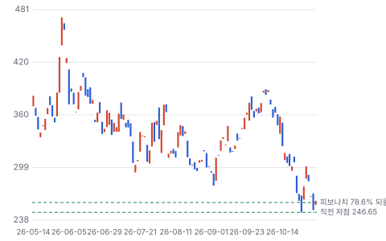

**주봉**

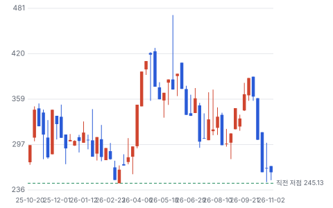

**월봉**

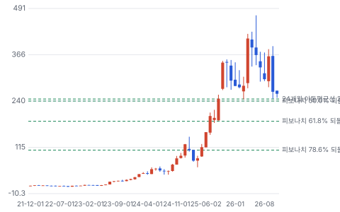

**분기 매출·EPS 실적과 컨센서스**

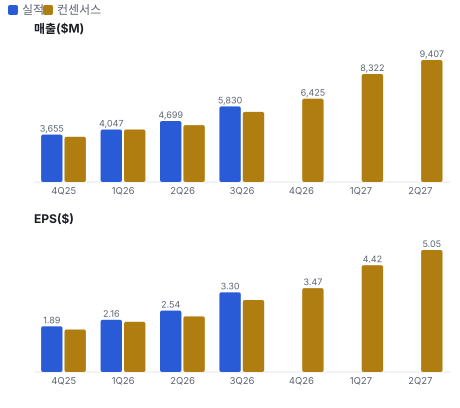

**밸류에이션 주가 시나리오**

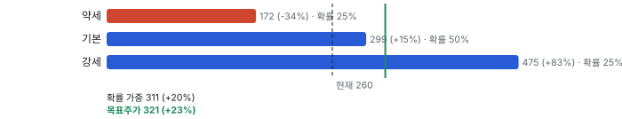

**주가별 업사이드**

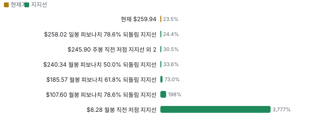

**제품·서비스 포트폴리오**

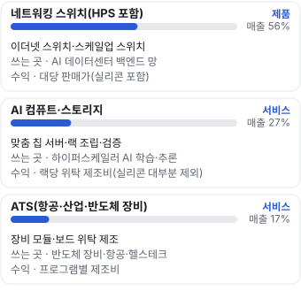

**고객 믹스(3Q26, 매출 대비)**

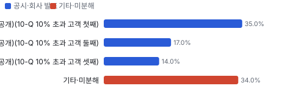

**공급 병목(10점, 낮을수록 병목)**

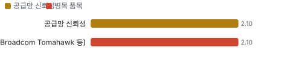

**CAPEX의 매출 대비 비중**

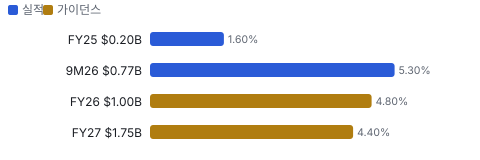

**어닝콜 변화별 주주가치 영향**

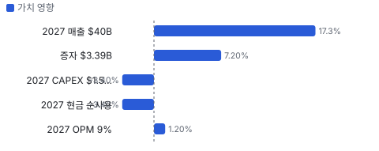

**멀티플 프리미엄**

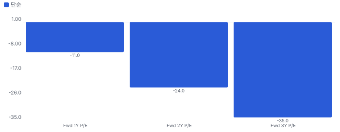

**합리적 멀티플**

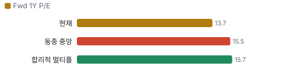

**일별 거래량 분해**

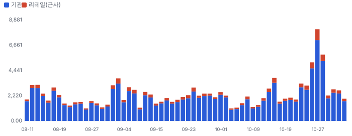

**기관 자금 흐름**

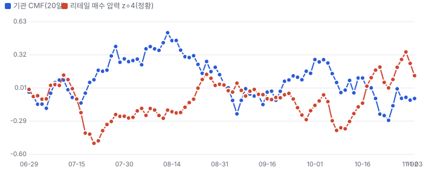

**몬테카를로**

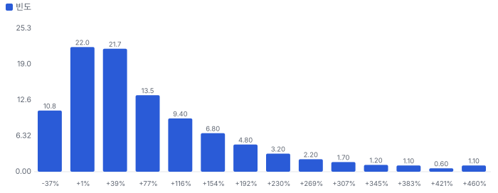

해석: 3,000번 중 2,374번(79%)에서 가치가 지금 주가 이상이었다. 가정을 흔들어도 지금 주가를 뒷받침하는 경우가 더 많다. 가운데 값은 1.49배이고, 열 번 중 여덟 번은 0.80~3.23배 사이에 든다.

## 내러티브

> **기업가치를 결정하는 이야기:** Fwd 1Y P/E 13.7배로 동종 5곳 중앙값 15.5배보다 낮다. 2027 가이던스 EPS \$21.50으로는 12.1배다. 시장은 성장률 90%를 EMS(전자제품 위탁 생산) 배수로 사고 있다. 할인의 근거는 셋 — 2027 현금 순사용, 상위 3사 66%, 8월 증자(주식 약 +9.7%). 이 셋 중 현금이 먼저 풀리면 배수가 오르고, 고객 한 곳이 흔들리면 이익 자체가 빠진다

> **멀티플·EPS 프리미엄**
> **멀티플:** Fwd 1Y P/E 13.7배, 동종 중앙값 15.5배보다 약 11% 낮다. Fabrinet(18.8배)·Plexus(20.0배)보다 싸고 Flex(13.9배)·Sanmina(13.0배)와 비슷하다
> **EPS:** 2027 매출은 2Q 콜 때 약 \$33B(추정)에서 \$40B로 올랐다. 분기 EPS 컨센서스 이력은 확인하지 못했다(미확인)

### 투자자들은 왜 열광했나

2025년 \$78에서 2026년 6월 \$472까지 올랐다. 800G(포트당 800기가비트 네트워크 세대) 스위치와 구글 TPU 랙이 '위탁 제조사가 AI 인프라 회사가 된다'는 이야기를 만들었다. 식은 이유는 8월 증자(−15%), 10월 AI 인프라 업종 하락, 그리고 3Q 콜의 2027 현금 순사용이다

### 무엇이 기업가치를 바꾸나

> **구조적 체질 변화**
> **변화:** CCS(연결·클라우드 솔루션 부문(데이터센터 네트워킹·컴퓨트·스토리지))가 매출의 80%를 넘고 설계까지 맡는 HPS(Celestica 자체 설계 하드웨어 플랫폼 사업(설계까지 맡는 제품))가 매출의 약 39%다. EMS에서 ODM(설계와 생산을 함께 맡는 위탁 제조) 쪽으로 옮겨 갔다
> **증거:** 3Q 콜(HPS \$2.3B), 2Q 콜(CCS 81%)
> **반증:** HPS 비중이 35% 아래로 내려간다

> **고부가 믹스 확장**
> **변화:** 2027 조정 영업이익률 9%(+60bp) 가이던스. 네트워킹·HPS가 마진에 유리하고 컴퓨트 위탁은 매출을 덜 키운다
> **증거:** 3Q 콜·분석가의 날 2026-10-27
> **반증:** 2027 분기 조정 영업이익률이 8.4% 아래

> **기술 혁신**
> **변화:** Tomahawk 6(Broadcom의 102.4Tbps 이더넷 스위치 칩) 기반 액체 냉각 스위치, AMD Helios 스케일업 스위치, 통합 광학 스위치(DS6005(Celestica의 통합 광학 스위치)) — 하이퍼스케일러 통합 광학 수주
> **증거:** 3Q 콜·분석가의 날 2026-10-27
> **반증:** 통합 광학 양산이 2028년으로 밀린다

> **실행 속도**
> **변화:** 샘플에서 양산까지 회사 일정 기준 약 9~12개월이다(OpenAI 랙 2026 4분기 샘플 → 2027 하반기 양산, Helios 스위치 2026 말 샘플 → 2027 상반기 램프). 이전 세대 값과 피어 값은 같은 기준 자료가 없다 **납품 리드타임 9~12개월.** 피어 비교 미확인. 이전 대비 미확인.
> **증거:** 3Q 콜·분석가의 날 2026-10-27
> **반증:** 샘플→양산이 18개월을 넘는다

> **M&A**
> **변화:** 해당 없음(최근 3년 중요 인수 공시 없음, 자체 투자로 성장)
> **증거:** 3Q 10-Q
> **반증:** 대형 인수 발표

> **정책·입법 연관성**
> **재정정책:** 해당 없음(보조금·세액공제 수령 공시 없음) 3Q 10-Q 반증: 미국 내 생산 보조금 수령 공시
> **행정명령:** 관세: 회사는 부품·제품 관세 비용을 대부분 고객에게서 회수한다고 가정한다(10-Q 전망 가정). 수출 통제·AI 관련 조치를 위험으로 적었다 3Q 10-Q 전망 가정 반증: 관세 회수가 막혀 매출총이익률이 50bp 넘게 하락 의회 동의 2/10 — 하원 1/5(Celestica 관련 하원 의결 기록을 찾지 못했다) · 상원 1/5(같음).
> **연관입법:** 해당 없음(회사를 직접 겨냥한 연방 법안을 찾지 못했다. 로비 공시는 키가 없어 미확인) 로비 조회 미확인 반증: AI 데이터센터 장비 수입 규제 법안

> **CAPEX 낙수효과**
> **변화:** 하이퍼스케일러·AI 연구소 설비투자가 스위치·랙 주문으로 온다. 고객 투자 발표를 이 회사 매출로 바로 옮기지 않는다 — 확인된 것은 프로그램 수주와 회사 가이던스다
> **증거:** 3Q 콜·분석가의 날 2026-10-27, 업계 자료(라이선스 요지)
> **반증:** 상위 고객 1곳이 2027 설비투자를 줄인다

### 내러티브 근거

> AI 데이터센터 스위치·랙을 설계까지 맡는 위탁 제조사라는 이야기다. 주가는 6/2 \$472에서 11/3 \$259.94로 −45%다. 같은 기간 회사는 2027 매출을 \$40B로 올렸다. 이익 추정은 올랐는데 배수가 줄었다 — 증자, 2027 현금 순사용, 고객 3곳 66% 집중이 할인의 이유다. 동종 대비 멀티플 차이 -11% 중 회사 고유 몫은 -13%다. 단계는 컨센서스, 쏠림은 중간이다.

> **이더넷 스케일업·1.6T 스위치** · 강화
> **논리:** AI 가속기를 묶는 스케일업 망이 이더넷으로 바뀌며 화이트박스 스위치 공급자가 커진다
> **숫자:** 1.6T 프로그램 10개(스케일업 4), 회사 인용 스케일업 이더넷 시장 2030년 \$55B
> **반증:** 2027 네트워킹 증가율이 업계 AI 백엔드 스위칭 증가율보다 낮다

> **맞춤 AI 칩 랙(TPU·OpenAI)** · 강화
> **논리:** 하이퍼스케일러 맞춤 칩이 늘수록 랙 단위 통합을 맡는 회사가 커진다
> **숫자:** 2026 컴퓨트·스토리지 \$5.6B(+170%), OpenAI·TPU 2027 하반기
> **반증:** OpenAI 램프가 2028년으로 밀린다

> **설계 역량 = 마진** · 유지
> **논리:** 설계까지 맡아 EMS보다 높은 마진을 받는다
> **숫자:** 조정 영업이익률 2027 9%(Jabil 4.7%·Flex 5.1% GAAP TTM)
> **반증:** 2027 분기 조정 영업이익률이 8.4% 아래

> **반대: 현금 전환** · 강화
> **논리:** 이익은 늘지만 운전자본이 현금을 먹는다. 2027 순현금 사용, 재고 \$4.5B, 매출채권 매각 시작
> **숫자:** TTM FCF \$545M vs 조정 순이익 약 \$1.2B(조정 EPS 4분기 합 \$9.89 × 희석 주식, 추정), 재고 연초 대비 +\$2.3B
> **반증:** 4Q26 현금 회전일 45일 이하 유지와 FCF 양(+)

> **반대: 고객 집중·이중 공급** · 유지
> **논리:** 고객 3곳 66%, 첫 수주 뒤 두 번째 공급사가 물량을 나눈다
> **숫자:** 상위 3사 35%·17%·14%
> **반증:** 4번째 10% 고객 등장

## 포트폴리오

| 제품·서비스 | 구분 | 무엇 | 쓰는 곳 | 돈 버는 방식 |
|---|---|---|---|---|
| 네트워킹 스위치(HPS 포함) | 제품 | 이더넷 스위치·스케일업 스위치 | AI 데이터센터 백엔드 망 | 대당 판매가(실리콘 포함) |
| AI 컴퓨트·스토리지 | 서비스 | 맞춤 칩 서버·랙 조립·검증 | 하이퍼스케일러 AI 학습·추론 | 랙당 위탁 제조비(실리콘 대부분 제외) |
| ATS(항공·산업·반도체 장비) | 서비스 | 장비 모듈·보드 위탁 제조 | 반도체 장비·항공·헬스테크 | 프로그램별 제조비 |

## 고객

> **3Q26 최대 고객 10% 초과 고객 1(이름 미공개)(10-Q 10% 초과 고객 첫째) 35%, 상위 3곳 66%, 집중도 보통.** 공시·회사 발표로 확인한 몫은 매출의 66%이고, 나머지 고객 몫은 추정이거나 미분해다. 10% 넘는 고객 3곳이 3Q 매출의 66%(35%·17%·14%)다. 1년 전 59%(30%·15%·14%)보다 더 쏠렸다. 회사는 이름을 공개하지 않는다. OpenAI·AMD는 프로그램 상대로 회사가 밝혔지만 매출 몫은 없다

**고객별 매출 몫(3Q26)**
| 고객 | 몫 | 변화 | 근거 |
|---|---|---|---|
| 10% 초과 고객 1(이름 미공개)(10-Q 10% 초과 고객 첫째) | 35% | +5%p | 공시 |
| 10% 초과 고객 2(이름 미공개)(10-Q 10% 초과 고객 둘째) | 17% | +2%p | 공시 |
| 10% 초과 고객 3(이름 미공개)(10-Q 10% 초과 고객 셋째) | 14% | +0%p | 공시 |
| OpenAI(맞춤 칩 랙 프로그램) | 미확인 | 미확인 | 공시 |
| 기타·미분해 | 34% | - | - |

> **10% 초과 고객 1(이름 미공개)(10-Q 10% 초과 고객 첫째)** · 공시
> **사는 것:** AI 컴퓨트·네트워킹(CCS)
> **추정 근거:** 업계 자료는 구글 TPU 관련 매출이 큰 회사로 분류한다 — 고객 이름은 가설

> **10% 초과 고객 2(이름 미공개)(10-Q 10% 초과 고객 둘째)** · 공시
> **사는 것:** 네트워킹(CCS)
> **추정 근거:** 1년 전 15%

> **10% 초과 고객 3(이름 미공개)(10-Q 10% 초과 고객 셋째)** · 공시
> **사는 것:** 네트워킹(CCS)
> **추정 근거:** 1년 전 14%

> **OpenAI(맞춤 칩 랙 프로그램)** · 공시
> **사는 것:** Jalapeño 랙(위탁 방식, 소재 매출 제외)
> **추정 근거:** 2027 하반기 램프. 매출 몫은 회사가 밝히지 않았다

## 수주·파이프라인

> **2026-10-27 기준 5건.** 건별 확정 금액은 공개되지 않았다.

**실행 속도와 방해 요인**
| 항목 | 상태 | 실행 속도 | 방해 요인 |
|---|---|---|---|
| 1.6T 스위치 프로그램 10개 | 조건부 | 수주→양산 미확인 | 부품 공급 · 고객 램프 일정 |
| OpenAI 맞춤 칩 랙(Jalapeño) | 조건부 | 샘플→양산 약 1년 | 고객 데이터센터 일정 · 실리콘 공급 |
| AMD Helios 스케일업 스위치(DS6010) | 조건부 | 미확인 | Helios 랙 채택 속도 |
| 하이퍼스케일러 통합 광학 스위치 | 조건부 | 미확인 | 통합 광학 수율 |
| 신규·기존 고객 대형 추진 건 | 파이프라인 | 미확인 | 선별 수주 |

## 마진 구조

> **GPM 11.0%, OPM 7.9%.** 3Q25 대비 GPM -2.0%p, OPM -2.3%p. 변동비는 매출의 84%이고, 매출이 10% 늘면 OPM은 +0.7%p 움직인다. 3Q 매출원가는 매출의 89.0%로 1년 전 87.0%보다 2.0%p 높다. 그래도 조정 영업이익률은 8.5%로 올랐다. 차이는 판관비다 — 3Q25 판관비(\$38.4M)는 주가 급등기의 TRS(주가에 연동한 총수익스와프(보상 주식 헤지)) 평가이익이 비용을 줄였다(10-Q가 TRS를 쓴다고 밝힘, 영향 크기는 추정)

> **매출 100 중 매출원가 88.5, 매출총이익 11.5(최근 4분기, 공시).** 매출원가 요인 중 부품·소재(실리콘·메모리·PCB(인쇄회로기판)·광)이 매출의 78.0%로 가장 무겁고, 단가가 +10% 오르면 GPM이 -7.80%p 움직인다. 분기 회귀로 매출 1이 늘 때 매출원가는 0.87 늘고, 매출원가의 고정비 몫은 2%다.

**비용 요인 강도 — 비중·추세·충격(+10%)·탄력**
| 비용 | 구분 | 매출 대비 | 1년 변화 | 마진 기여 | 충격 시 마진 | 매출 탄력 | 고정비 몫 |
|---|---|---|---|---|---|---|---|
| 부품·소재(실리콘·메모리·PCB·광) | 매출원가 요인 | 78.0% | 미확인 | 미확인 | -7.80%p | 미확인 | 0% |
| 제조 인건비·공장 간접비 | 매출원가 요인 | 6.5% | 미확인 | 미확인 | -0.65%p | 미확인 | 50% |
| 기타 매출원가 | 매출원가 요인 | 3.4% | 미확인 | 미확인 | -0.34%p | 미확인 | 50% |
| 감가상각 | 매출원가 요인 | 0.8% | -0.4%p | +0.4%p | -0.08%p | 미확인 | 100% |
| 재고 평가 손실 | 매출원가 요인 | 0.3% | -0.3%p | +0.3%p | -0.03%p | 미확인 | 0% |
| 매출원가 | 공시 항목 | 88.5% | +0.6%p | -0.6%p | -8.85%p | 0.87 | 2% |
| 판관비 | 공시 항목 | 2.0% | -0.2%p | +0.2%p | 미확인 | 0.01 | 76% |
| 연구개발 | 공시 항목 | 0.9% | -0.1%p | +0.1%p | 미확인 | 0.01 | -28% |
| 감가상각 | 공시 항목 | 0.2% | -0.2%p | +0.2%p | 미확인 | 0.00 | 89% |
| 기타 영업비용 | 공시 항목 | 0.0% | -0.2%p | +0.2%p | 미확인 | -0.00 | 100% |

매출 탄력 = 분기 비용을 매출에 회귀한 기울기(매출 1당 변동비), 고정비 몫 = 절편 ÷ 평균 비용. 표본이 8분기 미만이면 미확인. 매출원가 요인 비중은 margin 재료의 추정이 섞여 있고, 공시 매출원가와의 차이는 '기타 매출원가'로 둔다.

**GPM에서 OPM까지(GAAP)**
| 기간 | GPM | 연구개발 | 판관비 | 기타 | OPM |
|---|---|---|---|---|---|
| 3Q25 | 13.0% | 1.1% | 1.2% | 0.5% | 10.2% |
| 3Q26 | 11.0% | 0.9% | 2.0% | 0.2% | 7.9% |

**마진을 결정하는 비용 요인 — 비용 +10% 시 OPM**
| 비용 | 매출 대비 | 변화 | 고정비 | OPM |
|---|---|---|---|---|
| 부품·소재(실리콘·메모리·PCB·광) | 78.0% | 미확인 | 0% | -7.80%p |
| 제조 인건비·공장 간접비 | 6.5% | 미확인 | 50% | -0.65%p |
| 기타 매출원가 | 3.4% | 미확인 | 50% | -0.34%p |
| 판매관리비(TRS 평가손익 포함) | 2.0% | +0.8%p | 70% | -0.20%p |
| 연구개발비 | 0.9% | -0.3%p | 80% | -0.09%p |
| 감가상각 | 0.8% | -0.4%p | 100% | -0.08%p |
| 재고 평가 손실 | 0.3% | -0.3%p | 0% | -0.03%p |
| 무형자산 상각·기타 영업비용 | 0.2% | -0.3%p | 100% | -0.02%p |

**비용을 움직이는 요인**
| 비용 | 요인 |
|---|---|
| 부품·소재(실리콘·메모리·PCB·광)(매출원가) | 실리콘 포함 여부(네트워킹 포함·컴퓨트 위탁 제외), 메모리·PCB 단가 · 근거 추정 |
| 제조 인건비·공장 간접비(매출원가) | 태국·멕시코·미국 공장 인력, 가동률 · 근거 추정 |
| 기타 매출원가(매출원가) | 물류·관세 등 미분해 · 근거 추정 |
| 판매관리비(TRS 평가손익 포함)(판관비) | 인력, SBC, 주가 연동 TRS 평가손익 · 근거 공시 |
| 연구개발비(연구개발) | 엔지니어 1,600명 → 2,000명, 2027 R&D \$300M 이상 · 근거 공시 |
| 감가상각(매출원가) | CAPEX 증가(TTM \$862M) · 근거 공시 |
| 재고 평가 손실(매출원가) | 구형 프로그램 재고 · 근거 공시 |
| 무형자산 상각·기타 영업비용(기타) | 인수 무형자산 상각, 구조조정 · 근거 공시 |

**네트워킹 스위치(HPS 포함) BOM — 매출의 56%, GPM 12%(부문별 매출총이익 미공개. 회사는 네트워킹이 마진에 유리하다고만 밝혀 회사 평균 11.0%보다 약간 높게 둔 추정), 항목 가격 +10% 시**
| 항목 | 원가 몫 | 전가 | 제품 GPM | OPM |
|---|---|---|---|---|
| 스위치 실리콘(Broadcom Tomahawk 등) | 40~55% | 미확인 | -4.2%p | -2.34%p |
| 광·구리 인터커넥트·커넥터 | 8~15% | 미확인 | -1.0%p | -0.57%p |
| 고다층 PCB | 5~10% | 미확인 | -0.7%p | -0.37%p |
| 메모리·CPU(중앙 처리 장치) 모듈 | 3~8% | 미확인 | -0.5%p | -0.27%p |
| 미분해 | 28% | - | - | - |

**AI 컴퓨트·스토리지 BOM — 매출의 27%, GPM 9%(부문별 미공개. 위탁 방식(실리콘 제외)이라 매출은 작고 이익률 차이는 미확인 — 회사 평균보다 낮게 둔 추정), 항목 가격 +10% 시**
| 항목 | 원가 몫 | 전가 | 제품 GPM | OPM |
|---|---|---|---|---|
| 메모리·스토리지 | 20~35% | 미확인 | -2.5%p | -0.67%p |
| 보드·PCB 부품 | 20~35% | 미확인 | -2.5%p | -0.67%p |
| 랙·기구·액체 냉각 | 15~25% | 미확인 | -1.8%p | -0.49%p |
| 미분해 | 25% | - | - | - |

**ATS(항공·산업·반도체 장비) BOM — 매출의 17%, GPM 10%(3Q ATS 부문 이익률 6.6%에서 판관비를 되돌린 추정), 항목 가격 +10% 시**
| 항목 | 원가 몫 | 전가 | 제품 GPM | OPM |
|---|---|---|---|---|
| 전자 부품 | 40~60% | 미확인 | -4.5%p | -0.77%p |
| 정밀 가공 금속·소재 | 15~25% | 미확인 | -1.8%p | -0.31%p |
| 조립·검사 인력 | 10~20% | 미확인 | -1.4%p | -0.23%p |
| 미분해 | 15% | - | - | - |

스위치 실리콘(Broadcom Tomahawk 등) 가격이 +10% 오르면 영업이익은 -29.7% 움직인다. 판매가 전가를 모르는 항목은 전가 0%로 계산했다.

**BOM 항목 가격을 움직이는 것**
| 항목 | 요인 |
|---|---|
| 스위치 실리콘(Broadcom Tomahawk 등) | 스위치 원가의 가장 큰 몫 · 근거 추정 |
| 광·구리 인터커넥트·커넥터 | 1.6T에서 몫이 커진다 · 근거 추정 |
| 고다층 PCB | 400G SerDes(고속 직렬 신호 송수신 회로)로 기판 손실 예산이 빡빡해진다 · 근거 추정 |
| 메모리·CPU 모듈 | 스위치 제어부 · 근거 추정 |
| 메모리·스토리지 | 실리콘을 빼면 가장 큰 원가 · 근거 추정 |
| 보드·PCB 부품 | 맞춤 칩 보드 · 근거 추정 |
| 랙·기구·액체 냉각 | 랙 통합 범위가 넓어진다 · 근거 추정 |
| 전자 부품 | 장비 제어 보드 · 근거 추정 |
| 정밀 가공 금속·소재 | 장비 모듈 기구 · 근거 추정 |
| 조립·검사 인력 | 소량 다품종 · 근거 추정 |

**BOM 투입 물가 — PPI 전년비, 2026-11-03 수집**
| 항목 | 미국 | 일본 | 한국 | 대만 |
|---|---|---|---|---|
| 스위치 실리콘(Broadcom Tomahawk 등) | +1.5% | +5.9% | +0.0% | 미확인 |
| 보드·PCB 부품 | +45.8% | +11.3% | +4.5% | +11.2% |
| 메모리·스토리지 | -2.2%* | +3.9%* | +134.0% | +21.9%* |

별표는 품목보다 넓은 업종 지수다. 지난 1년 투입 물가를 판매가 전가 뒤 원가에 그대로 넣으면 OPM은 -15.05%p 움직인다(매출원가의 49% 기준).

## 공급망 병목

> **공급망 신뢰성 2.1/10, 병목 심각.** 가장 약한 고리는 스위치 실리콘(Broadcom Tomahawk 등) 2.1점이고, 품목 평균은 2.1점이다. 근거가 부족한 2건(메모리·스토리지 · 고다층 PCB)은 점수에서 뺐다. 약한 고리는 스위치 실리콘이다. Broadcom 한 곳 설계에 묶이고 리드타임이 52주를 넘는다. 메모리·PCB는 공급 계약으로 막았지만 상대와 물량은 공개되지 않았다

**병목과 마진 — 품목 가격 +10% 시 OPM**
| 품목 | 점수 | 판정 | 구분 | OPM |
|---|---|---|---|---|
| 스위치 실리콘(Broadcom Tomahawk 등)(필수) | 2.1 | 병목 심각 | 핵심 통제 품목 | -2.34%p |

> **스위치 실리콘(Broadcom Tomahawk 등)** · 2.1/10
> **왜:** 고객이 장기 리드타임 실리콘을 취소 불가로 주문했다(2Q 콜). 설계가 Broadcom 칩에 묶여 다른 공급사로 바꿀 수 없다
> **병목 요인:** 인증 공급사 1곳 · 캐파 부족 · 리드타임 미확인 · 재인증 미확인 · 1위 점유율 미확인 · 대만(TSMC(타이완 세미컨덕터 매뉴팩처링) 생산, 업계 구조 — 추정) 집중 100% · 물량 확보 장기계약
> **풀리는 조건:** 미확인

**공급사**
| 품목 | 공급사 | 몫 | 근거 |
|---|---|---|---|
| 스위치 실리콘(Broadcom Tomahawk 등) | Broadcom(스위치 칩(Tomahawk 6 — DS6000(Celestica의 Tomahawk 6 기반 스위치 제품군) 제품군)) | 미확인 | 회사 발표 |
| 메모리·스토리지 | 미공개(공급 계약 상대 미공시)(DRAM(D램 메모리)·SSD(플래시 저장 장치)) | 미확인 | 추정 |
| 고다층 PCB | 미공개(PWB(인쇄 배선 기판(PCB)) 공급 계약 상대 미공시)(고다층 기판) | 미확인 | 추정 |

**무역 통계로 본 공급 지역**
| 품목 | EU 수입처 | 일본 수입처 | EU 1위 전년비 |
|---|---|---|---|
| 스위치 실리콘(Broadcom Tomahawk 등) | JP(일본) 45% · US 35% · TW(대만) 7% | 大韓民国 36% · シンガポール 25% | +1090.7% |
| 메모리·스토리지 | TW 45% · KR(한국) 21% · CN(중국) 16% | 台湾 52% · 大韓民国 28% | +365.5% |
| 고다층 PCB | CN 85% · TW 4% · KR 4% | 中華人民共和国 62% · 台湾 11% | +25.2% |

## 생산능력

> **현재 명목 캐파 미확인, 가동률 미확인.** 착공 이상 증설은 0 거점(면적·라인 미공시), 발표까지 합치면 0 거점(면적·라인 미공시)이다. 9M26 CAPEX는 \$0.77B로 매출의 5.3%다. 회사는 명목 캐파와 가동률을 숫자로 내지 않는다. 2026 CAPEX 약 \$1.0B, 2027 \$1.5~2.0B는 이미 수주한 프로그램용이라고 밝혔다. 증설은 태국 캠퍼스, 텍사스 리처드슨·포트워스, 일본, 말레이시아다

**생산능력 확충 계획**
| 계획 | 단계 | 증설 | 가동 시점 | CAPEX |
|---|---|---|---|---|
| 텍사스 리처드슨 확장 | 발표 | 미확인 | 미확인 | 미확인 |
| 태국 플래그십 캠퍼스 증설 | 발표 | 미확인 | 2027-12 | 미확인 |
| 일본·말레이시아 표적 투자 | 발표 | 미확인 | 미확인 | 미확인 |

남은 계획의 CAPEX 합계는 \$0.00B(금액 미확인 3건 제외)다. 합계는 FY27 매출의 0%다.

**증설 방해 요인**
| 계획 | 방해 요인 |
|---|---|
| 텍사스 리처드슨 확장 | 인력 |
| 태국 플래그십 캠퍼스 증설 | 장비·인력·전력 |
| 일본·말레이시아 표적 투자 | 고객 일정 |

**CAPEX와 매출 대비**
| 기간 | CAPEX | 매출 | 매출 대비 | 구분 |
|---|---|---|---|---|
| FY25 | \$0.20B | \$12.39B | 1.6% | 실적 |
| 9M26 | \$0.77B | \$14.58B | 5.3% | 실적 |
| FY26 | \$1.00B | \$21.00B | 4.8% | 가이던스 |
| FY27 | \$1.75B | \$40.00B | 4.4% | 가이던스 |

## 해자

> 해자는 설계부터 대량 생산까지 한 회사가 하는 구조(HPS)와, 그 구조로 먼저 따낸 1.6T 스위치 프로그램, 그리고 장기 리드타임 부품을 먼저 확보한 공급 계약이다. 고객 3곳 집중과 이중 공급 관행이 해자를 깎는다

> **설계+양산 통합(HPS·JDM(고객과 공동 설계하는 제조))** · 보통
> **해자:** 하이퍼스케일러가 스위치·랙을 설계 단계부터 맡기고, 같은 회사가 양산 수율 문제를 일찍 푼다. 설계만 하는 회사와 생산만 하는 회사 사이 자리를 차지한다
> **근거:** 3Q 콜: 엔지니어 1,600명 → 2,000명, 2027 R&D \$300M 이상. 2Q 콜: 첫 수주 뒤 이중 공급으로 옮겨 간 물량을 고객이 다시 맡기는 사례
> **숫자:** 3Q HPS 매출 \$2.3B(+70%), 매출의 약 39%
> **깨지는 조건:** HPS 매출 증가율이 회사 전체 증가율보다 두 분기 연속 낮다

> **이더넷 스위치 선행 수주(1.6T·스케일업)** · 보통
> **해자:** 1.6T 세대 프로그램 10개(스케일업 4·스케일아웃 6)와 AMD Helios 스케일업 스위치를 먼저 따냈다
> **근거:** 3Q 콜(CFO 답변), AMD DS6010 발표, Bernstein 업종 자료가 AI 백엔드 스위칭 공급자로 분류
> **숫자:** 1.6T 프로그램 10개, 하이퍼스케일러 통합 광학 스위치 수주 1건
> **깨지는 조건:** 1.6T 램프에서 이중 공급사 몫이 늘어 네트워킹 증가율이 업계 증가율보다 낮다

> **장기 리드타임 부품 선확보** · 약함
> **해자:** 리드타임 52주를 넘는 실리콘·메모리·PCB를 고객 취소 불가 주문과 공급 계약으로 먼저 잡아 두었다. 공급이 막힐 때 물량을 옮겨 받는 근거가 된다
> **근거:** 2Q 콜 2026-07-27: 고객의 취소 불가 실리콘 주문, 메모리·PWB 공급 계약
> **숫자:** 재고 \$4.51B(원재료 \$3.54B), 연초 대비 +\$2.32B
> **깨지는 조건:** 공급이 풀려 리드타임이 26주 아래로 내려온다 — 이 해자는 공급 부족 때만 작동한다

## 경영진·네트워크

> Rob Mionis가 CEO이고, 10/1부터 Todd Ankenmann이 CFO, 전 CFO Mandeep Chawla가 신설 Group President다. 정치·사모임 연결은 공개 자료로 확인하지 못했다(로비 공시 조회는 키가 없어 미확인)

> **Rob Mionis** · 사장·CEO · 미확인
> **프로필:** 3Q 콜·분석가의 날 발표를 이끈 경영진
> **비즈니스:** 미확인
> **정계:** 미확인
> **동문:** 미확인
> **사모임:** 미확인

> **Todd Ankenmann** · CFO · 2026-10
> **프로필:** 2018년 입사, 10/1 CFO 취임(8-K)
> **비즈니스:** 미확인
> **정계:** 미확인
> **동문:** 미확인
> **사모임:** 미확인

> **Mandeep Chawla** · Group President, Global Markets(전 CFO) · 2026-10
> **프로필:** 2010년 입사, 2017~2026 CFO, 이전 GE(미국 General Electric) 근무(8-K)
> **비즈니스:** CCL(캐나다 포장재 회사 CCL Industries) Industries 이사(8-K)
> **정계:** 미확인
> **동문:** 퀸스대 재무 석사·맥마스터대(8-K)
> **사모임:** 미확인

**네트워크 정량화**
| 연결 | 강도 | 닿는 매출 | 가중 노출 | 매출 대비 | 근거 |
|---|---|---|---|---|---|
| 비즈니스: Chawla의 CCL Industries 이사직 | 1/5 | \$0.00B | \$0.00B | 0% | 포장재 회사로 Celestica 매출과 맞물리는 근거가 없다 9/11 8-K |

가중 노출은 연결이 닿는 매출의 크기다. 연결이 그 매출을 만들었다는 뜻이 아니며, 인과는 공개 자료로 입증하지 못한다.

## 약세 논리 및 셀온 조건

| 약세 논리 | 근거 | 반박 | 가를 자료 |
|---|---|---|---|
| 현금이 이익을 못 따라간다 | TTM FCF \$545M, 2027 현금 순사용, 3Q 매출채권 매각 \$700.8M 신규 | 3Q 현금 회전일 42일(1년 전 65일), 순현금 약 \$2.9B | 4Q26 FCF·현금 회전일, 2027 순사용 범위 |
| 고객 1곳이 35%다 | 3Q 10-Q: 10% 초과 고객 3곳 35%·17%·14%(1년 전 30%·15%·14%) | 2·3위 몫 유지, OpenAI·AMD 프로그램이 새로 붙는다 | 4번째 10% 고객, 1위 고객 2027 설비투자 |
| 공급이 풀리면 재고가 짐이 된다 | 원재료 재고 \$3.54B(12월 \$1.78B) | 실리콘은 고객 취소 불가 주문이다(2Q 콜) | 재고 평가 손실(3Q \$18.5M)과 리드타임 |
| 2027 하반기에 몰려 있다 | 3Q 콜: TPU·OpenAI가 2027 하반기 쏠림 | 상반기에 1.6T 10개·Helios 스위치 램프 | 1Q27 가이던스(2027-01 말) |
| 이중 공급이 가격을 깎는다 | 2Q 콜: 첫 수주 뒤 물량 일부가 두 번째 공급사로 간다 | 회사: 고객이 넘긴 물량을 다시 맡기는 사례가 있다 | 2027 매출총이익률 11%대 유지 |
| 증자로 주당 가치가 줄었다 | 8월 1,113만 주(주식 약 +9.7%, 주당 \$310) | TSX(토론토 증권거래소) 자사주 매입 최대 313만 주(11/3부터) | 자사주 매입 실제 집행, 추가 증자 여부 |

> **셀온 조건**
> **조건 1:** 4Q26 매출이 가이던스 하단 \$6.275B 아래다
> **조건 2:** 2027 상반기 분기 조정 영업이익률이 8.4% 아래다
> **조건 3:** 회사가 2027 순현금 사용이 순현금(\$2.9B)을 넘는다고 밝히거나 추가 증자를 한다
> **조건 4:** 10% 초과 고객 한 곳의 몫이 두 분기 연속 줄고 회사가 프로그램 이연을 밝힌다
> **조건 5:** OpenAI 랙 양산이 2028년으로 밀린다

## 어닝콜 변화

**직전 콜 대비 새로 나오거나 바뀐 내용 → 가치 영향**
| 항목 | 내용 | 직전 콜 | 최신 콜 | 모델 동인 이동 | 확신도 | 가치 영향 |
|---|---|---|---|---|---|---|
| 업데이트 | 2027 매출 가이던스 | 2026(65%)보다 빠른 성장, 약 \$33B(추정) | \$40B(+90%) | 1년차 성장률 +20.0% | 0.8 | +17.3% |
| 신규 | 2027 조정 영업이익률 | 추가 확대(숫자 없음) | 9%(+60bp), 매출총이익률 11%대 초반 | 목표 이익률 +0.50% | 0.8 | +1.2% |
| 업데이트 | 2027 CAPEX | \$1.5B 잠정 | \$1.5~2.0B(수주 프로그램 한정) | 매출÷투하자본 -50.0% | 0.8 | -3.4% |
| 부정 | 현금흐름 | 2026 FCF \$5~6억에서 상향 | 2026 FCF 하향, 2027 순현금 사용 | 매출÷투하자본 -50.0% | 0.8 | -3.4% |
| 신규 | 유상증자 | 순차입 \$204M(6/30) | 순현금 약 \$2.9B(9/30, 리스 포함 차입 기준) | 순차입 -\$3.39B | 1.0 | +7.2% |
| 반복 | OpenAI 맞춤 칩 랙 | 2027 양산, 수십억 달러 | 2027 하반기 쏠림, 위탁 방식(소재 매출 제외) | 1년차 성장률 — | 0.8 | +0.0% |
| 반복 | 통합 광학 스위치 | 2027 상반기 샘플, 하반기 양산 | 하이퍼스케일러 수주 확인, 일정 유지 | 1년차 성장률 — | 0.8 | +0.0% |
| 부정 | 고객 집중 | 63%(2Q) | 66%(35%·17%·14%) | 1년차 성장률 — | 1.0 | +0.0% |
| **합계** | 단독 합 |  |  | 동시 적용 +21.5% |  | **+18.9%** |

## 거시 지표 싱크로율

> **미국 반도체 PPI(생산자물가지수)와 매출 싱크로율 96%(1분기 선행, 전년 대비, 표본 6개·신뢰 참고용).** 이 지표가 내포하는 4Q26 매출은 5.50B(±1σ 5.23B~5.77B)다. 가이던스는 이보다 +16.8%(범위 위), 컨센서스는 +16.8%(범위 위)다. 매출은 하이퍼스케일러 장비 구매를 따라가고, 원가는 PCB·메모리 가격을 따른다. 미국 PCB·반도체 PPI가 매출·영업이익과 같이 움직이는지 본다

**지표별 싱크로율(상관계수 × 100)**
| 지표 | 증가율 기준 | 지표 선행 | 매출 | 영업이익 | 방향 일치 | 표본·신뢰 | 4Q26 내포 매출 |
|---|---|---|---|---|---|---|---|
| 미국 PCB PPI | 전년 대비 | 0분기 | 92% | -66%(1분기) | 100% | 7·참고용 | 미확인 |
| 미국 반도체 PPI | 전년 대비 | 1분기 | 96% | -83%(1분기) | 17% | 6·참고용 | +50.6% → 5.50B(확정) |
| 일본 통신장비(HS(국제 품목 분류 코드) 8517) 수입 | 전 분기 대비 | 0분기 | 35% | -96%(1분기) | 50% | 6·참고용 | 미확인 |

**지표를 고른 이유**
| 지표 | 이유 |
|---|---|
| 미국 PCB PPI | 보드·스위치 원가 |
| 미국 반도체 PPI | 실리콘·메모리 원가 대용 |
| 일본 통신장비(HS 8517) 수입 | 회사가 일본으로 스위칭 생산을 옮겨 일본 쪽 흐름이 생긴다(참고) |

싱크로율은 증가율의 상관계수이며 인과가 아니다. 지표 단위·통화는 원자료 그대로이고 나라끼리 더하지 않는다(EU(유럽연합) 수입만 상대국 합계). ±1σ는 회귀 잔차 표준편차다.

## 밸류에이션

> **목표주가 \$321, 업사이드 +23%.** 자리는 기본과 강세 사이(강세 쪽 12%)이고 도달 확률은 약 45%다. 기본 \$299, 강세 \$475(+83%), 약세 \$172(-34%). DCF 기준 업사이드는 기본 +52%, 강세 +187%, 약세 +13%다(WACC 8.9%).

배수 기준 기본 \$299(+15%)와 DCF 기본 업사이드 +52%의 차이는 기간이다. 배수는 다음 4개 분기 EPS(\$18.94)만 보지만, DCF는 2027 가이던스(+90%)와 2028 추정(+35%)의 이익을 모두 넣는다. 그래서 DCF는 장기 이익률을 9%로 묶고 증분 매출 ÷ 증분 자본을 3.5로 낮춰도(추정, 2027 현금 순사용 반영) 배수보다 높다. 반대로 DCF가 틀리는 길은 하나다 — 2027 성장이 가이던스 범위 하단에 머물면 DCF와 배수가 함께 내려간다. 약세 \$172는 EPS \$14.5에 동종 하단 배수를 곱한 값이다.

> **약세 \$172 (-34%)** · 확률 25%
> **가정:** 11.9배 × EPS \$14.50
> **근거:** 4Q가 가이던스 하단에 그치고 OpenAI·TPU 램프가 2028년으로 밀려 2027 매출이 가이던스 범위 하단(\$36B)에 가깝다

> **기본 \$299 (+15%)** · 확률 50%
> **가정:** 15.8배 × EPS \$18.90
> **근거:** 4Q \$6.4B 뒤 2027 상반기 1.6T·Helios 램프, 하반기 OpenAI·TPU. 다음 4개 분기 EPS 컨센서스 \$18.94와 같은 높이

> **강세 \$475 (+83%)** · 확률 25%
> **가정:** 19.8배 × EPS \$24.00
> **근거:** 부품 공급이 풀려 2027 매출이 \$45B 위로 가고 조정 영업이익률이 9%를 넘는다

**멀티플 선정 — Fwd 1Y P/E**
| 단계 | 조정 | 근거 |
|---|---|---|
| 동종 중앙값 | 15.5배 | 범위 12.9~20.0배, 5곳 |
| 펀더멘털 | +1% | 성장·이익률·ROIC(투하자본이익률)로 본 합리적 멀티플 15.7배와의 차이의 일부만 인정 |
| 해자 | +2% | 설계+양산 통합(HPS·JDM) 보통 · 이더넷 스위치 선행 수주(1.6T·스케일업) 보통 · 장기 리드타임 부품 선확보 약함 |
| 내러티브 | +0% | 단계 컨센서스 |
| 사이클·실행 판단 | +0% | 성장은 동종보다 훨씬 빠르지만 상위 3개 고객이 매출의 66%이고 2027년 현금을 순사용한다. 두 요인이 상쇄된다고 보고 판단 조정은 0으로 둔다 |
| **선정** | **15.8배** | 지금 13.7배 |

**동종 레인지**
| 회사 | Fwd 1Y P/E | Fwd 2Y P/E | Fwd 3Y P/E | 성장 | 영업이익률 | ROIC |
|---|---|---|---|---|---|---|
| JBL | 15.5 | 12.1 | 10.3 | 24% | 6% | 52% |
| FLEX | 13.9 | 10.4 | 8.2 | 30% | 8% | 25% |
| SANM | 12.9 | 10.8 | 10.0 | 21% | 7% | 22% |
| FN | 18.8 | 15.9 | 13.9 | 35% | 11% | 24% |
| PLXS | 20.0 | 17.1 | 15.4 | 16% | 6% | 15% |
| **Celestica** | 13.7 | 9.2 | 6.7 |  |  |  |

지금 주가가 요구하는 5년 매출 CAGR 14%, 기본 시나리오 27%. 몬테카를로 중앙값 업사이드 +49%.

> 의사결정 보조(투자자문 아님): ① 매수 매력: 연 기대수익 +22.3% (자기자본비용 8.9% 대비 +13.4%p) · 자본비용 초과 확률 78% · 안전마진 0.80 → 정량 신호 중립 / ② 위험 예산 지표(이론): 1/4 켈리 10.0% (상한 10%) · 5년 하위10% +22% · 30%+ 손실 확률 1% / ③ 상방(5년): 기대 2.74배 · 2배 60% · 3배 32% · 10배 0% · 상위10% 4.86배

투입 물가 점검: 지난 1년 PPI를 BOM에 넣으면 OPM -15.05%p다(매출원가의 49% 기준).

## 매수 위치(일봉)

> **현재가 \$260는 '지지 근접'(가장 가까운 일봉 지지 \$258에서 ATR 0.1배 위).** 이 자리에서 목표주가까지 +23.5%, 첫 일봉 저항까지 +2.7%, 다음 지지까지 하방 -0.7%, 손익비 31.9배.

**가격대별 업사이드(일봉 기준)**
| 가격대 | 가격 | 목표주가까지 | 첫 저항까지 | 다음 지지까지 | 손익비 | 근거 기법(강도) |
|---|---|---|---|---|---|---|
| 현재가 | \$260 | +23.5% | +2.7% | -0.7% | 31.9 | - |
| 지지 1 | \$258 | +24.4% | +3.5% | -4.4% | 5.5 | 피보 78.6%(1.0) |
| 지지 2 | \$247 | +30.1% | +4.6% | 미확인 | 미확인 | 120일 지그재그 저점 · 스윙 저점(1.8) |

**일봉 저항**
| 저항 | 가격 | 현재가 대비 | 근거 기법(강도) |
|---|---|---|---|
| 저항 1 | \$267 | +2.7% | 피보 61.8%(1.0) |
| 저항 2 | \$273 | +5.1% | 피보 50.0%(1.0) |
| 저항 3 | \$279 | +7.2% | 120일 지그재그 저점 · 피보 38.2%(1.8) |

일봉만 쓴다(주봉·월봉 제외). 손익비 = 목표주가까지 업사이드 ÷ 다음 지지까지 하방. 가격대별 기대값 참고표이며 매수·매도 시점 지시가 아니다.

## 애널리스트 토론

> **토론 결론 Buy(규칙 등급 Buy).** 2027 가이던스 대비 배수가 동종보다 낮다는 반박은 살아남았다. 현금 순사용 범위가 숫자로 없다는 반박도 살아남아 강한 쪽으로 가지 못했다

**패널(가상 애널리스트)**
| 자리 | 애널리스트 | 핵심 논리 | 틀리는 조건 | 최종 투표 |
|---|---|---|---|---|
| Strong Buy | 정하윤(가상 리서치 하우스 한빛증권) | 2027 가이던스 EPS \$21.50에 12배다. 90% 성장을 EMS 배수로 산다 | 4Q 매출이 가이던스 하단 \$6.275B 아래 | Buy |
| Buy | 오세린(가상 리서치 하우스 청해캐피털) | 1.6T·스케일업 수주가 2027~2028 매출을 받친다. 현금은 램프가 끝나면 돌아온다 | 2027 상반기 현금 회전일 55일 초과 | Buy |
| Neutral | 문태경(가상 리서치 하우스 동해리서치) | 이익은 오르지만 현금이 안 따라오고 고객 3곳이 66%다. 할인은 이유가 있다 | 2027 FCF가 양(+)으로 돌아선다 | Neutral |
| Sell | 권도희(가상 리서치 하우스 서해자산) | 공급 부족이 끝나면 선확보 재고가 부담이 되고 이중 공급사가 가격을 깎는다 | 2027 매출총이익률 11%대 유지 | Neutral |
| Strong Sell | 백준호(가상 리서치 하우스 북해증권) | 고객 1곳이 35%다. 그 고객이 설비투자를 줄이면 이익이 바로 빠진다 | 4번째 10% 고객 등장 | Sell |

**투표**
| Strong Buy | Buy | Neutral | Sell | Strong Sell |
|---|---|---|---|---|
| 0 | 2 | 2 | 1 | 0 |

> **개회 · Strong Buy**
> **발언:** 2027 가이던스 EPS \$21.50에 지금 주가는 12.1배다. 동종 중앙값 15.5배까지만 가도 \$333이다

> **개회 · Buy**
> **발언:** 1.6T 10개와 OpenAI·AMD 랙이 2027 매출의 근거다. 순현금 약 \$2.9B라 현금 순사용을 견딘다

> **개회 · Neutral**
> **발언:** TTM FCF는 \$545M인데 조정 이익은 그 두 배를 넘는다. 2027은 순사용이다. 시장은 그 차이를 깎고 있다

> **개회 · Sell**
> **발언:** 원재료 재고가 \$3.54B로 연초의 두 배다. 공급이 풀리면 이 재고의 가격이 먼저 떨어진다

> **개회 · Strong Sell**
> **발언:** 고객 한 곳이 35%다. 이 집중은 1년 전 30%보다 더 커졌다

> **반박1 · Neutral → Strong Buy**
> **발언:** \$21.50은 가이던스 범위 \$14.70~47.02의 가운데가 아니다. 하단이면 17.7배로 할인이 아니다

> **반박1 · Buy → Sell**
> **발언:** 재고는 고객의 취소 불가 주문과 짝을 이룬다(2Q 콜). 가격 위험의 상당 부분은 고객 몫이다

> **반박1 · Strong Buy → Strong Sell**
> **발언:** 1위 고객 몫이 커진 것은 그 고객 램프 때문이고, 2·3위도 15%·14%에서 17%·14%로 유지됐다

> **반박1 · Sell → Buy**
> **발언:** 취소 불가 주문은 실리콘만 덮는다. 메모리·PCB 공급 계약의 가격 조건은 공개되지 않았다

> **반박1 · Strong Sell → Neutral**
> **발언:** 현금만이 아니다. 매출채권 매각 \$700.8M이 3Q에 처음 생겼다 — 현금 회전일 42일은 그만큼 꾸민 값이다

> **반박2 · Buy → Strong Sell**
> **발언:** 매출채권 매각을 빼도 현금 회전일은 대략 50일대로 1년 전 65일보다 짧다(추정)

> **반박2 · Neutral → Buy**
> **발언:** 그 추정은 맞을 수 있지만 2027 순사용 범위를 회사가 숫자로 주지 않았다. 그게 할인의 핵심이다

> **반박2 · Strong Buy → Sell**
> **발언:** 매출총이익률은 2026 내내 11%대였고 회사는 2027도 11%대 초반을 말했다

> **반박2 · Sell → Strong Buy**
> **발언:** 동종 중앙값 15.5배는 Fabrinet·Plexus가 끌어올린 값이다. Jabil·Flex·Sanmina는 13~15배다

> **반박2 · Strong Sell → Strong Buy**
> **발언:** 2027 하반기에 OpenAI·TPU가 몰린다. 상반기 숫자가 약하면 가이던스 신뢰가 먼저 흔들린다

> **최종 · Strong Buy** · Buy
> **발언:** 배수 하단 논리는 남는다. 다만 하반기 쏠림을 인정해 한 단계 내린다

> **최종 · Buy**
> **발언:** 현금 순사용 범위가 나오기 전까지 Buy를 유지한다

> **최종 · Neutral**
> **발언:** 2027 순사용 범위와 4Q 현금 회전일을 확인할 때까지 가운데에 둔다

> **최종 · Sell** · Neutral
> **발언:** 재고 가격 위험은 남지만 마진 가이던스를 깰 증거는 아직 없다

> **최종 · Strong Sell** · Sell
> **발언:** 고객 집중 위험은 그대로라 Sell 쪽에 남는다

남은 반대 의견: Sell 자리: 고객 1곳 35%와 2027 하반기 쏠림은 가이던스 한 번 놓치면 배수와 이익이 함께 빠지는 구조다

패널은 가상 인물이고 실존 IB의 의견이 아니다.

## 시장 평가

> **셀사이드(IB 애널리스트)**
> **한 줄:** 셀사이드는 만장일치 매수지만 목표가는 이익보다 덜 올렸다 — 배수 상향은 기대하지 않는다는 뜻이다
> **의견 분포:** Buy 25 · Hold 0 · Sell 0 — 전원 매수
> **목표가 평균:** \$461(범위 \$385~535) — 현재가 대비 +78%
> **확신 목록 대형사:** EPS +8%, 목표가 −9% — 이익↑·배수↓

> **바이사이드(기관 투자자)**
> **한 줄:** \$3.45B 증자를 하루 만에 소화했다. 수요는 있었지만 가격은 \$310으로 눌렸다
> **기관 보유:** 68.2% — 미확인
> **8월 증자 소화:** \$3.45B(주당 \$310) — 발표일 −15.3%
> **13F:** 미수집 — 3Q 13F 11월 중순

> **언론·업계**
> **한 줄:** AI 인프라 업종 하락 기사 안에서 함께 다뤄진다
> **보도 초점:** 분석가의 날·OpenAI 랙 — —

## 체크리스트

| 시점 | 무엇 | 의미 |
|---|---|---|
| 2026-11 중순 | 3Q 13F | 10월 −31% 구간에 기관이 팔았는지 |
| 2026-11~12 | 자사주 매입 집행 | 증자 뒤 주당 가치 방어 의지 |
| 2027-01 말(예상) | 4Q26 실적·1Q27 가이던스 | 4Q 매출 \$6.275~6.575B, FCF·현금 회전일, 상반기 램프 속도 |
| 2027-02(예상) | FY2026 10-K | 구매 약정 잔액, 10% 고객, 공급 계약 |
| 2027 상반기 | AMD Helios 스위치 램프 | 스케일업 매출 첫 확인 |
| 2027 하반기 | OpenAI 랙·통합 광학 스위치 양산 | 2027 \$40B의 하반기 몫 |

## 출처
- Celestica 3Q26 10-Q https://www.sec.gov/Archives/edgar/data/1030894/000103089426000050/cls-20260930.htm
- 3Q26 실적 8-K(2026-10-26) https://www.sec.gov/Archives/edgar/data/1030894/000103089426000049/cls-20261026.htm
- 분석가의 날 자료 8-K(2026-10-27) https://www.sec.gov/Archives/edgar/data/1030894/000110465926118978/tm2628147d1_8k.htm
- 유상증자 8-K(2026-08-07) https://www.sec.gov/Archives/edgar/data/1030894/000110465926092676/tm2621135d2_8k.htm
- CFO 교체 8-K(2026-09-11) https://www.sec.gov/Archives/edgar/data/1030894/000110465926107079/tm2625204d1_8k.htm
- 자사주 매입 8-K(2026-10-30) https://www.sec.gov/Archives/edgar/data/1030894/000103089426000054/cls-20261030.htm
- Celestica 3Q 콜·분석가의 날 2026-10-27, 2Q 콜 2026-07-27(요지만)
- 라이선스 자료 요지 포함(IB 업종 입문서·AI 설비투자 지도·확신 목록 노트, 마스터 노션) — 외부 공유 금지
- 마스터 노션 자료: 미확인 Bernstein_-_US_Networking_-_Connecting_the_dots..._A_primer_on_networking_equipment_in_the_age_of_AI_-_8_Oct_2026.pdf (요지만, 외부 공유 금지)
- 마스터 노션 자료: MS MS_-_Following_AIs_1.6_trillion_Money_Trail_-_Mapping_the_Revenue_Generated_by_the_Capex_Boom(1).pdf (요지만, 외부 공유 금지)
- 마스터 노션 자료: 미확인 US_Conviction_List_-_Directors__Cut__November_2026_Update_-_Mid-earnings_thoughts.pdf (요지만, 외부 공유 금지)
- 3Q 콜·분석가의 날 2026-10-27
- https://www.sec.gov/Archives/edgar/data/1030894/000103089426000050/cls-20260930.htm
- 2Q 콜 2026-07-27
- 2Q 콜 2026-07-27: PWB 공급 계약
- 2Q 콜 2026-07-27: 메모리 공급 계약
- 2Q 콜 2026-07-27: 메모리 공급 계약, 스토리지 수요 강세
- 2Q 콜: 네트워킹 매출에 실리콘이 들어간다
- 2Q 콜: 네트워킹은 실리콘을 매출에 넣고 컴퓨트는 대부분 넣지 않는다
- 2Q 콜: 의도적 고가동, 공장 생산성 두 자릿수 개선
- 3Q 콜·분석가의 날 2026-10-27: 1.6T에서 구리 거리 제약, 광 비중 증가
- 3Q 콜·분석가의 날 2026-10-27: 랙 단위 통합
- 3Q 콜·분석가의 날 2026-10-27: 반도체 장비 사업 성장
- 공시 매출원가와의 차이

_구매 등급·목표주가 모두 규칙이 계산한 모델 값으로, 개인의 보유 종목·자금 사정을 반영하지 않는다 · 공개 자료 기반 분석이며 투자 권유가 아님 · 1차 판정, 미검증 · Chiip ten-bagger_