# 텐배거 리포트 2026-11-04 — Credo — 이익 추정은 +19% 올랐는데 주가는 고점 대비 −50%, 시장이 깎는 것은 이익의 지속성이다

> 2026-11-04 · Credo(CRDO) · 기업: AI 데이터센터의 GPU·스위치를 잇는 능동형 구리 케이블(AEC)과 고속 연결 칩을 설계하는 팹리스

## Chiip View

주가는 6/22 고점 \$302.52에서 11/3 \$150.91로 −50%다. 시가총액은 \$30.31B(완전 희석 기준), 순현금 \$0.74B를 뺀 EV는 \$29.57B다. 같은 기간 FY27 EPS 컨센서스는 \$5.24에서 \$6.23으로 +19% 올랐다 — 떨어진 것은 이익이 아니라 배수다(Fwd 1Y P/E 6월 말 45배 → 19.5배). **우리가 다르게 보는 곳은 '반토막이니 싸다'는 읽기다.** 19.5배는 동종 중앙값 23.7배보다 낮지만, 이미 다음 4개 분기 EPS \$7.37(이 EPS로 직접 나누면 20.5배) — 하반기 광 매출 \$600M과 AEC(능동형 전기 케이블 — 양 끝에 신호 보정 칩을 넣은 구리 케이블) 동반 성장 — 을 다 믿은 숫자다. 회사는 하반기 AEC 숫자를 주지 않았다. 엔진 목표주가는 \$139(−8%), 규칙 등급은 Neutral이다. 12월 2Q 콜의 3Q 가이던스가 컨센서스 \$644~682M을 넘으면 강세 \$218(+44%) 쪽이, 못 미치면 약세 \$81(−46%) 쪽이 열린다.

## 대시보드
| 항목 | 값 | 설명 |
|---|---|---|
| 주가 | \$150.91 | 고점 대비 -50% · 1년 -16% |
| 시가총액 | \$30.31B | 완전 희석 기준 · EV \$29.57B |
| 업사이드 | -8% | 목표주가 \$139 · 다운사이드 -46% · 손익비(강세÷약세) 1.0 |
| 구매등급 | Neutral | 애널리스트 19명: Strong Buy 16 · Buy 1 · Neutral 2 · Sell 0 · Strong Sell 0 |
| 멀티플 | Fwd 1Y P/E 19.5배 | 동종 중앙값 23.7배 |
| 가이던스 2Q FY27 | \$530M · \$1.29 | 컨센서스 미확인 |
| 알파 | 5.6/10 | 텐배거 가능성 점수 |
| 이벤트 | 2Q FY27(10/31 마감) 실적 — 날짜 미공시, 전년 12/1·직전 9/1 발표 기준 추정. 가이던스 매출 \$525~535M·조정 매출총이익률 67~69% 달성과 하반기 광 매출 \$600M+ 재확인 여부 | 2026-12-01 |

## 한 장 요약
- **기업가치를 결정하는 내러티브** Credo는 AI 데이터센터에서 GPU(그래픽 처리 장치)·스위치를 잇는 능동형 구리 케이블(AEC)과 연결 칩을 설계하는 팹리스다. FY27(2027년 5월 마감) 매출 +85% 이상을 가이던스로 냈고 이익 추정은 계속 올랐는데, 주가는 6월 고점 대비 −50%다. 시장이 깎는 것은 이익이 아니라 그 이익의 지속성 — 고객 4곳 집중, 하반기 쏠림, 광이라는 새 판의 경쟁이다
- **밸류에이션 모델로 본 주가 상방은 어디까지인가?** **목표주가 \$139(-8%), 약세와 기본 사이(약세 쪽 8%)다.** 강세 \$218(+44%)는 Fwd 1Y P/E 24.2배를 강세 EPS에 적용한 값이다. 기본 \$143, 약세 \$81. 손익비 1.0, DCF 기준 업사이드 -36%.
- **수주는 어디까지 왔나?** FY27 광 매출 \$600M 이상(광 DSP(디지털 신호 처리 칩)·PIC(광 집적회로)·ZF(ZeroFlap — 링크 끊김을 미리 감지·완화하는 Credo 제품군) 각 \$100M+) 12%, 100% 매출 \$0.60B · DustPhotonics(2026-05 인수한 이스라엘 실리콘 포토닉스 회사) PIC 설계 수주 2곳 미확인, 100% 매출 미확인 · ALC(마이크로 LED(발광 다이오드) 광 케이블) 미확인, 100% 매출 미확인. 회사는 수주 잔고를 내지 않고 PO(건별 구매 주문서)로 판다(잔여 이행 의무 \$4.2M뿐). 확인된 것은 FY27 매출 가이던스와 광 매출 목표, 설계 수주 언급이다. 금지표대로 설계 수주·목표를 매출 확정으로 읽지 않는다
- **누가 사 주나?** 최대 고객 최종 고객 D(이름 미공개)(10-Q 최종 고객 D) 33%, 상위 3곳 77%. 공시·회사 발표로 확인한 몫은 100%다.
- **마진과 공급망은 어디가 약한가?** GPM 64.5%, OPM 25.2%. OPM을 가장 흔드는 BOM(제품 원가를 이루는 부품·재료 명세) 항목은 구리 케이블·커넥터이고 가격 +10%에 -0.99%p다. 공급망 신뢰성은 2.2/10(병목 심각)이고 가장 약한 고리는 Credo DSP·리타이머 칩(자체 설계, TSMC(대만 파운드리) 생산)이다.
- **지금 가격은 무엇을 가정하나?** Fwd 1Y P/E 19.5배(배수 원천 기준 — 다음 4개 분기 EPS 컨센서스 \$7.37로 직접 나누면 20.5배)로 동종 6곳 중앙값 23.7배보다 약 18% 낮고, 자기 과거 3년 범위의 바닥이다. 다만 \$7.37은 FY27 +85%와 하반기 광 램프를 모두 믿은 값이다. 컨센서스 범위는 FY27 EPS \$5.6~7.0으로 넓다. 엔진이 고른 배수 19.4배는 지금 배수와 거의 같아, 기본 시나리오 \$143은 현재가 근처다. 시장은 '싸다'가 아니라 '하반기를 보여 달라'에 값을 매기고 있다.
- **왜 움직였나?** 세 구간이다. 첫째, 9/1 실적에서 매출 상회 폭이 작았다(가이던스 상단 \$475M 대비 \$479M) — 다음 날 −20.0%, 거래량 2,960만 주였고 BofA(뱅크 오브 아메리카)·JPMorgan(미국 투자은행 JP모건)·Mizuho·Stifel이 목표가를 내렸다. 둘째, 10/9 \$216.55에서 10/23 \$147.29까지 −32%. 업종 노트는 AI 설비투자 축소 우려로 설명했고 회사 고유 원인은 확인하지 못했다. 셋째, 11/2 Marvell의 Lumentum 인수 보도 날 \$140.02까지 밀린 뒤 11/3 +7.8% 반등했다.
- **1Q 실적에서 무엇이 바뀌었나?** 1Q FY27 매출 \$479.0M(+115%), 조정 매출총이익률 68.0%, 조정 EPS \$1.20. 2Q 가이던스는 매출 \$525~535M, 조정 매출총이익률 67~69%다. FY27 성장은 '+80% 이상'에서 '+85% 이상'으로 올랐고, 조정 영업비용 약 +55%가 처음 나왔다. 새로 나온 것은 DustPhotonics PIC 설계 수주 2곳(FY28 램프), Open CPX(스케일업 고밀도 광 모듈 공통 규격 단체) 가입, ALC·OmniConnect(Credo의 메모리 확장 연결 제품군)의 FY28 첫 매출이다. 영업현금흐름은 4Q \$182.2M에서 \$90.2M으로 줄었다(운전자본 −\$151.3M).
- **회사는 쟁점에 뭐라고 답했나?** 쟁점은 하반기 AEC다. Bank of America가 FY27 +85%가 AEC 둔화를 뜻하는지 묻자 CEO는 AEC 숫자를 주지 않고 '모든 제품이 크고, 광은 첫해라 빠르며, AEC는 계속 성장한다'고만 답했다(회사 답변: AEC 숫자 없음). 공급 쟁점(Barclays)에는 18~24개월 전부터 공급망을 준비했고 운전자본을 늘리는 중이라 하반기 물량에 자신 있다고 답했다. 고객 쟁점(TD(TD Cowen(미국 증권사)) Cowen)에는 4번째 10% 고객이 직전 분기와 다른 회사라고 밝혔다.
- **무엇이 바뀌면 판단이 달라지나?** 위로는 12월 콜의 3Q 가이던스가 \$682M 위이고, 광 \$600M을 다시 확인하며, AEC가 전 분기 대비 늘었다고 회사가 밝히면 이익 추정과 배수가 함께 올라 강세 \$218(+44%) 쪽이다. 아래로는 2Q 매출이 가이던스 하단 \$525M 아래이거나, 3Q 가이던스가 \$620M 아래로 하반기 변곡이 밀리거나, 최종 고객 한 곳의 몫이 10%p 넘게 빠지면 약세 \$81(−46%) 쪽이다.

## 한눈에 보기

**일봉**

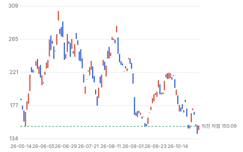

**주봉**

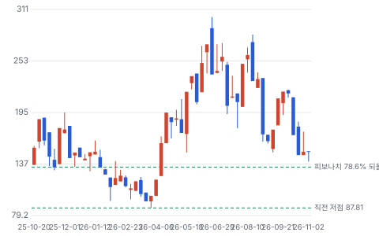

**월봉**

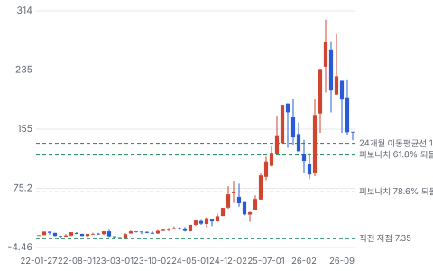

**분기 매출·EPS 실적과 컨센서스**

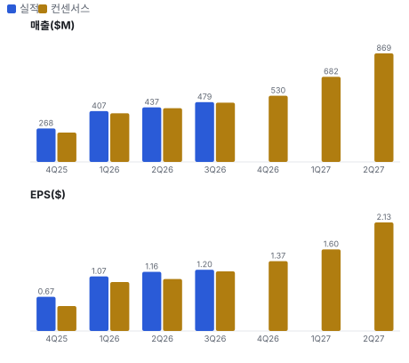

**최근 4개 분기 주가 변화 분석**

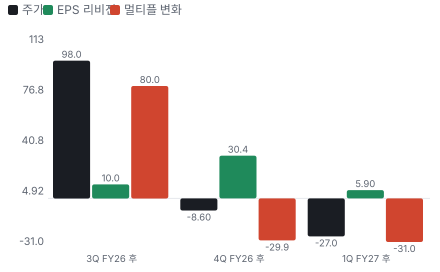

**EPS 리비전**

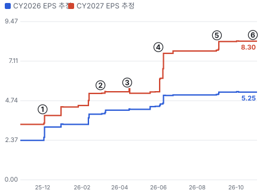

① 25-12-01 2Q FY26 실적 · EPS 리비전 +16%
② 26-03-02 3Q FY26 실적 · EPS 리비전 +2%
③ 26-04-13 DustPhotonics 인수 발표 · EPS 리비전 -2%
④ 26-06-01 4Q FY26·FY27 +80% · EPS 리비전 +44%
⑤ 26-09-01 1Q FY27·FY27 +85% · EPS 리비전 +7%
⑥ 26-11-02 Marvell–Lumentum 인수 보도 · EPS 리비전 +0%

**밸류에이션 주가 시나리오**

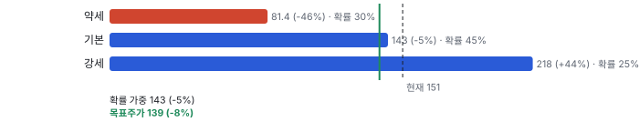

**주가별 업사이드**

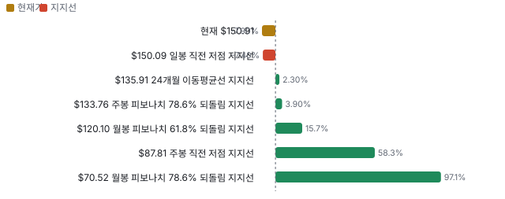

**제품·서비스 포트폴리오**

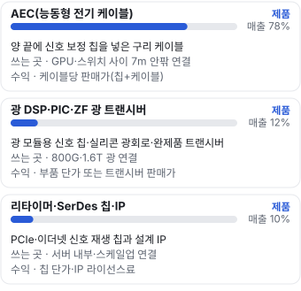

**고객 믹스(1Q FY27, 매출 대비)**

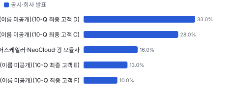

**공급 병목(10점, 낮을수록 병목)**

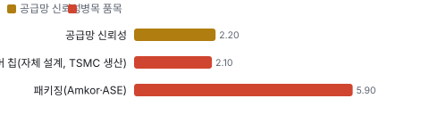

**어닝콜 변화별 주주가치 영향**

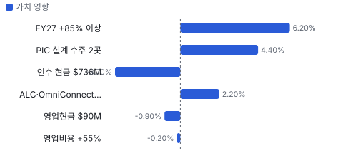

**멀티플 프리미엄**

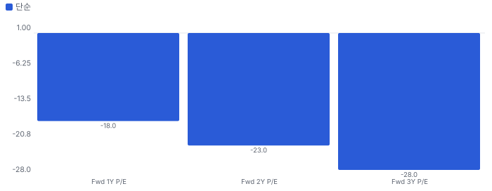

**합리적 멀티플**

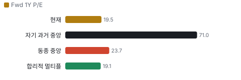

**일별 거래량 분해**

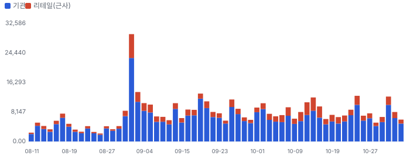

**기관 자금 흐름**

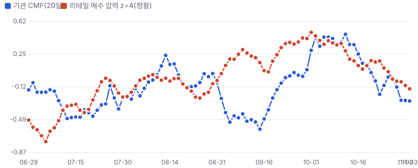

**몬테카를로**

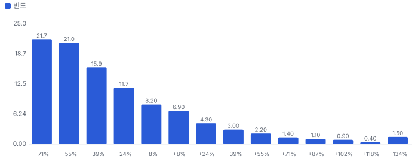

해석: 3,000번 중 649번(22%)에서 가치가 지금 주가 이상이었다. 가정을 흔들어도 지금 주가를 뒷받침하지 못하는 경우가 더 많다. 가운데 값은 0.59배이고, 열 번 중 여덟 번은 0.30~1.33배 사이에 든다.

## 내러티브

> **기업가치를 결정하는 이야기:** Fwd 1Y P/E 19.5배로 동종 6곳 중앙값 23.7배보다 약 18% 낮다. 다음 4개 분기 매출 성장은 약 +90%로 동종(Astera Labs +113% 다음) 중 두 번째로 빠르다. 6월 말 45배에서 배수가 반 아래로 줄었다. 배수를 다시 올릴 열쇠는 하반기 광 매출 \$600M과 AEC가 함께 크는지다 — 둘 중 하나가 빠지면 FY27 +85%가 흔들리고 이익도 내려간다

> **멀티플·EPS 프리미엄**
> **멀티플:** Fwd 1Y P/E 19.5배, 동종 중앙값 23.7배보다 약 18% 낮다. Astera Labs(30.8배)·Marvell(29.9배)·MACOM(26.9배)보다 싸고 Broadcom(18.8배)·Coherent(19.7배)·Lumentum(20.4배)과 비슷하다. 자기 과거 3년 범위(20~100배)의 바닥이다
> **EPS:** FY27 EPS 컨센서스는 6/8 \$5.24 → 9/4 \$6.23(+19%), FY28은 \$7.36 → \$9.30(+27%)이다. 1Q 콜 직전(8/31) 대비 같은 분기 EPS는 +3~7% 올랐다

### 투자자들은 왜 열광했나

2024년 말 \$20대에서 2026년 6월 \$302까지 올랐다. AEC가 AI 클러스터의 기본 연결이 되며 7개 분기 연속 세 자릿수 성장을 냈고, DustPhotonics 인수로 '구리부터 광까지'라는 이야기가 붙었다. 식은 이유는 세 가지다 — 9/1 실적의 매출 상회 폭이 작아(가이던스 상단 \$475M 대비 \$479M) 다음 날 −20%, 10월 AI 설비투자 축소 우려에 따른 업종 매도, 그리고 11/2 Marvell의 Lumentum 인수 보도로 광 경쟁이 커졌다

### 무엇이 기업가치를 바꾸나

> **구조적 체질 변화**
> **변화:** FY26 매출 \$1.34B(+206%)로 IP 회사에서 AEC 제품 회사가 됐다. FY27은 광이 매출의 약 4분의 1로 붙는 두 번째 전환이다
> **증거:** 10-K, 1Q FY27 콜
> **반증:** FY27 광 매출이 \$400M 아래

> **고부가 믹스 확장**
> **변화:** 조정 매출총이익률 68%를 유지하며 매출이 두 배가 됐다. 광 트랜시버는 외부 부품이 많아 믹스를 낮출 수 있다(추정)
> **증거:** 1Q FY27 보도자료
> **반증:** 조정 매출총이익률 2분기 연속 67% 아래

> **기술 혁신**
> **변화:** 1.6T(포트당 1.6테라비트 세대) ZF ALC(마이크로 LED, 30m), OmniConnect Weaver(LPDDR(저전력 D램) 기어박스), 224G ZF 광 트랜시버 발표. OCP(오픈 컴퓨트 프로젝트 — 데이터센터 하드웨어 공개 표준 단체) 단거리 광 표준 작업 주도
> **증거:** 보도자료 2026-09-15·10-12·10-13
> **반증:** FY28에 ALC·OmniConnect 첫 매출이 없다

> **실행 속도**
> **변화:** 인수 3개월 만에 DustPhotonics PIC 설계 수주 2곳을 받았다. 주문→출하 리드타임은 공시하지 않아 피어와 비교하지 못한다 **납품 리드타임 3개월.** 피어 비교 미확인. 이전 대비 미확인.
> **증거:** 1Q FY27 콜 2026-09-01
> **반증:** 설계 수주→매출이 FY28 말을 넘긴다

> **M&A**
> **변화:** DustPhotonics(실리콘 포토닉스 PIC) \$1.25B 인수 — 현금 \$769.6M·주식·언아웃 \$310M. 광 DSP와 PIC를 묶는다
> **증거:** 10-Q 5번 주석
> **반증:** PIC 매출 FY27 \$100M 미달 또는 영업권 손상

> **정책·입법 연관성**
> **재정정책:** 해당 없음(CHIPS(미국 반도체지원법) 보조금·세액공제 수령 공시 없음, 팹리스) 10-K·10-Q 반증: 보조금 수령 공시
> **행정명령:** 수출 통제·관세: 2Q 가이던스는 현 관세 체계 기준이고 유동적이라고 밝혔다. 중국 본토 매출은 1년 전 \$51.8M에서 1Q \$1.1M으로 줄었다 1Q FY27 콜, 10-Q 지역별 매출 반증: 홍콩·말레이시아 경유 출하에 새 수출 통제 의회 동의 2/10 — 하원 1/5(Credo를 겨냥한 하원 의결 기록을 찾지 못했다) · 상원 1/5(같음).
> **연관입법:** 해당 없음(회사를 직접 겨냥한 연방 법안을 찾지 못했다. 로비 공시는 키가 없어 미확인) lobby_watch 미확인 반증: AI 반도체 수출 통제 법안 의결

> **CAPEX 낙수효과**
> **변화:** 하이퍼스케일러 AI 설비투자가 GPU 클러스터 연결 수요로 온다. 고객 투자 발표를 이 회사 매출로 바로 옮기지 않는다 — 확인된 것은 최종 고객 4곳의 몫과 회사 가이던스다
> **증거:** 10-Q 최종 고객 표, 업종 노트(BofA 설비투자 축소 노트 요약)
> **반증:** 상위 고객 1곳이 2027 설비투자를 줄인다

### 내러티브 근거

> AI 클러스터의 구리 연결(AEC)을 사실상 처음 만든 팹리스가 광까지 넓혀 '연결의 Broadcom'이 된다는 이야기다. 주가는 6/22 \$302.52에서 11/3 \$150.91로 −50%다. 같은 기간 FY27 EPS 컨센서스는 \$5.24(6/8)에서 \$6.23(9/4)으로 +19% 올랐다. 이익이 아니라 배수가 줄었다 — Fwd 1Y P/E는 6월 말 45배에서 19.5배다. 동종 대비 멀티플 차이 -18% 중 회사 고유 몫은 +2%다. 단계는 과밀, 쏠림은 높음이다.

> **AEC = AI 클러스터 표준 연결** · 유지
> **논리:** GPU 사이 수 미터 연결에서 수동 구리(DAC(칩 없는 수동 구리 케이블))는 속도 한계, 광은 전력·고장 문제가 있어 AEC가 기본값이 된다
> **숫자:** 1Q 매출 증가의 90% 이상이 AEC, 최종 고객 4곳 각 10% 이상
> **반증:** 2Q·3Q FY27에 AEC 매출이 전 분기 대비 줄었다고 회사가 밝힌다

> **광 2막 — \$600M에서 시작** · 유지
> **논리:** 광 DSP·PIC·ZF 트랜시버로 플러거블 광 시장(회사 인용 2026년 6천만 개 → 2030년 1억 7,500만 개)에 들어간다
> **숫자:** FY27 광 매출 \$600M+(매출의 약 24%, 가이던스 기준 계산)
> **반증:** 3Q FY27 콜에서 광 \$600M 목표를 낮춘다

> **신뢰성 플랫폼(ZeroFlap(링크 끊김을 미리 감지·완화하는 Credo 제품군 이름)·Pilot(Credo의 링크 진단·원격 측정 소프트웨어))** · 유지
> **논리:** 링크 끊김을 미리 잡아 GPU 가동률을 지키는 소프트웨어가 붙은 하드웨어라 범용 부품보다 높은 마진
> **숫자:** 조정 매출총이익률 68.0%
> **반증:** 조정 매출총이익률 65% 아래

> **FY28 신제품(ALC·OmniConnect·NPO(칩 근처에 붙이는 광학(Near-Packaged Optics)))** · 태동
> **논리:** FY28부터 30m 광 케이블·메모리 기어박스·스케일업 광이 붙어 성장이 이어진다
> **숫자:** 회사: 각각 수십억 달러 시장(회사 주장, 근거 미공개)
> **반증:** FY28 첫 분기에 ALC·OmniConnect 매출 언급이 없다

> **반대: 고객 4곳·PO 판매** · 강화
> **논리:** 최종 고객 4곳이 84%이고 PO로 팔아 한 고객의 재고 조정이 바로 매출에 찍힌다
> **숫자:** 33%·28%·13%·10%, 4번째 고객이 분기마다 바뀜
> **반증:** 5번째 10% 고객 등장 또는 상위 1곳 25% 아래

> **반대: 광은 큰 회사의 판** · 강화
> **논리:** Broadcom·Marvell(Lumentum 인수)·Coherent가 DSP부터 레이저까지 수직 통합한다. Credo의 광 진입은 늦고 작다
> **숫자:** 광 \$600M vs Coherent TTM 매출 \$7.1B·Lumentum \$3.7B
> **반증:** PIC 설계 수주 2곳이 FY27 말 매출로 잡힌다

## 포트폴리오

| 제품·서비스 | 구분 | 무엇 | 쓰는 곳 | 돈 버는 방식 | Mix | Mix 변화(전년 대비) |
|---|---|---|---|---|---|---|
| AEC(능동형 전기 케이블) | 제품 | 양 끝에 신호 보정 칩을 넣은 구리 케이블 | GPU·스위치 사이 7m 안팎 연결 | 케이블당 판매가(칩+케이블) | 미확인 | 미확인 |
| 광 DSP·PIC·ZF 광 트랜시버 | 제품 | 광 모듈용 신호 칩·실리콘 광회로·완제품 트랜시버 | 800G(포트당 800기가비트 세대)·1.6T 광 연결 | 부품 단가 또는 트랜시버 판매가 | 미확인 | 미확인 |
| 리타이머·SerDes(고속 직렬 신호 송수신 회로) 칩·IP | 제품 | PCIe(서버 내부 고속 연결 규격)·이더넷 신호 재생 칩과 설계 IP | 서버 내부·스케일업 연결 | 칩 단가·IP 라이선스료 | 미확인 | 미확인 |

## 고객

> **1Q FY27 최대 고객 최종 고객 D(이름 미공개)(10-Q 최종 고객 D) 33%, 상위 3곳 77%, 집중도 보통.** 공시·회사 발표로 확인한 몫은 매출의 100%이고, 나머지 고객 몫은 추정이거나 미분해다. 회사가 밝힌 최종 고객 기준 4곳이 1Q 매출의 84%(33%·28%·13%·10%)다. FY26은 3곳이 84%(33%·32%·19%). 계약 상대 기준으로는 2곳이 71%(43%·28%) — 위탁 생산사가 대신 주문하기 때문이다. 이름은 공개하지 않는다. 회사는 공개 자료에서 첫 고객으로 Microsoft, 공동 개발 상대로 Oracle을 밝혔고 Amazon은 고객 워런트 보유자였다(10-K)

**고객별 매출 몫(1Q FY27)**
| 고객 | 몫 | 변화 | 근거 |
|---|---|---|---|
| 최종 고객 D(이름 미공개)(10-Q 최종 고객 D) | 33% | +0%p | 공시 |
| 최종 고객 C(이름 미공개)(10-Q 최종 고객 C) | 28% | -7%p | 공시 |
| 그 밖의 하이퍼스케일러·NeoCloud(AI 전용 신생 클라우드 사업자)·광 모듈사 | 16% | 미확인 | 공시 |
| 최종 고객 E(이름 미공개)(10-Q 최종 고객 E) | 13% | -7%p | 공시 |
| 최종 고객 F(이름 미공개)(10-Q 최종 고객 F) | 10% | 미확인 | 공시 |

> **최종 고객 D(이름 미공개)(10-Q 최종 고객 D)** · 공시
> **사는 것:** AEC 중심(회사: 상위 고객도 AEC 외 제품을 늘린다)
> **추정 근거:** FY26 33%, 1년 전 1Q 33%. 업계 자료는 Amazon으로 본다 — 이름은 가설

> **최종 고객 C(이름 미공개)(10-Q 최종 고객 C)** · 공시
> **사는 것:** AEC·리타이머
> **추정 근거:** 1년 전 1Q 35%

> **그 밖의 하이퍼스케일러·NeoCloud·광 모듈사** · 공시
> **사는 것:** 광 DSP·리타이머·IP
> **추정 근거:** 84%를 뺀 나머지. 회사: 하이퍼스케일러 5곳과 깊은 관계

> **최종 고객 E(이름 미공개)(10-Q 최종 고객 E)** · 공시
> **사는 것:** AEC
> **추정 근거:** FY26 19%, 1년 전 1Q 20%

> **최종 고객 F(이름 미공개)(10-Q 최종 고객 F)** · 공시
> **사는 것:** 미확인
> **추정 근거:** CFO: 직전 분기 4번째 10% 고객과 다른 회사, 과거에도 10% 고객이었다. 1년 전 1Q에는 10% 미만

## 수주·파이프라인

> **2026-09-02 기준 5건.** 건별 확정 금액은 공개되지 않았다.

**실행 속도와 방해 요인**
| 항목 | 상태 | 실행 속도 | 방해 요인 |
|---|---|---|---|
| FY27 광 매출 \$600M 이상(광 DSP·PIC·ZF 각 \$100M+) | 조건부 | 지연(계획 33%, -21%p), 이대로면 2029-02 완료, 21개월 지연 | 레이저·광 부품 공급 · 1.6T 램프 시점 |
| DustPhotonics PIC 설계 수주 2곳 | 조건부 | 인수 3개월 만에 수주(회사) | 고객 차세대 모듈 일정 |
| ALC(마이크로 LED 광 케이블) | 파이프라인 | 미확인 | 표준화(SRMO(단거리 마이크로 발광체 광학 표준 작업)) · 고객 인증 |
| OmniConnect·Weaver 메모리 기어박스 | 파이프라인 | 미확인 | XPU(GPU·맞춤 AI 칩 통칭) 설계 채택 |
| 스케일업 NPO(Open CPX) | 파이프라인 | 미확인 | 규격 경쟁(XPO(고밀도 플러거블 광 규격 후보)·CPX(스케일업용 고밀도 광 모듈 규격(Open CPX MSA))·CPO(칩 패키지 안에 넣는 광학)) |

## 마진 구조

> **GPM 64.5%, OPM 25.2%.** 1Q FY26 대비 GPM -2.9%p, OPM -2.1%p. 변동비는 매출의 41%이고, 매출이 10% 늘면 OPM은 +3.0%p 움직인다. 1Q FY27 GAAP 매출원가는 매출의 35.5%로 1년 전 32.6%보다 2.9%p 높다. 회사 설명대로 원인은 DustPhotonics 인수 무형자산 상각(\$11.0M, 2.3%p)이다 — 조정 매출총이익률은 68.0%로 1년 전 67.6%와 같다. GAAP 영업이익률이 25.2%로 낮은 것은 SBC(\$88.0M, 매출의 18.4%)와 인수 비용 때문이고, 조정 영업이익률은 48.2%다

> **매출 100 중 매출원가 32.9, 매출총이익 67.1(최근 4분기, 공시).** 매출원가 요인 중 AEC 소재·조립(구리 케이블·커넥터·BizLink(대만 케이블 조립 회사(AEC 생산 위탁)) 조립)이 매출의 20.0%로 가장 무겁고, 단가가 +10% 오르면 GPM이 -2.00%p 움직인다. 분기 회귀로 매출 1이 늘 때 매출원가는 0.33 늘고, 매출원가의 고정비 몫은 6%다.

**비용 요인 강도 — 비중·추세·충격(+10%)·탄력**
| 비용 | 구분 | 매출 대비 | 1년 변화 | 마진 기여 | 충격 시 마진 | 매출 탄력 | 고정비 몫 |
|---|---|---|---|---|---|---|---|
| AEC 소재·조립(구리 케이블·커넥터·BizLink 조립) | 매출원가 요인 | 20.0% | 미확인 | 미확인 | -2.00%p | 미확인 | 0% |
| 칩 웨이퍼·패키징·테스트(TSMC·Amkor·ASE(대만 반도체 패키징 회사)·KYEC(대만 반도체 테스트 회사)·Sigurd(대만 반도체 테스트 회사)) | 매출원가 요인 | 8.0% | 미확인 | 미확인 | -0.80%p | 미확인 | 0% |
| 기타 매출원가(물류·관세·광 부품) | 매출원가 요인 | 3.2% | 미확인 | 미확인 | -0.32%p | 미확인 | 30% |
| 인수 무형자산 상각 | 매출원가 요인 | 2.3% | +2.3%p | -2.3%p | -0.23%p | 미확인 | 100% |
| 매출원가 내 SBC | 매출원가 요인 | 1.2% | +1.0%p | -1.0%p | -0.12%p | 미확인 | 80% |
| 재고 평가 손실 | 매출원가 요인 | 0.8% | 미확인 | 미확인 | -0.08%p | 미확인 | 0% |
| 매출원가 | 공시 항목 | 32.9% | -1.1%p | +1.1%p | -3.29%p | 0.33 | 6% |
| 연구개발 | 공시 항목 | 21.5% | -6.7%p | +6.7%p | 미확인 | 0.19 | 32% |
| 판관비 | 공시 항목 | 13.9% | -5.3%p | +5.3%p | 미확인 | 0.12 | 36% |

매출 탄력 = 분기 비용을 매출에 회귀한 기울기(매출 1당 변동비), 고정비 몫 = 절편 ÷ 평균 비용. 표본이 8분기 미만이면 미확인. 매출원가 요인 비중은 margin 재료의 추정이 섞여 있고, 공시 매출원가와의 차이는 '기타 매출원가'로 둔다.

**GPM에서 OPM까지(GAAP)**
| 기간 | GPM | 연구개발 | 판관비 | 기타 | OPM |
|---|---|---|---|---|---|
| 1Q FY26 | 67.4% | 23.5% | 16.7% | 0.0% | 27.3% |
| 1Q FY27 | 64.5% | 23.9% | 15.4% | 0.0% | 25.2% |

**마진을 결정하는 비용 요인 — 비용 +10% 시 OPM**
| 비용 | 매출 대비 | 변화 | 고정비 | OPM |
|---|---|---|---|---|
| AEC 소재·조립(구리 케이블·커넥터·BizLink 조립) | 20.0% | 미확인 | 0% | -2.00%p |
| 연구개발(인건비·설계·시험) | 14.5% | -0.4%p | 80% | -1.45%p |
| 연구개발 SBC | 9.4% | +0.8%p | 80% | -0.94%p |
| 칩 웨이퍼·패키징·테스트(TSMC·Amkor·ASE·KYEC·Sigurd) | 8.0% | 미확인 | 0% | -0.80%p |
| 판관비 SBC | 7.8% | +0.6%p | 80% | -0.78%p |
| 판관비(인건비·외부 자문 등) | 5.5% | -4.0%p | 70% | -0.55%p |
| 기타 매출원가(물류·관세·광 부품) | 3.2% | 미확인 | 30% | -0.32%p |
| 인수 무형자산 상각 | 2.3% | +2.3%p | 100% | -0.23%p |
| 인수·통합 비용 | 2.2% | +2.2%p | 0% | -0.22%p |
| 매출원가 내 SBC | 1.2% | +1.0%p | 80% | -0.12%p |
| 재고 평가 손실 | 0.8% | 미확인 | 0% | -0.08%p |

**비용을 움직이는 요인**
| 비용 | 요인 |
|---|---|
| AEC 소재·조립(구리 케이블·커넥터·BizLink 조립)(매출원가) | AEC 출하량, 구리·커넥터 단가, 조립 단가 · 근거 추정 |
| 연구개발(인건비·설계·시험)(연구개발) | 엔지니어 충원(FY26 말 616명), 1.6T·광·ALC·OmniConnect 개발 · 근거 공시 |
| 연구개발 SBC(연구개발) | 신규 보상 주식 상각 · 근거 공시 |
| 칩 웨이퍼·패키징·테스트(TSMC·Amkor·ASE·KYEC·Sigurd)(매출원가) | 웨이퍼 단가·수율, 패키징 단가 · 근거 추정 |
| 판관비 SBC(판관비) | 임원·직원 보상 주식 · 근거 공시 |
| 판관비(인건비·외부 자문 등)(판관비) | 영업 인력, 외부 자문 · 근거 공시 |
| 기타 매출원가(물류·관세·광 부품)(매출원가) | 관세·물류, 광 트랜시버 부품 · 근거 추정 |
| 인수 무형자산 상각(매출원가) | DustPhotonics 기술 무형자산 · 근거 공시 |
| 인수·통합 비용(판관비) | DustPhotonics 통합(4Q \$9.3M, 1Q \$10.4M) · 근거 공시 |
| 매출원가 내 SBC(매출원가) | 인수 인력 보상 주식 · 근거 공시 |
| 재고 평가 손실(매출원가) | 구형 재고 · 근거 공시 |

**AEC(능동형 전기 케이블) BOM — 매출의 78%, GPM 66%(제품별 이익률 미공시. 1Q 매출 증가의 90% 이상이 AEC이고 조정 매출총이익률이 68%로 유지돼 회사 평균보다 약간 낮게 둔 추정. 매출 몫도 '증가분의 90% 이상'으로 거꾸로 잡은 추정), 항목 가격 +10% 시**
| 항목 | 원가 몫 | 전가 | 제품 GPM | OPM |
|---|---|---|---|---|
| 구리 케이블·커넥터 | 30~45% | 미확인 | -1.3%p | -0.99%p |
| Credo DSP·리타이머 칩(자체 설계, TSMC 생산) | 25~40% | 미확인 | -1.1%p | -0.86%p |
| 케이블 조립·테스트(BizLink 위탁) | 15~25% | 미확인 | -0.7%p | -0.53%p |
| 미분해 | 10% | - | - | - |

**광 DSP·PIC·ZF 광 트랜시버 BOM — 매출의 12%, GPM 55%(첫해 사업이라 이익률 미공시. 칩(DSP·PIC) 판매는 회사 평균에 가깝고 ZF 트랜시버는 외부 레이저·조립 몫이 커 낮다고 보고 둔 추정(범위 45~65%)), 항목 가격 +10% 시**
| 항목 | 원가 몫 | 전가 | 제품 GPM | OPM |
|---|---|---|---|---|
| 레이저·광 부품·모듈 조립 | 30~50% | 미확인 | -1.8%p | -0.22%p |
| 광 DSP 칩(자체 설계) | 20~35% | 미확인 | -1.2%p | -0.15%p |
| 실리콘 포토닉스 PIC(DustPhotonics 설계, 외부 파운드리) | 15~30% | 미확인 | -1.0%p | -0.12%p |
| 미분해 | 10% | - | - | - |

**리타이머·SerDes 칩·IP BOM — 매출의 10%, GPM 75%(칩·IP는 소재 몫이 작아 회사 평균보다 높게 둔 추정), 항목 가격 +10% 시**
| 항목 | 원가 몫 | 전가 | 제품 GPM | OPM |
|---|---|---|---|---|
| 웨이퍼(TSMC) | 40~60% | 미확인 | -1.2%p | -0.12%p |
| 패키징(Amkor·ASE) | 20~35% | 미확인 | -0.7%p | -0.07%p |
| 테스트(KYEC·Sigurd) | 10~20% | 미확인 | -0.4%p | -0.04%p |
| 미분해 | 7% | - | - | - |

구리 케이블·커넥터 가격이 +10% 오르면 영업이익은 -3.9% 움직인다. 판매가 전가를 모르는 항목은 전가 0%로 계산했다.

**BOM 항목 가격을 움직이는 것**
| 항목 | 요인 |
|---|---|
| Credo DSP·리타이머 칩(자체 설계, TSMC 생산) | 자체 칩이라 이익의 원천 · 근거 추정 |
| 구리 케이블·커넥터 | 구리 단가에 노출 · 근거 추정 |
| 케이블 조립·테스트(BizLink 위탁) | 장기 공급 계약·캐파 예약 · 근거 추정 |
| 광 DSP 칩(자체 설계) | 부품 판매는 칩만, 트랜시버는 완제품 · 근거 추정 |
| 실리콘 포토닉스 PIC(DustPhotonics 설계, 외부 파운드리) | 인수로 내재화 · 근거 추정 |
| 레이저·광 부품·모듈 조립 | ZF 트랜시버는 외부 부품 비중이 커 마진이 칩보다 낮을 가능성(추정) · 근거 추정 |
| 웨이퍼(TSMC) | 단독 파운드리 · 근거 추정 |
| 패키징(Amkor·ASE) | 고속 패키지 · 근거 추정 |
| 테스트(KYEC·Sigurd) | 고속 신호 시험 · 근거 추정 |

**BOM 투입 물가 — PPI 전년비, 2026-11-04 수집**
| 항목 | 미국 | 일본 | 한국 | 대만 |
|---|---|---|---|---|
| 웨이퍼(TSMC) | -2.2%* | +3.9%* | +134.0% | +21.9%* |
| 구리 케이블·커넥터 | +30.0% | +54.2% | +25.8% | +41.2% |

별표는 품목보다 넓은 업종 지수다. 지난 1년 투입 물가를 판매가 전가 뒤 원가에 그대로 넣으면 OPM은 -18.94%p 움직인다(매출원가의 60% 기준).

## 공급망 병목

> **공급망 신뢰성 2.2/10, 병목 심각.** 가장 약한 고리는 Credo DSP·리타이머 칩(자체 설계, TSMC 생산) 2.1점이고, 품목 평균은 2.4점이다. 근거가 부족한 3건(케이블 조립·테스트(BizLink 위탁) · 구리 케이블·커넥터 · 레이저·광 부품·모듈 조립)은 점수에서 뺐다. 약한 고리는 웨이퍼와 AEC 조립이다. FY26 웨이퍼는 TSMC 한 곳만 썼고, AEC 생산은 BizLink 장기 계약에 기대며, 회사는 캐파 예약 계약으로 FY27~28 최소 \$188.6M을 약정했다(10-K, 상대 미공시). 장기 공급 계약은 BizLink 외에는 없다

**병목과 마진 — 품목 가격 +10% 시 OPM**
| 품목 | 점수 | 판정 | 구분 | OPM |
|---|---|---|---|---|
| Credo DSP·리타이머 칩(자체 설계, TSMC 생산)(필수) | 2.1 | 병목 심각 | 핵심 통제 품목 | -0.86%p |
| 패키징(Amkor·ASE)(필수) | 5.9 | 병목 주의 | 출하 차질 위험 | -0.07%p |

> **Credo DSP·리타이머 칩(자체 설계, TSMC 생산)** · 2.1/10
> **왜:** TSMC와 장기 계약 없이 PO로 산다(10-K). 대체 파운드리 인증 공시 없음. 세계 파운드리 1위 점유율 약 67%는 업계 자료 추정
> **병목 요인:** 인증 공급사 1곳 · 캐파 미확인 · 리드타임 미확인 · 재인증 미확인 · 1위 점유율 67% · 대만 집중 100% · 물량 확보 현물
> **풀리는 조건:** 미확인

> **패키징(Amkor·ASE)** · 5.9/10
> **왜:** 두 곳 인증. 후공정 1위 점유율 약 30%·아시아 집중 90%는 업계 자료 추정
> **병목 요인:** 인증 공급사 2곳 · 캐파 미확인 · 리드타임 미확인 · 재인증 미확인 · 1위 점유율 30% · 아시아 집중 90% · 물량 확보 복수구매
> **풀리는 조건:** 미확인

**공급사**
| 품목 | 공급사 | 몫 | 근거 |
|---|---|---|---|
| Credo DSP·리타이머 칩(자체 설계, TSMC 생산) | TSMC(웨이퍼(FY26 전량)) | 미확인 | 공시 |
| 케이블 조립·테스트(BizLink 위탁) | BizLink(AEC 제조(장기 계약)) | 미확인 | 공시 |
| 구리 케이블·커넥터 | 미공개(케이블·커넥터) | 미확인 | 추정 |
| 패키징(Amkor·ASE) | Amkor(IC(집적회로(칩)) 패키징) | 미확인 | 공시 |
| 패키징(Amkor·ASE) | ASE(IC 패키징) | 미확인 | 공시 |
| 레이저·광 부품·모듈 조립 | 미공개(레이저·광 부품) | 미확인 | 추정 |

**무역 통계로 본 공급 지역**
| 품목 | EU 수입처 | 일본 수입처 | EU 1위 전년비 |
|---|---|---|---|
| Credo DSP·리타이머 칩(자체 설계, TSMC 생산) | TW(대만) 45% · KR(한국) 21% · CN(중국) 16% | 台湾 52% · 大韓民国 28% | +365.5% |
| 구리 케이블·커넥터 | MY(말레이시아) 69% · KR 10% · US(미국) 7% | マレーシア 58% · タイ 36% | 미확인 |

## M&A 시너지

> **DustPhotonics 인수(2026-05-28, \$1.25B): 시너지가 다 나면 연 \$0.06B(확률 가중 이익 기여).** 세후 시너지 가치는 통합 비용을 빼고 \$0.50B. EPS 효과는 2026년 +1.3%에서 2029년 +3.6%.

**DustPhotonics 시너지가 생기는 길**
| 종류 | 시너지 | 연 규모 | 완성 | 확률 | 어떻게 생기나 | 근거 |
|---|---|---|---|---|---|---|
| 매출 | DSP+PIC 묶음 판매 | \$0.10B(이익률 45%) | 2027 | 60% | Credo 광 DSP와 DustPhotonics PIC를 함께 최적화해 광 모듈사·하이퍼스케일러에 부품 세트로 판다 — FY27 PIC 매출 \$100M+ 목표 | 1Q FY27 콜(회사 목표) |
| 매출 | PIC 설계 수주 2곳 램프 | \$0.15B(이익률 45%) | 2028 | 40% | 차세대(1.6T·3.2T(포트당 3.2테라비트 세대)) 모듈 설계 수주 2곳이 FY28에 양산 — 규모는 회사가 밝히지 않아 추정 | 1Q FY27 콜(규모 추정) |
| 원가 | ZF 트랜시버 PIC 내재화 | \$0.01B | 2028 | 30% | 외부에서 사던 PIC를 자체 설계로 바꿔 트랜시버 원가를 줄인다(추정) | 추정 |

시너지 가치 = 세후 이익 기여 5년 + 말기 가치(할인율 9%, 성장 0) − 통합 비용. 매출 시너지는 그 매출의 이익률만 반영하고, 모든 시너지에 실현 확률을 곱했다.

## 해자

> 해자는 SerDes·DSP 설계를 성숙 공정에서 구현하는 원가 우위와, 칩·케이블·펌웨어·진단 소프트웨어를 한 회사가 묶은 시스템 신뢰성이다. 첫 고객부터 쌓은 하이퍼스케일러 인증도 진입 장벽이다. PO 판매와 고객 4곳 집중, 그리고 Marvell·Broadcom 같은 큰 경쟁사의 광 통합이 해자를 깎는다

> **성숙 공정 SerDes·DSP(n-1 원가 우위)** · 보통
> **해자:** 경쟁사와 비슷한 성능을 한 세대 앞선 공정 없이 낸다. 원가가 낮고 파운드리 캐파 경쟁을 덜 한다
> **근거:** 10-Q 사업 설명(n-1 advantage), 조정 매출총이익률 68%(1Q)
> **숫자:** 조정 매출총이익률 68.0%, 동종 GAAP 영업이익률 중앙 약 21% vs Credo 조정 48.2%
> **깨지는 조건:** 조정 매출총이익률이 두 분기 연속 65% 아래

> **시스템 신뢰성(칩+케이블+펌웨어+Pilot)** · 보통
> **해자:** 링크 끊김(link flap)을 미리 감지·완화하는 기능으로 GPU 가동률을 지킨다. 범용 DAC·광 모듈이 따라오기 어렵다
> **근거:** 10-K: Microsoft 이중 ToR(랙 최상단 스위치) 스위치 케이블, Oracle과 ZF 광 공동 개발
> **숫자:** 하이퍼스케일러 5곳과 깊은 관계, 최종 고객 4곳 각 10% 이상
> **깨지는 조건:** AEC 경쟁사가 하이퍼스케일러 2곳 이상에서 주력 공급사가 된다

> **하이퍼스케일러 인증 기반** · 약함
> **해자:** AEC 첫 공급자로 인증 이력을 쌓았지만 PO 판매라 고객이 짧은 통보로 바꿀 수 있다
> **근거:** 10-K: 장기 구매 약정 없음, 고객 10곳이 FY26 매출의 90%
> **숫자:** 상위 4사 84%
> **깨지는 조건:** 상위 고객 한 곳 몫이 한 분기에 10%p 넘게 빠진다

## 경영진·네트워크

> Bill Brennan이 CEO, Dan Fleming이 CFO다. 공동 창업자인 CTO Chi Fung(Lawrence) Cheng과 COO Yat Tung(Job) Lam(램리서치)이 경영에 남아 있다. 9~10월 경영진 장내 매도가 이어졌다(CTO 주 27,500주씩, COO 15만 주). 정치·사모임 연결은 공개 자료로 확인하지 못했다

> **William (Bill) Brennan** · 사장·CEO · 미확인
> **프로필:** 1Q FY27 콜을 이끈 경영진. 9/14·10/19 장내 매도(Form 4)
> **비즈니스:** 미확인
> **정계:** 미확인
> **동문:** 미확인
> **사모임:** 미확인

> **Daniel Fleming** · CFO · 미확인
> **프로필:** 10/8 7,580주 장내 매도(Form 4)
> **비즈니스:** 미확인
> **정계:** 미확인
> **동문:** 미확인
> **사모임:** 미확인

> **Chi Fung (Lawrence) Cheng** · 공동 창업자·CTO·이사 · 2008
> **프로필:** 9~10월 거의 매주 27,500주 매도(사전 매매 계획 여부 미확인)
> **비즈니스:** 미확인
> **정계:** 미확인
> **동문:** 미확인
> **사모임:** 미확인

> **Yat Tung (Job) Lam** · 공동 창업자·COO · 2008
> **프로필:** 9/25 10만 주·10/1 5만 주 매도(약 \$30.8M)
> **비즈니스:** 미확인
> **정계:** 미확인
> **동문:** 미확인
> **사모임:** 미확인

**네트워크 정량화**
| 연결 | 강도 | 닿는 매출 | 가중 노출 | 매출 대비 | 근거 |
|---|---|---|---|---|---|
| 비즈니스: Oracle과 ZF 광 공동 개발, Microsoft 이중 ToR 케이블 공동 구현(회사 발표) | 2/5 | 미확인 | 미확인 | 미확인 | 고객 이름별 매출 몫 미공시 https://www.sec.gov/Archives/edgar/data/1807794/000162828026043303/crdo-20260502.htm |

가중 노출은 연결이 닿는 매출의 크기다. 연결이 그 매출을 만들었다는 뜻이 아니며, 인과는 공개 자료로 입증하지 못한다.

## 약세 논리 및 셀온 조건

| 약세 논리 | 근거 | 반박 | 가를 자료 |
|---|---|---|---|
| 고객 4곳이 84%이고 PO로 판다 | 1Q 최종 고객 33%·28%·13%·10%, 장기 구매 약정 없음(10-K) | 1위 고객 몫이 1년째 33%로 같고, 4번째 10% 고객이 분기마다 바뀔 만큼 저변이 있다 | 2Q 10-Q 최종 고객 표, 5번째 10% 고객 |
| 하반기에 몰려 있다 | FY27 +85%면 하반기 매출이 약 \$1.46B 이상 — 상반기 \$1.01B보다 약 45% 많다(계산) | 회사는 18~24개월 전부터 공급을 준비했고 재고를 \$62.2M 늘렸다 | 12월 2Q 콜의 3Q 가이던스(컨센서스 \$644~682M) |
| AEC 성장이 꺾인다 | Bank of America 질문에 CEO가 하반기 AEC 숫자를 주지 않았다 | 1Q 매출 증가의 90% 이상이 AEC였다(10-Q) | 2Q·3Q AEC 순차 성장 언급 |
| 광은 큰 회사의 판이다 | Marvell의 Lumentum 인수 보도(11/2), Broadcom·Coherent 수직 통합 | Credo는 DSP·PIC 부품 판매가 주력이라 모듈사와 고객 관계다 | PIC 설계 수주 2곳의 매출 인식 시점 |
| 주식 보상이 이익을 먹는다 | 1Q SBC \$88.0M = 매출의 18.4%(1년 전 15.9%), GAAP 영업이익률 25.2% | 조정 영업이익률 48.2%, 매출이 커지면 비중은 준다 | FY27 SBC 비중, 2Q 희석 주식 수 |
| 경영진이 판다 | 9~10월 CTO 주 27,500주, COO 15만 주(약 \$30.8M) 장내 매도 | 사전 매매 계획 여부 미확인 — 매도 자체가 실적 정보는 아니다 | Form 4 각주(사전 매매 계획 표시) |

> **셀온 조건**
> **조건 1:** 2Q FY27 매출이 가이던스 하단 \$525M 아래다
> **조건 2:** 3Q FY27 가이던스가 \$620M 아래로 나와 하반기 변곡이 밀린다
> **조건 3:** 회사가 FY27 광 매출 \$600M 목표를 낮춘다
> **조건 4:** 최종 고객 한 곳의 몫이 한 분기에 10%p 넘게 빠지고 회사가 재고 조정을 밝힌다
> **조건 5:** 조정 매출총이익률이 두 분기 연속 65% 아래다

## 어닝콜 변화

**직전 콜 대비 새로 나오거나 바뀐 내용 → 가치 영향**
| 항목 | 내용 | 직전 콜 | 최신 콜 | 모델 동인 이동 | 확신도 | 가치 영향 |
|---|---|---|---|---|---|---|
| 업데이트 | FY27 성장 가이던스 | +80% 이상 | +85% 이상 | 1년차 성장률 +5.0% | 0.8 | +6.2% |
| 반복 | 광 매출 목표 | \$600M 이상, 세 제품 각 \$100M+ | 같음, 하반기 변곡 | 1년차 성장률 — | 0.5 | +0.0% |
| 신규 | 영업비용 가이던스 | 숫자 없음 | FY27 조정 영업비용 약 +55% | 출발 이익률 -1.0% | 0.8 | -0.2% |
| 신규 | DustPhotonics PIC 수주 | 인수 발표(4/13) | 대형 고객 2곳 설계 수주, FY28 램프 | 장기 성장 수렴값 +1.0% | 0.5 | +4.4% |
| 신규 | DustPhotonics 인수 현금 | 현금·단기투자 \$1.44B(5/2) | \$764.3M(8/1) | 순차입 +\$0.74B | 1.0 | -3.7% |
| 부정 | 현금 전환 | 4Q \$182.2M | 1Q \$90.2M(운전자본 −\$151.3M) | 매출÷투하자본 -20.0% | 1.0 | -0.9% |
| 신규 | FY28 신제품 | ALC FY28 목표 | ALC·OmniConnect·Weaver FY28 첫 매출 | 장기 성장 수렴값 +0.50% | 0.3 | +2.2% |
| 반복 | 고객 집중 | 4Q 상위 4사 각 10%+ | 33%·28%·13%·10% | 1년차 성장률 — | 1.0 | +0.0% |
| **합계** | 단독 합 |  |  | 동시 적용 +7.5% |  | **+8.1%** |

**사건별 EPS 리비전**
| # | 날짜 | 구분 | 사건 | CY2026 EPS 전→후 | CY2027 EPS 전→후 | 리비전 | 주가 반응 |
|---|---|---|---|---|---|---|---|
| ① | 25-12-01 | 실적 | 2Q FY26 실적 | \$2.36 → \$3.16 | \$3.32 → \$3.85 | +15.8% | +10.1% |
| ② | 26-03-02 | 실적 | 3Q FY26 실적 | \$3.93 → \$4.17 | \$5.17 → \$5.27 | +2.0% | -14.8% |
| ③ | 26-04-13 | 내러티브 | DustPhotonics 인수 발표 | \$4.17 → \$4.22 | \$5.27 → \$5.18 | -1.8% | +12.4% |
| ④ | 26-06-01 | 실적 | 4Q FY26·FY27 +80% | \$4.40 → \$5.05 | \$5.27 → \$7.57 | +43.5% | +1.3% |
| ⑤ | 26-09-01 | 실적 | 1Q FY27·FY27 +85% | \$5.11 → \$5.25 | \$7.76 → \$8.28 | +6.7% | -20.0% |
| ⑥ | 26-11-02 | 내러티브 | Marvell–Lumentum 인수 보도 | \$5.25 → \$5.25 | \$8.30 → \$8.30 | +0.0% | -7.3% |

**해석:** 3개 구간 누적 주가 +32% = EPS 리비전 +52% × 멀티플 -13%. 더 크게 움직인 쪽은 **EPS 리비전**이다.

## 거시 지표 싱크로율

> **미국 반도체 PPI(생산자물가지수)와 전사 매출 싱크로율 -93%(1분기 = 약 3개월 선행, 전년 대비, 표본 5개·t -4.4·유의·신뢰 참고용).** 이 지표가 내포하는 4Q26 매출은 597M(±1σ 518M~676M)다. 가이던스는 이보다 -11.2%(범위 안), 컨센서스는 -11.2%(범위 안)다. AEC는 구리 케이블과 TSMC 칩으로 만들어 대만·동남아에서 출하된다. 매출은 하이퍼스케일러 장비 구매를 따라가고 원가는 구리·반도체 가격을 따른다. 대만 케이블(HS(국제 품목 분류 코드) 8544) 수출과 미국 구리·반도체 PPI를 본다

**지표별 싱크로율(상관계수 × 100)**
| 지표 | 비교 대상 | 증가율 기준 | 지표 선행 | 매출(t값) | 영업이익 | 방향 일치 | 표본·신뢰 | 4Q26 내포 매출 |
|---|---|---|---|---|---|---|---|---|
| 대만 절연 전선·케이블(HS 8544) 수출 | 전사 매출 | 표본 부족 | 미확인 | 미확인 | 미확인 | 미확인 | 미확인 | 미확인 |
| 미국 구리 PPI | 전사 매출 | 전년 대비 | 0분기(0개월) | -93%(t -4.9) | 66%(0분기) | 100% | 6·참고용 | +109.0% → 560M(나우캐스트 2개월) |
| 미국 반도체 PPI | 전사 매출 | 전년 대비 | 1분기(3개월) | -93%(t -4.4) | 68%(0분기) | 20% | 5·참고용 | +122.6% → 597M(확정) |

**선행 지표로 본 향후 분기 매출 전망(이미 나온 지표 값 기준, ±1σ)**
| 지표 | 대상 | 분기 | 지표 증가율 | 내포 매출 증가율 | 내포 매출 |
|---|---|---|---|---|---|
| 미국 반도체 PPI | 전사 매출 | 4Q26 | -0.6% | +122.6% | 597M(518M~676M) |

지표가 k분기 앞서면 이미 발표된 지표로 k분기 뒤까지의 매출 증가율을 회귀식으로 읽는다. 표본이 작거나 t값이 2 미만이면 전망은 참고용이다.

**지표를 고른 이유**
| 지표 | 이유 |
|---|---|
| 대만 절연 전선·케이블(HS 8544) 수출 | AEC 조립·출하 흐름(참고) |
| 미국 구리 PPI | AEC 소재 원가 |
| 미국 반도체 PPI | 칩 원가 대용 |

싱크로율은 증가율의 상관계수이며 인과가 아니다. 지표 단위·통화는 원자료 그대로이고 나라끼리 더하지 않는다(EU(유럽연합) 수입만 상대국 합계). ±1σ는 회귀 잔차 표준편차다.

## P·Q 사이클

> **10년 위치: Q형 기업(매출 갭 분산의 0%가 가격) — 가격은 추세 대비 -1.8%(회복, 10년 분위 27%), 물량은 +43.4%(확장, 분위 100%). P 프리미엄 -4%, Q 프리미엄 +48%(매출총이익이 정상(추세) 수준보다 요인별로 이만큼 높거나 낮다).** AR(2) 전망으로 P 프리미엄은 4분기 뒤 +1%·8분기 뒤 +3%(+로 반전), Q 프리미엄은 +3%·-11%(−로 반전). 이익이 사이클 덕에 정상보다 높다 — 지금 이익에 높은 멀티플을 함께 주면 사이클을 두 번 세는 셈이다(IB는 정상 이익에 멀티플을 건다).

**10년 P·Q 사이클 위치·프리미엄**
| 항목 | 가격(P) | 물량(Q) |
|---|---|---|
| 추세 대비 갭(현재) | -1.8% | +43.4% |
| 사이클 시계 | 회복 | 확장 |
| 10년 분위 | 27% | 100% |
| 프리미엄(현재) | -4% | +48% |
| 프리미엄 4분기 뒤 | +1% | +3% |
| 프리미엄 8분기 뒤 | +3% | -11% |
| 갭 반감기 | 2분기 | 3분기 |

방법: P = 가격 지수 4분기 평균(미국 PPI 반도체·관련 소자 대용 — 회사 판매가가 아니라 업종 가격), Q = TTM 매출 ÷ P. 추세는 로그 레벨의 HP(추세 분리 필터) 필터(λ 1600)로 정상(mid-cycle) 수준을 잡는다. 프리미엄 = 요인별 매출총이익 증분 ÷ 정상 매출총이익(정상 GPM 61.6% = 10년 중앙값, 물량 증분 마진 68.6% = 전년 대비 ΔGP(매출총이익)÷ΔRev 회귀, 가격은 전액 이익 반영). 표본 22개 TTM 분기. 전망은 갭의 AR(2) 통계 외삽이며 가이던스·컨센서스가 아니다. HP 필터는 끝점에서 추세가 최근 값 쪽으로 끌려 현재 갭을 작게 볼 수 있다.

> **Q 사이클 — 최근 4분기 평균 가격 기여 -1.7%, 물량 기여 +104.8%(전년 대비 로그 증가율).** P 강도 4.3/10, Q 강도 6.6/10, 최근 8분기 중 100%가 같은 요인 우세(구조적). AR(2) 투영으로는 8분기 안에 전환 신호가 없다.

**P·Q 사이클 정량**
| 항목 | 가격(P) | 물량(Q) |
|---|---|---|
| 최근 4분기 평균 기여 | -1.7% | +104.8% |
| 강도(0~10, 자기 이력 z) | 4.3 | 6.6 |
| AR(2) 고유 주기 | 16.5분기 | 미확인 |
| 다음 4분기 투영 평균 | -0.8% | +71.7% |

가격 근거: 미국 PPI 반도체·관련 소자 대용 — 회사 판매가가 아니라 업종 가격. PPI를 쓰면 회사 판매가가 아니라 업종 가격 대용이다. 로그 증가율이라 가격·물량 기여의 합이 매출 증가율이다. 투영은 통계 외삽이며 가이던스·컨센서스가 아니다. 회사 판매가로 잴 수 없는 이유: 회사는 출하량·ASP를 공시하지 않는다. 매출의 대부분인 AEC는 세대(400G→800G→1.6T)마다 단가가 바뀌어 업종 PPI로 가격과 물량을 나누면 왜곡된다

## 밸류에이션

> **목표주가 \$139, 업사이드 -8%.** 자리는 약세와 기본 사이(약세 쪽 8%)이고 도달 확률은 약 50%다. 기본 \$143, 강세 \$218(+44%), 약세 \$81(-46%). DCF 기준 업사이드는 기본 -36%, 강세 +18%, 약세 -65%다(WACC 12.0%).

배수 기준 기본 \$143과 DCF 기본 업사이드 −36%의 차이는 세 가지 가정이다. DCF는 주식 보상(매출의 14.8%)을 비용으로 영구히 빼고, 업종 베타 1.52로 WACC 12.0%를 쓰며, 성장률이 FY28 약 +70%에서 빠르게 줄어 장기 영업이익률 30%(SBC 차감 뒤, 추정)에 수렴한다고 본다. 배수는 다음 4개 분기 조정 EPS만 본다. 그래서 두 값의 차이는 '조정 이익을 얼마나 믿느냐'다 — SBC 비중이 매출 증가로 빠르게 줄면 DCF가 올라오고, 성장이 FY28에 꺾이면 배수가 내려간다. 약세 \$81은 EPS \$5.6에 동종 하단 배수를 곱한 값이다.

> **약세 \$81 (-46%)** · 확률 30%
> **가정:** 14.5배 × EPS \$5.60
> **근거:** 하반기 AEC가 정체하고 광 \$600M이 밀려 FY27 성장이 +85%에 못 미친다. 다음 4개 분기 EPS가 FY27 컨센서스 하단 근처

> **기본 \$143 (-5%)** · 확률 45%
> **가정:** 19.4배 × EPS \$7.40
> **근거:** 2Q \$530M 뒤 하반기 광 램프로 FY27 약 \$2.5B. 다음 4개 분기 EPS 컨센서스 \$7.37과 같은 높이

> **강세 \$218 (+44%)** · 확률 25%
> **가정:** 24.2배 × EPS \$9.00
> **근거:** 1.6T AEC와 광 트랜시버가 함께 크고 PIC 설계 수주가 FY27 말부터 매출로 잡혀 FY28 매출이 \$4.3B를 넘는다

**멀티플 선정 — Fwd 1Y P/E**
| 단계 | 조정 | 근거 |
|---|---|---|
| 동종 중앙값 | 23.7배 | 범위 18.8~30.8배, 6곳 |
| 펀더멘털 | -10% | 성장·이익률·ROIC로 본 합리적 멀티플 19.1배와의 차이의 일부만 인정 |
| 해자 | +2% | 성숙 공정 SerDes·DSP(n-1 원가 우위) 보통 · 시스템 신뢰성(칩+케이블+펌웨어+Pilot) 보통 · 하이퍼스케일러 인증 기반 약함 |
| 반복 매출 | +0% | 재료 없음 |
| 수주 전환·가시성 | +0% | 재료 없음 |
| 내러티브 | -5% | 단계 과밀 |
| 사이클·실행 판단 | -5% | 성장은 동종 중 가장 빠르지만 최종 고객 4곳이 매출의 84%이고, 고객이 발주를 쉽게 바꾸는 PO 판매이며, 광 사업은 아직 첫해다. 내러티브가 과밀에서 식는 구간이라 판단 조정을 −5%로 둔다 |
| **선정** | **19.4배** | 지금 19.5배 |

**동종 레인지**
| 회사 | Fwd 1Y P/E | Fwd 2Y P/E | Fwd 3Y P/E | 성장 | 영업이익률 | ROIC |
|---|---|---|---|---|---|---|
| ALAB | 30.8 | 27.0 | 20.9 | 113% | 44% | 97% |
| MRVL | 29.9 | 20.7 | 15.1 | 63% | 39% | 17% |
| AVGO | 18.8 | 11.8 | 7.7 | 77% | 66% | 38% |
| COHR | 19.7 | 15.2 | 13.4 | 51% | 25% | 13% |
| LITE | 20.4 | 15.0 | 11.9 | 113% | 48% | 40% |
| MTSI | 26.9 | 21.3 | 15.9 | 54% | 38% | 30% |
| **Credo** | 19.5 | 13.9 | 10.2 |  |  |  |

지금 주가가 요구하는 5년 매출 CAGR 41%, 기본 시나리오 28%. 몬테카를로 중앙값 업사이드 -41%.

> 의사결정 보조(투자자문 아님): ① 매수 매력: 연 기대수익 +4.3% (자기자본비용 12.0% 대비 -7.7%p) · 자본비용 초과 확률 20% · 안전마진 0.30 → 정량 신호 약함 / ② 위험 예산 지표(이론): 0% — 기대수익이 자기자본비용에 못 미침(무위험 대비 켈리 0%는 참고) · 5년 하위10% -52% · 30%+ 손실 확률 29% / ③ 상방(5년): 기대 1.23배 · 2배 14% · 3배 4% · 10배 0% · 상위10% 2.27배

투입 물가 점검: 지난 1년 PPI를 BOM에 넣으면 OPM -18.94%p다(매출원가의 60% 기준).

## 매수 위치(일봉)

> **현재가 \$151는 '지지 근접'(가장 가까운 일봉 지지 \$150에서 ATR 0.1배 위).** 이 자리에서 목표주가까지 -7.9%, 첫 일봉 저항까지 +9.5%, 다음 지지까지 하방 -0.5%, 손익비 -14.6배.

**가격대별 업사이드(일봉 기준)**
| 가격대 | 가격 | 목표주가까지 | 첫 저항까지 | 다음 지지까지 | 손익비 | 근거 기법(강도) |
|---|---|---|---|---|---|---|
| 현재가 | \$151 | -7.9% | +9.5% | -0.5% | -14.6 | - |
| 지지 1 | \$150 | -7.4% | +10.1% | 미확인 | 미확인 | 120일 지그재그 저점 · 스윙 저점(1.8) |

**일봉 저항**
| 저항 | 가격 | 현재가 대비 | 근거 기법(강도) |
|---|---|---|---|
| 저항 1 | \$165 | +9.5% | 피보 78.6%(1.0) |
| 저항 2 | \$177 | +17.1% | 120일 지그재그 저점 · 20일선 · 피보 61.8%(2.3) |
| 저항 3 | \$181 | +20.0% | 200일선(1.0) |

일봉만 쓴다(주봉·월봉 제외). 손익비 = 목표주가까지 업사이드 ÷ 다음 지지까지 하방. 가격대별 기대값 참고표이며 매수·매도 시점 지시가 아니다.

## 애널리스트 토론

> **토론 결론 Neutral(규칙 등급 Neutral).** 배수가 동종 하단이라는 반박은 살아남았지만, 그 배수가 이미 다음 4개 분기 EPS를 다 믿은 값이라는 반박도 살아남았다. 하반기 AEC 숫자가 없는 한 규칙 등급(Neutral)에서 옮길 근거가 부족하다

**패널(가상 애널리스트)**
| 자리 | 애널리스트 | 핵심 논리 | 틀리는 조건 | 최종 투표 |
|---|---|---|---|---|
| Strong Buy | 한도윤(가상 리서치 하우스 한빛증권) | 다음 4개 분기 EPS가 +90% 크는데 Fwd 1Y P/E 19.5배, 자기 3년 범위 바닥이다 | 2Q 매출이 가이던스 하단 \$525M 아래 | Buy |
| Buy | 서지안(가상 리서치 하우스 청해캐피털) | AEC는 계속 크고 광 \$600M이 더해진다. 배수가 동종 중앙까지만 돌아와도 충분하다 | 3Q 콜에서 광 목표 하향 | Neutral |
| Neutral | 배윤서(가상 리서치 하우스 동해리서치) | 싸 보이지만 하반기에 몰려 있고 고객 4곳이 84%다. 2Q 콜까지 확인할 게 많다 | 2Q 콜에서 3Q 가이던스가 컨센서스 \$644~682M 위 | Neutral |
| Sell | 정민혁(가상 리서치 하우스 서해자산) | 광은 Broadcom·Marvell·Coherent의 판이고 Credo는 늦었다. AEC 성장이 꺾이면 배수가 더 준다 | 2Q FY27 AEC 매출이 전 분기 대비 증가했다고 회사가 밝힌다 | Neutral |
| Strong Sell | 오태호(가상 리서치 하우스 북해증권) | PO로 파는 회사에 고객 1곳이 33%다. 설비투자 조정 한 번이면 이익이 바로 빠진다 | 5번째 10% 고객 등장 | Sell |

**투표**
| Strong Buy | Buy | Neutral | Sell | Strong Sell |
|---|---|---|---|---|
| 0 | 1 | 3 | 1 | 0 |

> **개회 · Strong Buy**
> **발언:** 다음 4개 분기 EPS \$7.37에 19.5배다. 동종 중앙 23.7배면 \$175, FY28 EPS \$10.05에 20배면 \$201이다

> **개회 · Buy**
> **발언:** 1Q 매출 \$479M은 가이던스 상단 \$475M을 넘었고 2Q는 \$530M이다. 광 \$600M은 아직 거의 반영 전이다

> **개회 · Neutral**
> **발언:** FY27 +85%면 하반기 매출이 약 \$1.46B 이상이어야 한다. 상반기 \$1.01B보다 45% 많다. 그 확인이 12월 콜이다

> **개회 · Sell**
> **발언:** Marvell이 Lumentum을 사면 DSP부터 레이저까지 한 회사가 된다. Credo의 PIC·DSP 묶음은 그 앞에서 작다

> **개회 · Strong Sell**
> **발언:** 10-K는 장기 구매 약정이 없다고 적었다. 고객 1곳 33%가 PO로만 묶여 있다

> **반박1 · Neutral → Strong Buy**
> **발언:** \$7.37은 하반기 쏠림을 다 믿은 숫자다. 3Q 컨센서스 범위가 \$629~760M으로 넓다

> **반박1 · Buy → Sell**
> **발언:** Credo의 광 진입은 부품 판매가 주력이라 Lumentum과 정면 경쟁이 아니다. Lumentum은 오히려 DSP 고객일 수 있다(추정)

> **반박1 · Strong Buy → Strong Sell**
> **발언:** 1위 고객 몫은 1년째 33%로 같다. 집중은 늘지 않았다

> **반박1 · Sell → Buy**
> **발언:** Marvell이 Lumentum을 가지면 자기 DSP를 쓰게 할 것이다. 고객이 경쟁사가 되는 구조다

> **반박1 · Strong Sell → Neutral**
> **발언:** 영업현금흐름이 \$182M에서 \$90M으로 반 토막이다. 운전자본이 \$151M 나갔다

> **반박2 · Buy → Strong Sell**
> **발언:** 재고 증가는 하반기 램프 준비라고 CFO가 말했다. 1Q FCF도 \$82.9M 양(+)이다

> **반박2 · Neutral → Buy**
> **발언:** 준비는 맞을 수 있지만 AEC 하반기 숫자를 회사가 주지 않았다. 그게 할인의 핵심이다

> **반박2 · Strong Buy → Sell**
> **발언:** 배수는 이미 Broadcom 수준이다. 광 경쟁 우려가 가격에 들어갔다

> **반박2 · Sell → Strong Buy**
> **발언:** Broadcom은 고객이 수십 곳이고 Credo는 4곳이 84%다. 같은 배수는 싸지 않다

> **반박2 · Strong Sell → Strong Buy**
> **발언:** FY27 EPS 컨센서스 범위가 \$5.6~7.0이다. 하단이면 Fwd P/E는 20배대 중반이다

> **최종 · Strong Buy** · Buy
> **발언:** 배수 바닥 논리는 남는다. 하반기 쏠림을 인정해 한 단계 내린다

> **최종 · Buy** · Neutral
> **발언:** 엔진 기본 \$143이 현재가 아래다. 배수 19.4배에서 이익이 아직 하반기 확인 전이라 12월 콜까지 가운데로 옮긴다

> **최종 · Neutral**
> **발언:** AEC 하반기 숫자와 광 목표 재확인 전까지 가운데에 둔다

> **최종 · Sell** · Neutral
> **발언:** 광 경쟁은 남지만 배수가 이미 동종 하단이라 한 단계 올린다

> **최종 · Strong Sell** · Sell
> **발언:** 고객 집중은 그대로라 Sell 쪽에 남는다

남은 반대 의견: Strong Buy 자리: FY28 EPS \$10.05에 20배만 줘도 \$201이다. 12월 콜이 하반기를 확인하면 배수와 이익이 함께 오른다

패널은 가상 인물이고 실존 IB의 의견이 아니다.

## 시장 평가

> **셀사이드(IB 애널리스트)**
> **한 줄:** 셀사이드는 여전히 매수지만 실적 뒤 목표가를 일제히 내렸다 — 배수가 줄어든다고 인정한 셈이다
> **의견 분포:** Strong Buy 16 · Buy 1 · Hold 2 · Sell 0 — 19명 중 17명 매수
> **목표가 평균:** \$271.7(범위 \$176~310) — 현재가 대비 +80%
> **9/2 이후 목표가:** BofA \$340→\$275, JPMorgan \$335→\$310, Mizuho \$290→\$245, Stifel \$350→\$310 — 이익 추정은 올리고 목표가는 내림

> **바이사이드(기관 투자자)**
> **한 줄:** 펀드 레터는 '1Q 매출 상회 폭이 작았던 것은 분기 사이 주문 이동'이라는 강세 읽기다. 경영진은 꾸준히 판다
> **기관 보유:** 74.3% — —
> **펀드 레터(3Q):** Spyglass 고확신 롱·Liontrust 하락 때 추가·TimesSquare 소형주 펀드 졸업 — 3곳 모두 강세
> **경영진 매도:** 9~10월 CTO 주 27,500주, COO 15만 주 — 매도만 있음

> **언론·업계**
> **한 줄:** 이야기는 AEC에서 광으로 옮겨 갔고, 광은 큰 회사들이 통합하는 판이다
> **보도 초점:** 광 \$600M 목표·'Broadcom 뒷마당'·Anthropic 대기 — —
> **업종 사건:** Marvell의 Lumentum 인수(11/2 보도) — 광 경쟁 심화

## 체크리스트

| 시점 | 무엇 | 의미 |
|---|---|---|
| 2026-12 초(날짜 미공시) | 2Q FY27 실적·3Q 가이던스 | 하반기 변곡이 숫자로 나오는지 — 3Q 가이던스가 \$644~682M 이상이면 FY27 +85%가 산다 |
| 2026-12 초 | 2Q 10-Q 최종 고객 표·재고·영업현금흐름 | 집중과 현금 전환이 나아지는지 |
| 2026-11 중순 | 3Q 13F | 급락 구간에 기관이 샀는지 팔았는지 |
| FY27 하반기(2026-11~2027-04) | 광 DSP·PIC·ZF 트랜시버 각 \$100M | 광 2막의 첫 확인 |
| FY28(2027-05~) | ALC·OmniConnect 첫 매출, PIC 설계 수주 2곳 램프 | FY28 성장의 두 번째 다리 |
| 수시 | Marvell–Lumentum 거래 진행·고객 반응 | 광 경쟁 구도 |

## 출처
- Credo 1Q FY27 10-Q(2026-09-02) https://www.sec.gov/Archives/edgar/data/1807794/000162828026060111/crdo-20260801.htm
- 1Q FY27 실적 보도자료 8-K(2026-09-01) https://www.sec.gov/Archives/edgar/data/1807794/000162828026059795/credoq12027ex-991.htm
- FY2026 10-K(2026-06-15) https://www.sec.gov/Archives/edgar/data/1807794/000162828026043303/crdo-20260502.htm
- DustPhotonics 인수 발표 8-K(2026-04-13) https://www.sec.gov/Archives/edgar/data/1807794/000162828026024892/april20268-kex991.htm
- Credo 1Q FY27 콜(2026-09-01)·4Q FY26 콜(2026-06-01) 요지
- Form 4 경영진 매도(2026-09~10)
- Credo 보도자료 2026-10-12(1.6T ZF ALC)·10-13(OmniConnect Weaver·SRMO)
- https://www.sec.gov/Archives/edgar/data/1807794/000162828026060111/crdo-20260801.htm
- 1Q FY27 콜 2026-09-01
- 1Q FY27 콜·10/12 보도자료
- 1Q FY27 콜·10/13 보도자료
- 10-Q: 원가 증가는 AEC 출하 증가 때문. 몫은 공시 매출원가에서 공시 항목을 뺀 나머지를 나눈 추정
- https://www.sec.gov/Archives/edgar/data/1807794/000162828026024892/april20268-kex991.htm
- https://www.sec.gov/Archives/edgar/data/1807794/000162828026043303/crdo-20260502.htm
- https://www.sec.gov/Archives/edgar/data/1807794/000162828026059795/credoq12027ex-991.htm
- 공시 매출원가와의 차이

_구매 등급·목표주가 모두 규칙이 계산한 모델 값으로, 개인의 보유 종목·자금 사정을 반영하지 않는다 · 공개 자료 기반 분석이며 투자 권유가 아님 · 1차 판정, 미검증 · Chiip ten-bagger_