# 텐배거 리포트 2026-11-04 — MYR Group — EPS 추정은 넉 달 새 41% 올랐는데 Fwd P/E는 45배에서 19배로

> 2026-11-04 · MYR Group(MYRG) · 기업: 북미 송배전(T&D) 설계·시공과 상업·산업(C&I) 전기 공사 전문 시공사

## Chiip View

주가는 6/29 고점 \$501에서 11/3 \$291.59로 −42%다. 시가총액은 \$4.54B(기본 주식 15.57M주 기준, 대시보드 \$4.58B는 RSU를 더한 완전 희석 기준), 순차입 약 \$255M(리스 포함)을 더한 EV는 약 \$4.80B다. 같은 넉 달 동안 다음 4개 분기 EPS 추정은 약 \$11.0에서 \$15.54로 41% 올랐다. 하락은 전부 배수에서 나왔다 — Fwd 1Y P/E가 45.5배에서 18.8배로, 동종 중앙값 17.4배 근처까지 내려왔다. 3Q는 숫자로 좋았다. EPS \$3.82는 발표 전 추정 \$2.85보다 34% 높았고 잔고는 \$3.68B로 사상 최대, 회사는 2027 매출 +15~18%를 처음 숫자로 냈다. **우리가 다르게 보는 곳은 '추정이 올랐으니 배수도 돌아온다'는 읽기다.** 배수를 깎은 것은 테마 열기만이 아니라 이익의 질이다. 9M 영업현금흐름은 \$134M으로 1년 전 \$212M보다 37% 적고, 9M 영업이익의 약 10%(\$20.9M)가 프로젝트 추정 변경(종료 정산) 효과다. 엔진 목표주가는 \$349(+20%)이고 규칙 등급은 Buy였다. 애널리스트 토론이 한 단계 내려 Neutral로 조율했다 — 기본 시나리오만 보면 \$323(+11%)로 Buy 문턱(+15%) 아래이고, 목표주가를 강세 쪽으로 끌어올린 DCF(기본 가치가 시가총액의 2.18배)는 장기 영업이익률 7%와 매출 대비 투하자본 3.5를 10년 동안 유지한다는 가정에 기대기 때문이다. 4Q 영업현금흐름과 1Q27 대형 송전 수주가 그 가정을 가를 자료다.

## 대시보드
| 항목 | 값 | 설명 |
|---|---|---|
| 주가 | \$291.59 | 고점 대비 -42% · 1년 +28% |
| 시가총액 | \$4.58B | 완전 희석 기준 · EV \$4.84B |
| 업사이드 | +20% | 목표주가 \$349 · 다운사이드 -29% · 손익비(강세÷약세) 2.1 |
| 구매등급 | Neutral | 애널리스트 9명: Strong Buy 5 · Buy 0 · Neutral 4 · Sell 0 · Strong Sell 0 |
| 멀티플 | Fwd 1Y P/E 18.8배 | 동종 중앙값 17.4배 |
| 가이던스 4Q26 |  | 컨센서스 \$1,299M · \$3.67 |
| 알파 | 5.6/10 | 텐배거 가능성 점수 |
| 이벤트 | 4Q26 실적(예상 — 작년 2/25 발표, 날짜 미공시) | 2027-02-24 |

## 한 장 요약
- **기업가치를 결정하는 내러티브** MYR(MYR Group, 1891년 설립)은 콜로라도 손턴에 본사를 둔 북미 전기 시공사다. 유틸리티의 송전선·변전소를 짓고 고치는 T&D(송전·배전(Transmission & Distribution) 부문)와, 데이터센터·공장·교통 시설의 전기 공사를 하는 C&I(상업·산업용 전기 공사(Commercial & Industrial) 부문)가 매출을 반씩 낸다. 주가를 정하는 것은 '전력망·데이터센터 투자가 이 회사의 마진 있는 일감으로 몇 년 이어지느냐'와 '그 이익이 현금이 되느냐'다.
- **밸류에이션 모델로 본 주가 상방은 어디까지인가?** **목표주가 \$349(+20%), 기본과 강세 사이(강세 쪽 17%)다.** 강세 \$469(+61%)는 Fwd 1Y P/E 26.1배를 강세 EPS에 적용한 값이다. 기본 \$323, 약세 \$206. 손익비 2.1, DCF 기준 업사이드 +118%.
- **수주는 어디까지 왔나?** Xcel Energy(미국 중서부 전력회사) 345kV 송전 2건 미확인, 100% 매출 \$0.20B · 3Q T&D 신규 수주(인디애나·버지니아·아이오와·텍사스·매사추세츠 345kV 등) 미확인, 100% 매출 미확인 · C&I 잔고(데이터센터·창고·경전철·폐수처리 등) 미확인, 100% 매출 \$2.39B. 잔고 \$3.68B(T&D \$1.29B·C&I \$2.39B) 중 \$2.85B가 12개월 안에 매출이 된다. 건별 금액은 Xcel(Xcel Energy, 미국 중서부 전력회사) 2건(합계 \$200M 이상)만 숫자가 있다. 대형 고전압 송전은 2028 이후, C&I는 2029~2030년 일까지 미리 공유된다
- **누가 사 주나?** 최대 고객 상위 10개 고객 합계(top ten customers) 38%, 상위 3곳 66%. 공시·회사 발표로 확인한 몫은 38%다.
- **마진과 공급망은 어디가 약한가?** GPM 13.6%, OPM 6.8%. OPM을 가장 흔드는 BOM(제품 원가를 이루는 부품·재료 명세) 항목은 현장 인건비(노조 숙련공)이고 가격 +10%에 -4.04%p다. 공급망 신뢰성은 2.6/10(병목 심각)이고 가장 약한 고리는 현장 인건비(노조 숙련공)다.
- **생산능력은 얼마나 늘어나나?** 현재 명목 캐파 9,000 인력(명), 착공 이상 증설 0 인력(명). FY27 CAPEX는 매출의 3.4%다.
- **지금 가격은 무엇을 가정하나?** Fwd 1Y P/E 18.8배(다음 4개 분기 EPS 컨센서스 \$15.54)로 동종 중앙값 17.4배보다 약 8% 높다. Quanta(31.1배)와는 멀고 EMCOR(17.4배)·MasTec(18.5배)와 같은 자리다. 시장은 2027 가이던스(+15~18%)는 믿지만 그 위의 웃돈은 주지 않는다. 셀사이드 평균 목표가 \$395.67(9명, 5명 긍정)은 현재가보다 36% 위다. DCF로 역산하면 지금 가격은 5년 매출이 연 5% 줄어도 되는 수준이지만, 이 역산은 장기 영업이익률 7%·WACC 9.9% 가정에 기댄다 — 시공사에 이 가정이 너그럽다는 것이 시장의 반대 읽기다.
- **왜 움직였나?** 세 구간이다. 2025년 11월 \$204에서 4/30 1Q 실적(EPS \$2.99, 추정 \$2.05) 하루 +20%를 거쳐 6/29 \$501까지 올랐다. 'AI(인공지능) 전력 인프라' 묶음에 들어가 Fwd 1Y P/E가 45배까지 갔다. 7/1~7/29에 −36%가 빠졌다 — 7/1 Valley(Valley Holdings, 워싱턴주 에버렛 전기 시공사(2026-07 인수)) 인수 종결일 −7.5%, 7/24~7/29 2Q 발표 직전 −21%이고 원인은 1차 자료로 특정하지 못했다. 8월 −13%, 10/22 하루 −7.4%(원인 미확인)를 지나 3Q 실적 뒤 \$291로 반등했다. 그 사이 다음 4개 분기 EPS 추정은 약 \$11.0에서 \$15.54로 올랐다 — 하락은 전부 배수에서 나왔다.
- **3Q 실적에서 무엇이 바뀌었나?** 좋아진 것은 숫자와 가시성이다. 매출 \$1.26B(+32%, C&I +58%·T&D +10%), 매출총이익률 13.6%(1년 전 11.8%), C&I 영업이익률 8.7%·T&D 9.3%다. 잔고는 6/30 \$3.16B에서 9/30 \$3.68B로 늘었고 12개월 안 인식분이 \$2.85B다. 2027 매출 +15~18%, C&I 마진 '6~9% 상단'이 처음 나왔고 자사주 \$100M을 승인했다. 나빠진 것은 현금이다. 3Q FCF \$9M(1년 전 \$65M), 계약자산이 연초 \$242M에서 \$318M으로 늘었고 미승인 변경주문도 늘었다.
- **회사는 쟁점에 뭐라고 답했나?** 마진 지속 쟁점(KeyBanc)에 CFO는 Valley 상각 부담이 예상보다 작았다고 했고, CEO는 '강한 종료 정산도 들어 있다'면서도 2027 C&I 마진을 6~9% 상단으로 봤다. 현금 전환 쟁점(Baird)에 CFO는 미승인 변경주문은 통상 변동이라고 하면서 '고금리가 길어져 고객 지급 조건이 현금흐름의 역풍'이라고 인정했다. 대형 송전 시점(Goldman Sachs)에는 본격 구축이 2028 이후라고 답했다.
- **무엇이 바뀌면 판단이 달라지나?** 4Q 영업현금흐름이 순이익(4Q 추정 약 \$58M)을 넘고 대형 송전 1건 이상이 1Q27 잔고에 들어오면 강세 쪽(다음 4개 분기 EPS \$18 근처)이 열린다. 반대로 4Q EPS가 컨센서스 하단 \$3.10 아래이거나, 추정 변경 효과 없이 C&I 마진이 7% 아래로 내려가거나, 2027 가이던스 하단(+15%)을 4Q 실적에서 낮추면 약세 쪽이다.

## 한눈에 보기

**일봉**

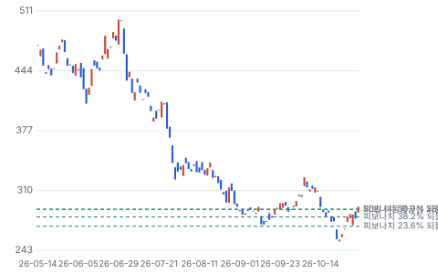

**주봉**

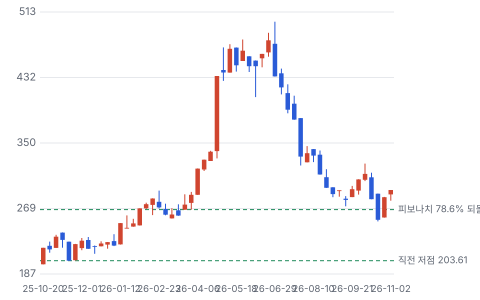

**월봉**

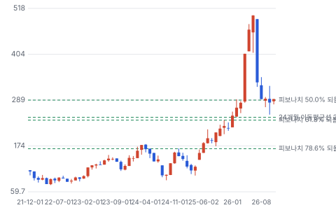

**분기 매출·EPS 실적과 컨센서스**

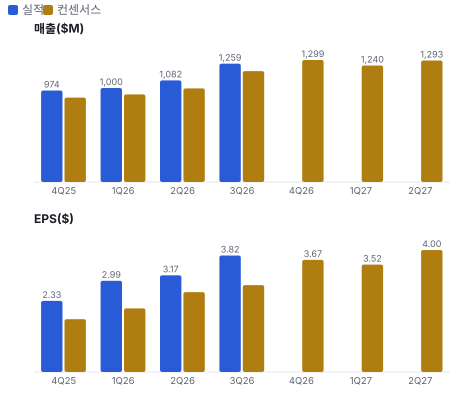

**최근 4개 분기 주가 변화 분석**

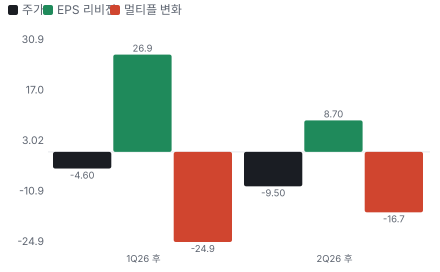

**EPS 리비전**

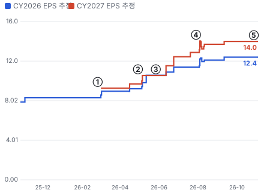

① 26-02-25 4Q25 실적 · EPS 리비전 -
② 26-04-29 1Q26 실적·EPS 46% 상회 · EPS 리비전 +9%
③ 26-05-27 Valley 인수 발표 · EPS 리비전 +0%
④ 26-07-29 2Q26 실적·Xcel 수주 · EPS 리비전 +6%
⑤ 26-10-28 3Q26 실적·2027 가이던스 · EPS 리비전 +0%

**밸류에이션 주가 시나리오**

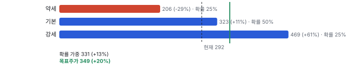

**주가별 업사이드**

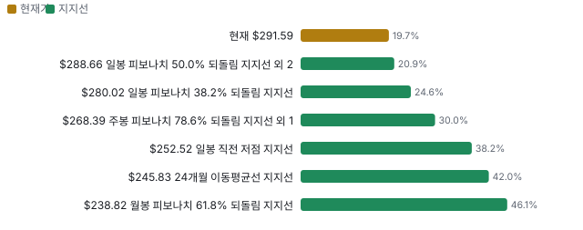

**제품·서비스 포트폴리오**

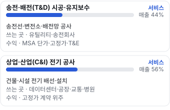

**고객 믹스(FY2025, 매출 대비)**

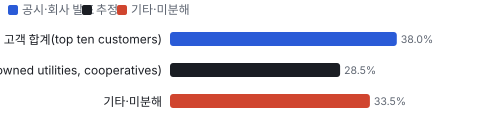

**공급 병목(10점, 낮을수록 병목)**

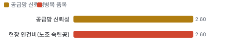

**생산능력 현재와 확충 계획(인력(명))**

**CAPEX의 매출 대비 비중**

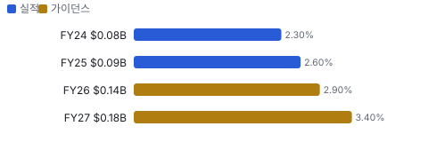

**어닝콜 변화별 주주가치 영향**

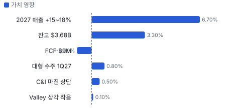

**멀티플 프리미엄**

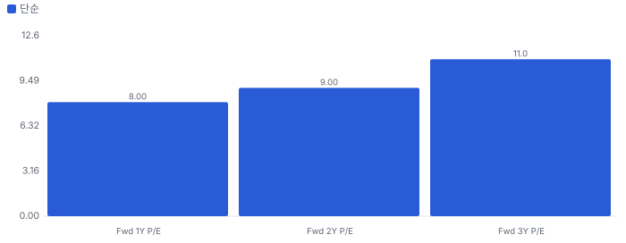

**합리적 멀티플**

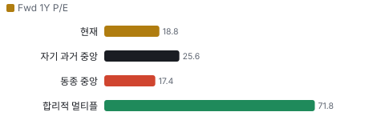

**일별 거래량 분해**

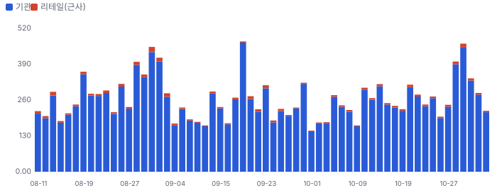

**기관 자금 흐름**

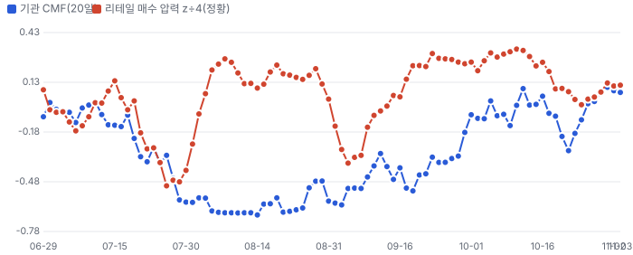

**몬테카를로**

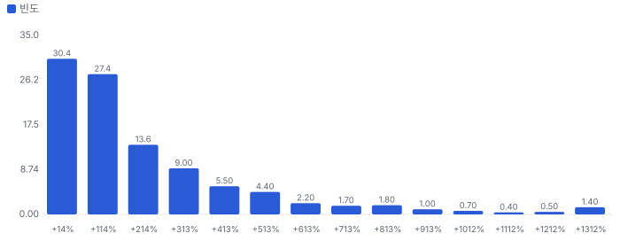

해석: 3,000번 중 2,745번(92%)에서 가치가 지금 주가 이상이었다. 가정을 흔들어도 지금 주가를 뒷받침하는 경우가 더 많다. 가운데 값은 2.28배이고, 열 번 중 여덟 번은 1.06~6.59배 사이에 든다.

## 내러티브

> **기업가치를 결정하는 이야기:** TTM 매출 \$4.31B, 영업이익 \$264M(이익률 6.1%)이다. 3Q는 매출 \$1.26B(+32%), EPS \$3.82(+86%)였다. 회사는 2027 매출 +15~18%와 부문 마진 상단~중간을 처음 숫자로 냈다. 기업가치의 위쪽은 2028년 이후 대형 고전압 송전이고, 아래쪽은 고정가 계약의 원가 위험과 운전자본이다.

> **멀티플·EPS 프리미엄**
> **멀티플:** Fwd 1Y P/E 18.8배로 동종 5곳 중앙값 17.4배보다 약간 높다. Quanta(31.1배)보다 한참 낮고 EMCOR(17.4배)·MasTec(18.5배)와 비슷하다. 자기 3년 범위는 16.4~45.7배였다.
> **EPS:** 다음 4개 분기 EPS 추정은 6월 말 약 \$11.0에서 11/3 \$15.54로 약 41% 올랐다(Fwd P/E 역산). FY2027 EPS 추정은 3/2 \$9.29에서 9/11 \$14.03·11/3 \$16.25로 올랐다.

### 투자자들은 왜 열광했나

4/30 1Q 실적(EPS \$2.99, 추정 \$2.05)으로 하루 +20%가 올랐다. 6/29에는 \$501까지 갔다. 'Quanta(Quanta Services, 미국 최대 전력 인프라 시공사)의 작은 형제'로 전력망·데이터센터 테마에 묶였다. 식은 것은 7월이다. 7/1~7/29에 −36%가 빠졌다. 7/1 Valley 인수 종결일에 −7.5%, 2Q 발표(7/29 장 마감 뒤) 직전 닷새에 −21%였다. 7월 하락의 원인은 1차 자료로 특정하지 못했다. 발표 뒤 2Q 콜에서 'DSO(매출채권 회수 일수) 상승'·'Valley 첫해 EPS 중립'·'가격을 정하는 쪽이 아니다'가 나왔고, 8월에도 −13%가 더 빠졌다.

### 무엇이 기업가치를 바꾸나

> **구조적 체질 변화**
> **변화:** C&I 매출 비중이 3Q 56%로 1년 전 47%에서 올랐다. 고정가 비중이 늘어 마진은 오르고 원가 위험도 커졌다
> **증거:** 3Q 10-Q 부문·계약 유형 표
> **반증:** C&I 마진이 6~9% 중간 아래로 내려간다

> **고부가 믹스 확장**
> **변화:** 345kV 이상 송전과 데이터센터 전기 공사가 늘었다. 회사는 765kV까지 할 수 있다고 했지만 착공은 2028 이후다
> **증거:** 2Q·3Q 콜
> **반증:** 대형 송전 수주가 경쟁사로 간다

> **기술 혁신**
> **변화:** 기술보다 시공 방식이다. 공장에서 부품을 미리 조립하는 프리패브를 넓혀 현장 인력을 아낀다(정량 효과 미공개)
> **증거:** 3Q 콜(Stifel 질문 답변)
> **반증:** 프리패브 투자 뒤에도 C&I 마진이 오르지 않는다

> **실행 속도**
> **변화:** Xcel 345kV 2건은 2Q 잔고 반영(2026-06)에서 매출 시작(2027 하반기)까지 약 12개월, 이후 약 18개월 걸린다. 같은 기준의 피어 값은 공개 자료에서 찾지 못했다 **납품 리드타임 12개월.** 피어 비교 미확인. 이전 대비 미확인.
> **증거:** 2Q 콜
> **반증:** Xcel 2건 착공이 2028로 밀린다

> **M&A**
> **변화:** Valley(\$324.8M, 2026-07-01)로 서부 C&I를 넓혔다. 회사는 C&I 비공개 인수 배수가 시너지 전 8~10배라고 했다
> **증거:** https://www.sec.gov/Archives/edgar/data/700923/000070092326000052/myrg-20260930.htm
> **반증:** 조건부 대가 목표 미달·영업권 손상

> **정책·입법 연관성**
> **재정정책:** 해당 없음(보조금·세액공제 수령 공시 없음). 송전 투자는 유틸리티 요금 기반 규제 승인에 달려 있다 3Q 10-Q 반증: 주 규제 당국이 대형 송전 요금 반영을 거부한다 의회 동의 2/10 — 하원 1/5(MYR 관련 하원 의결 기록을 찾지 못했다) · 상원 1/5(같음).
> **행정명령:** 연방 송전 인허가 가속·데이터센터 전력 공급 관련 행정 조치가 배경이다. MYR을 직접 겨냥한 명령은 없다. 회사는 대형 프로젝트가 입지 선정(siting) 단계에 있다고 했다 2Q 콜(Jefferies 질문 답변) 반증: 연방 인허가 가속이 법원에서 멈춘다 의회 동의 2/10 — 하원 1/5(관련 의결 기록 미확인) · 상원 1/5(같음).
> **연관입법:** 해당 없음(회사를 직접 겨냥한 연방 법안을 찾지 못했다. 로비 공시는 키가 없어 미확인) 로비 조회 미확인 반증: 송전 인허가 개혁 법안 무산

> **CAPEX 낙수효과**
> **변화:** 유틸리티 CAPEX·데이터센터 착공이 MSA(다년 유지보수·소규모 공사 기본 계약(master service agreement))와 C&I 수주로 온다. 고객 투자 발표를 MYR 매출로 바로 옮기지 않는다 — 확인된 것은 잔고 \$3.68B까지다
> **증거:** https://www.sec.gov/Archives/edgar/data/700923/000070092326000052/myrg-20260930.htm
> **반증:** 유틸리티가 2027 CAPEX 계획을 줄인다

### 내러티브 근거

> 북미 송배전·전기 공사 시공사가 'AI 전력 인프라' 묶음에 들어가 P/E가 2026년 4~6월 45배까지 갔다가 지금 18.8배로 돌아왔다. 그 사이 다음 4개 분기 EPS 추정은 약 41% 올랐다. 이야기는 살아 있고 웃돈만 빠졌다. 동종 대비 멀티플 차이 +8% 중 회사 고유 몫은 -74%다. 단계는 컨센서스, 쏠림은 중간이다.

> **전력망 투자 슈퍼사이클(송배전)** · 유지
> **논리:** 유틸리티 CAPEX와 대형 고전압 송전(345~765kV)이 늘어 T&D 일감이 길게 이어진다
> **숫자:** T&D 잔고 \$1.29B(12개월 안 \$1.04B), 2027 T&D 매출 +10~13%, 송전 시장 연 10% 성장(회사 인용 업계 보고서)
> **반증:** 1Q27까지 대형 송전 잔고 추가 없음

> **데이터센터·첨단 제조 전기 공사(C&I)** · 강화
> **논리:** 데이터센터 착공이 C&I 고정가 일감과 마진을 올린다
> **숫자:** C&I 매출 3Q \$704M(+58%, 인수 포함), C&I 잔고 \$2.39B, 2027 C&I +18~22%
> **반증:** C&I 잔고가 2분기 연속 감소

> **마진 체질 개선(계약 조건·실행)** · 유지
> **논리:** 계약 조건이 좋아져 C&I 마진이 6~9% 상단에 머문다
> **숫자:** C&I 영업이익률 6.4% → 8.7%, T&D 8.2% → 9.3%(3Q 전년 대비)
> **반증:** 추정 변경 효과를 빼면 마진 개선이 사라진다(3Q 효과 \$5.3M)

> **인수로 넓히는 C&I(Valley·Comet(Comet Electric, Valley와 함께 편입된 캘리포니아 전기 시공사))** · 유지
> **논리:** 서부 시장과 프리패브 역량을 사서 교차 판매한다
> **숫자:** 인수가 \$324.8M, 연환산 매출 약 \$400M(질문자 표현), 상각 부담이 예상보다 작다
> **반증:** 2027 C&I 성장이 18% 아래

> **반대: 이익이 현금이 안 된다** · 강화
> **논리:** 고정가 비중이 커지고 고객이 지급을 늦춰 FCF가 이익을 따라가지 못한다
> **숫자:** 9M 영업현금흐름 \$134M(1년 전 \$212M), 3Q FCF \$9M(1년 전 \$65M), 계약자산 \$318M(연초 \$242M)
> **반증:** 4Q 영업현금흐름이 순이익을 넘는다

> **반대: AI 전력 테마의 배수 되돌림** · 강화
> **논리:** 실적과 무관하게 테마 배수가 빠진다
> **숫자:** Fwd 1Y P/E 45.5배(6/30) → 18.8배(11/3), 같은 기간 다음 4개 분기 EPS 추정 약 +41%
> **반증:** P/E가 동종 중앙값(17.4배) 위에서 버틴다

## 포트폴리오

| 제품·서비스 | 구분 | 무엇 | 쓰는 곳 | 돈 버는 방식 |
|---|---|---|---|---|
| 송전·배전(T&D) 시공·유지보수 | 서비스 | 송전선·변전소·배전망 공사 | 유틸리티·송전회사 | MSA 단가·고정가·T&E(시간·장비 단가 계약(time and equipment)) |
| 상업·산업(C&I) 전기 공사 | 서비스 | 건물·시설 전기 배선·설치 | 데이터센터·공장·교통·병원 | 고정가 계약 위주 |

## 고객

> **FY2025 최대 고객 상위 10개 고객 합계(top ten customers) 38%, 상위 3곳 66%, 집중도 보통.** 공시·회사 발표로 확인한 몫은 매출의 38%이고, 나머지 고객 몫은 추정이거나 미분해다. 상위 10곳이 FY2025 매출의 38.0%이고 단일 10% 초과 고객은 없다(FY2025 10-K). 9/30 매출채권도 10% 넘는 고객이 없다. 고객은 투자자 소유 전력회사·협동조합·데이터센터 개발사·종합건설사다

**고객별 매출 몫(FY2025)**
| 고객 | 몫 | 변화 | 근거 |
|---|---|---|---|
| 상위 10개 고객 합계(top ten customers) | 38% | +0%p | 공시 |
| 투자자 소유 전력회사·협동조합(MSA)(investor-owned utilities, cooperatives) | 25~32% | 미확인 | 추정 |
| Xcel Energy(Xcel Energy) | 미확인 | 미확인 | 회사 발표 |
| 데이터센터 개발사·종합건설사(C&I)(general contractors, developers) | 미확인 | 미확인 | 회사 발표 |
| 기타·미분해 | 34% | - | - |

> **상위 10개 고객 합계(top ten customers)** · 공시
> **사는 것:** T&D·C&I
> **추정 근거:** FY2024 37.8%, FY2023 37.9% — 3년째 같은 수준

> **투자자 소유 전력회사·협동조합(MSA)(investor-owned utilities, cooperatives)** · 추정
> **사는 것:** 유지보수·소규모 송배전 공사
> **추정 근거:** T&D 44% × MSA 65% ≈ 29%(자체 계산)

> **Xcel Energy(Xcel Energy)** · 회사 발표
> **사는 것:** MSA + 345kV 송전 2건(\$200M 이상)
> **추정 근거:** 고객 몫은 비공개, 단일 10% 미만

> **데이터센터 개발사·종합건설사(C&I)(general contractors, developers)** · 회사 발표
> **사는 것:** 데이터센터 전기 공사
> **추정 근거:** 회사는 데이터센터가 모든 지역의 1순위가 아니라고 했다

## 수주·파이프라인

> **2026-09-30 기준 5건.** 확정 \$2.59B.

**실행 속도와 방해 요인**
| 항목 | 상태 | 실행 속도 | 방해 요인 |
|---|---|---|---|
| Xcel Energy 345kV 송전 2건 | 확정 | 매출 2027 하반기부터 약 18개월 | 인허가·자재 인도 |
| 3Q T&D 신규 수주(인디애나·버지니아·아이오와·텍사스·매사추세츠 345kV 등) | 확정 | 미확인 | 인력 |
| C&I 잔고(데이터센터·창고·경전철·폐수처리 등) | 확정 | 12개월 안 \$1.81B(76%) | 고정가 원가 초과 · 고객 지급 조건 |
| 대형 고전압 송전(765kV 포함) | 협상 | 빠르면 2027 말, 가능성 높은 시점 2028 이후 | 입지 선정·인허가 · 규제 헤드라인 |
| C&I 장기 단계 계약(Part A·B(설계·자재 확보(A)와 시공(B)을 나눈 단계 계약)) | 협상 | 미확인 | 자재 확보 |

## 마진 구조

> **GPM 13.6%, OPM 6.8%.** 3Q25 대비 GPM +1.8%p, OPM +1.9%p. 변동비는 매출의 75%이고, 매출이 10% 늘면 OPM은 +1.7%p 움직인다. 3Q 매출원가는 매출의 86.4%로 1년 전 88.2%보다 1.8%p 낮다. 회사는 원가 항목별 금액을 공시하지 않아 인건비·자재·하도급 몫은 추정이다. 개선 몫 중 추정 변경(종료 정산·생산성) 효과가 영업이익 \$5.3M(매출의 0.4%p)이다

> **매출 100 중 매출원가 87.0, 매출총이익 13.0(최근 4분기, 공시).** 매출원가 요인 중 현장 인건비(노조 숙련공)이 매출의 38.0%로 가장 무겁고, 단가가 +10% 오르면 GPM이 -3.80%p 움직인다. 분기 회귀로 매출 1이 늘 때 매출원가는 0.85 늘고, 매출원가의 고정비 몫은 4%다.

**비용 요인 강도 — 비중·추세·충격(+10%)·탄력**
| 비용 | 구분 | 매출 대비 | 1년 변화 | 마진 기여 | 충격 시 마진 | 매출 탄력 | 고정비 몫 |
|---|---|---|---|---|---|---|---|
| 현장 인건비(노조 숙련공) | 매출원가 요인 | 38.0% | -1.0%p | +1.0%p | -3.80%p | 미확인 | 20% |
| 자재(전선·배관·배전반) | 매출원가 요인 | 24.0% | -0.5%p | +0.5%p | -2.40%p | 미확인 | 0% |
| 하도급 | 매출원가 요인 | 12.0% | +0.0%p | -0.0%p | -1.20%p | 미확인 | 0% |
| 장비·연료·설비 감가상각 | 매출원가 요인 | 7.0% | -0.2%p | +0.2%p | -0.70%p | 미확인 | 60% |
| 기타 직접비(보험·현장 경비) | 매출원가 요인 | 5.4% | -0.1%p | +0.1%p | -0.54%p | 미확인 | 30% |
| 매출원가 | 공시 항목 | 87.0% | -1.6%p | +1.6%p | -8.70%p | 0.85 | 4% |
| 판관비 | 공시 항목 | 6.7% | -0.3%p | +0.3%p | 미확인 | 0.04 | 36% |
| 감가상각 | 공시 항목 | 0.2% | +0.1%p | -0.1%p | 미확인 | 0.00 | -71% |
| 기타 영업비용 | 공시 항목 | -0.1% | +0.1%p | -0.1%p | 미확인 | -0.00 | 40% |

매출 탄력 = 분기 비용을 매출에 회귀한 기울기(매출 1당 변동비), 고정비 몫 = 절편 ÷ 평균 비용. 표본이 8분기 미만이면 미확인. 매출원가 요인 비중은 margin 재료의 추정이 섞여 있고, 공시 매출원가와의 차이는 '기타 매출원가'로 둔다.

**GPM에서 OPM까지(GAAP)**
| 기간 | GPM | 연구개발 | 판관비 | 기타 | OPM |
|---|---|---|---|---|---|
| 3Q25 | 11.8% | 0.0% | 6.9% | -0.0% | 4.9% |
| 3Q26 | 13.6% | 0.0% | 6.5% | 0.4% | 6.8% |

**마진을 결정하는 비용 요인 — 비용 +10% 시 OPM**
| 비용 | 매출 대비 | 변화 | 고정비 | OPM |
|---|---|---|---|---|
| 현장 인건비(노조 숙련공) | 38.0% | -1.0%p | 20% | -3.80%p |
| 자재(전선·배관·배전반) | 24.0% | -0.5%p | 0% | -2.40%p |
| 하도급 | 12.0% | +0.0%p | 0% | -1.20%p |
| 장비·연료·설비 감가상각 | 7.0% | -0.2%p | 60% | -0.70%p |
| 판관비(SBC 포함) | 6.5% | -0.5%p | 70% | -0.65%p |
| 기타 직접비(보험·현장 경비) | 5.4% | -0.1%p | 30% | -0.54%p |
| 인수 무형자산 상각 | 0.5% | +0.3%p | 100% | -0.05%p |

**비용을 움직이는 요인**
| 비용 | 요인 |
|---|---|
| 현장 인건비(노조 숙련공)(매출원가) | IBEW(국제 전기 노동자 형제단(미국 전기공 노조)) 임금·인력 수급 · 근거 추정 |
| 자재(전선·배관·배전반)(매출원가) | C&I 고정가 계약 자재, 구리 가격 · 근거 추정 |
| 하도급(매출원가) | 대형 프로젝트 외주 · 근거 추정 |
| 장비·연료·설비 감가상각(매출원가) | 중앙 장비 운용, 경유 · 근거 추정 |
| 판관비(SBC 포함)(판관비) | 인센티브 보상·인수 편입 · 근거 공시 |
| 기타 직접비(보험·현장 경비)(매출원가) | 자가 보험·현장 비용 · 근거 추정 |
| 인수 무형자산 상각(기타) | Valley 잔고·고객 관계 상각(\$168M) · 근거 공시 |

**송전·배전(T&D) 시공·유지보수 BOM — 매출의 44%, GPM 9%(3Q 부문 영업이익률(부문 매출총이익률 비공개)), 항목 가격 +10% 시**
| 항목 | 원가 몫 | 전가 | 제품 GPM | OPM |
|---|---|---|---|---|
| 현장 인건비(노조 숙련공) | 45~55% | 미확인 | -4.5%p | -2.00%p |
| 장비·연료·설비 감가상각 | 12~18% | 미확인 | -1.4%p | -0.60%p |
| 자재(전선·배관·배전반) | 8~15% | 미확인 | -1.0%p | -0.46%p |
| 미분해 | 24% | - | - | - |

**상업·산업(C&I) 전기 공사 BOM — 매출의 56%, GPM 9%(3Q 부문 영업이익률(부문 매출총이익률 비공개)), 항목 가격 +10% 시**
| 항목 | 원가 몫 | 전가 | 제품 GPM | OPM |
|---|---|---|---|---|
| 현장 인건비(노조 숙련공) | 35~45% | 미확인 | -3.7%p | -2.04%p |
| 자재(전선·배관·배전반) | 30~40% | 미확인 | -3.2%p | -1.79%p |
| 하도급 | 10~20% | 미확인 | -1.4%p | -0.77%p |
| 미분해 | 10% | - | - | - |

현장 인건비(노조 숙련공) 가격이 +10% 오르면 영업이익은 -59.8% 움직인다. 판매가 전가를 모르는 항목은 전가 0%로 계산했다.

**BOM 항목 가격을 움직이는 것**
| 항목 | 요인 |
|---|---|
| 현장 인건비(노조 숙련공) | MSA·T&E 비중이 커 인력 비중이 높다 — 전가: 부분(MSA·T&E는 단가에 인건비 연동) · 근거 추정 |
| 장비·연료·설비 감가상각 | 크레인·장력기 등 중장비 — 전가: 부분(T&E 장비 단가) · 근거 추정 |
| 자재(전선·배관·배전반) | 고객 지급 자재가 많다 · 근거 추정 |
| 자재(전선·배관·배전반) | 고정가라 자재 가격 위험을 회사가 진다 · 근거 추정 |
| 현장 인건비(노조 숙련공) | 프리패브로 현장 시간을 줄이는 중 · 근거 추정 |
| 하도급 | 기계·통신 등 일부 공종 외주 · 근거 추정 |

**BOM 투입 물가 — PPI 전년비, 2026-11-03 수집**
| 항목 | 미국 | 일본 | 한국 | 대만 |
|---|---|---|---|---|
| 장비·연료·설비 감가상각 | +115.2% | 미확인 | 미확인 | 미확인 |
| 자재(전선·배관·배전반) | +30.0% | +54.2% | +25.8% | +41.2% |

별표는 품목보다 넓은 업종 지수다. 지난 1년 투입 물가를 판매가 전가 뒤 원가에 그대로 넣으면 OPM은 -15.34%p 움직인다(매출원가의 33% 기준).

## 공급망 병목

> **공급망 신뢰성 2.6/10, 병목 심각.** 가장 약한 고리는 현장 인건비(노조 숙련공) 2.6점이고, 품목 평균은 2.6점이다. 근거가 부족한 2건(장비·연료·설비 감가상각 · 자재(전선·배관·배전반))은 점수에서 뺐다. 약한 고리는 숙련 전기공이다. 회사는 시장이 '조금씩 빡빡해진다'고 했고, 고객과의 대화는 '자재와 인력을 제때 확보하느냐' 두 가지라고 했다. 자재(변압기·개폐기)는 고객이 사는 경우가 많아 MYR의 직접 병목은 인력·장비다

**병목과 마진 — 품목 가격 +10% 시 OPM**
| 품목 | 점수 | 판정 | 구분 | OPM |
|---|---|---|---|---|
| 현장 인건비(노조 숙련공)(필수) | 2.6 | 병목 심각 | 핵심 통제 품목 | -4.04%p |

> **현장 인건비(노조 숙련공)** · 2.6/10
> **왜:** 숙련공 약 85%가 단체협약 적용, 대다수가 IBEW(1위 몫 = 단체협약 적용 비율로 근사)
> **병목 요인:** 인증 공급사 미확인 · 캐파 부족 · 리드타임 미확인 · 재인증 미확인 · 1위 점유율 85% · 미국 집중 95% · 물량 확보 장기계약
> **풀리는 조건:** 미확인

**공급사**
| 품목 | 공급사 | 몫 | 근거 |
|---|---|---|---|
| 현장 인건비(노조 숙련공) | IBEW 지역 노조(숙련 전기공 공급(단체협약)) | 미확인 | 공시 |
| 장비·연료·설비 감가상각 | 장비 제조사(이름 미공시)(버킷 트럭·크레인·장력기) | 미확인 | 공시 |
| 자재(전선·배관·배전반) | 전기 자재 유통사(이름 미공시)(C&I 자재) | 미확인 | 추정 |

**무역 통계로 본 공급 지역**
| 품목 | EU 수입처 | 일본 수입처 | EU 1위 전년비 |
|---|---|---|---|
| 장비·연료·설비 감가상각 | US(미국) 75% · CN(중국) 12% · KR(한국) 6% | 大韓民国 74% · シンガポール 7% | +133.6% |
| 자재(전선·배관·배전반) | MY(말레이시아(무역 통계 국가 코드)) 69% · KR 10% · US 7% | マレーシア 58% · タイ 36% | 미확인 |

## 생산능력

> **현재 명목 캐파 9,000 인력(명), 가동률 미확인.** 착공 이상 증설은 0 인력(명), 발표까지 합치면 0 인력(명)이다. 다 가동하면 지금보다 +0%, 착공 이상만이면 +0%다. FY25 CAPEX는 \$0.09B로 매출의 2.6%다. 시공사라 캐파는 인력과 장비다. 회사 개요 기준 약 9,000명이고, 설비투자는 매출의 약 3%(2026)에서 3%대 초중반(2027)으로 늘린다. 공장 증설이 아니라 장비와 C&I 프리패브 시설이다

**생산능력 확충 계획**
| 계획 | 단계 | 증설 | 가동 시점 | CAPEX |
|---|---|---|---|---|
| T&D 장비·C&I 프리패브 확대 | 발표 | 미확인 | 2027-12 | \$0.18B |

남은 계획의 CAPEX 합계는 \$0.18B다. 합계는 FY27 매출의 3%다.

**증설 방해 요인**
| 계획 | 방해 요인 |
|---|---|
| T&D 장비·C&I 프리패브 확대 | 인력 확보 |

**CAPEX와 매출 대비**
| 기간 | CAPEX | 매출 | 매출 대비 | 구분 |
|---|---|---|---|---|
| FY24 | \$0.08B | \$3.36B | 2.3% | 실적 |
| FY25 | \$0.09B | \$3.66B | 2.6% | 실적 |
| FY26 | \$0.14B | \$4.64B | 2.9% | 가이던스 |
| FY27 | \$0.18B | \$5.33B | 3.4% | 가이던스 |

## M&A 시너지

> **Valley Holdings(Comet Electric 포함) 인수(2026-07-01, \$0.32B): 시너지가 다 나면 연 \$0.00B(확률 가중 이익 기여).** 세후 시너지 가치는 통합 비용을 빼고 \$0.02B. EPS 효과는 2026년 -3.7%에서 2029년 -3.3%.

**Valley Holdings(Comet Electric 포함) 시너지가 생기는 길**
| 종류 | 시너지 | 연 규모 | 완성 | 확률 | 어떻게 생기나 | 근거 |
|---|---|---|---|---|---|---|
| 매출 | 교차 판매 | \$0.03B(이익률 8%) | 2028 | 30% | Valley 고객을 MYR 전국 네트워크로, MYR 고객을 Valley 시장(태평양 북서부·캘리포니아)으로 | 2Q·3Q 콜(금액 비공개, 규모는 추정: 대상 매출의 5%) |
| 원가 | 회계·재무 시스템 통합 | \$0.00B | 2027 | 50% | 운영 시스템은 두고 회계·재무만 MYR로 옮긴다 | 2Q 콜(금액 비공개, 규모는 추정) |
| 설비투자 | 프리패브 역량 확산 | \$0.00B | 2028 | 30% | Valley 프리패브 노하우를 MYR C&I 작업장에 옮겨 새 시설 투자를 줄인다 | 2Q 콜(금액 비공개, 규모는 추정) |

시너지 가치 = 세후 이익 기여 5년 + 말기 가치(할인율 9%, 성장 0) − 통합 비용. 매출 시너지는 그 매출의 이익률만 반영하고, 모든 시너지에 실현 확률을 곱했다.

## 해자

> 해자는 '숙련 노조 전기공과 장비를 묶은 실행 능력'과 '유틸리티와의 반복 거래(MSA)'다. 둘 다 진입을 늦추지만 가격 결정력은 약하다 — 회사 스스로 '가격을 정하는 쪽이 아니다'고 했다

> **숙련 노조 인력·중앙 장비** · 보통
> **해자:** 고전압(345~765kV) 송전 공사는 자격 있는 인력·특수 장비가 있어야 입찰할 수 있다
> **근거:** FY2025 10-K: 숙련공 약 85% IBEW 단체협약, 장비 중앙 운용(wire puller·tensioner 자체 설계)
> **숫자:** 장비 구매 약정 \$41.0M(9/30), 순설비 \$345.6M
> **깨지는 조건:** 대형 송전 입찰에서 신규 진입사가 수주한다

> **유틸리티 반복 거래(MSA)** · 보통
> **해자:** T&D 매출의 약 65%가 MSA라 일감이 이어진다
> **근거:** 3Q 콜: MSA 약 65%, 2Q 콜: 사업의 90% 이상이 기존 고객 반복 거래
> **숫자:** 상위 10곳 FY2025 매출 38.0%, 단일 10% 초과 없음
> **깨지는 조건:** MSA는 30~90일 통보 해지 가능 — 주요 MSA 갱신 실패

> **계약 조건 협상력** · 약함
> **해자:** 인력·자재가 부족해 고객이 2029~2030년 일을 미리 묶는다(Part A·B)
> **근거:** 3Q 콜(Oppenheimer 질문 답변)
> **숫자:** C&I 영업이익률 3Q 8.7%(1년 전 6.4%)
> **깨지는 조건:** 2027 C&I 영업이익률이 6~9% 중간 아래

> **가격 결정력** · 약함
> **해자:** 경쟁 입찰이 여전하다
> **근거:** 2Q 콜: 'price makers가 아니다'(C&I 담당)
> **숫자:** 미확인
> **깨지는 조건:** 고정가 계약 마진이 2분기 연속 내려간다

## 경영진·네트워크

> CEO Rick Swartz(MYR CEO Rick Swartz)와 CFO Kelly Huntington(MYR CFO Kelly Huntington)이 콜을 이끈다. C&I는 Don Egan, T&D 마케팅은 Brian Stern이 답했다(직함은 콜 발언 기준, 정확한 직위 미확인). 정계·동문 연결은 공개 자료로 확인하지 못했다

> **Rick Swartz** · CEO · 미확인
> **프로필:** 3Q 콜 대표 발언자, 대형 프로젝트 팀을 20년 전 만들었다고 설명
> **비즈니스:** 미확인
> **정계:** 미확인
> **동문:** 미확인
> **사모임:** 미확인

> **Kelly Huntington** · CFO · 미확인
> **프로필:** 6/1 장내 매도 2,000주(약 \$0.92M, Form 4)
> **비즈니스:** 미확인
> **정계:** 미확인
> **동문:** 미확인
> **사모임:** 미확인

> **Don Egan** · C&I 담당(콜 발언) · 미확인
> **프로필:** C&I 시장·경쟁 답변
> **비즈니스:** 미확인
> **정계:** 미확인
> **동문:** 미확인
> **사모임:** 미확인

> **Brian Stern** · T&D 대형 프로젝트 마케팅(콜 발언) · 미확인
> **프로필:** 대형 프로젝트 팀 답변
> **비즈니스:** 미확인
> **정계:** 미확인
> **동문:** 미확인
> **사모임:** 미확인

**네트워크 정량화**
| 연결 | 강도 | 닿는 매출 | 가중 노출 | 매출 대비 | 근거 |
|---|---|---|---|---|---|
| 비즈니스: 유틸리티와의 장기 MSA 관계 | 2/5 | \$0.00B | \$0.00B | 0% | 경영진 개인 연결이 매출을 만든 증거는 없다 FY2025 10-K 고객 구조 |

가중 노출은 연결이 닿는 매출의 크기다. 연결이 그 매출을 만들었다는 뜻이 아니며, 인과는 공개 자료로 입증하지 못한다.

## 약세 논리 및 셀온 조건

| 약세 논리 | 근거 | 반박 | 가를 자료 |
|---|---|---|---|
| 이익이 현금이 안 된다 | 9M 영업현금흐름 \$134M(1년 전 \$212M), 3Q FCF \$9M(1년 전 \$65M), 계약자산 \$242M → \$318M | 1년 전 DSO가 사상 최저였던 기저, Valley 편입·대형 착수 시점(회사) | 4Q 영업현금흐름 대 순이익 |
| 마진에 일회성이 들어 있다 | 9M 추정 변경 효과 영업이익 \$20.9M(9M 영업이익의 약 10%), 3Q \$5.3M | 효과를 빼도 3Q 영업이익률 약 6.3%(1년 전 4.9%, 자체 계산) | 1Q27 부문 마진·추정 변경 효과 공시 |
| 고정가 원가 위험 | C&I는 주로 고정가, 미승인 변경주문 증가(3Q 콜) | 회사: 통상 분기 변동, 계약 조건이 좋아졌다 | 다음 10-Q 미승인 변경주문 잔액 |
| 테마 배수 되돌림이 더 남았다 | Fwd 1Y P/E 45.5배(6/30) → 18.8배, Quanta는 31.1배 | 이미 동종 중앙값 17.4배 근처 | 동종 배수 흐름 |
| 대형 송전이 늦다 | 본격 구축 2028 이후, 765kV는 입지 선정 단계 | Xcel 345kV 2건(\$200M 이상)은 2027 하반기 착공 | 1Q27 잔고 추가 |
| 인력 병목·노조 | 숙련공 약 85%가 단체협약(FY2025 10-K), 시장이 조금씩 빡빡해진다(2Q 콜) | 20년 된 대형 프로젝트 팀·중앙 장비 | 인건비·하도급 증가율 |
| 경영진 매도 | 6/1 CFO 2,000주·이사 3,159주 장내 매도(Form 4, 주가 \$450대) | 규모가 작고 매수·매도 모두 드물다 | 다음 Form 4 |

> **셀온 조건**
> **조건 1:** 4Q26 EPS가 컨센서스 하단 \$3.10 아래다
> **조건 2:** 4Q26 실적에서 2027 매출 가이던스 하단(+15%)을 낮춘다
> **조건 3:** 2분기 연속 영업현금흐름이 순이익의 60% 아래다
> **조건 4:** 추정 변경 효과를 뺀 C&I 영업이익률이 7% 아래로 내려간다
> **조건 5:** 1Q27 총잔고가 \$3.5B 아래로 줄어든다
> **조건 6:** 고정가 프로젝트 손실 충당(원가 초과) 공시

## 어닝콜 변화

**직전 콜 대비 새로 나오거나 바뀐 내용 → 가치 영향**
| 항목 | 내용 | 직전 콜 | 최신 콜 | 모델 동인 이동 | 확신도 | 가치 영향 |
|---|---|---|---|---|---|---|
| 신규 | 2027 매출 가이던스 | 숫자 없음(2Q는 2026 13~15%) | 2027 +15~18%(C&I +18~22%, T&D +10~13%) | 1년차 성장률 +2.0% | 0.8 | +6.7% |
| 업데이트 | C&I 마진 목표 | 2026 6~9% 중간 | 2027 6~9% 상단 | 목표 이익률 +0.40% | 0.5 | +0.5% |
| 업데이트 | 총 잔고 | \$3.16B(6/30) | \$3.68B(9/30), 12개월 안 \$2.85B | 1년차 성장률 +1.0% | 1.0 | +3.3% |
| 업데이트 | 인수 상각 부담 | 첫 12개월 EPS 중립 | 3Q C&I 상각 \$4.9M, 부담이 예상보다 작다 | 출발 이익률 +0.30% | 1.0 | +0.1% |
| 부정 | 현금 전환 | 2Q FCF −\$26M(세금 시점) | 3Q FCF \$9M, 지급 조건 역풍 | 매출÷투하자본 -30.0% | 0.8 | -0.9% |
| 신규 | 대형 프로젝트 수주 시점 | 765kV 빠르면 2027 말 | 일부 대형 프로젝트 연말~1Q27 잔고 진입 | 장기 성장 수렴값 +0.20% | 0.5 | +0.8% |
| 신규 | 자사주 매입 | 없음 | \$100M(시가총액의 약 2.2%) | 순차입 — | 1.0 | +0.0% |
| 반복 | 대형 송전 착공 | 2027 하반기부터 18개월 | 본격 구축 2028 이후 | 장기 성장 수렴값 — | 0.8 | +0.0% |
| **합계** | 단독 합 |  |  | 동시 적용 +10.9% |  | **+10.5%** |

**사건별 EPS 리비전**
| # | 날짜 | 구분 | 사건 | CY2026 EPS 전→후 | CY2027 EPS 전→후 | 리비전 | 주가 반응 |
|---|---|---|---|---|---|---|---|
| ① | 26-02-25 | 실적 | 4Q25 실적 | \$8.32 → \$8.98 | - → \$9.29 | - | -0.6% |
| ② | 26-04-29 | 실적 | 1Q26 실적·EPS 46% 상회 | \$9.23 → \$10.59 | \$9.71 → \$10.57 | +8.9% | +19.9% |
| ③ | 26-05-27 | 내러티브 | Valley 인수 발표 | \$10.59 → \$10.59 | \$10.57 → \$10.57 | +0.0% | +1.6% |
| ④ | 26-07-29 | 실적 | 2Q26 실적·Xcel 수주 | \$11.43 → \$12.13 | \$12.91 → \$13.74 | +6.4% | +2.7% |
| ⑤ | 26-10-28 | 실적 | 3Q26 실적·2027 가이던스 | \$12.43 → \$12.43 | \$14.03 → \$14.03 | +0.0% | +1.1% |

**해석:** 2개 구간 누적 주가 -14% = EPS 리비전 +38% × 멀티플 -37%. 더 크게 움직인 쪽은 **EPS 리비전**이다.

## 거시 지표 싱크로율

> **미국 변압기 PPI(생산자물가지수)와 매출 싱크로율 95%(0분기 선행, 전년 대비, 표본 7개·신뢰 참고용).**  C&I 고정가 계약의 자재 원가가 구리 가격을 따르고, 고객(유틸리티)의 변압기 투자가 송배전 공사량의 선행 지표일 수 있다

**지표별 싱크로율(상관계수 × 100)**
| 지표 | 증가율 기준 | 지표 선행 | 매출 | 영업이익 | 방향 일치 | 표본·신뢰 | 4Q26 내포 매출 |
|---|---|---|---|---|---|---|---|
| 미국 구리 PPI | 전년 대비 | 1분기 | 81% | 57%(0분기) | 100% | 6·참고용 | +28.2% → 1.25B(확정) |
| 미국 변압기 PPI | 전년 대비 | 0분기 | 95% | 66%(1분기) | 100% | 7·참고용 | 미확인 |

**지표를 고른 이유**
| 지표 | 이유 |
|---|---|
| 미국 구리 PPI | C&I 자재 원가·고정가 마진 |
| 미국 변압기 PPI | 유틸리티 송배전 투자 강도 |

싱크로율은 증가율의 상관계수이며 인과가 아니다. 지표 단위·통화는 원자료 그대로이고 나라끼리 더하지 않는다(EU(유럽연합) 수입만 상대국 합계). ±1σ는 회귀 잔차 표준편차다.

## 밸류에이션

> **목표주가 \$349, 업사이드 +20%.** 자리는 기본과 강세 사이(강세 쪽 17%)이고 도달 확률은 약 43%다. 기본 \$323, 강세 \$469(+61%), 약세 \$206(-29%). DCF 기준 업사이드는 기본 +118%, 강세 +454%, 약세 +55%다(WACC 9.9%).

세 시나리오는 Fwd 1Y P/E 15.6배·20.9배·26.1배를 쓴다. 엔진 선정 20.9배는 동종 중앙값 17.4배에 펀더멘털 몫 +20%를 얹은 값이다. 지금 배수 18.8배가 그대로면 기본 EPS \$15.50에서 주가는 약 \$291로 지금과 같다(자체 계산: 18.8 × 15.50). 그래서 기본 업사이드 +11%는 전부 배수 회복에서 나오고, 목표주가 +20%의 나머지는 강세 쪽 기울기(DCF·차트 요인)다.

DCF는 기본 가치가 시가총액의 2.18배다. 성장이 16%에서 3.5%로 천천히 식고, 영업이익률이 7%까지 오르며, 매출 대비 투하자본 3.5를 유지한다고 본다. 마진에 종료 정산이 섞여 있고 현금 전환이 약해지는 지금, DCF 쪽이 맞으려면 4Q 이후 영업현금흐름이 순이익을 다시 따라잡아야 한다. 할인율 +50bp에 가치가 −6.8% 움직인다.

> **약세 \$206 (-29%)** · 확률 25%
> **가정:** 15.6배 × EPS \$13.20
> **근거:** 종료 정산 효과가 사라지고 고정가 C&I에서 원가 초과가 한 번 나온다. 2027 성장이 가이던스 하단(+15%)에 머물고 마진이 2026 수준으로 돌아간다. 컨센서스 하단 \$13.17과 같은 높이

> **기본 \$323 (+11%)** · 확률 50%
> **가정:** 20.9배 × EPS \$15.50
> **근거:** 2027 가이던스 중간(+16.5%)과 부문 마진 상단~중간이 이어진다. 다음 4개 분기 EPS 컨센서스 \$15.54와 같은 높이

> **강세 \$469 (+61%)** · 확률 25%
> **가정:** 26.1배 × EPS \$18.00
> **근거:** 대형 송전이 1Q27 잔고에 들어오고 C&I 마진이 9% 근처에서 버틴다. 4개 분기 연속 20% 상회 습관이 이어지면 다음 4개 분기 EPS가 약 16% 더 올라간다

**멀티플 선정 — Fwd 1Y P/E**
| 단계 | 조정 | 근거 |
|---|---|---|
| 동종 중앙값 | 17.4배 | 범위 16.0~18.5배, 3곳 |
| 펀더멘털 | +20% | 성장·이익률·ROIC로 본 합리적 멀티플 71.8배와의 차이의 일부만 인정 |
| 해자 | +0% | 숙련 노조 인력·중앙 장비 보통 · 유틸리티 반복 거래(MSA) 보통 · 계약 조건 협상력 약함 · 가격 결정력 약함 |
| 내러티브 | +0% | 단계 컨센서스 |
| 사이클·실행 판단 | +0% | 동종 중앙값(Fwd 1Y P/E 17.4배) 근처다. 2027 성장 가이던스(15~18%)와 잔고는 동종보다 낫지만, 마진에 종료 정산이 들어 있고 FCF 전환이 약해 웃돈을 더 얹지 않는다 |
| **선정** | **20.9배** | 지금 18.8배 |

**동종 레인지**
| 회사 | Fwd 1Y P/E | Fwd 2Y P/E | Fwd 3Y P/E | 성장 | 영업이익률 | ROIC |
|---|---|---|---|---|---|---|
| PRIM(Primoris Services) | 16.0 | 14.7 | 12.8 | 10% | 4% | 8% |
| MTZ(MasTec) | 18.5 | 14.7 | 12.3 | 21% | 5% | 10% |
| EME(EMCOR Group) | 17.4 | 14.6 | 12.7 | 21% | 10% | 37% |
| **MYR Group** | 18.8 | 16.0 | 14.0 |  |  |  |

지금 주가가 요구하는 5년 매출 CAGR -5%, 기본 시나리오 12%. 몬테카를로 중앙값 업사이드 +128%.

> 의사결정 보조(투자자문 아님): ① 매수 매력: 연 기대수익 +39.1% (자기자본비용 10.2% 대비 +28.9%p) · 자본비용 초과 확률 91% · 안전마진 1.06 → 정량 신호 강함 / ② 위험 예산 지표(이론): 1/4 켈리 10.0% (상한 10%) · 5년 하위10% +69% · 30%+ 손실 확률 0% / ③ 상방(5년): 기대 5.21배 · 2배 83% · 3배 60% · 10배 11% · 상위10% 10.43배

투입 물가 점검: 지난 1년 PPI를 BOM에 넣으면 OPM -15.34%p다(매출원가의 33% 기준).

## 매수 위치(일봉)

> **현재가 \$292는 '지지 근접'(가장 가까운 일봉 지지 \$289에서 ATR 0.4배 위).** 이 자리에서 목표주가까지 +19.7%, 첫 일봉 저항까지 +1.9%, 다음 지지까지 하방 -1.0%, 손익비 18.8배.

**가격대별 업사이드(일봉 기준)**
| 가격대 | 가격 | 목표주가까지 | 첫 저항까지 | 다음 지지까지 | 손익비 | 근거 기법(강도) |
|---|---|---|---|---|---|---|
| 현재가 | \$292 | +19.7% | +1.9% | -1.0% | 18.8 | - |
| 지지 1 | \$289 | +21.0% | +2.9% | -1.2% | 17.5 | 50일선 · 피보 50.0%(2.0) |
| 지지 2 | \$285 | +22.4% | +1.2% | -1.8% | 12.6 | 20일선(0.5) |
| 지지 3 | \$280 | +24.6% | +1.8% | -3.4% | 7.2 | 피보 38.2%(1.0) |
| 지지 4 | \$270 | +29.1% | +3.6% | 미확인 | 미확인 | 120일 지그재그 저점 · 피보 23.6%(1.8) |

**일봉 저항**
| 저항 | 가격 | 현재가 대비 | 근거 기법(강도) |
|---|---|---|---|
| 저항 1 | \$297 | +1.9% | 피보 61.8%(1.0) |
| 저항 2 | \$309 | +6.0% | 피보 78.6%(1.0) |
| 저항 3 | \$324 | +11.0% | 120일 지그재그 고점 · 120일 지그재그 저점 · 스윙 고점(1.8) |

일봉만 쓴다(주봉·월봉 제외). 손익비 = 목표주가까지 업사이드 ÷ 다음 지지까지 하방. 가격대별 기대값 참고표이며 매수·매도 시점 지시가 아니다.

## 애널리스트 토론

> **토론 결론 Neutral(규칙 등급 Buy).** EPS 추정은 올랐고 배수는 동종 중앙값 근처까지 빠졌다. 남은 갈림길은 4Q 영업현금흐름과 1Q27 대형 송전 수주다

**패널(가상 애널리스트)**
| 자리 | 애널리스트 | 핵심 논리 | 틀리는 조건 | 최종 투표 |
|---|---|---|---|---|
| Strong Buy | 윤태오(가상 리서치 하우스 북극성증권) | EPS 추정이 넉 달 새 41% 올랐는데 P/E가 45배에서 19배로 빠졌다. 2027 가이던스 +15~18%에 잔고 \$3.68B면 동종 중앙값보다 웃돈이 맞다 | 4Q26 EPS가 컨센서스 하단 \$3.10 아래 | Buy |
| Buy | 서지안(가상 리서치 하우스 은하캐피털) | C&I 마진이 상단에 머물고 Valley 상각 부담이 작다. 자사주 \$100M과 레버리지 0.63배로 하방이 받쳐진다 | 1Q27 C&I 마진 7% 아래 | Buy |
| Neutral | 한도윤(가상 리서치 하우스 동방리서치) | 배수가 동종 중앙값 근처로 왔다. 위로 가려면 대형 송전 수주, 아래로 가려면 마진 되돌림이 필요하고 둘 다 1Q27 전에는 확인이 어렵다 | 대형 송전 1건 잔고 진입 | Neutral |
| Sell | 이채린(가상 리서치 하우스 청람자산) | 이익이 현금이 안 된다. 9M 영업현금흐름이 1년 전보다 37% 줄었고 회사가 지급 조건 역풍을 인정했다 | 4Q 영업현금흐름이 \$120M을 넘는다 | Neutral |
| Strong Sell | 강민호(가상 리서치 하우스 북해증권) | 마진에 종료 정산이 들어 있다. 9M 추정 변경 효과가 영업이익 \$20.9M이고 고정가가 늘었다. 한 번 원가가 넘치면 EPS가 크게 깎인다 | 2분기 연속 추정 변경 효과 없이 마진 유지 | Sell |

**투표**
| Strong Buy | Buy | Neutral | Sell | Strong Sell |
|---|---|---|---|---|
| 0 | 2 | 2 | 1 | 0 |

> **개회 · Strong Buy**
> **발언:** 넉 달 동안 EPS 추정은 41% 올랐고 주가는 42% 빠졌다. 실적이 아니라 테마 배수가 빠진 것이다.

> **개회 · Buy**
> **발언:** 2027 가이던스가 처음 숫자로 나왔고 마진도 상단이다. 레버리지 0.63배에 자사주까지 있다.

> **개회 · Neutral**
> **발언:** 그래도 P/E는 이미 동종 중앙값 근처다. 싸다고 하기 어렵다.

> **개회 · Sell**
> **발언:** 이익과 현금이 벌어진다. 9M 영업현금흐름이 1년 전보다 \$78M 적다.

> **개회 · Strong Sell**
> **발언:** 9M 영업이익의 10%가 추정 변경 효과다. 이 몫은 반복이 보장되지 않는다.

> **반박1 · Sell → Strong Buy**
> **발언:** EPS가 올라도 FCF가 안 따라오면 배수는 회복되지 않는다. 시장은 그 차이를 깎았다.

> **반박1 · Strong Buy → Sell**
> **발언:** 현금 감소는 Valley 편입·세금 시점·대형 착수 때문이라고 회사가 설명했다. 1년 전 DSO가 사상 최저였던 기저도 있다.

> **반박1 · Neutral → Buy**
> **발언:** 자사주 \$100M은 2.2%다. 배수를 바꿀 크기가 아니다.

> **반박1 · Buy → Strong Sell**
> **발언:** 추정 변경 효과를 빼도 3Q 영업이익률은 약 6.3%로 1년 전 4.9%보다 높다(자체 계산, 1년 전 분기의 추정 변경 효과는 빼지 않았다).

> **반박2 · Strong Sell → Buy**
> **발언:** 그 개선분에 인수 효과와 데이터센터 호황이 들어 있다. 고정가 원가가 넘치는 분기가 오면 다 돌아간다.

> **반박2 · Neutral → Strong Buy**
> **발언:** 테마 배수가 다시 45배가 될 근거가 없다. 동종 레인지 위쪽이 Quanta 31배인데 규모·마진이 다르다.

> **반박2 · Sell → Neutral**
> **발언:** 동종 중앙값 근처라도 현금 전환이 동종보다 약하면 아래쪽에 서야 한다.

> **반박2 · Strong Buy → Strong Sell**
> **발언:** 4개 분기 연속 20% 넘게 상회했다. 원가 초과가 오기 전까지 추정은 계속 올라간다.

> **최종 · Strong Buy** · Buy
> **발언:** 배수가 45배로 돌아갈 근거는 약하다. 한 단계 내린다.

> **최종 · Buy**
> **발언:** 추정 상향과 잔고가 2027을 받친다. Buy를 지킨다.

> **최종 · Neutral**
> **발언:** 갈림길은 4Q 현금흐름과 1Q27 대형 송전 수주다. Neutral이다.

> **최종 · Sell** · Neutral
> **발언:** 현금 전환은 4Q에 시험받는다. 확인 전까지 Neutral로 올린다.

> **최종 · Strong Sell** · Sell
> **발언:** 추정 변경 효과는 위험이지만 배수가 이미 빠졌다. 한 단계 올린다.

남은 반대 의견: Buy 자리: 다음 4개 분기 EPS 추정이 넉 달 새 41% 올랐고 2027 가이던스 +15~18%가 처음 나왔는데 배수는 테마 이전 수준이다

패널은 가상 인물이고 실존 IB의 의견이 아니다.

## 시장 평가

> **셀사이드(IB 애널리스트)**
> **한 줄:** 셀사이드는 실적을 의심하지 않는다. 질문은 '마진이 반복되느냐'와 '이익이 현금이 되느냐' 두 가지로 모였다
> **의견 분포:** Strong Buy 5·Hold 4 — 9명 중 5명 긍정
> **목표가:** 평균 \$395.67, 범위 \$331~\$530 — 현재가보다 36% 위
> **콜 질문 초점:** C&I 마진의 일회성 여부·현금 전환·대형 송전 시점 — 7개 증권사

> **바이사이드(기관 투자자)**
> **한 줄:** 2Q(주가 고점 구간)에 감소 기관이 더 많았다. 7~10월 급락 구간의 기관 움직임은 3Q 13F(11월 중순) 전까지 모른다
> **13F 기관(2Q26):** 438곳, 증가 129·감소 157 — 순감 0.18M주
> **매수 상위:** T. Rowe Price(미국 자산운용사) +0.37M, Vanguard(미국 자산운용사) +0.32M, Geode(Geode Capital Management, 인덱스 운용사) +0.13M — 패시브·대형 액티브
> **내부자 장내 매매:** 6/1 CFO 2,000주·이사 3,159주 매도 — 매수 없음

> **언론·업계**
> **한 줄:** 언론은 MYR을 Quanta와 같은 '전력망 투자' 테마 안에서 다룬다. 테마 열기가 식으면 실적과 상관없이 배수가 같이 빠지는 구조다
> **보도 초점:** Barron's·Motley Fool 'AI 전력 주식' 묶음, Seeking Alpha '매출 유형 변화가 마진을 올린다' — 회사 단독 분석은 실적 요약 위주

## 체크리스트

| 시점 | 무엇 | 의미 |
|---|---|---|
| 2026-11 중순 | 3Q 13F | 7~10월 급락 구간에 기관이 팔았는지 |
| 2026-11~2027-11 | 자사주 \$100M 집행 | 10-K·10-Q 매입 주식 수 |
| 2026-12~2027-03 | 대형 송전 잔고 진입 | 회사가 말한 '연말~1Q27' 이행 |
| 2027-02 하순(예상) | 4Q26 실적 | 영업현금흐름·2027 가이던스 유지·CAPEX |
| 2027-02 | FY2026 10-K | 상위 10곳 비중·구매 약정·추정 변경 효과 |
| 2027 하반기 | Xcel 345kV 2건 착공 | T&D 매출 가속 시작 |
| 2027-07 이후 | Valley 조건부 대가 | 인수 성과 목표 달성 여부 |

## 출처
- MYR Group 3Q26 10-Q https://www.sec.gov/Archives/edgar/data/700923/000070092326000052/myrg-20260930.htm
- MYR Group 3Q26 실적 보도자료(8-K) https://www.sec.gov/Archives/edgar/data/700923/000070092326000051/myrg-20261028.htm
- MYR Group FY2025 10-K https://www.sec.gov/Archives/edgar/data/700923/000070092326000007/myrg-20251231.htm
- MYR Group 2Q26 10-Q https://www.sec.gov/Archives/edgar/data/700923/000070092326000042/myrg-20260630.htm
- Valley 인수 발표 8-K(2026-05-27) https://www.sec.gov/Archives/edgar/data/700923/000070092326000033/myrg-20260527.htm
- 신용공여 개정 8-K(2026-09-08) https://www.sec.gov/Archives/edgar/data/700923/000070092326000047/myrg-20260908.htm
- MYR Group 3Q 콜 2026-10-28·2Q 콜 2026-07-29(요지만)
- 2Q 콜
- 3Q 콜
- 3Q 콜(T&D 매출의 65%가 MSA)
- https://www.sec.gov/Archives/edgar/data/700923/000070092326000007/myrg-20251231.htm
- 2Q·3Q 콜
- 3Q 콜 2026-10-28
- https://www.sec.gov/Archives/edgar/data/700923/000070092326000042/myrg-20260630.htm
- https://www.sec.gov/Archives/edgar/data/700923/000070092326000052/myrg-20260930.htm
- FY2025 10-K
- FY2025 10-K 원가 구조 서술
- FY2025 10-K: C&I는 주로 고정가 계약
- 업계 관행(유틸리티가 도체·철탑을 직접 조달하는 경우가 많다)
- 추정

_구매 등급·목표주가 모두 규칙이 계산한 모델 값으로, 개인의 보유 종목·자금 사정을 반영하지 않는다 · 공개 자료 기반 분석이며 투자 권유가 아님 · 1차 판정, 미검증 · Chiip ten-bagger_