# 텐배거 리포트 2026-11-04 — ProPetro — 계약 전력 510MW에 Fwd EV/EBITDA 4.2배, 주가는 4월 고점 대비 −61%

> 2026-11-04 · ProPetro Holding(PUMP) · 기업: 미국 퍼미안 셰일 수압파쇄·와이어라인·시멘팅 서비스와 가스 엔진 현장 발전(PROPWR) 회사

## Chiip View

주가는 4월 고점 \$18.2에서 11/3 \$7.18로 −61%다. 시가총액은 \$882M(기본 주식 122.9M주 기준 — 전환사채는 전환가 \$23.17이라 주식이 아니라 차입으로 셌다), 순차입 약 \$162M을 더한 EV는 약 \$1.04B다(대시보드 \$0.90B·\$1.06B는 RSU 2.1M주를 더한 완전 희석 기준). Fwd 1Y EV/EBITDA 4.2배로 동종 5곳 중앙값 8.8배의 절반이다. 3Q는 숫자로 좋았다. 매출 \$355M은 발표 전 추정 \$322M보다 10% 높고, PROPWR(ProPetro 전력 자회사 ProPetro Energy Solutions의 사업 이름) 부문이 처음으로 분기 EBITDA \$7.6M 흑자를 냈다. 계약 전력은 Targa(Targa Resources, 퍼미안 가스 처리·미드스트림 회사) 230MW를 더해 510MW다. **우리가 다르게 보는 곳은 '싸니까 열린다'는 읽기다.** 할인의 원인은 배수가 아니라 현금이다. 2026 CAPEX \$525~575M은 매출의 43%이고 3Q FCF는 −\$77M이다. 데이터센터 추가 계약은 협상 2건에 날짜가 없고, 회사 스스로 2027 이익이 하반기에 몰린다고 했다. 최대 고객 ExxonMobil(미국 석유 메이저) 자회사 XTO(ExxonMobil의 셰일 자회사 XTO Energy)의 2개 함대 계약은 연말에 끝난다(FY2025 10-K). 엔진 목표주가는 \$15(+103%)이고 규칙 등급은 Neutral이다. 등급이 업사이드보다 낮게 나온 이유는 규칙의 손익비 계산이다 — 약세 시나리오(\$8)도 현재가 위라 손익비가 정의되지 않아 Buy 조건(손익비 1.5 이상)을 확인하지 못했다. 업사이드 숫자는 Fwd EV/EBITDA를 동종 중앙값 근처(8.6배)로 되돌린다는 가정에 기댄다. 지난 3년 이 회사 배수가 대체로 3~8배였다는 점이 그 가정의 반대 근거다.

## 대시보드
| 항목 | 값 | 설명 |
|---|---|---|
| 주가 | \$7.18 | 고점 대비 -61% · 1년 -29% |
| 시가총액 | \$0.90B | 완전 희석 기준 · EV \$1.06B |
| 업사이드 | +103% | 목표주가 \$15 · 다운사이드 +5% · 손익비(강세÷약세) 0.0 |
| 구매등급 | Neutral | 애널리스트 14명: Strong Buy 9 · Buy 1 · Neutral 4 · Sell 0 · Strong Sell 0 |
| 멀티플 | Fwd 1Y EV/EBITDA 4.2배 | 동종 중앙값 8.8배 |
| 가이던스 4Q26 |  | 컨센서스 \$350M · EBITDA \$55M |
| 알파 | 5.7/10 | 텐배거 가능성 점수 |
| 이벤트 | 4Q26 실적(예상 — 작년 2/18 발표, 날짜 미공시) | 2027-02-17 |

## 한 장 요약
- **기업가치를 결정하는 내러티브** ProPetro는 텍사스 미들랜드에 본사를 둔 퍼미안 셰일 수압파쇄 회사다. 2024년 말 가스 엔진 발전 사업 PROPWR를 세워 유전·가스 처리 설비·데이터센터에 현장 전기를 팔기 시작했다. 주가를 정하는 것은 프랙이 아니라 '확보한 2.6GW 장비가 몇 MW(메가와트) 장기 계약으로 바뀌느냐'다.
- **밸류에이션 모델로 본 주가 상방은 어디까지인가?** **목표주가 \$15(+103%), 약세와 기본 사이(약세 쪽 24%)다.** 강세 \$27(+279%)는 Fwd 1Y EV/EBITDA 10.8배를 강세 EBITDA에 적용한 값이다. 기본 \$17, 약세 \$8. 손익비 0.0, DCF 기준 업사이드 +69%.
- **수주는 어디까지 왔나?** Targa 230MW(가스 처리 설비 전력) 미확인, 100% 매출 미확인 · 하이퍼스케일러 데이터센터(중서부, 약 60MW) 미확인, 100% 매출 미확인 · 유전·미드스트림·산업 전력 계약(나머지) 미확인, 100% 매출 미확인. 확정 전력 계약은 510MW(Targa 230MW·하이퍼스케일러 데이터센터·유전 다수)다. 데이터센터 추가 계약은 협상 2건이고 날짜가 없다. 프랙은 13개 함대가 완판이고 계약 마력 대부분이 2027 상반기에 재계약된다
- **누가 사 주나?** 최대 고객 ExxonMobil(XTO 포함)(ExxonMobil Corporation) 25%, 상위 3곳 51%. 공시·회사 발표로 확인한 몫은 62%다.
- **마진과 공급망은 어디가 약한가?** GPM 24.1%, OPM 3.1%. OPM을 가장 흔드는 BOM(제품 원가를 이루는 부품·재료 명세) 항목은 기타 직접비(정비·연료·전동 함대 리스)이고 가격 +10%에 -3.00%p다. 공급망 신뢰성은 3.6/10(병목 심각)이고 가장 약한 고리는 가스 왕복동 발전 엔진이다.
- **생산능력은 얼마나 늘어나나?** 현재 명목 캐파 1,259,500 프랙 HHP(수압파쇄 펌프 마력) / 전력 MW, 착공 이상 증설 0 프랙 HHP / 전력 MW. FY27 CAPEX는 매출의 40.5%다.
- **지금 가격은 무엇을 가정하나?** Fwd 1Y EV/EBITDA 4.2배는 동종 중앙값 8.8배의 절반이고 순수 프랙 LBRT(6.9배)·ACDC(6.0배)보다도 낮다. 다음 4개 분기 조정 EBITDA 컨센서스는 \$263M이다. 시장은 전력 사업을 거의 값으로 치지 않고, 전력 투자가 FCF를 깎는 기간을 먼저 본다. 셀사이드 평균 목표가 \$15.57(14명, 10명 긍정)과 현재가의 거리가 이 불신의 크기다.
- **왜 움직였나?** 세 구간이다. 2025년 10월 \$5에서 2026년 4월 \$18.2까지 하이퍼스케일러 현장 가동·캐터필러 1.5GW 계약·전환사채 \$690M으로 올랐다. 7/23~7/29 −25%가 빠졌는데 7/29 2Q 콜에서 회사가 데이터센터 계약이 예상보다 오래 걸린다고 했다(7/23~7/28 하락 원인은 미확인). 9월 중순 \$12에서 11/2 \$6.99까지 다시 −42%였고, 9/22 Targa 230MW 계약 발표에도 반등이 없었다.
- **3Q 실적에서 무엇이 바뀌었나?** 좋아진 것은 실적과 계약이다. 매출 \$355M(+16% q/q), 조정 EBITDA \$59.6M(이익률 16.8%)으로 발표 전 추정 \$49.9M을 넘었고 PROPWR 부문 EBITDA가 1년 전 −\$4.1M에서 +\$7.6M으로 바뀌었다. 계약 MW는 350에서 510으로 늘었고 2028년 초 500MW 이상 배치라는 경로가 처음 나왔다. 나빠진 것은 비용과 시점이다. 재가동 비용이 예상보다 컸고 4Q까지 이어진다. 2027 이익은 하반기에 몰리고 2027 PROPWR CAPEX는 2026년보다 늘어난다.
- **회사는 쟁점에 뭐라고 답했나?** 데이터센터 계약 시점 쟁점(Piper Sandler)에 PROPWR 사장은 지역 반대·유예가 아니라 대형·장기 설비의 책임·손해배상 범위를 맞추는 문제라고 답했다. 활발한 협상은 2건(수백 MW)이고 날짜는 주지 않았다(회사 답변: 날짜 없음). 자금 쟁점(Bank of America)에 CFO는 유동성 \$900M 이상(현금 \$700M 이상, 미인출 Stonebriar(Stonebriar Commercial Finance, 발전 장비 리스 금융사) \$350M 별도)이라며 필요할 때 선택지를 보고 선급금도 논의 대상이라고 했다. 2027 완결 CAPEX는 다음 분기로 미뤘다.
- **무엇이 바뀌면 판단이 달라지나?** 데이터센터 1건이 선급금과 함께 10년 이상 계약으로 서명되고 1Q27 프랙 재계약 가격이 오르면 강세 쪽(다음 4개 분기 EBITDA \$330M 근처)이 열린다. 반대로 XTO 2개 함대가 1Q27에 채워지지 않아 활동 함대가 12개 이하로 줄거나, 4Q 조정 EBITDA가 \$45M 아래이거나, 2027 CAPEX 가이던스가 \$600M을 넘는데 계약이 없으면 약세 쪽이다.

## 한눈에 보기

**일봉**

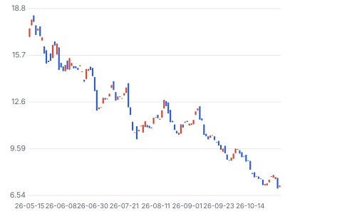

**주봉**

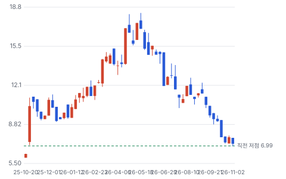

**월봉**

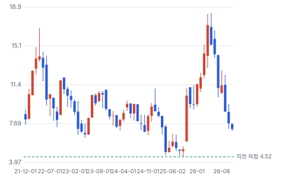

**분기 매출·EPS 실적과 컨센서스**

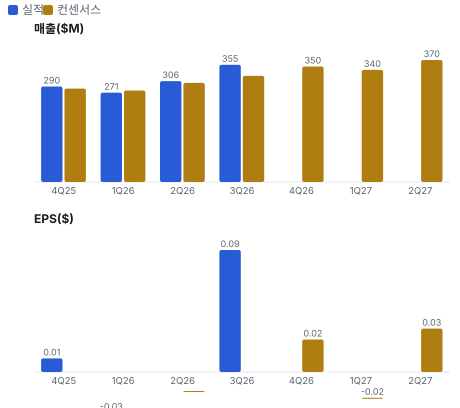

**최근 4개 분기 주가 변화 분석**

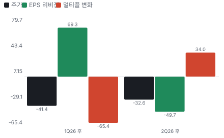

**EPS 리비전**

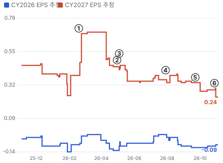

① 26-02-18 4Q25 실적 · EPS 리비전 +73%
② 26-04-30 1Q26 실적·캐터필러 1.5GW · EPS 리비전 +2%
③ 26-05-04 전환사채 \$690M · 실적 창과 겹침
④ 26-07-29 2Q26 실적·데이터센터 지연 · EPS 리비전 +8%
⑤ 26-09-22 Targa 230MW 계약 · EPS 리비전 -15%
⑥ 26-10-28 3Q26 실적·PROPWR 흑자 · EPS 리비전 -15%

**밸류에이션 주가 시나리오**

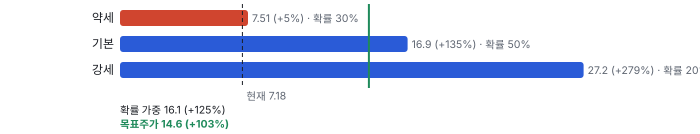

**주가별 업사이드**

**제품·서비스 포트폴리오**

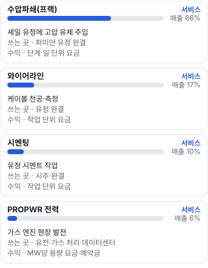

**고객 믹스(FY2025, 매출 대비)**

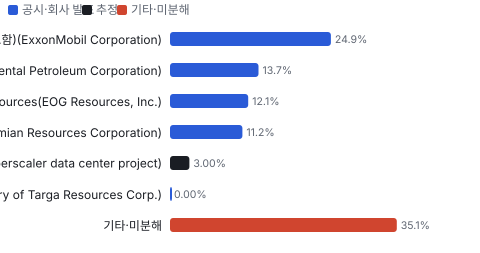

**공급 병목(10점, 낮을수록 병목)**

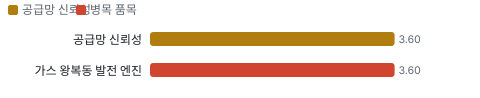

**생산능력 현재와 확충 계획(프랙 HHP / 전력 MW)**

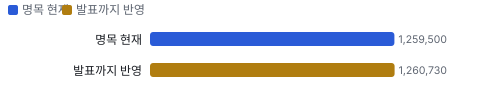

**CAPEX의 매출 대비 비중**

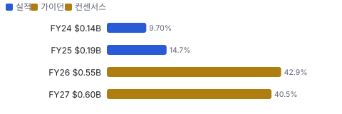

**어닝콜 변화별 주주가치 영향**

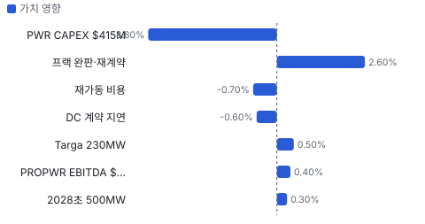

**멀티플 프리미엄**

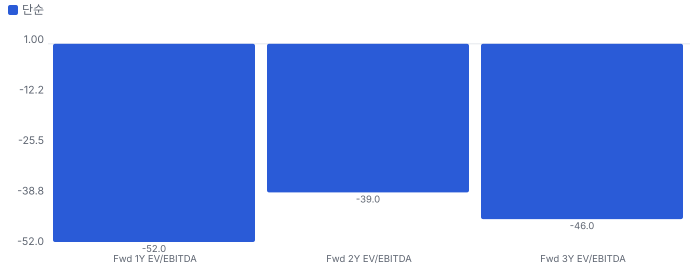

**합리적 멀티플**

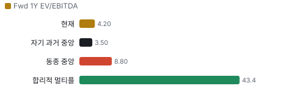

**일별 거래량 분해**

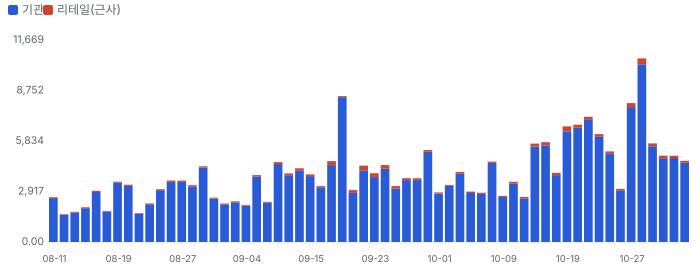

**기관 자금 흐름**

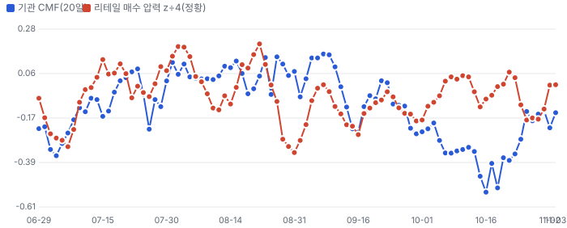

**몬테카를로**

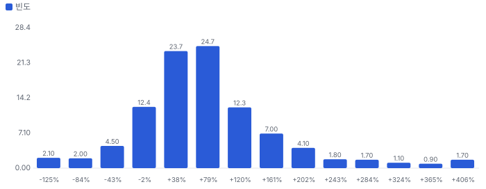

해석: 3,000번 중 2,589번(86%)에서 가치가 지금 주가 이상이었다. 가정을 흔들어도 지금 주가를 뒷받침하는 경우가 더 많다. 가운데 값은 1.67배이고, 열 번 중 여덟 번은 0.83~2.93배 사이에 든다.

## 내러티브

> **기업가치를 결정하는 이야기:** 프랙·와이어라인·시멘팅은 TTM 조정 EBITDA \$192M을 내고 13개 함대가 완판이다. 기업가치의 위쪽은 PROPWR다. 계약 510MW를 MW당 사업비 \$1.4~1.5M·회수 4~6년으로 역산하면 전력 EBITDA가 연 \$130~190M(자체 추정)이다. 그 대가로 2026 CAPEX가 \$550M이고 FCF가 음수다.

> **멀티플·EPS 프리미엄**
> **멀티플:** Fwd 1Y EV/EBITDA 4.2배로 동종 5곳 중앙값 8.8배의 절반이다. 순수 프랙 LBRT(6.9배)·ACDC(6.0배)보다도 싸고 BTM(전력망을 거치지 않는 현장 자가 발전(behind-the-meter)) 전력 대표 SEI(13.9배)와는 3배 차이다.
> **EPS:** 2027 연간 EPS 추정은 8/4 \$0.34에서 11/2 \$0.24로 30% 내려갔다. 다만 분기 EPS는 2027 1~4분기 모두 7/31보다 올랐다 — 이익이 2027 하반기로 밀린 모양이다.

### 투자자들은 왜 열광했나

2025년 10월 \$5에서 2026년 4월 \$18까지 올랐다. 하이퍼스케일러 현장 가동, 캐터필러 1.5GW 계약, 전환사채 \$690M 조달이 '프랙 회사가 AI(인공지능) 전력 회사가 된다'는 이야기를 만들었다. 식은 이유는 데이터센터 계약이 늦어진다는 2Q 콜 발언(7/29), AI 데이터센터 투자 잡음, 프랙 재가동 비용이다.

### 무엇이 기업가치를 바꾸나

> **구조적 체질 변화**
> **변화:** 전력 매출이 3Q 매출의 6.3%(\$22.3M)로 1년 전 0.05%에서 생겼다. 부문 EBITDA는 \$7.6M로 흑자 전환했다. 그래도 매출의 94%는 완결 서비스다
> **증거:** 3Q 10-Q 부문 표
> **반증:** 2027년에도 전력 매출 비중 15% 아래

> **고부가 믹스 확장**
> **변화:** PROPWR 부문 EBITDA 이익률 34%로 프랙(19.3%)보다 높다. 비중이 오르면 이익률이 오른다
> **증거:** 3Q 10-Q 부문 표(자체 계산)
> **반증:** 데이터센터 계약 마진이 유전 계약보다 낮게 공개된다

> **기술 혁신**
> **변화:** 기술보다 장비 선택이다. 캐터필러 10MW 정치형 엔진이 단순 가스 터빈보다 20~40% 효율이 높다고 회사는 말한다(회사 주장)
> **증거:** 3Q 콜
> **반증:** 경쟁사가 같은 엔진을 더 일찍 받는다

> **실행 속도**
> **변화:** Targa는 계약(9/22)에서 전량 배치(2028년 초)까지 약 17개월이다. 피어 같은 기준 값은 공개 자료에서 찾지 못했다 **납품 리드타임 17개월.** 피어 중앙값 11개월보다 55% 길다(AESI(Atlas Energy Solutions) 11개월 · SEI(Solaris Energy Infrastructure) 미확인). 이전 대비 미확인.
> **증거:** 9/22 8-K, 3Q 보도자료
> **반증:** Targa 배치가 2028년 하반기로 밀린다

> **M&A**
> **변화:** 최근 대형 인수 없음. 2024년 AquaProp(습식 모래 처리) 인수 정도이고 시너지 금액은 공시되지 않았다
> **증거:** FY2025 10-K
> **반증:** 전력 사업 확대를 위한 인수·증자

> **정책·입법 연관성**
> **재정정책:** 해당 없음(보조금·세액공제 수령 공시 없음) 3Q 10-Q 반증: 현장 가스 발전 세제 변경 의회 동의 2/10 — 하원 1/5(ProPetro 관련 하원 의결 기록을 찾지 못했다) · 상원 1/5(같음).
> **행정명령:** 연방 데이터센터 인허가 가속 행정명령이 현장 가스 발전 수요의 배경이다. PUMP(ProPetro)를 직접 겨냥한 명령은 없다. 3Q 콜에서 회사는 계약 지연이 지역 반대·유예 때문이 아니라고 했다 3Q 콜 Q&A 반증: 주 정부가 대형 부하·현장 발전 규제를 시행한다 의회 동의 2/10 — 하원 1/5(관련 의결 기록 미확인) · 상원 1/5(같음).
> **연관입법:** 해당 없음(회사를 직접 겨냥한 연방 법안을 찾지 못했다. 로비 공시는 키가 없어 미확인) 로비 조회 미확인 반증: 현장 가스 발전 배출 규제 강화 법안

> **CAPEX 낙수효과**
> **변화:** AI 데이터센터·퍼미안 가스 처리 설비 투자가 현장 전력 수요로 온다. 고객 투자 발표를 PUMP 매출로 바로 옮기지 않는다 — 확인된 것은 계약 510MW까지다
> **증거:** 3Q 보도자료
> **반증:** 고객이 전력망 연결을 확보해 현장 발전을 줄인다

### 내러티브 근거

> 퍼미안 프랙 회사가 가스 엔진 발전(PROPWR)으로 AI 데이터센터 전력 회사가 된다는 이야기다. 4월 \$18.2까지 갔던 주가는 11/3 \$7.18(−61%)로 돌아왔다. 계약은 510MW로 늘었지만 데이터센터 추가 계약이 늦어지고 2026 CAPEX \$550M에 FCF가 음수다. 동종 대비 멀티플 차이 -52% 중 회사 고유 몫은 -90%다. 단계는 확산, 쏠림은 중간이다.

> **데이터센터 현장 발전(BTM)** · 약화
> **논리:** 전력망 연결이 늦어 데이터센터가 현장 가스 발전을 산다. PUMP는 하이퍼스케일러 현장에서 이미 돌린다
> **숫자:** 확보 2.6GW, 데이터센터 협상 2건(수백 MW)
> **반증:** 2027-06까지 데이터센터 추가 계약 0건

> **계약 MW 누적(유전·미드스트림)** · 강화
> **논리:** 데이터센터가 아니어도 유전·가스 처리 전력으로 장비를 채운다
> **숫자:** 계약 240 → 350 → 510MW(4~10월)
> **반증:** 2027 상반기 계약 MW 증가 0

> **프랙 공급 축소·가격 회복** · 유지
> **논리:** 퍼미안 함대가 70개 중반으로 줄어 수요가 조금만 늘어도 가격이 오른다
> **숫자:** 13개 함대 완판, 계약 마력 대부분 2027 상반기 재계약
> **반증:** 1Q27 재계약 가격 동결 또는 인하

> **전동 함대 리스 매입** · 유지
> **논리:** 리스료가 EBITDA를 깎는데 매입하면 그만큼 돌아온다
> **숫자:** 리스료 분기 약 \$16M(2Q CFO), 4Q 1건·2027년 3건 매입
> **반증:** 매입 대신 리스 연장

> **반대: 자본 지출·FCF 음수** · 강화
> **논리:** 전력 투자로 2026~2028 FCF가 음수다. 현금 \$729M이 줄어들고 추가 조달이 필요할 수 있다
> **숫자:** 2026 CAPEX \$525~575M, 3Q FCF −\$76.9M, FY2027 FCF 추정 −\$340M
> **반증:** 데이터센터 계약에 선급금이 붙는다

> **반대: 고객 집중·XTO 만료** · 유지
> **논리:** 최대 고객 몫 일부가 연말에 빠진다
> **숫자:** 상위 5곳 68.2%, XTO 2개 함대 2026년 말 만료
> **반증:** 1Q27 함대 13개 유지

## 포트폴리오

| 제품·서비스 | 구분 | 무엇 | 쓰는 곳 | 돈 버는 방식 |
|---|---|---|---|---|
| 수압파쇄(프랙) | 서비스 | 셰일 유정에 고압 유체 주입 | 퍼미안 유정 완결 | 단계·일 단위 요금 |
| 와이어라인 | 서비스 | 케이블 천공·측정 | 유정 완결 | 작업 단위 요금 |
| 시멘팅 | 서비스 | 유정 시멘트 작업 | 시추·완결 | 작업 단위 요금 |
| PROPWR 전력 | 서비스 | 가스 엔진 현장 발전 | 유전·가스 처리·데이터센터 | MW당 용량 요금·예약금 |

## 고객

> **FY2025 최대 고객 ExxonMobil(XTO 포함)(ExxonMobil Corporation) 25%, 상위 3곳 51%, 집중도 분산.** 공시·회사 발표로 확인한 몫은 매출의 62%이고, 나머지 고객 몫은 추정이거나 미분해다. 상위 5곳이 FY2025 매출의 68.2%(FY2024 58.8%)이고 4곳이 10%를 넘는다. ExxonMobil(24.9%)의 자회사 XTO 2개 함대 계약은 2026년 말 끝나고 갱신을 기대하지 않는다(10-K). 전력 쪽 고객은 Targa와 이름 없는 하이퍼스케일러다

**고객별 매출 몫(FY2025)**
| 고객 | 몫 | 변화 | 근거 |
|---|---|---|---|
| ExxonMobil(XTO 포함)(ExxonMobil Corporation) | 25% | 미확인 | 공시 |
| Occidental(Occidental Petroleum, 미국 E&P) Petroleum(Occidental Petroleum Corporation) | 14% | 미확인 | 공시 |
| EOG(EOG Resources, 미국 셰일 E&P) Resources(EOG Resources, Inc.) | 12% | 미확인 | 공시 |
| Permian Resources(Permian Resources Corporation) | 11% | 미확인 | 공시 |
| 하이퍼스케일러(이름 미공개)(a hyperscaler(초대형 클라우드 데이터센터 사업자) data center project) | 2~4% | 미확인 | 추정 |
| Targa Resources(a subsidiary of Targa Resources Corp.) | 0% | 미확인 | 공시 |
| 기타·미분해 | 35% | - | - |

> **ExxonMobil(XTO 포함)(ExxonMobil Corporation)** · 공시
> **사는 것:** 프랙·와이어라인
> **추정 근거:** XTO 2개 함대 2026년 말 만료

> **Occidental Petroleum(Occidental Petroleum Corporation)** · 공시
> **사는 것:** 프랙·와이어라인·시멘팅
> **추정 근거:** FY2025 10-K

> **EOG Resources(EOG Resources, Inc.)** · 공시
> **사는 것:** 완결 서비스
> **추정 근거:** FY2025 10-K

> **Permian Resources(Permian Resources Corporation)** · 공시
> **사는 것:** 완결 서비스
> **추정 근거:** FY2025 10-K

> **하이퍼스케일러(이름 미공개)(a hyperscaler data center project)** · 추정
> **사는 것:** 데이터센터 현장 전력
> **추정 근거:** PROPWR 3Q 매출 \$22.3M 중 일부, 회사 이름은 가설로도 적지 않는다

> **Targa Resources(a subsidiary of Targa Resources Corp.)** · 공시
> **사는 것:** 230MW 전력(2028년 초 전량)
> **추정 근거:** 매출은 배치 뒤부터

## 수주·파이프라인

> **2026-10-28 기준 5건.** 확정 \$0.00B.

**실행 속도와 방해 요인**
| 항목 | 상태 | 실행 속도 | 방해 요인 |
|---|---|---|---|
| Targa 230MW(가스 처리 설비 전력) | 확정 | 계약→전량 배치 약 17개월 | 장비 인도 일정 · 현장 준비 비용 선반영 |
| 하이퍼스케일러 데이터센터(중서부, 약 60MW) | 확정 | 미확인 | 가동률 유지 |
| 유전·미드스트림·산업 전력 계약(나머지) | 확정 | 미확인 | 짧은 계약 기간 |
| 데이터센터 추가 계약(협상 2건) | 협상 | 빠르면 2027년 말 배치 시작 | 리스크 배분·손해배상 조건 · 자금 조달 구조 |
| 프랙 2027 재계약 | 협상 | 미확인 | 대형 E&P(석유·가스 탐사·생산 회사) 활동 · XTO 2개 함대 만료 |

## 마진 구조

> **GPM 24.1%, OPM 3.1%.** 3Q25 대비 GPM +4.6%p, OPM +5.2%p. 변동비는 매출의 53%이고, 매출이 10% 늘면 OPM은 +4.0%p 움직인다. 3Q 서비스 원가(감가상각 제외)는 매출의 75.9%로 1년 전 80.5%보다 4.6%p 낮다. 가장 큰 덩어리는 기타 직접비(정비·연료·전동 함대 리스, 36.5%)다. 전동 함대 리스료가 분기 약 \$16M(2Q CFO)이라 2027년 매입이 끝나면 그만큼 EBITDA로 돌아온다

> **매출 100 중 매출원가 76.1, 매출총이익 23.9(최근 4분기, 공시).** 매출원가 요인 중 기타 직접비(정비·연료·운송·전동 함대 리스)이 매출의 36.5%로 가장 무겁고, 단가가 +10% 오르면 GPM이 -3.65%p 움직인다. 분기 회귀로 매출 1이 늘 때 매출원가는 0.57 늘고, 매출원가의 고정비 몫은 22%다.

**비용 요인 강도 — 비중·추세·충격(+10%)·탄력**
| 비용 | 구분 | 매출 대비 | 1년 변화 | 마진 기여 | 충격 시 마진 | 매출 탄력 | 고정비 몫 |
|---|---|---|---|---|---|---|---|
| 기타 직접비(정비·연료·운송·전동 함대 리스) | 매출원가 요인 | 36.5% | -1.2%p | +1.2%p | -3.65%p | 미확인 | 40% |
| 소모품(모래 취급·화학·시멘트·와이어라인 부품) | 매출원가 요인 | 20.1% | -0.5%p | +0.5%p | -2.01%p | 미확인 | 0% |
| 현장 인건비 | 매출원가 요인 | 19.3% | -2.8%p | +2.8%p | -1.93%p | 미확인 | 50% |
| 매출원가 | 공시 항목 | 76.1% | -0.6%p | +0.6%p | -7.61%p | 0.57 | 22% |
| 감가상각 | 공시 항목 | 13.9% | -0.1%p | +0.1%p | 미확인 | 0.06 | 53% |
| 판관비 | 공시 항목 | 9.8% | +1.6%p | -1.6%p | 미확인 | 0.01 | 87% |
| 기타 영업비용 | 공시 항목 | -0.3% | -1.0%p | +1.0%p | 미확인 | 0.09 | -49% |

매출 탄력 = 분기 비용을 매출에 회귀한 기울기(매출 1당 변동비), 고정비 몫 = 절편 ÷ 평균 비용. 표본이 8분기 미만이면 미확인. 매출원가 요인 비중은 margin 재료의 추정이 섞여 있고, 공시 매출원가와의 차이는 '기타 매출원가'로 둔다.

**GPM에서 OPM까지(GAAP)**
| 기간 | GPM | 연구개발 | 판관비 | 기타 | OPM |
|---|---|---|---|---|---|
| 3Q25 | 19.5% | 0.0% | 7.7% | 14.0% | -2.1% |
| 3Q26 | 24.1% | 0.0% | 8.7% | 12.3% | 3.1% |

**마진을 결정하는 비용 요인 — 비용 +10% 시 OPM**
| 비용 | 매출 대비 | 변화 | 고정비 | OPM |
|---|---|---|---|---|
| 기타 직접비(정비·연료·운송·전동 함대 리스) | 36.5% | -1.2%p | 40% | -3.65%p |
| 소모품(모래 취급·화학·시멘트·와이어라인 부품) | 20.1% | -0.5%p | 0% | -2.01%p |
| 현장 인건비 | 19.3% | -2.8%p | 50% | -1.93%p |
| 감가상각·상각 | 12.5% | -1.7%p | 100% | -1.25%p |
| 일반관리비(SBC 포함) | 8.7% | +1.0%p | 80% | -0.87%p |

**비용을 움직이는 요인**
| 비용 | 요인 |
|---|---|
| 기타 직접비(정비·연료·운송·전동 함대 리스)(매출원가) | 재가동 정비·부품 재고, 경유, 리스료 분기 약 \$16M · 근거 공시 |
| 소모품(모래 취급·화학·시멘트·와이어라인 부품)(매출원가) | 작업량·소재 가격 · 근거 공시 |
| 현장 인건비(매출원가) | 인력 재고용·임금, 데이터센터 건설과 인력 경쟁 · 근거 공시 |
| 감가상각·상각(기타) | 함대·발전기 투자 · 근거 공시 |
| 일반관리비(SBC 포함)(판관비) | PROPWR 조직 확장 · 근거 공시 |

**수압파쇄(프랙) BOM — 매출의 66%, GPM 21%(3Q 부문 매출 \$235.2M − 서비스 원가 \$185.6M, 감가상각 전), 항목 가격 +10% 시**
| 항목 | 원가 몫 | 전가 | 제품 GPM | OPM |
|---|---|---|---|---|
| 기타 직접비(정비·연료·전동 함대 리스) | 57% | 미확인 | -4.5%p | -3.00%p |
| 현장 인건비 | 23% | 미확인 | -1.8%p | -1.19%p |
| 소모품(화학·모래 취급) | 20% | 미확인 | -1.6%p | -1.04%p |

**와이어라인 BOM — 매출의 17%, GPM 27%(3Q 부문 매출 \$60.7M − 서비스 원가 \$44.4M), 항목 가격 +10% 시**
| 항목 | 원가 몫 | 전가 | 제품 GPM | OPM |
|---|---|---|---|---|
| 소모품(천공 총·부품) | 39% | 미확인 | -2.9%p | -0.49%p |
| 현장 인건비 | 32% | 미확인 | -2.4%p | -0.41%p |
| 기타 직접비 | 28% | 미확인 | -2.1%p | -0.35%p |

**시멘팅 BOM — 매출의 10%, GPM 23%(3Q 부문 매출 \$37.4M − 서비스 원가 \$28.9M), 항목 가격 +10% 시**
| 항목 | 원가 몫 | 전가 | 제품 GPM | OPM |
|---|---|---|---|---|
| 소모품(시멘트·첨가제) | 60% | 미확인 | -4.6%p | -0.49%p |
| 현장 인건비 | 28% | 미확인 | -2.1%p | -0.22%p |
| 기타 직접비 | 14% | 미확인 | -1.1%p | -0.11%p |

**PROPWR 전력 BOM — 매출의 6%, GPM 51%(3Q 부문 매출 \$22.3M − 서비스 원가 \$11.0M), 항목 가격 +10% 시**
| 항목 | 원가 몫 | 전가 | 제품 GPM | OPM |
|---|---|---|---|---|
| 기타 직접비(정비·부품·임차) | 61% | 미확인 | -3.0%p | -0.19%p |
| 현장 인력 | 39% | 미확인 | -1.9%p | -0.12%p |
| 연료(천연가스) | 0% | 미확인 | -0.0%p | -0.00%p |

기타 직접비(정비·연료·전동 함대 리스) 가격이 +10% 오르면 영업이익은 -96.0% 움직인다. 판매가 전가를 모르는 항목은 전가 0%로 계산했다.

**BOM 항목 가격을 움직이는 것**
| 항목 | 요인 |
|---|---|
| 기타 직접비(정비·연료·전동 함대 리스) | 재가동 정비·부품, 리스료 포함 · 근거 공시 |
| 현장 인건비 | 크루 인력 · 근거 공시 |
| 소모품(화학·모래 취급) | 모래는 고객 공급이 많아 회사 원가 몫은 작다(업계 관행, 미확인) · 근거 공시 |
| 소모품(천공 총·부품) | 작업마다 소모 · 근거 공시 |
| 기타 직접비 | 트럭·정비 · 근거 공시 |
| 소모품(시멘트·첨가제) | 재료비 비중이 크다 · 근거 공시 |
| 기타 직접비 | 장비·운송 · 근거 공시 |
| 기타 직접비(정비·부품·임차) | 발전기 정비 · 근거 공시 |
| 현장 인력 | 운영 인력 · 근거 공시 |
| 연료(천연가스) | 연료는 고객이 대는 구조로 보인다(추정) · 근거 공시 |

**BOM 투입 물가 — PPI 전년비, 2026-11-03 수집**
| 항목 | 미국 | 일본 | 한국 | 대만 |
|---|---|---|---|---|
| 기타 직접비(정비·연료·전동 함대 리스) | +115.2% | 미확인 | 미확인 | 미확인 |

별표는 품목보다 넓은 업종 지수다. 지난 1년 투입 물가를 판매가 전가 뒤 원가에 그대로 넣으면 OPM은 -34.55%p 움직인다(매출원가의 40% 기준).

## 공급망 병목

> **공급망 신뢰성 3.6/10, 병목 심각.** 가장 약한 고리는 가스 왕복동 발전 엔진 3.6점이고, 품목 평균은 3.6점이다. 근거가 부족한 3건(전동 프랙 함대(FORCE(ProPetro 전동 수압파쇄 함대 브랜드)) 장비 · 현장 인력 · 경유·천연가스 연료)은 점수에서 뺐다. 약한 고리는 가스 발전 엔진이다. 캐터필러 한 곳에 1.5GW를 묶었고 10MW 엔진 인도는 2028년 하반기에 시작한다. 프랙 쪽은 현장 인력과 전동 함대 리스가 병목이다

**병목과 마진 — 품목 가격 +10% 시 OPM**
| 품목 | 점수 | 판정 | 구분 | OPM |
|---|---|---|---|---|
| 가스 왕복동 발전 엔진(필수) | 3.6 | 병목 심각 | 출하 차질 위험 | 미확인 |

> **가스 왕복동 발전 엔진** · 3.6/10
> **왜:** 최소 구매 의무 \$1,106M(연 인상·관세 조정), 9/30 잔여 \$463.1M, 10MW 엔진 인도 2028년 하반기부터
> **병목 요인:** 인증 공급사 2곳 · 캐파 부족 · 리드타임 미확인 · 재인증 미확인 · 1위 점유율 미확인 · 미국 집중 100% · 물량 확보 장기계약
> **풀리는 조건:** 미확인

**공급사**
| 품목 | 공급사 | 몫 | 근거 |
|---|---|---|---|
| 가스 왕복동 발전 엔진 | Caterpillar(엔진·발전기 제조·공급(포괄 계약)) | 미확인 | 공시 |
| 가스 왕복동 발전 엔진 | 미공개 장비 제조사(이동식 가스 터빈 발전 세트(\$201M)) | 미확인 | 공시 |
| 전동 프랙 함대(FORCE) 장비 | 리스 제공사(10-K에 이름 없음)(전동 함대 5개 3년 리스) | 미확인 | 공시 |
| 현장 인력 | 자체 고용(프랙·전력 크루) | 미확인 | 회사 발표 |
| 경유·천연가스 연료 | 미공개(연료) | 미확인 | 추정 |

**무역 통계로 본 공급 지역**
| 품목 | EU 수입처 | 일본 수입처 | EU 1위 전년비 |
|---|---|---|---|
| 경유·천연가스 연료 | US(미국) 75% · CN(중국) 12% · KR(한국) 6% | 大韓民国 74% · シンガポール 7% | +133.6% |

## 생산능력

> **현재 명목 캐파 1,259,500 프랙 HHP / 전력 MW, 가동률 미확인.** 착공 이상 증설은 0 프랙 HHP / 전력 MW, 발표까지 합치면 1,230 프랙 HHP / 전력 MW이다. 다 가동하면 지금보다 +0%, 착공 이상만이면 +0%다. FY25 CAPEX는 \$0.19B로 매출의 14.7%다. 프랙은 1,259,500 HHP(12/31/25) 중 13개 함대가 일하고 사실상 완판이다. 회사는 14번째 함대·성장 투자를 하지 않겠다고 했다. 전력은 확보 2.6GW, 인도·주문 1.1GW, 계약 510MW, 연말 배치 250~275MW다

**생산능력 확충 계획**
| 계획 | 단계 | 증설 | 가동 시점 | CAPEX |
|---|---|---|---|---|
| Targa 230MW | 발표 | 230 프랙 HHP / 전력 MW | 2028-02 | 미확인 |
| 캐터필러 10MW 엔진(1GW 이상) | 발표 | 1,000 프랙 HHP / 전력 MW | 2028-12 | 미확인 |

남은 계획의 CAPEX 합계는 \$0.00B(금액 미확인 2건 제외)다. 합계는 FY27 매출의 0%다.

**증설 방해 요인**
| 계획 | 방해 요인 |
|---|---|
| Targa 230MW | 현장 준비·장비 인도 |
| 캐터필러 10MW 엔진(1GW 이상) | 데이터센터 계약 |

**CAPEX와 매출 대비**
| 기간 | CAPEX | 매출 | 매출 대비 | 구분 |
|---|---|---|---|---|
| FY24 | \$0.14B | \$1.44B | 9.7% | 실적 |
| FY25 | \$0.19B | \$1.27B | 14.7% | 실적 |
| FY26 | \$0.55B | \$1.28B | 42.9% | 가이던스 |
| FY27 | \$0.60B | \$1.48B | 40.5% | 컨센서스 |

## 해자

> 해자는 '발전 장비를 먼저 잡아 둔 순서'와 '퍼미안 대형 E&P와의 전용 함대 관계'다. 둘 다 숫자로 보이지만 가격 결정력으로는 아직 이어지지 않았다

> **발전 장비 선점(캐터필러 포괄 계약)** · 보통
> **해자:** 공급이 막힌 가스 엔진을 2.6GW 확보했고 그중 1GW 이상이 10MW 고효율 정치형 엔진이다
> **근거:** 3Q 10-Q: 캐터필러 1.5GW 최소 구매 의무 \$1,106M, 9/30 570MW 주문·잔여 \$463.1M, 총 인도·주문 1.1GW
> **숫자:** 계약 510MW, 연말 배치 250~275MW
> **깨지는 조건:** 확보 장비 중 계약 비율이 2027 말까지 50% 아래에 머문다

> **퍼미안 대형 E&P 전용 함대** · 보통
> **해자:** 상위 고객이 메이저·대형 독립사라 일감이 끊기지 않는다
> **근거:** FY2025 10-K: ExxonMobil 24.9%·Occidental 13.7%·EOG 12.1%·Permian Resources 11.2%, 상위 5곳 68.2%
> **숫자:** 13개 함대 완판(3Q 콜)
> **깨지는 조건:** XTO 2개 함대가 2027년 1분기 안에 다른 고객으로 채워지지 않는다

> **가스 연소 함대 비중** · 보통
> **해자:** 디젤이 비쌀수록 가스를 태우는 함대가 웃돈을 받는다
> **근거:** FY2025 10-K: 1,259,500 HHP 중 DGB(디젤에 가스를 섞어 태우는 이중연료 엔진(Dynamic Gas Blending)) 445,000 + FORCE 312,000(60%)
> **숫자:** 3Q 콜: 가스 연소 장비가 함대의 다수
> **깨지는 조건:** 디젤·가스 가격 차가 줄고 전동 함대 재계약 가격이 내려간다

> **현장 가동 실적(하이퍼스케일러 60MW)** · 약함
> **해자:** BTM 업체 중 데이터센터에서 실제로 전기를 대는 곳이 적다
> **근거:** 3Q 보도자료: 중서부 하이퍼스케일러 현장 가동 중, 2.6MW 엔진 위주
> **숫자:** 1개 현장
> **깨지는 조건:** 2027 상반기에도 두 번째 데이터센터 계약이 없다

## 경영진·네트워크

> CEO Sam Sledge(ProPetro CEO Sam Sledge), CFO Caleb Weatherl(ProPetro CFO Caleb Weatherl), 사장·COO Adam Muñoz(ProPetro 사장·COO Adam Muñoz), PROPWR 사장 Travis Simmering(PROPWR 사장 Travis Simmering)이 콜을 이끈다. 10/16 감사위원 자격 사외이사 1명이 늘었다. 정계·동문 연결은 공개 자료로 확인하지 못했다

> **Sam Sledge** · CEO · 미확인
> **프로필:** 3Q 콜·보도자료 대표 발언자
> **비즈니스:** 미확인
> **정계:** 미확인
> **동문:** 미확인
> **사모임:** 미확인

> **Caleb Weatherl** · CFO(10/30부터 회계 책임자 겸임) · 미확인
> **프로필:** CAO(최고회계책임자) 사임 뒤 임시 회계 책임자(9/21 8-K)
> **비즈니스:** 미확인
> **정계:** 미확인
> **동문:** 미확인
> **사모임:** 미확인

> **Adam Muñoz** · 사장·COO · 미확인
> **프로필:** 8/4 장내 매도 70,696주(약 \$0.79M, Form 4)
> **비즈니스:** 미확인
> **정계:** 미확인
> **동문:** 미확인
> **사모임:** 미확인

> **Travis Simmering** · PROPWR 사장 · 미확인
> **프로필:** 전력 계약 협상 담당(콜)
> **비즈니스:** 미확인
> **정계:** 미확인
> **동문:** 미확인
> **사모임:** 미확인

**네트워크 정량화**
| 연결 | 강도 | 닿는 매출 | 가중 노출 | 매출 대비 | 근거 |
|---|---|---|---|---|---|
| 비즈니스: 퍼미안 대형 E&P와의 장기 거래 | 2/5 | \$0.00B | \$0.00B | 0% | 경영진 개인 연결이 매출을 만든 증거는 없다 FY2025 10-K 고객 집중 |

가중 노출은 연결이 닿는 매출의 크기다. 연결이 그 매출을 만들었다는 뜻이 아니며, 인과는 공개 자료로 입증하지 못한다.

## 약세 논리 및 셀온 조건

| 약세 논리 | 근거 | 반박 | 가를 자료 |
|---|---|---|---|
| 전력 투자가 FCF를 먹는다 | 2026 CAPEX \$525~575M(매출의 43%), 3Q FCF −\$76.9M, FY2027 FCF 추정 −\$340M | 현금 \$728.9M·유동성 \$934.1M, 장비 일부는 금융사가 직접 지급(3Q \$15.8M) | 2027 CAPEX 가이던스(4Q 실적)와 선급금 계약 |
| 데이터센터 계약이 안 온다 | 2Q 콜부터 '예상보다 오래 걸린다', 3Q 콜도 날짜 없음 | 협상 2건 수백 MW, 지연 원인은 지역 반대가 아니라 계약 조건(회사) | 2027 상반기 계약 공시 |
| XTO 2개 함대 만료 | FY2025 10-K: 2026년 말 만료, 갱신 예상 안 함. ExxonMobil 24.9% | 프랙 완판, 현물 작업 거절 중(3Q 콜) | 1Q27 활동 함대 수 |
| 재가동 비용이 마진을 깎는다 | 3Q 보도자료: 비용이 예상보다 컸고 4Q까지 압박 | 3Q 서비스 원가율 75.9%로 1년 전 80.5%보다 낮다 | 4Q 조정 EBITDA 이익률 |
| 캐터필러 의무가 무겁다 | 최소 구매 \$1,106M, 9/30 잔여 \$463.1M, 10MW 엔진 2028년 하반기 인도 | 장비가 부족한 시장이라 되팔 수 있는 자산이다(추정) | 계약 MW ÷ 확보 MW 비율 |
| 리테일·셀사이드 낙관이 이미 크다 | 14명 중 10명 긍정, 목표가 평균 \$15.57 | 주가가 목표가의 46%라 기대는 이미 꺾였다 | 11월 목표가 갱신 |
| 경영진 매도 | 8/4 사장·COO 70,696주, 이사 35,831주 장내 매도(Form 4) | 10/30 임원 2,000주 장내 매수 | 다음 Form 4 |

> **셀온 조건**
> **조건 1:** 2027-06-30까지 데이터센터 추가 계약이 한 건도 서명되지 않는다
> **조건 2:** 1Q27 활동 프랙 함대가 12개 이하로 줄어든다(XTO 공백 미충원)
> **조건 3:** 4Q26 조정 EBITDA가 \$45M 아래다
> **조건 4:** 2027 CAPEX 가이던스가 \$600M을 넘는데 선급금 계약이 없다
> **조건 5:** 추가 자금 조달이 보통주 증자·ATM(시장가 수시 증자)으로 나온다
> **조건 6:** Targa 230MW 전량 배치가 2028년 하반기 이후로 밀린다

## 어닝콜 변화

**직전 콜 대비 새로 나오거나 바뀐 내용 → 가치 영향**
| 항목 | 내용 | 직전 콜 | 최신 콜 | 모델 동인 이동 | 확신도 | 가치 영향 |
|---|---|---|---|---|---|---|
| 신규 | Targa 230MW 계약 | 계약 350MW(7/29) | 계약 510MW, 2028년 초 전량 배치 | 1년차 성장률 +3.0% | 1.0 | +0.5% |
| 업데이트 | PROPWR 분기 EBITDA | 마지막 2개월 흑자(2Q) | 3Q 부문 조정 EBITDA \$7.6M(1년 전 −\$4.1M) | 출발 이익률 +0.50% | 1.0 | +0.4% |
| 신규 | 배치 경로 | 숫자 없음 | 연말 250~275MW → 2028년 초 500MW 이상 | 1년차 성장률 +2.0% | 0.8 | +0.3% |
| 부정 | 데이터센터 계약 지연 | 2026년 내내 모멘텀 | 협상 2건, 날짜 없음, 2027 이익 하반기 쏠림 | 1년차 성장률 -3.0% | 0.5 | -0.6% |
| 부정 | 재가동 비용 | 새 함대 초기 비용(2Q) | 예상보다 컸다, 4Q까지 압박, 최적화는 2027 | 출발 이익률 -1.0% | 0.8 | -0.7% |
| 업데이트 | 프랙 가격 | 계약 마력 대부분 6~9개월 안 갱신 | 13개 함대 완판, 대부분 2027 상반기 재계약 | 목표 이익률 +1.0% | 0.5 | +2.6% |
| 업데이트 | PROPWR CAPEX | 2026 PROPWR CAPEX 범위(2Q) | \$400~430M로 좁힘, 2027은 더 늘어난다 | 매출÷투하자본 -3.0% | 0.8 | -3.8% |
| 반복 | MW당 사업비·회수 | MW당 \$1.4~1.5M, 회수 4~6년 | 같음 | 매출÷투하자본 — | 0.8 | +0.0% |
| **합계** | 단독 합 |  |  | 동시 적용 -1.1% |  | **-1.3%** |

**사건별 EPS 리비전**
| # | 날짜 | 구분 | 사건 | CY2026 EPS 전→후 | CY2027 EPS 전→후 | 리비전 | 주가 반응 |
|---|---|---|---|---|---|---|---|
| ① | 26-02-18 | 실적 | 4Q25 실적 | \$-0.09 → \$-0.03 | \$0.39 → \$0.68 | +73.1% | -6.2% |
| ② | 26-04-30 | 실적 | 1Q26 실적·캐터필러 1.5GW | \$-0.13 → \$-0.10 | \$0.45 → \$0.46 | +1.8% | -5.9% |
| ③ | 26-05-04 | 내러티브 | 전환사채 \$690M | \$-0.13 → \$-0.08 | \$0.45 → \$0.42 | 실적 창과 겹침 | +1.4% |
| ④ | 26-07-29 | 실적 | 2Q26 실적·데이터센터 지연 | \$-0.02 → \$-0.04 | \$0.36 → \$0.39 | +8.3% | -4.2% |
| ⑤ | 26-09-22 | 내러티브 | Targa 230MW 계약 | \$-0.11 → \$-0.11 | \$0.34 → \$0.28 | -15.1% | -1.3% |
| ⑥ | 26-10-28 | 실적 | 3Q26 실적·PROPWR 흑자 | \$-0.10 → \$-0.09 | \$0.29 → \$0.24 | -15.0% | +2.6% |

**해석:** 2개 구간 누적 주가 -61% = EPS 리비전 -15% × 멀티플 -54%. 더 크게 움직인 쪽은 **멀티플**이다.

## 거시 지표 싱크로율

> **미국 경유 PPI(생산자물가지수)와 매출 싱크로율 89%(1분기 선행, 전년 대비, 표본 6개·신뢰 참고용).** 이 지표가 내포하는 4Q26 매출은 346M(±1σ 323M~369M)다. 컨센서스는 +1.2%(범위 안)다. 기타 직접비에 연료가 들어가고 가스 연소 함대의 웃돈이 디젤 가격에 걸려 있다. 경유 가격이 매출·영업이익을 따라가는지 본다

**지표별 싱크로율(상관계수 × 100)**
| 지표 | 증가율 기준 | 지표 선행 | 매출 | 영업이익 | 방향 일치 | 표본·신뢰 | 4Q26 내포 매출 |
|---|---|---|---|---|---|---|---|
| 미국 경유 PPI | 전년 대비 | 1분기 | 89% | -72%(2분기) | 83% | 6·참고용 | +19.4% → 346M(확정) |

**지표를 고른 이유**
| 지표 | 이유 |
|---|---|
| 미국 경유 PPI | 연료 원가와 가스 연소 함대 웃돈 |

싱크로율은 증가율의 상관계수이며 인과가 아니다. 지표 단위·통화는 원자료 그대로이고 나라끼리 더하지 않는다(EU(유럽연합) 수입만 상대국 합계). ±1σ는 회귀 잔차 표준편차다.

## 밸류에이션

> **목표주가 \$15, 업사이드 +103%.** 자리는 약세와 기본 사이(약세 쪽 24%)이고 도달 확률은 약 55%다. 기본 \$17, 강세 \$27(+279%), 약세 \$8(+5%). DCF 기준 업사이드는 기본 +69%, 강세 +142%, 약세 +58%다(WACC 8.1%).

세 시나리오 모두 Fwd EV/EBITDA 8.6배(동종 중앙값 8.8배에 자기 이력·CAPEX 할인 −30%를 넣은 값)를 쓰므로, 업사이드의 대부분은 EBITDA가 아니라 배수 회복에서 나온다. 지금 4.2배가 그대로면 기본 EBITDA \$263M에서 주가는 약 \$7.5다(자체 계산: 4.2 × 0.263 − 순차입 0.162, ÷ 완전 희석 0.125B주). DCF(기본 가치가 시가총액의 1.69배)는 FY2028 컨센서스 EBITDA 이익률 23.5%에서 감가상각을 뺀 EBIT 이익률 8%가 이어진다고 보고, 매출 대비 투하자본 0.7로 성장 CAPEX를 크게 뺀 값이다. 전력 계약이 회수 4~6년 목표대로 돌면 DCF 쪽이, 계약 없이 장비만 쌓이면 지금 배수가 맞다. 할인율 +50bp에 가치가 −12.9% 움직일 만큼 먼 해의 현금에 기댄 값이다.

> **약세 \$8 (+5%)** · 확률 30%
> **가정:** 6.5배 × EBITDA \$0.17B
> **근거:** XTO 2개 함대가 비어 프랙 EBITDA가 약 15% 줄고(13개 중 2개) 1Q27 재계약 가격이 동결된다. 재가동 비용이 2027 상반기까지 남고 데이터센터 계약이 없어 PROPWR는 기존 계약 MW만 쌓는다. TTM 조정 EBITDA \$192M보다 낮은 높이

> **기본 \$17 (+135%)** · 확률 50%
> **가정:** 8.6배 × EBITDA \$0.26B
> **근거:** 13개 함대를 유지하고 재계약 가격이 소폭 오른다. PROPWR가 연말 250~275MW에서 Targa 배치로 계단식으로 늘어난다. 다음 4개 분기 EBITDA 컨센서스 \$263M과 같은 높이

> **강세 \$27 (+279%)** · 확률 20%
> **가정:** 10.8배 × EBITDA \$0.33B
> **근거:** 데이터센터 1건이 2027 상반기에 서명되고 전동 함대 리스 매입으로 분기 리스료(약 \$16M)가 줄며 재계약 가격이 두 자릿수 오른다

**멀티플 선정 — Fwd 1Y EV/EBITDA**
| 단계 | 조정 | 근거 |
|---|---|---|
| 동종 중앙값 | 8.8배 | 범위 6.0~13.9배, 5곳 |
| 펀더멘털 | +20% | 성장·이익률·ROIC로 본 합리적 멀티플 43.4배와의 차이의 일부만 인정 |
| 해자 | +3% | 발전 장비 선점(캐터필러 포괄 계약) 보통 · 퍼미안 대형 E&P 전용 함대 보통 · 가스 연소 함대 비중 보통 · 현장 가동 실적(하이퍼스케일러 60MW) 약함 |
| 내러티브 | +5% | 단계 확산 |
| 사이클·실행 판단 | -30% | 자기 이력과 현금 할인이다. 지난 3년 Fwd 1Y EV/EBITDA는 대체로 3~8배였고 최고가 2026-04 고점의 9.9배다. EV/EBITDA는 CAPEX를 보지 않는데 2026 CAPEX가 매출의 43%이고 컨센서스 FCF가 2028년까지 음수다. 펀더멘털 단계의 합리적 배수(43배)는 계약 전 FY2028 EBITDA에 기대므로 그 몫을 되돌린다 |
| **선정** | **8.6배** | 지금 4.2배 |

**동종 레인지**
| 회사 | Fwd 1Y EV/EBITDA | Fwd 2Y EV/EBITDA | Fwd 3Y EV/EBITDA | 성장 | 영업이익률 | ROIC |
|---|---|---|---|---|---|---|
| LBRT(Liberty Energy) | 6.9 | 4.8 | 3.4 | 7% | 3% | 3% |
| ACDC(ProFrac Holding) | 6.0 | 4.4 | 4.0 | 20% | -2% | -1% |
| AESI | 9.9 | 4.5 | 3.4 | 18% | -4% | -2% |
| SEI | 13.9 | 7.7 | 6.1 | 104% | 20% | 4% |
| WTTR(Select Water Solutions) | 8.8 | 7.3 | 6.9 | 11% | 8% | 6% |
| **ProPetro Holding** | 4.2 | 2.9 | 2.2 |  |  |  |

몬테카를로 중앙값 업사이드 +67%.

> 의사결정 보조(투자자문 아님): ① 매수 매력: 연 기대수익 +21.8% (자기자본비용 8.6% 대비 +13.2%p) · 자본비용 초과 확률 86% · 안전마진 0.83 → 정량 신호 강함 / ② 위험 예산 지표(이론): 1/4 켈리 10.0% (상한 10%) · 5년 하위10% +31% · 30%+ 손실 확률 4% / ③ 상방(5년): 기대 2.68배 · 2배 71% · 3배 29% · 10배 0% · 상위10% 4.37배

투입 물가 점검: 지난 1년 PPI를 BOM에 넣으면 OPM -34.55%p다(매출원가의 40% 기준).

## 매수 위치(일봉)

> **현재가 \$7.18는 '지지선 미확인'.** 이 자리에서 목표주가까지 +103.3%, 첫 일봉 저항까지 +2.3%, 다음 지지까지 하방 미확인.

**가격대별 업사이드(일봉 기준)**
| 가격대 | 가격 | 목표주가까지 | 첫 저항까지 | 다음 지지까지 | 손익비 | 근거 기법(강도) |
|---|---|---|---|---|---|---|
| 현재가 | \$7.18 | +103.3% | +2.3% | 미확인 | 미확인 | - |

**일봉 저항**
| 저항 | 가격 | 현재가 대비 | 근거 기법(강도) |
|---|---|---|---|
| 저항 1 | \$7.20 | +0.3% | 120일 지그재그 저점 · 스윙 저점(1.8) |
| 저항 2 | \$7.34 | +2.3% | 피보 78.6%(1.0) |
| 저항 3 | \$7.50 | +4.4% | 피보 50.0% · 피보 61.8%(1.0) |

일봉만 쓴다(주봉·월봉 제외). 손익비 = 목표주가까지 업사이드 ÷ 다음 지지까지 하방. 가격대별 기대값 참고표이며 매수·매도 시점 지시가 아니다.

## 애널리스트 토론

> **토론 결론 Neutral(규칙 등급 Neutral).** 배수는 동종의 절반이지만 그 할인은 FCF 음수(2026 CAPEX \$550M)와 데이터센터 계약 공백에서 온다. 갈림길은 1Q27 프랙 재계약 가격과 데이터센터 계약이다

**패널(가상 애널리스트)**
| 자리 | 애널리스트 | 핵심 논리 | 틀리는 조건 | 최종 투표 |
|---|---|---|---|---|
| Strong Buy | 윤태오(가상 리서치 하우스 북극성증권) | 계약 510MW가 2028년 초 다 돌면 MW당 연 EBITDA \$0.25~0.37M(회수 4~6년 역산)로 전력만 \$130~190M이다. 지금 EV는 \$1.05B다 | 2027 말까지 배치가 400MW 아래 | Buy |
| Buy | 서지안(가상 리서치 하우스 은하캐피털) | 프랙이 완판이고 2027 상반기 재계약에서 가격이 오른다. 전동 함대 리스료 분기 \$16M도 매입으로 줄어든다 | 1Q27 재계약 가격이 동결 | Buy |
| Neutral | 한도윤(가상 리서치 하우스 동방리서치) | 싸지만 2027 이익이 하반기에 몰려 있고 데이터센터 계약 날짜가 없다. 확인 전까지는 가운데다 | 데이터센터 1건 계약 | Neutral |
| Sell | 이채린(가상 리서치 하우스 청람자산) | 2026 CAPEX \$550M이 매출의 43%다. 현금 \$729M은 전력 투자로 줄고 FCF는 2028년까지 음수로 추정된다 | 선급금 구조 데이터센터 계약 | Sell |
| Strong Sell | 강민호(가상 리서치 하우스 북해증권) | 최대 고객 ExxonMobil 몫(24.9%)의 일부인 XTO 2개 함대가 연말에 빠진다. 완판이라는 말이 1Q27에 시험받는다 | XTO 함대가 1Q27 안에 새 고객으로 채워진다 | Sell |

**투표**
| Strong Buy | Buy | Neutral | Sell | Strong Sell |
|---|---|---|---|---|
| 0 | 2 | 1 | 2 | 0 |

> **개회 · Strong Buy**
> **발언:** 계약 510MW는 숫자로 있다. 회수 4~6년을 역산하면 전력 EBITDA만 연 \$130M 이상이고, 그 위에 데이터센터 2건이 협상 중이다.

> **개회 · Buy**
> **발언:** 프랙은 완판이다. 퍼미안 함대가 70개 중반이라 대형 E&P가 조금만 늘려도 가격이 오른다.

> **개회 · Neutral**
> **발언:** 회사도 2027 이익이 하반기에 몰린다고 했다. 데이터센터 계약 날짜가 없으니 중간 1년이 길다.

> **개회 · Sell**
> **발언:** 2026 CAPEX가 매출의 43%다. FCF 추정이 2028년까지 음수다.

> **개회 · Strong Sell**
> **발언:** 10-K가 XTO 2개 함대 만료를 적었다. 13개 중 2개면 15%다.

> **반박1 · Sell → Strong Buy**
> **발언:** 회수 기간 역산은 회사 목표다. 3Q 실적은 배치 MW가 200MW 안팎인데 EBITDA \$7.6M, 연환산 \$30M이다.

> **반박1 · Strong Buy → Sell**
> **발언:** 예약금은 현금으로 먼저 받고 매출은 배치 뒤라고 회사가 말했다. 지금 숫자가 계약보다 늦게 보이는 구조다.

> **반박1 · Neutral → Buy**
> **발언:** 재계약 가격 숫자가 아직 없다. 2Q 콜의 '6~9개월 안 갱신'이 3Q에 '2027 상반기'로 밀렸다.

> **반박1 · Buy → Strong Sell**
> **발언:** XTO 몫은 이미 알려진 일이고 회사는 현물 작업을 거절할 만큼 수요가 있다고 했다.

> **반박2 · Strong Sell → Buy**
> **발언:** 현물 작업은 가격이 낮다. 전용 함대 모델에서 빈 2개 함대를 현물로 채우면 마진이 내려간다.

> **반박2 · Neutral → Strong Buy**
> **발언:** EV/EBITDA 4.2배는 동종 중앙값의 절반이다. 시장은 전력을 거의 값으로 치지 않는다 — 그만큼 확인을 기다린다는 뜻이다.

> **반박2 · Sell → Neutral**
> **발언:** 싸 보이는 이유가 자본 지출이다. EBITDA가 FCF로 안 바뀐다.

> **반박2 · Strong Buy → Strong Sell**
> **발언:** 공매도가 유동주식의 18%다. 데이터센터 계약 한 건이면 숏 커버가 붙는다.

> **최종 · Strong Buy** · Buy
> **발언:** 역산 숫자는 회사 목표라 확신을 낮춘다. 한 단계 내린다.

> **최종 · Buy**
> **발언:** 프랙 완판과 리스 매입은 2027 EBITDA를 받친다. Buy를 지킨다.

> **최종 · Neutral**
> **발언:** 싸지만 확인 사건이 2027 상반기에 몰려 있다. Neutral이다.

> **최종 · Sell**
> **발언:** 자본 지출 부담은 숫자로 확인된다. Sell을 지킨다.

> **최종 · Strong Sell** · Sell
> **발언:** XTO는 알려진 위험이고 배수가 이미 낮다. 한 단계 올린다.

남은 반대 의견: Buy 자리: 계약 510MW와 프랙 완판이 2027 EBITDA를 받치고 공매도 18%라 계약 한 건의 위쪽이 크다

패널은 가상 인물이고 실존 IB의 의견이 아니다.

## 시장 평가

> **셀사이드(IB 애널리스트)**
> **한 줄:** 셀사이드는 거의 다 긍정이고 목표가는 현재가의 두 배다. 주가가 목표가에서 멀어진 만큼 '계약이 언제냐'에 답을 기다린다
> **의견 분포:** Strong Buy 9·Buy 1·Hold 4 — 14명 중 10명 긍정
> **목표가:** 평균 \$15.57, 범위 \$10~\$23 — 현재가의 2.2배
> **콜 질문 초점:** 데이터센터 계약 시점·자금 조달·프랙 재계약 가격 — 8개 증권사

> **바이사이드(기관 투자자)**
> **한 줄:** 2Q까지 기관은 늘렸다. 3Q 급락(7월 말·9~10월)의 기관 움직임은 3Q 13F(11월 중순) 전까지 모른다
> **13F 기관(2Q26):** 247곳, 증가 93·감소 58 — 순증 14.5M주
> **매수 상위:** Wellington +2.1M, Fund 1 +1.7M, Citadel +1.6M — 헤지펀드·액티브
> **내부자 장내 매매:** 매수 3·매도 10건 — 10/30 임원 2,000주 매수, 8/4 사장·이사 매도

> **언론·업계**
> **한 줄:** 언론은 PUMP를 BTM 전력 테마 안에서 다룬다. 회사 이름 검색은 'pump' 일반어와 섞여 셀사이드 의견 변경 제목을 걸러내지 못했다
> **보도 초점:** Barron's·Motley Fool 'AI 전력 주식' 묶음 기사 — 회사 단독 기사 없음(색인 기준)

## 체크리스트

| 시점 | 무엇 | 의미 |
|---|---|---|
| 2026-11 중순 | 3Q 13F | 7월·9~10월 급락 구간에 기관이 팔았는지 |
| 2026-12 | PROPWR 연말 배치 250~275MW | 가이던스 이행 여부 |
| 2026-12~2027-01 | 프랙 2027 재계약 | 가격 인상 폭(전동·이중연료 함대) |
| 2027-01 | XTO 2개 함대 후속 | 13개 함대 유지 여부 |
| 2027-02 중순(예상) | 4Q26 실적 | 2027 CAPEX·완결 CAPEX 가이던스, 4Q EBITDA |
| 2027 상반기 | 데이터센터 협상 2건 | 선급금·10년 이상 계약 서명 |
| 2027 상반기 | FORCE 전동 함대 리스 매입 3건 | 리스료 감소가 EBITDA로 |
| 2028년 초 | Targa 230MW 전량 배치 | 계약 MW가 매출로 바뀌는 시점 |

## 출처
- ProPetro 3Q26 실적 보도자료(8-K 첨부) https://www.sec.gov/Archives/edgar/data/1680247/000168024726000122/exhibit991-earningsrelea.htm
- ProPetro 3Q26 10-Q https://www.sec.gov/Archives/edgar/data/1680247/000168024726000126/pump-20260930.htm
- ProPetro FY2025 10-K https://www.sec.gov/Archives/edgar/data/1680247/000168024726000028/pump-20251231.htm
- Targa 230MW 계약 8-K(2026-09-22) https://www.sec.gov/Archives/edgar/data/1680247/000168024726000112/pump-20260922.htm
- CAO 사임 8-K(2026-09-21) https://www.sec.gov/Archives/edgar/data/1680247/000168024726000110/pump-20260916.htm
- ProPetro 3Q 콜 2026-10-28·2Q 콜 2026-07-29(요지만)
- 3Q 보도자료
- https://www.sec.gov/Archives/edgar/data/1680247/000168024726000028/pump-20251231.htm
- https://www.sec.gov/Archives/edgar/data/1680247/000168024726000112/pump-20260922.htm
- 3Q 콜 2026-10-28
- https://www.sec.gov/Archives/edgar/data/1680247/000168024726000122/exhibit991-earningsrelea.htm
- https://www.sec.gov/Archives/edgar/data/1680247/000168024726000126/pump-20260930.htm
- 3Q 10-Q 부문 소모품 \$0.04M
- 3Q 10-Q 부문 표 \$106.5M
- 3Q 10-Q 부문 표 \$12.5M
- 3Q 10-Q 부문 표 \$14.4M
- 3Q 10-Q 부문 표 \$17.1M
- 3Q 10-Q 부문 표 \$17.5M
- 3Q 10-Q 부문 표 \$3.9M
- 3Q 10-Q 부문 표 \$36.9M
- 3Q 10-Q 부문 표 \$4.3M
- 3Q 10-Q 부문 표 \$42.1M
- 3Q 10-Q 부문 표 \$6.7M
- 3Q 10-Q 부문 표 \$7.9M
- 3Q 콜

_구매 등급·목표주가 모두 규칙이 계산한 모델 값으로, 개인의 보유 종목·자금 사정을 반영하지 않는다 · 공개 자료 기반 분석이며 투자 권유가 아님 · 1차 판정, 미검증 · Chiip ten-bagger_