# 텐배거 리포트 2026-11-04 — 안전 인증은 꼭 필요하지만, 31배는 따로 설명이 필요하다

> 2026-11-04 · UL Solutions(ULS) · 기업: 전기·전자·소비재 제품의 안전 인증·시험(UL 마크)과 공급망 규제 준수 소프트웨어를 제공하는 미국 시험·인증 회사

## Chiip View

Sell — UL(미국 안전 인증 마크·기관) 마크는 북미 전기 제품의 사실상 필수 관문이고 3Q 유기 성장 7%·이익률 28.6%로 본업은 좋다. 그러나 유기 성장 6~7%인 시험·인증 회사가 Fwd(다음 4개 분기 추정 기준) P/E(주가 ÷ 주당순이익) 약 31배로 동종 중앙값 약 20배보다 50% 비싸고, 그 프리미엄의 절반 정도만 이익률로 설명된다. 2027 가이던스가 유기 7% 이상·이익률 28% 이상을 확인하지 않으면 배수가 동종 쪽으로 내려갈 여지가 크다.

## 대시보드
| 항목 | 값 | 설명 |
|---|---|---|
| 주가 | \$80.40 | 고점 대비 -23% · 1년 +2% |
| 시가총액 | \$16.39B | EV \$16.75B |
| 업사이드 | -28% | 목표주가 \$58 · 다운사이드 -51% · 손익비 -0.1 |
| 구매등급 | Sell | 애널리스트 13명: Strong Buy 7 · Buy 1 · Neutral 5 · Sell 0 · Strong Sell 0 |
| 멀티플 | Fwd 1Y P/E 31.3배 | 동종 중앙값 20.3배 |
| 가이던스 FY2026 | \$3,272M | 컨센서스 \$3,278M |
| 알파 | 6.0/10 | 텐배거 가능성 점수 |
| 이벤트 | 4Q26 실적·2027 가이던스 | 2027-02 하순(예상) |

## 한 장 요약
- **기업가치를 결정하는 내러티브** **시장이 산 이야기는 'UL이 전기화·AI(인공지능) 데이터센터 시대에 꼭 거쳐야 하는 안전 인증 관문'이라는 것이다.** 3Q는 그 이야기를 숫자로 보여 줬다. 유기 성장 7.0%(6개 분기 최고), 인증 시험 +10.7%, 조정 EBITDA(상각 전 영업이익) 이익률 28.6%(+90bp)다. 그러나 유기 성장 6~7%짜리 서비스 회사가 Fwd P/E 약 31배다. 유럽 동종(Intertek(영국 시험·인증 회사)·SGS(스위스 시험·인증 회사)·Bureau Veritas(프랑스 시험·인증 회사))은 19~22배다. 값은 그 프리미엄 약 10배를 유지할 근거가 성장 가속인지 희소성인지로 갈린다.
- **밸류에이션 모델로 본 주가 상방은 어디까지인가?** **목표주가 \$58(-28%), 기본 시나리오다.** 강세 \$77(-4%)는 Fwd 1Y P/E 28.0배를 강세 EPS(주당순이익)에 적용한 값이다. 기본 \$58, 약세 \$40. 손익비 -0.1, DCF 기준 업사이드 -55%.
- **수주는 어디까지 왔나?** FY2026 매출(가이던스 근사) 미확인, 100% 매출 \$3.27B · 지속 인증 서비스(연 환산) 미확인, 100% 매출 \$1.08B · E&E(Eurofins의 전기·전자 시험 사업) 인수 매출 미확인, 100% 매출 \$0.20B. 회사는 수주잔고를 따로 공시하지 않는다. 매출의 약 1/3이 계약상 반복되는 지속 인증 서비스이고, 회사는 에너지 전환·전기화 관련 주문이 매출보다 빨리 늘고 있다고 말했다.
- **3Q 콜에서 무엇이 바뀌었나?** **성장이 빨라졌고 이익률이 사상 최고였다.** 3Q 매출 \$823M(유기 +7.0%, 6개 분기 최고), 조정 EBITDA \$235M(이익률 28.6%, +90bp), 조정 EPS \$0.62(컨센서스 \$0.61)다. 2026 유기 성장 가이던스를 약 6.5%로 올렸고 연간 이익률 약 27.0%는 유지했다. 인증 시험이 +10.7%로 성장을 이끌었고 회사는 AI 데이터센터용 인증 프로그램 3개(배전·전력 변환·액체 냉각)를 냈다. 나빠진 것은 소프트웨어 이익률(29.7% → 18.9%)과 예상보다 큰 4Q 통합 비용(\$18~21M)이다.
- **왜 움직였나?** 상장(2024년 4월) 뒤 2026년 5월 \$105까지 올랐다. 1Q 실적일 +16.2%, 4Q25 실적일 +16.0%였다. 8/4 2Q 실적일 −14.0%로 꺾였고 9/18 \$64가 1년 최저였다. 11/3 3Q 실적일 +7.0%로 \$80이다. 12/3(−10.7%)·7/6(−8.0%)·9/15(−6.8%) 하락은 원인을 확인하지 못했다.
- **지금 가격은 무엇을 가정하나?** **동종보다 약 50% 비싼 배수를 계속 받는다고 가정한다.** \$80.40은 다음 4개 분기 EPS \$2.57의 약 31배다. 동종 중앙값 약 20배면 약 \$52로, 차이 약 \$28/주(시가총액 약 \$5.7B)가 'UL 프리미엄'이다. 이익률 우위는 일부 설명하지만 성장 차이(유기 6.5% vs 동종 약 5~6%)는 작다. DCF로는 시가총액의 약 0.45배이고, 지금 가격은 5년 매출 연 성장 약 28%를 요구해 기본 시나리오(약 6.6%)의 4배다.
- **E&E 인수는 어떤가?** Eurofins(프랑스·룩셈부르크 시험 분석 회사)의 전기·전자 시험 사업을 \$686M에 샀다(10/1 마감, 회사 역사상 최대). 4Q 매출 약 \$50M이라 연 매출 약 \$0.2B(추정), 매출의 약 3.4배다. 같은 해 EHS(직원 건강·안전 소프트웨어 사업) 소프트웨어(\$201M)·DQS(독일 경영 시스템 인증 회사) 지분(\$117M)을 팔아 대금의 약 46%를 마련했다. 유럽·아시아(한국 포함) 시험소와 인증 자격을 넓히는 거래이고, 통합은 2027년 백오피스, 2028년 영업·시험소까지 간다. 이익률 효과는 아직 공시되지 않았다.
- **무엇이 바뀌면 판단이 달라지나?** 2027 가이던스가 유기 성장 7% 이상이고 이익률 28% 이상이면 프리미엄을 지킬 근거가 생긴다. 반대로 유기 성장이 5% 아래로 내려가거나, E&E 통합으로 이익률이 내려가거나, FCC(미국 연방통신위원회) 규정으로 중국 매출이 눈에 띄게 줄면 배수가 동종 쪽으로 내려갈 수 있다.

## 한눈에 보기

**일봉**

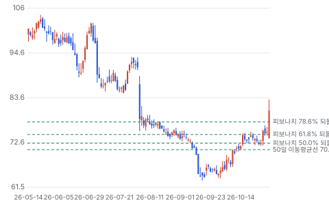

**주봉**

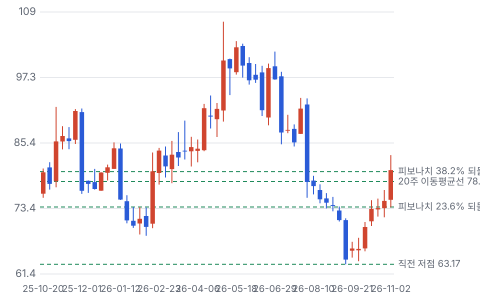

**월봉**

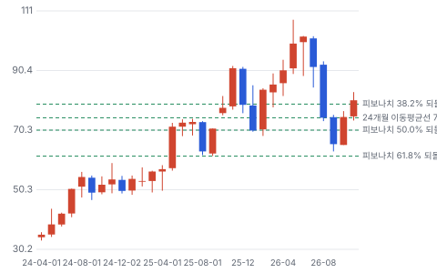

**분기 매출·EPS 실적과 컨센서스**

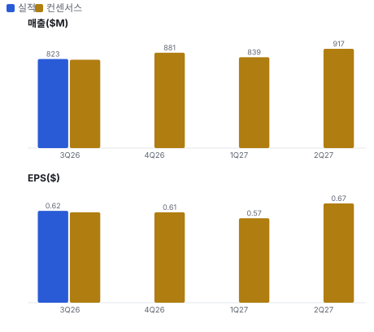

**EPS 리비전**

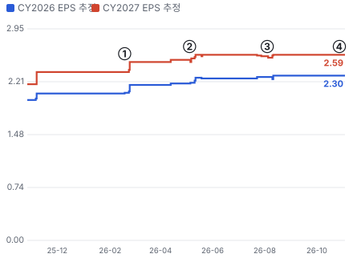

① 26-02-18 4Q25 실적, +16.0% · EPS 리비전 +6%
② 26-05-05 1Q26 실적, +16.2% · EPS 리비전 +2%
③ 26-08-04 2Q26 실적, −14.0% · EPS 리비전 +1%
④ 26-11-03 3Q26 실적, +7.0% · EPS 리비전 +0%

**밸류에이션 주가 시나리오**

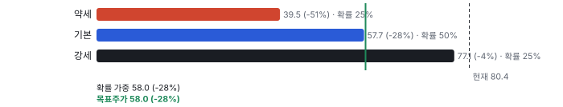

**주가별 업사이드**

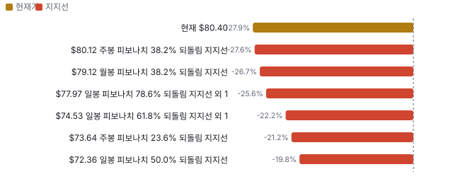

**어닝콜 변화별 주주가치 영향**

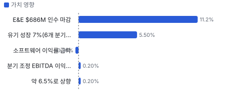

**최근 4개 분기 주가 변화 분석**

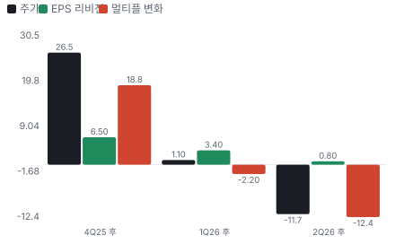

**멀티플 프리미엄**

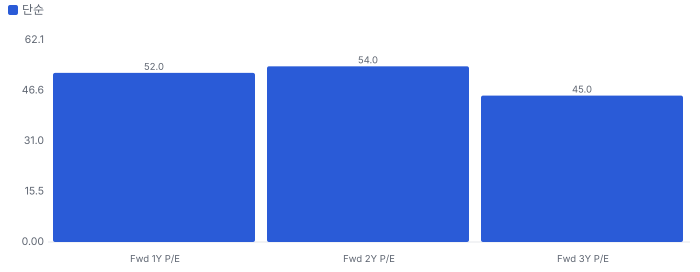

**합리적 멀티플**

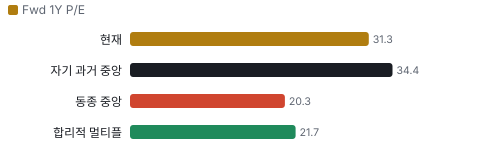

**몬테카를로**

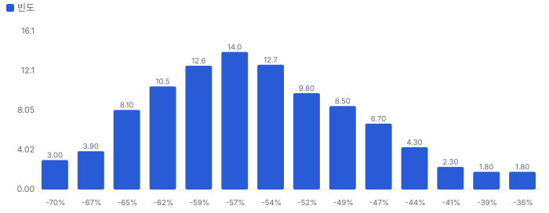

해석: 3,000번 중 0번(0%)에서 가치가 지금 주가 이상이었다. 가정을 흔들어도 지금 주가를 뒷받침하지 못하는 경우가 더 많다. 가운데 값은 0.44배이고, 열 번 중 여덟 번은 0.35~0.55배 사이에 든다.

## 내러티브

> **기업가치를 결정하는 이야기:** UL Solutions는 제품 안전 인증·시험(산업 50%, 소비재 44%)과 규제 준수 소프트웨어(6%)를 판다. 매출의 약 1/3은 인증한 제품의 공장 점검으로 매년 반복되는 매출이다. 기업가치는 신제품 인증 시험 성장(데이터센터·전기화), 이익률(2026 약 27% → 30% 목표), 그리고 E&E 같은 인수가 이익률을 깎지 않고 성장을 더하느냐로 갈린다.

> **멀티플·EPS 프리미엄**
> **멀티플:** Fwd P/E 약 31배로 시험·인증 동종 중앙값 약 20배보다 약 50% 비싸다. 자체 레인지는 상장 뒤 23~45배다.
> **EPS:** FY2027 EPS 추정은 2월 \$2.39에서 10월 \$2.59로 +8%다. 같은 기간 주가는 \$82에서 \$80으로 거의 그대로였다.

### 투자자들은 왜 열광했나

2024년 4월 상장 뒤 데이터센터·전기화 인증 수요와 이익률 개선이 겹쳐 주가가 3배 넘게 올랐다. 2026년 2Q 실적 −14%로 식었고, 9월 저점 뒤 3Q 실적(+7%)으로 다시 올랐다.

### 무엇이 기업가치를 바꾸나

> **구조적 체질 변화**
> **변화:** 비영리 시험 기관에서 상장 영리 회사로 바뀌며 가격·효율 관리가 들어왔다. 상장 뒤 조정 EBITDA 이익률이 약 500bp 올랐다.
> **증거:** 3Q 콜
> **반증:** 2027 이익률 정체

> **고부가 믹스 확장**
> **변화:** 저수익 사업(EHS 소프트웨어·일부 시험 사업)을 정리하고 인증 시험·지속 인증 비중을 키운다.
> **증거:** EHS \$201M 매각, DQS \$117M 매각, 사업 철수로 매출 −70bp
> **반증:** 남은 소프트웨어 이익률이 회복되지 않는다

> **기술 혁신**
> **변화:** AI 데이터센터 배전·전력 변환·액체 냉각 인증 프로그램을 새로 만들었다.
> **증거:** 3Q 콜, Plano(미국 텍사스주 도시) 냉각 시험소
> **반증:** 새 인증을 경쟁 시험소가 먼저 가져간다

> **실행 속도**
> **변화:** 인증 시험 주문이 매출보다 빨리 늘고(회사 설명), 비인증 시험은 3일 만에 끝나기도 한다. 인증 시험은 주문에서 매출까지 수개월로 본다(추정). **납품 리드타임 1~6개월.** 피어 비교 미확인. 이전 대비 미확인.
> **증거:** 3Q 콜 Citi 질의
> **반증:** 주문 증가가 매출로 이어지지 않는다

> **M&A**
> **변화:** E&E를 \$686M에 샀다(회사 역사상 최대). 연 매출 약 \$0.2B(추정)라 매출의 약 3.4배다. 같은 해 EHS(\$201M)·DQS 지분(\$117M)을 팔아 대금의 약 46%를 마련했다.
> **증거:** 3Q 보도자료
> **반증:** 2027년 E&E 통합 비용이 늘고 이익률이 내려간다

> **정책·입법 연관성**
> **재정정책:** 직접 관련 재정 지출은 없다. 해당 없음 반증: - 의회 동의 0/10 — 하원 0/5(해당 없음) · 상원 0/5(해당 없음).
> **행정명령:** 미 FCC가 중국 시험소의 미국 전자기기 인증 시험을 막기로 의결했다. 회사는 중국 매출 25% 중 작은 부분(주로 소비재)만 영향받고 다른 나라 시험소로 옮길 수 있다고 설명했다. 3Q 콜 반증: 영향 매출이 공시돼 1%를 넘는다 의회 동의 0/10 — 하원 0/5(행정 기관 규칙 — 의회 절차 없음) · 상원 0/5(행정 기관 규칙 — 의회 절차 없음).
> **연관입법:** 미국 산업안전보건청(OSHA(미국 산업안전보건청))의 국가 공인 시험소(NRTL(국가 공인 시험소)) 제도가 UL 같은 인증 기관의 법적 근거다. OSHA NRTL 제도 반증: 공인 시험소 요건이 완화돼 경쟁이 늘어난다

> **CAPEX(설비 투자) 낙수효과**
> **변화:** 데이터센터·전력망·배터리 제조사의 신제품 개발 투자가 인증 시험 주문이 된다.
> **증거:** 인증 시험 +10.7%
> **반증:** 전력 장비 회사들의 신제품 출시가 줄어든다

### 내러티브 근거

> '전기화·AI 데이터센터의 안전 인증 독점 브랜드'라는 이야기는 상장가 \$28에서 2026년 5월 \$105까지 주가를 끌어올렸다. 2Q 실적 −14%를 거쳐 9월 \$64까지 내렸다가 3Q 실적으로 \$80에 돌아왔다. Fwd P/E는 5월 약 42배에서 9월 약 26배, 지금 약 31배다. 동종 대비 멀티플 차이 +54% 중 회사 고유 몫은 +44%다. 단계는 컨센서스, 쏠림은 중이다.

> **전기화·데이터센터 신제품 인증** · 강화
> **논리:** 데이터센터 배전·냉각·배터리·전기차 신제품이 늘수록 인증 시험이 는다
> **숫자:** 인증 시험 3Q +10.7%, 산업 부문 유기 +8.4%
> **반증:** 인증 시험 성장이 5% 아래

> **이익률 확장** · 유지
> **논리:** 가격 체계·AI 자동화·포트폴리오 정리로 조정 EBITDA 이익률을 30%로
> **숫자:** 상장 이후 약 +500bp, 3Q 28.6%
> **반증:** 2027 이익률 정체

> **희소성 프리미엄** · 유지
> **논리:** 미국 상장 유일의 대형 순수 시험·인증 회사
> **숫자:** Fwd P/E 약 31배 vs 유럽 동종 약 19~22배
> **반증:** 유럽 동종 회사의 미국 상장·인수

> **반대 내러티브: 저성장 서비스업에 성장주 배수** · 유지
> **논리:** 유기 성장 6~7%인 시험 서비스에 30배는 비싸다
> **숫자:** 2Q 실적 −14%, 9월 저점 Fwd P/E 약 26배
> **반증:** 유기 성장이 8% 이상으로 오른다

## 포트폴리오

| 제품·서비스 | 구분 | 무엇 | 쓰는 곳 | 돈 버는 방식 |
|---|---|---|---|---|
| 산업 | 부문 | 전력·에너지·건축 자재·자동화 장비의 인증·시험 | 전력 장비·데이터센터·배터리 제조사 | 3Q \$410M(유기 +8.4%) |
| 소비재 | 부문 | 가전·전자·의료기기·소매 제품 시험·인증 | 소비재·전자 제조사, 유통사 | 3Q \$360M(유기 +5.9%) |
| 위험·규제 준수 소프트웨어 | 부문 | 공급망 규제 준수 데이터(ULTRUS(UL Solutions의 공급망 규제 준수 소프트웨어 플랫폼)) | 제조사·유통사 | 3Q \$53M(유기 +4.7%) |

## 수주·파이프라인

> **2026-11-03 기준 3건.** 건별 확정 금액은 공개되지 않았다. 서로 겹치는 항목은 합계에서 뺐다.

**실행 속도와 방해 요인**
| 항목 | 상태 | 실행 속도 | 방해 요인 |
|---|---|---|---|
| FY2026 매출(가이던스 근사) | 조건부 | 4Q 매출 약 \$0.86~0.89B 필요 | 통합 비용 |
| 지속 인증 서비스(연 환산) | 확정 | 3Q \$270M × 4 — 계약상 반복 | 고객 이탈 |
| E&E 인수 매출 | 확정 | 4Q 약 \$50M(연 약 \$0.2B 추정), 통합 2027~2028 | 통합 비용 · 인력 이탈 |

## 해자

> 해자는 'UL 마크'라는 규제·관행상 사실상 필수인 인증과 120년 넘게 쌓인 표준·시험 이력이다. 북미에서 전기 제품을 팔려면 UL 등록이 사실상 필요하고, 한번 인증한 제품은 매년 공장 점검(지속 인증 서비스)으로 반복 매출이 된다. 약점은 같은 국가 공인 시험소(NRTL) 자격을 가진 Intertek·SGS·CSA(캐나다 표준·인증 기관 CSA Group) 등과 가격 경쟁이 붙는 시험 물량이다.

> **UL 마크·표준 지위** · 강함
> **해자:** 북미 소매·건축 규정·보험사가 UL 등록을 요구하는 관행이 있어 제조사가 바꾸기 어렵다. 표준은 비영리 최대주주(ULSE(UL Standards & Engagement(비영리, 최대주주)))가 만든다.
> **근거:** 3Q 콜: Fortune 500(미국 매출 상위 500대 기업)의 60% 이상과 거래, Honeywell(미국 산업 기업)·Eaton(미국 전력 관리 회사)·Schneider와 100년 넘은 관계. 지속 인증 서비스가 매출의 약 1/3
> **숫자:** 지속 인증 서비스 3Q \$270M(+7.1%), 매출의 33%
> **깨지는 조건:** 미국 규정에서 UL 외 인증을 같은 조건으로 인정하는 범위가 넓어지거나, 지속 인증 매출 성장이 3% 아래로 떨어진다

> **신기술 인증 선점(데이터센터·전기화)** · 보통
> **해자:** 새 제품군(데이터센터 배전·액체 냉각·배터리)의 인증 프로그램을 먼저 만들고 시험소를 늘려 신제품 인증 물량을 가져간다.
> **근거:** 3Q 인증 시험 매출 +10.7%, AI 데이터센터 인증 프로그램 3개 출시, Plano 냉각 시험소 확장
> **숫자:** 인증 시험 3Q \$248M
> **깨지는 조건:** 인증 시험 성장이 한 자릿수 초반으로 꺾이거나 경쟁 시험소가 데이터센터 인증 물량을 가져간다

> **운영 효율(이익률 상승)** · 보통
> **해자:** 가격 체계 정비·AI 자동화·저수익 사업 정리로 이익률을 올린다.
> **근거:** 상장 이후 조정 EBITDA 이익률 약 +500bp, 2026 기초 +200bp(CFO(최고재무책임자)). 저수익 EHS 소프트웨어 매각
> **숫자:** 3Q 조정 EBITDA 이익률 28.6%
> **깨지는 조건:** 2027년 이익률이 28%에 못 미치거나 E&E 통합으로 이익률이 내려간다

## 경영진·네트워크

> CEO(최고경영자) Jenny Scanlon이 2024년 4월 상장을 이끌었고, 상장 뒤 이익률을 약 500bp 올렸다. 2026년에는 EHS 소프트웨어·DQS 지분을 팔고 회사 역사상 가장 큰 E&E 인수를 했다. 최대주주는 비영리 표준 기관 UL Standards & Engagement(UL Solutions 최대주주인 비영리 표준 기관)다.

> **Jennifer Scanlon** · 사장·CEO · 2019
> **프로필:** 전 USG(미국 건축 자재 회사 USG Corporation) Corporation CEO
> **비즈니스:** 다른 상장사 이사 겸직 미확인
> **정계:** 미확인
> **동문:** 미확인
> **사모임:** 미확인

> **Ryan Robinson** · CFO · 미확인
> **프로필:** 미확인
> **비즈니스:** 미확인
> **정계:** 미확인
> **동문:** 미확인
> **사모임:** 미확인

**네트워크 정량화**
| 연결 | 강도 | 닿는 매출 | 가중 노출 | 매출 대비 | 근거 |
|---|---|---|---|---|---|
| 비즈니스: 최대주주 ULSE가 UL 표준을 만든다 — 새 표준이 나올 때 인증 수요의 출발점에 가깝다 | 3/5 | 미확인 | 미확인 | 미확인 | 표준별 매출 미공시 회사 IR(투자자 관계) |

가중 노출은 연결이 닿는 매출의 크기다. 연결이 그 매출을 만들었다는 뜻이 아니며, 인과는 공개 자료로 입증하지 못한다.

## 약세 논리 및 셀온 조건

| 약세 논리 | 근거 | 가를 자료 |
|---|---|---|
| 배수 과다 | Fwd P/E 약 31배 vs TIC(시험·검사·인증 산업) 동종 약 20배, DCF 0.45배 | 2027 유기 성장 가이던스 |
| 중국·FCC | 중국이 2025년 매출의 25%, FCC가 중국 시험소의 미국 인증 시험을 막기로 의결 | 영향 매출 공시 |
| 인수 통합 | E&E 4Q 통합 비용이 예상보다 크다, 통합 2028년까지 | 2027 거래·통합 비용 |
| 소프트웨어 | 부문 이익률 29.7% → 18.9% | 4Q·2027 소프트웨어 이익률 |
| 주가 변동성 | 1년간 5% 넘는 일간 변동 11번, 2Q 실적일 −14% | 실적일 반응 |

> **셀온 조건**
> **조건 1:** 2027 유기 성장 가이던스가 5% 아래다.
> **조건 2:** 조정 EBITDA 이익률이 2027년에 27% 아래로 내려간다(E&E 희석 포함).
> **조건 3:** FCC 규정 영향 매출이 전체의 2%를 넘는다고 공시된다.
> **조건 4:** 인증 시험 성장이 두 분기 연속 5% 아래다.

## 어닝콜 변화

**직전 콜 대비 새로 나오거나 바뀐 내용 → 가치 영향**
| 항목 | 내용 | 직전 콜 | 최신 콜 | 모델 동인 이동 | 확신도 | 가치 영향 |
|---|---|---|---|---|---|---|
| 업데이트 | 유기 성장 | 2Q 약 6% | 3Q 7.0%, 인증 시험 +11% | 1년차 성장률 +1.0% | 1.0 | +5.5% |
| 업데이트 | 연간 유기 성장 가이던스 | 약 6% | 약 6.5% | 기준연도 매출 +\$0.01B | 1.0 | +0.2% |
| 업데이트 | 이익률 | 3Q25 27.7% | 28.6%(+90bp), 연간 약 27.0% 유지 | 출발 이익률 +0.50% | 1.0 | +0.2% |
| 신규 | E&E 인수 | 인수 발표 | 10/1 마감, 4Q 매출 약 \$50M, 통합 2027~2028 | 1년차 성장률 +2.0% | 0.8 | +11.2% |
| 부정 | 소프트웨어 | 3Q25 29.7% | 18.9%(EHS 매각 영향) | 목표 이익률 -0.30% | 0.8 | -0.3% |
| **합계** | 단독 합 |  |  | 동시 적용 +17.2% |  | **+16.8%** |

**사건별 EPS 리비전**
| # | 날짜 | 구분 | 사건 | CY2026 EPS 전→후 | CY2027 EPS 전→후 | 리비전 | 주가 반응 |
|---|---|---|---|---|---|---|---|
| ① | 26-02-18 | 실적 | 4Q25 실적, +16.0% | \$2.05 → \$2.17 | \$2.35 → \$2.49 | +6.1% | +16.0% |
| ② | 26-05-05 | 실적 | 1Q26 실적, +16.2% | \$2.19 → \$2.26 | \$2.52 → \$2.57 | +2.2% | +16.2% |
| ③ | 26-08-04 | 실적 | 2Q26 실적, −14.0% | \$2.28 → \$2.30 | \$2.57 → \$2.59 | +0.7% | -14.0% |
| ④ | 26-11-03 | 실적 | 3Q26 실적, +7.0% | \$2.30 → \$2.30 | \$2.59 → \$2.59 | +0.0% | +7.0% |

**해석:** 3개 구간 누적 주가 +13% = EPS 리비전 +11% × 멀티플 +2%. 더 크게 움직인 쪽은 **EPS 리비전**이다.

## 밸류에이션

> **목표주가 \$58, 업사이드 -28%.** 자리는 기본 시나리오이고 도달 확률은 약 49%다. 기본 \$58, 강세 \$77(-4%), 약세 \$40(-51%). DCF 기준 업사이드는 기본 -55%, 강세 -50%, 약세 -61%다(WACC(가중평균 자본비용) 8.9%).

순차입은 10/30 차입 \$689M에서 추정 현금 약 \$0.33B를 뺀 약 \$0.36B로 시가총액의 약 2%다. 그래서 주가 = 배수 × EPS로 본다.

**시험·인증 동종 비교**
| 회사 | Fwd P/E | 다음 4개 분기 매출 성장 | 이익률 | 특징 |
|---|---|---|---|---|
| UL Solutions | 약 31배 | +12%(E&E 포함, 유기 약 6~7%) | 조정 EBITDA 27%·영업이익률 약 19% | 미국 상장 순수 TIC, UL 마크 |
| Verisk(미국 데이터·위험 분석 회사) | 약 24배 | +6% | 영업이익률 45% | 데이터·소프트웨어(TIC 아님) |
| SGS | 약 22배 | +12%(인수 포함) | 영업이익률 15% | 세계 최대 TIC |
| Intertek | 약 21배 | +5% | 영업이익률 18% | 영국 TIC |
| Eurofins | 약 20배 | +6% | 영업이익률 12% | E&E 매각자 |
| Bureau Veritas | 약 19배 | +6% | 영업이익률 15% | 프랑스 TIC |

**UL 프리미엄 분해 — 31배는 무엇으로 설명되나**
| 항목 | 값 | 근거·계산 |
|---|---|---|
| 지금 주가 | \$80.40 | 다음 4개 분기 EPS \$2.57 × 약 31배 |
| TIC 동종 중앙값(약 20배)이면 | 약 \$52 | \$2.57 × 20.3배 — 지금보다 약 −35% |
| 프리미엄 | 약 \$28/주, 시가총액 약 \$5.7B | 동종 대비 약 +54% |
| 프리미엄의 근거 ① 이익률 | 조정 EBITDA 27% vs 동종 약 20%대 초반 | 영업이익률 차이 약 1~5%p — 일부는 정당화된다 |
| 프리미엄의 근거 ② 성장 | 유기 6.5%(2026) vs 동종 약 5~6% | 차이가 작다 — 배수 50%를 설명하기엔 부족하다 |
| 프리미엄의 근거 ③ 희소성·미국 | 미국 상장 대형 순수 TIC는 사실상 하나 | 숫자로 증명할 수 없는 몫. 지수·미국 성장 자금 수급 |
| DCF가 말하는 것 | 가치 ÷ 시가총액 약 0.45배 | WACC 8.95%·장기 성장 4%·이익률 20~21%로는 지금 가격의 절반 아래 |

**판정: 프리미엄의 절반 정도만 숫자로 설명된다.** 이익률 우위와 반복 매출(1/3)은 동종보다 높은 배수를 정당화하지만, 유기 성장 차이는 1%p 안팎이다. 나머지는 미국 상장 희소성과 '전기화·AI 데이터센터 인증' 이야기다. 성장 가속이 확인되지 않으면 그 몫이 가장 먼저 흔들린다. 동종 이익률은 영업이익률 기준이라 조정 EBITDA와 직접 비교되지 않는다.

> **약세 \$40 (-51%)** · 확률 25%
> **가정:** 16.8배 × EPS \$2.35
> **근거:** 소비재·중국 시험 둔화와 E&E 통합 비용으로 다음 4개 분기 EPS \$2.35(컨센서스 −9%)

> **기본 \$58 (-28%)** · 확률 50%
> **가정:** 22.4배 × EPS \$2.57
> **근거:** 컨센서스대로 다음 4개 분기 EPS 약 \$2.57

> **강세 \$77 (-4%)** · 확률 25%
> **가정:** 28.0배 × EPS \$2.75
> **근거:** 인증 시험 두 자릿수 성장이 이어지고 이익률이 28%를 넘어 \$2.75(+7%)

**멀티플 선정 — Fwd 1Y P/E**
| 단계 | 조정 | 근거 |
|---|---|---|
| 동종 중앙값 | 20.3배 | 범위 18.9~22.5배, 4곳 |
| 펀더멘털 | +4% | 성장·이익률·ROIC(투하자본이익률)로 본 합리적 멀티플 21.7배와의 차이의 일부만 인정 |
| 해자 | +7% | UL 마크·표준 지위 강함 · 신기술 인증 선점(데이터센터·전기화) 보통 · 운영 효율(이익률 상승) 보통 |
| 내러티브 | +0% | 단계 컨센서스 |
| 사이클·실행 판단 | +0% | 요인에 없는 조정은 하지 않는다. 미국 상장 순수 시험·인증 회사라는 희소성과 유럽 동종 대비 높은 이익률은 해자·펀더멘털 단계에 들어 있다 |
| **선정** | **22.4배** | 지금 31.3배 |

**동종 레인지**
| 회사 | Fwd 1Y P/E | Fwd 2Y P/E | Fwd 3Y P/E | 성장 | 영업이익률 | ROIC |
|---|---|---|---|---|---|---|
| ITRK(Intertek 종목 코드) | 20.6 | 18.0 | 17.2 | 5% | 19% | 19% |
| SGSN(SGS 종목 코드) | 22.5 | 20.7 | 19.3 | 12% | 17% | 17% |
| BVI(Bureau Veritas 종목 코드) | 18.9 | 17.6 | 16.2 | 6% | 16% | 21% |
| ERF(Eurofins 종목 코드) | 20.0 | 17.1 | 15.1 | 6% | 17% | 11% |
| **UL Solutions** | 31.3 | 27.6 | 25.1 |  |  |  |

지금 주가가 요구하는 5년 매출 CAGR 28%, 기본 시나리오 7%. 몬테카를로 중앙값 업사이드 -56%.

> 의사결정 보조(투자자문 아님): ① 매수 매력: 연 기대수익 -7.8% (자기자본비용 9.0% 대비 -16.8%p) · 자본비용 초과 확률 0% · 안전마진 0.35 → 정량 신호 약함 / ② 위험 예산 지표(이론): 0% — 기대수익이 자기자본비용에 못 미침(무위험 대비 켈리 0%는 참고) · 5년 하위10% -47% · 30%+ 손실 확률 64% / ③ 상방(5년): 기대 0.67배 · 2배 0% · 3배 0% · 10배 0% · 상위10% 0.82배

## 시장 평가

> **셀사이드(IB 애널리스트)**
> **한 줄:** 추정은 조금씩 오르고, 의견은 매수와 보유로 갈린다
> **애널리스트 의견:** 13명 — 강력 매수 7·매수 1·보유 5 — 보유가 많다
> **목표가 평균·범위:** \$98.48 (\$82.8~\$120, 10명) — 11/3 종가 대비 +22%
> **FY2027 EPS:** \$2.39(2/23) → \$2.59(10/16) — 8개월 +8%

> **바이사이드(기관 투자자)**
> **한 줄:** 기관 보유 변화는 확인하지 못했다
> **최대주주:** UL Standards & Engagement(비영리) — 보유 지분·추가 매각 일정 미확인

> **언론·업계**
> **한 줄:** 언론은 성장주이자 방어적 서비스주로 다룬다
> **보도:** '안전 과학으로 AI 시대 인증' — 데이터센터·전기화 연결 기사

## 체크리스트

| 시점 | 무엇 | 의미 |
|---|---|---|
| 2026년 11월 | 3Q 10-Q | E&E 인수 가격 배분·FCC 영향 설명 |
| 2026년 11월 중순 | 13F 3Q | 기관 보유 변화 |
| 2027년 2월 하순(예상) | 4Q 실적·2027 가이던스 | 유기 성장·이익률·통합 비용 |
| 2027년 | FCC 규정 시행 | 중국 소비재 시험 이전 속도 |
| 2027~2028년 | E&E 통합 | 시험소 가동률·교차 판매 |

## 출처
- UL Solutions 3Q26 실적 보도자료(2026-11-03)
- UL Solutions 3Q26 어닝콜(2026-11-03, 요지만 자기 말로)
- Eurofins E&E 매각 완료 보도(2026-10-01)
- 3Q 보도자료
- 3Q 콜

_구매 등급·목표주가 모두 규칙이 계산한 모델 값으로, 개인의 보유 종목·자금 사정을 반영하지 않는다 · 공개 자료 기반 분석이며 투자 권유가 아님 · 1차 판정, 미검증 · Chiip ten-bagger_