# 텐배거 리포트 2026-11-05 — 롯데에너지머티리얼즈 — 매출은 두 배가 됐는데 적자는 그대로, 값은 2027년 흑자를 먼저 샀다

> 2026-11-05 · 롯데에너지머티리얼즈(020150) · 기업: 구리를 전기분해로 얇게 펴 배터리용 전지박과 인쇄회로기판용 회로박(AI 서버용 HVLP 포함)을 만드는 한국 소재 회사(옛 일진머티리얼즈, 롯데케미칼 계열)

## Chiip View

주가는 11/5 장중 ₩34,850(−15.2%)이다. 시가총액은 ₩1.82T(기본·완전 희석 주식 수가 같다 — 대시보드는 반올림 ₩2T), 6/30 순현금 ₩37.6B(리스 포함 총차입 ₩348.8B − 현금·단기 ₩386.4B)를 뺀 EV(전기차)는 ₩1.79T다(9/3 롯데에코월(롯데에너지머티리얼즈의 옛 환경·건자재 자회사(9/3 지분 90% 매각)) 매각 대금 ₩170.8B는 3Q 재무상태표 전이라 미반영). 3Q 매출 ₩289.7B는 분기 최대이고 컨센서스 ₩256.5B를 13% 넘었지만, 영업손실 ₩21.3B는 컨센서스(−₩20.0B)보다 조금 크고 2Q(−₩16.9B)보다 커졌다 — 9개 분기 연속 적자다. **우리가 다르게 보는 곳은 '매출 서프라이즈 뒤 −15%는 과하다'는 읽기다.** 매출이 49% 늘었는데 영업이익률은 −8.7%에서 −7.4%로 1.3%p만 나아졌다. 말레이시아 5공장(말레이시아 사라왁주 동박 공장 5번째 라인(약 1만 톤, 2026년 7월 가동)) 고정비가 가공비보다 앞서고, 6공장이 4Q에 돌면 같은 일이 한 번 더 생긴다. 지금 Fwd 1Y EV/EBITDA 20.3배는 동종 후행 중앙값 18.0배보다 높고, DCF로 풀면 지금 주가는 5년 매출 CAGR 10%를 요구한다(기본 시나리오 12%) — 값은 2027년 흑자 전환을 대부분 넣었다. 엔진 목표주가는 ₩38,267(+10%), 규칙 등급과 애널리스트 토론 모두 Neutral이다. 약세 ₩18,738(−46%)·강세 ₩65,791(+89%)로 위아래가 다 넓다. 경쟁 가설 ① 오늘 하락은 이익 기대가 매출보다 앞섰던 탓이고 실적은 경로 위다(가를 자료: 4Q 실적의 분기 영업이익, 2027-02 초) ② 증설 고정비가 가공비 인상보다 빨라 흑자가 또 한 해 밀린다(가를 자료: 2027년 가공비 협상 결과·1Q27 분기 영업이익, 2027-05). 중간선거 영향 +1.1/10 — 가장 큰 채널은 IRA(미국 인플레이션 감축법) 청정에너지 세액공제(민주 의회에서 축소 위험이 내려감, 고객 경유 노출 0.6, +0.9) · 업종 ETF(상장지수펀드) 반응은 이번 회차에 재지 못했다. 정책 0단계(선거 결과) 가설이다.

## 대시보드
| 항목 | 값 | 설명 |
|---|---|---|
| 주가 | ₩34,850 | 고점 대비 -56% · 1년 +27% |
| 시가총액 | ₩2T | 완전 희석 기준 · EV ₩2T |
| 업사이드 | +10% | 목표주가 ₩38,267 · 다운사이드 -46% · 손익비(강세÷약세) 1.9 |
| 구매등급 | Neutral | 애널리스트 7명: Strong Buy 3 · Buy 2 · Neutral 2 · Sell 0 · Strong Sell 0 |
| 멀티플 | Fwd 1Y EV/EBITDA 20.3배 | 동종 중앙값 18.0배 |
| 가이던스 | 없음 | 회사가 숫자를 내지 않았다 |
| 알파 | 5.5/10 | 텐배거 가능성 점수 |
| 이벤트 | 3Q 분기보고서 제출 기한(분기 말 + 45일) — 재무상태표·차입·제품별 매출·가동률 확인 | 2026-11-16 |

## 한 장 요약
- **기업가치를 결정하는 내러티브** 롯데에너지머티리얼즈(020150)는 구리를 전기분해로 얇게 펴 배터리용 전지박(이차전지 음극 집전체로 쓰는 얇은 동박(4~20㎛))과 기판용 회로박(인쇄회로기판(PCB)·동박적층판(CCL)용 동박)을 만드는 회사다(옛 일진머티리얼즈, 2023년 롯데케미칼 인수). 3Q 매출 ₩289.7B는 분기 최대이고 전년의 두 배지만 영업손실 ₩21.3B로 9개 분기째 적자다. 주가는 11/5 장중 ₩34,850(−15.2%)
- **밸류에이션 모델로 본 주가 상방은 어디까지인가?** **목표주가 ₩38,267(+10%), 기본과 강세 사이(강세 쪽 8%)다.** 강세 ₩65,791(+89%)는 Fwd 1Y EV/EBITDA 26.2배를 강세 EBITDA에 적용한 값이다. 기본 ₩35,957, 약세 ₩18,738. 손익비 1.9, DCF 기준 업사이드 +4%.
- **누가 사 주나?** 최대 고객 북미 ESS(에너지저장장치(대형 배터리)) 핵심 고객(이름 미공시)(보도자료 '핵심 고객사') 32%, 상위 3곳 46%. 공시·회사 발표로 확인한 몫은 0%다.
- **마진과 공급망은 어디가 약한가?** GPM 1.5%, OPM -8.7%. OPM을 가장 흔드는 BOM(제품 원가를 이루는 부품·재료 명세) 항목은 구리 원료이고 가격 +10%에 -6.50%p다. 공급망 신뢰성은 8.0/10(병목 낮음)이고 가장 약한 고리는 구리 원료다.
- **생산능력은 얼마나 늘어나나?** 현재 명목 캐파 미확인, 착공 이상 증설 9,300 동박(구리를 얇게 편 박 — 전해(전기분해)로 드럼 위에 구리를 석출해 만든다) 톤(연). TTM 2Q26 CAPEX는 매출의 8.0%다.
- **지금 가격은 무엇을 가정하나?** 적자라 이익 배수는 EBITDA로 본다. Fwd 1Y EV/EBITDA 20.3배(다음 4개 분기 EBITDA 약 ₩88B — 4Q26 잔여 추정 + FY2027 컨센서스 × 0.75로 만든 컨센서스)이고, 동종 3곳의 후행 EV/EBITDA 중앙값은 18.0배다(선행 추정이 없어 후행으로 대신했다 — 거친 비교). Fwd 2Y는 10.4배로 내려가지만 FY2028 추정은 키움 1곳뿐이다. TTM EV/매출 2.19배는 중국 동박사 1.1~1.8배와 대만 회로박사 코텍 9.7배 사이다. DCF로 거꾸로 풀면 지금 주가는 5년 매출 CAGR 10%를 요구하고 기본 시나리오는 12%다. 엔진이 고른 합리적 배수는 21.0배, 목표주가는 ₩38,267이다.
- **왜 움직였나?** 1년 동안 네 구간이다. 2025년 10월 ₩24,000대에서 AI(인공지능) 회로박(3월 HVLP(표면 거칠기를 아주 낮춘 초저조도 회로박(Hyper Very Low Profile) — 고속 신호 손실을 줄여 AI 서버 기판에 쓴다) 양산)과 1Q 손실 축소로 5/4 장중 ₩83,100까지 올랐다. 6~7월 2Q 손실 확대·EV 부진과 함께 7/30 장중 ₩22,600까지 −73%. 10월 두 번의 하루 +18%(10/2·10/19, 원인은 공시로 확인 못 함)로 ₩58,500, 그리고 11/3 −10.3%(원인 미확인)와 3Q 발표일 11/5 −15.2%로 ₩34,850이다. 2Q 발표 전날(8/5 ₩31,250) 이후로는 +11.5%다. 3Q 발표일 하락은 매출이 아니라 손실 확대와 맞물린다 — 다만 장중 값이라 종가는 다를 수 있다.
- **3Q 실적에서 무엇이 바뀌었나?** 매출 ₩289.7B(+102% YoY, +49% QoQ)로 분기 최대 — 북미 ESS 공급과 북미 완성차 동박 출하가 이유다. 영업손실 ₩21.3B(2Q −₩16.9B), EBITDA ₩5.6B(2Q ₩7.7B)로 말레이시아 5공장 초기 고정비가 늘었다. 순이익 ₩70.4B는 롯데에코월 매각 처분이익 ₩111.1B 덕분이라 본업과 무관하다. 새로 나온 숫자 목표는 2027년 회로박 판매량 2배 이상, 회로박 판매의 50% 이상을 HVLP 중심 고성능 제품으로, 그리고 회로박 장기공급계약 추진이다. 매출·이익 숫자 가이던스는 없다.
- **회사는 쟁점에 뭐라고 답했나?** 쟁점은 매출이 늘어도 왜 이익이 따라오지 않느냐, 그리고 가공비를 언제 올리느냐다. 한국 상장사 콜 질의응답 전문이 공개되지 않아 이 질문에 대한 회사 답변은 확인하지 못했다(회사 답변 없음). 보도자료로 회사가 말한 것은 5공장 초기 고정비가 적자 요인이라는 설명과, 2027년을 고성능 제품 중심의 '구조적 수익 체계 전환 원년'으로 삼는다는 목표다. 가공비 인상 계약은 언급되지 않았다.
- **무엇이 바뀌면 판단이 달라지나?** 위로는 4Q26 또는 1Q27에 분기 영업흑자가 나오고, 2027년 전지박 가공비 인상과 회로박 장기공급계약이 공시되며, FY2027 영업이익 컨센서스가 ₩50B 위로 오르면 강세 ₩65,791 쪽이다. 아래로는 6공장 가동 뒤에도 분기 영업손실이 ₩20B 이상 이어지거나, 4Q 매출이 3Q보다 15% 넘게 줄거나, 차입 증가로 유상증자 얘기가 나오면 약세 ₩18,738(−46%) 쪽이다.

## 한눈에 보기

**일봉**

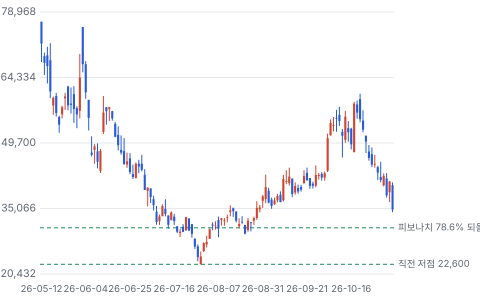

**주봉**

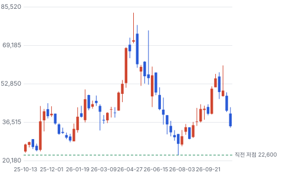

**월봉**

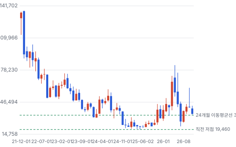

**분기 매출·EPS 실적과 컨센서스**

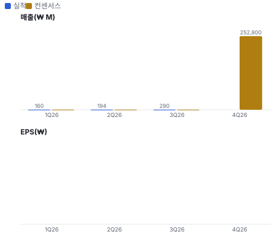

**밸류에이션 주가 시나리오**

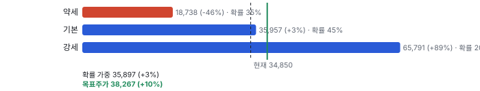

**주가별 업사이드**

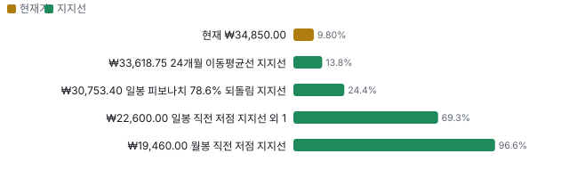

**제품·서비스 포트폴리오**

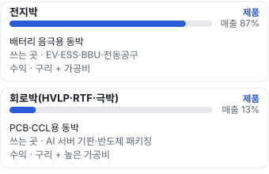

**고객 믹스(3Q26, 매출 대비)**

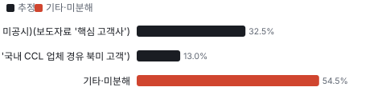

**공급 병목(10점, 낮을수록 병목)**

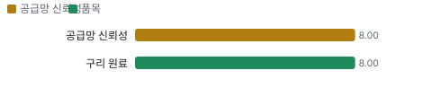

**CAPEX의 매출 대비 비중**

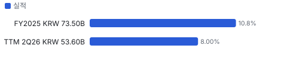

**어닝콜 변화별 주주가치 영향**

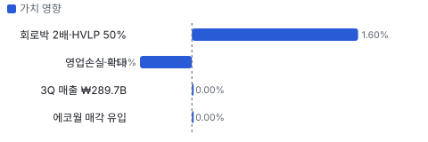

**멀티플 프리미엄**

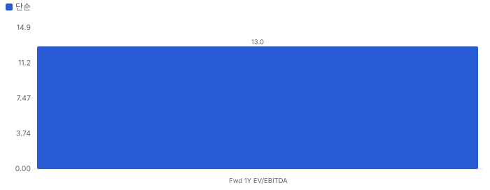

**합리적 멀티플**

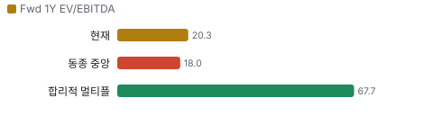

**몬테카를로**

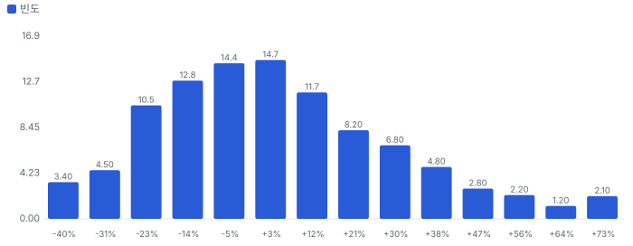

해석: 3,000번 중 1,580번(53%)에서 가치가 지금 주가 이상이었다. 지금 주가를 뒷받침하는 경우와 그렇지 않은 경우가 반반에 가깝다. 가운데 값은 1.02배이고, 열 번 중 여덟 번은 0.75~1.40배 사이에 든다.

## 내러티브

> **기업가치를 결정하는 이야기:** 적자라 Fwd 1Y EV/EBITDA 20.3배(다음 4개 분기 EBITDA 약 ₩88B, 컨센서스)로 본다. Fwd 2Y는 10.4배로 내려간다 — 가치는 2027~2028년 흑자 전환과 회로박 믹스가 정한다. TTM EV/매출 2.19배는 중국 동박사(1.1~1.8배)보다 높고 대만 회로박 회사 코텍(9.7배)보다 한참 낮다 — 시장은 아직 '전지박 회사'로 값을 매긴다

> **멀티플·EPS 프리미엄**
> **멀티플:** TTM EV/매출 2.19배, 동종 6곳 중앙값 1.70배(SKC(한국 소재 회사 — 자회사 SK넥실리스가 전지박을 만든다) 1.46·솔루스 2.71·노드 1.84·자위안 1.09·미쓰이금속 1.55·코텍 9.68)
> **EPS:** EPS는 적자 — FY2027 영업이익 컨센서스 ₩30.8B(7개사)가 첫 흑자 해

### 투자자들은 왜 열광했나

2025년 10월 ₩24,000대에서 2026년 5월 장중 ₩83,100까지 3.4배 올랐다. AI 회로박(HVLP 3월 양산)과 북미 ESS 수요, 1Q 영업손실 축소(−₩5.0B)가 이유였다. 6~7월에 ₩22,600까지 −73% 빠졌다 — 2Q 손실 확대와 EV 부진이 겹쳤다(원인 일부 미확인). 10월 다시 ₩58,500까지 올랐다가 3Q 손실 확대로 11/5 −15%

### 무엇이 기업가치를 바꾸나

> **구조적 체질 변화**
> **변화:** EV 전지박 회사 → AI 데이터센터 소재(회로박·ESS·BBU(데이터센터 서버용 배터리 백업 장치(Battery Backup Unit))) 회사. NH(NH투자증권)는 ESS+회로박 비중을 2026년 47% → 2027년 53%로 본다
> **증거:** 2Q PT(실적 발표 자료(프레젠테이션)), NH(5/12)
> **반증:** 2027년 ESS+회로박 비중 50% 미만

> **고부가 믹스 확장**
> **변화:** 회로박 HVLP 가공비가 전지박의 3배 이상(키움 추정). 회로박 매출은 1Q ₩21.0B로 아직 13%
> **증거:** 키움(8/7)·NH
> **반증:** HVLP 3·4급 수율 개선 지연

> **기술 혁신**
> **변화:** HVLP 1~4급 양산, HVLP5(HVLP 5세대 — 가장 낮은 조도 등급(개발 중)) 개발, RTF(뒷면 처리 회로박(Reverse Treated Foil) — 고주파용)·1~3㎛ 극박(1~3㎛ 두께의 아주 얇은 회로박 — 반도체 패키징·광트랜시버 기판용) — 국내 유일 회로박 양산이라는 위치
> **증거:** 2Q PT 8쪽
> **반증:** 고객 인증에서 일본·대만 공급사에 밀림

> **실행 속도**
> **변화:** 해당 없음(주문→출하 리드타임을 회사가 공시하지 않는다 — 동박은 고객 연간 공급 물량을 월 단위로 출하한다). 대신 증설 속도: 말레이시아 5공장 2026년 7월 가동, 6공장을 2027년 초(IBK(IBK투자증권) 5/12 기준 계획)에서 4Q26으로 앞당겼다
> **증거:** 2Q PT·3Q 보도
> **반증:** 6공장 가동이 2027년 2Q 이후로 밀림

> **M&A**
> **변화:** 해당 없음(인수 없음). 9/3 롯데에코월 지분 90% 매각 — 대금은 동박 투자에 쓴다(보도)
> **증거:** 데이터뉴스 9/4
> **반증:** 추가 자산 매각·유상증자

> **정책·입법 연관성**
> **재정정책:** 미국 IRA 첨단제조·ESS 투자세액공제는 고객(배터리사) 경유 노출 — 회사 직접 수혜는 미확인 중간선거 영향 모형 반증: ESS 투자세액공제 축소 의결 의회 동의 2/10 — 하원 1/5(2026 회기 중 축소 법안 본회의 표결 기록 미확인) · 상원 1/5(같음).
> **행정명령:** 중국산 배터리 소재 관세·우려 외국 기관(FEOC(우려 외국 기관 — 미국 IRA가 중국 등 공급망을 세액공제에서 빼는 규정)) 규정이 비중국 동박 수요를 만든다 — 회사 특정 조치는 없다 3Q 보도 '비중국 공급망' 반증: 중국산 동박 관세 완화 의회 동의 0/10 — 하원 0/5(행정부 조치) · 상원 0/5(같음).
> **연관입법:** 해당 없음(회사를 겨냥한 미국·한국 법안 미확인) 로비 공시 키 없음(미확인) 반증: 미국 배터리 소재 원산지 규정 강화 의결

> **CAPEX 낙수효과**
> **변화:** AI 데이터센터 투자 → 서버 기판 → HVLP 회로박. 고객 투자 발표를 이 회사 매출로 바로 옮기지 않는다 — 확인된 것은 회로박 1Q 매출 ₩21.0B와 2027 판매 2배 목표
> **증거:** NH·3Q 보도
> **반증:** AI 서버 기판 업체의 CCL(동박적층판 — 수지 절연층 양면에 동박을 붙인 PCB 원판) 주문 둔화

### 내러티브 근거

> 전지박 회사가 AI 데이터센터 소재 회사로 바뀐다는 이야기다. AI 서버 기판용 HVLP 회로박, 데이터센터 ESS·BBU용 전지박, 중국을 피하려는 북미 고객이 세 축이다. 매출은 3Q에 분기 최대(₩289.7B, +102% YoY)를 찍었지만 9개 분기째 영업적자다. 주가는 5월 장중 ₩83,100 → 7월 ₩22,600 → 10월 ₩58,500 → 11/5 ₩34,850으로 이야기의 값이 크게 흔들린다. 동종 대비 멀티플 차이 +13% 중 회사 고유 몫은 -70%다. 단계는 확산, 쏠림은 중간이다.

> **AI 서버 회로박(HVLP)** · 강화
> **논리:** AI 서버 기판이 고속 신호용 HVLP 동박을 쓰면서 회로박이 고부가 제품이 된다
> **숫자:** 회로박 캐파 3,700톤(2025) → 6,700톤(2026) → 1만 6,000톤(2027 말), 2027 판매 2배·HVLP 50% 이상 목표
> **반증:** 2027년 상반기 회로박 판매가 전년 대비 50% 미만 성장

> **북미 ESS 비중국 동박** · 강화
> **논리:** 북미 ESS·완성차가 중국산을 피해 말레이시아 동박을 산다
> **숫자:** 3Q 매출 +102% YoY, 6공장 4Q 조기 가동
> **반증:** 4Q 매출이 3Q보다 15% 넘게 줄어든다

> **동박 공급 부족과 가공비** · 정황
> **논리:** 업계 캐파가 회로박으로 옮겨 전지박이 부족해지고 가공비를 올릴 수 있다
> **숫자:** 미확인 — 가공비 인상 계약은 공시되지 않았다
> **반증:** 2027년 가공비 협상이 동결로 끝난다

> **가동률 레버리지** · 유지
> **논리:** 고정비가 큰 공장이라 가동률이 오르면 이익이 빨리 돈다
> **숫자:** 가동률 47.4%(2025) → 72.1%(2Q26), EBITDA 2Q ₩7.7B → 3Q ₩5.6B
> **반증:** 6공장 가동 뒤에도 4Q·1Q 영업손실이 ₩20B 이상

> **반대: 흑자는 늘 다음 해** · 유지
> **논리:** 2024년부터 '내년 흑자'가 반복됐고 3Q에도 매출이 49% 늘었는데 손실이 커졌다
> **숫자:** 9개 분기 연속 영업적자, 3Q 영업이익률 −7.4%
> **반증:** 1Q27 분기 영업흑자(IBK 예상 시점)

## 포트폴리오

| 제품·서비스 | 구분 | 무엇 | 쓰는 곳 | 돈 버는 방식 | Mix | Mix 변화(전년 대비) |
|---|---|---|---|---|---|---|
| 전지박 | 제품 | 배터리 음극용 동박 | EV·ESS·BBU·전동공구 | 구리 + 가공비 | 미확인 | 미확인 |
| 회로박(HVLP·RTF·극박) | 제품 | PCB(인쇄회로기판)·CCL용 동박 | AI 서버 기판·반도체 패키징 | 구리 + 높은 가공비 | 미확인 | 미확인 |

## 고객

> **3Q26 최대 고객 북미 ESS 핵심 고객(이름 미공시)(보도자료 '핵심 고객사') 32%, 상위 3곳 46%, 집중도 분산.** 공시·회사 발표로 확인한 몫은 매출의 0%이고, 나머지 고객 몫은 추정이거나 미분해다. 회사는 고객별 매출을 이번 자료에 밝히지 않았다. 회사 설명은 '북미 ESS 핵심 고객'·'북미 완성차(4680(지름 46mm·높이 80mm 원통형 배터리 규격) 원통형)'·'국내 CCL 업체를 통한 북미 고객'이다. 이름 연결은 모두 가설이고 몫은 미확인

**고객별 매출 몫(3Q26)**
| 고객 | 몫 | 변화 | 근거 |
|---|---|---|---|
| 북미 ESS 핵심 고객(이름 미공시)(보도자료 '핵심 고객사') | 25~40% | 미확인 | 추정 |
| 국내 CCL·PCB 업체(회로박)(NH '국내 CCL 업체 경유 북미 고객') | 13% | 미확인 | 추정 |
| 북미 완성차(4680 원통형 배터리)(2Q PT '북미 EV OEM(완성차 회사) 4680向') | 미확인 | 미확인 | 회사 발표 |
| BBU·전동공구 소형전지 고객(2Q PT 'AIDC(AI 데이터센터)용 BBU/전동공구') | 미확인 | 미확인 | 회사 발표 |
| 기타·미분해 | 54% | - | - |

> **북미 ESS 핵심 고객(이름 미공시)(보도자료 '핵심 고객사')** · 추정
> **사는 것:** ESS용 6㎛ 전지박
> **추정 근거:** NH(5/12)는 국내 배터리사의 북미 라인 ESS 전환 수혜를 짚었다 — 특정 회사 연결은 가설 · 몫 범위 = NH 2026E ESS+회로박 판매 비중 47%에서 회로박 약 13%를 뺀 약 34%를 가운데로 둔 추정(판매량 기준이라 매출 몫과 다를 수 있다)

> **국내 CCL·PCB 업체(회로박)(NH '국내 CCL 업체 경유 북미 고객')** · 추정
> **사는 것:** HVLP·RTF·극박 회로박
> **추정 근거:** 1Q26 회로박 매출 ₩21.0B ÷ 매출 ₩159.8B = 13%(NH 5/12) — 회로박을 사는 CCL·PCB 업체 묶음의 몫(제품 몫으로 근사)

> **북미 완성차(4680 원통형 배터리)(2Q PT '북미 EV OEM 4680向')** · 회사 발표
> **사는 것:** EV용 전지박
> **추정 근거:** 2Q PT: 3Q 본격 출하 · 3Q 보도: 북미 완성차향 출하 본격화

> **BBU·전동공구 소형전지 고객(2Q PT 'AIDC용 BBU/전동공구')** · 회사 발표
> **사는 것:** 12~20㎛ 후박 전지박
> **추정 근거:** 2Q PT: 하반기 출하 100% 이상 증가 목표

## 마진 구조

> **GPM 1.5%, OPM -8.7%.** 2Q25 대비 GPM +7.5%p, OPM +6.5%p. 변동비는 매출의 78%이고, 매출이 10% 늘면 OPM은 +2.8%p 움직인다. 2Q26 매출총이익률 1.6%(2Q25 −6.0%), 판관비 10.2%로 영업이익률 −8.7%. 동박 값은 구리 시세 + 가공비라 구리는 대체로 고객에게 넘어가고, 이익은 가공비와 가동률이 정한다. 3Q는 매출이 49% 늘었는데 5공장 초기 고정비로 영업이익률 −7.4%

**GPM에서 OPM까지(K-IFRS)**
| 기간 | GPM | 연구개발 | 판관비 | 기타 | OPM |
|---|---|---|---|---|---|
| 2Q25 | -6.0% | 0.0% | 9.2% | 0.0% | -15.2% |
| 2Q26 | 1.5% | 0.0% | 10.2% | 0.0% | -8.7% |

**마진을 결정하는 비용 요인 — 비용 +10% 시 OPM**
| 비용 | 매출 대비 | 변화 | 고정비 | OPM |
|---|---|---|---|---|
| 구리 원료(전기동·스크랩) | 60.0% | 미확인 | 0% | -6.00%p |
| 인건비·약품·기타 제조원가 | 17.8% | 미확인 | 50% | -1.78%p |
| 감가상각 | 12.7% | +1.6%p | 100% | -1.27%p |
| 판매·관리비 | 10.2% | +1.0%p | 70% | -1.02%p |
| 전력 | 8.0% | 미확인 | 20% | -0.80%p |

**비용을 움직이는 요인**
| 비용 | 요인 |
|---|---|
| 구리 원료(전기동·스크랩)(매출원가) | LME(런던금속거래소 — 구리 국제 가격의 기준) 구리 시세 — 판매가에 연동 · 근거 추정 |
| 인건비·약품·기타 제조원가(매출원가) | 가동률(2Q 72.1%) · 근거 추정 |
| 감가상각(매출원가) | 말레이시아 5·6공장 가동 · 근거 공시 |
| 판매·관리비(판관비) | 인력·물류 · 근거 공시 |
| 전력(매출원가) | 전해 공정 전력 단가 — 말레이시아 수력 전력 · 근거 추정 |

**전지박 BOM — 매출의 87%, GPM 0%(추정 — 제품별 이익률 미공시. 2Q 전사 GPM 1.6% = 전지박 약 0% × 87% + 회로박 약 12% × 13%로 맞춘 값), 항목 가격 +10% 시**
| 항목 | 원가 몫 | 전가 | 제품 GPM | OPM |
|---|---|---|---|---|
| 구리 원료 | 60~75% | 미확인 | -6.8%p | -5.87%p |
| 전해 드럼·설비 감가상각 | 8~15% | 미확인 | -1.1%p | -1.00%p |
| 전력 | 6~12% | 미확인 | -0.9%p | -0.78%p |
| 미분해 | 12% | - | - | - |

**회로박(HVLP·RTF·극박) BOM — 매출의 13%, GPM 12%(추정 — 키움: HVLP 가공비는 전지박의 3배 이상(추정)), 항목 가격 +10% 시**
| 항목 | 원가 몫 | 전가 | 제품 GPM | OPM |
|---|---|---|---|---|
| 구리 원료 | 45~65% | 미확인 | -4.8%p | -0.63%p |
| 전해 드럼·설비 감가상각 | 10~20% | 미확인 | -1.3%p | -0.17%p |
| 표면처리 약품·도금 | 5~12% | 미확인 | -0.7%p | -0.10%p |
| 미분해 | 21% | - | - | - |

판매가 전가를 모르는 항목은 전가 0%로 계산했다.

**BOM 항목 가격을 움직이는 것**
| 항목 | 요인 |
|---|---|
| 구리 원료 | 동박 원가의 가장 큰 몫 · 동박 값은 구리 시세 + 가공비 구조라 구리는 대체로 판가에 연동된다(업계 관행) — 회사 계약 조항은 확인 못 해 미확인 · 근거 추정 |
| 전력 | 전해 석출 공정 · 근거 추정 |
| 전해 드럼·설비 감가상각 | 말레이시아 신공장 초기 · 근거 추정 |
| 구리 원료 | 가공비가 높아 구리 몫이 전지박보다 작다 · 동박 값은 구리 시세 + 가공비 구조라 구리는 대체로 판가에 연동된다(업계 관행) — 회사 계약 조항은 확인 못 해 미확인 · 근거 추정 |
| 표면처리 약품·도금 | 저조도·내열 처리 · 근거 추정 |
| 전해 드럼·설비 감가상각 | 회로박 신규 설비 ₩49.0B 투자 · 근거 추정 |

**BOM 투입 물가 — PPI 전년비, 2026-11-05 수집**
| 항목 | 미국 | 일본 | 한국 | 대만 |
|---|---|---|---|---|
| 구리 원료 | +30.0% | +54.2% | +25.8% | +41.2% |

별표는 품목보다 넓은 업종 지수다. 지난 1년 투입 물가를 판매가 전가 뒤 원가에 그대로 넣으면 OPM은 -24.40%p 움직인다(매출원가의 66% 기준).

## 공급망 병목

> **공급망 신뢰성 8.0/10, 병목 낮음.** 가장 약한 고리는 구리 원료 8.0점이고, 품목 평균은 8.0점이다. 근거가 부족한 2건(전력 · 전해 드럼·생산 설비)은 점수에서 뺐다. 약한 고리는 구리 원료 가격과 말레이시아 공장 전력이다. 구리는 판가에 연동되지만 시세가 급히 움직이면 재고 손익(1Q 재고평가 환입 ₩12.0B)이 생긴다. 공급사 이름은 공시하지 않았다

**병목과 마진 — 품목 가격 +10% 시 OPM**
| 품목 | 점수 | 판정 | 구분 | OPM |
|---|---|---|---|---|
| 구리 원료(필수) | 8.0 | 병목 낮음 | 가격 위험 | -6.50%p |

> **구리 원료** · 8.0/10
> **왜:** 전기동은 상품 시장이라 물량 병목 근거가 없다. 인증 공급사 3곳·재인증 3개월·1위 점유율 10%·물량 확보 방식(복수 구매)은 업계 구조로 본 추정 — 회사 공시 미확인. 2Q PT: 운전자본 증가는 구리 원재료 구매
> **병목 요인:** 인증 공급사 3곳 · 캐파 균형 · 리드타임 미확인 · 재인증 3개월 · 1위 점유율 10% · 중국(세계 정련동 생산 약 45%, 업계 통계 근사) 집중 45% · 물량 확보 복수구매
> **풀리는 조건:** 미확인

**공급사**
| 품목 | 공급사 | 몫 | 근거 |
|---|---|---|---|
| 구리 원료 | 미공시(전기동·스크랩) | 미확인 | 추정 |
| 전력 | 말레이시아 사라왁 전력 공급사(미공시)(말레이시아 공장 전력) | 미확인 | 추정 |
| 전해 드럼·생산 설비 | 미공시(티타늄 음극 드럼·제박기) | 미확인 | 추정 |

**무역 통계로 본 공급 지역**
| 품목 | EU 수입처 | 일본 수입처 | EU 1위 전년비 |
|---|---|---|---|
| 구리 원료 | MY(말레이시아) 69% · KR(한국) 10% · US 7% | マレーシア 58% · タイ 36% | 미확인 |

## 생산능력

> **현재 명목 캐파 미확인, 가동률 72%.** 착공 이상 증설은 9,300 동박 톤(연), 발표까지 합치면 19,300 동박 톤(연)이다. TTM 2Q26 CAPEX는 KRW 53.60B로 매출의 8.0%다. 회사는 전체 명목 캐파를 이번 자료에 숫자로 밝히지 않았다. 가동률은 2025년 47.4% → 1Q26 66.6% → 2Q26 72.1%(반기보고서, 데이터뉴스). 말레이시아 5공장(약 1만 톤) 7월 가동, 6공장(약 1만 톤) 4Q 조기 가동 추진. 회로박은 3,700톤(2025) → 6,700톤(2026) → 2027년 말 1만 6,000톤(IBK)

**생산능력 확충 계획**
| 계획 | 단계 | 증설 | 가동 시점 | CAPEX |
|---|---|---|---|---|
| 말레이시아 6공장(말레이시아 동박 공장 6번째 라인(약 1만 톤, 4Q26 조기 가동 추진)) 전지박 | 발표 | 10,000 동박 톤(연) | 2026-12 | 미확인 |
| 회로박 증설(익산(전북 익산 공장 — 회로박 전환 중) 전환 포함) | 착공 | 9,300 동박 톤(연) | 2027-12 | KRW 49.00B |

남은 계획의 CAPEX 합계는 KRW 49.00B(금액 미확인 1건 제외)다. 금액을 아는 계획의 단위당 CAPEX는 KRW 0.01B/동박 톤(연)이다. 합계는 TTM 2Q26 매출의 7%다.

**증설 방해 요인**
| 계획 | 방해 요인 |
|---|---|
| 말레이시아 6공장 전지박 | 북미 ESS 수요 지속 |
| 회로박 증설(익산 전환 포함) | HVLP 3·4급 수율 |

**CAPEX와 매출 대비**
| 기간 | CAPEX | 매출 | 매출 대비 | 구분 |
|---|---|---|---|---|
| FY2025 | KRW 73.50B | KRW 677.50B | 10.8% | 실적 |
| TTM 2Q26 | KRW 53.60B | KRW 668.70B | 8.0% | 실적 |

## 해자

> 해자는 아직 약하다. 전지박은 중국 업체와 가격 경쟁이고, 회로박 HVLP는 일본·대만 소수 업체가 앞서 있다. 비중국 공급망(말레이시아)과 국내 유일 회로박 양산이라는 위치가 지금의 차별점이다

> **비중국 공급망 위치** · 보통
> **해자:** 북미 고객이 중국산을 피하면서 말레이시아·한국 동박을 찾는다
> **근거:** 3Q 보도: '비중국 공급망 확보가 최우선인 북미 고객'
> **숫자:** 3Q 매출 +102% YoY
> **깨지는 조건:** 북미 고객이 중국계 동남아 공장 물량을 같은 조건으로 받는다

> **회로박 HVLP 양산** · 약함
> **해자:** AI 서버 기판용 HVLP를 국내에서 유일하게 양산한다고 회사가 말한다
> **근거:** 2Q PT·NH: 3월 HVLP 양산 시작
> **숫자:** 1Q 회로박 매출 ₩21.0B, HVLP 3·4급 수율은 낮다(데이터뉴스)
> **깨지는 조건:** 2027년 회로박 판매 2배 목표 미달 또는 HVLP 비중 50% 미달

> **말레이시아 저원가 전력** · 보통
> **해자:** 전해 공정 원가의 큰 몫인 전력을 말레이시아에서 싸게 쓴다
> **근거:** 2Q PT 전략 지역
> **숫자:** 미확인(전력 단가 비교 미공시)
> **깨지는 조건:** 말레이시아 전력 요금 인상

## 경영진·네트워크

> 최대주주는 롯데케미칼이다(2023년 일진머티리얼즈 인수). 대표는 김연섭. 경영진의 정치·사적 연결은 공개 기록으로 확인하지 못했다

> **김연섭** · 대표이사 · 미확인
> **프로필:** 3Q 보도자료에서 회사를 대표해 발언
> **비즈니스:** 롯데그룹 계열
> **정계:** 미확인
> **동문:** 미확인
> **사모임:** 미확인

**네트워크 정량화**
| 연결 | 강도 | 닿는 매출 | 가중 노출 | 매출 대비 | 근거 |
|---|---|---|---|---|---|
| 비즈니스: 롯데그룹 계열(최대주주 롯데케미칼) | 2/5 | ₩0.00B | ₩0.00B | 0% | 그룹 계열사 매출 비중은 미확인. 계열 관계가 매출을 만든다고 쓰지 않는다 https://www.tradingview.com/news/hankyung:567e7459065a7:0/ |

가중 노출은 연결이 닿는 매출의 크기다. 연결이 그 매출을 만들었다는 뜻이 아니며, 인과는 공개 자료로 입증하지 못한다.

## 약세 논리 및 셀온 조건

| 약세 논리 | 근거 | 반박 | 가를 자료 |
|---|---|---|---|
| 흑자는 늘 '내년'이다 | 2024 −₩64.4B·2025 −₩145.2B·2026 1~3Q −₩43.2B 영업손실, 7개사 모두 2027 흑자 전망(9/4) | 가동률 47.4%(2025) → 72.1%(2Q26) | 1Q27 분기 영업이익(2027-05) |
| 증설 고정비가 가공비보다 빠르다 | 3Q 매출 +49% QoQ인데 영업이익률 +1.3%p, EBITDA ₩7.7B → ₩5.6B | 5공장 초기 비용은 일시적(회사) | 4Q 실적 — 6공장 가동 첫 분기(2027-02) |
| 가공비 인상은 말뿐이다 | 인상 계약 공시 없음, SK증권 '물량이 아니라 가격'(데이터뉴스 9/4) | 범용 회로박·전지박 공급 부족(회사·보도) | 2027년 가공비 협상 결과·장기공급계약 공시 |
| 차입이 빨리 는다 | 차입금 ₩181.4B(2025 말) → ₩337.1B(6/30), 보도상 3Q ₩381.9B — 같은 지표: 6/30 리스 포함 총차입은 ₩348.8B | 롯데에코월 매각 대금 ₩170.8B(보도) 3Q 유입 | 3Q 분기보고서 재무상태표(11/16 기한) |
| HVLP 수율이 낮다 | 6㎛ ESS 전지박·HVLP 3·4급 낮은 수율이 적자 요인(데이터뉴스) | 3월 HVLP 양산 시작, 2027 회로박 50% 이상 고성능 목표 | 2027년 상반기 회로박 매출(분기 공시·PT) |
| 동종보다 비싸다 | TTM EV/매출 2.19배 vs 중국 동박사 1.09·1.84배(흑자인데도) | 회로박 믹스가 오르면 코텍(9.7배) 쪽으로 움직일 수 있다 | 회로박 매출 비중 20% 돌파 여부 |

데이터 공백: 데이터 검증 8.9/10 — ① 회사가 매출·이익 숫자 가이던스를 내지 않는다(미확인) ② 동종사 선행 EBITDA 추정이 없어 기준 배수 비교가 후행 대용이다. ·Easyconomics는 한국 종목을 지원하지 않아 시세·재무는 TradingView와 회사 PT, 컨센서스는 공개 보도의 증권사 추정 평균으로 채웠다. DART(금융감독원 전자공시시스템) 분기보고서는 robots 제한으로 열지 못해 구매 약정·10% 고객·정부 지원·제한 현금은 미확인이다. 3Q 재무상태표(현금·차입)와 비지배지분 ₩147.5B는 EV에 반영하지 않았다. 고객별 매출 몫과 제품별 이익률은 공시되지 않아 추정이다.

> **셀온 조건**
> **조건 1:** 6공장 가동 뒤 4Q26·1Q27 분기 영업손실이 ₩20B 이상 이어진다
> **조건 2:** 4Q 매출이 3Q ₩289.7B보다 15% 넘게 줄어 북미 ESS 물량이 한 분기 반짝이었음이 드러난다
> **조건 3:** 2027년 전지박 가공비 협상이 동결로 끝나거나 회로박 장기공급계약이 나오지 않는다
> **조건 4:** 차입이 ₩450B를 넘거나 유상증자·전환사채 발행이 공시된다
> **조건 5:** FY2027 영업이익 컨센서스가 ₩15B 아래로 내려간다

## 어닝콜 변화

**직전 콜 대비 새로 나오거나 바뀐 내용 → 가치 영향**
| 항목 | 내용 | 직전 콜 | 최신 콜 | 모델 동인 이동 | 확신도 | 가치 영향 |
|---|---|---|---|---|---|---|
| 업데이트 | 분기 매출 | 2Q ₩194.2B | 3Q ₩289.7B(+49% QoQ) | 기준연도 매출 +0.08 BKRW(십억 원 단위) | 1.0 | +0.0% |
| 부정 | 영업손실 | 2Q −₩16.9B(−8.7%) | 3Q −₩21.3B(−7.4%) | 출발 이익률 -1.0% | 1.0 | -0.5% |
| 신규 | 회로박 2027 목표 | High-End 생산 역량 확대(정성) | 2027 판매량 2배 이상, 50% 이상 HVLP 중심 | 목표 이익률 +1.0% | 0.5 | +1.6% |
| 업데이트 | 롯데에코월 매각 | 매각 추진 | 처분이익 ₩111.1B, 대금 ₩170.8B(보도) | 순차입 -0.05 BKRW | 1.0 | +0.0% |
| 반복 | 6공장 조기 가동 | 4Q 조기 가동 추진(2Q PT) | 4Q 조기 가동으로 판매량 증가(3Q) | 1년차 성장률 — | 0.8 | +0.0% |
| **합계** | 단독 합 |  |  | 동시 적용 +1.1% |  | **+1.1%** |

## P·Q 사이클

> **Q 사이클 — 최근 4분기 평균 가격 기여 +5.4%, 물량 기여 +8.9%(전년 대비 로그 증가율).** P 강도 7.2/10, Q 강도 5.5/10, 최근 8분기 중 12%가 같은 요인 우세(순환적). AR(2) 투영으로는 7분기 뒤(2Q28) P 사이클로 전환.

**P·Q 사이클 정량**
| 항목 | 가격(P) | 물량(Q) |
|---|---|---|
| 최근 4분기 평균 기여 | +5.4% | +8.9% |
| 강도(0~10, 자기 이력 z) | 7.2 | 5.5 |
| AR(2) 고유 주기 | 미확인 | 77.9분기 |
| 다음 4분기 투영 평균 | +5.5% | +31.3% |

가격 근거: 미국 PPI(생산자물가지수) 변압기·배전 기기 대용 — 회사 판매가가 아니라 업종 가격. PPI를 쓰면 회사 판매가가 아니라 업종 가격 대용이다. 로그 증가율이라 가격·물량 기여의 합이 매출 증가율이다. 투영은 통계 외삽이며 가이던스·컨센서스가 아니다. 회사 판매가로 잴 수 없는 이유: 회사가 분기 판매량을 매 분기 공시하지 않는다(1Q 4,800톤만 NH 인용). 가격·물량 분해를 잴 수 없다

10년 위치·프리미엄: TTM 표본 14개로 20개에 못 미친다 — quarters.js로 분기 44개를 다시 받으면 나온다.

## 밸류에이션

> **목표주가 ₩38,267, 업사이드 +10%.** 자리는 기본과 강세 사이(강세 쪽 8%)이고 도달 확률은 약 40%다. 기본 ₩35,957, 강세 ₩65,791(+89%), 약세 ₩18,738(-46%). DCF 기준 업사이드는 기본 +4%, 강세 +25%, 약세 -5%다(WACC 10.3%).

배수 기준 기본 ₩35,957과 DCF 기본 업사이드 +3.7%는 같은 방향이다 — 둘 다 지금 값이 기본 경로를 거의 다 넣었다고 본다. 배수는 다음 4개 분기 EBITDA ₩88B에 21.0배를 곱한 값이다. DCF는 FY2027·FY2028 컨센서스 성장(+39%·+30%) 뒤 둔화하고, 영업이익률이 4년차 8%로 올라간다고 둔다(2022년 11.6%와 2023년 1.5% 사이). 차이는 Fwd 2Y다 — FY2028 EBITDA ₩190B 안팎(키움 1곳)을 믿으면 Fwd 2Y EV/EBITDA는 10.4배로 싸지만, 그 추정의 표본이 1명이라 기본값에 넣지 않았다. 약세 ₩18,738은 EBITDA ₩60B에 동종 하단 쪽 배수를 곱한 값이다.

> **약세 ₩18,738 (-46%)** · 확률 35%
> **가정:** 15.7배 × EBITDA ₩60.00B
> **근거:** 6공장 가동 초기 고정비와 HVLP 3·4급 수율 부진으로 2027년 상반기까지 분기 영업적자가 이어지고 가공비 인상은 동결된다. 다음 4개 분기 EBITDA ₩60B(영업이익 약 −₩30B + 감가상각 약 ₩90B)

> **기본 ₩35,957 (+3%)** · 확률 45%
> **가정:** 21.0배 × EBITDA ₩88.00B
> **근거:** 4Q26 판매량 증가, 1Q27 분기 손익분기 근처, 2027 영업이익이 컨센서스 ₩30.8B 근처. 다음 4개 분기 EBITDA ₩88B

> **강세 ₩65,791 (+89%)** · 확률 20%
> **가정:** 26.2배 × EBITDA ₩130.00B
> **근거:** 전지박 가공비 인상과 HVLP 3·4급 수율 개선이 겹쳐 2027 영업이익이 키움 추정 ₩36.2B를 넘고 회로박 판매가 2배를 넘는다. 다음 4개 분기 EBITDA ₩130B

**멀티플 선정 — Fwd 1Y EV/EBITDA**
| 단계 | 조정 | 근거 |
|---|---|---|
| 동종 중앙값 | 18.0배 | 범위 7.2~40.8배, 3곳 |
| 펀더멘털 | +20% | 성장·이익률·ROIC로 본 합리적 멀티플 67.7배와의 차이의 일부만 인정 |
| 해자 | +2% | 비중국 공급망 위치 보통 · 회로박 HVLP 양산 약함 · 말레이시아 저원가 전력 보통 |
| 반복 매출 | +0% | 재료 없음 |
| 수주 전환·가시성 | +0% | 재료 없음 |
| 내러티브 | +5% | 단계 확산 |
| 사이클·실행 판단 | -10% | 흑자 전환이 2027년 1분기 이후로 밀려 있고 3Q에 매출이 49% 늘었는데도 영업손실이 커졌다. 가공비 인상이 계약으로 확인되기 전에는 동종보다 할증을 주지 않고 10% 할인한다 |
| **선정** | **21.0배** | 지금 20.3배 |

**동종 레인지**
| 회사 | Fwd 1Y EV/EBITDA | 성장 | 영업이익률 | ROIC |
|---|---|---|---|---|
| 미쓰이금속 | 7.2 | 11% | 18% | 20% |
| 코텍(대만 Co-Tech) | 40.8 | 31% | 23% | 17% |
| 후루카와전기 | 18.0 | 13% | 6% | 8% |
| **롯데에너지머티리얼즈** | 20.3 |  |  |  |

지금 주가가 요구하는 5년 매출 CAGR 10%, 기본 시나리오 12%. 몬테카를로 중앙값 업사이드 +2%.

> 의사결정 보조(투자자문 아님): ① 매수 매력: 연 기대수익 +11.5% (자기자본비용 10.3% 대비 +1.2%p) · 자본비용 초과 확률 54% · 안전마진 0.75 → 정량 신호 중립 / ② 위험 예산 지표(이론): 1/4 켈리 10.0% (상한 10%) · 5년 하위10% +26% · 30%+ 손실 확률 0% / ③ 상방(5년): 기대 1.73배 · 2배 22% · 3배 1% · 10배 0% · 상위10% 2.27배

투입 물가 점검: 지난 1년 PPI를 BOM에 넣으면 OPM -24.40%p다(매출원가의 66% 기준).

## 매수 위치(일봉)

> **현재가 ₩34,850는 '지지 근접'(가장 가까운 일봉 지지 ₩30,753에서 ATR 0.8배 위).** 이 자리에서 목표주가까지 +9.8%, 첫 일봉 저항까지 +6.6%, 다음 지지까지 하방 -11.8%, 손익비 0.8배. 손익비는 지지 1 ₩30,753에서 0.9배로 가장 높다(목표주가까지 +24.4%).

**가격대별 업사이드(일봉 기준)**
| 가격대 | 가격 | 목표주가까지 | 첫 저항까지 | 다음 지지까지 | 손익비 | 근거 기법(강도) |
|---|---|---|---|---|---|---|
| 현재가 | ₩34,850 | +9.8% | +6.6% | -11.8% | 0.8 | - |
| 지지 1 | ₩30,753 | +24.4% | +20.8% | -26.5% | 0.9 | 피보 78.6%(1.0) |
| 지지 2 | ₩22,600 | +69.3% | +36.1% | 미확인 | 미확인 | 120일 지그재그 저점 · 스윙 저점(1.8) |

**일봉 저항**
| 저항 | 가격 | 현재가 대비 | 근거 기법(강도) |
|---|---|---|---|
| 저항 1 | ₩37,154 | +6.6% | 피보 61.8%(1.0) |
| 저항 2 | ₩41,650 | +19.5% | 피보 50.0%(1.0) |
| 저항 3 | ₩43,210 | +24.0% | 120일 지그재그 저점 · 50일선(1.8) |

일봉만 쓴다(주봉·월봉 제외). 손익비 = 목표주가까지 업사이드 ÷ 다음 지지까지 하방. 가격대별 기대값 참고표이며 매수·매도 시점 지시가 아니다.

## 애널리스트 토론

> **토론 결론 Neutral(규칙 등급 Neutral).** 매출 서프라이즈와 6공장 가동은 살아남았고, 흑자 시점·가공비 계약 부재 반박도 살아남았다. 1Q27 분기 흑자 확인 전에는 규칙 등급을 따른다

**패널(가상 애널리스트)**
| 자리 | 애널리스트 | 핵심 논리 | 틀리는 조건 | 최종 투표 |
|---|---|---|---|---|
| Strong Buy | 윤태오(가상 리서치 하우스 해온증권) | 6공장이 돌면 2027년 매출이 ₩1.2T를 넘고 회로박이 이익을 바꾼다 — 지금은 Fwd 2Y EV/EBITDA 10배 | 1Q27에도 영업적자 | Buy |
| Buy | 서민하(가상 리서치 하우스 다솜투자) | 매출이 컨센서스를 13% 넘었고 손실은 컨센서스와 비슷하다 — 오늘 −15%는 이익 기대가 너무 앞섰던 탓 | 4Q 매출 ₩250B 미만 | Neutral |
| Neutral | 강도윤(가상 리서치 하우스 누리자산) | 방향은 맞지만 흑자 시점이 계속 밀린다. 1Q27 분기 흑자 확인 전에는 위아래가 다 열려 있다 | 1Q27 영업흑자 | Neutral |
| Sell | 문서진(가상 리서치 하우스 한결증권) | 매출이 49% 늘어도 손실이 커졌다 — 증설 고정비가 가공비를 앞선다. 차입도 늘었다 | 가공비 인상 계약 공시 | Sell |
| Strong Sell | 임하준(가상 리서치 하우스 바른리서치) | 흑자 전환은 2024년부터 매년 '내년'이었다. 중국 동박사가 1.1~1.8배 EV/매출에 거래되는데 2.2배다 | FY2027 영업이익 컨센서스 ₩50B 이상으로 상향 | Sell |

**투표**
| Strong Buy | Buy | Neutral | Sell | Strong Sell |
|---|---|---|---|---|
| 0 | 1 | 2 | 2 | 0 |

> **개회 · Strong Buy**
> **발언:** 3Q 매출 ₩289.7B는 전년의 두 배다. 6공장이 4Q에 돌면 판매량이 더 는다

> **개회 · Buy**
> **발언:** 매출은 컨센서스 ₩256.5B를 13% 넘었고 영업손실은 ₩1.3B 차이다 — 실적이 무너진 게 아니다

> **개회 · Neutral**
> **발언:** Fwd 1Y EV/EBITDA 20배는 흑자 전환을 이미 넣은 값이다. 증거는 1Q27 분기 실적이다

> **개회 · Sell**
> **발언:** 2Q 영업이익률 −8.7%, 3Q −7.4% — 매출이 49% 늘었는데 이익률이 1.3%p만 나아졌다

> **개회 · Strong Sell**
> **발언:** 2024년 −₩64.4B, 2025년 −₩145.2B, 2026년도 적자다. '내년 흑자'는 세 번째다

> **반박1 · Neutral → Strong Buy**
> **발언:** 판매량은 늘지만 가공비 인상은 계약으로 나온 적이 없다

> **반박1 · Buy → Strong Sell**
> **발언:** 2025년은 가동률 47%였다. 2Q26은 72%다 — 같은 회사가 아니다

> **반박1 · Strong Buy → Sell**
> **발언:** 3Q 손실은 5공장 초기 고정비다. 가동 초기는 늘 이렇다

> **반박1 · Sell → Buy**
> **발언:** 회사가 4Q 숫자 가이던스를 주지 않았다. 매출 서프라이즈만으로 값을 올릴 근거가 없다

> **반박1 · Strong Sell → Neutral**
> **발언:** 차입이 6개월 만에 거의 두 배다. 흑자가 늦으면 증자 위험이 있다

> **반박2 · Strong Buy → Strong Sell**
> **발언:** 에코월 매각 대금 ₩170.8B(보도)가 3Q에 들어왔다 — 증자 압박은 낮다

> **반박2 · Neutral → Buy**
> **발언:** HVLP 3·4급 수율이 낮다는 보도가 있다. 회로박 2배 목표는 수율이 정한다

> **반박2 · Sell → Strong Buy**
> **발언:** Fwd 2Y 10배는 키움 1곳의 2028 추정에 기댄다

> **반박2 · Buy → Sell**
> **발언:** 범용 회로박이 부족하다고 회사와 업계가 같이 말한다 — 가격 결정력이 생기는 구간이다

> **반박2 · Strong Sell → Strong Buy**
> **발언:** 중국 동박사는 흑자인데도 EV/매출 1~2배다

> **최종 · Strong Buy**
> **발언:** 6공장·회로박 증설이 2027년 이익을 바꾼다

> **최종 · Buy**
> **발언:** 매출 서프라이즈와 공급 부족이 이어진다

> **최종 · Neutral**
> **발언:** 1Q27 흑자 확인 전에는 규칙 등급을 옮길 근거가 약하다

> **최종 · Sell**
> **발언:** 가공비 계약 없이는 이익률이 따라오지 않는다

> **최종 · Strong Sell**
> **발언:** 적자 회사의 프리미엄은 근거가 없다

남은 반대 의견: Strong Buy 자리: Fwd 2Y EV/EBITDA 10배는 2027~2028년 이익을 덜 반영한다

패널은 가상 인물이고 실존 IB의 의견이 아니다.

## 시장 평가

> **셀사이드(IB 애널리스트)**
> **한 줄:** 셀사이드는 매수 쪽이지만 근거는 2027~2028년 흑자 전환이다. 키움은 2028 EBITDA ₩190B에 14배를 곱했다 — 지금 값은 2년 뒤 이익을 미리 사는 구조다
> **의견 분포:** Buy 3·Overweight 2·Hold 2 — 7명
> **목표가(보도):** 키움 ₩54,000(8/7, ₩82,000에서 하향)·NH ₩95,000·IBK ₩80,000(5/12) — 날짜가 제각각
> **FY2027 영업이익:** 7개사 평균 ₩30.8B(9/4) — 전원 흑자 전환 전망

> **바이사이드(기관 투자자)**
> **한 줄:** 외국인·기관 수급 자료를 이번 회차에 확보하지 못했다(미확인)
> **기관·외국인 보유 변화:** 미확인
> **최대주주:** 롯데케미칼(2023년 인수)

> **언론·업계**
> **한 줄:** 언론은 '매출은 최대, 이익은 아직'으로 갈렸다
> **보도 초점:** 역대 최대 매출 vs 9분기 연속 적자 — 디일렉·리드경제·아주경제

## 체크리스트

| 시점 | 무엇 | 의미 |
|---|---|---|
| 2026-11-16(기한) | 3Q 분기보고서 | 현금·차입·에코월 대금 사용처, 제품별 매출·가동률 — EV와 순차입을 다시 잰다 |
| 2026-12 | 말레이시아 6공장 가동 공시·보도 | 조기 가동이 실제로 4Q에 이뤄졌는지 |
| 2027-01~02 | 2027년 가공비 협상 결과 | 흑자 전환의 가장 큰 변수 — 회사 발표나 증권사 리포트로 확인 |
| 2027-02 초(예상) | 4Q26 실적·PT | 6공장 첫 분기 손익, 회로박 판매량, 2027 판매 계획 숫자 |
| 2027-05(예상) | 1Q27 실적 | IBK가 예상한 분기 흑자 전환 시점 |
| 2027년 상반기 | 회로박 장기공급계약 공시 | HVLP 2배 목표가 계약 물량으로 바뀌는지 |

## 정정 기록 — Chiip Proviser 23:30

당일 리포트 점검에서 보완한 것만 적는다. 판단·목표주가·등급·시나리오 숫자는 바꾸지 않았다. 리포트(13:28)는 보도로 3Q 숫자를 썼고, 그 뒤 17:25에 회사 3Q PT가 나왔다. 매출 ₩289.7B(QoQ +49.2%), 영업손실 ₩21.3B, EBITDA ₩5.6B, 순이익 ₩70.4B, 에코월 처분이익 ₩111.1B는 PT 3쪽과 모두 일치했다. 영업이익률은 PT 표기 −7.3%, 계산값 −7.35%라 본문 −7.4%는 반올림 차이다.

| 무엇을(전 → 후) | 왜 | 근거 |
|---|---|---|
| 출처: 1차 0건 → 회사 3Q PT 추가 | 보도 4건으로만 3Q 숫자를 확인했다(자동 점검 '1차 0') | 3Q26 경영실적 PT 3쪽 요약 손익 |
| 3Q 재무상태표 보완 메모 추가(본문 순현금 ₩37.6B는 6/30 기준 그대로 둠) | PT 4쪽에 3Q 현금 ₩479.7B·차입 ₩381.9B(리스 제외)가 나왔다. 순현금은 ₩97.8B, 리스 ₩11.7B를 빼면 약 ₩86B다. 6/30보다 약 ₩48B 많아 주당 약 +₩900(주가의 약 2.6%)이다. 근사 계산이고 엔진은 다시 돌리지 않았다. 업사이드는 약 +12%로 Buy 문턱 15%보다 낮아 등급은 Neutral 그대로다. 리스·비지배지분은 11/16 분기보고서로 확정한 뒤 다음 리포트 회차에 반영한다 | 3Q26 경영실적 PT 4쪽 요약 재무상태표, datapack profile(6/30) |

## 출처
- 3Q26 경영실적 PT(회사, IRGO 11/5 17:25 게시 — 리포트 작성 뒤 나온 1차 자료) https://file.irgo.co.kr/data/BOARD/ATTACH_PDF/J4VHEA5NDEQ8EMPVZBCNNREXJ7VD2DMF2026115172444.pdf
- 2Q26 경영실적 PT(회사, IRGO 게시) https://file.irgo.co.kr/data/BOARD/ATTACH_PDF/SZAWEWFANB5MN_H4888SZVNUAJT727FGE202686145533.pdf
- 3Q 잠정실적 보도(디일렉 11/5) https://www.thelec.kr/news/articleView.html?idxno=64930
- 3Q 잠정실적 보도(비즈니스포스트 11/5) https://www.businesspost.co.kr/BP?command=article_view&num=451226
- 3Q 잠정실적 보도(리드경제 11/5) https://www.leadeconomy.co.kr/news/articleView.html?idxno=10942
- 3Q 잠정실적 보도(아주경제 11/5) https://www.ajunews.com/view/20261105100935243
- 반기 실적·7개사 추정(데이터뉴스 9/4) https://datanews.co.kr/news/article.html?no=146298
- 키움 리포트 요지(이투데이 8/7) https://www.etoday.co.kr/news/view/2611973
- NH 리포트 요지(5/12) https://v.daum.net/v/20260512084404289?f=p
- IBK 리포트 요지(뉴스퀘스트 5/12) https://www.newsquest.co.kr/news/articleView.html?idxno=266188
- 3Q 컨센서스 집계(공개 텔레그램 채널 11/5) https://t.me/easobi_ai/26840 — 시장 반응의 증거, 사실 아님
- 시세·동종 재무: TradingView(KRX:020150 외)
- https://file.irgo.co.kr/data/BOARD/ATTACH_PDF/SZAWEWFANB5MN_H4888SZVNUAJT727FGE202686145533.pdf
- https://v.daum.net/v/20260512084404289?f=p
- https://www.businesspost.co.kr/BP?command=article_view&num=451226
- https://www.newsquest.co.kr/news/articleView.html?idxno=266188
- 업계 가격 구조
- 업계 가격 구조(구리 + 가공비) — 회사 원재료 비중 미대조
- 미확인
- https://datanews.co.kr/news/article.html?no=146298

_구매 등급·목표주가 모두 규칙이 계산한 모델 값으로, 개인의 보유 종목·자금 사정을 반영하지 않는다 · 공개 자료 기반 분석이며 투자 권유가 아님 · 1차 판정, 미검증 · Chiip ten-bagger_