# 텐배거 리포트 2026-11-05 — Aehr Test Systems — AI 칩 번인 장비, FY27 매출 3배는 잔고로 덮였지만 주가는 대형 고객 양산 판정까지 먼저 샀다

> 2026-11-05 · Aehr Test Systems(AEHR) · 기업: 반도체를 고온·고전압으로 미리 혹사시켜 초기 불량을 걸러내는 웨이퍼·패키지 번인 장비와 전용 소모품(WaferPak) 제조

## Chiip View

주가는 8월 고점 \$145.61에서 10월 말 \$54.89까지 62% 빠졌다가 1Q 실적 다음 날(11/3) +26.5%, 11/4 \$60.84다. 시가총액은 \$2.04B(완전 희석 기준, 기본 주식 기준 \$1.99B), 순현금 \$95M을 뺀 EV(전기차)는 \$1.95B다. 1Q FY27(회사 회계연도 2027(2027년 6월 하순 종료 — 2026년 회계연도 말을 5월에서 6월로 바꿨다)) 매출 \$33.0M은 전년의 3배, 비GAAP EPS \$0.28은 발표 전 추정 \$0.11의 2.5배였고 회사는 FY27 매출을 \$150M(FY26(회사 회계연도 2026(2026-05-29 종료))의 3배)으로 올렸다. 남은 3개 분기 매출 \$117M 중 \$109M이 이미 잔고다. **우리가 다르게 보는 곳은 '이익 추정이 62% 올랐는데 주가는 고점의 42%이니 싸다'는 읽기다.** 지금 Fwd 1Y P/E 48.3배는 동종 4곳 중앙값 20.1배의 2.4배이고, 지금 주가가 요구하는 5년 매출 CAGR은 52%로 기본 시나리오 17%의 세 배다. 이 값은 FY27이 아니라 FY28 이후 대형 AI 가속기 공급사의 웨이퍼 번인 양산 채택을 깔고 있다 — 그 판정은 2027년 초 대만 OSAT(반도체 후공정 외주 조립·시험 회사) 설치 뒤 수개월에 나온다. 엔진 목표주가는 \$30(−51%), 규칙 등급은 Strong Sell이고 애널리스트 토론이 한 단계 올려 Sell이다. 강세 \$45(−27%)도 현재가 아래다. 경쟁 가설 ① 시장이 대형 고객 양산을 이미 확률 높게 넣었다(가를 자료: 대형 고객 FOX-XP(Aehr의 웨이퍼 레벨 번인 장비 — 웨이퍼 최대 9장을 동시에 번인) 양산 주문 공시, 2027-03~06) ② 배수 압축은 고객 집중 할인이다(가를 자료: FY27 10-K 10% 고객 표, 2027-08). 중간선거 영향 −0.4/10 — 가장 큰 채널은 CHIPS(미국 반도체지원법) 보조금·세액공제(민주 의회에서 폐지 위험이 내려감, 노출 0.8, +1.6) · 업종 반응은 반도체 ETF(SMH(반도체 업종 상장지수펀드)) 선거 뒤 CAR(누적 초과수익률(시장 대비)) −5.4%(t −2.33)로 정책 기여를 웃돈다. 정책 0단계(선거 결과) 가설이고 하원 결과는 미확정이다.

## 대시보드
| 항목 | 값 | 설명 |
|---|---|---|
| 주가 | \$60.84 | 고점 대비 -58% · 1년 +145% |
| 시가총액 | \$2.04B | 완전 희석 기준 · EV \$1.95B |
| 업사이드 | -51% | 목표주가 \$30 · 다운사이드 -80% · 손익비(강세÷약세) -0.3 |
| 구매등급 | Sell | 애널리스트 7명: Strong Buy 6 · Buy 0 · Neutral 1 · Sell 0 · Strong Sell 0 |
| 멀티플 | Fwd 1Y P/E 48.3배 | 동종 중앙값 20.1배 |
| 가이던스 FY27 | \$150M | 컨센서스 \$150M |
| 알파 | 5.6/10 | 텐배거 가능성 점수 |
| 이벤트 | 1Q FY27 10-Q 제출 기한(분기 말 9/25 + 45일) — 고객별 매출·잔고 이행 기간·구매 약정 확인 | 2026-11-09 |

## 한 장 요약
- **기업가치를 결정하는 내러티브** Aehr Test Systems(AEHR)는 반도체를 고온·고전압으로 미리 혹사시켜 초기 불량을 걸러내는 번인(burn-in) 장비 회사다. 예전엔 SiC(실리콘 카바이드 — 전기차 인버터용 전력 반도체 소재) 전기차 칩이 매출의 90%였지만, 이제는 AI 칩이 주인공이다. 1Q FY27 매출 \$33.0M(전년 3배), 수주 \$46.7M, FY27 가이던스 \$150M(FY26의 3배)
- **밸류에이션 모델로 본 주가 상방은 어디까지인가?** **목표주가 \$30(-51%), 기본과 강세 사이(강세 쪽 23%)다.** 강세 \$45(-27%)는 Fwd 1Y P/E 25.5배를 강세 EPS에 적용한 값이다. 기본 \$26, 약세 \$12. 손익비 -0.3, DCF 기준 업사이드 -66%.
- **수주는 어디까지 왔나?** WLBI(웨이퍼 레벨 번인 — 다이를 자르기 전 웨이퍼 통째로 고온·고전압 스트레스를 걸어 초기 불량을 걸러내는 공정(Wafer-Level Burn-In)) 선두 AI 고객 후속 주문(8월) 미확인, 100% 매출 \$0.02B · 회사 전체 잔고(유효) 미확인, 100% 매출 \$0.11B · 대형 AI 가속기·CPU(중앙처리장치) 공급사 FOX-XP 평가 셀 미확인, 100% 매출 미확인. 잔고 9/25 \$100.9M, 11/1 유효 잔고 \$109.3M — FY27 가이던스 \$150M 중 남은 3개 분기분(\$117M)의 약 93%. 개별 주문은 8월 \$22M(WLBI 선두 AI 고객) 외에 금액을 밝히지 않는다
- **누가 사 주나?** 최대 고객 하이퍼스케일 데이터센터 고객(이름 미공시)(보도자료 'lead hyperscale customer') 30%, 상위 3곳 68%. 공시·회사 발표로 확인한 몫은 8%다.
- **마진과 공급망은 어디가 약한가?** GPM 47.5%, OPM 18.3%. OPM을 가장 흔드는 BOM(제품 원가를 이루는 부품·재료 명세) 항목은 고전력 전원 공급 장치이고 가격 +10%에 -0.90%p다. 공급망 신뢰성은 5.0/10(병목 주의)이고 가장 약한 고리는 환경 챔버·온도 제어다.
- **생산능력은 얼마나 늘어나나?** 현재 명목 캐파 미확인, 착공 이상 증설 0 공장 면적(제곱피트)·출하 대수 — 회사는 생산 단위 캐파를 공시하지 않는다. FY27 CAPEX는 매출의 1.7%다.
- **지금 가격은 무엇을 가정하나?** Fwd 1Y P/E 48.3배(다음 4개 분기 EPS 컨센서스 \$1.26)로 동종 4곳(COHU(미국 반도체 시험·핸들러 회사 Cohu) 18.9·CAMT(이스라엘 반도체 검사 장비 회사 Camtek) 19.8·FORM(미국 프로브 카드 회사 FormFactor) 20.5·TER(미국 반도체 시험 장비 회사 Teradyne) 26.0배) 중앙값 20.1배의 2.4배다. Fwd 2Y는 35.2배, Fwd 3Y는 30.1배다. 컨센서스 \$1.26은 비GAAP 순이익률 약 27%를 깔고 있어 회사가 말한 하한 20%보다 높다. DCF로 거꾸로 풀면 지금 주가는 5년 매출 CAGR 52%를 요구하고, 기본 시나리오는 17%다. 엔진이 고른 합리적 배수는 20.4배(동종 중앙에 해자·반복 매출·수주 가시성·내러티브를 더하고 펀더멘털·고객 집중을 뺐다)이고 목표주가는 \$30이다.
- **왜 움직였나?** 세 구간이다. 3Q FY26 실적(4/7)과 ATM(시장가 수시 유상증자(at-the-market)) \$60M(4/8~4/17 소진) 뒤 3/31 \$37.08에서 4/24 \$95.91까지 +159%, 4Q 실적(7/14) 다음 날 +21.9%, 8월 WLBI 선두 고객 \$22M 후속 주문 공시 뒤 8/17 고점 \$145.61. 그 뒤 10/30 \$54.89까지 −62%는 공시로 원인을 확인하지 못했다 — 같은 기간 임원·이사 장내 매도(약 \$18.9M)와 업종 조정이 겹쳤다. 4Q 콜(7/14) 이후로 보면 주가는 −15.5%인데 같은 분기 EPS 추정은 +49.2%, 그래서 Fwd 배수가 −43.4% 줄었다 — 이 구간을 움직인 것은 이익 하향이 아니라 배수 압축이다(엔진 해석 문구가 '이익 추정 하향'으로 나오는 것은 방향 오류).
- **1Q 실적에서 무엇이 바뀌었나?** 1Q FY27(6/27~9/25, 회계연도 말을 6월로 바꿨다) 매출 \$33.0M(+200%, 전 분기 대비 +75%), 비GAAP 매출총이익률 48.5%(1년 전 37.5%), 비GAAP 영업이익 \$8.2M, 비GAAP EPS \$0.28. 수주 \$46.7M(B/B(수주 ÷ 매출(book-to-bill)) 1.4), 잔고 \$100.9M, 11/1 유효 잔고 \$109.3M. FY27 매출 \$130~150M → \$150M, 비GAAP 순이익률 20% 이상을 처음 숫자로 냈다. 새로 나온 것은 대형 AI 가속기·CPU 공급사의 FOX-XP 1셀 구매(대만 OSAT, 2027년 초 설치)와 하이퍼스케일 고객 두 번째 칩의 Sonoma(Aehr(옛 Incal)의 초고전력 패키지 번인 장비 — AI 가속기용) 인증 통과다. 현금은 매출채권(+\$10.7M)·재고(+\$9.0M) 증가로 \$116.5M에서 \$105.1M로 줄었다.
- **회사는 쟁점에 뭐라고 답했나?** 쟁점은 48배가 깔고 있는 대형 고객 양산이 언제 확정되느냐다. CEO는 벤치마크 고객과 시간당 처리량·가동률 같은 양산 장비 조건을 담은 작업 명세를 맞췄고, 고객이 2027년 1~3월에 데이터를 보고 캐파 계획을 정할 것이라고 답했다(William Blair 질문). 가이던스 \$150M은 현재 고객 주문·희망 출하일 기준이며 공급 제약이 아니고 보수적으로 잡았다고 했다(Lake Street 질문). 대형 고객 매출이 FY27 가이던스에 들어 있는지는 답하지 않았다(회사 답변 없음).
- **무엇이 바뀌면 판단이 달라지나?** 위로는 대형 AI 가속기 공급사가 OSAT 평가 뒤 FOX-XP 양산 주문을 내고, 하이퍼스케일 두 번째 칩이 2027년에 램프하며, 소모품 비중이 35% 이상을 지켜 FY28 매출 컨센서스가 \$250M 쪽으로 오르면 강세 \$45 위로 엔진 값이 올라간다. 아래로는 양산 판정이 2027년 하반기로 밀리거나, 2Q 매출이 \$30M 아래로 꺾이거나, 잔고가 두 분기 연속 줄면 약세 \$12(−80%) 쪽이다.

## 한눈에 보기

**일봉**

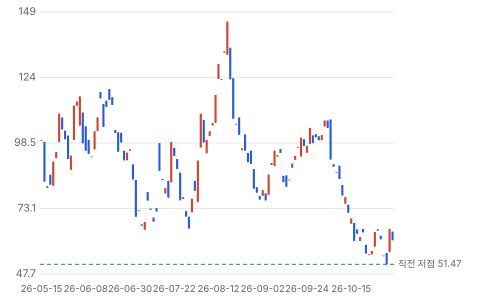

**주봉**

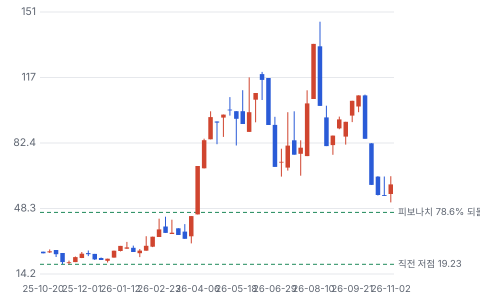

**월봉**

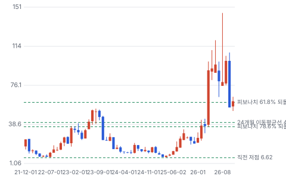

**분기 매출·EPS 실적과 컨센서스**

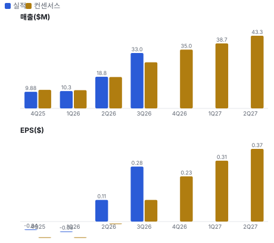

**밸류에이션 주가 시나리오**

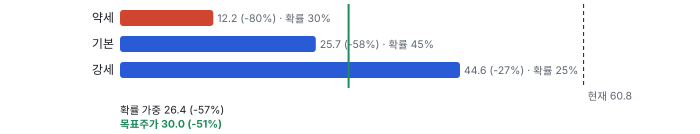

**주가별 업사이드**

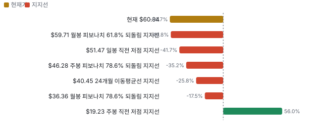

**제품·서비스 포트폴리오**

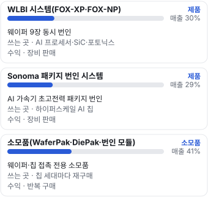

**고객 믹스(FY26, 매출 대비)**

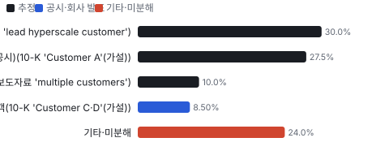

**공급 병목(10점, 낮을수록 병목)**

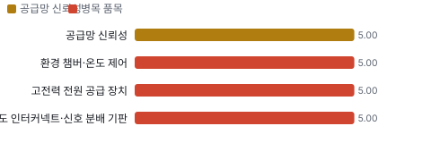

**CAPEX의 매출 대비 비중**

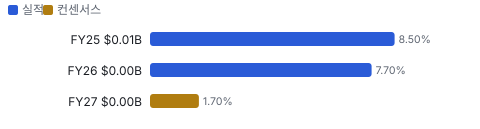

**어닝콜 변화별 주주가치 영향**

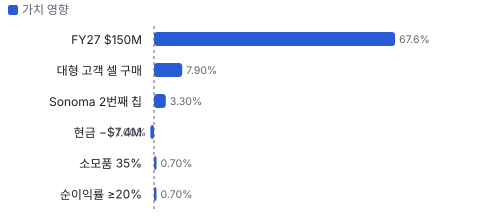

**멀티플 프리미엄**

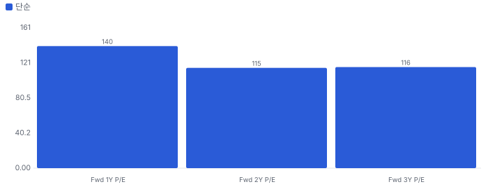

**합리적 멀티플**

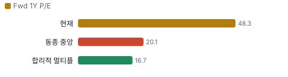

**일별 거래량 분해**

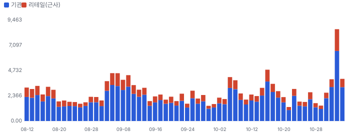

**기관 자금 흐름**

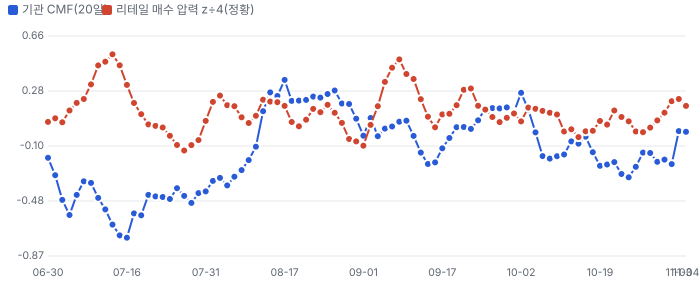

**몬테카를로**

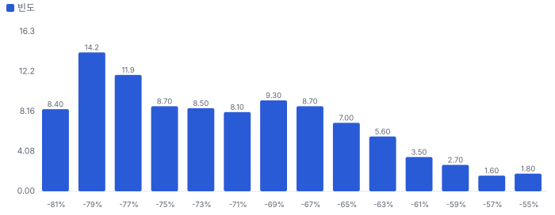

해석: 3,000번 중 0번(0%)에서 가치가 지금 주가 이상이었다. 가정을 흔들어도 지금 주가를 뒷받침하지 못하는 경우가 더 많다. 가운데 값은 0.27배이고, 열 번 중 여덟 번은 0.20~0.38배 사이에 든다.

## 내러티브

> **기업가치를 결정하는 이야기:** Fwd 1Y P/E 48.3배로 동종 4곳 중앙값 20.2배의 2.4배다. 다음 4개 분기 EPS 컨센서스 \$1.26은 회사 가이던스(비GAAP 순이익률 20% 이상)보다 높은 27% 순이익률을 깔고 있다. 가치는 FY28 이후 대형 AI 고객 양산 여부에 달렸다

> **멀티플·EPS 프리미엄**
> **멀티플:** Fwd 1Y P/E 48.3배, 동종 4곳 중앙값 20.2배(COHU 18.9·CAMT 19.8·FORM 20.5·TER 26.0)
> **EPS:** 1Q 비GAAP EPS \$0.28은 발표 전 추정 \$0.11의 2.5배. FY27 EPS 컨센서스는 \$0.735(9/11)에서 \$1.19(11/3)로 +62%

### 투자자들은 왜 열광했나

2025년 11월 \$20에서 2026년 8월 \$145까지 7배 올랐다 — 4월 3Q 실적과 ATM 뒤 AI WLBI 고객·Sonoma 하이퍼스케일 주문이 이유였다. 8월 고점 뒤 10월 말 \$55까지 빠진 원인은 공시로 확인되지 않았다(내부자 매도·업종 조정과 겹친다). 11/3 실적으로 +26.5%

### 무엇이 기업가치를 바꾸나

> **구조적 체질 변화**
> **변화:** SiC 회사에서 AI 칩 신뢰성 회사로 — SiC는 FY24 약 90%에서 FY26 약 10%로 줄었다
> **증거:** 11/2 콜 CEO 발언, 10-K
> **반증:** FY27 매출에서 AI 비중이 50% 아래

> **고부가 믹스 확장**
> **변화:** 소모품 비중 30%→41%, 비GAAP 매출총이익률 37.5%→48.5%
> **증거:** 1Q 보도자료·콜
> **반증:** 매출총이익률 40% 아래로 복귀

> **기술 혁신**
> **변화:** 웨이퍼당 수천 W를 9장 동시에 — 다중 다이 AI 칩의 패키지 전 불량 선별
> **증거:** 콜·10-K
> **반증:** 대형 장비사의 동급 웨이퍼 번인 양산 채택

> **실행 속도**
> **변화:** 잔고를 약 10개월 매출로 바꾼다. 고객이 2Q 출하분을 1Q로 당겨 달라 했고 회사가 맞췄다 **납품 리드타임 9.9개월.** 피어 비교 미확인. FY26 말(잔고 \$80.6M ÷ 4Q 월 매출 \$6.3M) 12.8개월보다 23% 짧다.
> **증거:** 콜·보도자료
> **반증:** 잔고가 늘었는데 분기 매출이 정체

> **M&A**
> **변화:** Incal(2024-07, \$22.2M) 인수로 얻은 Sonoma가 하이퍼스케일 양산에 들어갔다
> **증거:** 10-K 4번 주석, 보도자료
> **반증:** Sonoma 두 번째 칩 램프 실패

> **정책·입법 연관성**
> **재정정책:** 해당 없음(정부 보조금·CHIPS 지원 공시 없음) 10-K 검색 반증: 반도체 장비 세액공제 축소 의결 의회 동의 2/10 — 하원 1/5(회사 관련 세출 논의 없음) · 상원 1/5(같음).
> **행정명령:** 관세·수출 통제: 보도자료가 대만·동남아 지정학과 관세를 위험으로 든다. 회사 특정 조치는 확인하지 못했다 보도자료 위험 문구 반증: 대만산 반도체 장비·부품 관세 시행 의회 동의 0/10 — 하원 0/5(행정부 단독 조치) · 상원 0/5(같음).
> **연관입법:** 해당 없음(회사를 겨냥한 연방 법안 없음, 로비 공시는 키가 없어 미확인) lobby_watch 11/5 미확인 반증: 반도체 장비 대중 수출 통제 확대 의결

> **CAPEX 낙수효과**
> **변화:** AI 가속기·CPU 출하 증가가 번인 장비 수요로 온다. 고객 투자 발표를 이 회사 매출로 바로 옮기지 않는다 — 확인된 것은 잔고 \$109.3M
> **증거:** 보도자료
> **반증:** 하이퍼스케일 CAPEX 감속과 잔고 감소가 겹친다

### 내러티브 근거

> AI 칩이 여러 다이를 한 패키지에 묶으면서, 비싼 패키지를 만들기 전에 웨이퍼 단계에서 불량을 거르는 번인이 필수가 된다는 이야기다. FY27 매출을 FY26의 3배(\$150M)로 잡았고 1Q가 그 경로를 숫자로 보였다. 그러나 주가는 8월 \$145에서 10월 \$55까지 62% 빠졌다가 실적 날 26% 올랐다 — 내러티브는 맞는데 값을 얼마나 줄지가 흔들린다. 동종 대비 멀티플 차이 +140% 중 회사 고유 몫은 +189%다. 단계는 확산, 쏠림은 높음이다.

> **AI 칩 웨이퍼 번인 전환** · 강화
> **논리:** 다중 다이 AI 칩은 패키지 전 웨이퍼 단계 번인이 필요해진다
> **숫자:** 선두 고객 \$22M 후속 주문, 대형 공급사 1셀 구매
> **반증:** 대형 고객이 2027년 상반기 평가 뒤 양산을 미룬다

> **Sonoma 하이퍼스케일 램프** · 강화
> **논리:** 하이퍼스케일 고객 두 칩이 연달아 Sonoma로 간다
> **숫자:** 월 12대 넘게 출하, 두 번째 칩 인증
> **반증:** 두 번째 칩 2027년 램프 지연 또는 경쟁 장비 공동 공급

> **소모품 반복 매출** · 유지
> **논리:** 설치 기반이 커질수록 소모품이 이익률을 받친다
> **숫자:** 소모품 30% → 1Q 41% → FY27 약 35%
> **반증:** 소모품 비중이 25% 아래

> **고객 다변화** · 강화
> **논리:** 큰 주문을 줄 수 있는 고객이 손에 꼽히던 데서 12곳 넘게 늘었다
> **숫자:** 상위 5곳 93%(FY24) → 70%(FY26)
> **반증:** FY27 10-K에서 상위 1곳이 40%를 넘는다

> **반대: 값이 앞서 갔다** · 유지
> **논리:** Fwd 1Y P/E 48배는 동종 중앙의 2.4배 — 양산 판정 전에 대형 고객을 이미 넣은 값
> **숫자:** 8월 \$145 → 10월 \$55(−62%), 내부자 매도 약 \$18.9M
> **반증:** 대형 고객 양산 주문 공시

## 포트폴리오

| 제품·서비스 | 구분 | 무엇 | 쓰는 곳 | 돈 버는 방식 | Mix | Mix 변화(전년 대비) |
|---|---|---|---|---|---|---|
| WLBI 시스템(FOX-XP·FOX-NP(Aehr의 소량·엔지니어링용 번인 장비)) | 제품 | 웨이퍼 9장 동시 번인 | AI 프로세서·SiC·포토닉스 | 장비 판매 | 미확인 | 미확인 |
| Sonoma 패키지 번인 시스템 | 제품 | AI 가속기 초고전력 패키지 번인 | 하이퍼스케일 AI 칩 | 장비 판매 | 미확인 | 미확인 |
| 소모품(WaferPak(Aehr의 웨이퍼 통째 접촉용 전용 소모품(풀 웨이퍼 컨택터) — 기기마다 새로 산다)·DiePak(Aehr의 개별 다이·모듈 번인용 전용 캐리어(소모품))·번인 모듈) | 소모품 | 웨이퍼·칩 접촉 전용 소모품 | 칩 세대마다 재구매 | 반복 구매 | 미확인 | 미확인 |

## 고객

> **FY26 최대 고객 하이퍼스케일 데이터센터 고객(이름 미공시)(보도자료 'lead hyperscale customer') 30%, 상위 3곳 68%, 집중도 보통.** 공시·회사 발표로 확인한 몫은 매출의 8%이고, 나머지 고객 몫은 추정이거나 미분해다. FY26 매출 \$50.0M 중 고객 A 26.3%·B 14.2%·C 10.9%, 상위 5곳 70%(FY25 77%, FY24 93%). 회사는 이름을 밝히지 않는다. 회사 설명으로는 WLBI 선두 AI 고객, Sonoma 하이퍼스케일 고객, SiC 고객이 큰 몫이다 — 이름 연결은 가설

**고객별 매출 몫(FY26)**
| 고객 | 몫 | 변화 | 근거 |
|---|---|---|---|
| 하이퍼스케일 데이터센터 고객(이름 미공시)(보도자료 'lead hyperscale customer') | 20~40% | 미확인 | 추정 |
| AI 프로세서 WLBI 선두 고객(이름 미공시)(10-K 'Customer A'(가설)) | 20~35% | 미확인 | 추정 |
| 실리콘 포토닉스 고객(복수)(보도자료 'multiple customers') | 5~15% | 미확인 | 추정 |
| SiC·GaN(질화갈륨 — 고효율 전력·고주파 반도체 소재) 전력 반도체 고객(10-K 'Customer C·D'(가설)) | 5~12% | 미확인 | 회사 발표 |
| 기타·미분해 | 24% | - | - |

> **하이퍼스케일 데이터센터 고객(이름 미공시)(보도자료 'lead hyperscale customer')** · 추정
> **사는 것:** Sonoma 패키지 번인 시스템·번인 모듈
> **추정 근거:** 월 12대 넘게 출하 — 1Q 매출 상당 몫. 회사가 몫을 밝히지 않아 범위로 둔다

> **AI 프로세서 WLBI 선두 고객(이름 미공시)(10-K 'Customer A'(가설))** · 추정
> **사는 것:** FOX-XP 시스템·WaferPak(8월 \$22M 후속 주문)
> **추정 근거:** FY26 최대 고객 26.3%. WLBI 선두 고객의 캐파 확장과 8월 \$22M 주문으로 FY27에도 큰 몫 — 어느 알파벳인지는 가설

> **실리콘 포토닉스 고객(복수)(보도자료 'multiple customers')** · 추정
> **사는 것:** FOX-XP·FOX-NP와 WaferPak
> **추정 근거:** 1Q에 여러 고객 추가 양산 주문 — 몫 미공시

> **SiC·GaN 전력 반도체 고객(10-K 'Customer C·D'(가설))** · 회사 발표
> **사는 것:** WaferPak 소모품 위주
> **추정 근거:** CEO: FY26 매출 \$50M 중 SiC는 약 10% · 이전: FY24 SiC 약 90%

## 수주·파이프라인

> **2026-11-01 기준 4건.** 확정 \$0.13B.

**실행 속도와 방해 요인**
| 항목 | 상태 | 실행 속도 | 방해 요인 |
|---|---|---|---|
| WLBI 선두 AI 고객 후속 주문(8월) | 확정 | 주문→출하 12개월 안 | 단일 공급원 부품 |
| 회사 전체 잔고(유효) | 확정 | 잔고 ÷ 월 매출 약 10개월 | 취소·일정 변경 가능(10-K) |
| 대형 AI 가속기·CPU 공급사 FOX-XP 평가 셀 | 파이프라인 | 평가 → 양산 판정 3~6개월(회사 발언) | OSAT 환경 양산 검증 · 고객 캐파 계획 |
| 하이퍼스케일 고객 두 번째 AI 칩(Sonoma) | 파이프라인 | 미확인 | 고객 예측은 구속력 없음 |

## 마진 구조

> **GPM 47.5%, OPM 18.3%.** 1Q FY26 대비 GPM +13.5%p, OPM +55.4%p. 변동비는 매출의 53%이고, 매출이 10% 늘면 OPM은 +2.6%p 움직인다. 1Q FY27 GAAP 매출총이익률 47.5%(1년 전 8/29 분기 33.9%), 비GAAP 48.5%(37.5%). 물량과 소모품 믹스가 이유다. 연구개발 12.6%·판관비 16.6%로 영업이익률 18.3%

> **매출 100 중 매출원가 58.9, 매출총이익 41.1(최근 4분기, 공시).** 매출원가 요인 중 구매 부품·서브어셈블리(챔버·전원·인터커넥트·IC(집적회로(반도체 칩)))이 매출의 30.0%로 가장 무겁고, 단가가 +10% 오르면 GPM이 -3.00%p 움직인다. 분기 회귀로 매출 1이 늘 때 매출원가는 0.49 늘고, 매출원가의 고정비 몫은 15%다.

**비용 요인 강도 — 비중·추세·충격(+10%)·탄력**
| 비용 | 구분 | 매출 대비 | 1년 변화 | 마진 기여 | 충격 시 마진 | 매출 탄력 | 고정비 몫 |
|---|---|---|---|---|---|---|---|
| 구매 부품·서브어셈블리(챔버·전원·인터커넥트·IC) | 매출원가 요인 | 30.0% | 미확인 | 미확인 | -3.00%p | 미확인 | 0% |
| 직접 인건비·제조 간접비(프리몬트·필리핀) | 매출원가 요인 | 10.0% | 미확인 | 미확인 | -1.00%p | 미확인 | 60% |
| WaferPak·번인 모듈 소재(컨택터·기판) | 매출원가 요인 | 8.0% | 미확인 | 미확인 | -0.80%p | 미확인 | 0% |
| 보증·설치·재고 충당·기타 | 매출원가 요인 | 4.5% | 미확인 | 미확인 | -0.46%p | 미확인 | 30% |
| 매출원가 | 공시 항목 | 58.9% | -4.9%p | +4.9%p | -5.89%p | 0.49 | 15% |
| 판관비 | 공시 항목 | 27.6% | -4.8%p | +4.8%p | 미확인 | 0.14 | 50% |
| 연구개발 | 공시 항목 | 19.3% | +0.1%p | -0.1%p | 미확인 | 0.09 | 42% |

매출 탄력 = 분기 비용을 매출에 회귀한 기울기(매출 1당 변동비), 고정비 몫 = 절편 ÷ 평균 비용. 표본이 8분기 미만이면 미확인. 매출원가 요인 비중은 margin 재료의 추정이 섞여 있고, 공시 매출원가와의 차이는 '기타 매출원가'로 둔다.

**GPM에서 OPM까지(GAAP)**
| 기간 | GPM | 연구개발 | 판관비 | 기타 | OPM |
|---|---|---|---|---|---|
| 1Q FY26 | 33.9% | 26.0% | 43.0% | 2.0% | -37.1% |
| 1Q FY27 | 47.5% | 12.6% | 16.6% | 0.0% | 18.3% |

**마진을 결정하는 비용 요인 — 비용 +10% 시 OPM**
| 비용 | 매출 대비 | 변화 | 고정비 | OPM |
|---|---|---|---|---|
| 구매 부품·서브어셈블리(챔버·전원·인터커넥트·IC) | 30.0% | 미확인 | 0% | -3.00%p |
| 판매·관리비 | 16.6% | -26.4%p | 70% | -1.66%p |
| 연구개발 | 12.6% | -13.4%p | 80% | -1.26%p |
| 직접 인건비·제조 간접비(프리몬트·필리핀) | 10.0% | 미확인 | 60% | -1.00%p |
| WaferPak·번인 모듈 소재(컨택터·기판) | 8.0% | 미확인 | 0% | -0.80%p |
| 보증·설치·재고 충당·기타 | 4.5% | 미확인 | 30% | -0.46%p |

**비용을 움직이는 요인**
| 비용 | 요인 |
|---|---|
| 구매 부품·서브어셈블리(챔버·전원·인터커넥트·IC)(매출원가) | 부품 단가·외주 가공비 — 단일·소수 공급원 · 근거 추정 |
| 판매·관리비(판관비) | 인력·주식 보상 · 근거 공시 |
| 연구개발(연구개발) | 엔지니어 인력 · 근거 공시 |
| 직접 인건비·제조 간접비(프리몬트·필리핀)(매출원가) | 가동률 — 물량이 늘면 비중이 준다 · 근거 추정 |
| WaferPak·번인 모듈 소재(컨택터·기판)(매출원가) | 소모품 물량 · 근거 추정 |
| 보증·설치·재고 충당·기타(매출원가) | 설치 대수 · 근거 추정 |

**WLBI 시스템(FOX-XP·FOX-NP) BOM — 매출의 30%, GPM 40%(추정 — 제품별 이익률 미공시. 회사 1Q GAAP 매출총이익률 47.5% = 소모품 41%×약 60% + 시스템 59%×약 39%로 맞춘 값), 항목 가격 +10% 시**
| 항목 | 원가 몫 | 전가 | 제품 GPM | OPM |
|---|---|---|---|---|
| 환경 챔버·온도 제어 | 15~30% | 미확인 | -1.4%p | -0.40%p |
| 고전력 전원 공급 장치 | 15~30% | 미확인 | -1.4%p | -0.40%p |
| 고밀도 인터커넥트·신호 분배 기판 | 10~25% | 미확인 | -1.1%p | -0.31%p |
| 미분해 | 38% | - | - | - |

**Sonoma 패키지 번인 시스템 BOM — 매출의 29%, GPM 38%(추정 — 제품별 이익률 미공시. 회사 1Q GAAP 매출총이익률 47.5% = 소모품 41%×약 60% + 시스템 59%×약 39%로 맞춘 값), 항목 가격 +10% 시**
| 항목 | 원가 몫 | 전가 | 제품 GPM | OPM |
|---|---|---|---|---|
| 고전력 전원 공급 장치 | 20~35% | 미확인 | -1.7%p | -0.49%p |
| 액체·공기 냉각 열 관리 | 15~30% | 미확인 | -1.4%p | -0.40%p |
| 외주 서브어셈블리(필리핀·외주사) | 15~30% | 미확인 | -1.4%p | -0.40%p |
| 미분해 | 28% | - | - | - |

**소모품(WaferPak·DiePak·번인 모듈) BOM — 매출의 41%, GPM 60%(추정 — 제품별 이익률 미공시. 회사 1Q GAAP 매출총이익률 47.5% = 소모품 41%×약 60% + 시스템 59%×약 39%로 맞춘 값), 항목 가격 +10% 시**
| 항목 | 원가 몫 | 전가 | 제품 GPM | OPM |
|---|---|---|---|---|
| 풀 웨이퍼 컨택터 프로브·기판 | 30~50% | 미확인 | -1.6%p | -0.66%p |
| 번인 모듈 소켓·보드 | 20~40% | 미확인 | -1.2%p | -0.49%p |
| 정렬·조립 인건비 | 10~30% | 미확인 | -0.8%p | -0.33%p |
| 미분해 | 10% | - | - | - |

고전력 전원 공급 장치 가격이 +10% 오르면 영업이익은 -4.9% 움직인다. 판매가 전가를 모르는 항목은 전가 0%로 계산했다.

**BOM 항목 가격을 움직이는 것**
| 항목 | 요인 |
|---|---|
| 환경 챔버·온도 제어 | 10-K가 단일·소수 공급원 부품으로 든다 · 근거 추정 |
| 고전력 전원 공급 장치 | 웨이퍼당 수천 W — 전원 비중이 크다 · 근거 추정 |
| 고밀도 인터커넥트·신호 분배 기판 | 10-K 단일 공급원 목록 · 근거 추정 |
| 고전력 전원 공급 장치 | AI 가속기 한 개당 1kW 이상 · 근거 추정 |
| 액체·공기 냉각 열 관리 | 초고전력 번인의 핵심 · 근거 추정 |
| 외주 서브어셈블리(필리핀·외주사) | CEO: 외주사가 서브어셈블리를 더 맡는다 · 근거 추정 |
| 풀 웨이퍼 컨택터 프로브·기판 | 독점 설계 · 근거 추정 |
| 번인 모듈 소켓·보드 | Sonoma 모듈 · 근거 추정 |
| 정렬·조립 인건비 | 자체 조립 · 근거 추정 |

## 공급망 병목

> **공급망 신뢰성 5.0/10, 병목 주의.** 가장 약한 고리는 환경 챔버·온도 제어 5.0점이고, 품목 평균은 5.0점이다. 근거가 부족한 1건(외주 서브어셈블리·Sonoma 직송 생산)은 점수에서 뺐다. 약한 고리는 단일·소수 공급원 부품(환경 챔버·전원·고밀도 인터커넥트·컨택터·일부 IC)이다. 10-K가 그렇게 적고, 회사는 1Q에 장납기 부품을 미리 사들여 재고가 \$44.4M에서 \$53.1M로 늘었다. 공급사 이름은 공시하지 않는다

**병목과 마진 — 품목 가격 +10% 시 OPM**
| 품목 | 점수 | 판정 | 구분 | OPM |
|---|---|---|---|---|
| 환경 챔버·온도 제어(필수) | 5.0 | 병목 주의 | 출하 차질 위험 | -0.40%p |
| 고전력 전원 공급 장치(필수) | 5.0 | 병목 주의 | 핵심 통제 품목 | -0.90%p |
| 고밀도 인터커넥트·신호 분배 기판(필수) | 5.0 | 병목 주의 | 출하 차질 위험 | -0.31%p |

> **환경 챔버·온도 제어** · 5.0/10
> **왜:** 10-K 단일·소수 공급원 목록 · 인증 공급사 1곳은 10-K "하나 또는 소수"를 보수적으로 읽은 값(추정). 물량 확보 = FY26 10-K 현금흐름 설명의 공급사 선급금. 재인증 12개월은 업계 통상 범위의 중간(추정)
> **병목 요인:** 인증 공급사 1곳 · 캐파 균형 · 리드타임 미확인 · 재인증 12개월 · 1위 점유율 미확인 · 지역 집중 미확인 · 물량 확보 선급금
> **풀리는 조건:** 미확인

> **고전력 전원 공급 장치** · 5.0/10
> **왜:** CFO: 1Q 운전자본에 장납기 부품 구매 포함 · 인증 공급사 1곳은 10-K "하나 또는 소수"를 보수적으로 읽은 값(추정). 물량 확보 = FY26 10-K 현금흐름 설명의 공급사 선급금. 재인증 12개월은 업계 통상 범위의 중간(추정)
> **병목 요인:** 인증 공급사 1곳 · 캐파 균형 · 리드타임 미확인 · 재인증 12개월 · 1위 점유율 미확인 · 지역 집중 미확인 · 물량 확보 선급금
> **풀리는 조건:** 미확인

> **고밀도 인터커넥트·신호 분배 기판** · 5.0/10
> **왜:** 10-K · 인증 공급사 1곳은 10-K "하나 또는 소수"를 보수적으로 읽은 값(추정). 물량 확보 = FY26 10-K 현금흐름 설명의 공급사 선급금. 재인증 12개월은 업계 통상 범위의 중간(추정)
> **병목 요인:** 인증 공급사 1곳 · 캐파 균형 · 리드타임 미확인 · 재인증 12개월 · 1위 점유율 미확인 · 지역 집중 미확인 · 물량 확보 선급금
> **풀리는 조건:** 미확인

**공급사**
| 품목 | 공급사 | 몫 | 근거 |
|---|---|---|---|
| 환경 챔버·온도 제어 | 미공시(챔버 — 단일·소수 공급원(10-K)) | 미확인 | 공시 |
| 고전력 전원 공급 장치 | 미공시(전원 — 단일·소수 공급원(10-K)) | 미확인 | 공시 |
| 고밀도 인터커넥트·신호 분배 기판 | 미공시(기판 — 단일·소수 공급원(10-K)) | 미확인 | 공시 |
| 외주 서브어셈블리·Sonoma 직송 생산 | 외주 제조사(이름 미공시)(Sonoma 생산·직송, WLBI 서브어셈블리) | 미확인 | 공시 |

## 생산능력

> **현재 명목 캐파 미확인, 가동률 미확인.** 착공 이상 증설은 0 공장 면적(제곱피트)·출하 대수 — 회사는 생산 단위 캐파를 공시하지 않는다, 발표까지 합치면 0 공장 면적(제곱피트)·출하 대수 — 회사는 생산 단위 캐파를 공시하지 않는다이다. FY26 CAPEX는 \$0.00B로 매출의 7.7%다. 프리몬트 본사 51,289제곱피트(임차, 2030년 9월까지)와 필리핀 클라크 공장(임차, 2029년 6월까지). 4Q FY26에 외주사의 Sonoma 직송을 인증했고, Sonoma를 월 12대 넘게 출하한다. CEO는 \$150M 가이던스가 공급 제약이 아니라고 했다

**생산능력 확충 계획**
| 계획 | 단계 | 증설 | 가동 시점 | CAPEX |
|---|---|---|---|---|
| 프리몬트 운영 확장 | 발표 | 미확인 | 미확인 | 미확인 |

남은 계획의 CAPEX 합계는 \$0.00B(금액 미확인 1건 제외)다. 합계는 FY27 매출의 0%다.

**증설 방해 요인**
| 계획 | 방해 요인 |
|---|---|
| 프리몬트 운영 확장 | 미확인 |

**CAPEX와 매출 대비**
| 기간 | CAPEX | 매출 | 매출 대비 | 구분 |
|---|---|---|---|---|
| FY25 | \$0.01B | \$0.06B | 8.5% | 실적 |
| FY26 | \$0.00B | \$0.05B | 7.7% | 실적 |
| FY27 | \$0.00B | \$0.15B | 1.7% | 컨센서스 |

## M&A 시너지

> **Incal(Aehr가 2024년 7월 \$22.2M에 인수한 패키지 번인 장비 회사(Incal Technology)) Technology 인수(2024-07-31, \$0.02B): 시너지가 다 나면 연 \$0.01B(확률 가중 이익 기여).** 세후 시너지 가치는 통합 비용을 빼고 \$0.04B. EPS 효과는 2027년 +7.0%에서 2030년 +7.0%.

**Incal Technology 시너지가 생기는 길**
| 종류 | 시너지 | 연 규모 | 완성 | 확률 | 어떻게 생기나 | 근거 |
|---|---|---|---|---|---|---|
| 매출 | Sonoma 하이퍼스케일 양산 공급 | \$0.04B(이익률 25%) | 2027 | 50% | Aehr의 고객 영업·외주 생산 확대로 Incal의 Sonoma를 AI 칩 양산 번인에 공급(월 12대 넘게 출하) | 회사는 시너지 규모를 밝히지 않았다 — Sonoma 매출 규모는 추정 |

시너지 가치 = 세후 이익 기여 5년 + 말기 가치(할인율 9%, 성장 0) − 통합 비용. 매출 시너지는 그 매출의 이익률만 반영하고, 모든 시너지에 실현 확률을 곱했다.

## 해자

> 해자는 '웨이퍼 9장을 수천 W로 동시에 번인'하는 풀 웨이퍼 접촉 기술과, 장비를 깔면 칩이 바뀔 때마다 다시 사야 하는 독점 소모품(WaferPak)이다. 다만 대형 장비사가 같은 시장을 노리고, 고객 몇 곳이 매출의 절반을 쥔다

> **풀 웨이퍼 고전력 번인(WLBI)** · 보통
> **해자:** 자르기 전 웨이퍼 단계에서 AI 칩 초기 불량을 걸러 비싼 다중 다이 패키지 손실을 줄인다
> **근거:** 10-K·11/2 콜: 웨이퍼 9장 동시, 웨이퍼당 수천 W
> **숫자:** 특허 125건(만료 2028~2045), 출원 100건 이상
> **깨지는 조건:** 대형 장비사가 같은 처리량의 웨이퍼 번인을 양산 고객에 넣는다

> **독점 소모품 반복 구매** · 보통
> **해자:** 장비 설치 기반 위에서 칩 세대마다 WaferPak·번인 모듈을 다시 산다
> **근거:** 콜: 소모품 FY26 약 30% → 1Q 41%, SiC 고객은 1년 반 동안 소모품만 샀다
> **숫자:** FY27 소모품 약 35%
> **깨지는 조건:** 소모품 비중이 시스템 성장기에도 25% 아래로 떨어진다

> **패키지 초고전력 번인(Sonoma)** · 약함
> **해자:** 하이퍼스케일 AI 칩 양산 번인에 들어갔다
> **근거:** 월 12대 넘게 출하, 두 번째 칩 인증
> **숫자:** 고객 1곳 중심
> **깨지는 조건:** 두 번째 칩 램프에서 경쟁 장비가 공동 공급사로 들어온다

## 경영진·네트워크

> 창업자 Rhea Posedel이 1977년부터 이사회 의장(1.5% 보유), Gayn Erickson이 2012년부터 CEO(Verigy 메모리 시험 사업 총괄 출신). 10월에 Meta 인프라 부사장 출신을 이사로 들였다. 7월 이후 내부자는 장내 매도만 했다

> **Rhea J. Posedel** · 창업자·이사회 의장 · 1977
> **프로필:** 1977~2012 CEO, 2012~2013 집행 의장. UC(미국 캘리포니아대(University of California)) 버클리 전기공학. 477,714주(1.5%)
> **비즈니스:** Cohu 이사 경력(위임장)
> **정계:** 미확인
> **동문:** UC 버클리·산호세 주립대
> **사모임:** 미확인

> **Gayn Erickson** · 사장·CEO·이사 · 2012
> **프로필:** 2006~2011 Verigy 메모리 시험 사업 총괄. 259,996주. 9월 장내 40,000주 매도(약 \$5.2M)
> **비즈니스:** Verigy(현 Advantest에 합병) 출신
> **정계:** 미확인
> **동문:** 미확인
> **사모임:** 미확인

> **Narsing Vijayrao** · 이사(10/28 선임) · 2026
> **프로필:** Meta 인프라 부사장(2013~2026-08)
> **비즈니스:** 하이퍼스케일 인프라
> **정계:** 미확인
> **동문:** 미확인
> **사모임:** 미확인

**네트워크 정량화**
| 연결 | 강도 | 닿는 매출 | 가중 노출 | 매출 대비 | 근거 |
|---|---|---|---|---|---|
| 비즈니스: 이사 Vijayrao — 전 Meta 인프라 부사장 | 2/5 | \$0.00B | \$0.00B | 0% | 하이퍼스케일 고객 이름은 공시되지 않았다. 이사 선임이 매출을 만든다고 쓰지 않는다 https://www.sec.gov/Archives/edgar/data/1040470/000165495426009242/aehr_8k.htm |
| 비즈니스: CEO의 Verigy(메모리 시험) 경력 | 2/5 | \$0.00B | \$0.00B | 0% | 업계 경력 연결이며 매출 연결 근거 없음 https://www.sec.gov/Archives/edgar/data/1040470/000165495426008222/aehr_def14a.htm |

가중 노출은 연결이 닿는 매출의 크기다. 연결이 그 매출을 만들었다는 뜻이 아니며, 인과는 공개 자료로 입증하지 못한다.

## 약세 논리 및 셀온 조건

| 약세 논리 | 근거 | 반박 | 가를 자료 |
|---|---|---|---|
| 값이 양산 판정을 먼저 샀다 | Fwd 1Y P/E 48.3 vs 동종 20.1, 요구 5년 CAGR 52% vs 기본 17% | 1Q가 추정의 2.5배, FY27 잔고 커버 93% | 대형 고객 FOX-XP 양산 주문 공시(2027-03~06) |
| 고객 몇 곳이 매출을 쥔다 | FY26 고객 A·B·C 26.3·14.2·10.9%, 상위 5곳 70%(10-K) | 상위 5곳 93%(FY24) → 70%(FY26), 큰 주문 잠재 고객 12곳 넘음(보도자료) | FY27 10-K 10% 고객 표(2027-08) |
| 잔고는 취소 가능하다 | 10-K: 주문 대부분 적은 위약금으로 취소·일정 변경 가능 | 고객이 오히려 출하를 당겨 달라 했다(콜) | 2Q 잔고·수주(2027-01 실적) |
| 전례: 고객 하나가 빠지면 반토막 | FY24 상위 2곳 84% → SiC 둔화로 매출 \$66M → \$59M → \$50M | SiC는 FY26 약 10%로 줄었다 | 분기 수주의 고객 수 언급 |
| 현금이 운전자본에 묶인다 | 1Q 영업현금흐름 −\$3.1M(매출채권 +\$10.7M·재고 +\$9.0M) | 현금 \$105M·차입 0, 장납기 부품 선구매(CFO) | 2Q 영업현금흐름 |
| 내부자는 팔았다 | 7월 이후 장내 매도 약 \$18.9M(CEO 40,000주 \$5.2M 포함), 장내 매수 0건 | RSU 원천징수 매도가 섞여 있고, 장내 매도는 보유분 일부 | 다음 분기 Form 4 |

데이터 공백: 1Q FY27 10-Q가 아직 나오지 않아(기한 11/9) 고객별 매출·잔고 이행 기간·구매 약정은 FY26 10-K 기준이다. 제품별 이익률과 WLBI·Sonoma 매출 몫은 회사가 공시하지 않아 추정이다. 컨센서스 분기 추정의 표본은 1~2명이고, 회계연도 변경으로 옛 분기 추정과 한 달씩 어긋난다. 8~10월 주가 하락의 원인은 공시로 확인하지 못했다.

> **셀온 조건**
> **조건 1:** 대형 AI 가속기 공급사의 OSAT 평가 판정이 2027년 하반기로 밀리거나 양산을 다른 방식(시스템 레벨 시험)으로 정한다
> **조건 2:** 2Q FY27 매출이 \$30M 아래이거나 잔고가 두 분기 연속 줄어든다
> **조건 3:** 하이퍼스케일 고객 두 번째 칩 램프에 경쟁 번인 장비가 공동 공급사로 들어온다
> **조건 4:** 소모품 비중이 25% 아래로 떨어지고 비GAAP 매출총이익률이 40% 아래로 돌아간다
> **조건 5:** 새 ATM·증자로 주식 수가 5% 넘게 늘어난다

## 어닝콜 변화

**직전 콜 대비 새로 나오거나 바뀐 내용 → 가치 영향**
| 항목 | 내용 | 직전 콜 | 최신 콜 | 모델 동인 이동 | 확신도 | 가치 영향 |
|---|---|---|---|---|---|---|
| 업데이트 | FY27 매출 가이던스 | \$130~150M(7/14) | \$150M(11/2) | 기준연도 매출 +\$0.07B | 0.8 | +67.6% |
| 신규 | 비GAAP 순이익률 하한 | 숫자 없음 | FY27 비GAAP 순이익 매출의 20% 이상 | 출발 이익률 +3.0% | 0.8 | +0.7% |
| 업데이트 | 벤치마크 고객 | 벤치마크 통과·파일럿 관심(7월) | FOX-XP 1셀 구매, 대만 OSAT 2027년 초 설치 | 장기 성장 수렴값 +2.0% | 0.3 | +7.9% |
| 업데이트 | Sonoma 두 번째 칩 | 두 번째 칩용 구매 확대 예측 | 두 번째 칩 인증 통과·초기 생산 주문, 2027년 램프 | 1년차 성장률 +3.0% | 0.5 | +3.3% |
| 신규 | 소모품 비중 | FY26 약 30% | FY27 약 35%(1Q 41%) | 목표 이익률 +1.0% | 0.5 | +0.7% |
| 부정 | 운전자본 | 5/29 현금 \$116.5M | 9/25 \$105.1M — 매출채권·재고 증가 | 매출÷투하자본 -10.0% | 1.0 | -1.0% |
| **합계** | 단독 합 |  |  | 동시 적용 +85.2% |  | **+79.1%** |

**해석:** 이 기간 주가 -15.5% 중 EPS 추정 변화가 +49.2%, 멀티플 변화가 -43.4% — 주가를 움직인 것은 **이익 추정 하향**이다. 이익 추정은 오르는데 주가가 내렸다면 시장은 숫자가 아니라 지속성·위험(할인율)을 다시 매긴 것이다.

## P·Q 사이클

> **10년 위치: Q형 기업(매출 갭 분산의 0%가 가격) — 가격은 추세 대비 -1.2%(수축, 10년 분위 15%), 물량은 +8.5%(확장, 분위 60%). P 프리미엄 -3%, Q 프리미엄 +12%(매출총이익이 정상(추세) 수준보다 요인별로 이만큼 높거나 낮다).** AR(2) 전망으로 P 프리미엄은 4분기 뒤 -1%·8분기 뒤 +1%(+로 반전), Q 프리미엄은 +47%·-4%(−로 반전).

**10년 P·Q 사이클 위치·프리미엄**
| 항목 | 가격(P) | 물량(Q) |
|---|---|---|
| 추세 대비 갭(현재) | -1.2% | +8.5% |
| 사이클 시계 | 수축 | 확장 |
| 10년 분위 | 15% | 60% |
| 프리미엄(현재) | -3% | +12% |
| 프리미엄 4분기 뒤 | -1% | +47% |
| 프리미엄 8분기 뒤 | +1% | -4% |
| 갭 반감기 | 4분기 | 7분기 |

방법: P = 가격 지수 4분기 평균(미국 PPI(생산자물가지수) 반도체 제조 장비 대용 — 회사 판매가가 아니라 업종 가격), Q = TTM 매출 ÷ P. 추세는 로그 레벨의 HP(호드릭-프레스콧 추세 필터) 필터(λ 1600)로 정상(mid-cycle) 수준을 잡는다. 프리미엄 = 요인별 매출총이익 증분 ÷ 정상 매출총이익(정상 GPM 40.5% = 10년 중앙값, 물량 증분 마진 56.6% = 전년 대비 ΔGP(매출총이익)÷ΔRev 회귀, 가격은 전액 이익 반영). 표본 40개 TTM 분기. 전망은 갭의 AR(2) 통계 외삽이며 가이던스·컨센서스가 아니다. HP 필터는 끝점에서 추세가 최근 값 쪽으로 끌려 현재 갭을 작게 볼 수 있다.

> **Q 사이클 — 최근 4분기 평균 가격 기여 +0.8%, 물량 기여 +11.9%(전년 대비 로그 증가율).** P 강도 4.0/10, Q 강도 4.9/10, 최근 8분기 중 38%가 같은 요인 우세(순환적). AR(2) 투영으로는 8분기 안에 전환 신호가 없다.

**P·Q 사이클 정량**
| 항목 | 가격(P) | 물량(Q) |
|---|---|---|
| 최근 4분기 평균 기여 | +0.8% | +11.9% |
| 강도(0~10, 자기 이력 z) | 4.0 | 4.9 |
| AR(2) 고유 주기 | 10.9분기 | 11.0분기 |
| 다음 4분기 투영 평균 | +2.3% | +37.6% |

가격 근거: 미국 PPI 반도체 제조 장비 대용 — 회사 판매가가 아니라 업종 가격. PPI를 쓰면 회사 판매가가 아니라 업종 가격 대용이다. 로그 증가율이라 가격·물량 기여의 합이 매출 증가율이다. 투영은 통계 외삽이며 가이던스·컨센서스가 아니다. 회사 판매가로 잴 수 없는 이유: 회사는 출하 대수·단가를 공시하지 않는다. 매출은 고객별 장비 주문 물량이 정한다(Q형 추정이나 잴 수 없음)

## 밸류에이션

> **목표주가 \$30, 업사이드 -51%.** 자리는 기본과 강세 사이(강세 쪽 23%)이고 도달 확률은 약 40%다. 기본 \$26, 강세 \$45(-27%), 약세 \$12(-80%). DCF 기준 업사이드는 기본 -66%, 강세 -74%, 약세 -79%다(WACC 11.1%).

배수 기준 기본 \$26과 DCF 기본 업사이드 −66%는 같은 방향이다. 차이는 두 가지다. 첫째, 배수는 다음 4개 분기 EPS \$12.6K 보므로 Fwd 2Y EPS가 +37% 더 크는 경로를 반영하지 않는다 — 그래서 Fwd 2Y P/E 35.2배를 쓰면 기본 값이 올라간다. 둘째, DCF는 컨센서스대로 FY28 이후 성장이 21%·감속으로 내려가고 장기 영업이익률이 25~30%에 머문다고 본다(자기자본비용 11.1%, 베타 3.3 반영). 지금 주가는 5년 매출 CAGR 52%를 요구한다 — FY26 \$50M에서 5년 뒤 약 \$400M이다. 이는 FY29 컨센서스 상단 \$370M보다 높다. 약세 \$12는 EPS \$0.80에 동종 하단 배수를 곱한 값이다.

> **약세 \$12 (-80%)** · 확률 30%
> **가정:** 15.3배 × EPS \$0.80
> **근거:** 대형 AI 가속기 공급사가 2027년 상반기 OSAT 평가 뒤 양산을 미루고, 하이퍼스케일 두 번째 칩 램프가 늦어 FY28 매출이 FY27 수준(\$150M)에 머문다. 비GAAP 순이익률은 하한 20% 근처

> **기본 \$26 (-58%)** · 확률 45%
> **가정:** 20.4배 × EPS \$1.26
> **근거:** 잔고 출하로 FY27 \$150M, 두 번째 Sonoma 칩이 2027년 램프, 대형 고객은 일부 양산. 다음 4개 분기 EPS 컨센서스 \$1.26과 같은 높이

> **강세 \$45 (-27%)** · 확률 25%
> **가정:** 25.5배 × EPS \$1.75
> **근거:** 대형 고객이 2027년 1~3월 데이터로 WLBI 양산을 정하고 소모품이 40%대를 지켜 FY28 매출이 \$250M 안팎. FY28 EPS 추정 상단 쪽

**멀티플 선정 — Fwd 1Y P/E**
| 단계 | 조정 | 근거 |
|---|---|---|
| 동종 중앙값 | 20.1배 | 범위 18.9~26.0배, 4곳 |
| 펀더멘털 | -9% | 성장·이익률·ROIC로 본 합리적 멀티플 16.7배와의 차이의 일부만 인정 |
| 해자 | +2% | 풀 웨이퍼 고전력 번인(WLBI) 보통 · 독점 소모품 반복 구매 보통 · 패키지 초고전력 번인(Sonoma) 약함 |
| 반복 매출 | +4% | 반복 매출 35%(동종 20%) · 소모품(WaferPak·DiePak·번인 모듈) · 이미 반복 단계 · 기반 설치된 FOX(Aehr의 웨이퍼·다이 번인 장비 제품군)·Sonoma 시스템 수(대수 미공시, '수천 대 설치' 회사 소개) |
| 수주 전환·가시성 | +9% | 잔고 커버리지 0.90 · book-to-bill 1.00 · RPO(잔여 이행 의무(계약 잔고)) 12개월 1.00 · RPO·ACV(연간 계약 가치) 성장 − 매출 성장 1.00 → 가시성 0.96(감점 0.01) · 전환 9.9개월(동종 12) |
| 내러티브 | +5% | 단계 확산 |
| 사이클·실행 판단 | -10% | 고객 3곳이 FY26 매출의 51%이고 대형 고객의 양산 결정(2027년 초 설치 후 수개월)이 아직 나지 않았다. 매출 \$72M 규모의 단일 장비 회사라 실행·고객 집중 할인을 둔다 |
| **선정** | **20.4배** | 지금 48.3배 |

**동종 레인지**
| 회사 | Fwd 1Y P/E | Fwd 2Y P/E | Fwd 3Y P/E | 성장 | 영업이익률 | ROIC |
|---|---|---|---|---|---|---|
| TER | 26.0 | 20.6 | 18.5 | 16% | 30% | 36% |
| FORM | 20.5 | 16.1 | 13.7 | 28% | 31% | 45% |
| COHU | 18.9 | 12.3 | 10.7 | 39% | 19% | 24% |
| CAMT | 19.8 | 16.6 | 14.2 | 46% | 35% | 48% |
| **Aehr Test Systems** | 48.3 | 35.2 | 30.1 |  |  |  |

지금 주가가 요구하는 5년 매출 CAGR 52%, 기본 시나리오 17%. 몬테카를로 중앙값 업사이드 -73%.

> 의사결정 보조(투자자문 아님): ① 매수 매력: 연 기대수익 -15.1% (자기자본비용 11.1% 대비 -26.2%p) · 자본비용 초과 확률 0% · 안전마진 0.20 → 정량 신호 약함 / ② 위험 예산 지표(이론): 0% — 기대수익이 자기자본비용에 못 미침(무위험 대비 켈리 0%는 참고) · 5년 하위10% -70% · 30%+ 손실 확률 98% / ③ 상방(5년): 기대 0.44배 · 2배 0% · 3배 0% · 10배 0% · 상위10% 0.61배

## 매수 위치(일봉)

> **현재가 \$60.84는 '중간'(가장 가까운 일봉 지지 \$51.47에서 ATR 1.9배 위).** 이 자리에서 목표주가까지 -50.7%, 첫 일봉 저항까지 +7.0%, 다음 지지까지 하방 -15.4%, 손익비 -3.3배.

**가격대별 업사이드(일봉 기준)**
| 가격대 | 가격 | 목표주가까지 | 첫 저항까지 | 다음 지지까지 | 손익비 | 근거 기법(강도) |
|---|---|---|---|---|---|---|
| 현재가 | \$60.84 | -50.7% | +7.0% | -15.4% | -3.3 | - |
| 지지 1 | \$51.47 | -41.7% | +26.5% | 미확인 | 미확인 | 120일 지그재그 저점 · 스윙 저점(1.8) |

**일봉 저항**
| 저항 | 가격 | 현재가 대비 | 근거 기법(강도) |
|---|---|---|---|
| 저항 1 | \$65.10 | +7.0% | 120일 지그재그 저점 · 20일선 · 피보 23.6%(2.3) |
| 저항 2 | \$72.92 | +19.9% | 피보 38.2%(1.0) |
| 저항 3 | \$74.87 | +23.1% | 200일선(1.0) |

일봉만 쓴다(주봉·월봉 제외). 손익비 = 목표주가까지 업사이드 ÷ 다음 지지까지 하방. 가격대별 기대값 참고표이며 매수·매도 시점 지시가 아니다.

## 애널리스트 토론

> **토론 결론 Sell(규칙 등급 Strong Sell).** 강세 5조차 현재가 아래라는 반박은 살아남았다. 다만 규칙은 다음 4개 분기 EPS에 동종 중앙 배수를 곱해, Fwd 2Y EPS가 +37% 더 크는 경로(Fwd 2Y P/E 35.2배)를 덜 본다는 반박도 살아남았다. FY27이 잔고로 덮였고 차입이 없어 Strong Sell의 약세 2(−80%)는 판정 실패가 겹친 경우에 가깝다 — 한 단계 올려 Sell

**패널(가상 애널리스트)**
| 자리 | 애널리스트 | 핵심 논리 | 틀리는 조건 | 최종 투표 |
|---|---|---|---|---|
| Strong Buy | 윤태오(가상 리서치 하우스 해온증권) | FY27 매출 3배가 잔고로 거의 덮였고, 대형 AI 고객 하나만 양산에 들어와도 FY28 추정이 다시 오른다 | 2027년 상반기 대형 고객 양산 보류 | Neutral |
| Buy | 서민하(가상 리서치 하우스 다솜투자) | 이익 추정이 주가보다 빨리 오른다 — 주가는 8월보다 58% 낮은데 FY27 EPS 추정은 62% 올랐다 | 2Q 매출이 \$30M 아래 | Neutral |
| Neutral | 강도윤(가상 리서치 하우스 누리자산) | 좋은 회사이지만 48배는 양산 판정 전 값이다. 판정(2027년 1~3월 데이터) 전에는 위아래가 다 열려 있다 | 판정 전 대형 고객 양산 주문 공시 | Sell |
| Sell | 문서진(가상 리서치 하우스 한결증권) | 고객 3곳이 51%이고 잔고는 취소 가능하다. 내부자는 고점 근처에서 팔았다 | FY27 상위 고객 비중이 40% 아래로 분산 | Sell |
| Strong Sell | 임하준(가상 리서치 하우스 바른리서치) | 장비 회사 사이클 고점 이익에 48배다. 2024년 SiC 고객이 빠지자 매출이 반토막 난 전례가 있다 | FY28 매출 컨센서스 \$210M 이상이 두 분기 유지 | Strong Sell |

**투표**
| Strong Buy | Buy | Neutral | Sell | Strong Sell |
|---|---|---|---|---|
| 0 | 0 | 2 | 2 | 1 |

> **개회 · Strong Buy**
> **발언:** 남은 3개 분기 매출 \$117M 중 \$109M이 이미 잔고다. 가이던스는 공급 제약도 아니라고 회사가 답했다

> **개회 · Buy**
> **발언:** FY27 EPS 추정이 9월 \$0.735에서 \$1.19로 올랐는데 주가는 8월 고점의 42%다

> **개회 · Neutral**
> **발언:** Fwd 1Y P/E 48배는 동종 중앙 20배의 2.4배다. 대형 고객 양산 판정은 2027년 초에야 나온다

> **개회 · Sell**
> **발언:** 10-K는 잔고가 취소·일정 변경 가능하다고 적는다. 고객 3곳이 FY26 매출의 51%다

> **개회 · Strong Sell**
> **발언:** FY24 고객 2곳 84%가 SiC 둔화로 빠지자 FY25·FY26 매출이 \$66M→\$59M→\$50M으로 줄었다

> **반박1 · Neutral → Strong Buy**
> **발언:** 잔고는 FY27을 덮지만 48배는 FY28 이후를 산 값이다. FY28 추정 \$210M은 표본이 얇다

> **반박1 · Buy → Strong Sell**
> **발언:** SiC 시절과 달리 큰 주문을 줄 고객이 12곳 넘는다고 회사가 말했고, 상위 5곳 비중은 93%에서 70%로 내려왔다

> **반박1 · Strong Buy → Sell**
> **발언:** 소모품 41%는 설치 기반에서 나온다 — 시스템 주문이 쉬어도 매출 바닥이 있다

> **반박1 · Sell → Buy**
> **발언:** 목표가는 실적 뒤 오히려 내려갔다. 셀사이드도 배수를 낮췄다

> **반박1 · Strong Sell → Neutral**
> **발언:** 1Q 영업현금흐름이 −\$3.1M이다. 매출채권과 재고가 \$19.7M 늘었다

> **반박2 · Strong Buy → Strong Sell**
> **발언:** 현금 \$105M에 차입이 없다. 운전자본 증가는 장납기 부품 선구매라고 CFO가 설명했다

> **반박2 · Neutral → Buy**
> **발언:** EPS 추정 \$1.19는 순이익률 27% 가정이다. 회사가 말한 하한은 20%다

> **반박2 · Sell → Strong Buy**
> **발언:** 벤치마크 고객은 1셀 구매다. 양산 결정은 설치 뒤 수개월 — 아직 매출이 아니다

> **반박2 · Buy → Sell**
> **발언:** 목표가 하향은 주가 급락을 따른 것이고 이익 추정은 올랐다

> **반박2 · Strong Sell → Strong Buy**
> **발언:** 공매도 18%·베타 3.3 — 판정이 늦어지면 하방이 크다

> **최종 · Strong Buy**
> **발언:** 잔고·소모품·두 번째 Sonoma 칩이 FY27을 받친다

> **최종 · Buy**
> **발언:** 추정 상향 대비 주가 하락으로 배수가 반 가까이 줄었다

> **최종 · Neutral**
> **발언:** 판정 전에는 규칙 등급을 옮길 근거가 부족하다

> **최종 · Sell**
> **발언:** 고객 집중과 취소 가능한 잔고는 그대로다

> **최종 · Strong Sell**
> **발언:** 48배는 고점 이익의 값이다

남은 반대 의견: Neutral 자리: 대형 고객 양산 판정(2027년 1~3월 데이터) 전에는 위아래가 다 열려 있다

패널은 가상 인물이고 실존 IB의 의견이 아니다.

## 시장 평가

> **셀사이드(IB 애널리스트)**
> **한 줄:** 셀사이드는 전원 매수 쪽이지만 실적 직후 목표가를 내렸다 — 주가 급락을 따라간 하향이며, 이익 추정은 올랐다
> **의견 분포:** Strong Buy 6·Hold 1 — 7명
> **목표가:** \$121(범위 \$110~140) — 현재가 대비 +99%
> **실적 뒤 목표가:** Lake Street \$110→\$90, Jefferies 하향(\$140) — 가이던스 상향에도 목표 하향

> **바이사이드(기관 투자자)**
> **한 줄:** 장기 펀더멘털 펀드보다 퀀트·마켓메이커 비중이 크고, 내부자는 고점 부근에서 팔았다
> **13F 기관(2Q26):** 240곳, 순감 53만 주 — 증가 61·감소 67
> **순매수 상위:** Two Sigma·D. E. Shaw·JPMorgan(미국 투자은행 JP모건)·Jane Street — 퀀트·마켓메이커 위주
> **5% 주주:** BlackRock 6.4%·Jane Street 5.0%
> **내부자:** 7월 이후 장내 매도만 약 \$18.9M(CEO \$5.2M 포함) — 장내 매수 0건

> **언론·업계**
> **한 줄:** 커뮤니티 매체는 '매출 3배'에 맞춰져 있다 — 양산 판정 같은 다음 관문은 덜 다룬다
> **보도 초점:** AI 수주·매출 3배, 'beat and raise' — Motley Fool·Seeking Alpha·Benzinga

## 체크리스트

| 시점 | 무엇 | 의미 |
|---|---|---|
| 2026-11-09(기한) | 1Q FY27 10-Q | 고객별 매출·잔고 이행 기간·구매 약정·제한 현금 — 집중도가 FY26보다 나아졌는지 |
| 2026-11 중순 | 3Q 13F(미국 기관투자자 분기 보유 공시) | 퀀트·마켓메이커 외 장기 펀드가 하락 구간에 들어왔는지 |
| 2027-01 초(예상) | 2Q FY27 실적 | 하이퍼스케일 출하가 잔고대로 나왔는지, 2Q 수주·B/B |
| 2027-01~03 | 대형 고객 FOX-XP 대만 OSAT 설치·데이터 | 양산 판정의 재료 — 회사가 설치 완료를 알리는지 |
| 2027-03~06 | 대형 고객 양산 주문 여부 | 48배의 전제가 맞는지 가르는 사건 |
| 2027-08(예상) | FY27 10-K | 10% 고객 표·소모품 비중·FY28 가이던스 |

## 출처
- 1Q FY27 실적 8-K(EX-99.1) https://www.sec.gov/Archives/edgar/data/1040470/000165495426009385/aehr_ex991.htm
- 4Q FY26 실적 8-K(EX-99.1) https://www.sec.gov/Archives/edgar/data/1040470/000165495426006655/aehr_ex991.htm
- FY2026 10-K https://www.sec.gov/Archives/edgar/data/1040470/000165495426006919/aehr_10k.htm
- 2026 위임장 https://www.sec.gov/Archives/edgar/data/1040470/000165495426008222/aehr_def14a.htm
- ATM 소진 8-K https://www.sec.gov/Archives/edgar/data/1040470/000165495426003746/aehr_8k.htm
- 이사 선임 8-K https://www.sec.gov/Archives/edgar/data/1040470/000165495426009242/aehr_8k.htm
- 1Q FY27 어닝콜(2026-11-02) — 요지만 자기 말로
- 1Q FY27 어닝콜(2026-11-02) 질의응답 요지
- https://www.sec.gov/Archives/edgar/data/1040470/000165495426006919/aehr_10k.htm
- https://www.sec.gov/Archives/edgar/data/1040470/000165495426009385/aehr_ex991.htm

_구매 등급·목표주가 모두 규칙이 계산한 모델 값으로, 개인의 보유 종목·자금 사정을 반영하지 않는다 · 공개 자료 기반 분석이며 투자 권유가 아님 · 1차 판정, 미검증 · Chiip ten-bagger_