# 텐배거 리포트 2026-11-05 — Cipher Digital — 계약 임대료 \$16.6B를 쥐었지만 지분은 차입 \$6.7B 위의 얇은 층이다

> 2026-11-05 · Cipher Digital(CIFR) · 기업: 텍사스 비트코인 채굴장을 AI·HPC 데이터센터로 바꿔 하이퍼스케일러에 15~20년 임대하는 미국 회사(옛 Cipher Mining)

## Chiip View

주가는 6/18 고점 \$29.18에서 11/4 \$6.50까지 78% 빠졌다. 시가총액은 \$3.25B(완전 희석 기준, 기본 주식 기준 \$2.97B)다. 3Q26 매출 \$26.7M은 컨센서스를 32% 밑돌았지만 첫 HPC(고성능 컴퓨팅 — AI 학습·추론용 GPU 서버를 돌리는 데이터센터 수요(High-Performance Computing)) 임대 매출 \$5.85M이 들어왔고, Barber Lake(Cipher의 텍사스 콜로라도시티 HPC 캠퍼스 — Fluidstack 임대, Google 보증 구조, 20년으로 연장) 임대를 20년으로 늘려 계약 매출이 약 \$16.6B(700MW, 가중 17.3년)가 됐다. 엔진 규칙 등급은 Sell(목표주가 \$5, −22%)이고 애널리스트 토론이 한 단계 올려 Neutral이다. **우리가 다르게 보는 곳은 '주가가 계약 임대 가치보다 싸다'는 읽기다.** 지분은 차입 \$6.7B 위의 얇은 층이다. 순부채는 회사 기준(제한 현금 포함) 약 \$3B지만, 제한 현금 약 \$3.0B는 건설에 쓰이므로 완공 뒤 지분 기준 순부채는 약 \$6.0B다. 그 기준으로 지금 가격은 안정화 NOI(순영업이익 — 임대 매출에서 시설 운영비를 뺀 값(Net Operating Income)) \$864M을 자본화율 9.4%로 매기고 6GW 파이프라인엔 값을 거의 주지 않는다. 자본화율 1%p가 지분 가치를 약 \$1B(시총의 약 3분의 1) 움직이므로, 판단은 '계약이 있느냐'가 아니라 '조달 금리와 비용이 더 나빠지지 않느냐'에 달렸다. 경쟁 가설 ① 하락은 Cipher 고유 문제(비용 초과·희석)다 — 가를 자료: 4Q26 10-K 캠퍼스별 건설 약정·유형자산(2027-02 하순) ② 하락은 업종 재평가(KBW(미국 금융 전문 증권사 Keefe, Bruyette & Woods)의 업종 목표가 재설정, AI 인프라 신용 재가격)다 — 가를 자료: 다음 프로젝트 채권 금리(Stingray(Cipher의 세 번째 계약 HPC 캠퍼스(텍사스) — 외장 구조물 4Q26 완공 예정) 6% 대비, 2027 상반기). 중간선거 영향 0.0/10 — 업종 표에 데이터센터 임대 채널이 없어 재료 없음으로 잰다. 정책 0단계(선거 결과) 가설이고 하원 결과는 미확정이다.

## 대시보드
| 항목 | 값 | 설명 |
|---|---|---|
| 주가 | \$6.50 | 고점 대비 -78% · 1년 -71% |
| 시가총액 | \$3.25B | 완전 희석 기준 · EV \$9.22B |
| 업사이드 | -22% | 목표주가 \$5 · 다운사이드 -112% · 손익비(강세÷약세) 1.1 |
| 구매등급 | Neutral | 애널리스트 22명: Strong Buy 17 · Buy 1 · Neutral 4 · Sell 0 · Strong Sell 0 |
| 멀티플 | Fwd 1Y EV/EBITDA 40.2배 | 동종 중앙값 17.8배 |
| 가이던스 4Q26 |  | 컨센서스 \$101M |
| 알파 | 5.0/10 | 텐배거 가능성 점수 |
| 이벤트 | Colchis·Mikeska 1GW 조건부 기저부하 최종 분류(ERCOT, 회사 예상 12월) — 날짜는 회사가 밝힌 '12월'의 중간으로 둔 추정. 4Q26 실적은 2027년 2월 말(작년 2/24) | 2026-12-15 |

## 한 장 요약
- **기업가치를 결정하는 내러티브** Cipher Digital(CIFR)은 텍사스 채굴장을 AI 데이터센터로 바꿔 AWS(아마존 웹서비스 — 아마존의 클라우드 사업)·Fluidstack(Google 보증)에 15~20년 빌려주는 회사다. 계약 700MW·계약 매출 약 \$16.6B가 있지만 3Q 매출은 \$26.7M에 그쳤고, 첫 계약의 비용 초과(\$359M)와 전환사채 \$850M이 겹치며 주가는 6월 고점 대비 −78%다
- **밸류에이션 모델로 본 주가 상방은 어디까지인가?** **목표주가 \$5(-22%), 약세와 기본 사이(약세 쪽 20%)다.** 강세 \$15(+126%)는 Fwd 1Y EV/EBITDA 15.5배를 강세 EBITDA에 적용한 값이다. 기본 \$7, 약세 \$-1. 손익비 1.1, DCF 기준 업사이드 -156%.
- **수주는 어디까지 왔나?** Barber Lake(Fluidstack, 20년) 17%, 100% 매출 \$9.10B · Black Pearl(AWS, 15년) 6%, 100% 매출 미확인 · Stingray 0%, 100% 매출 미확인. 계약 3개 캠퍼스 700MW, 계약 매출 약 \$16.6B. 건별 인도 MW(메가와트 — 데이터센터 IT 용량 단위)만 일부 공개된다
- **누가 사 주나?** 최대 고객 비트코인 네트워크(채굴 보상)(채굴 매출) 78%, 상위 3곳 100%. 공시·회사 발표로 확인한 몫은 78%다.
- **마진과 공급망은 어디가 약한가?** GPM -101.9%, OPM -269.3%. OPM을 가장 흔드는 BOM(제품 원가를 이루는 부품·재료 명세) 항목은 전력(텍사스 PPA(전력 구매 계약(Power Purchase Agreement)))이고 가격 +10%에 -3.96%p다. 공급망 신뢰성은 1.0/10(병목 심각)이고 가장 약한 고리는 계통 전력(ERCOT(텍사스 전력망 운영 기관(Electric Reliability Council of Texas)) 연결)이다.
- **생산능력은 얼마나 늘어나나?** 현재 명목 캐파 69 IT MW(HPC 인도 기준), 착공 이상 증설 531 IT MW(HPC 인도 기준). FY2028 CAPEX는 매출의 260.9%다.
- **지금 가격은 무엇을 가정하나?** 기준이 둘이라 먼저 밝힌다. 회사 기준 순부채는 약 \$3B(제한 현금 포함)이고, 지분 기준 순부채는 약 \$6.0B(제한 현금 약 \$3.0B는 건설 전용이라 뺀다)다. 지분 기준으로 완공 뒤 기업가치는 약 \$9.2B(완전 희석 시총 \$3.25B + 차입 \$6.7B − 무제한 현금 \$0.72B)이고 안정화 NOI \$864M의 10.7배, 자본화율 9.4%다. Fwd 1Y EV/EBITDA 40.2배는 인도 초기라 의미가 작다. Fwd 2Y(4Q27~3Q28 EBITDA 컨센서스 \$793M)는 지분 기준 순부채로 11.6배(멀티플 표의 9.8배는 표준화 재무의 순부채 기준)이고 동종(CORZ(미국 채굴·HPC 임대 회사 Core Scientific) 15.1·APLD(미국 데이터센터 개발 회사 Applied Digital) 17.8·WULF(미국 채굴·HPC 임대 회사 TeraWulf) 21.8배, Fwd 1Y)보다 낮다. 가격은 계약 700MW의 임대료를 업계보다 높은 자본화율로 매기고, 계약 전 6.1GW 부지에는 값을 거의 주지 않는다. DCF(WACC 7.7%)로는 지분 가치가 음수다 — 장기 투하자본 수익률 5~6%가 할인율보다 낮게 나오기 때문이다.
- **왜 움직였나?** 6월 18일 \$29.18에서 11/4 \$6.50까지 −78%다. 하락은 네 단계였다. ① 8/4 2Q 실적: 매출 \$24.8M이 추정 \$29~32M을 밑돌고 EPS −\$0.65(워런트 평가손실 \$151M) — 다음 날부터 8월 말까지 −36%. ② 10/13 전환사채 발행 발표(8-K): 당일 −12.8%, 거래량 128M주로 평소의 4배 — 2032년 0% 전환사채 \$850M(전환가 \$15.31)과 캡드콜이 붙었고 전환사채 매수자의 헤지 매도가 이어졌을 가능성이 크다(정황). ③ 11/2 3Q 실적: 매출 \$26.7M(컨센서스 대비 −32%), Barber Lake 비용 초과 \$359M을 회사가 떠안았다는 설명. ④ 11/4 KBW가 Market Perform으로 내리고 목표가를 \$9.5로(11/2 \$28 → \$11에 이어) 낮추자 하루 −20%, 거래량 103M주. 같은 이틀 동안 Rosenblatt \$30→\$19, JPMorgan(미국 투자은행 JP모건) \$22→\$18, Chardan \$24→\$18, Macquarie \$35→\$30이 목표가를 깎았다 — KBW 표현으로는 업종 전체가 '계약 임대 가치 근처'로 다시 매겨지는 중이다.
- **3Q 실적에서 무엇이 바뀌었나?** 매출 \$26.7M: 채굴 \$20.85M(78%)·HPC 임대 \$5.85M(22%, 첫 매출). Black Pearl이 고객 요청으로 8월에 18MW를 예정보다 먼저 넘겼고, 11/2 Barber Lake 첫 51MW에 서비스 개시 통지(RFS(서비스 개시 통지 — 데이터홀을 임차인에게 넘겨 임대료가 시작되는 시점(Ready for Service)))를 보냈다. GAAP 순이익 \$32M은 Google 워런트 평가이익 \$127M 덕이고 조정 EBITDA는 −\$10M(2Q −\$30M)이다. Barber Lake 기본 임대를 10년에서 20년으로 늘려 계약 매출이 약 \$9.2B(+\$5.2B)가 됐다. 대신 고객 변경주문 \$409M 중 \$359M을 회사가 부담해 회사 몫 비용이 MW당 약 \$13M(조달 기준 \$10.4M)으로 올랐고, 회사는 평균 수익률이 약 13%에서 15%로 오른다고 설명했다. 10월에 0% 전환사채 \$850M을 냈고 2030년 전환사채 \$166M을 40.7M주로 바꿨다. 10-Q 건설 약정은 \$1.61B, 제한 현금 \$2.20B(9/30)다.
- **회사는 쟁점에 뭐라고 답했나?** 쟁점은 '비용 초과가 Barber Lake 한 번으로 끝나는가'다. CEO는 원인을 설계가 덜 된 채 서둘러 맺은 첫 계약의 변경주문으로 들고, 다음 계약은 설계 30~60%를 확정한 뒤 맺겠다고 답했다(Cantor). CFO는 Black Pearl·Stingray 계약에 합의된 자본 지출 상한을 넘는 비용을 막는 장치가 있다고 했다. 비용 상승분 절반은 고객이 계약 수익률을 얹어 임대료로 갚는다. 그러나 앞으로의 MW당 비용 숫자는 '설계 요구에 따라 다르다'며 내지 않았다(UBS(유니온 뱅크 오브 스위츠랜드) — 회사 답변 없음). Colchis(Cipher의 1GW 개발 부지 — ERCOT 조건부 기저부하 분류, 12월 최종 예정) 1GW는 계통연계 승인 전에 최종 임대를 맺을 것으로 보지 않는다고 했다.
- **무엇이 바뀌면 판단이 달라지나?** 위로는 ① 12월 ERCOT가 Colchis·Mikeska(Cipher의 1GW 개발 부지 — 조건부 기저부하 분류·PCLR 지정) 1GW를 최종 분류하고 2027년 상반기에 첫 신규 임대가 붙거나 ② 다음 프로젝트 채권이 6% 안팎으로 나와 자본화율이 내려가면 기본 \$6.65를 넘어 강세 \$14.69 쪽이다. 아래로는 ① Black Pearl·Stingray에서 회사 부담 비용이 다시 나오거나 ② Barber Lake 최종 데이터홀이 2027년 1분기를 넘기거나 ③ 모회사 차원의 전환사채·증자가 또 나오면 약세 −\$0.80(지분 가치 소멸, 다만 프로젝트 채권 \$4.5B는 비소구) 쪽이다.

## 한눈에 보기

**일봉**

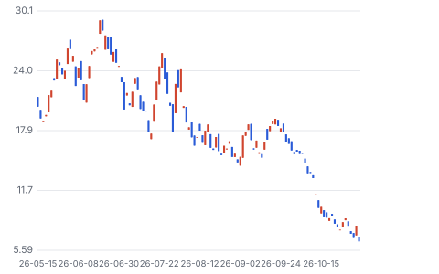

**주봉**

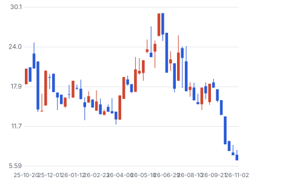

**월봉**

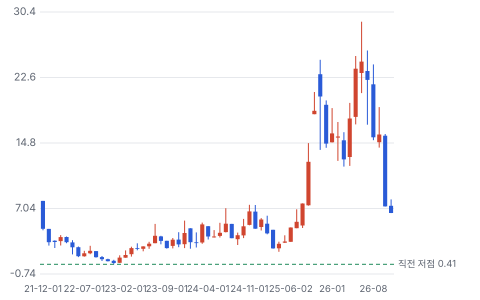

**분기 매출·EPS 실적과 컨센서스**

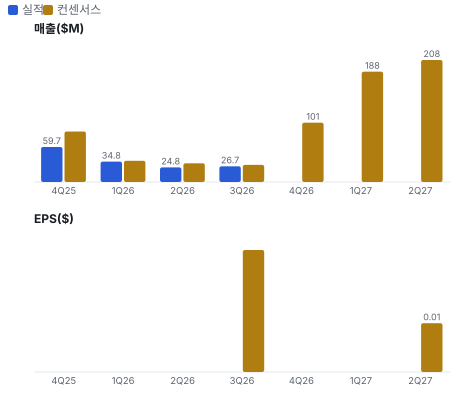

**밸류에이션 주가 시나리오**

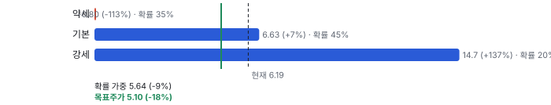

**주가별 업사이드**

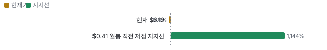

**제품·서비스 포트폴리오**

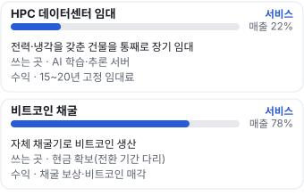

**고객 믹스(3Q26, 매출 대비)**

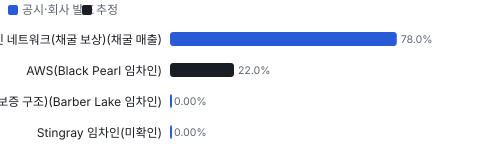

**공급 병목(10점, 낮을수록 병목)**

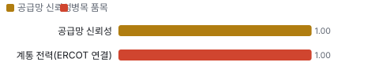

**생산능력 현재와 확충 계획(IT MW(HPC 인도 기준))**

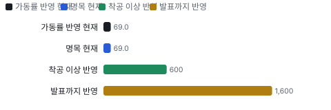

**CAPEX의 매출 대비 비중**

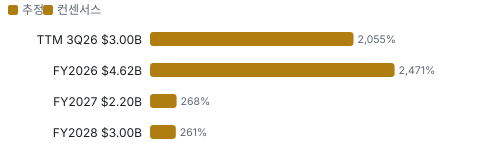

**멀티플 프리미엄**

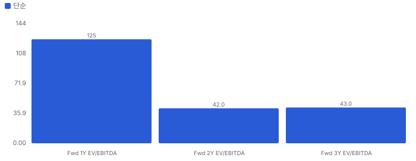

**합리적 멀티플**

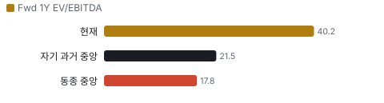

**일별 거래량 분해**

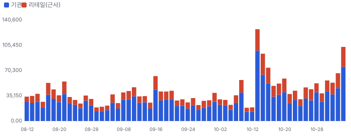

**기관 자금 흐름**

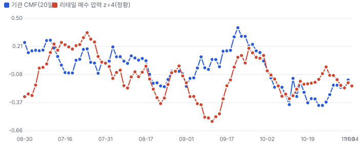

**몬테카를로**

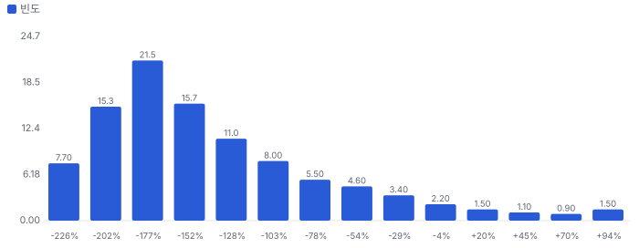

해석: 3,000번 중 154번(5%)에서 가치가 지금 주가 이상이었다. 가정을 흔들어도 지금 주가를 뒷받침하지 못하는 경우가 더 많다. 가운데 값은 -0.55배이고, 열 번 중 여덟 번은 -1.05~0.58배 사이에 든다.

## 내러티브

> **기업가치를 결정하는 이야기:** 기업가치는 계약 NOI 연 \$864M을 시장이 몇 퍼센트로 자본화하느냐와, 남은 6GW 부지가 새 임대로 바뀌느냐로 정해진다. 완공 기준 기업가치 약 \$9.2B(완전 희석)는 NOI의 10.7배, 자본화율 9.4%다. 차입이 \$6.7B라 자본화율 1%p가 지분 가치를 약 \$1B(시총의 약 3분의 1) 움직인다

> **멀티플·EPS 프리미엄**
> **멀티플:** Fwd 1Y EV/EBITDA 40배는 인도 초기라 의미가 작다. Fwd 2Y는 약 8~9배로 동종(CORZ·APLD 15~18배 Fwd 1Y)보다 낮다
> **EPS:** 3Q GAAP EPS는 Google 워런트 평가이익 \$127M 덕에 기본 \$0.08, 희석 −\$0.22. 조정 EBITDA는 −\$10M

### 투자자들은 왜 열광했나

2025년 9월 Fluidstack·Google 계약 뒤 \$7에서 \$29까지 올랐다. 식은 이유는 세 가지다 — 매출이 세 분기 연속 추정을 밑돌았고, Barber Lake 비용을 회사가 떠안았고, 10월 전환사채 발행 직후 헤지 매도와 업종 목표가 재설정이 겹쳤다

### 무엇이 기업가치를 바꾸나

> **구조적 체질 변화**
> **변화:** 채굴 100%(2Q) → HPC 임대 22%(3Q), 2027년 대부분 임대료로
> **증거:** 10-Q 세그먼트
> **반증:** 2027년 1Q HPC 매출이 컨센서스 \$188M의 절반 아래

> **고부가 믹스 확장**
> **변화:** HPC 원가율 12% vs 채굴 70%
> **증거:** 10-Q
> **반증:** HPC 운영비가 인도 MW보다 빨리 는다

> **기술 혁신**
> **변화:** 해당 없음 — 시설은 표준 설계, 고객이 장비를 소유
> **증거:** 콜
> **반증:** 해당 없음

> **실행 속도**
> **변화:** Black Pearl은 예정보다 앞서 인도, Barber Lake는 비용 초과 **납품 리드타임 13개월.** 피어 비교 미확인. 이전 대비 미확인.
> **증거:** 콜
> **반증:** Barber Lake 최종 데이터홀이 1Q27을 넘긴다

> **M&A**
> **변화:** 부지 인수(Horizon(3Q에 인수한 텍사스 70MW 부지 — 2029년 전력 공급 예정) 70MW, 인접 토지 685·256에이커)만 있다
> **증거:** 콜
> **반증:** 해당 없음

> **정책·입법 연관성**
> **재정정책:** 해당 없음 — 이 회사의 연방 보조금 공시가 없다 10-Q 검색 반증: 해당 없음 의회 동의 2/10 — 하원 1/5(데이터센터 직접 지원 세출 없음) · 상원 1/5(같음).
> **행정명령:** AI 인프라·전력 인허가 가속 행정명령은 업종 우호, 직접 수혜 공시 없음 콜 반증: 데이터센터 전력 사용 제한 조치 의회 동의 0/10 — 하원 0/5(행정부 단독 조치) · 상원 0/5(같음).
> **연관입법:** 텍사스 대형 부하 규정(ERCOT 대형 부하 연결·출력제한 규정)이 부지 가치를 정한다 — 주 규정이라 연방 의회 단계가 없다 콜(Wells Fargo 질문) 반증: ERCOT가 PCLR(ERCOT의 조건부 대형 부하 지정 — 송전망 보강 전에도 신청 전력을 쓰되 일부 출력제한을 받을 수 있는 지위) 출력제한 조건을 강하게 정한다

> **CAPEX 낙수효과**
> **변화:** 하이퍼스케일러 AI 투자가 임대 수요를 만든다 — 다만 고객 투자 발표를 이 회사 매출로 바로 옮기지 않는다
> **증거:** 콜: 수요는 충분하다(CEO)
> **반증:** 다음 임대 체결이 2027년 상반기까지 없다

### 내러티브 근거

> 6월 고점 \$29에서 11/4 \$6.50까지 −78%. '채굴장을 AI 데이터센터로 바꾸는 회사'라는 이야기가 '건설비를 떠안고 빚으로 짓는 회사'로 바뀌었다. 단계는 붕괴, 쏠림은 높음이다.

> **계약 임대료의 채권화** · 약화
> **논리:** 15~20년 투자등급 임대료라 리츠처럼 NOI 배수로 평가받는다
> **숫자:** 완공 기준 기업가치 약 \$9.2B(완전 희석 시총 \$3.25B + 차입 \$6.7B − 무제한 현금 \$0.72B) ÷ NOI \$864M = 10.7배, 자본화율 9.4%
> **반증:** 다음 프로젝트 채권 금리가 7.5%를 넘는다

> **건설비 초과** · 강화
> **논리:** MW당 비용이 오르면 계약 수익률이 깎이고 추가 자본이 필요하다
> **숫자:** 회사 부담 \$359M = 시총의 12%
> **반증:** Black Pearl·Stingray가 자본 지출 상한 안에서 끝난다

> **GW(기가와트(1,000MW)) 파이프라인 옵션** · 정체
> **논리:** 6.8GW 중 계약 전 6GW가 임대되면 가치가 몇 배가 된다
> **숫자:** 1GW 임대 = 연 NOI 약 \$1.2B(700MW당 \$864M 비례, 추정)
> **반증:** 12월 ERCOT 최종 분류 실패

> **희석·전환사채 헤지** · 강화
> **논리:** 전환사채가 늘 때마다 헤지 매도와 희석 우려가 주가를 누른다
> **숫자:** 외가격 잠재 주식 약 137M주(2031·2032)
> **반증:** 다음 자금을 프로젝트 채권만으로 조달

> **반대 내러티브: 지분은 계약 가치 아래** · 태동
> **논리:** 주가가 계약 임대 가치만큼도 반영하지 않는다(KBW의 업종 진단을 거꾸로 읽은 것)
> **숫자:** NOI \$864M을 7%로 자본화하면 \$12.3B − 순차입 약 \$6.0B = 지분 \$6.3B, 완전 희석 시총 \$3.25B의 2배(추정)
> **반증:** 임차인 계약 조건 변경 또는 자본화율 9% 이상

## 포트폴리오

| 제품·서비스 | 구분 | 무엇 | 쓰는 곳 | 돈 버는 방식 | Mix | Mix 변화(전년 대비) |
|---|---|---|---|---|---|---|
| HPC 데이터센터 임대 | 서비스 | 전력·냉각을 갖춘 건물을 통째로 장기 임대 | AI 학습·추론 서버 | 15~20년 고정 임대료 | 미확인 | 미확인 |
| 비트코인 채굴 | 서비스 | 자체 채굴기로 비트코인 생산 | 현금 확보(전환 기간 다리) | 채굴 보상·비트코인 매각 | 미확인 | 미확인 |

## 고객

> **3Q26 최대 고객 비트코인 네트워크(채굴 보상)(채굴 매출) 78%, 상위 3곳 100%, 집중도 집중.** 공시·회사 발표로 확인한 몫은 매출의 78%이고, 나머지 고객 몫은 추정이거나 미분해다. 3Q 매출 \$26.7M 중 채굴 \$20.8M(78%)·HPC 임대 \$5.85M(22%)다. 계약 700MW의 임차인은 AWS(Black Pearl, 300MW·15년 — 회사 개요), Fluidstack(Barber Lake, Google 워런트·보증 구조, 20년), Stingray 임차인(이름은 이 자료에서 미확인) 세 곳이다. 10-Q는 고객별 매출 비중을 따로 적지 않는다

**고객별 매출 몫(3Q26)**
| 고객 | 몫 | 변화 | 근거 |
|---|---|---|---|
| 비트코인 네트워크(채굴 보상)(채굴 매출) | 78% | -22%p | 공시 |
| AWS(Black Pearl 임차인) | 22% | +22%p | 추정 |
| Fluidstack(Google 보증 구조)(Barber Lake 임차인) | 0% | +0%p | 회사 발표 |
| Stingray 임차인(미확인) | 0% | +0%p | 회사 발표 |

> **비트코인 네트워크(채굴 보상)(채굴 매출)** · 공시
> **사는 것:** 채굴 연산(해시레이트)
> **추정 근거:** 3Q 채굴 \$20.85M ÷ \$26.70M · prior = 2Q26 HPC 매출 0

> **AWS(Black Pearl 임차인)** · 추정
> **사는 것:** Black Pearl 300MW 턴키 데이터센터 15년 임대
> **추정 근거:** 3Q HPC 매출 \$5.85M은 Black Pearl에서만 나왔다(콜). Black Pearl 임차인이 AWS라는 것은 회사 개요·발표 기준 — 몫은 계산값

> **Fluidstack(Google 보증 구조)(Barber Lake 임차인)** · 회사 발표
> **사는 것:** Barber Lake 300MW, 20년, 계약 매출 약 \$9.2B
> **추정 근거:** 첫 51MW RFS 통지 11/2 — 4Q부터 매출. Google은 워런트 24.7M주를 가진 보증 당사자(10-Q)

> **Stingray 임차인(미확인)** · 회사 발표
> **사는 것:** Stingray 캠퍼스 임대
> **추정 근거:** 외장 구조물 4Q26 완공 예정 — 임차인 이름은 이 회차 자료에서 확인하지 못했다

## 수주·파이프라인

> **2026-11-02 기준 4건.** 확정 \$9.10B.

**실행 속도와 방해 요인**
| 항목 | 상태 | 실행 속도 | 방해 요인 |
|---|---|---|---|
| Barber Lake(Fluidstack, 20년) | 확정 | 임대 체결 → 첫 RFS 약 13개월(2025-09 계약 기준) | 변경주문 비용 · 노동력 |
| Black Pearl(AWS, 15년) | 확정 | 미확인 | 2단계 전기 공사 |
| Stingray | 확정 | 미확인 | 시공 일정 |
| 온사이트 발전 1GW 임대 협의 | 협상 | 미확인 | 발전 장비 부족 · IPP(독립 발전 사업자(Independent Power Producer)) 구조 |

## 마진 구조

> **GPM -101.9%, OPM -269.3%.** 3Q25 대비 GPM -144.5%p, OPM -216.9%p. 변동비는 매출의 86%이고, 매출이 10% 늘면 OPM은 +25.8%p 움직인다. 3Q 채굴 매출원가 \$14.6M(채굴 매출의 70%), HPC 임대 원가 \$0.73M(HPC 매출의 12%). 보상·복리후생 \$38.6M·일반관리비 \$26.4M·감가상각 등 \$18.3M이 매출 \$26.7M보다 커 GAAP 영업손실 \$71.9M이다. HPC가 커지면 원가 비중이 낮은 임대 매출이 늘어 구조가 바뀐다

> **매출 100 중 매출원가 152.7, 매출총이익 -52.7(최근 4분기, 공시).** 매출원가 요인 중 보상·복리후생(주식 보상 포함)이 매출의 144.4%로 가장 무겁고, 단가가 +10% 오르면 GPM이 -14.44%p 움직인다. 분기 회귀로 매출 1이 늘 때 매출원가는 0.39 늘고, 매출원가의 고정비 몫은 58%다.

**비용 요인 강도 — 비중·추세·충격(+10%)·탄력**
| 비용 | 구분 | 매출 대비 | 1년 변화 | 마진 기여 | 충격 시 마진 | 매출 탄력 | 고정비 몫 |
|---|---|---|---|---|---|---|---|
| 보상·복리후생(주식 보상 포함) | 매출원가 요인 | 144.4% | 미확인 | 미확인 | -14.44%p | 미확인 | 90% |
| 채굴 매출원가(전력·호스팅) | 매출원가 요인 | 54.8% | 미확인 | 미확인 | -5.48%p | 미확인 | 20% |
| HPC 임대 원가 | 매출원가 요인 | 2.7% | +2.7%p | -2.7%p | -0.27%p | 미확인 | 60% |
| 기타 영업비용 | 공시 항목 | 215.5% | +237.3%p | -237.3%p | 미확인 | 0.93 | -97% |
| 매출원가 | 공시 항목 | 152.7% | +86.6%p | -86.6%p | -15.27%p | 0.39 | 58% |
| 감가상각 | 공시 항목 | 74.7% | -14.2%p | +14.2%p | 미확인 | 0.80 | -13% |
| 판관비 | 공시 항목 | 44.3% | +27.1%p | -27.1%p | 미확인 | -0.15 | 100% |

매출 탄력 = 분기 비용을 매출에 회귀한 기울기(매출 1당 변동비), 고정비 몫 = 절편 ÷ 평균 비용. 표본이 8분기 미만이면 미확인. 매출원가 요인 비중은 margin 재료의 추정이 섞여 있고, 공시 매출원가와의 차이는 '기타 매출원가'로 둔다.

**GPM에서 OPM까지(GAAP)**
| 기간 | GPM | 연구개발 | 판관비 | 기타 | OPM |
|---|---|---|---|---|---|
| 3Q25 | 42.6% | 0.0% | 11.4% | 83.6% | -52.5% |
| 3Q26 | -101.9% | 0.0% | 98.7% | 68.7% | -269.3% |

**마진을 결정하는 비용 요인 — 비용 +10% 시 OPM**
| 비용 | 매출 대비 | 변화 | 고정비 | OPM |
|---|---|---|---|---|
| 보상·복리후생(주식 보상 포함) | 144.4% | 미확인 | 90% | -14.44%p |
| 일반관리비 | 98.7% | +87.3%p | 80% | -9.87%p |
| 감가상각·기타 | 68.7% | 미확인 | 90% | -6.87%p |
| 채굴 매출원가(전력·호스팅) | 54.8% | 미확인 | 20% | -5.48%p |
| HPC 임대 원가 | 2.7% | +2.7%p | 60% | -0.27%p |

**비용을 움직이는 요인**
| 비용 | 요인 |
|---|---|
| 보상·복리후생(주식 보상 포함)(매출원가) | 인력·주식 보상 — 표준화 재무가 매출원가로 분류 · 근거 공시 |
| 일반관리비(판관비) | 거래 자문·Colorado City 수자원 기부금 \$3M · 근거 공시 |
| 감가상각·기타(기타) | 시설·채굴기 감가상각 · 근거 공시 |
| 채굴 매출원가(전력·호스팅)(매출원가) | 텍사스 전력 단가·채굴 가동 · 근거 공시 |
| HPC 임대 원가(매출원가) | 인도 MW · 근거 공시 |

**HPC 데이터센터 임대 BOM — 매출의 22%, GPM 88%(공시 — 3Q HPC 원가 \$0.73M), 항목 가격 +10% 시**
| 항목 | 원가 몫 | 전가 | 제품 GPM | OPM |
|---|---|---|---|---|
| 전기 설비(변전소·개폐기·UPS(무정전 전원 장치(Uninterruptible Power Supply))) | 30~45% | 50% | -0.4%p | +0.08%p |
| 건물·토목·시공 인건비 | 25~40% | 50% | -0.4%p | +0.07%p |
| 냉각 설비(액체 냉각·칠러) | 15~25% | 50% | -0.2%p | +0.04%p |
| 미분해 | 10% | - | - | - |

**비트코인 채굴 BOM — 매출의 78%, GPM 30%(공시 — 3Q 채굴 원가 \$14.64M), 항목 가격 +10% 시**
| 항목 | 원가 몫 | 전가 | 제품 GPM | OPM |
|---|---|---|---|---|
| 전력(텍사스 PPA) | 65~80% | 0% | -5.1%p | -3.96%p |
| 채굴기 감가상각 | 8~15% | 0% | -0.8%p | -0.63%p |
| 시설 운영·인력 | 5~10% | 0% | -0.5%p | -0.41%p |
| 미분해 | 8% | - | - | - |

**BOM 항목 가격을 움직이는 것**
| 항목 | 요인 |
|---|---|
| 전기 설비(변전소·개폐기·UPS) | MW당 \$10~13M 건설비의 가장 큰 몫(업계 통상, 추정) · 전가 50% = Barber Lake 범위 확대·인플레 비용을 고객과 반씩 나누고 고객 몫은 임대료로 회수(CFO) — 다른 캠퍼스는 자본 지출 상한 보호 · 근거 추정 |
| 냉각 설비(액체 냉각·칠러) | 냉각 설계 변경이 변경주문의 원인이었다(CEO) · 전가 50% = Barber Lake 범위 확대·인플레 비용을 고객과 반씩 나누고 고객 몫은 임대료로 회수(CFO) — 다른 캠퍼스는 자본 지출 상한 보호 · 근거 추정 |
| 건물·토목·시공 인건비 | 노동시장 타이트, 2027년에도 상승(CEO) · 전가 50% = Barber Lake 범위 확대·인플레 비용을 고객과 반씩 나누고 고객 몫은 임대료로 회수(CFO) — 다른 캠퍼스는 자본 지출 상한 보호 · 근거 추정 |
| 전력(텍사스 PPA) | 채굴 원가의 대부분은 전력 · 근거 추정 |
| 채굴기 감가상각 | 4Q25 채굴기 손상 뒤 감가가 줄었다 · 근거 추정 |
| 시설 운영·인력 | Odessa(Cipher의 텍사스 오데사 비트코인 채굴장 — HPC 전환·매각 검토 중) 운영 · 근거 추정 |

## 공급망 병목

> **공급망 신뢰성 1.0/10, 병목 심각.** 가장 약한 고리는 계통 전력(ERCOT 연결) 1.0점이고, 품목 평균은 1.0점이다. 근거가 부족한 3건(전기 설비(변전소·개폐기·UPS) · 건물·토목·시공 인건비 · 온사이트 발전 장비(가스터빈·왕복엔진))은 점수에서 뺐다. 병목은 전력과 시공이다. 10-Q 건설 약정은 \$1.61B(9/30)이고 대부분 HPC 임차 부지 시공이다. 회사는 노동시장이 타이트하고 일부 고객 장비(OFCI(고객이 사서 공급하고 시공사가 설치하는 장비(Owner-Furnished, Contractor-Installed))) 납기가 늘어 작업팀이 기다렸다고 말했다. 온사이트 발전용 터빈·엔진은 세계적으로 부족하다(CEO)

**병목과 마진 — 품목 가격 +10% 시 OPM**
| 품목 | 점수 | 판정 | 구분 | OPM |
|---|---|---|---|---|
| 계통 전력(ERCOT 연결)(필수) | 1.0 | 병목 심각 | 출하 차질 위험 | 미확인 |

> **계통 전력(ERCOT 연결)** · 1.0/10
> **왜:** 다른 지역은 수억 달러 보증금·2030년대 연결(CEO)
> **병목 요인:** 인증 공급사 1곳 · 캐파 부족 · 리드타임 미확인 · 재인증 미확인 · 1위 점유율 100% · 텍사스 집중 100% · 물량 확보 미확인
> **풀리는 조건:** 미확인

**공급사**
| 품목 | 공급사 | 몫 | 근거 |
|---|---|---|---|
| 전기 설비(변전소·개폐기·UPS) | 미공시(변전·배전 장비) | 미확인 | 추정 |
| 건물·토목·시공 인건비 | 종합건설사·하도급(이름 미공시)(시공) | 미확인 | 회사 발표 |
| 계통 전력(ERCOT 연결) | ERCOT·지역 송전 사업자(계통연계·부하 분류) | 미확인 | 공시 |
| 온사이트 발전 장비(가스터빈·왕복엔진) | IPP가 확보하는 구조(미정)(발전 장비·운영) | 미확인 | 회사 발표 |

## 생산능력

> **현재 명목 캐파 69 IT MW(HPC 인도 기준), 가동률 100%.** 착공 이상 증설은 531 IT MW(HPC 인도 기준), 발표까지 합치면 1,531 IT MW(HPC 인도 기준)이다. 다 가동하면 지금보다 +2219%, 착공 이상만이면 +770%다. FY2028 CAPEX는 \$3.00B로 매출의 260.9%다. 채굴 운영 약 207MW, 계약 HPC 700MW(3개 캠퍼스), 전체 운영·계약·개발 약 6.8GW(10-Q·콜). Black Pearl 18MW 인도, Barber Lake 첫 51MW RFS(11/2)

**생산능력 확충 계획**
| 계획 | 단계 | 증설 | 가동 시점 | CAPEX |
|---|---|---|---|---|
| Barber Lake 잔여 데이터홀 | 착공 | 249 IT MW(HPC 인도 기준) | 2027-03 | 미확인 |
| Black Pearl 1단계 잔여·2단계 | 착공 | 282 IT MW(HPC 인도 기준) | 미확인 | 미확인 |
| Stingray | 착공 | 미확인 | 미확인 | 미확인 |
| Colchis 1GW | 인허가 | 1,000 IT MW(HPC 인도 기준) | 미확인 | 미확인 |

남은 계획의 CAPEX 합계는 \$0.00B(금액 미확인 4건 제외)다. 합계는 FY2028 매출의 0%다.

**증설 방해 요인**
| 계획 | 방해 요인 |
|---|---|
| Barber Lake 잔여 데이터홀 | 변경주문·노동력 |
| Black Pearl 1단계 잔여·2단계 | 전기 공사 진행 중 |
| Stingray | 외장 구조물 4Q26 완공 예정 |
| Colchis 1GW | ERCOT 최종 분류 12월, 임차인 미정 |

**CAPEX와 매출 대비**
| 기간 | CAPEX | 매출 | 매출 대비 | 구분 |
|---|---|---|---|---|
| TTM 3Q26 | \$3.00B | \$0.15B | 2054.8% | 추정 |
| FY2026 | \$4.62B | \$0.19B | 2470.6% | 컨센서스 |
| FY2027 | \$2.20B | \$0.82B | 268.3% | 컨센서스 |
| FY2028 | \$3.00B | \$1.15B | 260.9% | 컨센서스 |

## 해자

> 해자는 텍사스에서 계통연계를 이미 받은 전력 부지와 투자등급 임차인의 장기 계약이다. 기술 해자는 없다 — 건물과 전기는 누구나 지을 수 있고, 차이는 전력 확보 시점과 조달 금리에서 난다

> **전력 확보 부지** · 중간
> **해자:** 계통연계·조건부 기저부하를 받은 GW급 부지가 있다
> **근거:** 3Q 콜: 6.8GW 포트폴리오, Reveille(Cipher 개발 부지 — 계통연계 승인 확보)·Ulysses(Cipher 개발 부지 — 계통연계 승인 확보) 연계 승인, Colchis·Mikeska 1GW 조건부, PCLR 3곳
> **숫자:** 계약 700MW / 단기 개발 5.9GW
> **깨지는 조건:** 12월 ERCOT 최종 분류에서 Colchis·Mikeska가 빠지거나 출력제한이 크게 붙는다

> **조달 금리** · 중간
> **해자:** 프로젝트 채권 금리가 업계 하단이다
> **근거:** CFO: AI 인프라 고수익 채권 20~25건 중 스프레드 하위 4개 중 3개가 Cipher. 금리 7⅛%·6⅛%·6%
> **숫자:** Stingray 6% vs Barber Lake 7⅛%
> **깨지는 조건:** 다음 프로젝트 채권 금리가 7.5%를 넘는다

> **임차인 신용** · 강함
> **해자:** 임대료를 AWS·Google 보증 구조가 낸다
> **근거:** 회사 개요·10-Q Google 워런트
> **숫자:** 가중 계약 17.3년, 계약 매출 \$16.6B
> **깨지는 조건:** 임차인이 인도 지연을 이유로 계약 조건을 바꾼다

## 경영진·네트워크

> Tyler Page CEO와 Greg Mumford CFO가 3Q 콜을 이끌었다. 공개 자료로 확인한 범위에서 경영진의 정계·동문 연결이 매출로 이어진 근거는 없다

> **Tyler Page** · CEO · 미확인
> **프로필:** 3Q 콜 진행·전략 답변
> **비즈니스:** 미확인
> **정계:** 미확인
> **동문:** 미확인
> **사모임:** 미확인

> **Greg Mumford** · CFO · 미확인
> **프로필:** 자본구조·비용 답변
> **비즈니스:** 미확인
> **정계:** 미확인
> **동문:** 미확인
> **사모임:** 미확인

**네트워크 정량화**
| 연결 | 강도 | 닿는 매출 | 가중 노출 | 매출 대비 | 근거 |
|---|---|---|---|---|---|
| 비즈니스: 대주주 13D/A가 10/7·11/4에 제출됐다 — 지분 변동 내용은 이 회차에서 원문 미확인 | 1/5 | \$0.00B | \$0.00B | 0% | 매출 연결 근거 없음 https://www.sec.gov/cgi-bin/browse-edgar?action=getcompany&CIK=0001819989 |

가중 노출은 연결이 닿는 매출의 크기다. 연결이 그 매출을 만들었다는 뜻이 아니며, 인과는 공개 자료로 입증하지 못한다.

## 약세 논리 및 셀온 조건

| 약세 논리 | 근거 | 반박 | 가를 자료 |
|---|---|---|---|
| 지분은 차입 위의 얇은 층이다 | 총차입 약 \$6.7B vs 완전 희석 시총 \$3.25B — 자산 가치가 10% 줄면 지분이 약 30% 준다 | 프로젝트 채권 \$4.5B는 비소구라 캠퍼스 하나가 틀어져도 모회사로 번지지 않는다 | 다음 프로젝트 채권 금리·조건(2027 상반기 Stingray 이후) |
| 비용 초과가 되풀이된다 | Barber Lake 회사 부담 \$359M, MW당 \$10.4M → 약 \$13M | Black Pearl·Stingray는 자본 지출 상한 보호(CFO) | 4Q26 10-K 캠퍼스별 건설 약정·유형자산 증가(2027-02 하순) |
| 매출 인식이 계속 늦다 | 1~3Q 매출이 연속으로 컨센서스 하회(3Q −32%) | Black Pearl은 오히려 예정보다 먼저 인도 | 4Q26 HPC 임대 매출(컨센서스 4Q 총매출 \$86~101M) |
| 희석이 끝나지 않았다 | 2031·2032 전환사채 약 \$2.15B, 잠재 약 137M주(외가격), 2030 전환사채 주식화 40.7M주 | 2032년분은 캡드콜로 \$28.35까지 희석을 상쇄 | 다음 자금 조달 방식(프로젝트 채권 vs 전환사채·증자) |
| 파이프라인은 값이 없다 | 6.8GW 중 계약 700MW, 온사이트 발전 장비 세계적 부족(CEO) | Colchis·Mikeska 1GW씩 조건부 기저부하, PCLR 3곳 | ERCOT 최종 분류(12월)·첫 신규 임대 공시 |
| 데이터 공백 — 검증 미통과 3건 | 회사가 매출 가이던스를 내지 않는다. 원자료 시가총액 \$2.82B는 10/16 교환 전 주식 수(4.35억 주) 기준이라 표지 주식 × 종가 \$2.97B와 4.8% 다르다. SEC(미국 증권거래위원회) 반희석 제외 주식 2.04억 주(최대 전환율, 10월 교환 전)와 희석 표 4,330만 주(외가격 전환사채 제외) 기준이 다르다 | 계약 매출 \$16.6B·NOI \$864M이 가이던스 역할을 한다. 2031·2032 전환사채(약 1.37억 주)는 전환가 \$16.03·\$15.31로 지금 가격의 2.5배 | 4Q26 10-K 희석 주석·첫 연간 가이던스 여부(2027-02 하순) |

## 어닝콜 변화

**직전 콜 대비 새로 나오거나 바뀐 내용 → 가치 영향**
| 항목 | 내용 | 직전 콜 | 최신 콜 | 모델 동인 이동 | 확신도 | 가치 영향 |
|---|---|---|---|---|---|---|
| 신규 | Black Pearl 첫 HPC 매출 | 8월 인도 예정 | 3Q HPC 매출 \$5.85M, 18MW 조기 인도 | 기준연도 매출 +\$0.01B | 1.0 | - |
| 업데이트 | Barber Lake 임대 연장 | 10년 기본 임대 | 20년, 계약 매출 약 \$9.2B(+\$5.2B) | 성장 지속(감속 계수) -5.0% | 1.0 | - |
| 부정 | Barber Lake 비용 초과 | MW당 \$9~11M(조달 \$10.4M) | 회사 부담 약 \$13M/MW | 매출÷투하자본 -10.0% | 1.0 | - |
| 업데이트 | Barber Lake 수익률 | 약 13%(연장 전) | 약 15%(연장 후) | 목표 이익률 +1.0% | 0.8 | - |
| 부정 | 전환사채·주식화 | 모회사 전환사채 2030·2031 | 2032 0% \$850M 추가, 2030 \$166M → 40.7M주 | 순차입 +\$0.69B | 1.0 | - |
| 신규 | 온사이트 발전 파이프라인 | 언급 없음 | 가스 배관 최대 2.5GW, 약 1GW 임대 협의 | 장기 성장 수렴값 +1.0% | 0.3 | - |
| 부정 | 매출 컨센서스 하회 | 추정 \$29~39M | \$26.7M | 기준연도 매출 -\$0.01B | 1.0 | - |
| **합계** | 단독 합 |  |  | 동시 적용 - |  | **+0.0%** |

## 밸류에이션

> **목표주가 \$5, 업사이드 -22%.** 자리는 약세와 기본 사이(약세 쪽 20%)이고 도달 확률은 약 51%다. 기본 \$7, 강세 \$15(+126%), 약세 \$-1(-112%). DCF 기준 업사이드는 기본 -156%, 강세 -47%, 약세 -166%다(WACC 7.7%).

배수 기준 기본 \$6.65(+2%)와 DCF 음수는 방향이 다르다. 배수는 완공 뒤인 4Q27~3Q28 EBITDA \$750M에 엔진이 고른 Fwd 1Y EV/EBITDA 12.4배를 곱하고, 같은 시점 기준인 지분 순부채 약 \$6.0B를 뺀다 — 시장이 이런 자산에 실제로 주는 값이다. DCF는 FY27 +338%·FY28 +40% 뒤 3%로 수렴하고 장기 EBIT 이익률 42%를 두지만, 투하자본 약 \$6.8B에 비해 세후 영업이익이 작아 투하자본 수익률이 5~6%로 WACC 7.7%보다 낮다. 감가상각을 경제적 비용으로 보면 계약 임대료가 자본비용을 겨우 덮는다는 뜻이다. 두 방법의 차이는 결국 할인율이다 — 투자등급 장기 임대료라면 프로젝트 채권 금리(6~7⅛%) 쪽에 가깝고, 그렇다면 배수 쪽이 맞다. 약세 −\$0.80은 지분 가치가 0 아래로 계산된 값이며 실제로는 비소구 채권 구조 때문에 바닥이 있다.

> **약세 \$-1 (-112%)** · 확률 35%
> **가정:** 9.3배 × EBITDA \$0.60B
> **근거:** Barber Lake 잔여 데이터홀과 Black Pearl 2단계가 2~3분기 늦어 4Q27~3Q28 EBITDA가 \$600M에 그친다. 12월 ERCOT 분류가 미뤄지고 새 임대가 없다. 비용 초과가 한 번 더 나온다

> **기본 \$7 (+2%)** · 확률 45%
> **가정:** 12.4배 × EBITDA \$0.75B
> **근거:** 계약 700MW가 2027년 안에 대부분 인도된다. 4Q27~3Q28 EBITDA 컨센서스 \$793M에서 일반관리비 증가를 뺀 \$750M — 안정화 NOI \$864M의 87%

> **강세 \$15 (+126%)** · 확률 20%
> **가정:** 15.5배 × EBITDA \$0.86B
> **근거:** 인도가 일정대로 끝나 안정화 NOI \$864M에 가까워지고, Colchis 또는 온사이트 발전 1GW 임대가 2027년 상반기에 체결돼 배수가 동종 쪽으로 오른다

**멀티플 선정 — Fwd 1Y EV/EBITDA**
| 단계 | 조정 | 근거 |
|---|---|---|
| 동종 중앙값 | 17.8배 | 범위 3.0~57.2배, 5곳 |
| 펀더멘털 | +0% | 재료 없음 |
| 해자 | +4% | 전력 확보 부지 중간 · 조달 금리 중간 · 임차인 신용 강함 |
| 반복 매출 | +0% | 반복 매출 22%(동종 20%) · 장기 임대료 · 반복 단계까지 1년(할인 ×0.79) · 기반 계약 700MW(3개 캠퍼스) |
| 수주 전환·가시성 | -5% | 가시성 재료 없음 |
| 내러티브 | -20% | 단계 붕괴 |
| 사이클·실행 판단 | -10% | Barber Lake에서 회사가 변경주문 \$359M을 떠안아 MW당 비용이 \$10.4M에서 \$13M으로 올랐다. 1~3분기 매출이 연속으로 컨센서스를 밑돌았고, 차입 \$6.7B·전환사채 2건이 지분 위에 있다 — 동종 대비 할인 |
| **선정** | **12.4배** | 지금 40.2배 |

**동종 레인지**
| 회사 | Fwd 1Y EV/EBITDA | Fwd 2Y EV/EBITDA | Fwd 3Y EV/EBITDA | 성장 | 영업이익률 | ROIC |
|---|---|---|---|---|---|---|
| IREN(호주계 채굴·AI 클라우드 회사 IREN) | 3.0 | 1.1 | 0.7 | 317% | 13% | 1% |
| CORZ | 15.1 | 6.9 | 4.7 | 77% | -73% | -5% |
| APLD | 17.8 | 16.3 | 15.1 | 82% | 11% | 2% |
| WULF | 21.8 | 5.8 | 3.3 | 15% | -250% | -12% |
| HUT(미국·캐나다 채굴·데이터센터 회사 Hut 8) | 57.2 | 9.3 | 5.9 | 71% | -227% | -6% |
| **Cipher Digital** | 40.2 | 9.8 | 6.7 |  |  |  |

지금 주가가 요구하는 5년 매출 CAGR 75%, 기본 시나리오 48%. 몬테카를로 중앙값 업사이드 -155%.

> 의사결정 보조(투자자문 아님): ① 매수 매력: 연 기대수익 -100.0% (자기자본비용 12.6% 대비 -112.6%p) · 자본비용 초과 확률 3% · 안전마진 -1.05 → 정량 신호 약함 / ② 위험 예산 지표(이론): 0% — 기대수익이 자기자본비용에 못 미침(무위험 대비 켈리 0%는 참고) · 5년 하위10% -251% · 30%+ 손실 확률 88% / ③ 상방(5년): 기대 -0.51배 · 2배 3% · 3배 1% · 10배 0% · 상위10% 0.85배

## 매수 위치(일봉)

> **현재가 \$6.50는 '지지선 미확인'.** 이 자리에서 목표주가까지 -21.5%, 첫 일봉 저항까지 +42.7%, 다음 지지까지 하방 미확인.

**가격대별 업사이드(일봉 기준)**
| 가격대 | 가격 | 목표주가까지 | 첫 저항까지 | 다음 지지까지 | 손익비 | 근거 기법(강도) |
|---|---|---|---|---|---|---|
| 현재가 | \$6.50 | -21.5% | +42.7% | 미확인 | 미확인 | - |

**일봉 저항**
| 저항 | 가격 | 현재가 대비 | 근거 기법(강도) |
|---|---|---|---|
| 저항 1 | \$9.27 | +42.7% | 20일선(0.5) |
| 저항 2 | \$13.65 | +110.1% | 50일선(1.0) |
| 저항 3 | \$14.28 | +119.7% | 120일 지그재그 저점 · 스윙 저점(1.8) |

일봉만 쓴다(주봉·월봉 제외). 손익비 = 목표주가까지 업사이드 ÷ 다음 지지까지 하방. 가격대별 기대값 참고표이며 매수·매도 시점 지시가 아니다.

## 애널리스트 토론

> **토론 결론 Neutral(규칙 등급 Sell).** 규칙 등급은 Sell(목표 \$5, −22%)이다. 약세 −\$0.80은 지분이 0 아래로 가는 값인데, 차입 \$6.7B 중 \$4.5B가 캠퍼스별 비소구 채권이라 지분 손실에는 바닥이 있다. 투자등급 임차인의 계약 임대료와 12월 ERCOT 분류라는 날짜 있는 촉매를 근거로 한 단계 올려 Neutral로 둔다

**패널(가상 애널리스트)**
| 자리 | 애널리스트 | 핵심 논리 | 틀리는 조건 | 최종 투표 |
|---|---|---|---|---|
| Strong Buy | 윤서하(가상 리서치 하우스 한빛자산) | 지분이 계약 NOI 가치의 절반도 안 된다 | 다음 채권 금리 7.5% 초과 | Buy |
| Buy | 강도윤(가상 리서치 하우스 누리증권) | 2027년 1Q까지 인도가 끝나면 EBITDA가 \$580M으로 뛴다 | 1Q27 매출 \$150M 미만 | Buy |
| Neutral | 백지안(가상 리서치 하우스 다솜리서치) | 계약 가치는 있지만 비용 초과와 희석이 끝났는지 모른다 | Stingray 비용 상한 안 완공 | Neutral |
| Sell | 문태경(가상 리서치 하우스 은하증권) | 새 임대 없이 빚만 늘면 파이프라인 가치는 0이다 | 12월 Colchis 임대 발표 | Neutral |
| Strong Sell | 오세린(가상 리서치 하우스 가람투자) | 건설비가 계속 오르면 지분이 차입에 먹힌다 | Black Pearl 2단계 비용 확정 공시 | Sell |

**투표**
| Strong Buy | Buy | Neutral | Sell | Strong Sell |
|---|---|---|---|---|
| 0 | 2 | 2 | 1 | 0 |

> **개회 · Strong Buy**
> **발언:** NOI \$864M을 7%로만 자본화해도 \$12.3B다. 순차입 약 \$6.0B를 빼도 지분 \$6.3B, 지금 완전 희석 시총의 약 2배다

> **개회 · Buy**
> **발언:** Barber Lake 첫 51MW가 11/2에 넘어갔다. FY27 EBITDA 컨센서스 \$580M이면 Fwd 2Y EV/EBITDA 8배다

> **개회 · Neutral**
> **발언:** 계약은 좋다. 문제는 회사가 비용 \$359M을 떠안았고 남은 두 캠퍼스도 같은지 모른다는 점이다

> **개회 · Sell**
> **발언:** 6.8GW 중 계약은 700MW다. 나머지는 ERCOT 분류와 발전 장비에 달려 있다

> **개회 · Strong Sell**
> **발언:** MW당 비용이 \$10.4M에서 \$13M으로 25% 올랐다. 같은 일이 Black Pearl에서 나면 지분이 또 희석된다

> **반박1 · Strong Buy → Strong Sell**
> **발언:** Black Pearl·Stingray 계약에는 자본 지출 상한 보호가 있다고 CFO가 말했다. Barber Lake와 구조가 다르다

> **반박1 · Buy → Neutral**
> **발언:** 비용 초과의 절반은 고객이 수익률을 얹어 갚는다. 그래서 평균 수익률이 13%에서 15%로 올랐다

> **반박1 · Neutral → Buy**
> **발언:** 수익률 15%는 회사 계산이다. MW당 \$13M 기준의 검증 자료는 아직 없다

> **반박1 · Sell → Strong Buy**
> **발언:** 7% 자본화율은 낙관이다. KBW는 업종을 계약 가치 근처로 다시 쟀고 금리가 오르면 9%도 가능하다

> **반박1 · Strong Sell → Strong Buy**
> **발언:** 자본화율 9%면 \$9.6B, 순차입 \$6.0B를 빼면 지분 \$3.6B로 지금 시총과 비슷하다 — 상방이 없다

> **반박2 · Strong Buy → Strong Sell**
> **발언:** 9%여도 지금 가격이다. 하방이 계약 가치로 막혀 있고 파이프라인은 공짜다

> **반박2 · Buy → Sell**
> **발언:** 12월 ERCOT 분류는 날짜가 정해진 촉매다

> **반박2 · Neutral → Strong Buy**
> **발언:** 공짜 옵션이라도 개발하려면 또 자본이 든다. 전환사채가 또 나오면 주당 가치는 준다

> **반박2 · Sell → Buy**
> **발언:** 매출이 세 분기 연속 추정을 밑돌았다. 인도 일정도 미끄러질 수 있다

> **반박2 · Strong Sell → Buy**
> **발언:** 공매도 27%는 시장이 비용 초과가 끝나지 않았다고 본다는 뜻이다

> **최종 · Strong Buy**
> **발언:** 계약 가치 대비 할인이 너무 크다 — 유지

> **최종 · Buy**
> **발언:** 1Q27 인도 완료가 확인되면 재평가 — 유지

> **최종 · Neutral**
> **발언:** Stingray 비용과 다음 조달 방식을 보고 판단한다

> **최종 · Sell**
> **발언:** 새 임대가 나오기 전까지 파이프라인에 값을 주지 않는다

> **최종 · Strong Sell**
> **발언:** 비용 초과 재발 위험을 지분이 진다 — 유지

남은 반대 의견: Strong Sell 자리: 비용 초과가 한 번 더 나오면 비소구 구조와 무관하게 모회사 전환사채 \$2.15B가 지분 위에 남는다

패널은 가상 인물이고 실존 IB의 의견이 아니다.

## 시장 평가

> **셀사이드(IB 애널리스트)**
> **한 줄:** 의견은 아직 매수 일색인데 목표가가 사흘 새 20~65% 깎였다. KBW는 업종 전체를 '계약 임대 가치 근처'로 다시 쟀다
> **의견 분포:** Strong Buy 17·Buy 1·Hold 4·Sell 0(22명)
> **목표가:** 평균 \$22.07, 중앙 \$18.5, \$9.5~51.5
> **11/2~11/4 하향:** KBW \$28→\$9.5, Rosenblatt \$30→\$19, JPMorgan \$22→\$18, Chardan \$24→\$18, Macquarie \$35→\$30

> **바이사이드(기관 투자자)**
> **한 줄:** 전환사채 발행 직후 거래량이 3배가 됐다 — 전환사채 차익거래 헤지 매도가 가격을 눌렀을 가능성(정황)
> **기관 보유:** 92%(yfinance)
> **대주주:** 13D/A 10/7·11/4 제출(내용 미확인)
> **캡드콜:** \$28.35까지 희석 상쇄 — 전환사채 매수자의 헤지 매도 가능성

> **언론·업계**
> **한 줄:** 매체는 업종 전체의 밸류에이션 재설정으로 다룬다
> **보도 초점:** 목표가 하향·건설비 초과·AI 인프라 신용 재가격

## 체크리스트

| 시점 | 무엇 | 의미 |
|---|---|---|
| 2026-12(회사 예상) | Colchis·Mikeska 1GW 조건부 기저부하 최종 분류(ERCOT) | 파이프라인 가치의 첫 관문 — 회사는 '중요한 촉매'라 했다 |
| 2026-12~2027-03 | Barber Lake 잔여 데이터홀 RFS | FY27 EBITDA 컨센서스 \$580M의 전제 |
| 2026 4Q | Stingray 외장 구조물 완공 | 세 번째 캠퍼스 일정 확인 |
| 2027-02 하순 | 4Q26 실적·10-K | HPC 임대 매출 규모, 캠퍼스별 비용·약정 |
| 2027 봄 | ERCOT 연구 부하·PCLR 출력제한 조건 | PCLR 지정 부지의 실제 사용 가능 전력 |

## 출처
- 3Q26 어닝콜(2026-11-02) 요지
- https://www.sec.gov/Archives/edgar/data/1819989/000181998926000050/cifr-20260930.htm

_구매 등급·목표주가 모두 규칙이 계산한 모델 값으로, 개인의 보유 종목·자금 사정을 반영하지 않는다 · 공개 자료 기반 분석이며 투자 권유가 아님 · 1차 판정, 미검증 · Chiip ten-bagger_