# 텐배거 리포트 2026-11-05 — National Presto — 가전 회사의 이름표를 단 40mm 탄약 독점사, 3Q EPS는 추정의 두 배였지만 그 3할은 관세 환급이다

> 2026-11-05 · National Presto(NPK) · 기업: 미 육군 40mm 탄약·신관 등 방위 탄약과 가정용 소형 가전 제조

## Chiip View

주가는 1년 전 \$108.93에서 11/4 \$149.58로 +37%다. 시가총액은 \$1.07B(완전 희석 기준), 리스를 뺀 순현금 \$7M을 뺀 EV는 \$1.06B다. 3Q 매출의 84%가 방산이고, 미 육군 40mm(유탄발사기용 40밀리미터 탄약(훈련탄·전술탄)) 탄약 체계를 혼자 맡은 백로그 \$1.81B는 TTM 방산 매출의 약 3.8배다. 3Q EPS \$2.79는 직전 추정 \$1.36의 두 배였지만 시장은 −2.6%로 받았다. **우리가 다르게 보는 곳은 '추정을 두 배로 넘었으니 싸다'는 읽기다.** 관세 환급 \$7.553M을 빼면 3Q EPS는 약 \$1.97이고, 일회성을 뺀 TTM EPS 약 \$6.77로는 22.1배다. 그래도 방산 영업이익은 +61.8%로 매출(+31.3%)의 두 배로 늘었다 — 이 이익률이 지속되는지가 쟁점이다. 엔진 목표주가는 \$162(+8%), 규칙 등급은 Neutral이다. FY26(회사 회계연도 2026(12월 결산)) 40mm 발주(최대 \$448M)가 확정되고 4Q 방산 이익률이 유지되면 강세 \$274(+83%) 쪽이, 발주가 밀리고 이익률이 FY25 수준(19%)으로 돌아가면 약세 \$96(−36%) 쪽이 열린다. 경쟁 가설 ① 지배 구조 할인(가를 자료: 2027 위임장의 지배 주주 지분·행동주의 13D(5% 넘게 보유한 주주가 경영 관여 의사와 함께 내는 지분 공시), 2027-04) ② 중간선거 뒤 국방 세출 둔화(가를 자료: FY27 국방 세출 탄약 조달 의결, 시점 미확인). 중간선거 영향 −0.2/10 — 가장 큰 채널은 국방 예산(민주당 의회의 세출 증가 둔화 가능, 노출 1.0) · 업종 반응은 방산 ETF(상장지수펀드) 선거 뒤 CAR(누적 초과수익률(시장 대비)) +0.7%(t 0.61, 유의하지 않음). 정책 0단계(선거 결과) 가설이고 하원 결과는 미확정이다.

## 대시보드
| 항목 | 값 | 설명 |
|---|---|---|
| 주가 | \$149.58 | 고점 대비 -5% · 1년 +37% |
| 시가총액 | \$1.07B | 완전 희석 기준 · EV \$1.06B |
| 업사이드 | +8% | 목표주가 \$162 · 다운사이드 -36% · 손익비(강세÷약세) 2.3 |
| 구매등급 | Neutral | 애널리스트 1명: Strong Buy 0 · Buy 0 · Neutral 1 · Sell 0 · Strong Sell 0 |
| 멀티플 | Fwd 1Y P/E 19.6배 | 동종 중앙값 23.1배 |
| 가이던스 4Q26 |  | 컨센서스 미확인 |
| 알파 | 5.6/10 | 텐배거 가능성 점수 |
| 이벤트 | 3Q26 10-Q 제출 기한(보도자료는 10/30에 나옴) — 세그먼트 이익·방산 백로그·재고·신용 한도 갱신 확인 | 2026-11-13 |

## 한 장 요약
- **기업가치를 결정하는 내러티브** National Presto(NPK)는 Presto 가전 회사로 알려졌지만 3Q 매출의 84%가 방산이다. 자회사 AMTEC(NPK의 방산 자회사 — 미 육군 40mm 탄약 체계 단독 프라임 계약사)이 미 육군 40mm 탄약 체계를 혼자 맡고, 신관·기폭관·탄피·장전까지 계열사가 만든다. 백로그 \$1.81B는 TTM 방산 매출의 약 3.8배다. 3Q EPS \$2.79는 직전 추정 \$1.36의 두 배지만 관세 환급(일회성)을 빼면 약 \$1.97이다
- **밸류에이션 모델로 본 주가 상방은 어디까지인가?** **목표주가 \$162(+8%), 약세와 기본 사이(약세 쪽 16%)다.** 강세 \$274(+83%)는 Fwd 1Y P/E 28.6배를 강세 EPS에 적용한 값이다. 기본 \$174, 약세 \$96. 손익비 2.3, DCF 기준 업사이드 -38%.
- **수주는 어디까지 왔나?** 40mm 4차 5년 체계 계약(FY22~26) 미확인, 100% 매출 \$0.96B · 40mm 체계 계약 FY26 발주분(상한 잔여) 0%, 100% 매출 \$0.45B · M918E2(미 육군 40mm 고속 훈련탄 신형 모델) TP-DNT(주·야간·열상 장비로 탄착이 보이는 훈련탄(Target Practice Day/Night/Thermal)) 훈련탄 IDIQ(5년) 미확인, 100% 매출 \$0.26B. 방산 백로그는 7/5 \$1.810B(12/31 \$1.748B, 1년 전 말 \$1.086B)로 TTM 방산 매출의 약 3.8배다. 18~48개월에 걸쳐 이행한다. 큰 두 건은 40mm 4차 5년 체계 계약과 M918E2 훈련탄 IDIQ(수량·시기를 정하지 않고 상한만 둔 미 정부 계약(발주가 와야 매출))다. 남은 FY26 발주 1년분은 확정 전이다
- **누가 사 주나?** 최대 고객 미 육군·국방부(40mm 체계 계약 직접)(10-K 'DOD(미 국방부)') 68%, 상위 3곳 100%. 공시·회사 발표로 확인한 몫은 16%다.
- **마진과 공급망은 어디가 약한가?** GPM 19.5%, OPM 13.2%. OPM을 가장 흔드는 BOM(제품 원가를 이루는 부품·재료 명세) 항목은 장전·조립·포장(LAP(탄약을 장전·조립·포장하는 최종 공정(Load, Assemble and Pack)))·직접 인건비이고 가격 +10%에 -2.53%p다. 공급망 신뢰성은 3.2/10(병목 심각)이고 가장 약한 고리는 40mm 최종 장전·조립(정부 시설 LAP)이다.
- **생산능력은 얼마나 늘어나나?** 현재 명목 캐파 미확인, 착공 이상 증설 0 공장 면적(제곱피트) — 생산 단위 캐파 미공시. 6M26 CAPEX는 매출의 2.1%다.
- **지금 가격은 무엇을 가정하나?** Fwd 1Y P/E 19.6배(다음 4개 분기 EPS 컨센서스 \$7.62)로 동종 5곳 중앙값 23.1배보다 약 15% 낮다. 탄약 사업을 가진 GD(20.0배)와 거의 같다. 다만 \$7.62는 3Q 발표 전(10/16) 추정이고 애널리스트 1명뿐인 추정이다. 일회성을 뺀 TTM EPS 약 \$6.77로는 22.1배다. 지금 가격은 '방산 이익이 늘었다'는 것은 믿되 그 속도가 이어질지는 할인한다. 엔진이 고른 합리적 배수는 22.9배다. DCF 기본 업사이드 −38%가 배수 기준(+16%)보다 크게 낮은 이유는 밸류에이션 절에 적었다.
- **왜 움직였나?** 세 구간이다. 1Q 실적(5/1) 뒤 −6.4%, 주총(5/19) 다음 날 −10.2%로 5/29 \$126.57까지 밀렸다 — 1Q 가전 적자(새 창고 가동 차질)와 행동주의 Albion River(미국 투자회사 — 2025년 12월 NPK 지분 5% 초과 공시 뒤 2026년 6월 4%로 축소)의 장내 매도(5~6월 약 10만 8천 주, \$132~143)가 겹쳤다. 2Q 실적(7/31) 다음 거래일 +11.1%로 \$134.91, 8/25 \$156.80까지 올랐다. 그 뒤 \$144~156에서 옆으로 갔고, 3Q 실적(10/30)은 −2.6%, 중간선거 다음 날(11/4)은 −1.4%였다.
- **3Q 실적에서 무엇이 바뀌었나?** 3Q 매출 \$144.3M(+25%), 순이익 \$19.98M, EPS \$2.79(1년 전 \$0.74)다. 방산 매출은 +\$29M(+31.3%), 방산 영업이익은 +\$7.1M(+61.8%)이고 회사는 이유로 물량에 더해 '더 유리한 믹스와 운영 효율'을 처음 들었다. 가전 매출은 −2.1%였고 영업이익 \$8.1M의 대부분이 관세 환급이다(2Q 10-Q가 예고한 \$7.553M). 회사는 가이던스를 내지 않고 3Q 10-Q는 11월 중순에 나온다.
- **회사는 쟁점에 뭐라고 답했나?** 쟁점은 방산 이익률이 지속되는지다. 회사는 어닝콜·질의응답을 하지 않아 이 쟁점에 대한 회사 답변은 없다(회사 답변 없음). 보도자료의 사장 발언은 방산 증가를 '백로그 출하 증가'와 '믹스·효율'로 설명했을 뿐 4Q 전망을 주지 않았다. 관세 환급의 추가분은 '항소 중이라 금액·시점이 불확실하다'고 2Q 10-Q에 적었다.
- **무엇이 바뀌면 판단이 달라지나?** 위로는 3Q 10-Q의 방산 매출총이익률이 2Q(19.6%)보다 높고, 백로그가 \$1.81B 위를 지키며, FY26 40mm 발주가 확정되면 이익 추정과 배수가 함께 올라 강세 \$274(+83%) 쪽이다. 아래로는 FY26 발주가 2027년 상반기까지 없거나, 정부 LAP 시설 정지가 반복되거나, 방산 매출총이익률이 18% 아래로 내려가면 약세 \$96(−36%) 쪽이다.

## 한눈에 보기

**일봉**

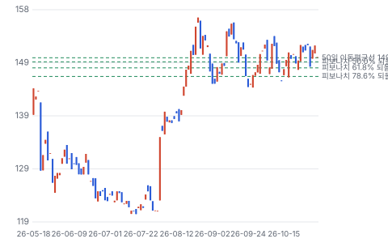

**주봉**

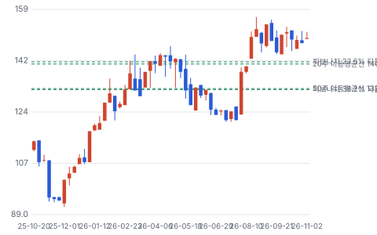

**월봉**

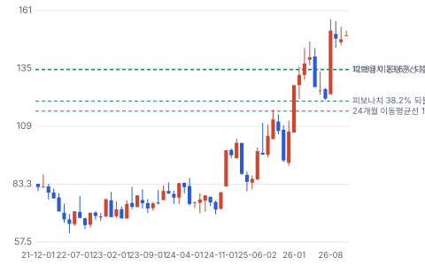

**분기 매출·EPS 실적과 컨센서스**

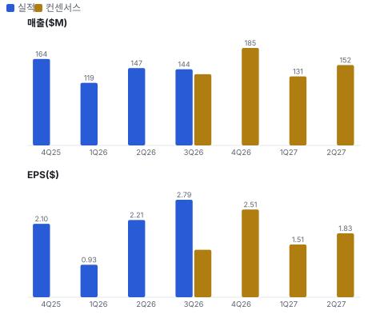

**밸류에이션 주가 시나리오**

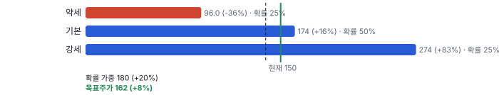

**주가별 업사이드**

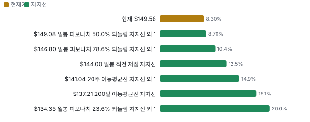

**제품·서비스 포트폴리오**

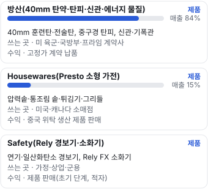

**고객 믹스(3Q26, 매출 대비)**

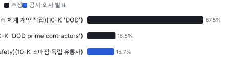

**공급 병목(10점, 낮을수록 병목)**

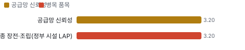

**CAPEX의 매출 대비 비중**

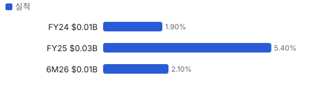

**어닝콜 변화별 주주가치 영향**

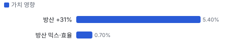

**멀티플 프리미엄**

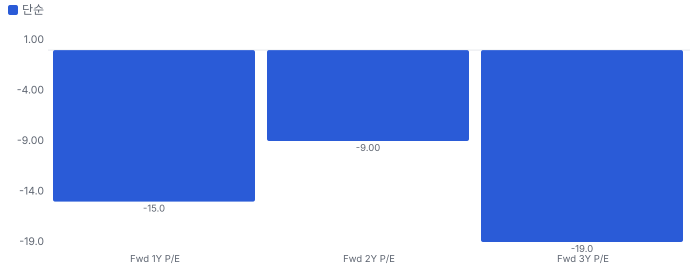

**합리적 멀티플**

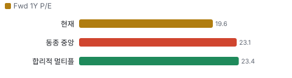

**일별 거래량 분해**

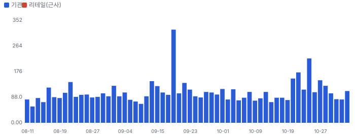

**기관 자금 흐름**

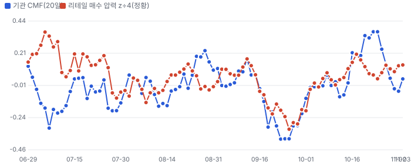

**몬테카를로**

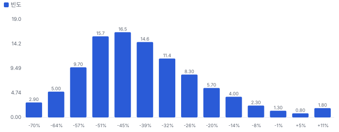

해석: 3,000번 중 89번(3%)에서 가치가 지금 주가 이상이었다. 가정을 흔들어도 지금 주가를 뒷받침하지 못하는 경우가 더 많다. 가운데 값은 0.58배이고, 열 번 중 여덟 번은 0.41~0.84배 사이에 든다.

## 내러티브

> **기업가치를 결정하는 이야기:** Fwd 1Y P/E 19.6배로 동종 5곳 중앙값 23.1배보다 약 15% 낮다. 다음 4개 분기 EPS 컨센서스 \$7.62는 일회성을 뺀 TTM EPS 약 \$6.77보다 +13% 높다. 배수를 정하는 것은 40mm 백로그가 매출로 바뀌는 속도와, FY26 발주 1년분(최대 \$448M)이 확정되는지다

> **멀티플·EPS 프리미엄**
> **멀티플:** Fwd 1Y P/E 19.6배, 동종 5곳 중앙값 23.1배(HBB(미국 소형 가전 회사 Hamilton Beach Brands) 15.3·GD(미국 방산 대기업 General Dynamics) 20.0·RGR(미국 총기 제조사 Sturm, Ruger) 23.1·CW(미국 방산·산업 부품사 Curtiss-Wright) 28.2·DCO(미국 항공·방산 부품사 Ducommun) 31.5)보다 약 15% 낮다. 탄약 사업이 있는 GD(20.0배)와 비슷하다
> **EPS:** 3Q EPS \$2.79는 10/16 추정 \$1.36을 크게 넘었다. 연간 추정(FY26 EPS \$7.01, 범위 \$5.90~8.09)은 3Q 전 값이라 9M 실적 \$5.93 + 4Q 추정 \$2.51 = \$8.44가 이미 범위 상단 위다. 다만 TTM 영업이익의 약 14%가 관세 환급이다

### 투자자들은 왜 열광했나

2024년 10월 \$72에서 2026년 11월 \$150까지 올랐다. 방산 백로그가 2023년 말 \$564M에서 2025년 말 \$1.748B로 세 배가 됐고, 2025년 방산 매출이 +43%였다. 식었던 구간은 1Q 가전 적자(창고 가동 차질)와 5~6월 행동주의 펀드 매도다

### 무엇이 기업가치를 바꾸나

> **구조적 체질 변화**
> **변화:** 방산이 매출의 81%(FY25)에서 84%(3Q26)로 늘었다. 가전 회사가 아니라 탄약 회사다
> **증거:** 10-K 세그먼트, 3Q 보도자료
> **반증:** 방산 매출이 두 분기 연속 전년보다 줄어든다

> **고부가 믹스 확장**
> **변화:** 3Q 방산 영업이익 +61.8%로 매출 +31.3%의 두 배 — 회사가 '더 유리한 믹스와 효율'을 처음 이유로 들었다
> **증거:** 3Q 보도자료
> **반증:** 방산 매출총이익률이 18% 아래로 내려간다

> **기술 혁신**
> **변화:** 주·야간·열상 장비로 탄착이 보이는 M918E2 TP-DNT 훈련탄 IDIQ(수주 \$256M, 상한 \$818.9M). Safety(NPK 안전 제품 부문(경보기·소화기))는 PFAS(과불화화합물 — 환경 규제 대상 화학물질) 없는 거품 소화기
> **증거:** 10-K, 1Q 보도자료
> **반증:** M918E2 추가 발주가 2027년에 없다

> **실행 속도**
> **변화:** 백로그를 18~48개월에 걸쳐 매출로 바꾼다. 백로그 ÷ 월 방산 매출로 약 45개월이다. 회사 이전 값과 피어 값은 같은 기준 자료가 없다 **납품 리드타임 18~48개월.** 피어 비교 미확인. 이전 대비 미확인.
> **증거:** 2Q 10-Q 2번 주석
> **반증:** 백로그 증가가 멈췄는데 방산 매출 증가율이 20% 아래로 떨어진다

> **M&A**
> **변화:** 해당 없음(최근 3년 중요 인수 없음, Woodlawn(NPK의 텍사스 정밀 금속 부품 공장(2022 인수)) 2022년)
> **증거:** 10-K
> **반증:** 탄약 관련 인수 발표

> **정책·입법 연관성**
> **재정정책:** 국방 세출·탄약 조달 — 40mm 발주는 세출과 육군 조달 계획에 달렸다. FY27 세출 단계는 확인하지 못했다 10-K(계약은 세출·조달 규정에 달렸다) 반증: FY27 국방 세출에서 탄약 조달 삭감 의결 의회 동의 2/10 — 하원 1/5(FY27 국방 세출 하원 의결 기록을 확인하지 못했다(법안 번호 미확인)) · 상원 1/5(같음).
> **행정명령:** 관세: 대법원이 2/20 IEEPA(국제비상경제권한법 — 2025년 관세의 근거 법, 2026년 2월 대법원이 위법 판단) 관세를 위법 판단, 환급 진행(항소 중). Section 122(무역적자 대응 150일 한시 관세 조항(무역법 122조)) 10% 관세는 7/25 만료, 뒤이어 Section 301(불공정 무역 대응 관세 조항(무역법 301조)) 10~12.5% 관세 2Q 10-Q 14번 주석 반증: 환급 항소에서 정부 승소 또는 가전 대상 새 관세 의회 동의 0/10 — 하원 0/5(관세는 행정부 단독 조치 — 의회 동의 절차 없음) · 상원 0/5(같음).
> **연관입법:** 해당 없음(회사를 직접 겨냥한 연방 법안을 찾지 못했다. 로비 공시는 키가 없어 미확인) lobby_watch 11/5 미확인 반증: 탄약 국내 생산 의무화 법안 의결

> **CAPEX 낙수효과**
> **변화:** 국방부 탄약 조달이 40mm 발주로 온다. 예산 발표를 이 회사 매출로 바로 옮기지 않는다 — 확인된 것은 계약 수주액과 백로그다
> **증거:** 10-K 계약 표
> **반증:** FY26 발주분이 상한 잔여 \$448M보다 크게 작게 나온다

### 내러티브 근거

> 미 육군 40mm 탄약을 혼자 맡는 방산 회사가 가전 회사의 껍데기를 쓰고 있다는 이야기다. 방산이 3Q 매출의 84%, 백로그 \$1.81B가 TTM 방산 매출의 약 3.8배다. 주가는 1년 전 \$108.93에서 \$149.58로 +37%, 애널리스트는 1명뿐이다. 동종 대비 멀티플 차이 -15% 중 회사 고유 몫은 -16%다. 단계는 확산, 쏠림은 낮음이다.

> **40mm 단독 프라임·백로그 3.8년** · 강화
> **논리:** 육군 40mm 체계를 혼자 맡아 백로그가 매출 3~4년치로 쌓였다
> **숫자:** 백로그 12/23 \$564M → 12/25 \$1.748B → 7/26 \$1.810B
> **반증:** 백로그가 두 분기 연속 줄고 FY26 발주가 나오지 않는다

> **방산 이익률 개선(믹스·효율)** · 강화
> **논리:** 물량이 늘며 고정비 흡수가 좋아지고 믹스가 유리해진다
> **숫자:** 3Q 방산 영업이익 +61.8% vs 매출 +31.3%
> **반증:** 방산 매출총이익률이 두 분기 연속 18% 아래

> **관세 환급(일회성)** · 소멸
> **논리:** IEEPA 관세 위법 판결로 낸 관세를 돌려받아 가전 이익이 반짝 좋아졌다
> **숫자:** 2Q \$2.245M + 3Q \$7.553M = TTM 영업이익의 약 14%
> **반증:** 추가 환급이 반복된다(항소 결과)

> **반대: 지배 구조·정보 할인** · 유지
> **논리:** 지배 주주 25.6%, 어닝콜·가이던스 없음, 애널리스트 1명이라 배수가 동종보다 낮게 머문다
> **숫자:** Fwd 1Y P/E 19.6배 vs 동종 중앙 23.1배
> **반증:** 회사가 어닝콜·가이던스를 시작하거나 커버리지가 3명 이상으로 는다

> **반대: 중간선거 뒤 국방 예산** · 정황
> **논리:** 민주당 의회가 국방 세출 증가 속도를 늦추면 탄약 발주가 밀린다
> **숫자:** 중간선거 영향 −0.2/10(국방 예산 채널 −1.0, 업종 반응 t 0.61)
> **반증:** FY27 국방 세출에서 탄약 조달이 늘어 의결된다

> **반대: 가전 사업의 관세 꼬리** · 유지
> **논리:** 가전은 중국 생산이라 관세가 바뀔 때마다 이익이 흔들린다
> **숫자:** FY25 가전 매출총이익률 8%(2024 25%)
> **반증:** 환급 없이 가전 매출총이익률 15% 회복

## 포트폴리오

| 제품·서비스 | 구분 | 무엇 | 쓰는 곳 | 돈 버는 방식 | Mix | Mix 변화(전년 대비) |
|---|---|---|---|---|---|---|
| 방산(40mm 탄약·탄피·신관·에너지 물질) | 제품 | 40mm 훈련탄·전술탄, 중구경 탄피, 신관·기폭관 | 미 육군·국방부·프라임 계약사 | 고정가 계약 납품 | 미확인 | 미확인 |
| Housewares(Presto 소형 가전) | 제품 | 압력솥·통조림 솥·튀김기·그리들 | 미국·캐나다 소매점 | 중국 위탁 생산 제품 판매 | 미확인 | 미확인 |
| Safety(Rely(NPK Safety 부문 브랜드(경보기·소화기)) 경보기·소화기) | 제품 | 연기·일산화탄소 경보기, Rely FX(NPK Safety 부문의 상업용 소화기 제품군) 소화기 | 가정·상업·군용 | 제품 판매(초기 단계, 적자) | 미확인 | 미확인 |

## 고객

> **3Q26 최대 고객 미 육군·국방부(40mm 체계 계약 직접)(10-K 'DOD') 68%, 상위 3곳 100%, 집중도 집중.** 공시·회사 발표로 확인한 몫은 매출의 16%이고, 나머지 고객 몫은 추정이거나 미분해다. 3Q 매출의 약 84%가 방산(\$121.6M, 계산)이고 고객은 미 국방부와 국방부 프라임 계약사다. 회사는 방산 고객별 몫을 공시하지 않는다. Housewares는 미국·캐나다 소매점에 직접 팔고, 2025년 10% 넘는 고객은 없었다(2024 Amazon 10%)

**고객별 매출 몫(3Q26)**
| 고객 | 몫 | 변화 | 근거 |
|---|---|---|---|
| 미 육군·국방부(40mm 체계 계약 직접)(10-K 'DOD') | 60~75% | 미확인 | 추정 |
| 국방부 프라임 계약사(이름 미공시)(10-K 'DOD prime contractors') | 9~24% | 미확인 | 추정 |
| 소매 유통(Housewares·Safety)(10-K 소매점·독립 유통사) | 16% | -4%p | 공시 |

> **미 육군·국방부(40mm 체계 계약 직접)(10-K 'DOD')** · 추정
> **사는 것:** 40mm 훈련탄·전술탄(체계 계약·M918E2 IDIQ)
> **추정 근거:** AMTEC이 40mm 체계 단독 프라임. 방산 매출 84% 중 프라임 계약사 부품 몫을 빼고 둔 범위 — 고객별 몫 미공시

> **국방부 프라임 계약사(이름 미공시)(10-K 'DOD prime contractors')** · 추정
> **사는 것:** 탄피·신관·기폭관·금속 부품·LAP 용역
> **추정 근거:** Amron(NPK의 위스콘신 중구경 탄피 공장)·Tech Ord(NPK의 사우스다코타 기폭관·에너지 물질 공장)·Woodlawn의 고객 — 방산 84%에서 위 범위를 뺀 나머지

> **소매 유통(Housewares·Safety)(10-K 소매점·독립 유통사)** · 공시
> **사는 것:** Presto 소형 가전·Rely 경보기·소화기
> **추정 근거:** 3Q Housewares 약 \$22.0M + Safety \$0.6M(계산) ÷ \$144.3M. 1년 전 3Q 약 19.8%

## 수주·파이프라인

> **2026-07-05 기준 4건.** 확정 \$3.03B, 미확정 \$0.45B.

**실행 속도와 방해 요인**
| 항목 | 상태 | 실행 속도 | 방해 요인 |
|---|---|---|---|
| 40mm 4차 5년 체계 계약(FY22~26) | 확정 | 수주→납품 최장 6년 | 정부 시설 LAP 가동 · 정부 지정 하도급 |
| 40mm 체계 계약 FY26 발주분(상한 잔여) | 프레임워크 | 미확인 | FY26 국방 예산·발주 · 중간선거 뒤 예산 협상 |
| M918E2 TP-DNT 훈련탄 IDIQ(5년) | 확정 | 수주→납품 약 1~3년 | 육군 추가 발주 |
| 방산 백로그 전체(7/5) | 확정 | 백로그 ÷ 월 방산 매출 약 45개월(계산) | 정부 시설 LAP · 고정가 원가 |

## 마진 구조

> **GPM 19.5%, OPM 13.2%.** 2Q25 대비 GPM +4.1%p, OPM +8.2%p. 변동비는 매출의 69%이고, 매출이 10% 늘면 OPM은 +1.6%p 움직인다. 2Q 매출총이익률은 19.5%로 1년 전 15.4%보다 4.1%p 높다. 방산 매출총이익률 19.6%(1년 전 19.2%), Housewares는 관세 환급 \$2.245M이 매출원가를 줄여 \$4.7M(1년 전 \$0.5M)이다. 판관비는 매출의 5.9%로 낮고, 영업이익률은 13.2%다

> **매출 100 중 매출원가 83.5, 매출총이익 16.5(최근 4분기, 공시).** 매출원가 요인 중 방산 직접 인건비·공장 간접비이 매출의 25.0%로 가장 무겁고, 단가가 +10% 오르면 GPM이 -2.50%p 움직인다. 분기 회귀로 매출 1이 늘 때 매출원가는 0.84 늘고, 매출원가의 고정비 몫은 -6%다.

**비용 요인 강도 — 비중·추세·충격(+10%)·탄력**
| 비용 | 구분 | 매출 대비 | 1년 변화 | 마진 기여 | 충격 시 마진 | 매출 탄력 | 고정비 몫 |
|---|---|---|---|---|---|---|---|
| 방산 직접 인건비·공장 간접비 | 매출원가 요인 | 25.0% | 미확인 | 미확인 | -2.50%p | 미확인 | 50% |
| 방산 소재(강철·알루미늄·아연·구리 합금) | 매출원가 요인 | 22.0% | 미확인 | 미확인 | -2.20%p | 미확인 | 0% |
| 방산 에너지 물질·하도급(추진제·정부 지정 하도급·LAP) | 매출원가 요인 | 20.0% | 미확인 | 미확인 | -2.00%p | 미확인 | 0% |
| Housewares 완제품 매입(중국 위탁 생산) | 매출원가 요인 | 10.0% | 미확인 | 미확인 | -1.00%p | 미확인 | 0% |
| 기타 매출원가(물류·창고) | 매출원가 요인 | 3.0% | 미확인 | 미확인 | -0.30%p | 미확인 | 30% |
| 관세(환급 차감 뒤) | 매출원가 요인 | 0.5% | 미확인 | 미확인 | -0.05%p | 미확인 | 0% |
| 매출원가 | 공시 항목 | 83.5% | +2.8%p | -2.8%p | -8.35%p | 0.84 | -6% |
| 판관비 | 공시 항목 | 6.8% | -0.9%p | +0.9%p | 미확인 | 0.03 | 63% |
| 감가상각 | 공시 항목 | 0.3% | -0.0%p | +0.0%p | 미확인 | 0.00 | 40% |

매출 탄력 = 분기 비용을 매출에 회귀한 기울기(매출 1당 변동비), 고정비 몫 = 절편 ÷ 평균 비용. 표본이 8분기 미만이면 미확인. 매출원가 요인 비중은 margin 재료의 추정이 섞여 있고, 공시 매출원가와의 차이는 '기타 매출원가'로 둔다.

**GPM에서 OPM까지(GAAP)**
| 기간 | GPM | 연구개발 | 판관비 | 기타 | OPM |
|---|---|---|---|---|---|
| 2Q25 | 15.4% | 0.0% | 7.8% | 2.6% | 5.1% |
| 2Q26 | 19.5% | 0.0% | 5.9% | 0.3% | 13.2% |

**마진을 결정하는 비용 요인 — 비용 +10% 시 OPM**
| 비용 | 매출 대비 | 변화 | 고정비 | OPM |
|---|---|---|---|---|
| 방산 직접 인건비·공장 간접비 | 25.0% | 미확인 | 50% | -2.50%p |
| 방산 소재(강철·알루미늄·아연·구리 합금) | 22.0% | 미확인 | 0% | -2.20%p |
| 방산 에너지 물질·하도급(추진제·정부 지정 하도급·LAP) | 20.0% | 미확인 | 0% | -2.00%p |
| Housewares 완제품 매입(중국 위탁 생산) | 10.0% | 미확인 | 0% | -1.00%p |
| 판관비 | 5.9% | -1.9%p | 70% | -0.59%p |
| 기타 매출원가(물류·창고) | 3.0% | 미확인 | 30% | -0.30%p |
| 관세(환급 차감 뒤) | 0.5% | 미확인 | 0% | -0.05%p |
| 무형자산 상각 | 0.3% | +0.0%p | 100% | -0.03%p |

**비용을 움직이는 요인**
| 비용 | 요인 |
|---|---|
| 방산 직접 인건비·공장 간접비(매출원가) | 5개 공장 인력·흡수율(1Q 정부 시설 정지로 흡수 감소) · 근거 추정 |
| 방산 소재(강철·알루미늄·아연·구리 합금)(매출원가) | 금속 단가 — 2017·2022 계약은 강철·알루미늄·아연만 단가 연동 · 근거 추정 |
| 방산 에너지 물질·하도급(추진제·정부 지정 하도급·LAP)(매출원가) | 정부 지정 하도급 단가, 정부 시설 LAP 가동 · 근거 추정 |
| Housewares 완제품 매입(중국 위탁 생산)(매출원가) | 위탁사 단가·환율 · 근거 추정 |
| 판관비(판관비) | 본사 인력·영업 8명 · 근거 공시 |
| 기타 매출원가(물류·창고)(매출원가) | 미시시피 새 물류창고 가동 초기 비용(2Q 약 \$0.45M) · 근거 추정 |
| 관세(환급 차감 뒤)(매출원가) | IEEPA 환급(2Q \$2.245M 차감)·Section 301 10~12.5% · 근거 추정 |
| 무형자산 상각(기타) | 인수 무형자산 · 근거 공시 |

**방산(40mm 탄약·탄피·신관·에너지 물질) BOM — 매출의 84%, GPM 20%(2Q 10-Q 세그먼트: 매출 \$126.96M·매출총이익 \$24.94M. FY25 19%), 항목 가격 +10% 시**
| 항목 | 원가 몫 | 전가 | 제품 GPM | OPM |
|---|---|---|---|---|
| 장전·조립·포장(LAP)·직접 인건비 | 30~45% | 0% | -3.0%p | -2.53%p |
| 금속 부품·탄피 소재(강철·알루미늄·아연) | 25~35% | 미확인 | -2.4%p | -2.03%p |
| 추진제·에너지 물질(정부 지정 하도급) | 20~35% | 미확인 | -2.2%p | -1.86%p |
| 미분해 | 5% | - | - | - |

**Housewares(Presto 소형 가전) BOM — 매출의 15%, GPM 12%(FY25 8%(관세), 2Q26 관세 환급 포함 약 24%, 1Q26 적자 — 환급을 뺀 평상 수준을 10~15%로 둔 추정), 항목 가격 +10% 시**
| 항목 | 원가 몫 | 전가 | 제품 GPM | OPM |
|---|---|---|---|---|
| 중국 위탁 생산 완제품 | 70~85% | 미확인 | -6.8%p | -1.02%p |
| 관세 | 5~20% | 미확인 | -1.1%p | -0.17%p |
| 물류·창고 | 5~10% | 미확인 | -0.7%p | -0.10%p |
| 미분해 | 3% | - | - | - |

장전·조립·포장(LAP)·직접 인건비 가격이 +10% 오르면 영업이익은 -19.1% 움직인다. 판매가 전가를 모르는 항목은 전가 0%로 계산했다.

**BOM 항목 가격을 움직이는 것**
| 항목 | 요인 |
|---|---|
| 금속 부품·탄피 소재(강철·알루미늄·아연) | 탄체·탄피·신관 금속 · 전가: 부분(강철·알루미늄·아연 단가 연동 조항) · 근거 추정 |
| 추진제·에너지 물질(정부 지정 하도급) | 정부가 지정한 하도급을 써야 한다(10-K) · 근거 추정 |
| 장전·조립·포장(LAP)·직접 인건비 | 대부분을 정부 시설이 LAP하고 Spectra(NPK의 아칸소 탄약 장전·조립 공장(Spectra Technologies))도 일부 맡는다 · 근거 추정 |
| 중국 위탁 생산 완제품 | 대부분 중국 소수 위탁사에서 주문서로 산다 · 전가: 부분(소매가 인상, 2Q 판매량 감소) · 근거 추정 |
| 관세 | IEEPA 위법 판결 뒤 환급, Section 301 새 관세 · 전가: 부분 · 근거 추정 |
| 물류·창고 | 미시시피 새 창고 가동 초기 · 근거 추정 |

## 공급망 병목

> **공급망 신뢰성 3.2/10, 병목 심각.** 가장 약한 고리는 40mm 최종 장전·조립(정부 시설 LAP) 3.2점이고, 품목 평균은 3.2점이다. 근거가 부족한 3건(추진제·에너지 물질(정부 지정 하도급) · 금속 부품·탄피 소재(강철·알루미늄·아연) · 중국 위탁 생산 완제품)은 점수에서 뺐다. 약한 고리는 정부 쪽이다. 40mm 탄약 대부분을 장전·조립하는 곳이 정부 시설이고(1Q에 2주 정지), 핵심 부품·용역 일부는 정부가 지정한 하도급을 써야 한다(10-K). 금속은 복수 구매가 가능하다. Housewares는 중국 위탁사 소수에 주문서로 산다

**병목과 마진 — 품목 가격 +10% 시 OPM**
| 품목 | 점수 | 판정 | 구분 | OPM |
|---|---|---|---|---|
| 40mm 최종 장전·조립(정부 시설 LAP)(필수) | 3.2 | 병목 심각 | 출하 차질 위험 | 미확인 |

> **40mm 최종 장전·조립(정부 시설 LAP)** · 3.2/10
> **왜:** 회사가 통제하지 못하는 정부 시설이 출하 속도를 정한다. 물량 확보는 정부가 체계 계약으로 정한다(장기계약으로 분류)
> **병목 요인:** 인증 공급사 1곳 · 캐파 빠듯 · 리드타임 미확인 · 재인증 미확인 · 1위 점유율 미확인 · 미국 집중 100% · 물량 확보 장기계약
> **풀리는 조건:** 미확인

**공급사**
| 품목 | 공급사 | 몫 | 근거 |
|---|---|---|---|
| 40mm 최종 장전·조립(정부 시설 LAP) | 정부 소유 탄약 시설(이름 미공시)(40mm 대부분 LAP) | 미확인 | 공시 |
| 추진제·에너지 물질(정부 지정 하도급) | 정부 지정 하도급(이름 미공시)(핵심 부품·용역) | 미확인 | 공시 |
| 금속 부품·탄피 소재(강철·알루미늄·아연) | 미공시(복수)(강철·알루미늄·아연) | 미확인 | 추정 |
| 중국 위탁 생산 완제품 | 중국 위탁 생산사 소수(이름 미공시)(소형 가전 완제품) | 미확인 | 공시 |

## 생산능력

> **현재 명목 캐파 미확인, 가동률 미확인.** 6M26 CAPEX는 \$0.01B로 매출의 2.1%다. 방산 공장 5곳(재닌스빌 131,000·이스트캠든 384,000·안티고 212,000·클리어레이크 124,000·마셜 77,000제곱피트, 모두 소유)이다. 명목 캐파·가동률은 공시하지 않는다. CAPEX는 2025년 \$27.0M(매출의 5.4%, 미시시피 물류창고 포함)에서 2026년 상반기 \$5.4M으로 줄었다

공개된 증설 계획은 확인되지 않았다.

**CAPEX와 매출 대비**
| 기간 | CAPEX | 매출 | 매출 대비 | 구분 |
|---|---|---|---|---|
| FY24 | \$0.01B | \$0.39B | 1.9% | 실적 |
| FY25 | \$0.03B | \$0.50B | 5.4% | 실적 |
| 6M26 | \$0.01B | \$0.27B | 2.1% | 실적 |

## 해자

> 해자는 40mm 탄약을 신관·기폭관·금속 부품·탄피·최종 장전까지 한 회사 안에서 만드는 수직 계열과, 2017·2022년 연속 단독 프라임으로 쌓은 육군 자격이다. 고정가 계약과 정부 시설 의존, 발주 1년 단위 확정이 해자를 깎는다

> **40mm 수직 계열(신관·기폭관·금속·탄피·LAP)** · 보통
> **해자:** 40mm 한 발을 이루는 부품 대부분을 자회사 5곳이 만든다
> **근거:** 10-K·10-Q 4번 주석
> **숫자:** 방산 공장 5곳, 2005·2010 복수 프라임 → 2017·2022 단독 프라임
> **깨지는 조건:** 다음 5년 체계 계약에서 복수 프라임으로 돌아간다

> **육군 단독 프라임 자격·납품 이력** · 보통
> **해자:** 20년 넘게 40mm 체계를 납품해 육군 로트 승인 이력이 쌓였다
> **근거:** 10-K: 1·2차 \$671M·\$566M 납품, 3차 \$539.6M, 4차 수주 \$965M
> **숫자:** 백로그 \$1.810B = TTM 방산 매출 약 3.8배
> **깨지는 조건:** 경쟁사가 40mm 체계 입찰에서 몫을 따낸다

> **에너지 물질(아지드화납 등) 자체 생산** · 미확인
> **해자:** 기폭관·아지드화납을 자체 생산해 외부 조달 병목을 줄인다
> **근거:** 10-K Tech Ord 설명
> **숫자:** 미확인(국내 공급원 수 미공시)
> **깨지는 조건:** 에너지 물질 외부 조달 의존이 공시된다

## 경영진·네트워크

> Maryjo Cohen이 1994년부터 CEO, 2002년부터 이사회 의장이다. 의결권 신탁 포함 25.6%를 지배한다. 경영진은 5명이고 COO Douglas Frederick, CFO David Peuse다. 행동주의 Albion River는 2025년 12월 13D를 냈다가 2026년 5~6월 장내 매도로 4.01%까지 줄였다. 정계·사모임 연결은 공개 자료로 확인하지 못했다

> **Maryjo Cohen** · 이사회 의장·사장·CEO · 1994
> **프로필:** 1976년 입사, 1989 사장·1994 CEO·2002 의장. 25.6% 보유(의결권 신탁 1,669,664주 포함)
> **비즈니스:** 미확인
> **정계:** 미확인
> **동문:** 미확인
> **사모임:** 미확인

> **Douglas J. Frederick** · COO·부사장·총무·법무 책임자 · 미확인
> **프로필:** 10-K 임원 명단
> **비즈니스:** 미확인
> **정계:** 미확인
> **동문:** 미확인
> **사모임:** 미확인

> **David J. Peuse** · CFO·재무 책임자 · 미확인
> **프로필:** 보도자료 연락 창구
> **비즈니스:** 미확인
> **정계:** 미확인
> **동문:** 미확인
> **사모임:** 미확인

**네트워크 정량화**
| 연결 | 강도 | 닿는 매출 | 가중 노출 | 매출 대비 | 근거 |
|---|---|---|---|---|---|
| 비즈니스: Cohen 가문 의결권 신탁(25.6%) | 3/5 | \$0.00B | \$0.00B | 0% | 지배 구조 연결이며 매출을 만드는 연결이 아니다 https://www.sec.gov/Archives/edgar/data/80172/000143774926012242/npk20260403_def14a.htm |

가중 노출은 연결이 닿는 매출의 크기다. 연결이 그 매출을 만들었다는 뜻이 아니며, 인과는 공개 자료로 입증하지 못한다.

## 약세 논리 및 셀온 조건

| 약세 논리 | 근거 | 반박 | 가를 자료 |
|---|---|---|---|
| TTM 영업이익의 16%가 일회성이다 | TTM 관세 환급 \$9.8M + 설비 매각 이익 \$1.7M = TTM 영업이익 \$70.9M의 16%(3Q 영업이익은 10-Q 전 추정) | 방산 영업이익만 3Q +61.8% — 일회성은 가전에만 있다 | 3Q 10-Q 세그먼트 영업이익(11월 중순) |
| 계약 하나·고객 하나다 | 40mm 4차 체계 계약 상한 \$1.413B 중 수주 \$965M, FY26 1년분만 남았다 | 2017·2022 연속 단독 프라임, 수직 계열 경쟁사 공시 없음 | FY26 발주 공시·5차 체계 계약 입찰 일정 |
| 현금이 재고에 묶인다 | 재고 \$326.5M(재공품 \$277.7M) = TTM 매출의 57%, 2024·2025 영업현금흐름 −\$53.4M·−\$9.1M | 상반기 영업현금흐름 \$44.1M, 신용 한도 \$23.6M 상환 | 3Q 10-Q 현금흐름·재고, 신용 한도 갱신(9/30 만기) |
| 정부 시설이 출하를 정한다 | 40mm 대부분을 장전·조립하는 정부 시설이 1Q에 2주 정지(1Q 보도자료) | 2Q·3Q는 백로그 출하가 늘었다 | 분기 보도자료의 정지·흡수율 언급 |
| 고정가라 원가가 오르면 이익이 준다 | 단가 연동은 강철·알루미늄·아연뿐(10-K) | 3Q 방산 이익률은 오히려 올랐다 | 3Q 10-Q 방산 매출총이익률 |
| 정보 할인은 풀리지 않는다 | 애널리스트 1명, 어닝콜·가이던스 없음, 지배 주주 25.6% | 행동주의 13D가 한 번 나왔다(2025-12) | 2027 위임장·13D 공시(2027-04) |

데이터 공백: 회사가 가이던스를 내지 않고 어닝콜이 없어 '회사 가이던스'와 '콜 톤' 두 칸은 미확인이다(데이터 검증 9.3/10). 3Q 영업이익·현금흐름·세그먼트 이익은 10-Q 전이라 순이익에서 거꾸로 잡은 추정이다. 컨센서스는 애널리스트 1명의 추정이고 3Q 발표 전 값이다.

> **셀온 조건**
> **조건 1:** 3Q 10-Q에서 방산 백로그가 \$1.81B 아래로 줄고 FY26 40mm 발주 공시가 없다
> **조건 2:** 방산 매출총이익률이 두 분기 연속 18% 아래다
> **조건 3:** 정부 LAP 시설 정지나 하도급 문제로 분기 방산 매출이 전년보다 줄어든다
> **조건 4:** 재고가 다시 늘어 반기 영업현금흐름이 음(−)으로 돌아가고 신용 한도를 다시 쓴다
> **조건 5:** 관세 환급 항소에서 정부가 이겨 환급금 반환이 공시된다

## 어닝콜 변화

**직전 콜 대비 새로 나오거나 바뀐 내용 → 가치 영향**
| 항목 | 내용 | 직전 콜 | 최신 콜 | 모델 동인 이동 | 확신도 | 가치 영향 |
|---|---|---|---|---|---|---|
| 업데이트 | 방산 매출 증가율 | 2Q +27.2% | 3Q +31.3%(+\$29M) | 1년차 성장률 +3.0% | 1.0 | +5.4% |
| 신규 | 방산 이익률 | 2Q 영업이익 +33.5%(물량) | 3Q 영업이익 +61.8%(믹스·효율 추가) | 출발 이익률 +1.0% | 0.5 | +0.7% |
| 업데이트 | 관세 환급 | 2Q \$2.245M 인식, 이후 \$7.553M 수령 예고 | 3Q \$7.553M 인식 — 일회성 | 출발 이익률 — | 1.0 | +0.0% |
| 반복 | 방산 백로그 | 12/31 \$1.748B | 7/5 \$1.810B(18~48개월 이행) | 장기 성장 수렴값 — | 1.0 | +0.0% |
| 부정 | Housewares 수요 | 2Q −6.2%(관세 가격 인상) | 3Q −2.1% | 1년차 성장률 — | 1.0 | +0.0% |
| **합계** | 단독 합 |  |  | 동시 적용 +6.1% |  | **+6.1%** |

## 밸류에이션

> **목표주가 \$162, 업사이드 +8%.** 자리는 약세와 기본 사이(약세 쪽 16%)이고 도달 확률은 약 56%다. 기본 \$174, 강세 \$274(+83%), 약세 \$96(-36%). DCF 기준 업사이드는 기본 -38%, 강세 -34%, 약세 -48%다(WACC 8.9%).

배수 기준 기본 \$174(+16%)와 DCF 기본 업사이드 −38%의 차이는 두 가정이다. 첫째, DCF는 컨센서스대로 FY27·FY28 매출이 각각 +6%만 크고 장기 영업이익률이 11.5%에 머문다고 본다 — 3Q 방산 증가율(+31%)과 백로그 3.8년치는 반영하지 않는다. 둘째, 이 회사는 매출 \$1을 늘리는 데 재고 등 자본이 약 \$0.70 든다(매출 ÷ 투하자본 1.42). 2024·2025년 영업현금흐름이 −\$53.4M·−\$9.1M이었던 까닭이다. 그래서 DCF는 이익보다 현금이 적게 남는다고 읽는다. 배수는 다음 4개 분기 EPS만 보므로 재고에 묶이는 현금을 보지 않는다. 상반기 영업현금흐름 \$44.1M이 하반기에도 이어지면 DCF가 올라오고, 재고가 다시 늘면 배수가 내려간다. 약세 \$96은 EPS \$5.6에 동종 하단 배수를 곱한 값이다.

> **약세 \$96 (-36%)** · 확률 25%
> **가정:** 17.2배 × EPS \$5.60
> **근거:** FY26 40mm 발주가 밀리고 정부 LAP 시설 정지가 반복돼 방산 매출 증가가 한 자릿수로 꺾이고, 관세 환급이 끝나 가전이 다시 적자다. 다음 4개 분기 EPS가 FY27 추정 하단 \$5.50 근처

> **기본 \$174 (+16%)** · 확률 50%
> **가정:** 22.9배 × EPS \$7.60
> **근거:** 백로그 출하가 이어져 방산 매출이 +10% 안팎, 방산 매출총이익률 19~20%, 관세 환급 없음. 다음 4개 분기 EPS 컨센서스 \$7.62와 같은 높이

> **강세 \$274 (+83%)** · 확률 25%
> **가정:** 28.6배 × EPS \$9.60
> **근거:** FY26 발주(최대 \$448M) 확정과 M918E2 추가 발주로 방산 매출 +20% 이상, 3Q의 믹스·효율이 이어져 방산 이익률이 20%를 넘는다. FY27 추정 상단 \$9.82 근처

**멀티플 선정 — Fwd 1Y P/E**
| 단계 | 조정 | 근거 |
|---|---|---|
| 동종 중앙값 | 23.1배 | 범위 15.3~31.5배, 5곳 |
| 펀더멘털 | +1% | 성장·이익률·ROIC로 본 합리적 멀티플 23.4배와의 차이의 일부만 인정 |
| 해자 | +3% | 40mm 수직 계열(신관·기폭관·금속·탄피·LAP) 보통 · 육군 단독 프라임 자격·납품 이력 보통 · 에너지 물질(아지드화납 등) 자체 생산 미확인 |
| 반복 매출 | +0% | 재료 없음 |
| 수주 전환·가시성 | -5% | book-to-bill 0.94 · RPO(잔여 이행 의무(계약 잔고))·ACV(연간 계약 가치) 성장 − 매출 성장 1.00 → 가시성 0.52(감점 0.45) · 전환 45개월(동종 12) |
| 내러티브 | +5% | 단계 확산 |
| 사이클·실행 판단 | -5% | 방산 매출은 사실상 미 육군 40mm 체계 계약 하나에 기대고, 남은 FY26 발주 1년분이 확정되지 않았다. 애널리스트 1명·어닝콜 없음으로 정보 할인이 있고, 지배 주주 25.6%(의결권 신탁)로 행동주의가 물러났다 |
| **선정** | **22.9배** | 지금 19.6배 |

**동종 레인지**
| 회사 | Fwd 1Y P/E | Fwd 2Y P/E | Fwd 3Y P/E | 성장 | 영업이익률 | ROIC |
|---|---|---|---|---|---|---|
| GD | 20.0 | 17.9 | 16.4 | 5% | 11% | 16% |
| DCO | 31.5 | 25.9 | 21.8 | 5% | 12% | 9% |
| CW | 28.1 | 25.3 | 22.0 | 8% | 19% | 17% |
| HBB | 15.3 | 15.2 | - | 2% | 6% | 20% |
| RGR | 23.1 | 20.6 | - | 6% | 6% | 14% |
| **National Presto Industries** | 19.6 | 18.8 | 17.7 |  |  |  |

몬테카를로 중앙값 업사이드 -42%.

> 의사결정 보조(투자자문 아님): ① 매수 매력: 연 기대수익 -2.3% (자기자본비용 8.9% 대비 -11.1%p) · 자본비용 초과 확률 2% · 안전마진 0.41 → 정량 신호 약함 / ② 위험 예산 지표(이론): 0% — 기대수익이 자기자본비용에 못 미침(무위험 대비 켈리 0%는 참고) · 5년 하위10% -40% · 30%+ 손실 확률 22% / ③ 상방(5년): 기대 0.89배 · 2배 0% · 3배 0% · 10배 0% · 상위10% 1.24배

## 매수 위치(일봉)

> **현재가 \$150는 '중간'(가장 가까운 일봉 지지 \$147에서 ATR 1.3배 위).** 이 자리에서 목표주가까지 +8.3%, 첫 일봉 저항까지 +1.1%, 다음 지지까지 하방 -1.9%, 손익비 4.5배. 손익비는 지지 3 \$137에서 8.2배로 가장 높다(목표주가까지 +18.6%).

**가격대별 업사이드(일봉 기준)**
| 가격대 | 가격 | 목표주가까지 | 첫 저항까지 | 다음 지지까지 | 손익비 | 근거 기법(강도) |
|---|---|---|---|---|---|---|
| 현재가 | \$150 | +8.3% | +1.1% | -1.9% | 4.5 | - |
| 지지 1 | \$147 | +10.4% | +3.0% | -1.8% | 5.7 | 피보 61.8% · 피보 78.6%(1.0) |
| 지지 2 | \$144 | +12.4% | +1.9% | -5.2% | 2.4 | 120일 지그재그 고점 · 120일 지그재그 저점 · 스윙 저점(1.8) |
| 지지 3 | \$137 | +18.6% | +5.5% | -2.3% | 8.2 | 120일 지그재그 고점 · 200일선(1.8) |
| 지지 4 | \$133 | +21.4% | +2.3% | 미확인 | 미확인 | 120일 지그재그 고점(0.8) |

**일봉 저항**
| 저항 | 가격 | 현재가 대비 | 근거 기법(강도) |
|---|---|---|---|
| 저항 1 | \$151 | +1.1% | 피보 23.6%(1.0) |
| 저항 2 | \$153 | +2.6% | 120일 지그재그 고점 · 스윙 고점(1.8) |
| 저항 3 | \$156 | +4.4% | 120일 지그재그 고점 · 피보 확장 127.2%(1.6) |

일봉만 쓴다(주봉·월봉 제외). 손익비 = 목표주가까지 업사이드 ÷ 다음 지지까지 하방. 가격대별 기대값 참고표이며 매수·매도 시점 지시가 아니다.

## 애널리스트 토론

> **토론 결론 Neutral(규칙 등급 Neutral).** 방산 이익이 실적으로 뛰었다는 반박은 살아남았다. 그러나 TTM 이익의 약 14%가 관세 환급이고, 탄약 비교 대상 GD와 배수가 비슷하다는 반박도 살아남았다. FY26 발주 확인 전에는 규칙 등급에서 옮길 근거가 부족하다

**패널(가상 애널리스트)**
| 자리 | 애널리스트 | 핵심 논리 | 틀리는 조건 | 최종 투표 |
|---|---|---|---|---|
| Strong Buy | 한서준(가상 리서치 하우스 한빛증권) | 탄약 독점 회사가 Fwd 1Y P/E 19.6배로 동종 중앙 23.1배보다 15% 싸고, 이익은 추정보다 빨리 오른다 | FY26 40mm 발주가 2027년 상반기까지 없다 | Buy |
| Buy | 윤다인(가상 리서치 하우스 청해캐피털) | 추정이 실적을 못 따라간다. 리비전만으로 배수가 유지돼도 주가가 오른다 | 4Q EPS가 \$2.0 아래 | Buy |
| Neutral | 강도현(가상 리서치 하우스 동해리서치) | 일회성을 빼면 싸지 않다. 관세 환급이 TTM 영업이익의 14%다 | 환급 없이 분기 EPS \$2.2 이상이 두 번 나온다 | Neutral |
| Sell | 문지호(가상 리서치 하우스 서해자산) | 계약 하나·고객 하나다. FY26 발주가 체계 계약의 마지막 해다 | 5차 5년 체계 계약 단독 수주 | Neutral |
| Strong Sell | 배하율(가상 리서치 하우스 북해증권) | 재고 \$326.5M(매출 57%)이 현금을 묶고, 정부 시설이 멈추면 출하가 선다 | 2026 연간 영업현금흐름이 순이익을 넘는다 | Sell |

**투표**
| Strong Buy | Buy | Neutral | Sell | Strong Sell |
|---|---|---|---|---|
| 0 | 2 | 2 | 1 | 0 |

> **개회 · Strong Buy**
> **발언:** 다음 4개 분기 EPS \$7.62에 19.6배다. 동종 중앙 23.1배까지만 가도 \$176이다

> **개회 · Buy**
> **발언:** 3Q EPS가 추정의 두 배였는데 커버리지가 1명이라 리비전이 늦게 붙는다

> **개회 · Neutral**
> **발언:** 관세 환급 \$7.553M을 빼면 3Q EPS는 약 \$1.97이다. 일회성 제외 TTM EPS \$6.77에 22배다

> **개회 · Sell**
> **발언:** 남은 것은 FY26 발주 1년분, 최대 \$448M이다. 그다음 5년 계약은 아직 입찰 전이다

> **개회 · Strong Sell**
> **발언:** 2024년 영업현금흐름 −\$53.4M, 2025년 −\$9.1M이다. 이익이 재고로 들어갔다

> **반박1 · Neutral → Strong Buy**
> **발언:** 동종 중앙 23.1배에는 GAAP 이익이 적자인 DCO(31.5배)가 들어 있다. 탄약 비교 대상 GD는 20.0배다

> **반박1 · Buy → Strong Sell**
> **발언:** 상반기 영업현금흐름은 \$44.1M으로 돌아섰고 신용 한도 \$23.6M을 다 갚았다

> **반박1 · Strong Buy → Sell**
> **발언:** 2017·2022 두 번 연속 단독 프라임이다. 수직 계열을 대신할 경쟁사가 공시된 적 없다

> **반박1 · Sell → Buy**
> **발언:** 3Q 추정 \$1.36은 표본 1명과 컨센서스이다. 그 '서프라이즈'를 시장이 −2.5%로 받았다

> **반박1 · Strong Sell → Neutral**
> **발언:** 목표가 \$162는 1명이고 업사이드 +8%다. 그마저 Hold다

> **반박2 · Buy → Neutral**
> **발언:** 환급을 빼도 3Q 방산 영업이익은 +61.8%다. 일회성은 가전에만 있다

> **반박2 · Neutral → Buy**
> **발언:** 맞다, 그래서 Sell이 아니다. 하지만 FY27 EPS 추정 \$7.60은 FY26 실적 경로 \$8.44보다 낮다 — 일회성이 빠지기 때문이다

> **반박2 · Strong Sell → Strong Buy**
> **발언:** 백로그 이행 기간이 최장 48개월이다. 연 매출로 바꾸면 성장률은 백로그보다 훨씬 완만하다

> **반박2 · Strong Buy → Strong Sell**
> **발언:** 재고는 고정가 계약의 재공품이고 해지되더라도 작업분과 이익을 돌려받는 조항이 있다(10-K)

> **반박2 · Sell → Strong Buy**
> **발언:** 중간선거 뒤 민주당 의회다. 국방 세출 증가 속도가 늦어지면 FY26 발주 규모부터 줄 수 있다

> **최종 · Strong Buy** · Buy
> **발언:** 배수 격차는 남지만 비교 대상을 GD로 좁히면 차이가 작다. 한 단계 내린다

> **최종 · Buy**
> **발언:** 리비전 경로는 살아 있다. Buy를 지킨다

> **최종 · Neutral**
> **발언:** 일회성을 뺀 배수와 FY26 발주 확인 전까지 가운데에 둔다

> **최종 · Sell** · Neutral
> **발언:** 단독 프라임 이력은 인정한다. 다음 계약 전까지 가운데로 옮긴다

> **최종 · Strong Sell** · Sell
> **발언:** 상반기 현금 회복은 인정하지만 2025년 전체는 음수였다. 한 단계 올린다

남은 반대 의견: Buy 자리: 커버리지 1명이라 추정이 실적을 따라가는 것만으로 다음 4개 분기 EPS가 오른다

패널은 가상 인물이고 실존 IB의 의견이 아니다.

## 시장 평가

> **셀사이드(IB 애널리스트)**
> **한 줄:** 셀사이드 커버리지가 사실상 없다. 실적이 추정을 크게 넘어도 리비전을 알릴 사람이 없다 — 정보 할인의 원천
> **의견 분포:** Hold 1 — 애널리스트 1명
> **목표가:** \$162 — 현재가 대비 +8%
> **3Q 추정 대비:** EPS \$2.79 vs \$1.36 — 추정이 실적을 못 따라감

> **바이사이드(기관 투자자)**
> **한 줄:** 행동주의 펀드가 들어왔다가 5~6월 \$132~143에 팔고 나갔다. 회사는 같은 주총에서 정관의 사전 통지 요건을 강화했다
> **기관 보유:** 66.8%
> **BlackRock:** 11.6% — 최대 기관
> **Albion River:** 5.1% → 4.01% — 5~6월 약 10만 8천 주 장내 매도(\$132~143)
> **지배 주주:** Cohen 25.6% — 의결권 신탁 포함

> **언론·업계**
> **한 줄:** 회사 이름이 나오는 기사는 실적 예고·이동평균 돌파 같은 자동 기사뿐이다
> **보도 초점:** 중간선거 뒤 방산주 약세 — 업종 기사

## 체크리스트

| 시점 | 무엇 | 의미 |
|---|---|---|
| 2026-11-13(기한) | 3Q26 10-Q | 방산 매출총이익률·백로그·재고·영업현금흐름·신용 한도 갱신 — 3Q 이익률이 일회성 없이 오른 것인지 |
| 2026-11 중순 | 3Q 13F | BlackRock(미국 자산운용사 블랙록) 등 기관이 1년 +37% 구간에 늘렸는지 |
| 수시(FY26 발주) | 육군 40mm 체계 계약 FY26 발주 | 상한 잔여 최대 \$448M이 얼마나 확정되는지 |
| 2026-12~2027-03 | FY27 국방 세출 의결 | 중간선거 뒤 탄약 조달 예산 — 정책 0단계 가설의 확인 |
| 2027-03 초(예상) | 4Q26 보도자료·FY2026 10-K | 연말 백로그, 10% 고객, 다음 5년 체계 계약 언급 |
| 2027-04(예상) | 2027 위임장 | 지배 주주·행동주의 지분 변화 |

## 출처
- National Presto 2Q26 10-Q https://www.sec.gov/Archives/edgar/data/80172/000143774926027999/npk20260615_10q.htm
- FY2025 10-K https://www.sec.gov/Archives/edgar/data/80172/000143774926008214/npk20251231_10k.htm
- 3Q26 실적 보도자료 8-K(2026-10-30) https://www.sec.gov/Archives/edgar/data/80172/000143774926034432/ex_1036451.htm
- 2Q26 실적 보도자료 8-K(2026-07-31) https://www.sec.gov/Archives/edgar/data/80172/000143774926025460/ex_997628.htm
- 1Q26 실적 보도자료 8-K(2026-05-01) https://www.sec.gov/Archives/edgar/data/80172/000143774926014873/ex_956204.htm
- 주총·정관 개정 8-K(2026-05-20) https://www.sec.gov/Archives/edgar/data/80172/000143774926018109/ex_966603.htm
- 2026 위임장(DEF 14A) https://www.sec.gov/Archives/edgar/data/80172/000143774926012242/npk20260403_def14a.htm
- Albion River 13D/A(2026-06-15) https://www.sec.gov/Archives/edgar/data/80172/000149315226028722/0001493152-26-028722-index.htm
- 중간선거 영향 −0.2/10 — 국방 예산 채널 −1.0(노출 1.0), 업종 ETF 선거 뒤 CAR +0.7%(t 0.61), 정책 0단계(선거 결과) 가설
- https://www.sec.gov/Archives/edgar/data/80172/000143774926008214/npk20251231_10k.htm
- https://www.sec.gov/Archives/edgar/data/80172/000143774926034432/ex_1036451.htm
- https://www.sec.gov/Archives/edgar/data/80172/000143774926027999/npk20260615_10q.htm
- https://www.sec.gov/Archives/edgar/data/80172/000143774926014873/ex_956204.htm
- https://www.sec.gov/Archives/edgar/data/80172/000143774926018109/ex_966603.htm

_구매 등급·목표주가 모두 규칙이 계산한 모델 값으로, 개인의 보유 종목·자금 사정을 반영하지 않는다 · 공개 자료 기반 분석이며 투자 권유가 아님 · 1차 판정, 미검증 · Chiip ten-bagger_