# 텐배거 리포트 2026-11-05 — Veeco Instruments — 2027년 \$1B 경로는 열렸지만, 주가는 Axcelis 교환 가치보다 9% 비싸게 묶여 있다

> 2026-11-05 · Veeco Instruments(VECO) · 기업: 레이저 어닐·이온빔 증착·첨단 패키징 습식·MOCVD 등 반도체 공정 장비 제조, Axcelis에 주식 교환으로 피인수 예정(중국 승인 대기)

## Chiip View

주가는 6/15 고점 \$83.04에서 11/4 \$36.00까지 57% 빠졌다. 시가총액은 \$2.32B(완전 희석 기준, 기본 주식 기준 \$2.20B), EV \$2.09B다. 3Q26 매출 \$209.4M(+26%)은 가이던스 안이었지만 비GAAP EPS \$0.36은 발표 직전 추정 \$0.43을 밑돌았고, 매출총이익률 39%는 가이던스 41~42% 아래였다. 대신 회사는 2027년 매출이 \$1B를 넘는 경로(+40% 안팎, 공급 제약 반영)를 처음 말했고, 고객 선수금은 한 분기에 \$58M 늘어 \$169M, 구매 약정은 2025년 말 \$150.8M에서 \$411.0M이 됐다. 엔진 목표주가는 \$47(+31%), 규칙 등급은 Buy이고 애널리스트 토론이 한 단계 내려 Neutral이다. **우리가 다르게 보는 곳은 'Fwd 1Y P/E 15.2배로 동종 중앙 19.3배보다 21% 싸다'는 읽기다.** 합병이 끝나면 Veeco 1주는 Axcelis 0.3575주가 된다 — 11/4 교환 가치는 \$32.94이고 Veeco는 그보다 9.3% 비싸다. 6월 이후 −57%는 Axcelis −52%와 같은 날 같은 방향(7/2 −18%·−24%, 10/22 −12%·−10%)이었다. 그래서 12개월 값은 Veeco 이익보다 Axcelis 주가와 중국 반독점 당국(SAMR(중국 국가시장감독관리총국 — 반독점 심사 기관)) 결과가 먼저 정한다. 목표 \$47은 Axcelis로 환산하면 \$131(+43%)이 필요한 단독 가치다. 경쟁 가설 ① 웃돈 9%는 합병이 깨질 확률을 산 값이다(가를 자료: SAMR 승인·조건, 종결 기한 2027-06-30) ② 하락은 Axcelis가 아니라 Veeco 마진 실망이다(가를 자료: 4Q 매출총이익률 43~44% 달성 여부, 2027-02 하순 4Q 실적). 중간선거 영향 −0.4/10 — 가장 큰 채널은 CHIPS(미국 반도체지원법) 보조금·세액공제(민주 의회에서 폐지 위험이 내려감, 노출 0.8, +1.6) · 업종 반응은 반도체 ETF(SMH(반도체 업종 상장지수펀드(VanEck Semiconductor ETF))) 선거 뒤 CAR(누적 초과수익률 — 사건 뒤 시장 대비 더 오르거나 내린 폭(Cumulative Abnormal Return)) −5.4%(t −2.33)로 정책 기여를 웃돈다. 정책 0단계(선거 결과) 가설이고 하원 결과는 미확정이다.

## 대시보드
| 항목 | 값 | 설명 |
|---|---|---|
| 주가 | \$36.00 | 고점 대비 -57% · 1년 +24% |
| 시가총액 | \$2.32B | 완전 희석 기준 · EV \$2.09B |
| 업사이드 | +31% | 목표주가 \$47 · 다운사이드 -25% · 손익비(강세÷약세) 4.9 |
| 구매등급 | Neutral | 애널리스트 6명: Strong Buy 3 · Buy 0 · Neutral 3 · Sell 0 · Strong Sell 0 |
| 멀티플 | Fwd 1Y P/E 15.2배 | 동종 중앙값 19.3배 |
| 가이던스 4Q26 | \$245M | 컨센서스 \$245M |
| 알파 | 5.4/10 | 텐배거 가능성 점수 |
| 이벤트 | 4Q26 실적(합병 미종결 시) — 4Q 매출 \$230~260M·매출총이익률 43~44% 확인. 그 전에 중국 반독점 당국(SAMR) 승인·새 HSR 신고 결과가 먼저 나올 수 있다 | 2027-02-25 |

## 한 장 요약
- **기업가치를 결정하는 내러티브** Veeco Instruments(VECO)는 레이저 어닐·이온빔 증착·첨단 패키징 습식·MOCVD(유기금속 화학 기상 증착 — 화합물 반도체(InP·GaN) 결정 성장 장비) 장비를 파는 중형 반도체 장비 회사다. 3Q26 매출 \$209.4M(+26%), 비GAAP EPS \$0.36(추정 \$0.43 하회), 매출총이익률 39%. 회사는 2027년 매출이 \$1B를 넘는 경로(+40% 안팎)를 처음 말했다. 동시에 Axcelis가 주당 0.3575주로 인수하는 합병이 중국 승인 대기로 2027년 1분기 말로 밀렸다
- **밸류에이션 모델로 본 주가 상방은 어디까지인가?** **목표주가 \$47(+31%), 약세와 기본 사이(약세 쪽 15%)다.** 강세 \$80(+121%)는 Fwd 1Y P/E 26.6배를 강세 EPS에 적용한 값이다. 기본 \$50, 약세 \$27. 손익비 4.9, DCF 기준 업사이드 +8%.
- **수주는 어디까지 왔나?** 첨단 패키징 습식·리소 수주(2Q) 미확인, 100% 매출 \$0.20B · 1년 넘는 계약 잔여 이행 의무 미확인, 100% 매출 \$0.43B · 300mm GaN-on-실리콘 양산 주문 미확인, 100% 매출 미확인. 회사는 전체 수주잔고를 공시하지 않는다. 확인되는 것은 2Q 첨단 패키징 수주 \$200M(대부분 2027 인도), 고객 선수금 \$169M(+\$58M), 1년 넘는 계약의 잔여 이행 의무 \$425.6M(38%가 1년 안)이다
- **누가 사 주나?** 최대 고객 선두 파운드리(이름 미공시)(10-K 'Customer A'(가설)) 20%, 상위 3곳 49%. 공시·회사 발표로 확인한 몫은 51%다.
- **마진과 공급망은 어디가 약한가?** GPM 38.4%, OPM 6.7%. OPM을 가장 흔드는 BOM(제품 원가를 이루는 부품·재료 명세) 항목은 고출력 레이저 광원·광학계이고 가격 +10%에 -0.86%p다. 공급망 신뢰성은 3.2/10(병목 심각)이고 가장 약한 고리는 고출력 레이저 광원·광학계다.
- **생산능력은 얼마나 늘어나나?** 현재 명목 캐파 미확인, 착공 이상 증설 0 공장 면적(제곱피트)·출하 대수 — 회사는 생산 단위 캐파를 공시하지 않는다. FY2028 CAPEX는 매출의 3.1%다.
- **지금 가격은 무엇을 가정하나?** Fwd 1Y P/E 15.2배(다음 4개 분기 EPS 컨센서스 \$2.36)로 동종 6곳(KLIC(미국 반도체 본딩 장비 회사 Kulicke & Soffa) 12.0·ONTO(미국 반도체 검사·계측 장비 회사 Onto Innovation) 17.8·ACLS(미국 이온 주입 장비 회사 Axcelis Technologies — Veeco 인수 예정) 19.3·ACMR(미국·중국 반도체 습식 세정 장비 회사 ACM Research) 19.3·CAMT(이스라엘 반도체 검사 장비 회사 Camtek) 21.3·NVMI(이스라엘 반도체 계측 장비 회사 Nova) 25.7배) 중앙값 19.3배보다 21% 낮다. Fwd 2Y는 10.3배다. DCF로 거꾸로 풀면 지금 주가는 5년 매출 CAGR 10%를 요구하고 기본 시나리오는 13%다. 다만 이 계산은 단독 회사 기준이다. 합병 조건으로 보면 지금 가격은 Axcelis 11/4 종가 \$92.14 × 0.3575 = \$32.94보다 9.3% 높다 — 시장은 합병이 깨지거나 조건이 바뀔 가능성, 또는 종결 전 Axcelis 반등을 일부 산다.
- **왜 움직였나?** 4~6월에 \$34에서 \$83까지 2.4배 올랐다. 1Q 실적 다음 날(5/6) +25%, 2Q \$200M 패키징 수주와 InP(인화인듐 — 고속 광통신 레이저 소재) 레이저 주문이 이유였고 같은 기간 Axcelis도 \$93에서 \$192로 올랐다. 7월 이후 −57%는 Axcelis와 같은 날 움직였다(7/2 −18%·−24%, 10/22 −12%·−10%, 10/30 −9%·−11%). 2Q 콜(8/5) 이후로 보면 주가 −33%에 2027년 1~3분기 EPS 추정은 −6~−15%다 — 하락 대부분은 Veeco 이익 하향이 아니라 Axcelis에 묶인 가격이다. 교환 가치 대비 웃돈은 4월 0%에서 6/15 +21%까지 커졌다가 11/4 +9.3%다.
- **3Q 실적에서 무엇이 바뀌었나?** 매출 \$209.4M(+26%): 반도체 \$135M(65%)·화합물 반도체 \$40M(19%, 전 분기 대비 +96%)·데이터 스토리지 \$20M·과학 \$14M. 중국 비중은 25%에서 12%로 내려갔다. 비GAAP 매출총이익률 39%(공급망 비용·믹스·미국 정부 수출 심사로 LSA(레이저 스파이크 어닐 — 레이저로 웨이퍼 표면만 밀리초 동안 가열해 도펀트를 활성화하는 공정 장비(Laser Spike Annealing)) 1대 매출 이연), 비GAAP 영업이익 \$25.2M, EPS \$0.36. FY26 매출 \$790~820M(직전 \$780~810M), EPS \$1.32~1.52(직전 \$1.36~1.61). 4Q 매출 \$230~260M·매출총이익률 43~44%. 새로 나온 것은 2027년 \$1B 초과 경로, 업계 공통 부품 부족, 외주사 2곳(동남아 1Q27 첫 출하·미국 완성 시스템), NAND(낸드 플래시 메모리)용 첫 LSA 연말 출하다. 영업현금흐름 \$57.9M, 현금·단기 투자 \$482.5M.
- **회사는 쟁점에 뭐라고 답했나?** 쟁점은 단독 가치가 주가를 정할 수 있느냐, 곧 합병 종결 여부와 마진 회복이다. 합병은 회사가 질문을 받지 않았다(회사 답변 없음) — CEO는 준비 발언에서 중국 당국과 건설적으로 협의 중이고 2027년 1분기 말 종결을 예상한다고만 했다. 마진은 4Q 가이던스 43~44% 외에 2027년 숫자를 내지 않았다(회사 답변 없음). 2027년 성장 40% 안팎은 공급 제약을 반영한 값이라고 CEO가 Needham 질문에 두 번 확인했다.
- **무엇이 바뀌면 판단이 달라지나?** 위로는 합병이 SAMR 기한(2027-06-30)을 넘겨 깨지고 4Q 매출총이익률 43% 이상·1Q27 매출 \$240M 이상이 나와 단독 가치가 주가를 정하게 되면 목표 \$47·기본 \$50 쪽이다. 합병이 끝나는 경우엔 Axcelis 주가가 오르는 만큼만 오른다 — Veeco 고유 판단이 아니라 Axcelis 판단이 된다. 아래로는 SAMR 승인으로 종결이 확정되며 웃돈 9.3%가 사라지거나, 4Q 매출총이익률이 41% 아래면 약세 \$27(−25%) 쪽이다.

## 한눈에 보기

**일봉**

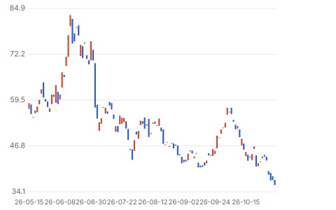

**주봉**

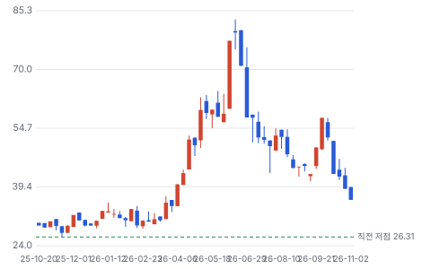

**월봉**

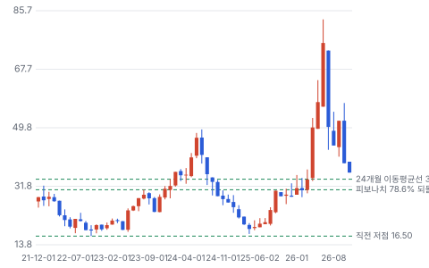

**분기 매출·EPS 실적과 컨센서스**

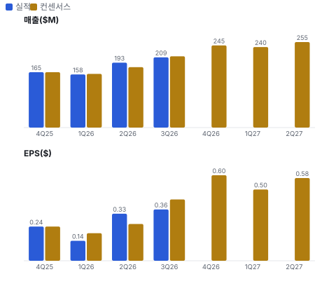

**최근 4개 분기 주가 변화 분석**

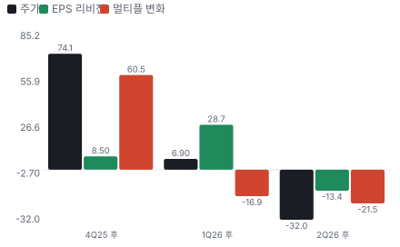

**EPS 리비전**

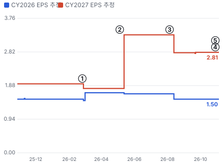

① 26-02-25 4Q25 실적 · EPS 리비전 -7%
② 26-05-05 1Q26 실적 · EPS 리비전 +83%
③ 26-08-05 2Q26 실적·\$200M 패키징 수주 · EPS 리비전 -15%
④ 26-11-02 합병 종결 연기(8-K) · EPS 리비전 +0%
⑤ 26-11-04 3Q26 실적·EPS 하회 · EPS 리비전 +0%

**밸류에이션 주가 시나리오**

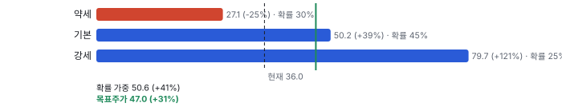

**주가별 업사이드**

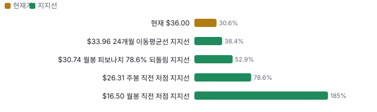

**제품·서비스 포트폴리오**

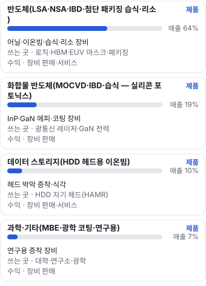

**고객 믹스(FY25·3Q26, 매출 대비)**

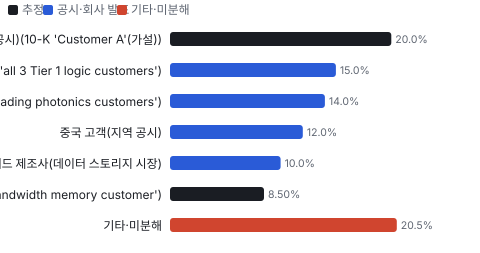

**공급 병목(10점, 낮을수록 병목)**

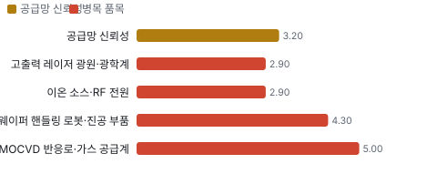

**CAPEX의 매출 대비 비중**

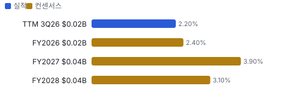

**어닝콜 변화별 주주가치 영향**

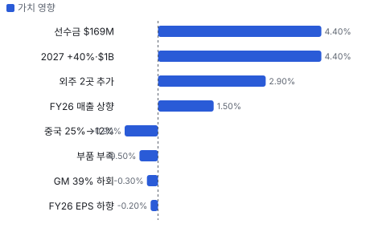

**멀티플 프리미엄**

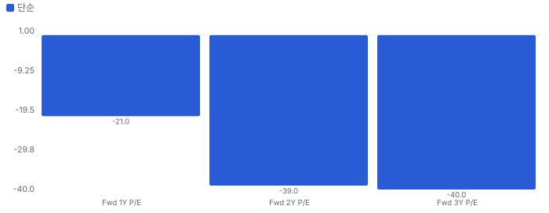

**합리적 멀티플**

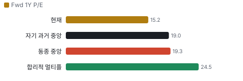

**일별 거래량 분해**

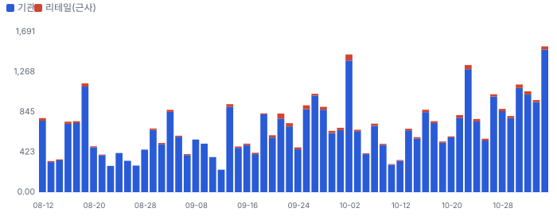

**기관 자금 흐름**

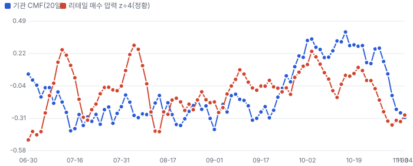

**몬테카를로**

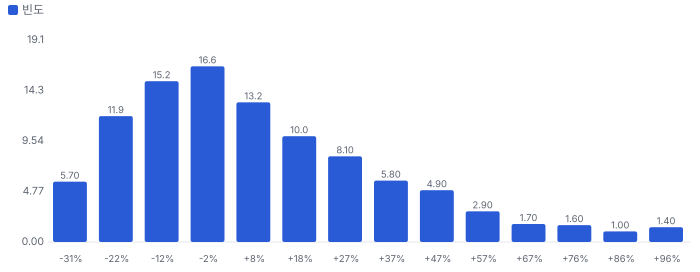

해석: 3,000번 중 1,649번(55%)에서 가치가 지금 주가 이상이었다. 지금 주가를 뒷받침하는 경우와 그렇지 않은 경우가 반반에 가깝다. 가운데 값은 1.03배이고, 열 번 중 여덟 번은 0.77~1.49배 사이에 든다.

## 내러티브

> **기업가치를 결정하는 이야기:** Fwd 1Y P/E 15.2배로 동종 6곳 중앙값 19.3배보다 21% 낮다. 다음 4개 분기 EPS 컨센서스 \$2.36은 FY26 가이던스 중간 \$1.42의 1.7배다. 가치는 두 갈래다 — 합병이 끝나면 Axcelis 주가 × 0.3575, 깨지면 2027년 \$1B·이익률 회복을 증명해야 하는 단독 가치

> **멀티플·EPS 프리미엄**
> **멀티플:** Fwd 1Y P/E 15.2배, 동종 6곳 중앙값 19.3배(KLIC 12.0·ONTO 17.8·ACLS 19.3·ACMR 19.3·CAMT 21.3·NVMI 25.7)
> **EPS:** 3Q EPS \$0.36은 발표 직전 추정 \$0.43의 84%. 2Q 콜 뒤 2027년 1~3분기 EPS 추정은 \$0.59·0.65·0.72에서 \$0.50·0.58·0.68로 내려갔다

### 투자자들은 왜 열광했나

4월~6월에 \$34에서 \$83까지 2.4배 올랐다 — 1Q 실적 다음 날 +25%, 2Q \$200M 패키징 수주와 InP 레이저 주문이 이유였고 같은 기간 Axcelis도 \$93에서 \$192로 올랐다. 7월 이후 −57%는 Axcelis −52%와 같은 날 같은 방향으로 움직였다(7/2 −18%·−24%, 10/22 −12%·−10%) — Veeco 고유 악재는 3Q 마진 하회뿐이다

### 무엇이 기업가치를 바꾸나

> **구조적 체질 변화**
> **변화:** 성숙 공정·중국 의존(2Q 25%)에서 AI 첨단 공정·패키징·광통신 중심으로 — 3Q 중국 12%
> **증거:** 3Q 콜·10-Q
> **반증:** 2027년 첨단 패키징·포토닉스 성장이 중국 감소를 못 메운다

> **고부가 믹스 확장**
> **변화:** 화합물 반도체 11% → 19%, 그러나 신제품 램프로 매출총이익률은 40.8%(3Q25) → 38.4%(3Q26, GAAP)
> **증거:** 10-Q·콜
> **반증:** 4Q 매출총이익률 43~44% 달성

> **기술 혁신**
> **변화:** NSA(저열 예산 어닐)·IBD-300(D램 저저항 금속막)·패널 습식 — 세 신제품이 평가·초기 주문 단계
> **증거:** 3Q 콜
> **반증:** IBD-300 D램 2027년 파일럿 주문이 안 나온다

> **실행 속도**
> **변화:** 현 공장 공간이 차서 외주사 2곳(동남아·미국)으로 2027년 캐파 2배 넘게 — 부품 리드타임은 늘었다 **납품 리드타임 6~18개월.** 피어 비교 미확인. 이전 대비 미확인.
> **증거:** 3Q 콜

> **M&A**
> **변화:** Axcelis에 피인수 — 0.3575주 교환, 양사 주총 승인(2026-02-06), SAMR 대기, HSR(미국 하트-스콧-로디노법 — 기업 결합 사전 신고·대기 제도) 재신고, 종결 2027년 1분기 말 예상
> **증거:** 10-Q 10번 주석·8-K(11/2)
> **반증:** 2027-06-30 기한까지 SAMR 승인 실패

> **정책·입법 연관성**
> **재정정책:** CHIPS 보조금은 이 회사 직접 수혜 공시가 없다. 고객(미국 팹) 보조금을 통한 간접 노출 10-K·10-Q 검색 반증: 반도체 투자세액공제 축소 의결 의회 동의 4/10 — 하원 2/5(CHIPS 세액공제 확대는 한쪽 당 지지만 확인) · 상원 2/5(같음).
> **행정명령:** 수출 통제: 3Q에 LSA 1대 매출이 미국 정부 수출 심사로 늦어졌다. 중국 매출은 25% → 12% 3Q 콜 반증: 대중 장비 수출 통제 추가 확대 의회 동의 0/10 — 하원 0/5(행정부 단독 조치(BIS(미국 상무부 산업안보국 — 수출 통제 담당))) · 상원 0/5(같음).
> **연관입법:** 합병은 중국 SAMR 심사 대기 — 미국 법안이 아니라 중국 반독점 절차다. 로비 공시는 키가 없어 미확인 8-K(11/2) 반증: SAMR 조건부 승인(사업 매각 요구)

> **CAPEX 낙수효과**
> **변화:** AI 인프라 투자 → 패키징·HBM(고대역폭 메모리 — D램을 수직으로 쌓은 AI용 메모리)·광연결 장비. 고객 투자 발표를 이 회사 매출로 바로 옮기지 않는다 — 확인된 것은 \$200M 수주·선수금 \$169M·RPO(잔여 이행 의무 — 계약했지만 아직 매출로 잡지 않은 금액) \$425.6M
> **증거:** 콜·10-Q
> **반증:** 2027년 WFE(웨이퍼 팹 장비 — 전공정 반도체 장비 시장 전체) 성장이 20% 아래

### 내러티브 근거

> AI 투자가 첨단 패키징·HBM·광통신 레이저를 한꺼번에 늘리면서, 어닐·이온빔·습식·MOCVD를 다 가진 중형 장비사가 2027년 매출 \$1B를 넘는다는 이야기다. 그러나 주가는 이야기보다 Axcelis 주가를 따라간다 — 합병이 끝나면 Veeco 1주가 Axcelis 0.3575주가 되기 때문이다. 6월 \$83에서 11/4 \$36까지 −57%는 Axcelis −52%와 같은 길이다. 동종 대비 멀티플 차이 -21% 중 회사 고유 몫은 -38%다. 단계는 컨센서스, 쏠림은 보통이다.

> **첨단 패키징 2027년 2배** · 강화
> **논리:** CoWoS(TSMC의 2.5D 첨단 패키징(실리콘 인터포저 위에 GPU·HBM을 올린다))급 패키징 증설로 습식·리소 장비 매출이 2027년 2배 쪽으로 간다
> **숫자:** 2Q 수주 \$200M(대부분 2027 인도), 고객 선수금 \$169M
> **반증:** 2027년 상반기 패키징 매출이 2026년 수준에 머문다

> **실리콘 포토닉스 InP 레이저** · 강화
> **논리:** 광연결 전환으로 InP 레이저 에피·습식·단면 코팅 장비가 늘어난다
> **숫자:** 화합물 반도체 3Q \$40M(+96% QoQ), 2026년 약 2배
> **반증:** Lumina(Veeco의 비소·인화물(As/P) MOCVD 장비 — InP 레이저용) 신규 고객 추가가 2027년에 없다

> **차세대 어닐·HBM 메모리 진입** · 유지
> **논리:** NSA가 Tier1 로직 3곳에 들어가고 LSA가 HBM·NAND로 넓어진다
> **숫자:** NSA 1곳 매출 주문, HBM 고객 LSA 양산 기준 장비, 어닐 SAM(회사가 공략할 수 있는 시장 규모(Serviceable Available Market)) 2030년 약 \$1.3B(회사)
> **반증:** 2·3번째 Tier1이 NSA 평가 뒤 주문하지 않는다

> **합병 교환 비율 앵커** · 유지
> **논리:** 종결 전까지 주가는 Axcelis × 0.3575에 묶이고, 지금은 그보다 9% 비싸다
> **숫자:** 교환 가치 \$32.94 vs \$36.00(+9.3%), 6/15 +21%
> **반증:** SAMR 승인 뒤에도 웃돈이 남는다(웃돈이 단독 가치를 뜻한다)

> **반대: 마진 실행** · 강화
> **논리:** 매출이 늘어도 공급 제약·외주 램프 비용이 이익률을 누른다
> **숫자:** 3Q 매출총이익률 39% vs 가이던스 41~42%, FY26 EPS 가이던스 하향, 2027 1~3분기 EPS 추정 −6~−15%
> **반증:** 4Q 매출총이익률 43% 이상

> **반대: 중국 매출 감소** · 강화
> **논리:** 성숙 공정 LSA 중국 매출이 계속 준다
> **숫자:** 중국 25%(2Q) → 12%(3Q), 2027년 추가 감소(CEO)
> **반증:** 중국 비중 10% 아래에서 멈추고 총매출이 가이던스 상단

## 포트폴리오

| 제품·서비스 | 구분 | 무엇 | 쓰는 곳 | 돈 버는 방식 | Mix | Mix 변화(전 분기 대비) |
|---|---|---|---|---|---|---|
| 반도체(LSA·NSA·IBD(이온빔 증착 — 이온빔으로 타깃을 때려 매우 균일한 박막을 쌓는 장비(Ion Beam Deposition))·첨단 패키징 습식·리소) | 제품 | 어닐·이온빔·습식·리소 장비 | 로직·HBM·EUV(극자외선 노광 — 13.5nm 빛으로 회로를 새기는 노광 기술) 마스크·패키징 | 장비 판매·서비스 | 미확인 | 미확인 |
| 화합물 반도체(MOCVD·IBD·습식 — 실리콘 포토닉스) | 제품 | InP·GaN(질화갈륨 — 고효율 전력·고주파 반도체 소재) 에피·코팅 장비 | 광통신 레이저·GaN 전력 | 장비 판매 | 미확인 | 미확인 |
| 데이터 스토리지(HDD(하드디스크 드라이브) 헤드용 이온빔) | 제품 | 헤드 박막 증착·식각 | HDD 자기 헤드(HAMR(열 보조 자기 기록 — 레이저로 디스크를 데워 기록 밀도를 높이는 HDD 기술)) | 장비 판매·서비스 | 미확인 | 미확인 |
| 과학·기타(MBE(분자선 에피택시 — 진공에서 원자층 단위로 결정을 키우는 연구용 장비)·광학 코팅·연구용) | 제품 | 연구용 증착 장비 | 대학·연구소·광학 | 장비 판매 | 미확인 | 미확인 |

## 고객

> **FY25·3Q26 최대 고객 선두 파운드리(이름 미공시)(10-K 'Customer A'(가설)) 20%, 상위 3곳 49%, 집중도 분산.** 공시·회사 발표로 확인한 몫은 매출의 51%이고, 나머지 고객 몫은 추정이거나 미분해다. 10-K는 FY25 매출의 17%를 낸 고객 A 한 곳만 10%를 넘었다고 적는다(FY24 11%). 상위 10곳이 매출채권의 68%다. 3Q26 지역은 대만 \$53.0M(25%)·미국 31%·중국 12%다. 회사 설명으로는 선두 파운드리(첨단 패키징 습식·LSA), Tier1 로직 3곳(LSA 양산 기준 장비), HBM 고객 1곳, HDD 헤드 제조사, InP 레이저 업체가 큰 몫이다 — 이름 연결은 가설

**고객별 매출 몫(FY25·3Q26)**
| 고객 | 몫 | 변화 | 근거 |
|---|---|---|---|
| 선두 파운드리(이름 미공시)(10-K 'Customer A'(가설)) | 15~25% | +3%p | 추정 |
| Tier1 로직 3곳(콜 'all 3 Tier 1 logic customers') | 10~20% | 미확인 | 회사 발표 |
| InP 레이저·광통신 업체(복수)(콜 'leading photonics customers') | 10~18% | +3%p | 공시 |
| 중국 고객(지역 공시) | 10~14% | -13%p | 공시 |
| HDD 헤드 제조사(데이터 스토리지 시장) | 8~12% | +5%p | 공시 |
| HBM·D램 고객(콜 'Tier 1 high-bandwidth memory customer') | 5~12% | 미확인 | 추정 |
| 기타·미분해 | 20% | - | - |

> **선두 파운드리(이름 미공시)(10-K 'Customer A'(가설))** · 추정
> **사는 것:** 첨단 패키징 습식(WaferStorm(Veeco의 단일 웨이퍼 습식 세정·포토레지스트 박리 장비)·WaferEtch(Veeco의 단일 웨이퍼 습식 식각 장비))·리소그래피, LSA, 패널 습식 평가 장비
> **추정 근거:** 대만 매출 3Q \$53.0M(25%)·9개월 \$162.0M과 '선두 파운드리 첨단 패키징 수주' 발언 — 고객 A가 이 회사라는 것은 가설 · prior = FY25 고객 A 17%(10-K)

> **Tier1 로직 3곳(콜 'all 3 Tier 1 logic customers')** · 회사 발표
> **사는 것:** LSA(양산 기준 장비)·NSA 평가·주문
> **추정 근거:** 3곳 모두 LSA 양산 기준 장비, NSA는 1곳 매출 주문·1곳 평가·1곳 평가 장비 출하. 몫은 미공시

> **InP 레이저·광통신 업체(복수)(콜 'leading photonics customers')** · 공시
> **사는 것:** Lumina·Lumina Plus(Lumina의 생산성 개선판 MOCVD 장비) MOCVD, 습식, Spector(Veeco의 레이저 단면(facet) 코팅용 이온빔 증착 장비) IBD
> **추정 근거:** 3Q 화합물 반도체 \$40M(19%, 전 분기 대비 +96%) — 실리콘 포토닉스가 주도 · prior = 2Q26 화합물 반도체 11%

> **중국 고객(지역 공시)** · 공시
> **사는 것:** LSA(성숙 공정)·기타
> **추정 근거:** 3Q 12%, 2027년 더 줄 것(CEO) · prior = 2Q26 25%

> **HDD 헤드 제조사(데이터 스토리지 시장)** · 공시
> **사는 것:** 헤드용 이온빔 증착·식각 장비
> **추정 근거:** 3Q 데이터 스토리지 \$20M(10%), 2026년 약 \$80M으로 2배(CEO). 고객은 소수 HDD 회사 — 이름 미공시 · prior = FY25 데이터 스토리지 약 5%(FY25 \$40M 추정)

> **HBM·D램 고객(콜 'Tier 1 high-bandwidth memory customer')** · 추정
> **사는 것:** LSA 양산 기준 장비, IBD-300 평가 2대(D램 2곳)
> **추정 근거:** 2026년 투자를 앞당긴 HBM 고객 1곳 — 회사 이름은 공시되지 않았다

## 수주·파이프라인

> **2026-11-04 기준 6건.** 확정 \$0.63B.

**실행 속도와 방해 요인**
| 항목 | 상태 | 실행 속도 | 방해 요인 |
|---|---|---|---|
| 첨단 패키징 습식·리소 수주(2Q) | 확정 | 주문→출하 6~18개월 | 부품 부족 · 외주사 램프 |
| 1년 넘는 계약 잔여 이행 의무 | 확정 | 1~3년 | 취소·일정 변경 |
| 300mm GaN-on-실리콘 양산 주문 | 확정 | 미확인 | 고객 수요 |
| NSA Tier1 로직 3곳 | 파이프라인 | 미확인 | 고객 평가 |
| IBD-300 D램 평가 2대 | 파이프라인 | 미확인 | 장비 견고성 검증 |
| 실리콘 포토닉스 Lumina·Lumina Plus 주문 | 확정 | 미확인 | 신제품 생산 램프 |

## 마진 구조

> **GPM 38.4%, OPM 6.7%.** 3Q25 대비 GPM -2.4%p, OPM +0.4%p. 변동비는 매출의 61%이고, 매출이 10% 늘면 OPM은 +2.9%p 움직인다. 3Q26 GAAP 매출총이익률 38.4%(1년 전 40.8%), 비GAAP 39%. 회사는 공급망 비용·제품 믹스·수출 심사로 이연된 LSA 1대를 이유로 들었다. 연구개발 16.7%·판관비 13.6%로 GAAP 영업이익률 6.7%, 비GAAP 12.0%

> **매출 100 중 매출원가 62.6, 매출총이익 37.4(최근 4분기, 공시).** 매출원가 요인 중 구매 부품·서브어셈블리(레이저·이온 소스·진공·로봇·광학)이 매출의 42.0%로 가장 무겁고, 단가가 +10% 오르면 GPM이 -4.20%p 움직인다. 분기 회귀로 매출 1이 늘 때 매출원가는 0.57 늘고, 매출원가의 고정비 몫은 4%다.

**비용 요인 강도 — 비중·추세·충격(+10%)·탄력**
| 비용 | 구분 | 매출 대비 | 1년 변화 | 마진 기여 | 충격 시 마진 | 매출 탄력 | 고정비 몫 |
|---|---|---|---|---|---|---|---|
| 구매 부품·서브어셈블리(레이저·이온 소스·진공·로봇·광학) | 매출원가 요인 | 42.0% | 미확인 | 미확인 | -4.20%p | 미확인 | 0% |
| 직접 인건비·제조 간접비(산호세·서머셋·호샴·세인트폴) | 매출원가 요인 | 10.0% | 미확인 | 미확인 | -1.00%p | 미확인 | 60% |
| 외주 제조·물류·관세 | 매출원가 요인 | 5.0% | 미확인 | 미확인 | -0.50%p | 미확인 | 20% |
| 보증·설치·재고 충당·기타 | 매출원가 요인 | 4.6% | 미확인 | 미확인 | -0.46%p | 미확인 | 30% |
| 매출원가 | 공시 항목 | 62.6% | +3.5%p | -3.5%p | -6.26%p | 0.57 | 4% |
| 연구개발 | 공시 항목 | 17.7% | +0.1%p | -0.1%p | 미확인 | 0.11 | 36% |
| 판관비 | 공시 항목 | 14.4% | -0.0%p | +0.0%p | 미확인 | 0.06 | 62% |
| 기타 영업비용 | 공시 항목 | 1.5% | +3.4%p | -3.4%p | 미확인 | -0.12 | 100% |
| 감가상각 | 공시 항목 | 0.3% | -0.2%p | +0.2%p | 미확인 | -0.03 | 100% |

매출 탄력 = 분기 비용을 매출에 회귀한 기울기(매출 1당 변동비), 고정비 몫 = 절편 ÷ 평균 비용. 표본이 8분기 미만이면 미확인. 매출원가 요인 비중은 margin 재료의 추정이 섞여 있고, 공시 매출원가와의 차이는 '기타 매출원가'로 둔다.

**GPM에서 OPM까지(GAAP)**
| 기간 | GPM | 연구개발 | 판관비 | 기타 | OPM |
|---|---|---|---|---|---|
| 3Q25 | 40.8% | 17.5% | 14.9% | 2.1% | 6.4% |
| 3Q26 | 38.4% | 16.7% | 13.6% | 1.3% | 6.7% |

**마진을 결정하는 비용 요인 — 비용 +10% 시 OPM**
| 비용 | 매출 대비 | 변화 | 고정비 | OPM |
|---|---|---|---|---|
| 구매 부품·서브어셈블리(레이저·이온 소스·진공·로봇·광학) | 42.0% | 미확인 | 0% | -4.20%p |
| 연구개발 | 16.7% | -0.7%p | 80% | -1.67%p |
| 판매·관리비 | 13.6% | -1.2%p | 70% | -1.36%p |
| 직접 인건비·제조 간접비(산호세·서머셋·호샴·세인트폴) | 10.0% | 미확인 | 60% | -1.00%p |
| 외주 제조·물류·관세 | 5.0% | 미확인 | 20% | -0.50%p |
| 보증·설치·재고 충당·기타 | 4.6% | 미확인 | 30% | -0.46%p |
| 상각·합병 비용·기타 | 1.3% | -0.8%p | 50% | -0.13%p |

**비용을 움직이는 요인**
| 비용 | 요인 |
|---|---|
| 구매 부품·서브어셈블리(레이저·이온 소스·진공·로봇·광학)(매출원가) | 부품 단가 — 업계 공통 부족으로 상승(CFO) · 근거 추정 |
| 연구개발(연구개발) | IBD-300·NSA·Lumina 개발 인력 · 근거 공시 |
| 판매·관리비(판관비) | 인력·주식 보상 · 근거 공시 |
| 직접 인건비·제조 간접비(산호세·서머셋·호샴·세인트폴)(매출원가) | 가동률·캐파 확장 준비 인력 · 근거 추정 |
| 외주 제조·물류·관세(매출원가) | 외주사 2곳 램프·관세 · 근거 추정 |
| 보증·설치·재고 충당·기타(매출원가) | 설치 대수 · 근거 추정 |
| 상각·합병 비용·기타(기타) | 합병 비용 \$2.3M(3Q) · 근거 공시 |

**반도체(LSA·NSA·IBD·첨단 패키징 습식·리소) BOM — 매출의 64%, GPM 41%(추정 — 시장별 이익률 미공시. 회사 3Q GAAP 매출총이익률 38.4%에 맞춘 값), 항목 가격 +10% 시**
| 항목 | 원가 몫 | 전가 | 제품 GPM | OPM |
|---|---|---|---|---|
| 고출력 레이저 광원·광학계 | 15~30% | 미확인 | -1.3%p | -0.86%p |
| 웨이퍼 핸들링 로봇·진공 부품 | 15~25% | 미확인 | -1.2%p | -0.76%p |
| 습식 공정 모듈·약액 공급계 | 10~25% | 미확인 | -1.0%p | -0.67%p |
| 미분해 | 40% | - | - | - |

**화합물 반도체(MOCVD·IBD·습식 — 실리콘 포토닉스) BOM — 매출의 19%, GPM 33%(추정 — 신제품(Lumina) 램프 초기라 낮게 둔다), 항목 가격 +10% 시**
| 항목 | 원가 몫 | 전가 | 제품 GPM | OPM |
|---|---|---|---|---|
| MOCVD 반응로·가스 공급계 | 20~35% | 미확인 | -1.8%p | -0.35%p |
| 히터·온도 제어 | 10~20% | 미확인 | -1.0%p | -0.19%p |
| 이온 소스·RF(무선 주파수(Radio Frequency)) 전원 | 10~20% | 미확인 | -1.0%p | -0.19%p |
| 미분해 | 42% | - | - | - |

**데이터 스토리지(HDD 헤드용 이온빔) BOM — 매출의 10%, GPM 40%(추정), 항목 가격 +10% 시**
| 항목 | 원가 몫 | 전가 | 제품 GPM | OPM |
|---|---|---|---|---|
| 이온 소스·RF 전원 | 15~30% | 미확인 | -1.4%p | -0.13%p |
| 진공 챔버·펌프 | 15~25% | 미확인 | -1.2%p | -0.12%p |
| 웨이퍼 핸들링 로봇·진공 부품 | 10~20% | 미확인 | -0.9%p | -0.09%p |
| 미분해 | 43% | - | - | - |

**과학·기타(MBE·광학 코팅·연구용) BOM — 매출의 7%, GPM 38%(추정), 항목 가격 +10% 시**
| 항목 | 원가 몫 | 전가 | 제품 GPM | OPM |
|---|---|---|---|---|
| 진공 챔버·펌프 | 20~35% | 미확인 | -1.7%p | -0.11%p |
| 이온 소스·RF 전원 | 10~20% | 미확인 | -0.9%p | -0.06%p |
| 정밀 광학·계측 부품 | 10~20% | 미확인 | -0.9%p | -0.06%p |
| 미분해 | 42% | - | - | - |

고출력 레이저 광원·광학계 가격이 +10% 오르면 영업이익은 -12.7% 움직인다. 판매가 전가를 모르는 항목은 전가 0%로 계산했다.

**BOM 항목 가격을 움직이는 것**
| 항목 | 요인 |
|---|---|
| 고출력 레이저 광원·광학계 | LSA·NSA의 핵심 부품, 10-K 단일 공급원 위험 · 근거 추정 |
| 웨이퍼 핸들링 로봇·진공 부품 | 300mm 장비 공통 부품 · 근거 추정 |
| 습식 공정 모듈·약액 공급계 | 첨단 패키징 습식 장비 · 근거 추정 |
| MOCVD 반응로·가스 공급계 | MOCVD 핵심 모듈 · 근거 추정 |
| 히터·온도 제어 | 에피 균일도 결정 · 근거 추정 |
| 이온 소스·RF 전원 | Spector IBD · 근거 추정 |
| 이온 소스·RF 전원 | IBD·이온빔 식각 공통 · 근거 추정 |
| 진공 챔버·펌프 | 고진공 장비 · 근거 추정 |
| 웨이퍼 핸들링 로봇·진공 부품 | 공통 부품 · 근거 추정 |
| 진공 챔버·펌프 | MBE · 근거 추정 |
| 이온 소스·RF 전원 | 광학 코팅 IBD · 근거 추정 |
| 정밀 광학·계측 부품 | 연구용 장비 · 근거 추정 |

## 공급망 병목

> **공급망 신뢰성 3.2/10, 병목 심각.** 가장 약한 고리는 고출력 레이저 광원·광학계 2.9점이고, 품목 평균은 3.7점이다. 근거가 부족한 1건(외주 시스템 조립(동남아·미국))은 점수에서 뺐다. 10-K는 일부 부품이 단일 공급원이라고 적는다. 3Q에 CFO가 업계 공통 부품 부족과 리드타임 증가를 처음 말했고, 회사는 2027년 물량을 미리 발주하고 선급금을 낸다. 구매 약정은 2025년 말 \$150.8M에서 9/30 \$411.0M으로 2.7배다. 공급사 이름은 공시하지 않는다

**병목과 마진 — 품목 가격 +10% 시 OPM**
| 품목 | 점수 | 판정 | 구분 | OPM |
|---|---|---|---|---|
| 고출력 레이저 광원·광학계(필수) | 2.9 | 병목 심각 | 핵심 통제 품목 | -0.86%p |
| 이온 소스·RF 전원(필수) | 2.9 | 병목 심각 | 출하 차질 위험 | -0.38%p |
| 웨이퍼 핸들링 로봇·진공 부품(필수) | 4.3 | 병목 주의 | 핵심 통제 품목 | -0.85%p |
| MOCVD 반응로·가스 공급계 | 5.0 | 병목 주의 | 출하 차질 위험 | -0.35%p |

> **고출력 레이저 광원·광학계** · 2.9/10
> **왜:** LSA·NSA 출하를 정하는 부품 · 인증 공급사 1곳은 10-K '단일 공급원' 문구를 보수적으로 읽은 값(추정). 재인증 12개월은 업계 통상 범위의 중간(추정)
> **병목 요인:** 인증 공급사 1곳 · 캐파 부족 · 리드타임 미확인 · 재인증 12개월 · 1위 점유율 미확인 · 지역 집중 미확인 · 물량 확보 선급금
> **풀리는 조건:** 미확인

> **이온 소스·RF 전원** · 2.9/10
> **왜:** IBD·이온빔 식각 공통 · 인증 공급사 수는 추정
> **병목 요인:** 인증 공급사 1곳 · 캐파 부족 · 리드타임 미확인 · 재인증 12개월 · 1위 점유율 미확인 · 지역 집중 미확인 · 물량 확보 선급금
> **풀리는 조건:** 미확인

> **웨이퍼 핸들링 로봇·진공 부품** · 4.3/10
> **왜:** 업계 공통 부족 품목에 들 가능성(추정)
> **병목 요인:** 인증 공급사 2곳 · 캐파 부족 · 리드타임 미확인 · 재인증 12개월 · 1위 점유율 미확인 · 지역 집중 미확인 · 물량 확보 선급금
> **풀리는 조건:** 미확인

> **MOCVD 반응로·가스 공급계** · 5.0/10
> **왜:** 신제품 램프
> **병목 요인:** 인증 공급사 1곳 · 캐파 균형 · 리드타임 미확인 · 재인증 12개월 · 1위 점유율 미확인 · 지역 집중 미확인 · 물량 확보 선급금
> **풀리는 조건:** 미확인

**공급사**
| 품목 | 공급사 | 몫 | 근거 |
|---|---|---|---|
| 고출력 레이저 광원·광학계 | 미공시(레이저·광학 — 단일·소수 공급원(10-K 위험 요인)) | 미확인 | 공시 |
| 이온 소스·RF 전원 | 미공시(이온 소스·전원 — 소수 공급원) | 미확인 | 공시 |
| 웨이퍼 핸들링 로봇·진공 부품 | 미공시(로봇·진공 — 업계 공통 품목) | 미확인 | 공시 |
| MOCVD 반응로·가스 공급계 | 미공시(자체 설계·외부 가공) | 미확인 | 공시 |
| 외주 시스템 조립(동남아·미국) | 외주 제조사 2곳(이름 미공시)(동남아 완성 시스템(1Q27 첫 출하), 미국 서브어셈블리 → 완성 시스템) | 미확인 | 회사 발표 |

## 생산능력

> **현재 명목 캐파 미확인, 가동률 미확인.** 착공 이상 증설은 0 공장 면적(제곱피트)·출하 대수 — 회사는 생산 단위 캐파를 공시하지 않는다, 발표까지 합치면 0 공장 면적(제곱피트)·출하 대수 — 회사는 생산 단위 캐파를 공시하지 않는다이다. TTM 3Q26 CAPEX는 \$0.02B로 매출의 2.2%다. 소유 시설은 플레인뷰 본사 80,000·서머셋 80,000·세인트폴 43,000·서머셋 38,000제곱피트, 임차 산호세 100,000·호샴 49,000제곱피트(10-K). CEO는 현 공장이 공간이 찼다며 2027년 캐파를 2배 넘게 늘리되 대부분 동남아 외주사로 간다고 했다

**생산능력 확충 계획**
| 계획 | 단계 | 증설 | 가동 시점 | CAPEX |
|---|---|---|---|---|
| 동남아 외주사 완성 시스템 조립(계약, 1Q27 첫 출하 예정) | 발표 | 미확인 | 2027-03 | 미확인 |
| 자체 공장 확장 | 발표 | 미확인 | 미확인 | 미확인 |

남은 계획의 CAPEX 합계는 \$0.00B(금액 미확인 2건 제외)다. 합계는 FY2028 매출의 0%다.

**증설 방해 요인**
| 계획 | 방해 요인 |
|---|---|
| 동남아 외주사 완성 시스템 조립(계약, 1Q27 첫 출하 예정) | 외주사 수율·부품 부족 |
| 자체 공장 확장 | 공간 포화 |

**CAPEX와 매출 대비**
| 기간 | CAPEX | 매출 | 매출 대비 | 구분 |
|---|---|---|---|---|
| TTM 3Q26 | \$0.02B | \$0.73B | 2.2% | 실적 |
| FY2026 | \$0.02B | \$0.81B | 2.4% | 컨센서스 |
| FY2027 | \$0.04B | \$1.08B | 3.9% | 컨센서스 |
| FY2028 | \$0.04B | \$1.24B | 3.1% | 컨센서스 |

## 해자

> 해자는 Tier1 로직 3곳 모두의 LSA 양산 기준 장비 지위와, EUV 마스크 블랭크 다층막 이온빔 증착의 시장 선도다. 첨단 패키징 습식과 InP MOCVD는 경쟁이 있고 MOCVD는 점유율이 낮다

> **LSA 양산 기준 장비(POR(양산 기준 공정 장비로 채택된 상태(Process Tool of Record)))** · 강함
> **해자:** Tier1 로직 3곳 모두에서 LSA가 양산 기준 장비다 — 공정을 다시 인증해야 바꿀 수 있다
> **근거:** 3Q 콜·10-Q
> **숫자:** Tier1 3곳 중 3곳, NSA는 1곳 매출 주문
> **깨지는 조건:** Tier1 1곳이 차세대 노드에서 다른 어닐 장비를 기준 장비로 고른다

> **EUV 마스크 블랭크 이온빔 증착** · 보통
> **해자:** EUV 마스크 블랭크의 다층 반사막 증착에서 시장 선도
> **근거:** 3Q 콜·10-K
> **숫자:** IBD 전공정 SAM 2030년 약 \$500M(회사)
> **깨지는 조건:** 마스크 블랭크 업체가 다른 증착 방식을 양산에 넣는다

> **첨단 패키징 습식(단일 웨이퍼)** · 보통
> **해자:** 선두 파운드리·메모리·OSAT(반도체 후공정 외주 조립·시험 회사) 수주, 패널 장비 인증 중
> **근거:** 2Q \$200M 수주, 3Q 콜
> **숫자:** 회사 추정 첨단 패키징 SAM 2030년 약 \$1B
> **깨지는 조건:** 패널 습식 인증에서 경쟁사가 공동 공급사로 들어온다

> **InP 레이저 MOCVD** · 약함
> **해자:** 신제품 Lumina로 InP 레이저 시장에 들어가는 중
> **근거:** Steelhead 질문: '저점유율 회사'
> **숫자:** 점유율 미공시, 2027년 램프 제약
> **깨지는 조건:** 2027년 신규 고객 추가가 없다

## 경영진·네트워크

> William J. Miller(57)가 2018년부터 CEO, John P. Kiernan(63)이 2020년부터 CFO, Richard A. D'Amore(72, 1990년 이사회 합류)가 이사회 의장이다. 2026년 임원·이사는 장내 매도만 45건 했고, CEO는 6·8월 25만 주(약 \$13.8M)를 팔았다

> **William J. Miller, Ph.D.** · CEO·이사 · 2018
> **프로필:** 2002년 입사, 그 전 Advanced Energy 엔지니어링·운영. 2026-06-02 5만 주(\$2.9M)·08-17 20만 주(\$10.8M) 장내 매도
> **비즈니스:** Advanced Energy 출신
> **정계:** 미확인
> **동문:** 미확인
> **사모임:** 미확인

> **John P. Kiernan** · SVP·CFO · 2020
> **프로필:** 2011년부터 재무·회계 책임자, 2026-08-10 3.5만 주(\$1.8M) 장내 매도
> **비즈니스:** 미확인
> **정계:** 미확인
> **동문:** 미확인
> **사모임:** 미확인

> **Richard A. D'Amore** · 이사회 의장 · 1990
> **프로필:** 벤처캐피털 30년 이상, 노스이스턴대 이사회 의장. 2026-05-14 4.4만 주(\$2.7M) 매도
> **비즈니스:** Everbridge 이사
> **정계:** 미확인
> **동문:** 노스이스턴대
> **사모임:** 미확인

**네트워크 정량화**
| 연결 | 강도 | 닿는 매출 | 가중 노출 | 매출 대비 | 근거 |
|---|---|---|---|---|---|
| 비즈니스: CEO의 Advanced Energy(반도체 장비 전원) 경력 | 2/5 | \$0.00B | \$0.00B | 0% | 업계 경력이며 매출 연결 근거 없음 https://www.sec.gov/Archives/edgar/data/103145/000110465926032085/tm261442-1_def14a.htm |

가중 노출은 연결이 닿는 매출의 크기다. 연결이 그 매출을 만들었다는 뜻이 아니며, 인과는 공개 자료로 입증하지 못한다.

## 약세 논리 및 셀온 조건

| 약세 논리 | 근거 | 반박 | 가를 자료 |
|---|---|---|---|
| 웃돈 9%는 종결 때 사라진다 | 교환 가치 \$32.94 vs \$36.00, 종결 2027년 1분기 말 | 5월 말 이후 웃돈이 +7~21%로 계속 있었다 — 시장이 단독 가치를 더 높게 본다 | SAMR 승인·조건 공시(2027-03 전후), 종결 기한 2027-06-30 |
| 마진이 물량을 못 따라간다 | 3Q 매출총이익률 39% vs 가이던스 41~42%, 1년 전 40.8%(GAAP) | 4Q 가이던스 43~44%, 이연된 LSA 1대가 4Q로 | 4Q26 실적(2027-02 하순) |
| 이익 추정이 꺾였다 | 2Q 콜 뒤 2027년 1~3분기 EPS 추정 −6~−15%, FY27 \$2.80 → \$2.64 | FY27 매출 추정 \$1.08B 유지, 선수금 +\$58M | 1Q27 가이던스(2027-02) |
| 공급망이 출하를 막는다 | CFO: 부품 부족·리드타임 증가, 공급망 신뢰성 3.2/10 | 2027년 물량 선발주·선급금, 구매 약정 \$411M | 동남아 외주사 1Q27 첫 출하 여부 |
| 중국 매출이 계속 준다 | 25% → 12%, 2027년 추가 감소(CEO) | 총매출은 가이던스 상단 쪽으로 올렸다 | 4Q·1Q27 지역 매출(콜) |

## 어닝콜 변화

**직전 콜 대비 새로 나오거나 바뀐 내용 → 가치 영향**
| 항목 | 내용 | 직전 콜 | 최신 콜 | 모델 동인 이동 | 확신도 | 가치 영향 |
|---|---|---|---|---|---|---|
| 업데이트 | FY26 매출 가이던스 | \$780~810M(8/5) | \$790~820M(11/4) | 기준연도 매출 +\$0.01B | 0.8 | +1.5% |
| 부정 | FY26 EPS 가이던스 | \$1.36~1.61 | \$1.32~1.52 | 출발 이익률 -0.50% | 0.8 | -0.2% |
| 부정 | 3Q 매출총이익률 | 3Q 가이던스 41~42% | 39%(공급망 비용·믹스·수출 심사 이연) | 출발 이익률 -1.0% | 1.0 | -0.3% |
| 신규 | 2027 성장률 | '2027년 성장 의미 있게 가속' | 40% 안팎, \$1B 초과 경로(공급 제약 반영) | 1년차 성장률 +5.0% | 0.5 | +4.4% |
| 업데이트 | 고객 선수금 | \$114M(6/30) | \$169M(9/30, +\$58M) | 장기 성장 수렴값 +1.0% | 1.0 | +4.4% |
| 신규 | 부품 제약·선급금 | 언급 없음 | 리드타임 증가·부품 부족, 2027년 물량 선발주·선급금 | 목표 이익률 -0.50% | 0.5 | -0.5% |
| 업데이트 | 캐파 확장 | 2027년 캐파 2배 이상(8/5) | 동남아 외주사 1Q27 첫 출하·미국 외주사 완성 시스템 | 매출÷투하자본 +10.0% | 0.8 | +2.9% |
| 부정 | 중국 비중 | 2Q 25% | 3Q 12%, 2027년 추가 감소 | 1년차 성장률 -1.0% | 0.8 | -0.9% |
| **합계** | 단독 합 |  |  | 동시 적용 +11.1% |  | **+11.3%** |

**사건별 EPS 리비전**
| # | 날짜 | 구분 | 사건 | CY2026 EPS 전→후 | CY2027 EPS 전→후 | 리비전 | 주가 반응 |
|---|---|---|---|---|---|---|---|
| ① | 26-02-25 | 실적 | 4Q25 실적 | \$1.50 → \$1.68 | \$1.93 → \$1.80 | -6.7% | +7.8% |
| ② | 26-05-05 | 실적 | 1Q26 실적 | \$1.68 → \$1.65 | \$1.80 → \$3.30 | +83.3% | +25.2% |
| ③ | 26-08-05 | 실적 | 2Q26 실적·\$200M 패키징 수주 | \$1.65 → \$1.50 | \$3.30 → \$2.80 | -15.2% | -2.5% |
| ④ | 26-11-02 | 내러티브 | 합병 종결 연기(8-K) | \$1.50 → \$1.50 | \$2.81 → \$2.81 | +0.0% | -4.1% |
| ⑤ | 26-11-04 | 실적 | 3Q26 실적·EPS 하회 | \$1.50 → \$1.50 | \$2.81 → \$2.81 | +0.0% | - |

**해석:** 3개 구간 누적 주가 +26% = EPS 리비전 +21% × 멀티플 +5%. 더 크게 움직인 쪽은 **EPS 리비전**이다.

## P·Q 사이클

> **10년 위치: Q형 기업(매출 갭 분산의 0%가 가격) — 가격은 추세 대비 -1.3%(수축, 10년 분위 15%), 물량은 +0.8%(확장, 분위 50%). P 프리미엄 -3%, Q 프리미엄 +1%(매출총이익이 정상(추세) 수준보다 요인별로 이만큼 높거나 낮다).** AR(2) 전망으로 P 프리미엄은 4분기 뒤 -1%·8분기 뒤 +1%(+로 반전), Q 프리미엄은 +10%·-3%(−로 반전).

**10년 P·Q 사이클 위치·프리미엄**
| 항목 | 가격(P) | 물량(Q) |
|---|---|---|
| 추세 대비 갭(현재) | -1.3% | +0.8% |
| 사이클 시계 | 수축 | 확장 |
| 10년 분위 | 15% | 50% |
| 프리미엄(현재) | -3% | +1% |
| 프리미엄 4분기 뒤 | -1% | +10% |
| 프리미엄 8분기 뒤 | +1% | -3% |
| 갭 반감기 | 4분기 | 7분기 |

방법: P = 가격 지수 4분기 평균(미국 PPI(생산자물가지수) 반도체 제조 장비 대용 — 회사 판매가가 아니라 업종 가격), Q = TTM 매출 ÷ P. 추세는 로그 레벨의 HP(호드릭-프레스콧 필터 — 시계열에서 추세를 떼어내는 방법) 필터(λ 1600)로 정상(mid-cycle) 수준을 잡는다. 프리미엄 = 요인별 매출총이익 증분 ÷ 정상 매출총이익(정상 GPM 40.8% = 10년 중앙값, 물량 증분 마진 40.8% = 전년 대비 ΔGP(매출총이익(Gross Profit))÷ΔRev 회귀, 가격은 전액 이익 반영). 표본 40개 TTM 분기. 전망은 갭의 AR(2) 통계 외삽이며 가이던스·컨센서스가 아니다. HP 필터는 끝점에서 추세가 최근 값 쪽으로 끌려 현재 갭을 작게 볼 수 있다.

> **Q 사이클 — 최근 4분기 평균 가격 기여 +1.0%, 물량 기여 +4.8%(전년 대비 로그 증가율).** P 강도 4.1/10, Q 강도 5.0/10, 최근 8분기 중 25%가 같은 요인 우세(순환적). AR(2) 투영으로는 4분기 뒤(3Q27) P 사이클로 전환.

**P·Q 사이클 정량**
| 항목 | 가격(P) | 물량(Q) |
|---|---|---|
| 최근 4분기 평균 기여 | +1.0% | +4.8% |
| 강도(0~10, 자기 이력 z) | 4.1 | 5.0 |
| AR(2) 고유 주기 | 11.1분기 | 10.4분기 |
| 다음 4분기 투영 평균 | +2.2% | +11.5% |

가격 근거: 미국 PPI 반도체 제조 장비 대용 — 회사 판매가가 아니라 업종 가격. PPI를 쓰면 회사 판매가가 아니라 업종 가격 대용이다. 로그 증가율이라 가격·물량 기여의 합이 매출 증가율이다. 투영은 통계 외삽이며 가이던스·컨센서스가 아니다. 회사 판매가로 잴 수 없는 이유: 회사는 출하 대수·단가를 공시하지 않는다. 장비 1대 \$5~10M의 고객 주문 물량이 매출을 정한다(Q형 추정이나 잴 수 없음)

## 밸류에이션

> **목표주가 \$47, 업사이드 +31%.** 자리는 약세와 기본 사이(약세 쪽 15%)이고 도달 확률은 약 53%다. 기본 \$50, 강세 \$80(+121%), 약세 \$27(-25%). DCF 기준 업사이드는 기본 +8%, 강세 +33%, 약세 -11%다(WACC 11.3%).

배수 기준 기본 \$50(+39%)과 DCF 기본 업사이드 +8%는 방향은 같고 폭이 다르다. 배수는 다음 4개 분기 EPS \$2.36에 엔진이 고른 21.3배를 곱한다 — FY26 가이던스 중간 \$1.42에서 1.7배로 뛴 이익을 그대로 믿는다. DCF는 FY27 +34% 뒤 FY28 +15%로 감속하고 장기 GAAP 영업이익률을 17%(비GAAP 컨센서스 20.6%에서 주식 보상 4.5% 차감)로 둔다(WACC 11.3%). 두 방식 모두 단독 회사 값이다. 합병이 끝나면 12개월 값은 Axcelis 주가 × 0.3575이고, 지금 교환 가치 \$32.94는 약세 \$27과 목표 \$47 사이에 있다 — 그래서 토론이 규칙 등급 Buy를 Neutral로 한 단계 내렸다.

> **약세 \$27 (-25%)** · 확률 30%
> **가정:** 15.9배 × EPS \$1.70
> **근거:** 부품 부족과 외주사 램프 지연으로 2027년 매출 성장이 15~20%에 그치고 매출총이익률이 40% 안팎에 머문다. 합병은 종결되고 Axcelis 주가가 업종 조정으로 더 빠진다

> **기본 \$50 (+39%)** · 확률 45%
> **가정:** 21.3배 × EPS \$2.36
> **근거:** 4Q 매출총이익률 43~44%를 지키고 2027년 매출이 \$1.0~1.1B. 다음 4개 분기 EPS 컨센서스 \$2.36과 같은 높이

> **강세 \$80 (+121%)** · 확률 25%
> **가정:** 26.6배 × EPS \$3.00
> **근거:** 첨단 패키징 2배·InP 레이저·NSA 2·3번째 Tier1 주문이 겹쳐 2027년 매출 \$1.15B 이상, 매출총이익률 45%. FY27 EPS 추정 상단 \$3.30 쪽

**멀티플 선정 — Fwd 1Y P/E**
| 단계 | 조정 | 근거 |
|---|---|---|
| 동종 중앙값 | 19.3배 | 범위 12.0~25.7배, 6곳 |
| 펀더멘털 | +14% | 성장·이익률·ROIC로 본 합리적 멀티플 24.5배와의 차이의 일부만 인정 |
| 해자 | +6% | LSA 양산 기준 장비(POR) 강함 · EUV 마스크 블랭크 이온빔 증착 보통 · 첨단 패키징 습식(단일 웨이퍼) 보통 · InP 레이저 MOCVD 약함 |
| 반복 매출 | +1% | 반복 매출 25%(동종 20%) · 부품·업그레이드·서비스 · 이미 반복 단계 · 기반 설치 장비 대수 미공시 |
| 수주 전환·가시성 | -5% | RPO 12개월 0.16 → 가시성 0.16 |
| 내러티브 | +0% | 단계 컨센서스 |
| 사이클·실행 판단 | -5% | 3Q 매출총이익률 39%가 가이던스 41~42%를 밑돌았고 공급 제약·캐파 2배 확장 비용이 2027년 상반기 이익률을 누른다. 중국 매출 비중이 내려가는 중이고, 합병 종결 전까지 주가가 Axcelis 주가 × 0.3575에 묶인다 |
| **선정** | **21.3배** | 지금 15.2배 |

**동종 레인지**
| 회사 | Fwd 1Y P/E | Fwd 2Y P/E | Fwd 3Y P/E | 성장 | 영업이익률 | ROIC |
|---|---|---|---|---|---|---|
| ACLS | 19.3 | 17.9 | 14.3 | 9% | 17% | 17% |
| ONTO | 17.8 | 15.9 | 14.2 | 52% | 33% | 21% |
| KLIC | 12.0 | - | - | 59% | 23% | 44% |
| CAMT | 21.3 | 17.0 | 14.0 | 44% | 31% | 23% |
| ACMR | 19.3 | 14.2 | 12.9 | 21% | 17% | 20% |
| NVMI | 25.7 | 24.5 | 22.3 | 25% | 35% | 23% |
| **Veeco Instruments** | 15.2 | 10.3 | 8.5 |  |  |  |

지금 주가가 요구하는 5년 매출 CAGR 10%, 기본 시나리오 13%. 몬테카를로 중앙값 업사이드 +3%.

> 의사결정 보조(투자자문 아님): ① 매수 매력: 연 기대수익 +12.9% (자기자본비용 11.3% 대비 +1.7%p) · 자본비용 초과 확률 53% · 안전마진 0.77 → 정량 신호 중립 / ② 위험 예산 지표(이론): 1/4 켈리 10.0% (상한 10%) · 5년 하위10% +30% · 30%+ 손실 확률 0% / ③ 상방(5년): 기대 1.84배 · 2배 31% · 3배 3% · 10배 0% · 상위10% 2.49배

## 매수 위치(일봉)

> **현재가 \$36.00는 '지지선 미확인'.** 이 자리에서 목표주가까지 +30.6%, 첫 일봉 저항까지 +13.6%, 다음 지지까지 하방 미확인.

**가격대별 업사이드(일봉 기준)**
| 가격대 | 가격 | 목표주가까지 | 첫 저항까지 | 다음 지지까지 | 손익비 | 근거 기법(강도) |
|---|---|---|---|---|---|---|
| 현재가 | \$36.00 | +30.6% | +13.6% | 미확인 | 미확인 | - |

**일봉 저항**
| 저항 | 가격 | 현재가 대비 | 근거 기법(강도) |
|---|---|---|---|
| 저항 1 | \$40.89 | +13.6% | 120일 지그재그 저점 · 스윙 저점(1.8) |
| 저항 2 | \$42.99 | +19.4% | 120일 지그재그 저점(0.8) |
| 저항 3 | \$43.81 | +21.7% | 20일선(0.5) |

일봉만 쓴다(주봉·월봉 제외). 손익비 = 목표주가까지 업사이드 ÷ 다음 지지까지 하방. 가격대별 기대값 참고표이며 매수·매도 시점 지시가 아니다.

## 애널리스트 토론

> **토론 결론 Neutral(규칙 등급 Buy).** 규칙 등급은 Buy(목표 \$47, +31%)다. 그러나 이 목표는 단독 회사 값이고, 합병이 끝나면 주주가 받는 것은 Axcelis 0.3575주(11/4 교환 가치 \$32.94, 현재가 −8.5%)라는 반박이 살아남았다. 목표 \$47은 Axcelis \$131(+43%)과 같은 값이다. 4Q 매출총이익률과 SAMR 결과 전에는 Buy를 받칠 근거가 Veeco 이익이 아니라 Axcelis 주가라 한 단계 내려 Neutral

**패널(가상 애널리스트)**
| 자리 | 애널리스트 | 핵심 논리 | 틀리는 조건 | 최종 투표 |
|---|---|---|---|---|
| Strong Buy | 한지율(가상 리서치 하우스 새벽증권) | 2027년 +40%·\$1B가 선수금과 수주로 받쳐지는데 Fwd 1Y P/E는 동종보다 21% 싸다 | 1Q27 매출 \$240M 아래 | Buy |
| Buy | 오세린(가상 리서치 하우스 다온투자) | 주가 하락은 Axcelis를 따라간 것이지 Veeco 이익 추정이 무너진 게 아니다 | FY27 매출 추정이 \$1.0B 아래로 | Neutral |
| Neutral | 백도현(가상 리서치 하우스 누리자산) | 합병 종결 전에는 가치가 Axcelis × 0.3575에 묶이고, 지금 그보다 9% 비싸다 — 단독 가치는 합병이 깨질 때만 의미가 있다 | SAMR 승인 뒤에도 Veeco가 교환 가치 위에서 거래 | Neutral |
| Sell | 남궁현(가상 리서치 하우스 한결증권) | 매출은 늘지만 마진이 따라오지 않는다 — 3Q 매출총이익률 하회, EPS 가이던스 하향, 2027 분기 EPS 추정도 내려갔다 | 4Q 매출총이익률 43% 이상 | Neutral |
| Strong Sell | 길하람(가상 리서치 하우스 바른리서치) | 교환 가치보다 9% 비싸게 산 사람은 종결과 동시에 그 웃돈을 잃는다. Axcelis가 더 빠지면 함께 빠진다 | 합병이 깨지고 단독 가치가 \$45 이상으로 재평가 | Sell |

**투표**
| Strong Buy | Buy | Neutral | Sell | Strong Sell |
|---|---|---|---|---|
| 0 | 1 | 3 | 1 | 0 |

> **개회 · Strong Buy**
> **발언:** 선수금이 한 분기에 \$58M 늘었다. 고객이 돈을 먼저 냈다는 뜻이고 2027년 +40%는 공급 제약을 반영한 값이라고 CEO가 두 번 말했다

> **개회 · Buy**
> **발언:** 6월 이후 −57%는 Axcelis −52%와 같은 날 같은 방향이다. Veeco 고유 악재는 3Q 마진 하나다

> **개회 · Neutral**
> **발언:** 합병이 끝나면 Veeco 1주는 Axcelis 0.3575주다. 11/4 교환 가치 \$32.94보다 9% 비싸게 거래된다

> **개회 · Sell**
> **발언:** 3Q 매출총이익률 39%는 가이던스 41~42%를 밑돌았고 FY26 EPS 가이던스를 내렸다

> **개회 · Strong Sell**
> **발언:** 웃돈 9%는 종결되면 사라진다. 그 위에 Axcelis 하락 위험까지 진다

> **반박1 · Neutral → Strong Buy**
> **발언:** Fwd 1Y P/E 15배가 싸 보여도 종결되면 주주가 받는 건 Axcelis 주식이다 — Veeco의 배수가 아니라 Axcelis 주가가 값을 정한다

> **반박1 · Buy → Sell**
> **발언:** 4Q 가이던스 매출총이익률 43~44%는 3Q 이연된 LSA 1대와 물량 회복을 반영한다. 3Q 하회 일부는 시점 문제다

> **반박1 · Strong Buy → Strong Sell**
> **발언:** 웃돈은 합병이 깨질 확률과 단독 가치를 산 값이다. 단독 DCF 기본값이 시가총액의 1.08배라 웃돈만큼은 받친다

> **반박1 · Sell → Buy**
> **발언:** 2Q 콜 뒤 2027 1~3분기 EPS 추정이 6~15% 내려갔다. 이익 추정도 꺾였다

> **반박1 · Strong Sell → Neutral**
> **발언:** 종결 예상이 2026년 하반기에서 2027년 1분기 말로 밀렸고 계약 기한(2026-09-30)은 이미 자동 연장됐다. 기다리는 동안 부품 부족이 커진다

> **반박2 · Strong Buy → Sell**
> **발언:** 구매 약정이 \$150.8M에서 \$411.0M으로 늘었다 — 2027년 물량을 미리 잡았다는 숫자다

> **반박2 · Neutral → Buy**
> **발언:** 동반 급락은 맞지만 그래서 더 Axcelis 주가에 달렸다. Veeco 실적만으로 방향을 정할 수 없다

> **반박2 · Sell → Strong Buy**
> **발언:** 선수금은 늘었지만 매출총이익률은 1년 전 40.8%보다 낮다. 물량이 마진으로 바뀐다는 증거가 아직 없다

> **반박2 · Buy → Strong Sell**
> **발언:** 5월 말 이후 웃돈은 +7~21%로 계속 있었다 — 시장은 단독 가치를 꾸준히 더 높게 본다

> **반박2 · Strong Sell → Strong Buy**
> **발언:** 단독 DCF는 2027년 컨센서스 \$1.08B를 그대로 넣었다. 그 표본은 사실상 회사 발언이다

> **최종 · Strong Buy**
> **발언:** 선수금·수주·약정이 2027년을 받친다

> **최종 · Buy**
> **발언:** 하락은 Axcelis를 따라간 것이다

> **최종 · Neutral**
> **발언:** 종결 전에는 교환 가치와 단독 가치 사이에 묶인다

> **최종 · Sell**
> **발언:** 마진 회복을 4Q에서 먼저 봐야 한다

> **최종 · Strong Sell**
> **발언:** 웃돈 9%는 종결 때 사라질 값이다

남은 반대 의견: Strong Buy 자리: 선수금 \$169M·구매 약정 \$411M은 2027년 +40%가 회사 말뿐이 아니라는 숫자다

패널은 가상 인물이고 실존 IB의 의견이 아니다.

## 시장 평가

> **셀사이드(IB 애널리스트)**
> **한 줄:** 셀사이드는 반반이고 목표가 표본이 4명이다. 합병 대기 종목이라 커버리지가 얇아졌다 — 컨센서스 추정 표본이 1명인 분기도 있다
> **의견 분포:** Strong Buy 3·Hold 3 — 6명
> **목표가:** \$54.75(범위 \$35~66) — 현재가 대비 +52%
> **의견 변경:** Northland 상향(제목) — 주문 모멘텀

> **바이사이드(기관 투자자)**
> **한 줄:** 2Q에 롱온리 펀드가 늘렸고 내부자는 고점 부근(5~8월)에서 팔았다
> **13F 기관(2Q26):** 309곳, 순감 35만 주 — 증가 87·감소 77
> **순매수 상위:** T. Rowe Price +168만·Franklin +111만·Barrow Hanley +87만 주 — 롱온리 펀드 신규·확대
> **5% 주주:** BlackRock 14.4%·Vanguard 12.2%
> **내부자:** 2026년 장내 매도 45건·매수 0건, CEO 25만 주 약 \$13.8M

> **언론·업계**
> **한 줄:** 커뮤니티 매체는 합병 일정과 단기 주가를 다룬다 — 2027년 \$1B 경로와 마진 회복은 덜 다룬다
> **보도 초점:** 종결 연기·3Q EPS 하회·지난달 급등 — Seeking Alpha·Motley Fool·MarketBeat

## 체크리스트

| 시점 | 무엇 | 의미 |
|---|---|---|
| 수시 | SAMR 승인·조건, 새 HSR 신고 결과 | 종결이면 주가 = Axcelis × 0.3575, 웃돈 소멸 |
| 2026-12-31 | 2029년 전환사채 전환 가능 기간 끝 | 전환 청구가 오면 원금 \$230M 현금 지급·초과분 주식 |
| 2027-01~03 | 동남아 외주사 첫 출하 | 캐파 2배 계획의 첫 증거 |
| 2027-02 하순 | 4Q26 실적: 매출 \$230~260M·매출총이익률 43~44% | 마진 회복 여부 — 단독 가치의 전제 |
| 2027-06-30 | 합병 기한 자동 연장 끝 | 그때까지 미종결이면 해지 가능 — 단독 가치가 주가를 정한다 |

## 출처
- 3Q26 어닝콜(2026-11-04) 요지
- https://www.sec.gov/Archives/edgar/data/103145/000110465926019711/veco-20251231x10k.htm
- https://www.sec.gov/Archives/edgar/data/103145/000110465926122721/veco-20260930x10q.htm
- 2Q26 어닝콜(2026-08-05) 요지
- https://www.sec.gov/Archives/edgar/data/103145/000110465926122689/veco-ex99d1.htm

_구매 등급·목표주가 모두 규칙이 계산한 모델 값으로, 개인의 보유 종목·자금 사정을 반영하지 않는다 · 공개 자료 기반 분석이며 투자 권유가 아님 · 1차 판정, 미검증 · Chiip ten-bagger_