# 텐배거 리포트 2026-11-06 — 삼성전자 — 분기 영업이익 ₩107T를 내고도 주가는 절반, 시장은 이익이 아니라 사이클의 끝에 값을 매기고 있다

> 2026-11-06 · 삼성전자(005930) · 기업: 메모리(DRAM·HBM·NAND)·파운드리·시스템LSI·스마트폰·가전 종합 전자 기업

## Chiip View

주가는 11/6 종가 ₩188,700(−6.35%)으로 6월 장중 고점 ₩374,500보다 50% 낮다. 시가총액은 ₩1,239T(보통주 가격 × 보통·우선 합산 주식 수 기준, 우선주 할인을 빼면 약 3% 작다), 순현금 ₩197.6T를 뺀 EV는 ₩1,041T다. 3Q26은 매출 ₩195.3T·영업이익 ₩107.4T로 4분기 연속 최대였고 DS(삼성 반도체 부문) 영업이익률이 72%다. 엔진 목표주가는 ₩198,859(+5%), 규칙 등급은 Neutral이고 애널리스트 토론도 등급을 옮기지 않았다. **우리가 다르게 보는 곳은 'DCF가 +140%이니 싸다'는 읽기다.** DCF는 앞 2년 영업이익률 61%(증권사 2곳 추정)가 끌어올린 값이라 약세에서도 +111%가 나온다 — 방향을 가르는 건 할인율이 아니라 메모리 가격이 언제 꺾이느냐다. 지금 Fwd 1Y P/E 2.9배는 메모리 동종 중앙 3.1배와 거의 같아, 시장은 삼성전자를 다른 메모리 회사와 똑같이 '피크 이익' 값으로 매긴다. 경쟁 가설 ① 피크 할인은 정당하다 — 최근 4분기 매출 증가가 가격 +66%·물량 −6%로 거의 가격이다(가를 자료: 2027년 1분기 DRAM(D램 메모리) 계약가 발표, 2027-01) ② 할인의 일부는 환원 불확실성이다 — 10/29 자사주 발표가 없어 실적일 −4%(가를 자료: 1월 말 이사회 소각 규모, 2027-01-28 예상). 회사 답변: 3Q 콜에서 회사는 2027 CAPEX 증가분 상당 부분이 공간 확보·건설비라 2028년 비트 증가가 크지 않고 공급 부족이 2028년까지 간다고 답했다 — ① 쪽 쟁점에 회사가 낸 답이지만 같은 원출처라 독립 확인이 아니다. 중간선거 영향 −0.6/10 — 가장 큰 채널은 CHIPS(미국 반도체 지원법) 보조금 폐지 입법 위험 하락(노출 0.8, +0.8)이지만 반도체 ETF(SMH(미국 반도체 ETF)) 선거 뒤 CAR(누적 초과수익률) −5.7%(t −2.0)가 더 크다. 정책 0단계(선거 결과) 가설이고 하원 결과는 미확정이다.

## 대시보드
| 항목 | 값 | 설명 |
|---|---|---|
| 주가 | ₩188,700 | 고점 대비 -48% · 1년 +90% |
| 시가총액 | ₩1,239T | 완전 희석 기준 · EV ₩1,041T |
| 업사이드 | +5% | 목표주가 ₩198,859 · 다운사이드 -43% · 손익비(강세÷약세) 0.9 |
| 구매등급 | Neutral | 애널리스트 39명: Strong Buy 32 · Buy 6 · Neutral 1 · Sell 0 · Strong Sell 0 |
| 멀티플 | Fwd 1Y P/E 2.9배 | 동종 중앙값 3.1배 |
| 가이던스 4Q26 |  | 컨센서스 ₩16033.00 |
| 알파 | 5.4/10 | 텐배거 가능성 점수 |
| 이벤트 | 4Q26 실적·차기 주주환원 정책(1월 말 이사회, 회사 예고. 날짜는 예상) | 2027-01-28 |

## 한 장 요약
- **기업가치를 결정하는 내러티브** 삼성전자(005930)는 메모리(DRAM·HBM(AI 가속기 옆에 쌓는 고대역폭 메모리)·낸드)·파운드리·시스템LSI(DS), 스마트폰·TV(텔레비전)·가전(DX(삼성 세트(모바일·TV·가전) 부문)), 디스플레이(SDC(삼성디스플레이)), 하만을 가진 복합 전자 회사다. 지금 이익의 99%는 DS에서 나온다. 3Q26 매출 ₩195.3T(+127%)·영업이익 ₩107.4T(55.0%)로 4분기 연속 최대를 냈는데, 주가는 6월 장중 고점 ₩374,500에서 11/6 종가 ₩188,700까지 −50%(종가 고점 ₩362,500 대비 −48%)다
- **밸류에이션 모델로 본 주가 상방은 어디까지인가?** **목표주가 ₩198,859(+5%), 기본과 강세 사이(강세 쪽 27%)다.** 강세 ₩261,195(+38%)는 Fwd 1Y P/E 3.4배를 강세 EPS에 적용한 값이다. 기본 ₩176,326, 약세 ₩107,228. 손익비 0.9, DCF 기준 업사이드 +140%.
- **수주는 어디까지 왔나?** 2027 HBM 물량·가격 미확인, 100% 매출 미확인 · 메모리 LTA(장기 공급 계약) 10곳(+협상 10곳) 미확인, 100% 매출 미확인 · 파운드리 2나노 대형 고객(HPC(고성능 컴퓨팅)) 미확인, 100% 매출 미확인. 수주잔고 금액은 공시하지 않는다. 확인되는 것은 2027 HBM 물량 협상 완료, LTA 고객 수, 파운드리 2나노 과제 수다. 금지표대로 LTA·과제 수는 매출 확정이 아니다
- **누가 사 주나?** 최대 고객 일반 소비자(자사 세트)(DX 부문) 26%, 상위 3곳 66%. 공시·회사 발표로 확인한 몫은 26%다.
- **마진과 공급망은 어디가 약한가?** GPM 69.3%, OPM 55.0%. OPM을 가장 흔드는 BOM(제품 원가를 이루는 부품·재료 명세) 항목은 웨이퍼 팹 감가상각(장비·클린룸)이고 가격 +10%에 -0.59%p다. 공급망 신뢰성은 2.2/10(병목 심각)이고 가장 약한 고리는 EUV(극자외선 노광) 노광 장비다.
- **생산능력은 얼마나 늘어나나?** 현재 명목 캐파 미확인, 착공 이상 증설 0 회사는 웨이퍼 캐파를 공시하지 않는다 — 금액(CAPEX)으로 쓴다. FY2027 CAPEX는 매출의 10.2%다.
- **지금 가격은 무엇을 가정하나?** Fwd 1Y P/E 2.9배(다음 4개 분기 EPS 근사 ₩64,132 = 4Q26 컨센서스 ₩16,033 × 4)로 메모리 동종 중앙 3.1배(키옥시아 2.2·SK하이닉스 2.6·난야 3.1·샌디스크 3.5·마이크론 4.3배)보다 약 5% 낮다. Fwd 2Y는 2.4배(2027 EPS 증권사 2곳 평균 ₩78,156)다. DCF가 요구하는 5년 매출 CAGR은 −19% — 지금 값은 매출이 5년 동안 매년 19%씩 줄어도 맞는 값이다. 시장은 2023년 같은 메모리 하락이 2년 안에 온다고 가정한다. 2027 추정은 공개 집계 컨센서스가 아니라 증권사 2곳 값이라 표본이 작다.
- **왜 움직였나?** 2025-08 ₩71,900에서 2026-06 장중 ₩374,500까지 5.2배 — HBM4(6세대 고대역폭 메모리) 공급과 메모리 가격 급등이 끌었다. 그 뒤 메모리 피크아웃 논쟁으로 7/30 ₩207,000까지 내렸다가, 3Q 실적일 10/29 ₩232,000(전일 대비 −4%, 자사주 발표 없음), 11/5 ₩201,500(−7.6%)·11/6 ₩188,700(−6.35%)이다. 11/5~6은 미국 중간선거 뒤 데이터센터 건설 규제 우려로 필라델피아 반도체지수가 −12.25% 빠진 날이다(국내 보도). 같은 기간 KB(KB증권)증권 2027 영업이익 추정은 ₩555T → ₩640T로 올랐다 — 값이 이익과 반대로 갔다.
- **3Q 실적에서 무엇이 바뀌었나?** 매출 ₩195.3T(+14% QoQ)는 발표 직전 추정 ₩200.2T의 98%, 영업이익률 55.0%는 추정 52.6%보다 높았다. DS 매출 ₩147.1T·영업이익 ₩106.5T(72%), DX −₩0.8T, SDC ₩1.1T, 하만 ₩0.6T. 메모리 비트는 DRAM 한 자릿수 초중반·낸드 한 자릿수 중반 늘었고 ASP는 DRAM 약 20%·낸드 10%대 후반 올랐다. 새로 나온 것: 2027 HBM 물량 목표 가격으로 완판, HBM4가 HBM 매출의 약 60%, LTA 10곳 체결·10곳 협상(2030 캐파 60~70%), 2026 CAPEX ₩84.4T(+₩31.7T), 1.4나노 테스트칩 확정. 환율로 영업이익이 QoQ 약 ₩10T 줄었다. 3Q 배당 주당 ₩4,601(총 ₩30T).
- **회사는 쟁점에 뭐라고 답했나?** 쟁점은 메모리 부족이 몇 년 가느냐, 그리고 환원이 언제 얼마냐다. 첫째 질문(2028 메모리 시장)에 회사는 2027 CAPEX 증가분 상당 부분이 클린룸 공간 확보와 건설비 상승이라 2028년 비트 증가로 이어지기 어렵고, 2028년에도 공급이 빠듯하다고 답했다. 환원은 2026년 총 ₩90~110T 중 남은 ₩55~75T를 배당과 '상당 규모'의 자사주 매입·소각으로 쓰고, 우선주 매입 비중을 적극 검토하며, 1월 말 이사회에서 확정한다고 했다 — 규모 숫자는 없다(회사 답변: 규모 미정). 공개 전문에 질문 증권사 이름은 없다.
- **무엇이 바뀌면 판단이 달라지나?** 위로는 1월 말 이사회가 자사주 소각 ₩30T 이상을 내고, 4Q26 영업이익이 IB 추정 ₩127T를 넘고, 2027년 1분기 DRAM 계약가가 계속 오른다는 업계 발표가 나오면 강세 ₩261,195(+38%) 쪽이다. 아래로는 4Q26 DS 영업이익이 3Q ₩106.5T 아래거나, 하이퍼스케일러 2027 CAPEX 가이던스가 줄거나, 업계 2027 DRAM 비트 공급 전망이 +25%를 넘으면 약세 ₩107,228(−43%) 쪽이다.

## 한눈에 보기

**일봉**

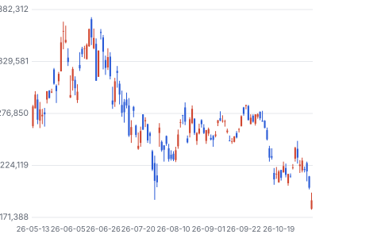

**주봉**

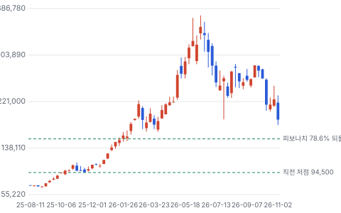

**월봉**

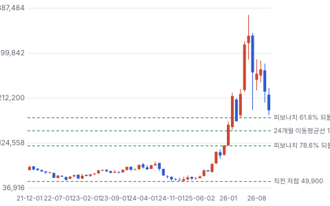

**분기 매출·EPS 실적과 컨센서스**

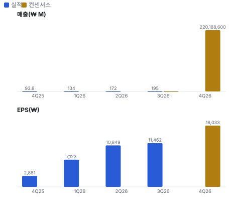

**밸류에이션 주가 시나리오**

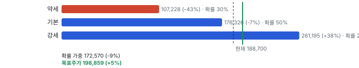

**주가별 업사이드**

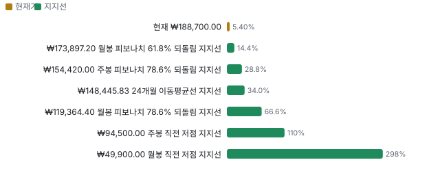

**제품·서비스 포트폴리오**

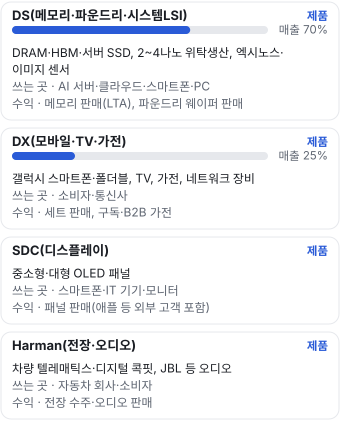

**고객 믹스(3Q26, 매출 대비)**

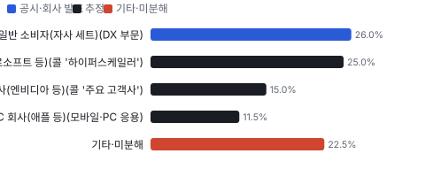

**공급 병목(10점, 낮을수록 병목)**

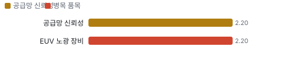

**CAPEX의 매출 대비 비중**

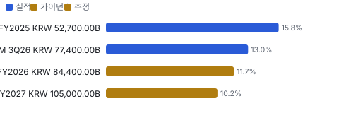

**어닝콜 변화별 주주가치 영향**

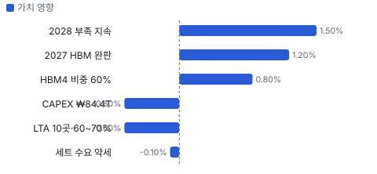

**멀티플 프리미엄**

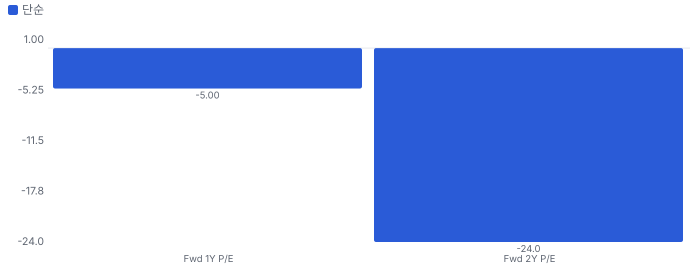

**합리적 멀티플**

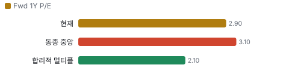

**몬테카를로**

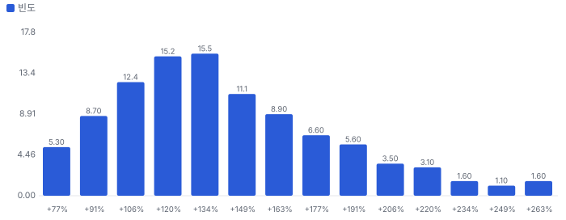

해석: 3,000번 중 3,000번(100%)에서 가치가 지금 주가 이상이었다. 가정을 흔들어도 지금 주가를 뒷받침하는 경우가 더 많다. 가운데 값은 2.35배이고, 열 번 중 여덟 번은 1.93~3.02배 사이에 든다.

## 내러티브

> **기업가치를 결정하는 이야기:** 기업가치는 메모리 이익이 몇 년 이어지느냐와 그 현금이 주주에게 얼마나 돌아오느냐로 정해진다. 지금 Fwd 1Y P/E 2.9배(다음 4개 분기 EPS 컨센서스 근사 ₩64,132)는 메모리 동종 5곳 중앙 3.1배보다 약간 낮다. 시장은 이 이익이 2년 안에 꺾인다고 본다

> **멀티플·EPS 프리미엄**
> **멀티플:** Fwd 1Y P/E 2.9배, 동종 중앙 3.1배(키옥시아 2.2·SK하이닉스 2.6·난야 3.1·샌디스크 3.5·마이크론 4.3배) — 약 −5%. Fwd 2Y 2.4배(증권사 2곳)
> **EPS:** 3Q 매출 ₩195.3T는 발표 직전 추정 ₩200.2T의 98%, 영업이익률 55.0%는 추정 52.6%보다 2.4%p 높다. KB증권 2027 영업이익 추정 ₩555T → ₩640T(+15%)

### 투자자들은 왜 열광했나

2025-08 ₩71,900에서 2026-06 ₩374,500까지 5.2배 — HBM4 엔비디아 공급 재개와 메모리 가격 급등이 'HBM 낙오자'를 '메모리 이익 1위'로 바꿨다. 식은 이유는 세 가지다: 6월 이후 메모리 피크아웃 논쟁, 10/29 실적일 자사주 발표 부재(−4%), 11/5~6 미국 중간선거 뒤 반도체 급락(이틀 약 −14%). 같은 기간 이익 추정은 오히려 올랐다

### 무엇이 기업가치를 바꾸나

> **구조적 체질 변화**
> **변화:** 세트 회사(3Q25 DX 매출 56%)에서 반도체 회사(3Q26 DS 75%)로
> **증거:** IR 부문 매출
> **반증:** DS 매출 비중이 50% 아래로

> **고부가 믹스 확장**
> **변화:** HBM·서버 DRAM·eSSD(기업용 SSD) 비중 확대, HBM4가 HBM의 60%
> **증거:** 3Q 콜
> **반증:** 4Q26 메모리 영업이익률 70% 아래

> **기술 혁신**
> **변화:** HBM4E(HBM4 다음 세대 고대역폭 메모리) 상반기 양산·하반기 램프, 1c(10나노급 6세대 DRAM 공정) DRAM, V10(10세대 V낸드) 낸드, 1.4나노 테스트칩
> **증거:** 3Q 콜
> **반증:** HBM4E 양산이 2027 하반기 이후로 밀린다

> **실행 속도**
> **변화:** 납기를 공시하지 않는다. 회사는 가용 캐파가 모자라 추가 공급 요청에 다 응하지 못한다고 했다 **납품 리드타임 12~21주.** 피어 비교 미확인. 이전 대비 미확인.
> **증거:** 3Q 콜

> **M&A**
> **변화:** 해당 없음(최근 3년 시너지를 공시한 인수 없음). 1월 이사회에서 대형 인수가 아니라 환원 정책을 정한다
> **증거:** IR 자료
> **반증:** 해당 없음

> **정책·입법 연관성**
> **재정정책:** 미국 CHIPS 보조금(테일러, 상무부 발표 최대 \$4.745B)과 한국 반도체 투자 세액공제 상무부 발표 2024-12 반증: CHIPS 지급 조건 변경 의회 동의 10/10 — 하원 5/5(CHIPS법(2022) 하원 본회의 통과·세출 반영) · 상원 5/5(같음).
> **행정명령:** 미국 반도체 232조(미국 무역확장법 안보 관세 조항) 관세 조사와 수출통제(VEU(미국 수출통제 포괄 허가) 포괄 허가) 행정부 조치 반증: 메모리 관세 부과 확정 의회 동의 0/10 — 하원 0/5(행정부 단독 조치) · 상원 0/5(같음).
> **연관입법:** 중간선거 뒤 데이터센터 건설 규제 우려가 보도됐다. 법안 번호·발의 단계는 확인하지 못했다 국내 보도 11/6 반증: 해당 없음

> **CAPEX 낙수효과**
> **변화:** 하이퍼스케일러·AI 가속기 투자 → HBM·서버 메모리. 고객 투자 발표를 이 회사 매출로 바로 옮기지 않는다 — 확인된 것은 2027 HBM 협상 완료·미주 매출 ₩83.6T(2Q)
> **증거:** 콜·지역 매출
> **반증:** 2027 하이퍼스케일러 CAPEX 가이던스 감소

### 내러티브 근거

> 삼성전자가 HBM 낙오자에서 메모리 이익 1위로 돌아왔다는 이야기를 셀사이드는 믿고, 주가는 그 이익이 언제 꺾이느냐만 묻는다. 동종 대비 멀티플 차이 -5% 중 회사 고유 몫은 +38%다. 단계는 컨센서스, 쏠림은 셀사이드는 거의 만장일치로 쏠렸고 가격은 두 달 만에 절반이 됐다이다.

> **HBM 복귀** · 강화
> **논리:** HBM4로 점유율을 DRAM 점유율 수준까지 되찾아 엔비디아 낙오 할인이 사라진다
> **숫자:** HBM4 매출 3배·HBM 중 60%, 2027 물량 완판
> **반증:** HBM4E 첫 공급사가 경쟁사로 정해지거나 2027 HBM 가격 재협상 보도

> **LTA가 사이클을 누른다** · 유지
> **논리:** 장기 계약이 하락기 물량을 묶는다
> **숫자:** 10곳 체결·10곳 협상, 2030 캐파 60~70%
> **반증:** 가격 하단 조항이 없다는 공시·보도

> **2028까지 공급 부족** · 정황
> **논리:** 클린룸·장비 리드타임 때문에 CAPEX가 늘어도 비트가 크게 늘지 않는다
> **숫자:** 2027 CAPEX 증가분 상당 부분이 공간 확보(회사)
> **반증:** 2027 업계 DRAM 비트 공급 +25% 이상 전망

> **주주환원 ₩90~110T** · 조건부
> **논리:** 순현금 ₩197.6T로 자사주 소각을 하면 EPS가 기계적으로 오른다
> **숫자:** 남은 재원 ₩55~75T, 1월 이사회 확정
> **반증:** 1월 발표가 배당 위주이고 소각이 ₩20T 미만

> **파운드리 회복** · 정황
> **논리:** 2나노 HPC 수주와 테일러 가동으로 적자 사업이 이익 사업이 된다
> **숫자:** 2나노 과제 수 2배, 8나노 이하 가동률 100% 상회 전망
> **반증:** 테일러 고객 램프 지연 공시

> **반대: 피크 이익** · 강화
> **논리:** 영업이익률 55%는 메모리 가격 정점의 숫자이고 2023년엔 2.5%였다 — 피크 이익에는 낮은 배수가 맞다
> **숫자:** Fwd 1Y P/E 2.9배, 동종 중앙 3.1배
> **반증:** 2027 1분기 DRAM 계약가 상승 지속

> **반대: 미국 정책·AI 투자 속도** · 정황
> **논리:** 중간선거 뒤 데이터센터 규제 우려가 하이퍼스케일러 CAPEX 속도를 늦춘다
> **숫자:** 11/6 필라델피아 반도체 −12.25%, 삼성전자 −6.35%
> **반증:** 4Q 하이퍼스케일러 2027 CAPEX 가이던스 상향

## 포트폴리오

| 제품·서비스 | 구분 | 무엇 | 쓰는 곳 | 돈 버는 방식 | Mix | Mix 변화(전 분기 대비) |
|---|---|---|---|---|---|---|
| DS(메모리·파운드리·시스템LSI) | 제품 | DRAM·HBM·서버 SSD(낸드 저장 장치), 2~4나노 위탁생산, 엑시노스·이미지 센서 | AI 서버·클라우드·스마트폰·PC(개인용 컴퓨터) | 메모리 판매(LTA), 파운드리 웨이퍼 판매 | 70% | +1.6%p |
| DX(모바일·TV·가전) | 제품 | 갤럭시 스마트폰·폴더블, TV, 가전, 네트워크 장비 | 소비자·통신사 | 세트 판매, 구독·B2B(기업 대상 판매) 가전 | 25% | -1.0%p |
| SDC(디스플레이) | 제품 | 중소형·대형 OLED(유기발광 디스플레이) 패널 | 스마트폰·IT(정보기술 기기) 기기·모니터 | 패널 판매(애플 등 외부 고객 포함) | 4% | -0.2%p |
| Harman(전장·오디오) | 제품 | 차량 텔레매틱스·디지털 콕핏, JBL(하만의 오디오 브랜드) 등 오디오 | 자동차 회사·소비자 | 전장 수주·오디오 판매 | 2% | -0.4%p |

**Mix 변화가 가장 큰 쪽은 DS(메모리·파운드리·시스템LSI)(+1.6%p, 전 분기 대비).** 계절성 판정: 분기 매출 계절 지수 기준 없음 → 직전 분기와 비교.

## 고객

> **3Q26 최대 고객 일반 소비자(자사 세트)(DX 부문) 26%, 상위 3곳 66%, 집중도 보통.** 공시·회사 발표로 확인한 몫은 매출의 26%이고, 나머지 고객 몫은 추정이거나 미분해다. 사업보고서는 매출 상위 고객을 이름 없이 묶어 적는다. 미주 매출이 2Q26 ₩83.6T(49%)로 1년 새 3배가 됐다 — 미국 AI 가속기·클라우드 고객 쪽 메모리다. 고객별 몫은 공시되지 않아 아래는 대부분 추정이다

**고객별 매출 몫(3Q26)**
| 고객 | 몫 | 변화 | 근거 |
|---|---|---|---|
| 일반 소비자(자사 세트)(DX 부문) | 25~27% | -22%p | 공시 |
| 하이퍼스케일러(구글·아마존·메타·마이크로소프트 등)(콜 '하이퍼스케일러') | 20~30% | 미확인 | 추정 |
| AI 가속기 회사(엔비디아 등)(콜 '주요 고객사') | 10~20% | 미확인 | 추정 |
| 스마트폰·PC 회사(애플 등)(모바일·PC 응용) | 8~15% | 미확인 | 추정 |
| 기타·미분해 | 22% | - | - |

> **일반 소비자(자사 세트)(DX 부문)** · 공시
> **사는 것:** 갤럭시·TV·가전
> **추정 근거:** DX 매출 ₩52.1T ÷ 전사 ₩195.3T(부문 간 내부 매출 포함). 1년 전 3Q25 ₩48.4T ÷ ₩86.1T

> **하이퍼스케일러(구글·아마존·메타·마이크로소프트 등)(콜 '하이퍼스케일러')** · 추정
> **사는 것:** 서버 DRAM·eSSD·커스텀 칩 HBM, 2나노 HPC 파운드리
> **추정 근거:** 미주 매출 몫에서 GPU(그래픽·AI 가속 칩) 회사 몫을 뺀 범위(추정)

> **AI 가속기 회사(엔비디아 등)(콜 '주요 고객사')** · 추정
> **사는 것:** HBM4·HBM3E(5세대 고대역폭 메모리), 4나노 HBM 베이스다이
> **추정 근거:** IB 요지의 3Q HBM 약 \$6B(₩8T)에 GPU용 서버 DRAM을 더한 범위. 고객명은 공시되지 않았다(가설)

> **스마트폰·PC 회사(애플 등)(모바일·PC 응용)** · 추정
> **사는 것:** LPDDR(저전력 DRAM 규격)·모바일 낸드, OLED 패널(SDC)
> **추정 근거:** 메모리 응용 중 모바일·PC 비중이 줄고 있다는 콜 설명과 SDC 매출 ₩8.0T로 잡은 범위

## 수주·파이프라인

> **2026-10-29 기준 4건.** 확정 KRW 0.00B. 서로 겹치는 항목은 합계에서 뺐다.

**실행 속도와 방해 요인**
| 항목 | 상태 | 실행 속도 | 방해 요인 |
|---|---|---|---|
| 2027 HBM 물량·가격 | 확정 | 목표 가격으로 협상 완료, 추가 증량 요청 | HBM4E 수율 · 고객 사양 변경 |
| 메모리 LTA 10곳(+협상 10곳) | 조건부 | 2030년 캐파의 60~70% 목표, 롤링 연장 | 가격 조항 비공개 · 보증금 여부 미확인 |
| 파운드리 2나노 대형 고객(HPC) | 파이프라인 | 2026 2나노 과제 수 2배 이상, 2027 HPC 매출 50% 이상 전망 | 수율 · 테일러 램프 |
| 테일러 1공장 | 파이프라인 | 클린룸 가동, 장비 반입·웨이퍼 투입 시작 | 인력 · CHIPS 보조금 조건 |

## 마진 구조

> **GPM 69.3%, OPM 55.0%.** 3Q25 대비 GPM +30.4%p, OPM +40.8%p. 변동비는 매출의 22%이고, 매출이 10% 늘면 OPM은 +2.1%p 움직인다. 3Q26 매출총이익률 69.3%(1년 전 38.9%), 영업이익률 55.0%(1년 전 14.2%). 이익의 99%가 DS(반도체 영업이익 ₩106.5T)에서 나오고 DX는 −₩0.8T 적자다. 메모리 가격이 오른 몫이 거의 그대로 이익률이 됐고, 같은 메모리 가격이 모바일 원가를 밀어 올린다

> **매출 100 중 매출원가 36.1, 매출총이익 63.9(최근 4분기, 공시).** 매출원가 요인 중 원재료(웨이퍼·화학·가스·기판·모바일 부품)이 매출의 13.0%로 가장 무겁고, 단가가 +10% 오르면 GPM이 -1.30%p 움직인다. 분기 회귀로 매출 1이 늘 때 매출원가는 0.08 늘고, 매출원가의 고정비 몫은 85%다.

**비용 요인 강도 — 비중·추세·충격(+10%)·탄력**
| 비용 | 구분 | 매출 대비 | 1년 변화 | 마진 기여 | 충격 시 마진 | 매출 탄력 | 고정비 몫 |
|---|---|---|---|---|---|---|---|
| 원재료(웨이퍼·화학·가스·기판·모바일 부품) | 매출원가 요인 | 13.0% | 미확인 | 미확인 | -1.30%p | 미확인 | 0% |
| 제조 인건비·외주·공장 간접비 | 매출원가 요인 | 7.2% | 미확인 | 미확인 | -0.72%p | 미확인 | 70% |
| 감가상각(팹 장비·클린룸) | 매출원가 요인 | 5.5% | -6.0%p | +6.0%p | -0.55%p | 미확인 | 100% |
| 기타 매출원가(물류·로열티·재고 평가) | 매출원가 요인 | 5.0% | 미확인 | 미확인 | -0.50%p | 미확인 | 30% |
| 매출원가 | 공시 항목 | 36.1% | -27.7%p | +27.7%p | -3.61%p | 0.08 | 85% |
| 판관비 | 공시 항목 | 10.8% | -10.3%p | +10.3%p | 미확인 | -0.04 | 100% |
| 연구개발 | 공시 항목 | 7.0% | +1.4%p | -1.4%p | 미확인 | 0.13 | -100% |
| 감가상각 | 공시 항목 | 4.0% | +0.6%p | -0.6%p | 미확인 | 0.09 | -100% |

매출 탄력 = 분기 비용을 매출에 회귀한 기울기(매출 1당 변동비), 고정비 몫 = 절편 ÷ 평균 비용. 표본이 8분기 미만이면 미확인. 매출원가 요인 비중은 margin 재료의 추정이 섞여 있고, 공시 매출원가와의 차이는 '기타 매출원가'로 둔다.

**GPM에서 OPM까지(K-IFRS)**
| 기간 | GPM | 연구개발 | 판관비 | 기타 | OPM |
|---|---|---|---|---|---|
| 3Q25 | 38.9% | 10.2% | 14.5% | 0.0% | 14.2% |
| 3Q26 | 69.3% | 7.4% | 6.9% | 0.1% | 55.0% |

**GPM·OPM 최근 4개 분기**
| 분기 | GPM | OPM |
|---|---|---|
| 2025-12 | 46.4% | 21.3% |
| 2026-03 | 61.2% | 42.7% |
| 2026-06 | 69.6% | 52.2% |
| 2026-09 | 69.3% | 55.0% |

**마진을 결정하는 비용 요인 — 비용 +10% 시 OPM**
| 비용 | 매출 대비 | 변화 | 고정비 | OPM |
|---|---|---|---|---|
| 원재료(웨이퍼·화학·가스·기판·모바일 부품) | 13.0% | 미확인 | 0% | -1.30%p |
| 연구개발 | 7.4% | -2.8%p | 90% | -0.74%p |
| 제조 인건비·외주·공장 간접비 | 7.2% | 미확인 | 70% | -0.72%p |
| 판매·관리비(마케팅·인건비) | 6.9% | -7.6%p | 60% | -0.69%p |
| 감가상각(팹 장비·클린룸) | 5.5% | -6.0%p | 100% | -0.55%p |
| 기타 매출원가(물류·로열티·재고 평가) | 5.0% | 미확인 | 30% | -0.50%p |

**비용을 움직이는 요인**
| 비용 | 요인 |
|---|---|
| 원재료(웨이퍼·화학·가스·기판·모바일 부품)(매출원가) | DX 부품(메모리·AP(스마트폰 두뇌 칩)·패널) 구매 단가 · 근거 추정 |
| 연구개발(연구개발) | HBM4E·1.4나노·엑시노스 · 근거 공시 |
| 제조 인건비·외주·공장 간접비(매출원가) | 인력·성과급 · 근거 추정 |
| 판매·관리비(마케팅·인건비)(판관비) | 세트 마케팅 · 근거 공시 |
| 감가상각(팹 장비·클린룸)(매출원가) | 2026 CAPEX ₩84.4T 가동분 · 근거 공시 |
| 기타 매출원가(물류·로열티·재고 평가)(매출원가) | 물류비(콜: 원자재·물류비 상승) · 근거 추정 |

**DS(메모리·파운드리·시스템LSI) BOM — 매출의 70%, GPM 80%(추정 — 부문 매출총이익 미공시, 부문 영업이익률 72%), 항목 가격 +10% 시**
| 항목 | 원가 몫 | 전가 | 제품 GPM | OPM |
|---|---|---|---|---|
| 웨이퍼 팹 감가상각(장비·클린룸) | 35~50% | 미확인 | -0.8%p | -0.59%p |
| HBM 후공정(TSV(실리콘 관통 전극)·적층·테스트) | 10~20% | 미확인 | -0.3%p | -0.21%p |
| 공정 소재(포토레지스트·전구체·특수가스) | 10~18% | 미확인 | -0.3%p | -0.19%p |
| 실리콘 웨이퍼 | 6~10% | 미확인 | -0.2%p | -0.11%p |
| 미분해 | 20% | - | - | - |

**DX(모바일·TV·가전) BOM — 매출의 25%, GPM 25%(추정 — 부문 영업이익률 −2%), 항목 가격 +10% 시**
| 항목 | 원가 몫 | 전가 | 제품 GPM | OPM |
|---|---|---|---|---|
| 모바일 메모리(LPDDR·UFS(모바일 낸드 저장 규격)) | 12~20% | 20% | -1.0%p | -0.27%p |
| AP(스냅드래곤·엑시노스) | 12~20% | 미확인 | -1.2%p | -0.30%p |
| 디스플레이 패널 | 10~18% | 미확인 | -1.1%p | -0.26%p |
| 미분해 | 54% | - | - | - |

웨이퍼 팹 감가상각(장비·클린룸) 가격이 +10% 오르면 영업이익은 -1.1% 움직인다. 판매가 전가를 모르는 항목은 전가 0%로 계산했다.

**BOM 항목 가격을 움직이는 것**
| 항목 | 요인 |
|---|---|
| 웨이퍼 팹 감가상각(장비·클린룸) | 메모리 원가의 최대 몫 — 고정비 · 근거 추정 |
| 실리콘 웨이퍼 | 300mm 웨이퍼 장기 계약 · 근거 추정 |
| 공정 소재(포토레지스트·전구체·특수가스) | EUV 층수가 늘수록 커진다 · 근거 추정 |
| HBM 후공정(TSV·적층·테스트) | HBM은 같은 비트에 웨이퍼를 2~3배 쓴다 · 근거 추정 |
| 모바일 메모리(LPDDR·UFS) | 메모리 값이 오르면 DX 원가가 오른다 — 사내 거래도 시장가 — 전가율 0.2는 콜의 '원가 부담 지속·이익 감소 불가피' 발언에 둔 추정 · 근거 추정 |
| AP(스냅드래곤·엑시노스) | 플래그십 AP 단가 상승 · 근거 추정 |
| 디스플레이 패널 | 폴더블은 패널 몫이 크다 · 근거 추정 |

**BOM 투입 물가 — PPI 전년비, 2026-11-06 수집**
| 항목 | 미국 | 일본 | 한국 | 대만 |
|---|---|---|---|---|
| 모바일 메모리(LPDDR·UFS) | -2.2%* | +3.9%* | +134.0% | +22.9%* |

별표는 품목보다 넓은 업종 지수다. 지난 1년 투입 물가를 판매가 전가 뒤 원가에 그대로 넣으면 OPM은 -4.66%p 움직인다(매출원가의 13% 기준).

## 공급망 병목

> **공급망 신뢰성 2.2/10, 병목 심각.** 가장 약한 고리는 EUV 노광 장비 2.2점이고, 품목 평균은 2.2점이다. 근거가 부족한 3건(클린룸 공간(평택·테일러) · 실리콘 웨이퍼 · HBM 적층 장비(TC(열압착) 본더))은 점수에서 뺐다. 병목은 원료보다 자기 캐파(클린룸·EUV 장비)다. 콜은 장비 리드타임이 길어지고 건설비가 올라 2028년 비트 증가가 제한된다고 했다. 공급사 이름과 몫은 공시되지 않는다

**병목과 마진 — 품목 가격 +10% 시 OPM**
| 품목 | 점수 | 판정 | 구분 | OPM |
|---|---|---|---|---|
| EUV 노광 장비(필수) | 2.2 | 병목 심각 | 출하 차질 위험 | 미확인 |

> **EUV 노광 장비** · 2.2/10
> **왜:** 1c DRAM·2나노가 EUV 층에 묶인다
> **병목 요인:** 인증 공급사 1곳 · 캐파 빠듯 · 리드타임 미확인 · 재인증 미확인 · 1위 점유율 100% · 네덜란드 집중 100% · 물량 확보 미확인
> **풀리는 조건:** 미확인

**공급사**
| 품목 | 공급사 | 몫 | 근거 |
|---|---|---|---|
| EUV 노광 장비 | ASML(EUV 스캐너 단독 공급) | 미확인 | 보도 |
| 클린룸 공간(평택·테일러) | 자체(삼성물산 등 시공)(팹 건설) | 미확인 | 회사 발표 |
| 실리콘 웨이퍼 | 신에츠·섬코·SK실트론 등(300mm 웨이퍼) | 미확인 | 추정 |
| HBM 적층 장비(TC 본더) | 세메스·한화세미텍 등(열압착 본더) | 미확인 | 보도 |

**무역 통계로 본 공급 지역**
| 품목 | EU 수입처 | 일본 수입처 | EU 1위 전년비 |
|---|---|---|---|
| 실리콘 웨이퍼 | TW(대만) 45% · KR(한국) 21% · CN(중국) 16% | 台湾 52% · 大韓民国 28% | +365.5% |

## 생산능력

> **현재 명목 캐파 미확인, 가동률 미확인.** 착공 이상 증설은 0 회사는 웨이퍼 캐파를 공시하지 않는다 — 금액(CAPEX)으로 쓴다, 발표까지 합치면 0 회사는 웨이퍼 캐파를 공시하지 않는다 — 금액(CAPEX)으로 쓴다이다. TTM 3Q26 CAPEX는 KRW 77,400.00B로 매출의 13.0%다. 명목 캐파·가동률은 공시하지 않는다. 파운드리 8나노 이하 가동률은 4Q 100% 상회 전망(콜). 2026 CAPEX ₩84.4T(DS ₩76.8T), 2027 메모리·파운드리 증가 예고. 테일러 1공장은 클린룸 가동·장비 반입 시작

**생산능력 확충 계획**
| 계획 | 단계 | 증설 | 가동 시점 | CAPEX |
|---|---|---|---|---|
| 테일러 1공장(파운드리 2나노) | 장비 반입 | 미확인 | 2027 | 미확인 |
| 평택 신규 팹(메모리) | 착공 | 미확인 | 미확인 | 미확인 |
| 기흥 HBM 베이스다이 파운드리 팹(카이로스) | 발표 | 미확인 | 미확인 | 미확인 |

남은 계획의 CAPEX 합계는 KRW 0.00B(금액 미확인 3건 제외)다. 합계는 FY2027 매출의 0%다.

**증설 방해 요인**
| 계획 | 방해 요인 |
|---|---|
| 테일러 1공장(파운드리 2나노) | 본사 인력 파견·고객 램프 |
| 평택 신규 팹(메모리) | 건설비 상승·장비 리드타임 |
| 기흥 HBM 베이스다이 파운드리 팹(카이로스) | 미확인 |

**CAPEX와 매출 대비**
| 기간 | CAPEX | 매출 | 매출 대비 | 구분 |
|---|---|---|---|---|
| FY2025 | KRW 52,700.00B | KRW 333,605.90B | 15.8% | 실적 |
| TTM 3Q26 | KRW 77,400.00B | KRW 594,463.50B | 13.0% | 실적 |
| FY2026 | KRW 84,400.00B | KRW 723,134.70B | 11.7% | 가이던스 |
| FY2027 | KRW 105,000.00B | KRW 1,029,893.40B | 10.2% | 추정 |

## 해자

> 해자는 규모와 수직계열화, 순현금이다. HBM에서는 2024~2025년에 뒤처졌다가 HBM4로 따라붙었고, 그 회복이 아직 점유율 숫자로 공시되지는 않았다.

> **메모리 규모와 원가** · 강함
> **해자:** DRAM·낸드 모두 세계 최대 캐파라 같은 가격에서 이익이 가장 크다
> **근거:** 3Q26 DS 영업이익 ₩106.5T vs SK하이닉스 3Q ₩83.3T
> **숫자:** DS 영업이익률 72%
> **깨지는 조건:** DRAM 점유율 1위를 잃는다(분기 시장조사 발표)

> **메모리·파운드리·패키징 한 회사** · 보통
> **해자:** HBM 코어 다이·4나노 베이스다이·적층을 한 회사가 해 커스텀 HBM에 유리하다
> **근거:** 콜: HBM4 베이스다이(4나노) 수율 업계 최고 수준 주장. 숫자는 없다
> **숫자:** 미확인
> **깨지는 조건:** 커스텀 HBM4E 첫 공급사가 경쟁사로 정해진다

> **순현금과 투자 여력** · 강함
> **해자:** 순현금으로 증설과 환원을 동시에 한다
> **근거:** 9/30 순현금 ₩197.6T, 차입금비율 3%
> **숫자:** 2026 CAPEX의 약 2.3년 치
> **깨지는 조건:** 2027 CAPEX와 환원 합계가 영업현금흐름을 넘는다

## 경영진·네트워크

> 연결이 닿는 매출의 핵심은 미국 AI·클라우드 고객 쪽 미주 매출이다. 연결이 그 매출을 만들었다고 볼 근거는 없다.

> **이재용** · 회장 · 2022-10
> **프로필:** 최대주주 일가. 공개 일정으로 미국 빅테크 CEO와 접촉해 왔다
> **비즈니스:** 엔비디아·테슬라 등 CEO 회동 보도
> **정계:** 정치 성향은 쓰지 않는다
> **동문:** 미확인
> **사모임:** 미확인

> **노태문** · DX 부문장 사장 · 미확인
> **프로필:** 11월 자사주 3,000주 장내 매수가 커뮤니티 집계에 올랐다(공시 원문 미확인)
> **비즈니스:** 갤럭시 사업
> **정계:** 미확인
> **동문:** 미확인
> **사모임:** 미확인

**네트워크 정량화**
| 연결 | 강도 | 닿는 매출 | 가중 노출 | 매출 대비 | 근거 |
|---|---|---|---|---|---|
| 비즈니스: 미국 AI·클라우드 고객 | 3/5 | ₩83,616.00B | ₩50,169.60B | 8% | 2Q26 미주 매출 ₩83.6T(지역 KPI). 고객별 몫 미공시 지역 매출 공시 |
| 정계: 미국 CHIPS 보조금(테일러) | 4/5 | 미확인 | 미확인 | 미확인 | 상무부 발표 최대 \$4.745B(2024-12) — 마일스톤 조건, 이번 회차에 최종 계약 원문 미확인 미국 상무부 발표 |
| 동문: 공개 자료 없음 | 0/5 | 미확인 | 미확인 | 미확인 | 미확인 미확인 |
| 사모임: 공개 자료 없음 | 0/5 | 미확인 | 미확인 | 미확인 | 미확인 미확인 |

가중 노출은 연결이 닿는 매출의 크기다. 연결이 그 매출을 만들었다는 뜻이 아니며, 인과는 공개 자료로 입증하지 못한다.

## 약세 논리 및 셀온 조건

| 약세 논리 | 근거 | 반박 | 가를 자료 |
|---|---|---|---|
| 가격이 만든 이익 | 최근 4분기 매출 증가 가격 +66%·물량 −6%(한국 반도체 PPI(생산자물가지수) 대용), 2023년 영업이익률 2.5% | LTA 10곳이 2030 캐파 60~70%를 묶고 2027 HBM은 값까지 정해졌다 | 2027년 1분기 DRAM 계약가(업계 발표, 2027-01) |
| LTA 가격 조항 비공개 | 콜은 물량·기간만 말했고 가격 하단·보증금 여부가 없다 | 롤링 연장과 추가 공급 요청이 있다(회사) | 사업보고서 계약부채·선수금 변화(2026 사업보고서, 2027-03) |
| 공급 반응 | 2026 CAPEX ₩84.4T(+₩31.7T), 2027 메모리·파운드리 추가 증가 | 증가분 상당 부분이 공간 확보·건설비라 2028 비트 증가가 제한된다(회사) | 2027 업계 DRAM 비트 공급 전망(시장조사 발표, 2026-12) |
| 세트 부문 적자 | DX 3Q −₩0.8T, 회사가 2027 스마트폰·TV·디스플레이 수요 약세를 말했다 | DX는 이익의 1% 미만이라 전사 이익 영향은 작다 | 4Q26 MX(삼성 모바일 사업부) 영업이익(2027-01 실적) |
| 미국 정책·AI 투자 속도 | 11/5~6 필라델피아 반도체 −12.25%, 반도체 ETF 선거 뒤 CAR −5.7%(t −2.0) | 법안 번호·발의 단계가 확인되지 않은 보도 단계다 | 하이퍼스케일러 4Q 실적의 2027 CAPEX 가이던스(2027-01 하순~02 초) |

## 어닝콜 변화

**직전 콜 대비 새로 나오거나 바뀐 내용 → 가치 영향**
| 항목 | 내용 | 직전 콜 | 최신 콜 | 모델 동인 이동 | 확신도 | 가치 영향 |
|---|---|---|---|---|---|---|
| 신규 | 2027 HBM | 2027 협상 중 | 2027 물량 목표 가격으로 협상 완료, 추가 증량 요청 | 1년차 성장률 +2.0% | 0.8 | +1.2% |
| 업데이트 | LTA | LTA 추진 | 대형 고객 10곳 체결·10곳 협상, 2030년 캐파의 60~70%, 롤링 연장 | 성장 지속(감속 계수) -2.0% | 0.5 | -0.6% |
| 업데이트 | HBM 점유율 | HBM4 3Q부터 절반 이상 목표 | HBM4 매출 3배, HBM 점유율이 DRAM 점유율 수준 | 목표 이익률 +1.0% | 1.0 | +0.8% |
| 부정 | CAPEX | 증가 예고 | 2026 ₩84.4T(+₩31.7T), 2027 메모리·파운드리 추가 증가 | 매출÷투하자본 -5.0% | 0.8 | -0.6% |
| 부정 | 세트 수요 | 하반기 일부 둔화 | 2027 스마트폰·TV·디스플레이 수요 약세, MX 이익 감소 불가피 | 출발 이익률 -0.50% | 0.8 | -0.1% |
| 신규 | 2028 수급 | 2027 부족 | 2027 CAPEX 증가분 상당 부분이 공간 확보라 2028 비트 증가 제한 | 장기 성장 수렴값 +0.50% | 0.5 | +1.5% |
| **합계** | 단독 합 |  |  | 동시 적용 +2.3% |  | **+2.2%** |

## 거시 지표 싱크로율

> **한국 반도체 PPI와 DS(메모리·파운드리·시스템LSI) 싱크로율 98%(0분기 = 약 0개월 선행, 전년 대비, 표본 5개·t 9.8·유의·신뢰 참고용).**  DS 매출은 메모리 출하 금액을 따라가야 한다. 한국 수출 통계는 저장소에 없어 미국 메모리 수입과 한국 반도체 PPI로 본다

**지표별 싱크로율(상관계수 × 100)**
| 지표 | 비교 대상 | 증가율 기준 | 지표 선행 | 매출(t값) | 영업이익 | 방향 일치 | 표본·신뢰 | 4Q26 내포 매출 |
|---|---|---|---|---|---|---|---|---|
| 미국 메모리 수입 | DS(메모리·파운드리·시스템LSI) | 전년 대비 | 0분기(0개월) | 83%(t 2.6) | 53%(0분기) | 80% | 5·참고용 | 미확인 |
| 한국 반도체 PPI | DS(메모리·파운드리·시스템LSI) | 전년 대비 | 0분기(0개월) | 98%(t 9.8) | 83%(0분기) | 100% | 5·참고용 | 미확인 |

**지표를 고른 이유**
| 지표 | 이유 |
|---|---|
| 미국 메모리 수입 | 미국 고객이 들여오는 메모리 금액 — 미주 매출의 대용 |
| 한국 반도체 PPI | 메모리 비중이 큰 한국 반도체 생산자물가 — 가격 대용 |

싱크로율은 증가율의 상관계수이며 인과가 아니다. 지표 단위·통화는 원자료 그대로이고 나라끼리 더하지 않는다(EU(유럽연합) 수입만 상대국 합계). ±1σ는 회귀 잔차 표준편차다.

## P·Q 사이클

> **P 사이클 — 최근 4분기 평균 가격 기여 +66.0%, 물량 기여 -6.2%(전년 대비 로그 증가율).** P 강도 5.7/10, Q 강도 4.2/10, 최근 8분기 중 80%가 같은 요인 우세(구조적). 회사가 분기 DRAM·낸드 비트 증가율과 ASP 증가율을 범위로 말한다. 범위 중간값 시계열을 만들 만큼 과거 분기가 정리되지 않아 업종 PPI 대용으로 잰다

**P·Q 사이클 정량**
| 항목 | 가격(P) | 물량(Q) |
|---|---|---|
| 최근 4분기 평균 기여 | +66.0% | -6.2% |
| 강도(0~10, 자기 이력 z) | 5.7 | 4.2 |
| AR(2) 고유 주기 | 미확인 | 미확인 |
| 다음 4분기 투영 평균 | 미확인 | 미확인 |

가격 근거: 제품 PPI. PPI를 쓰면 회사 판매가가 아니라 업종 가격 대용이다. 로그 증가율이라 가격·물량 기여의 합이 매출 증가율이다. 투영은 통계 외삽이며 가이던스·컨센서스가 아니다.

10년 위치·프리미엄: TTM 표본 6개로 20개에 못 미친다 — quarters.js로 분기 44개를 다시 받으면 나온다.

## 밸류에이션

> **목표주가 ₩198,859, 업사이드 +5%.** 자리는 기본과 강세 사이(강세 쪽 27%)이고 도달 확률은 약 36%다. 기본 ₩176,326, 강세 ₩261,195(+38%), 약세 ₩107,228(-43%). DCF 기준 업사이드는 기본 +140%, 강세 +194%, 약세 +111%다(WACC 12.1%).

배수 기준 기본 ₩176,326(−7%)과 DCF 기본 업사이드 +140%는 방향이 반대다. 배수는 다음 4개 분기 EPS ₩64,132에 엔진이 고른 2.7배(동종 중앙 3.1배에서 복합기업 할인을 뺀 값)를 곱한다 — 시장이 지금 메모리 회사에 주는 피크 이익 배수를 그대로 쓴다. DCF는 FY2027 매출 +42%·영업이익률 61%를 받아 5년차 30%로 내린 뒤 WACC 12.1%로 할인한다 — 앞 2년 이익이 워낙 커 약세 시나리오도 +111%다. 이 차이는 '이익률이 30%까지만 내려온다'는 가정에서 나온다. 2023년 영업이익률은 2.5%였고, 그런 해가 2028년에 오면 DCF의 약세도 틀린다. 목표 ₩198,859는 기본과 강세 사이(강세 쪽 27%)로, DCF와 순현금을 일부 인정해도 피크 배수 때문에 지금보다 5%만 높다.

> **약세 ₩107,228 (-43%)** · 확률 30%
> **가정:** 2.1배 × EPS ₩52000.00
> **근거:** 2027 상반기 DRAM·낸드 계약가가 꺾이고 모바일·PC 수요 조정이 겹쳐 다음 4개 분기 EPS가 분기 ₩13,000 수준(3Q ₩11,462와 4Q 추정 ₩16,033 사이)에 머문다. 배수는 동종 하단으로

> **기본 ₩176,326 (-7%)** · 확률 50%
> **가정:** 2.7배 × EPS ₩64132.00
> **근거:** 4Q26 EPS 컨센서스 ₩16,033이 1년 이어진다 — HBM 완판과 LTA가 물량을 받치고 가격은 보합

> **강세 ₩261,195 (+38%)** · 확률 20%
> **가정:** 3.4배 × EPS ₩76000.00
> **근거:** 2027 HBM 단가 상승과 서버 DRAM 부족이 이어져 2027 EPS 증권사 추정(₩77,370~78,942) 경로를 탄다

**멀티플 선정 — Fwd 1Y P/E**
| 단계 | 조정 | 근거 |
|---|---|---|
| 동종 중앙값 | 3.1배 | 범위 2.2~4.3배, 5곳 |
| 펀더멘털 | -16% | 성장·이익률·ROIC로 본 합리적 멀티플 2.1배와의 차이의 일부만 인정 |
| 해자 | +10% | 메모리 규모와 원가 강함 · 메모리·파운드리·패키징 한 회사 보통 · 순현금과 투자 여력 강함 |
| 반복 매출 | +0% | 재료 없음 |
| 수주 전환·가시성 | +0% | 가시성 재료 없음 |
| 내러티브 | +0% | 단계 컨센서스 |
| 사이클·실행 판단 | -5% | 복합기업 할인(모바일 적자·TV 적자)과 아직 실행 전인 자사주 소각 때문에 메모리 동종보다 낮게 둔다. HBM 점유율 회복과 2027 HBM 완판은 이미 이익 추정에 들어가 배수로 다시 세지 않는다 |
| **선정** | **2.7배** | 지금 2.9배 |

**동종 레인지**
| 회사 | Fwd 1Y P/E | Fwd 2Y P/E | 성장 | 영업이익률 | ROIC |
|---|---|---|---|---|---|
| SK하이닉스 | 2.5 | 1.9 | 220% | 74% | 72% |
| 마이크론 | 4.3 | 3.7 | 109% | 75% | 75% |
| 샌디스크 | 3.5 | 3.2 | 72% | 73% | 122% |
| 키옥시아 | 2.2 | - | 75% | 70% | 102% |
| 난야테크놀로지 | 3.1 | - | 127% | 57% | 111% |
| **삼성전자** | 2.9 | 2.4 |  |  |  |

지금 주가가 요구하는 5년 매출 CAGR -19%, 기본 시나리오 11%. 몬테카를로 중앙값 업사이드 +135%.

> 의사결정 보조(투자자문 아님): ① 매수 매력: 연 기대수익 +30.8% (자기자본비용 12.1% 대비 +18.7%p) · 자본비용 초과 확률 100% · 안전마진 1.93 → 정량 신호 강함 / ② 위험 예산 지표(이론): 1/4 켈리 10.0% (상한 10%) · 5년 하위10% +201% · 30%+ 손실 확률 0% / ③ 상방(5년): 기대 3.83배 · 2배 100% · 3배 90% · 10배 0% · 상위10% 4.83배

투입 물가 점검: 지난 1년 PPI를 BOM에 넣으면 OPM -4.66%p다(매출원가의 13% 기준).

## 매수 위치(일봉)

> **현재가 ₩188,700는 '지지선 미확인'.** 이 자리에서 목표주가까지 +5.4%, 첫 일봉 저항까지 +7.8%, 다음 지지까지 하방 미확인.

**가격대별 업사이드(일봉 기준)**
| 가격대 | 가격 | 목표주가까지 | 첫 저항까지 | 다음 지지까지 | 손익비 | 근거 기법(강도) |
|---|---|---|---|---|---|---|
| 현재가 | ₩188,700 | +5.4% | +7.8% | 미확인 | 미확인 | - |

**일봉 저항**
| 저항 | 가격 | 현재가 대비 | 근거 기법(강도) |
|---|---|---|---|
| 저항 1 | ₩189,200 | +0.3% | 120일 지그재그 저점(0.8) |
| 저항 2 | ₩203,500 | +7.8% | 120일 지그재그 저점 · 스윙 저점(1.8) |
| 저항 3 | ₩213,237 | +13.0% | 피보 78.6%(1.0) |

일봉만 쓴다(주봉·월봉 제외). 손익비 = 목표주가까지 업사이드 ÷ 다음 지지까지 하방. 가격대별 기대값 참고표이며 매수·매도 시점 지시가 아니다.

## 애널리스트 토론

> **토론 결론 Neutral(규칙 등급 Neutral).** DCF +140%는 약세에서도 +111%라 방향을 가르지 못한다는 반박과, 목표주가 +5%·손익비 0.9가 살아남았다. 이익 경로(2027 HBM 완판)는 양쪽이 인정했고 쟁점은 1월 환원과 가격 조항이다 — 규칙 등급 Neutral을 옮기지 않는다

**패널(가상 애널리스트)**
| 자리 | 애널리스트 | 핵심 논리 | 틀리는 조건 | 최종 투표 |
|---|---|---|---|---|
| Strong Buy | 서윤하(가상 리서치 하우스 한강리서치) | 순현금이 시가총액의 16%이고 DCF 기본이 +140%다 — 피크 할인이 지나치다 | 1월 이사회 자사주 소각이 ₩20T 미만 | Buy |
| Buy | 정우진(가상 리서치 하우스 남산증권) | 2027 HBM 완판과 LTA 10곳이 다음 해 이익을 이미 묶었다 | 4Q26 DS 영업이익이 3Q ₩106.5T 아래 | Buy |
| Neutral | 문지호(가상 리서치 하우스 청계리서치) | 이익은 맞는데 목표주가가 +5%, 손익비 0.9다 — 1월 환원 발표 전에는 위아래가 비슷하다 | 4Q26 영업이익 ₩127T 이상과 소각 ₩30T 이상이 함께 나온다 | Neutral |
| Sell | 강나래(가상 리서치 하우스 인왕증권) | 매출 증가는 거의 전부 가격이다 — 가격이 꺾이면 이익률 55%는 2023년처럼 한 자릿수로 돌아간다 | 2027 1분기 DRAM 계약가가 계속 오른다 | Neutral |
| Strong Sell | 류승민(가상 리서치 하우스 북악리서치) | 미국 정책이 AI 투자 속도를 늦추면 피크 이익에 피크 CAPEX가 겹친다 | 하이퍼스케일러 2027 CAPEX 가이던스 상향 | Sell |

**투표**
| Strong Buy | Buy | Neutral | Sell | Strong Sell |
|---|---|---|---|---|
| 0 | 2 | 2 | 1 | 0 |

> **개회 · Strong Buy**
> **발언:** 순현금 ₩197.6T를 빼면 영업가치는 ₩1,041T다. 2026 영업이익 추정 ₩381T의 2.7배다

> **개회 · Buy**
> **발언:** 2027 HBM은 값까지 정해졌다. 이익 추정이 내려갈 이유를 숫자로 대지 못한다

> **개회 · Neutral**
> **발언:** 목표주가가 +5%다. 기본 ₩176,326은 지금보다 낮다 — 엔진은 배수가 더 줄 수 있다고 본다

> **개회 · Sell**
> **발언:** 매출 +127% 중 물량은 거의 없다. 가격이 만든 이익은 가격이 가져간다

> **개회 · Strong Sell**
> **발언:** 선거 뒤 이틀 만에 −14%다. 시장은 AI 투자 속도를 다시 매기고 있다

> **반박1 · Strong Buy → Sell**
> **발언:** 2023년과 다르게 지금은 LTA가 있다. 2030 캐파 60~70%가 계약이다

> **반박1 · Sell → Strong Buy**
> **발언:** LTA 가격 조항은 비공개다. 물량만 묶고 가격은 시장을 따라가면 2023년을 막지 못한다

> **반박1 · Buy → Strong Sell**
> **발언:** 정책 우려는 법안 번호도 없는 보도다. 2027 HBM 협상은 이미 끝났다

> **반박1 · Strong Sell → Buy**
> **발언:** KB ₩640T와 IB ₩629T 두 곳이 2027 숫자의 전부다. 공개 컨센서스가 아니다

> **반박1 · Neutral → Strong Buy**
> **발언:** DCF +140%는 앞 2년 이익률 61%가 끌어올린 값이다. 같은 모델의 약세도 +111%라 방향을 가르지 못한다

> **반박2 · Strong Buy → Neutral**
> **발언:** 환원 ₩55~75T는 시가총액의 4~6%다. 1월이 날짜가 정해진 촉매다

> **반박2 · Neutral → Strong Buy**
> **발언:** 그 촉매는 3Q 실적일에 나오지 않아 −4%였다. 날짜까지 손익비 0.9를 버텨야 한다

> **반박2 · Sell → Buy**
> **발언:** 회사 스스로 2027 스마트폰·TV·디스플레이 수요 약세를 말했다. 메모리 값이 세트 수요를 깎는다

> **반박2 · Buy → Sell**
> **발언:** DX는 매출의 25%이고 이익은 1% 미만이다. 세트 약세는 이익에 작다

> **반박2 · Strong Sell → Neutral**
> **발언:** 약세 EPS ₩52,000에 2.1배면 ₩107,228이다. 2023년 저점 배수를 보면 이것도 낙관이다

> **최종 · Strong Buy** · Buy
> **발언:** 가치는 크다. 다만 1월 소각 규모를 숫자로 확인하기 전에는 Strong Buy를 고집할 근거가 약하다

> **최종 · Buy** · Buy
> **발언:** 2027 이익 경로는 유지한다

> **최종 · Neutral** · Neutral
> **발언:** 손익비 0.9에서 등급을 올릴 반박은 없었다

> **최종 · Sell** · Neutral
> **발언:** LTA가 물량을 묶는다는 반박은 인정한다. 가격 조항이 나오기 전까지 Neutral

> **최종 · Strong Sell** · Sell
> **발언:** 정책 우려는 법안 단계 전이라는 반박을 인정한다

남은 반대 의견: Buy 두 표: 순현금 ₩197.6T와 1월 환원 ₩55~75T는 하방을 받치는 숫자인데 엔진 약세 배수가 이를 넣지 않았다

패널은 가상 인물이고 실존 IB의 의견이 아니다.

## 시장 평가

> **셀사이드(IB 애널리스트)**
> **한 줄:** 목표가와 2027 추정은 시장 기대의 증거다. 2.5~3배 P/E에서 목표가가 나오는 길은 업황이 2028년까지 간다는 가정 하나뿐이다
> **투자의견:** 39명 중 Buy 계열 38 — Hold 1·매도 0
> **평균 목표주가:** ₩488,057 — 현재가의 2.6배
> **IB 요지(마스터 노션, 라이선스):** 골드만삭스 ₩500,000 유지, 4Q 영업이익 ₩127T — 2027 HBM 단가 +160%·DRAM 내 HBM 20% 추정
> **공개 보도:** KB증권 2027 영업이익 ₩640T(직전 ₩555T) — 목표가 ₩600,000 유지

> **바이사이드(기관 투자자)**
> **한 줄:** 기관은 이익이 아니라 환원의 시점과 사이클 길이를 기다린다
> **고점 대비:** −50% — 6월 ₩374,500 → ₩188,700
> **3Q 실적일 반응:** −4%(코스피 −1%) — 자사주 발표가 없어 실망
> **임원 매수:** DX 부문장 3,000주 매수 — 공시 원문 미확인

> **언론·업계**
> **한 줄:** 언론의 질문은 실적이 아니라 미국 정책이 AI 투자 속도를 늦추느냐다
> **11/6 급락 보도:** 중간선거 뒤 데이터센터 규제 우려 — 필라델피아 반도체 −12.25%
> **증권사 반응 보도:** 수요 이상 징후 없음, 과잉 반응 — 메리츠증권

## 체크리스트

| 시점 | 무엇 | 의미 |
|---|---|---|
| 2026-11 지급 | 3Q 배당 ₩30T 지급 | 순현금이 약 ₩168T로 준다 — 이미 발표된 값 |
| 2026-12 | 업계 2027 DRAM·낸드 비트 공급 전망 | 회사의 '2028까지 부족' 주장을 독립 자료로 대조 |
| 2027-01 초 | 4Q26 잠정 실적 | 영업이익 IB 추정 ₩127T 대비 |
| 2027-01-28(예상) | 4Q26 실적·1월 말 이사회 차기 환원 정책 | 자사주 소각 규모, 우선주 매입 비중 |
| 2027-01 | 2027년 1분기 DRAM 계약가 | 가격 사이클 방향 |
| 2027-03 | 2026 사업보고서 | 계약부채·선수금으로 LTA 보증금 여부 확인 |

## 출처
- 마스터 노션 자료: 미확인 Samsung_Electronics_(005930(2).pdf (요지만, 외부 공유 금지)
- 마스터 노션 자료: MS MS_-_Following_AIs_1.6_trillion_Money_Trail_-_Mapping_the_Revenue_Generated_by_the_Capex_Boom(1).pdf (요지만, 외부 공유 금지)
- https://images.samsung.com/kdp/ir/events/2026/2026_3Q_conference_kor.pdf
- https://www.thelec.kr/news/articleView.html?idxno=64531
- https://images.samsung.com/kdp/ir/events/2026/2026_3Q_conference_kor.pdf — 3Q 감가상각 ₩11.9T ÷ ₩195.3T의 약 90%를 매출원가로(추정 배분)
- 매출원가 ₩60.0T에서 감가·원재료 추정을 뺀 나머지
- 사업보고서 원재료 항목 범주 — 분기 금액 미확인
- 업계 원가 구조 통념(추정)
- 티어다운 통념(추정)
- ASML 연차보고서(고객 범주)
- 국내 보도(공급사 공시 미확인)
- 보도
- 업계 구조(추정)
- 딘스티커 11/4(보도 인용) — 회사 공시 전

_구매 등급·목표주가 모두 규칙이 계산한 모델 값으로, 개인의 보유 종목·자금 사정을 반영하지 않는다 · 공개 자료 기반 분석이며 투자 권유가 아님 · 1차 판정, 미검증 · Chiip ten-bagger_