# 텐배거 리포트 2026-11-06 — MTG — 매출은 세 번 올렸는데 이익률은 반으로, 11/11 가이던스가 성장의 질을 가른다

> 2026-11-06 · MTG(7806) · 기업: ReFa(고급 드라이어·아이론·샤워헤드)와 SIXPAD(전기 자극 트레이닝 기기)를 만들어 직영점·백화점·드럭스토어·온라인·호텔·미용실로 파는 나고야의 미용·건강 가전 회사(도쿄증권거래소 7806)

## Chiip View

주가는 11/5 종가 ¥8,610, 시가총액은 완전 희석 기준 ¥344.3B(기본 주식 기준 ¥338.9B — 신주예약권 약 63만 주 차이)다. 6/30 순차입 ¥8.9B(총차입 ¥18.7B − 현금 ¥9.8B)를 더한 EV는 약 ¥353B다. FY9/26 가이던스를 세 번 올려 매출 ¥142B(+44%)·영업이익 ¥16B(+50%)이고 9개월 매출총이익률도 64.7%로 올랐다. 그런데 3Q 단독 영업이익률은 7.4%로 반기 15.1%의 절반이 됐고, 통기 가이던스에서 역산한 4Q도 8.4%다. **우리가 다르게 보는 곳은 'Fwd 1Y P/E 24.3배라 동종(중앙값 26.9배)보다 싸다'는 읽기다.** 그 배수는 12개월 선행 EPS ¥355(3명 평균)를 믿을 때의 값이고, DCF로 거꾸로 풀면 지금 주가는 5년 매출 CAGR 20%를 요구한다 — 이 리포트의 기본 시나리오(FY9/27 +18% 뒤 빠른 둔화)는 7%다. 값은 고성장이 5년 가까이 이어진다는 쪽에 이미 서 있다. 엔진 목표주가는 ¥8,540(−1%), 규칙 등급과 애널리스트 토론 모두 Neutral이다. 기본 ¥8,954(Fwd 1Y P/E 25.2배 × EPS ¥355), 약세 ¥5,297(−38%), 강세 ¥13,558(+57%)이다. DCF 기준 업사이드는 −36%로 배수 기준보다 훨씬 낮다 — 차이는 성장 지속 기간 가정에서 나온다. 경쟁 가설 ① 3Q 이익률 하락은 긴자 플래그십(도쿄 긴자의 ReFa 직영 대형 매장(2025년 11월 개점))·RED(MTG의 리커버리(회복) 웨어 브랜드 — 2025년 7월 출시) 출시·하반기 성장 투자 ¥4.5B 같은 일회성 투자다(가를 자료: 11/11 FY9/27 영업이익률 가이던스) ② 판관비가 구조적으로 매출보다 빨리 느는 성장이라 이익률이 10% 안팎에 머문다(가를 자료: 1Q FY9/27 영업이익률, 2027-02) ③ 인바운드(방일 외국인 관광객 소비) 수요가 정점을 지난다(가를 자료: 11/11 리테일 스토어 사업 성장률과 일본정부관광국 월별 방일객). 중간선거 영향 +0.0/10 — 미국 매출이 작아(추정 2%) 관세 고착화 채널만 아주 작게 노출(+0.03) · 업종 ETF(상장지수펀드) 반응은 이번 회차에 재지 못했다. 정책 0단계(선거 결과) 가설이다.

## 대시보드
| 항목 | 값 | 설명 |
|---|---|---|
| 주가 | ¥8,610 | 고점 대비 -8% · 1년 +116% |
| 시가총액 | ¥344.25B | 완전 희석 기준 · EV ¥353.15B |
| 업사이드 | -1% | 목표주가 ¥8,540 · 다운사이드 -38% · 손익비(강세÷약세) 1.5 |
| 구매등급 | Neutral | 애널리스트 3명: Strong Buy 0 · Buy 2 · Neutral 1 · Sell 0 · Strong Sell 0 |
| 멀티플 | Fwd 1Y P/E 24.3배 | 동종 중앙값 26.9배 |
| 가이던스 4Q26 | ¥40M · ¥31.99 | 컨센서스 ¥40M · ¥38.88 |
| 알파 | 5.0/10 | 텐배거 가능성 점수 |
| 이벤트 | FY9/26 결산 발표(예정) — FY9/27 첫 가이던스·4Q 이익률 | 2026-11-11 |

## 한 장 요약
- **기업가치를 결정하는 내러티브** MTG(7806)는 나고야의 미용가전·건강기기 회사다. 매출의 약 74%가 ReFa(드라이어·아이론·샤워헤드), 약 15%가 SIXPAD(근육 자극 트레이닝 기기)다. FY9/26 9개월 매출 ¥102.5B(+46%)·영업이익 ¥12.7B(+36%)이고 통기 가이던스를 세 번 올려 매출 ¥142B·영업이익 ¥16B다. 주가는 11/5 ¥8,610, 시가총액 ¥338.9B(기본 주식 기준)
- **밸류에이션 모델로 본 주가 상방은 어디까지인가?** **목표주가 ¥8,540(-1%), 약세와 기본 사이(약세 쪽 11%)다.** 강세 ¥13,558(+57%)는 Fwd 1Y P/E 31.5배를 강세 EPS에 적용한 값이다. 기본 ¥8,954, 약세 ¥5,297. 손익비 1.5, DCF 기준 업사이드 -36%.
- **누가 사 주나?** 최대 고객 방일 관광객(인바운드)(리테일 스토어 사업 일부) 22%, 상위 3곳 22%. 공시·회사 발표로 확인한 몫은 0%다.
- **마진과 공급망은 어디가 약한가?** GPM 64.7%, OPM 12.4%. OPM을 가장 흔드는 BOM(제품 원가를 이루는 부품·재료 명세) 항목은 모터·히터·전자 부품이고 가격 +10%에 -0.94%p다. 공급망 신뢰성은 7.4/10(관리 가능)이고 가장 약한 고리는 모터·히터·전자 부품이다.
- **지금 가격은 무엇을 가정하나?** Fwd 1Y P/E 24.3배(12개월 선행 EPS ¥355, 애널리스트 3명 평균)로 일본 뷰티 동종 6곳 중앙값 26.9배(카오 25.0·시세이도 35.9·로토 17.6·코세 28.7·폴라 30.2·밀본 23.6)보다 조금 낮다. 동종의 다음 해 매출 성장은 0.7~5.8%이고 MTG(이 리포트의 회사 — 주식회사 MTG(나고야))는 FY9/26 +44%다. 그런데 DCF로 거꾸로 풀면 지금 주가는 5년 매출 CAGR 20%를 요구하고, 이 리포트의 기본 시나리오는 7%(FY9/27 +18% 뒤 연 30%씩 둔화)다. 배수로는 싸 보이고 현금흐름으로는 비싸 보이는 이유는 '고성장이 몇 년 가느냐'다. 엔진이 고른 합리적 배수는 25.2배, 목표주가는 ¥8,540이다.
- **왜 움직였나?** 1년 동안 세 구간이다. 2025년 10월 ¥3,600대에서 11/12 FY9/25 결산 뒤 이틀 동안 ¥3,670 → ¥4,845(+32%, 거래량 167만 주)로 뛰었다. 2/12 1Q 실적과 1차 상향 뒤 이틀 +22%(¥4,400 → ¥5,380), 5/12 2차 상향 뒤 ¥6,000대, 8/4 3차 상향 뒤에는 3Q 이익률 하락이 섞여 ¥7,400 → ¥7,510으로 반응이 작았다. 10월 장중 고점 ¥9,500을 찍고 11/5 ¥8,610이다. 3Q 발표일 종가 ¥7,400 이후 +16%다. 10/29 거래량 151만 주(평균의 약 7배)의 원인은 공시로 확인하지 못했다. 2025년 11월 중국 정부의 일본 여행 자제 권고 보도 뒤에도 주가가 올랐다 — 시장은 인바운드 위험보다 가이던스 상향을 더 크게 봤다.
- **3Q 결산에서 무엇이 바뀌었나?** 통기 가이던스를 세 번째로 올렸다 — 매출 ¥135.0B → ¥142.0B(+43.7%), 영업이익 ¥15.0B → ¥16.0B, 순이익 ¥10.0B → ¥11.0B, 기말 배당 ¥33 → ¥37. 3Q 단독은 매출 ¥36.0B(+54%)에 영업이익 ¥2.6B(+35%)로 영업이익률 7.4%다(반기 15.1%). 새 숫자는 3Q 신제품 218개(최다)와 9개월 매출의 63%가 신제품, 리테일 스토어 사업 +82.5%다. Kirala(MTG가 2026년 인수한 정수기·생활 서비스 회사)·MTG VITABLE(MTG의 2026년 신규 연결 자회사(사업 내용 미확인))이 연결에 들어왔고 차입은 9/30 ¥3.7B에서 6/30 ¥18.7B로 늘었다.
- **회사는 쟁점에 뭐라고 답했나?** 쟁점은 '매출이 54% 느는데 왜 3Q 이익률이 반이 됐나'다. 결산설명회 질의응답 전문이 공개되지 않아 이 질문에 대한 회사 답변은 확인하지 못했다(회사 답변 없음). 회사 자료에서 확인된 설명은 하반기 성장 투자 ¥4.5B와 매출총이익률 64% 가정(2Q 자료)이고, 3Q 요약은 브랜딩·마케팅비 +94%를 적었다. 이 투자가 일회성인지는 4Q 가이던스(영업이익률 8.4%)로는 아직 보이지 않는다.
- **무엇이 바뀌면 판단이 달라지나?** 위로는 11/11 FY9/27 가이던스가 매출 +18% 이상과 영업이익률 13% 이상을 함께 내고, 리테일 스토어(인바운드) 성장이 20% 이상 이어지면 강세 ¥13,558 쪽이다 — 성장 지속 기간 가정이 길어진다. 아래로는 FY9/27 가이던스가 매출 +10% 미만이거나 영업이익률 11% 미만, 또는 4Q 영업이익이 역산 가이던스 ¥3.3B에 못 미치면 약세 ¥5,297(−38%) 쪽이다. 4Q 실적과 FY9/27 가이던스가 같은 날 나와 하루에 두 변수가 함께 바뀐다.

## 한눈에 보기

**일봉**

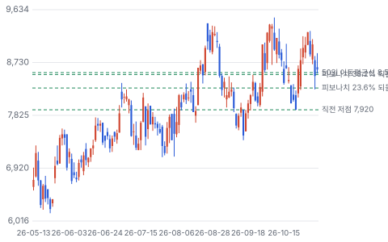

**주봉**

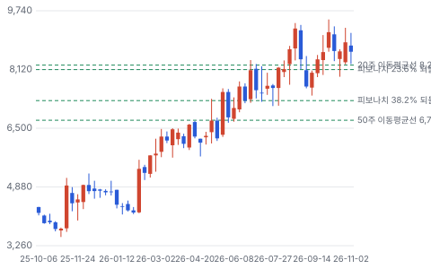

**월봉**

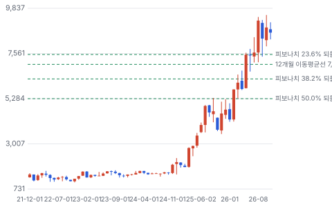

**분기 매출·EPS 실적과 컨센서스**

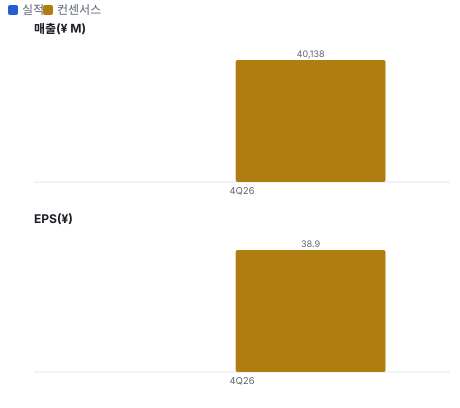

**밸류에이션 주가 시나리오**

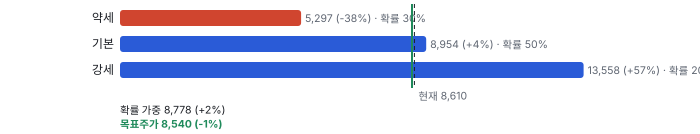

**주가별 업사이드**

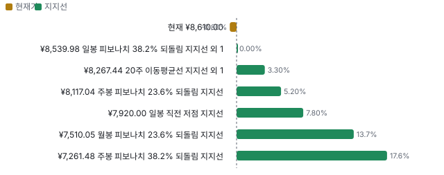

**제품·서비스 포트폴리오**

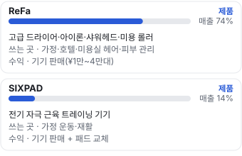

**고객 믹스(FY9/26 9개월, 매출 대비)**

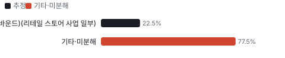

**공급 병목(10점, 낮을수록 병목)**

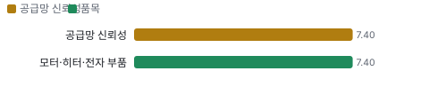

**어닝콜 변화별 주주가치 영향**

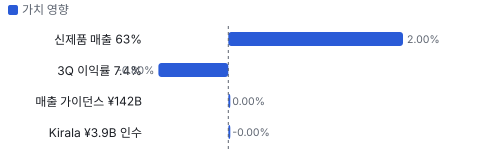

**멀티플 프리미엄**

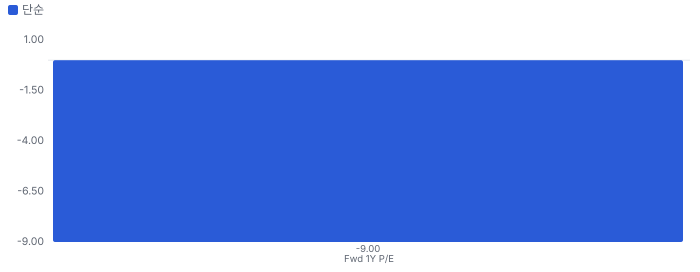

**합리적 멀티플**

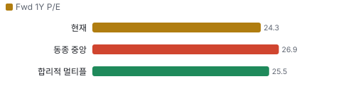

**몬테카를로**

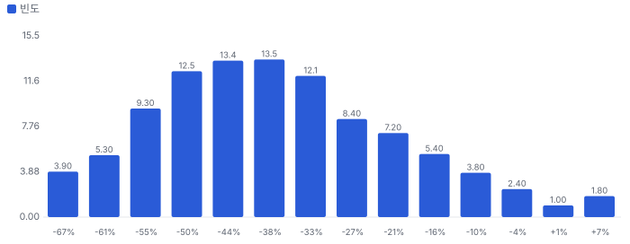

해석: 3,000번 중 78번(3%)에서 가치가 지금 주가 이상이었다. 가정을 흔들어도 지금 주가를 뒷받침하지 못하는 경우가 더 많다. 가운데 값은 0.61배이고, 열 번 중 여덟 번은 0.43~0.86배 사이에 든다.

## 내러티브

> **기업가치를 결정하는 이야기:** Fwd 1Y P/E 24.3배(12개월 선행 EPS ¥355 컨센서스)로 일본 뷰티 동종 중앙값 26.9배보다 조금 낮다 — 동종은 매출 성장 0~6%, MTG는 40%대다. 시장은 성장이 이어질지 반신반의하며 값을 매긴다. 가치를 정하는 것은 ① FY9/27 성장률(+15~20%가 컨센서스로 보임) ② 영업이익률이 3Q 7.4%에서 13% 근처로 돌아오는지다

> **멀티플·EPS 프리미엄**
> **멀티플:** Fwd 1Y P/E 24.3배, 동종 6곳 중앙값 26.9배(카오 25.0·시세이도 35.9·로토 17.6·코세 28.7·폴라 30.2·밀본 23.6)
> **EPS:** TTM EPS ¥297(희석) → 12개월 선행 ¥355(+19%). FY9/26 가이던스 EPS는 ¥279.66 — 4Q EPS 약 ¥32로 전년 4Q(약 ¥54)보다 낮다

### 투자자들은 왜 열광했나

2025년 10월 ¥3,600대에서 2026년 10월 장중 ¥9,500까지 2.6배 올랐다. 가이던스 세 번 상향, 리테일 스토어 +83%, 긴자 플래그십(2025-11 개점, 6월 말까지 32만 명 방문)이 이유였다. 2025년 11월 중국의 일본 여행 자제 권고 보도에도 다음 분기 매출이 늘어 우려가 식었다. 지금은 3Q 이익률 하락과 11/11 FY9/27 가이던스를 기다리며 ¥8,000~9,500 사이에 있다

### 무엇이 기업가치를 바꾸나

> **구조적 체질 변화**
> **변화:** 단일 히트(미용 롤러) 회사 → 드라이어·아이론·웨어(RED)·생활 서비스(Kirala)까지 넓힌 다브랜드 회사. 신제품이 매출의 63%
> **증거:** 3Q 요약·결산단신(일본 상장사의 분기 실적 속보 공시(決算短信)) 연결 범위
> **반증:** ReFa 외 브랜드 매출 성장 정체

> **고부가 믹스 확장**
> **변화:** ¥3만~4만대 프리미엄 드라이어·트리트먼트 아이론 비중 확대로 9개월 매출총이익률 62.4% → 64.7%
> **증거:** TradingView 분기 매출총이익
> **반증:** 매출총이익률 60% 미만

> **기술 혁신**
> **변화:** 'Neo Treatment(MTG가 트리트먼트 아이론으로 만들려는 새 제품 범주)' — 열 손상을 줄인 트리트먼트 아이론으로 새 범주를 만들겠다고 한다(회사 목표 시장 ¥2T, 회사 주장)
> **증거:** WWD(WWD JAPAN — 일본 패션·뷰티 업계지) 7/22
> **반증:** 트리트먼트 아이론 경쟁 제품 확산으로 가격 하락

> **실행 속도**
> **변화:** 해당 없음(주문→인도 리드타임이 없는 소비재). 대신 출시 속도: 3Q 신제품 218개로 최다
> **증거:** 3Q 요약
> **반증:** 신제품 수 감소와 매출 성장 둔화가 함께

> **M&A**
> **변화:** Kirala(정수기·생활 서비스) ¥3.9B 인수 — 규모가 작고 시너지 미공시
> **증거:** 5/12 자료 요약
> **반증:** 대형 인수로 차입 급증

> **정책·입법 연관성**
> **재정정책:** 일본 면세 판매 제도가 2026년 11월부터 출국 때 환급하는 방식으로 바뀐다고 알려져 있다 — 인바운드 매장 판매 절차가 바뀐다(보도 기반, 1차 미대조) 일본 2025년도 세제개정(보도) 반증: 11~12월 리테일 스토어 성장률 급락 의회 동의 0/10 — 하원 0/5(미국 의회 무관 — 일본 국회 세제개정 사항) · 상원 0/5(같음).
> **행정명령:** 중국 정부의 일본 여행 자제 권고(2025-11 보도)가 인바운드 수요 위험 — 회사 매출은 그 뒤에도 늘었다 보도 반증: 중국인 방일객 급감이 MTG 리테일 매출 감소로 확인 의회 동의 0/10 — 하원 0/5(외국 정부 조치 — 미국 의회 무관) · 상원 0/5(같음).
> **연관입법:** 해당 없음(회사를 겨냥한 미국·일본 법안 미확인) 미확인 반증: 미용가전 안전 규제 강화

> **CAPEX 낙수효과**
> **변화:** 해당 없음 — 고객 설비투자가 아니라 가계 소비·관광 소비가 수요를 정한다
> **증거:** 사업 구조
> **반증:** 해당 없음

### 내러티브 근거

> ReFa 드라이어·아이론이 '일본 뷰티 가전의 명품'이 되고, 방일 관광객과 신제품 속도가 매출을 1년에 40%씩 키운다는 이야기다. FY9/26 가이던스를 세 번 올렸고 주가는 1년 새 ¥3,600대 → ¥9,500(장중 고점)으로 올랐다. 그런데 3Q 영업이익률은 7.4%로 반기의 절반이 됐다 — 성장을 마케팅으로 사고 있는지가 갈림길이다. 동종 대비 멀티플 차이 -9% 중 회사 고유 몫은 -5%다. 단계는 확산, 쏠림은 중간이다.

> **ReFa 고급 미용가전** · 강화
> **논리:** ¥2만~4만 드라이어·아이론 시장을 ReFa가 넓히고 있다
> **숫자:** FY9/25 ReFa ¥72.8B(+42%), 9개월 매출 +46%
> **반증:** FY9/27 매출 가이던스 성장률 10% 미만

> **인바운드 관광 소비** · 유지
> **논리:** 방일 관광객이 ReFa를 '일본 기념품'으로 산다
> **숫자:** 리테일 스토어 9개월 +82.5%, 긴자 매출 약 65%가 인바운드
> **반증:** 리테일 스토어 사업 성장률이 2분기 연속 20% 미만

> **신제품 속도** · 강화
> **논리:** 신제품이 매출의 60% 이상이라 히트가 이어진다
> **숫자:** 3Q 신제품 218개, 9개월 신제품 매출 63%
> **반증:** 신제품 비중 50% 미만

> **가이던스 반복 상향** · 유지
> **논리:** 회사가 보수적으로 잡고 올린다
> **숫자:** 매출 가이던스 ¥120B → ¥128B → ¥135B → ¥142B
> **반증:** 11/11 FY9/27 가이던스가 컨센서스 아래

> **반대: 성장을 마케팅으로 산다** · 강화
> **논리:** 매출이 54% 늘었는데 3Q 영업이익은 35%만 늘었다 — 판관비가 매출보다 빨리 는다
> **숫자:** 3Q 영업이익률 7.4%, 브랜딩·마케팅비 +94%, 4Q 가이던스 8.4%
> **반증:** FY9/27 영업이익률 가이던스 13% 이상

> **반대: 2019년의 기억** · 유지
> **논리:** 2018년 상장 뒤 중국 수요가 꺼지며 주가가 ¥8,120 → ¥463(−94%)이 됐다
> **숫자:** 월봉 고점 ¥8,120(2018-07) → 저점 ¥463(2020-03)
> **반증:** 인바운드 감소 국면에서도 국내 매출이 성장 유지

## 포트폴리오

| 제품·서비스 | 구분 | 무엇 | 쓰는 곳 | 돈 버는 방식 | Mix | Mix 변화(전년 대비) |
|---|---|---|---|---|---|---|
| ReFa | 제품 | 고급 드라이어·아이론·샤워헤드·미용 롤러 | 가정·호텔·미용실 헤어·피부 관리 | 기기 판매(¥1만~4만대) | 미확인 | 미확인 |
| SIXPAD | 제품 | 전기 자극 근육 트레이닝 기기 | 가정 운동·재활 | 기기 판매 + 패드 교체 | 미확인 | 미확인 |

## 고객

> **FY9/26 9개월 최대 고객 방일 관광객(인바운드)(리테일 스토어 사업 일부) 22%, 상위 3곳 22%, 집중도 분산.** 공시·회사 발표로 확인한 몫은 매출의 0%이고, 나머지 고객 몫은 추정이거나 미분해다. 불특정 다수 소비자에게 판다. 회사는 10% 넘는 단일 고객을 이번에 확인한 자료에서 밝히지 않았다(유가증권보고서 미열람). 채널은 직영점·백화점·드럭스토어·가전 양판점·온라인·호텔·미용실이고, 직영 매장 매출의 상당 부분이 방일 관광객이다

**고객별 매출 몫(FY9/26 9개월)**
| 고객 | 몫 | 변화 | 근거 |
|---|---|---|---|
| 방일 관광객(인바운드)(리테일 스토어 사업 일부) | 15~30% | 미확인 | 추정 |
| 국내 유통(백화점·가전 양판점·드럭스토어)(도매·리테일 채널) | 미확인 | 미확인 | 회사 발표 |
| 온라인 직판·EC(전자상거래) 몰(다이렉트 마케팅) | 미확인 | 미확인 | 회사 발표 |
| 미용실·호텔(전문가 채널)(Smart Plan(미용실용 ReFa 기기 도입 프로그램)·호텔 객실) | 미확인 | 미확인 | 회사 발표 |
| 기타·미분해 | 78% | - | - |

> **방일 관광객(인바운드)(리테일 스토어 사업 일부)** · 추정
> **사는 것:** ReFa 드라이어·아이론·샤워헤드
> **추정 근거:** 긴자 플래그십 매출의 약 65%가 인바운드(WWD 7/22)·리테일 스토어 9개월 +82.5%를 근거로 둔 범위 — 전사 몫은 공시 미확인

> **국내 유통(백화점·가전 양판점·드럭스토어)(도매·리테일 채널)** · 회사 발표
> **사는 것:** ReFa·SIXPAD 전 제품
> **추정 근거:** 드럭스토어 3,000곳 목표(12/19 자료 요약)

> **온라인 직판·EC 몰(다이렉트 마케팅)** · 회사 발표
> **사는 것:** ReFa·SIXPAD·화장품
> **추정 근거:** 채널별 매출 미공시

> **미용실·호텔(전문가 채널)(Smart Plan·호텔 객실)** · 회사 발표
> **사는 것:** ReFa 드라이어·아이론
> **추정 근거:** ReFa 드라이어·아이론이 호텔 객실 약 12만 실에 들어가 있다(WWD 7/22)

## 마진 구조

> **GPM 64.7%, OPM 12.4%.** 9M FY25 대비 GPM +2.4%p, OPM -1.0%p. 변동비는 매출의 64%이고, 매출이 10% 늘면 OPM은 +2.1%p 움직인다. 9개월 매출총이익률 64.7%(전년 62.4%)로 올랐지만 판관비가 매출의 52.4%(전년 49.1%)로 더 빨리 늘어 영업이익률은 13.3% → 12.4%. 3Q 단독은 7.4%다. 이 회사의 이익은 원가보다 마케팅 강도가 정한다

> **매출 100 중 매출원가 35.5, 매출총이익 64.5(최근 4분기, 공시).** 매출원가 요인 중 제품 원가(위탁 생산·매입)이 매출의 30.0%로 가장 무겁고, 단가가 +10% 오르면 GPM이 -3.00%p 움직인다. 분기 회귀로 매출 1이 늘 때 매출원가는 0.33 늘고, 매출원가의 고정비 몫은 12%다.

**비용 요인 강도 — 비중·추세·충격(+10%)·탄력**
| 비용 | 구분 | 매출 대비 | 1년 변화 | 마진 기여 | 충격 시 마진 | 매출 탄력 | 고정비 몫 |
|---|---|---|---|---|---|---|---|
| 제품 원가(위탁 생산·매입) | 매출원가 요인 | 30.0% | 미확인 | 미확인 | -3.00%p | 미확인 | 0% |
| 물류·보관·기타 원가 | 매출원가 요인 | 5.3% | 미확인 | 미확인 | -0.53%p | 미확인 | 30% |
| 판관비 | 공시 항목 | 53.8% | 미확인 | 미확인 | 미확인 | 미확인 | 미확인 |
| 매출원가 | 공시 항목 | 35.5% | -3.0%p | +3.0%p | -3.55%p | 0.33 | 12% |
| 감가상각 | 공시 항목 | 3.0% | 미확인 | 미확인 | 미확인 | 미확인 | 미확인 |

매출 탄력 = 분기 비용을 매출에 회귀한 기울기(매출 1당 변동비), 고정비 몫 = 절편 ÷ 평균 비용. 표본이 8분기 미만이면 미확인. 매출원가 요인 비중은 margin 재료의 추정이 섞여 있고, 공시 매출원가와의 차이는 '기타 매출원가'로 둔다.

**GPM에서 OPM까지(J-GAAP)**
| 기간 | GPM | 연구개발 | 판관비 | 기타 | OPM |
|---|---|---|---|---|---|
| 9M FY25 | 62.4% | 0.0% | 49.1% | 0.0% | 13.3% |
| 9M FY26 | 64.7% | 0.0% | 52.4% | 0.0% | 12.4% |

**GPM·OPM 최근 4개 분기**
| 분기 | GPM | OPM |
|---|---|---|
| 2025-09 | 63.7% | 4.6% |
| 2025-12 | 65.9% | 16.5% |
| 2026-03 | 64.0% | 13.6% |
| 2026-06 | 64.3% | 7.4% |

**마진을 결정하는 비용 요인 — 비용 +10% 시 OPM**
| 비용 | 매출 대비 | 변화 | 고정비 | OPM |
|---|---|---|---|---|
| 제품 원가(위탁 생산·매입) | 30.0% | 미확인 | 0% | -3.00%p |
| 광고·브랜딩·판촉 | 20.0% | 미확인 | 20% | -2.00%p |
| 판매 수수료·점포 비용 | 15.0% | 미확인 | 40% | -1.50%p |
| 기타 판관비(감가상각·영업권 상각 포함) | 9.4% | 미확인 | 60% | -0.94%p |
| 인건비 | 8.0% | 미확인 | 80% | -0.80%p |
| 물류·보관·기타 원가 | 5.3% | 미확인 | 30% | -0.53%p |

**비용을 움직이는 요인**
| 비용 | 요인 |
|---|---|
| 제품 원가(위탁 생산·매입)(매출원가) | 생산 위탁처 단가·엔화 환율 · 근거 추정 |
| 광고·브랜딩·판촉(판관비) | 신제품 출시·브랜딩(9개월 +94%) · 근거 추정 |
| 판매 수수료·점포 비용(판관비) | 유통 마진·직영점 임차(긴자 플래그십 2025-11 개점) · 근거 추정 |
| 기타 판관비(감가상각·영업권 상각 포함)(판관비) | 점포·시스템 투자 · 근거 추정 |
| 인건비(판관비) | 인원(1,514명) · 근거 추정 |
| 물류·보관·기타 원가(매출원가) | 출하량 · 근거 추정 |

**ReFa BOM — 매출의 74%, GPM 66%(추정 — 브랜드별 이익률 미공시. 전사 9개월 64.7%에 고가 드라이어·아이론 믹스를 더해 조금 높게), 항목 가격 +10% 시**
| 항목 | 원가 몫 | 전가 | 제품 GPM | OPM |
|---|---|---|---|---|
| 모터·히터·전자 부품 | 30~45% | 미확인 | -1.3%p | -0.94%p |
| 조립·위탁 생산 가공비 | 20~30% | 미확인 | -0.8%p | -0.63%p |
| 외장 수지·금속 성형 | 15~25% | 미확인 | -0.7%p | -0.50%p |
| 포장·부속품 | 5~10% | 미확인 | -0.3%p | -0.19%p |
| 미분해 | 10% | - | - | - |

**SIXPAD BOM — 매출의 14%, GPM 60%(추정 — 미공시. 소모품(패드)이 섞인 기기라 전사보다 조금 낮게), 항목 가격 +10% 시**
| 항목 | 원가 몫 | 전가 | 제품 GPM | OPM |
|---|---|---|---|---|
| 근육 자극(EMS(근육에 전기 자극을 주는 장치(Electrical Muscle Stimulation))) 회로·배터리 | 30~45% | 미확인 | -1.5%p | -0.22%p |
| 조립·위탁 생산 가공비 | 20~30% | 미확인 | -1.0%p | -0.15%p |
| 겔 패드·소재 | 15~25% | 미확인 | -0.8%p | -0.12%p |
| 미분해 | 18% | - | - | - |

모터·히터·전자 부품 가격이 +10% 오르면 영업이익은 -7.6% 움직인다. 판매가 전가를 모르는 항목은 전가 0%로 계산했다.

**BOM 항목 가격을 움직이는 것**
| 항목 | 요인 |
|---|---|
| 모터·히터·전자 부품 | 고속 모터 드라이어·히터 아이론의 핵심 부품 · 근거 추정 |
| 외장 수지·금속 성형 | 디자인 외장이 브랜드 가치의 큰 몫 · 근거 추정 |
| 조립·위탁 생산 가공비 | 생산 위탁처·국가 미확인 · 근거 추정 |
| 포장·부속품 | 선물 수요용 고급 포장 · 근거 추정 |
| 근육 자극(EMS) 회로·배터리 | EMS는 전기 자극으로 근육을 움직이는 장치 · 근거 추정 |
| 겔 패드·소재 | 소모품 성격(교체 수요) · 근거 추정 |
| 조립·위탁 생산 가공비 | 생산 위탁처 미확인 · 근거 추정 |

## 공급망 병목

> **공급망 신뢰성 7.4/10, 관리 가능.** 가장 약한 고리는 모터·히터·전자 부품 7.4점이고, 품목 평균은 7.4점이다. 근거가 부족한 1건(조립·위탁 생산 가공비)은 점수에서 뺐다. 공급사 이름을 이번에 확인한 자료에서 찾지 못했다. 제품 대부분이 전자 부품을 쓰는 소형 가전이라 위탁 생산처와 모터·배터리 부품이 약한 고리일 수 있다 — 모두 미확인

**병목과 마진 — 품목 가격 +10% 시 OPM**
| 품목 | 점수 | 판정 | 구분 | OPM |
|---|---|---|---|---|
| 모터·히터·전자 부품(필수) | 7.4 | 관리 가능 | 가격 위험 | -0.94%p |

> **모터·히터·전자 부품** · 7.4/10
> **왜:** 드라이어 성능을 정하는 부품. 인증 공급사 3곳·재인증 6개월·중국 집중 60%·복수 구매는 범용 소형 모터·전자 부품 업계 구조로 본 추정 — 회사 공시 미확인
> **병목 요인:** 인증 공급사 3곳 · 캐파 균형 · 리드타임 미확인 · 재인증 6개월 · 1위 점유율 미확인 · 중국(소형 모터·전자 부품 생산 집중 — 업계 구조 근사) 집중 60% · 물량 확보 복수구매
> **풀리는 조건:** 미확인

**공급사**
| 품목 | 공급사 | 몫 | 근거 |
|---|---|---|---|
| 조립·위탁 생산 가공비 | 미공시(제품 위탁 생산) | 미확인 | 추정 |
| 모터·히터·전자 부품 | 미공시(고속 모터·히터·PCB(인쇄회로기판)) | 미확인 | 추정 |

## 해자

> 해자는 브랜드와 신제품 속도다. 기술 특허보다 '디자인 + 마케팅 + 유통'이 경쟁을 막는다 — 모방품이 쉽게 나오는 업종이라 강도는 보통

> **ReFa 브랜드 가격 결정력** · 보통
> **해자:** ReFa 드라이어·아이론을 ¥2만~4만 가격대 고급 미용가전으로 자리 잡았다
> **근거:** FY9/25 ReFa 매출 ¥72.8B(+42%), 9개월 매출총이익률 64.7%(전년 62.4%)
> **숫자:** GPM +2.3%p
> **깨지는 조건:** 매출총이익률이 2분기 연속 60% 아래

> **신제품 출시 속도** · 보통
> **해자:** 한 분기에 신제품 218개를 내고 신제품이 매출의 63%다
> **근거:** 3Q 요약(Quartr)
> **숫자:** 신제품 매출 비중 63%
> **깨지는 조건:** 신제품 비중이 50% 아래로 떨어지면서 성장률 둔화

> **다채널 유통망** · 약함
> **해자:** 직영점·백화점·드럭스토어·호텔·미용실을 함께 쓴다
> **근거:** 호텔 객실 약 12만 실, 드럭스토어 3,000곳 목표
> **숫자:** 미확인(채널별 매출 미공시)
> **깨지는 조건:** 유통사 재고 조정으로 출하가 판매보다 먼저 꺾임

## 경영진·네트워크

> 창업자 마쓰시타 쓰요시가 대표이사 사장이다(1996년 설립). 내부자 지분이 약 66%(yfinance)로 경영권이 집중돼 있다. SIXPAD는 축구 선수 크리스티아누 호날두와 함께 개발·광고한 브랜드로 알려져 있다(회사 홍보, 이번 회차 1차 미대조). 정치 연결은 공개 기록으로 확인하지 못했다

> **마쓰시타 쓰요시(松下剛)** · 대표이사 사장·창업자 · 1996
> **프로필:** 1996년 MTG 설립
> **비즈니스:** ReFa·SIXPAD 브랜드 개발 주도
> **정계:** 미확인
> **동문:** 미확인
> **사모임:** 미확인

> **다지마 아키히코(田島安希彦)** · 이사 CFO · 미확인
> **프로필:** 결산단신 문의 책임자
> **비즈니스:** 미확인
> **정계:** 미확인
> **동문:** 미확인
> **사모임:** 미확인

**네트워크 정량화**
| 연결 | 강도 | 닿는 매출 | 가중 노출 | 매출 대비 | 근거 |
|---|---|---|---|---|---|
| 비즈니스: 스포츠 스타 브랜드 제휴(SIXPAD) | 2/5 | ¥0.14B | ¥0.06B | 0% | SIXPAD 매출 몫 14.5%(FY9/25). 제휴가 매출을 만들었다고 쓰지 않는다 https://filingreader.com/news-wire/tokyo/2025-12-19/mtg-projects-strong-growth-record-profit-for-2025 |

가중 노출은 연결이 닿는 매출의 크기다. 연결이 그 매출을 만들었다는 뜻이 아니며, 인과는 공개 자료로 입증하지 못한다.

## 약세 논리 및 셀온 조건

| 약세 논리 | 근거 | 반박 | 가를 자료 |
|---|---|---|---|
| 성장을 마케팅비로 산다 | 3Q 매출 +54%에 영업이익 +35%, 브랜딩·마케팅비 +94%, 9개월 판관비율 49.1% → 52.4% | 9개월 매출총이익률 62.4% → 64.7% — 가격은 지켰다 | 11/11 FY9/27 영업이익률 가이던스(13% 이상이면 반박 성립) |
| 4Q도 이익률이 낮다 | 통기 가이던스에서 역산한 4Q 영업이익률 8.4%, 4Q EPS 약 ¥32(전년 4Q 약 ¥54) | 세 번 모두 보수적 가이던스 — 9개월 경상이익 진척률 78.6% | 11/11 FY9/26 4Q 실적 |
| 인바운드 유행은 꺼진다 | 긴자 플래그십 매출의 약 65%가 인바운드, 2025년 11월 중국 여행 자제 권고 보도 | 권고 뒤에도 1~3Q 분기 매출이 전년보다 39~54% 늘었다 | 일본정부관광국 월별 방일객(매월 중순)·리테일 스토어 사업 성장률(11/11) |
| 2019년의 반복 | 2018-07 월봉 고점 ¥8,120 → 2020-03 저점 ¥463(−94%) — 중국 수요에 기댄 롤러 히트가 꺼졌다 | 지금은 신제품이 매출의 63%이고 제품이 드라이어·아이론·웨어로 나뉘었다 | FY9/27 브랜드별 매출(11/11 설명자료) |
| 차입이 빨리 는다 | 총차입 ¥3.7B(9/30) → ¥18.7B(6/30), 같은 기간 현금 ¥9.8B — 순차입 ¥8.9B | Kirala 인수 ¥3.9B·재고·점포 투자로 보이며 순차입은 EBITDA TTM ¥18.0B의 0.5배 | FY9/26 유가증권보고서 차입 내역(12월) |
| 표본이 작다 | 커버리지 3명, FY9/27 매출 컨센서스 미확인, 12개월 선행 EPS ¥355는 3명 평균 | 회사 가이던스가 기준선 역할 | 11/11 이후 증권사 추정 수정 |

데이터 공백: ·가 MTG를 다루지 않아 재무는 3Q 결산단신 1쪽(1차)·TradingView 분기 재무·yfinance 개요로, 컨센서스는 공개 페이지(카부요호 3명)로 채웠다. 결산단신 첨부(재무상태표 세부·세그먼트)와 결산설명자료 PDF(문서 파일 형식), 유가증권보고서는 이번 회차에 열지 못해 구매 약정·제한 현금·10% 고객·정부 지원(R-20261031-01의 네 곳), 브랜드·채널·지역별 매출, 차입의 단기·장기 구분은 미확인이다. 분기 컨센서스가 없어 서프라이즈 표가 빠졌고, Fwd 2Y·3Y EPS는 +15% 외삽이다.

> **셀온 조건**
> **조건 1:** 11/11 FY9/27 가이던스가 매출 +10% 미만이거나 영업이익률 11% 미만이다
> **조건 2:** FY9/26 4Q 영업이익이 역산 가이던스 ¥3.3B에 못 미친다 — 네 번째 '보수적 가이던스' 가정이 깨진다
> **조건 3:** 리테일 스토어 사업 성장률이 2분기 연속 20% 아래로 내려간다(인바운드 둔화 확인)
> **조건 4:** 매출총이익률이 2분기 연속 60% 아래 — 가격 결정력 훼손
> **조건 5:** 순차입이 EBITDA의 1.5배를 넘거나 대형 인수가 발표된다

## 어닝콜 변화

**직전 콜 대비 새로 나오거나 바뀐 내용 → 가치 영향**
| 항목 | 내용 | 직전 콜 | 최신 콜 | 모델 동인 이동 | 확신도 | 가치 영향 |
|---|---|---|---|---|---|---|
| 업데이트 | 통기 매출 가이던스 | ¥135.0B(5/12) | ¥142.0B(8/4) | 기준연도 매출 +0.05 BJPY(십억 엔 단위) | 0.8 | +0.0% |
| 업데이트 | 통기 영업이익 가이던스 | ¥15.0B | ¥16.0B | 출발 이익률 — | 0.8 | +0.0% |
| 부정 | 3Q 영업이익률 | 반기 15.1% | 3Q 7.4%(마케팅 +94%) | 출발 이익률 -1.5% | 1.0 | -0.8% |
| 신규 | 신제품 비중 | 목표 60%(12/19) | 9개월 63%, 3Q 218개 | 1년차 성장률 +2.0% | 0.5 | +2.0% |
| 업데이트 | Kirala 인수 | 없음 | 취득가 ¥3.9B, 연결 편입 | 순차입 +0.02 BJPY | 1.0 | -0.0% |
| **합계** | 단독 합 |  |  | 동시 적용 +1.2% |  | **+1.2%** |

## 밸류에이션

> **목표주가 ¥8,540, 업사이드 -1%.** 자리는 약세와 기본 사이(약세 쪽 11%)이고 도달 확률은 약 50%다. 기본 ¥8,954, 강세 ¥13,558(+57%), 약세 ¥5,297(-38%). DCF 기준 업사이드는 기본 -36%, 강세 -22%, 약세 -49%다(WACC 7.3%).

배수 기준 기본 ¥8,954는 다음 4개 분기 EPS ¥355에 Fwd 1Y P/E 25.2배를 곱한 값이고, DCF 기본 업사이드는 −36%다. 둘이 이렇게 갈리는 이유는 성장 지속 기간이다. DCF는 매출이 FY9/26 가이던스 ¥142B에서 FY9/27 +18%로 꺾인 뒤 해마다 둔화해 장기 3%로 가고, 영업이익률이 3년차 13%를 찍은 뒤 동종 상위권 12%로 수렴한다고 둔다 — 소비재 히트 상품의 평균 회귀를 반영한 가정이다. 배수는 동종 중앙값 근처의 P/E를 1년 뒤 EPS에 곱할 뿐이라 그 뒤 성장이 꺾이는 속도를 묻지 않는다. 지금 주가가 요구하는 5년 매출 CAGR 20%는 FY9/27 이후에도 연 20% 가까운 성장이 4년 더 이어져야 한다는 뜻이다 — 가이던스 상향이 반복된 1년의 기록은 이 가정을 지지하지만, 3Q 이익률 하락은 그 성장의 비용이 크다는 반대 증거다. 약세 ¥5,297은 EPS ¥280(FY9/26 가이던스 수준)에 동종 하단 쪽 배수 18.9배, 강세 ¥13,558은 EPS ¥430에 31.5배를 곱했다.

> **약세 ¥5,297 (-38%)** · 확률 30%
> **가정:** 18.9배 × EPS ¥280.00
> **근거:** 인바운드 둔화와 유행 꺾임으로 FY9/27 매출 성장이 한 자릿수로 내려가고, 마케팅비를 줄이지 못해 영업이익률이 10% 안팎에 머문다. 다음 4개 분기 EPS ¥280(FY9/26 가이던스 ¥279.66 수준)

> **기본 ¥8,954 (+4%)** · 확률 50%
> **가정:** 25.2배 × EPS ¥355.00
> **근거:** FY9/27 매출 +15~18%, 영업이익 약 ¥19B(SMBC닛코(SMBC닛코증권) 추정 근처), 영업이익률 12% 안팎. 다음 4개 분기 EPS ¥355(12개월 선행 컨센서스)

> **강세 ¥13,558 (+57%)** · 확률 20%
> **가정:** 31.5배 × EPS ¥430.00
> **근거:** 가이던스 상향 패턴이 FY9/27에도 이어져 매출 +25% 이상, 하반기 투자 효과로 영업이익률이 반기 수준(15%)에 가까워진다. 다음 4개 분기 EPS ¥430

**멀티플 선정 — Fwd 1Y P/E**
| 단계 | 조정 | 근거 |
|---|---|---|
| 동종 중앙값 | 26.9배 | 범위 17.6~35.9배, 6곳 |
| 펀더멘털 | -3% | 성장·이익률·ROIC로 본 합리적 멀티플 25.5배와의 차이의 일부만 인정 |
| 해자 | +2% | ReFa 브랜드 가격 결정력 보통 · 신제품 출시 속도 보통 · 다채널 유통망 약함 |
| 반복 매출 | +0% | 재료 없음 |
| 수주 전환·가시성 | +0% | 재료 없음 |
| 내러티브 | +5% | 단계 확산 |
| 사이클·실행 판단 | -10% | 3Q 영업이익률이 7.4%로 반기(15.1%)의 절반이 됐고, 4Q 가이던스도 8.4%다. 2019년 상장 뒤 인바운드 수요가 꺼지며 주가가 −90% 빠진 이력이 있다 — 성장은 동종 10배지만 이익률 회복이 확인되기 전에는 동종 중앙값에서 10% 할인한다 |
| **선정** | **25.2배** | 지금 24.3배 |

**동종 레인지**
| 회사 | Fwd 1Y P/E | 성장 | 영업이익률 | ROIC |
|---|---|---|---|---|
| 카오 | 25.0 | 3% | 10% | 12% |
| 시세이도 | 35.9 | 2% | 4% | 3% |
| 로토제약 | 17.6 | 6% | 12% | 11% |
| 코세 | 28.7 | 3% | 4% | 5% |
| 폴라오르비스 | 30.2 | 1% | 10% | 13% |
| 밀본 | 23.6 | 2% | 13% | 14% |
| **MTG** | 24.3 |  |  |  |

지금 주가가 요구하는 5년 매출 CAGR 20%, 기본 시나리오 7%. 몬테카를로 중앙값 업사이드 -39%.

> 의사결정 보조(투자자문 아님): ① 매수 매력: 연 기대수익 -2.5% (자기자본비용 7.5% 대비 -9.9%p) · 자본비용 초과 확률 2% · 안전마진 0.43 → 정량 신호 약함 / ② 위험 예산 지표(이론): 0% — 기대수익이 자기자본비용에 못 미침(무위험 대비 켈리 0%는 참고) · 5년 하위10% -40% · 30%+ 손실 확률 23% / ③ 상방(5년): 기대 0.88배 · 2배 0% · 3배 0% · 10배 0% · 상위10% 1.20배

## 매수 위치(일봉)

> **현재가 ¥8,610는 '지지 근접'(가장 가까운 일봉 지지 ¥8,540에서 ATR 0.1배 위).** 이 자리에서 목표주가까지 -0.8%, 첫 일봉 저항까지 +1.2%, 다음 지지까지 하방 -0.8%, 손익비 -1.0배. 손익비는 지지 3 ¥7,920에서 1.2배로 가장 높다(목표주가까지 +7.8%).

**가격대별 업사이드(일봉 기준)**
| 가격대 | 가격 | 목표주가까지 | 첫 저항까지 | 다음 지지까지 | 손익비 | 근거 기법(강도) |
|---|---|---|---|---|---|---|
| 현재가 | ¥8,610 | -0.8% | +1.2% | -0.8% | -1.0 | - |
| 지지 1 | ¥8,540 | +0.0% | +2.0% | -2.4% | 0.0 | 50일선 · 피보 38.2%(2.0) |
| 지지 2 | ¥8,336 | +2.4% | +2.4% | -5.0% | 0.5 | 120일 지그재그 고점 · 피보 23.6%(1.8) |
| 지지 3 | ¥7,920 | +7.8% | +5.3% | -6.6% | 1.2 | 120일 지그재그 저점 · 스윙 저점(1.8) |
| 지지 4 | ¥7,400 | +15.4% | +7.0% | 미확인 | 미확인 | 120일 지그재그 저점(0.8) |

**일봉 저항**
| 저항 | 가격 | 현재가 대비 | 근거 기법(강도) |
|---|---|---|---|
| 저항 1 | ¥8,711 | +1.2% | 20일선 · 피보 50.0%(1.5) |
| 저항 2 | ¥8,896 | +3.3% | 피보 61.8%(1.0) |
| 저항 3 | ¥9,162 | +6.4% | 피보 78.6%(1.0) |

일봉만 쓴다(주봉·월봉 제외). 손익비 = 목표주가까지 업사이드 ÷ 다음 지지까지 하방. 가격대별 기대값 참고표이며 매수·매도 시점 지시가 아니다.

## 애널리스트 토론

> **토론 결론 Neutral(규칙 등급 Neutral).** 매출총이익률 상승과 반복 상향은 살아남았고, 3Q·4Q 영업이익률 하락 반박도 살아남았다. 11/11 FY9/27 가이던스 전에는 규칙 등급을 따른다

**패널(가상 애널리스트)**
| 자리 | 애널리스트 | 핵심 논리 | 틀리는 조건 | 최종 투표 |
|---|---|---|---|---|
| Strong Buy | 하시모토 겐(가상 리서치 하우스 아오바증권) | 가이던스를 세 번 올린 회사가 Fwd 1Y P/E 24배로 동종보다 싸다 — 성장 40%대에 할인은 맞지 않다 | FY9/27 매출 가이던스 +10% 미만 | Buy |
| Buy | 서지안(가상 리서치 하우스 다온투자) | 3Q 이익률 하락은 신제품·플래그십 투자라 일시적이다 — 매출총이익률은 오히려 올랐다 | FY9/27 영업이익률 가이던스 11% 미만 | Buy |
| Neutral | 모리 유이(가상 리서치 하우스 미나토자산) | 성장은 확인됐지만 이익률은 확인되지 않았다. 11/11 가이던스가 둘 중 하나를 가른다 | 11/11 FY9/27 영업이익 ¥19B 이상 | Neutral |
| Sell | 한도겸(가상 리서치 하우스 정석증권) | 매출 +54%에 영업이익 +35% — 성장을 마케팅비로 산다. 차입도 다섯 배가 됐다 | 판관비율이 전년 수준(49%)으로 회귀 | Neutral |
| Strong Sell | 오카다 슌(가상 리서치 하우스 기타미증권) | 2018년 상장 뒤 −94%를 겪은 회사다. 인바운드 유행 상품은 한 번 꺾이면 빠르다 | 인바운드 둔화 분기에도 매출 +20% 이상 | Sell |

**투표**
| Strong Buy | Buy | Neutral | Sell | Strong Sell |
|---|---|---|---|---|
| 0 | 2 | 2 | 1 | 0 |

> **개회 · Strong Buy**
> **발언:** 매출 가이던스가 ¥120B에서 ¥142B로 18% 올라갔다. 회사가 보수적으로 잡는다는 증거다

> **개회 · Buy**
> **발언:** 9개월 매출총이익률이 64.7%로 올랐다 — 가격을 깎아 판 성장이 아니다

> **개회 · Neutral**
> **발언:** 3Q 영업이익률 7.4%와 4Q 가이던스 8.4%는 반기 15.1%와 너무 다르다. 어느 쪽이 정상인지 아직 모른다

> **개회 · Sell**
> **발언:** 판관비가 매출의 49.1%에서 52.4%로 올랐다. 매출이 늘수록 이익률이 떨어지는 구조다

> **개회 · Strong Sell**
> **발언:** 이 회사는 2019년에 중국 수요가 꺼지자 주가가 1년 만에 −70% 넘게 빠졌다

> **반박1 · Neutral → Strong Buy**
> **발언:** 가이던스 상향은 매출 쪽이 컸다. 영업이익 가이던스는 ¥13B → ¥16B로 매출만큼 오르지 않았다

> **반박1 · Buy → Sell**
> **발언:** 판관비 증가분 중 긴자 플래그십·RED 출시 같은 일회성 투자가 있다 — 4Q까지 ¥4.5B로 회사가 범위를 밝혔다

> **반박1 · Strong Buy → Strong Sell**
> **발언:** 2019년은 롤러 하나에 매출이 몰렸다. 지금은 신제품이 매출의 63%이고 드라이어·아이론·웨어로 나뉘었다

> **반박1 · Sell → Buy**
> **발언:** 일회성이라면 3Q가 아니라 4Q 가이던스가 올라가야 한다. 4Q도 8.4%다

> **반박1 · Strong Sell → Neutral**
> **발언:** 차입이 6월 말 ¥18.7B다. 성장 둔화 때 재고가 쌓이면 이익률이 더 내려간다

> **반박2 · Strong Buy → Sell**
> **발언:** 4Q 가이던스는 세 번 모두 보수적이었다 — 9개월 경상이익 진척률이 78.6%다

> **반박2 · Neutral → Buy**
> **발언:** 일회성 투자라는 근거는 회사 설명뿐이다. 판관비 세부는 공시되지 않았다

> **반박2 · Sell → Strong Buy**
> **발언:** Fwd 1Y P/E 24배는 12개월 선행 EPS ¥355를 믿을 때다. 그 숫자는 3명 평균이다

> **반박2 · Buy → Strong Sell**
> **발언:** 2025년 11월 중국 여행 자제 권고 뒤에도 1~3Q 매출은 분기마다 전년보다 39~54% 늘었다

> **반박2 · Strong Sell → Strong Buy**
> **발언:** 동종보다 싸다는 말은 동종의 이익률이 안정적일 때만 맞다

> **최종 · Strong Buy**
> **발언:** 11/11에 FY9/27 가이던스가 성장 이야기를 다시 확인할 것이다

> **최종 · Buy**
> **발언:** 매출총이익률 상승이 브랜드 힘을 보여 준다

> **최종 · Neutral**
> **발언:** 이익률 확인 전에는 규칙 등급을 옮길 근거가 약하다

> **최종 · Sell**
> **발언:** 판관비율이 내려오기 전에는 성장의 질을 믿기 어렵다

> **최종 · Strong Sell**
> **발언:** 유행 소비재의 정점 신호를 무시하지 말아야 한다

남은 반대 의견: Strong Buy 자리: 동종보다 낮은 P/E에 40%대 성장은 할인 과잉이다

패널은 가상 인물이고 실존 IB의 의견이 아니다.

## 시장 평가

> **셀사이드(IB 애널리스트)**
> **한 줄:** 커버리지가 3명뿐이다. 컨센서스는 회사 가이던스를 조금 넘는 수준(FY9/26 영업이익 ¥16.2B vs ¥16.0B)이고 4주 동안 바뀌지 않았다 — 11/11 FY9/27 첫 가이던스가 기대를 다시 정한다
> **의견 분포:** 강세 2·중립 1 — 3명
> **목표가 평균:** ¥10,533 — 현재가 +22%
> **FY9/27 영업이익:** SMBC닛코 ¥19.0B — 1곳(6월경)

> **바이사이드(기관 투자자)**
> **한 줄:** 유통 주식이 적어(내부자 66%) 기관 보유가 6%에 그친다. 13F 같은 보유 변화 자료는 일본에 없어 미확인
> **기관 보유:** 5.8% — yfinance
> **내부자 보유:** 65.6% — 창업자 중심

> **언론·업계**
> **한 줄:** 일본 업계지는 'J-Beauty(일본 뷰티 산업)'와 인바운드를 성장 이야기로 묶는다
> **보도 초점:** 세 번째 상향·리테일 +83%·긴자 플래그십 — WWD

## 체크리스트

| 시점 | 무엇 | 의미 |
|---|---|---|
| 2026-11-11(예정) | FY9/26 결산·FY9/27 가이던스 | 성장률과 영업이익률 가이던스 — 이 리포트의 핵심 변수 두 개가 한 번에 나온다 |
| 2026-11-11 이후 | 결산설명자료 브랜드·채널별 매출 | ReFa·SIXPAD·RED 몫과 리테일 스토어(인바운드) 성장률 |
| 매월 중순 | 일본정부관광국 방일객 수(국가별) | 인바운드 수요의 선행 지표 — 중국인 방일객 추이 |
| 2026-12(예상) | FY9/26 유가증권보고서 | 차입 내역·주요 고객·생산 위탁처·설비 |
| 2027-02(예상) | 1Q FY9/27 실적 | 연말 선물 시즌 매출과 마케팅비 강도 — 이익률 회복 첫 확인 |

## 출처
- 3Q FY9/26 결산단신(2026-08-04, TDnet) https://www2.jpx.co.jp/disc/78060/081220260803506610_tse-qcedjpsm-78060-20260804378060-ixbrl.htm
- 3Q 결산·통기 세 번째 상향 보도(WWD JAPAN 8/4) https://www.wwdjapan.com/?p=2466820
- 긴자 플래그십·2046 목표(WWD JAPAN 7/22) https://www.wwdjapan.com/articles/2456522
- 3Q 실적 요약(Quartr) https://quartr.com/events/mtg-co-ltd-7806-q3-2026_FtgH7o2o
- 2Q 실적 요약(Quartr) https://quartr.com/events/mtg-co-ltd-7806-q2-2026_FtgH7o2F
- 5/12 가이던스 상향·Kirala 인수 요약 https://filingreader.com/news-wire/tokyo/2026-05-12/mtg-raises-annual-forecasts-and-dividends-as-sales-surge
- FY9/25 결산·FY9/26 첫 가이던스 요약 https://filingreader.com/news-wire/tokyo/2025-12-19/mtg-projects-strong-growth-record-profit-for-2025
- 1Q 실적(마쓰이증권 결산표) https://finance.matsui.co.jp/stock/7806/settlement/index
- 애널리스트 컨센서스·목표가(카부요호) https://kabuyoho.jp/reportTarget?bcode=7806
- 시세·동종 재무: TradingView(TSE:7806 외)
- https://filingreader.com/news-wire/tokyo/2025-12-19/mtg-projects-strong-growth-record-profit-for-2025
- https://quartr.com/events/mtg-co-ltd-7806-q3-2026_FtgH7o2o
- https://www.wwdjapan.com/articles/2456522
- 9개월 매출원가 35.3%(TradingView 매출총이익) — 세부 미공시
- https://www.tradingview.com/symbols/TSE-7806/
- 매출원가의 나머지
- 미확인
- 업계 드라이어 원가 구조
- 업계 원가 구조
- 판관비 52.4%의 나머지

_구매 등급·목표주가 모두 규칙이 계산한 모델 값으로, 개인의 보유 종목·자금 사정을 반영하지 않는다 · 공개 자료 기반 분석이며 투자 권유가 아님 · 1차 판정, 미검증 · Chiip ten-bagger_